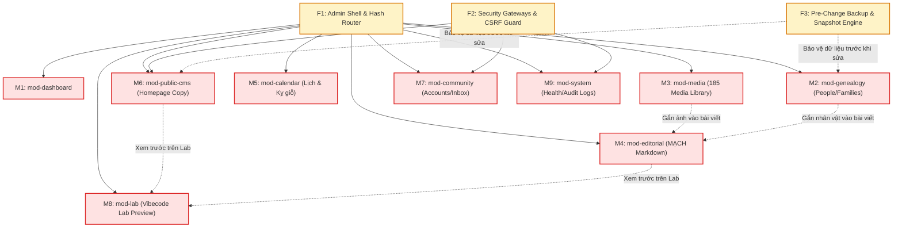

# TÀI LIỆU THIẾT KẾ KIẾN TRÚC: UNIFIED ADMIN CONTROL CENTER (v2.1)
## (CHUẨN HÓA TOÀN DIỆN HỆ THỐNG QUẢN TRỊ TRUNG TÂM & VIBECODE LAB THEO MÔ HÌNH WORDPRESS ADMIN)

**Mã tài liệu:** `ADMIN_CONTROL_CENTER_ARCHITECTURE_v2.1.md`  
**Đường dẫn canonical:** `AUDIT/ADMIN_CONTROL_CENTER_ARCHITECTURE_v2.1.md`  
**Tài liệu tiền nhiệm:** [`AUDIT/archive/ADMIN_CONTROL_CENTER_ARCHITECTURE_v2.md`](file:///Users/tuantq/Projects/Personal/giatoctrantrongthu/AUDIT/archive/ADMIN_CONTROL_CENTER_ARCHITECTURE_v2.md) (v2.0 - Lưu trữ đối soát), [`AUDIT/archive/ADMIN_CONTROL_CENTER_AUDIT.md`](file:///Users/tuantq/Projects/Personal/giatoctrantrongthu/AUDIT/archive/ADMIN_CONTROL_CENTER_AUDIT.md) (v1.0)  
**Chỉ thị điều hành:** `DIRECTIVE: ADMIN-01 — ARCHITECTURE REVIEW & REFINEMENT (v2.1)`  
**Dự án:** CÂY GIA PHẢ — GIA TỘC TRẦN TRỌNG THU (`giatoctrantrongthu.com`)  
**Product Owner / Thẩm quyền tối cao:** Tuấn (Human Final Authority)  
**Thẩm định kiến trúc & Quản trị chất lượng:** Emarald (Strategic Analysis / Quality Control)  
**Cơ quan thực thi:** AGY (Execution Coordinator / Primary Agent)  
**Chế độ khảo sát:** **STRICT READ-ONLY ARCHITECTURE REFINEMENT**  
**Ngày hoàn thành:** 2026-11-03  

---

## 1. TỔNG QUAN ĐIỀU HÀNH (EXECUTIVE SUMMARY)

Bản đặc tả kiến trúc phiên bản 2.1 (`v2.1`) là tài liệu quy chuẩn kỹ thuật toàn diện, hoàn thiện sau khi tiếp thu toàn bộ 9 nhóm phản biện kiến trúc (`REV-01` đến `REV-09`) từ Emarald và chỉ đạo từ Tuấn.

### 1.1 Tầm Nhìn Sản Phẩm & Định Hướng Cốt Lõi
Hệ thống giải quyết dứt điểm sự phân mảnh giữa một bên là phân hệ quản trị cũ (`/admin`) và một bên là phòng thí nghiệm thiết kế (`lab.html`). Lấy **WordPress Admin** làm mô hình kiến trúc tham chiếu, hệ thống quy hoạch một **Trung tâm Điều hành Thống nhất (Unified Admin Control Center)** phục vụ 7 mục tiêu điều hành của Tuấn:
1. Quan sát tình trạng tổng thể của di sản dòng họ qua Dashboard duy nhất.
2. Quản trị dữ liệu thực thể và biên tập nội dung mà không phải chạm vào mã nguồn.
3. Quản lý thành viên, định danh gia tộc và phân quyền theo huyết thống.
4. Kiểm duyệt đóng góp ký ức và yêu cầu đính chính từ con cháu.
5. Quản lý hình ảnh, tư liệu số hóa, ngày kỵ giỗ và xuất bản các ấn phẩm MẠCH.
6. Xem trước trải nghiệm trên 7 bề mặt UI với các góc nhìn persona và độ phân giải khác nhau.
7. Giám sát sức khỏe API, tình trạng CSDL, phiên xác thực và quy trình sao lưu an toàn.

```
┌─────────────────────────────────────────────────────────────────────────────┐
│                 UNIFIED ADMIN CONTROL CENTER (WORDPRESS MODEL)              │
│                                                                             │
│  ┌──────────────┐  ┌─────────────────────────────────────────────────────┐  │
│  │   SIDEBAR    │  │                   MAIN CONTROL VIEW                 │  │
│  │  NAVIGATION  │  │                                                     │  │
│  │  ──────────  │  │  1. DASHBOARD: Tình trạng di sản, kỵ giỗ, metric    │  │
│  │  Dashboard   │  │  2. NỘI DUNG: Phả hệ, Tư liệu, MẠCH, Lịch, Public   │  │
│  │  Nội dung    │  │  3. CỘNG ĐỒNG: Thành viên, Duyệt bài, Phân quyền   │  │
│  │  Cộng đồng   │  │  4. THIẾT KẾ & LAB: Preview UI, Persona, Viewport   │  │
│  │  Design/Lab  │  │  5. VẬN HÀNH: API Health, CSDL, Sao lưu, Audit Log │  │
│  │  Vận hành    │  │                                                     │  │
│  └──────────────┘  └─────────────────────────────────────────────────────┘  │
└─────────────────────────────────────────────────────────────────────────────┘
```

### 1.2 Những Bước Tiến Kiến Trúc Nổi Bật Trong Bản v2.1
- **Phân định 7 khái niệm Danh tính & Quyền hạn (`REV-01`):** Phân biệt dứt khoát giữa Con người (*Human/Person*), Tài khoản (*Account*), Ánh xạ danh tính (*Identity Mapping*), Vai trò (*Role*), Quyền hạn (*Permission*), Quan hệ thân tộc (*Relationship*) và Tài nguyên (*Resource*).
- **Mô hình Đe dọa CSRF Đa tầng (`REV-02`):** Đánh giá khách quan hiện trạng thiếu CSRF Token; thiết lập ma trận kiểm soát request cho các phương thức thay đổi dữ liệu (`POST`, `PUT`, `PATCH`, `DELETE`) dựa trên Origin, Referer, Fetch Metadata và Custom Headers.
- **Pipeline Soạn thảo MẠCH & Khử độc XSS (`REV-03`):** Đặc tả quy trình 5 bước từ Markdown đến DOM Injection, kết hợp khử độc 2 đầu (Client Preview & Server Publish) và Allowlist giao thức URL.
- **Kiến trúc Sao lưu & Phục hồi Độc lập (`REV-04`):** Bác bỏ giả định sai lầm rằng Transaction CSDL có thể thay thế an toàn file vật lý; đặc tả cơ chế SQLite Online Backup API, WAL Checkpoint, Chế độ bảo trì (*Maintenance Mode*) và Snapshot an toàn.
- **Biểu đồ Phụ thuộc Thực tế (`REV-05`):** Thay thế chuỗi 7 tầng tuyến tính bằng Graph phụ thuộc 4 nhóm (Hard, Soft, Shared Foundation, Independent), chỉ rõ các module triển khai song song.
- **Chuẩn hóa Ngữ pháp Route (`REV-07`):** Thiết lập quy tắc ngữ pháp BNF cho Hash Router Admin, bảo đảm không phá vỡ các route hiện hành.
- **Bảo chứng Bất biến của Audit Log (`REV-08`):** Kiểm soát tính toàn vẹn ở tầng lưu trữ backend (Trigger/Permissions append-only) thay vì chỉ ẩn nút bấm trên UI.
- **Ranh giới Vệ tinh Staging & Che mờ PII (`REV-09`):** Pipeline trích xuất và che mờ PII cho môi trường Staging; cấm tuyệt đối Thư riêng Clara xuất hiện ở môi trường thử nghiệm.

---

## 2. ĐỐI SOÁT & TIẾP THU PHẢN BIỆN TỪ BẢN v2 (REVIEW OF v2 & REFINEMENT MANDATE)

Theo kết luận thẩm định từ Emarald:
- **Định hướng sản phẩm:** `ACCEPTED`.
- **Các quyết định DEC-A01, DEC-A02, DEC-A04:** `APPROVED IN PRINCIPLE`.
- **Kiến trúc tổng thể v2:** `RETURN FOR REVISION`.
- **Triển khai mã nguồn:** `NOT AUTHORIZED` (Chưa được phép thực thi).

Bảng đối soát 9 hạng mục chỉnh sửa bắt buộc trong phiên bản v2.1:

| Mã Yêu Cầu | Nội Dung Phản Biện Của Emarald | Xử Lý Kiến Trúc Trong v2.1 | Chương |
| :--- | :--- | :--- | :---: |
| **`REV-01`** | Thiếu phân biệt rõ ràng giữa Person, Account, Identity Mapping, Role, Permission; chưa làm rõ trường hợp 1 người có nhiều account hoặc vừa là Admin vừa là thành viên; chưa xác định rõ Backend Principal. | Bổ sung mô hình 7 thực thể danh tính; luồng Authentication/Authorization riêng biệt; xác định rõ Backend Principal (`req.session.userId` vs `req.session.accountId`). | **Chương 4** |
| **`REV-02`** | Thiết kế CSRF ở v2 còn đơn giản, phụ thuộc vào `SameSite: Lax`; chưa phân biệt safe methods và state-changing methods; kết luận hệ thống hiện tại an toàn là sai. | Thừa nhận hiện trạng thiếu CSRF Token; xây dựng mô hình đe dọa OWASP toàn diện cho `POST/PUT/PATCH/DELETE`; ma trận chấp nhận/từ chối request. | **Chương 5** |
| **`REV-03`** | Chưa đặc tả chi tiết pipeline xử lý nội dung MẠCH; chưa có chính sách Raw HTML, URL protocol allowlist và kiểm duyệt 2 đầu client/server. | Đặc tả pipeline 5 pha: `Markdown` $\rightarrow$ `Parser` $\rightarrow$ `Sanitization` $\rightarrow$ `Safe HTML` $\rightarrow$ `DOM Rendering`; cấm Raw HTML; URL allowlist. | **Chương 6** |
| **`REV-04`** | Giả định sai rằng Database Transaction có thể bảo đảm nguyên tử cho việc thay thế file vật lý SQLite; chưa phân biệt backup SQLite vs MariaDB vs Media. | Tách riêng hoàn toàn Backup và Restore; phân tích SQLite WAL/checkpoint, SQLite Online Backup API; Maintenance Mode và pre-restore snapshot. | **Chương 7** |
| **`REV-05`** | Chuỗi phụ thuộc 7 tầng ở v2 quá tuyến tính; giả định sai rằng MẠCH phụ thuộc Homepage CMS hoặc Media Manager phụ thuộc `cms_documents`. | Thay bằng Dependency Graph 4 phân loại (Hard, Soft, Shared Foundation, Independent); chỉ ra các luồng song song; đặt Backup làm Foundation. | **Chương 8** |
| **`REV-06`** | Bằng chứng v2 chưa phân biệt rõ loại bằng chứng (Existence, Config, Execution, Behavior, Security, E2E); còn gán nhãn thiếu căn cứ. | Rà soát toàn bộ bảng bằng chứng theo 6 chiều bằng chứng; gắn kèm file path, line ref, phương pháp test và giới hạn kiểm chứng. | **Chương 9** |
| **`REV-07`** | Quy ước route v2 chưa có cấu trúc ngữ pháp chuẩn xác; chưa làm rõ action, resource ID, query và state. | Xây dựng chuẩn ngữ pháp BNF cho Hash Router; ma trận đối chiếu ánh xạ các route hiện hành và route tương lai. | **Chương 10** |
| **`REV-08`** | Audit Log v2 mới chỉ dựa vào việc UI không có nút xóa; chưa có bảo đảm bất biến ở tầng lưu trữ backend; chưa có cơ chế loại bỏ PII nhạy cảm. | Thiết kế Trigger SQLite ngăn chặn `UPDATE/DELETE` trên `audit_logs`; danh mục trường cấm ghi log; cơ chế mã băm kiểm tra toàn vẹn. | **Chương 11** |
| **`REV-09`** | Chưa có đặc tả pipeline làm sạch dữ liệu Staging (Sanitization); chưa xử lý rủi ro tái định danh (Re-identification) và cô lập Thư Clara. | Đặc tả quy trình che mờ PII cho Staging; kiểm thử tự động assertion chống rò rỉ dữ liệu sống; loại bỏ 100% Thư Clara khỏi Staging. | **Chương 12** |

---

## 3. KIẾN TRÚC MỤC TIÊU ĐIỀU CHỈNH (REVISED TARGET ARCHITECTURE)

Trung tâm Quản trị Thống nhất được tổ chức thành **4 Tầng Vận Hành Độc Lập**, tuân thủ nguyên tắc phân tách trách nhiệm tối cao:

```
┌─────────────────────────────────────────────────────────────────────────────┐
│                          UNIFIED ADMIN CONTROL CENTER                       │
│                        (Mounted at http://host/admin)                       │
├─────────────────────────────────────────────────────────────────────────────┤
│  1. PRESENTATION & SHELL LAYER                                              │
│     ├── Admin Shell (Sidebar 2 cấp, Topbar Environment, User Profile Info)  │
│     ├── Hash Router Engine (BNF Grammar: #/domain/action/id?query)          │
│     └── Shared Design System (src/css/foundation/foundation.css)            │
├─────────────────────────────────────────────────────────────────────────────┤
│  2. DOMAIN CONTROL MODULES (Mounted dynamically into #main-view)            │
│     ├── mod-dashboard  ──► Tổng quan di sản, ngày kỵ cận kề, cảnh báo dữ liệu│
│     ├── mod-genealogy  ──► Quản lý Hồ sơ (people), Gia đình (families), Phả đồ│
│     ├── mod-media      ──► Quản lý Thư viện 185+ tư liệu, ảnh, văn tự       │
│     ├── mod-editorial  ──► Soạn thảo MẠCH (Markdown + Split Preview song song│
│     ├── mod-calendar   ──► Quản lý Lịch gia tộc & 4 nhóm sự kiện nghi lễ    │
│     ├── mod-public-cms ──► Biên tập Trang chủ & Thẻ Mời Cửa Ngõ (DEC-A03)   │
│     ├── mod-community  ──► Quản trị Thành viên (accounts) & Hộp thư tiếp nhận│
│     ├── mod-lab        ──► Vibecode Lab Engine (Preview 7 Bề mặt UI vNEXT)  │
│     └── mod-system     ──► Sức khỏe API, CSDL, Sao lưu vật lý, Audit Logs   │
├─────────────────────────────────────────────────────────────────────────────┤
│  3. SECURITY & API SERVICES LAYER (Node.js / Express 5)                     │
│     ├── Edge Security: Rate Limiter + Origin/Referer Guard + Sec-Fetch Guard│
│     ├── Auth Gates: Admin Session Guard vs Member Session Guard             │
│     ├── Policy Engine: System RBAC Guard + Kinship ReBAC Policy Evaluator   │
│     └── RESTful Endpoints: /api/admin/* (JSON format, strict validation)    │
├─────────────────────────────────────────────────────────────────────────────┤
│  4. PERSISTENCE & STORAGE LAYER                                             │
│     ├── Git Repositories (Codebase, Design Tokens, Navigation Defaults)     │
│     ├── CMS-Managed Storage (Homepage Content, Invitation Card, Drafts)     │
│     ├── Primary Relational Database (SQLite family_archive.db / MariaDB)    │
│     ├── Append-Only Log Store (SQLite audit_logs table with triggers)       │
│     └── Off-Site Backup Vault (Encrypted snapshots on NAS Synology / Cloud) │
└─────────────────────────────────────────────────────────────────────────────┘
```

---

## 4. ĐỊNH DANH & PHÂN QUYỀN TOÀN DIỆN (IDENTITY & AUTHORIZATION — REV-01)

### 4.1 Phân Định 7 Khái Niệm Cốt Lõi Trong Hệ Thống
Hệ thống xác lập ranh giới tường minh giữa 7 khái niệm thực thể để tránh nhầm lẫn kiến trúc:

```
┌─────────────────────────────────────────────────────────────────────────────┐
│                           7 THỰC THỂ DANH TÍNH & QUYỀN HẠN                  │
├─────────────────┬───────────────────────────────────────────────────────────┤
│ THỰC THỂ        │ ĐỊNH NGHĨA & PHẠM VI ÁP DỤNG                             │
├─────────────────┼───────────────────────────────────────────────────────────┤
│ 1. Con người    │ Thực thể sinh học / lịch sử trên cây gia phả (bảng       │
│    (Person)     │ people, ví dụ: @I115@ - Gioan Baotixita Trần Quốc Tuấn).  │
│                 │ Tồn tại độc lập với việc người đó có tài khoản hay không. │
├─────────────────┼───────────────────────────────────────────────────────────┤
│ 2. Tài khoản    │ Thực thể xác thực điện tử chứa thông tin đăng nhập, mật   │
│    (Account)    │ khẩu băm, email/username. Bao gồm 2 loại bảng:            │
│                 │ - admin_users: Dùng cho quản trị kỹ thuật (/admin).       │
│                 │ - accounts: Dùng cho thành viên dòng họ (/me/*).          │
├─────────────────┼───────────────────────────────────────────────────────────┤
│ 3. Ánh xạ       │ Bản ghi liên kết 1-1 giữa Account và Person (bảng         │
│ (Identity Map)  │ identity_mappings). Trả lời: "Tài khoản này là ai trên    │
│                 │ cây gia phả?". HOÀN TOÀN KHÔNG PHẢI LÀ CẤP QUYỀN.        │
├─────────────────┼───────────────────────────────────────────────────────────┤
│ 4. Vai trò      │ Danh hiệu hệ thống gán cho tài khoản (admin_users.role    │
│    (Role)       │ gồm 'owner', 'editor'; accounts.role gồm 'member').       │
├─────────────────┼───────────────────────────────────────────────────────────┤
│ 5. Quyền hạn    │ Quyền thực thi cụ thể trên tài nguyên: READ, WRITE,       │
│  (Permission)   │ PROPOSE, APPROVE, DELETE, RESTORE, VIEW_PRIVATE.          │
├─────────────────┼───────────────────────────────────────────────────────────┤
│ 6. Quan hệ      │ Mối liên hệ thân tộc giữa 2 Person trên cây phả hệ        │
│ (Relationship)  │ (SELF, PARENT, CHILD, SPOUSE, BRANCH_HEAD, OUTSIDER).     │
├─────────────────┼───────────────────────────────────────────────────────────┤
│ 7. Tài nguyên   │ Đối tượng được bảo vệ: Hồ sơ phả hệ, Tư liệu ảnh,         │
│   (Resource)    │ Bài viết MẠCH, Thư riêng Clara, Nhật ký kiểm toán.        │
└─────────────────┴───────────────────────────────────────────────────────────┘
```

### 4.2 Xử Lý Các Trường Hợp Danh Tính Đặc Biệt
1. **Một người sở hữu nhiều tài khoản (One Human, Multiple Accounts):**
   - *Tình huống:* Một thành viên dòng họ có thể có một tài khoản thường dùng trên điện thoại, một tài khoản phụ, hoặc người quản trị Tuấn sở hữu cả tài khoản Owner lẫn tài khoản test.
   - *Quy tắc:* Nhiều `account_id` có thể ánh xạ tới cùng một `person_id` trong `identity_mappings`. Tuy nhiên, một `account_id` chỉ được ánh xạ tới duy nhất một `person_id` tại một thời điểm (Ràng buộc Unique trên `account_id`).
2. **Một người vừa là Admin vừa là Thành viên dòng họ (Dual Identity):**
   - *Tình huống:* Tuấn là Chủ quản hệ thống (`owner` trong `admin_users`), đồng thời là một người con thuộc thế hệ thứ 4 trên cây phả hệ (`@I115@` trong `people`).
   - *Quy tắc:* Khi đăng nhập vào `/admin`, phiên làm việc định danh Tuấn qua `req.session.userId` (Admin Principal). Khi đăng nhập vào Cổng Thành Viên (`/me`), phiên định danh qua `req.session.accountId` (Member Principal). Hai phiên này hoạt động độc lập, không dùng chung session cookie để tránh xung đột ngữ cảnh.

### 4.3 Luồng Xác Thực (Authentication) & Xác Quyền (Authorization) Riêng Biệt

```
                                LUỒNG XÁC THỰC & XÁC QUYỀN
                                
   [ ĐĂNG NHẬP ADMIN: POST /api/auth/login ]      [ ĐĂNG NHẬP THÀNH VIÊN: POST /api/member/login ]
                 │                                               │
                 ▼                                               ▼
      Đối soát admin_users                            Đối soát accounts
      (Bcrypt compare password)                       (Bcrypt compare password)
                 │                                               │
                 ▼                                               ▼
      Thiết lập Admin Session:                        Thiết lập Member Session:
      req.session.userId = user.id                    req.session.accountId = acc.id
      req.session.role = user.role                    req.session.status = acc.status
      req.session.authType = 'ADMIN'                  req.session.authType = 'MEMBER'
                 │                                               │
                 └───────────────────────┬───────────────────────┘
                                         │
                                         ▼
                 [ REQUEST TRUY CẬP TÀI NGUYÊN BẢO VỆ ]
                                         │
                                         ▼
   ┌─────────────────────────────────────────────────────────────────────────┐
   │ BACKEND PRINCIPAL EVALUATOR (Điểm Quyết Định Quyền Hạn Tối Cao)         │
   ├─────────────────────────────────────────────────────────────────────────┤
   │ 1. Xác định Principal:                                                  │
   │    - Nếu route thuộc /api/admin/*: Principal là req.session.userId      │
   │      -> Thực thi RBAC (Kiểm tra role 'owner' hoặc 'editor').            │
   │                                                                         │
   │ 2. Nếu route thuộc /api/member/* hoặc dữ liệu thân tộc:                 │
   │    - Principal là req.session.accountId                                 │
   │    - Truy vấn identity_mappings để tìm person_id tương ứng.             │
   │    - Thực thi Kinship ReBAC: Đánh giá quan hệ thân tộc giữa person_id   │
   │      và tài nguyên yêu cầu (Hồ sơ bản thân, người thân, hay người ngoài)│
   │                                                                         │
   │ 3. Field-Level Policy Gate:                                             │
   │    - Lọc bỏ các thuộc tính bảo mật cao (Thư Clara, ngày sinh người sống)│
   │      nếu Principal không thỏa mãn điều kiện sở hữu hoặc quyền Owner.    │
   └─────────────────────────────────────────────────────────────────────────┘
```

---

## 5. MÔ HÌNH ĐE DỌA CSRF & AN NINH PHIÊN (CSRF THREAT MODEL — REV-02)

### 5.1 Đánh Giá Khách Quan Hiện Trạng Hệ Thống
Khảo sát pháp y tại [`server/index.js:62-91`](file:///Users/tuantq/Projects/Personal/giatoctrantrongthu/server/index.js#L62-L91) xác nhận:
- Cookie session thiết lập `sameSite: 'lax'`.
- CORS policy kiểm tra header `Origin` đối chiếu với danh sách `adminOrigins`.
- **Lỗ hổng trọng yếu:** Toàn bộ hệ thống hiện tại **HOÀN TOÀN CHƯA CÓ Anti-CSRF Token**. Theo tài liệu chính thức *OWASP CSRF Prevention Cheat Sheet*, việc chỉ dựa vào `SameSite: Lax` là **chưa đủ an toàn** do:
  1. Trình duyệt cũ hoặc ứng dụng Webview di động có thể không hỗ trợ hoặc xử lý sai thuộc tính SameSite.
  2. Các request ở dạng Top-level Navigation (`GET`) vẫn tự động gửi kèm cookie `SameSite: Lax`.
  3. Kịch bản Subdomain Takeover hoặc cấu hình sai CORS (`adminOrigins` chứa wildcard hoặc origin rác) có thể bị khai thác để tấn công CSRF.

### 5.2 Phân Biệt Phương Thức An Toàn & Phương Thức Thay Đổi Dữ Liệu
- **Phương thức an toàn (Safe Methods - RFC 7231):** `GET`, `HEAD`, `OPTIONS`. Tuyệt đối không được gây ra bất kỳ tác dụng phụ (side-effect) nào làm thay đổi trạng thái CSDL.
- **Phương thức thay đổi dữ liệu (State-Changing Methods):** `POST`, `PUT`, `PATCH`, `DELETE`. Bắt buộc phải đi qua toàn bộ quy trình kiểm duyệt an ninh CSRF đa tầng.

### 5.3 Kiến Trúc Phòng Vệ CSRF Đa Tầng Cho Bản v2.1
Hệ thống thiết lập 3 lớp kiểm soát nghiêm ngặt trước khi một request thay đổi dữ liệu được chạm tới logic nghiệp vụ:

```
                 REQUEST THAY ĐỔI DỮ LIỆU (POST / PUT / PATCH / DELETE)
                                         │
                                         ▼
   ┌─────────────────────────────────────────────────────────────────────────┐
   │ LỚP 1: ORIGIN & REFERER STRICT VALIDATION                               │
   │ - Trích xuất header Origin (hoặc Referer nếu thiếu Origin).             │
   │ - Nếu Origin không khớp chính xác với domain của Admin Server           │
   │   (ví dụ: http://localhost:3000 hoặc https://admin.giatoctrantrongthu.com)│
   │   ──► TỪ CHỐI NGAY LẬP TỨC: HTTP 403 Forbidden ("Invalid Origin").      │
   └─────────────────────────────────────┬───────────────────────────────────┘
                                         │ Hợp lệ
                                         ▼
   ┌─────────────────────────────────────────────────────────────────────────┐
   │ LỚP 2: FETCH METADATA INSPECTION (Cho trình duyệt hiện đại)             │
   │ - Đọc header Sec-Fetch-Site.                                            │
   │ - Nếu Sec-Fetch-Site == 'cross-site':                                   │
   │   ──► TỪ CHỐI NGAY: HTTP 403 Forbidden ("Cross-site request blocked").   │
   │ - Fallback khi thiếu header (Trình duyệt cũ, CLI, curl test):           │
   │   Bắt buộc chuyển tiếp sang Lớp 3 để thẩm định.                         │
   └─────────────────────────────────────┬───────────────────────────────────┘
                                         │ Hợp lệ hoặc Thiếu header
                                         ▼
   ┌─────────────────────────────────────────────────────────────────────────┐
   │ LỚP 3: ANTI-CSRF TOKEN GUARD (Double Submit Cookie / Synchronizer)      │
   │ - Phía Server: Sinh mã ngẫu nhiên cryptographically secure (CSRF Token) │
   │   khi tạo phiên đăng nhập.                                              │
   │ - Phía Client: Gửi kèm token trong Header X-CSRF-Token hoặc Body.       │
   │ - Nếu token thiếu hoặc không khớp:                                      │
   │   ──► TỪ CHỐI NGAY: HTTP 403 Forbidden ("CSRF Token Mismatch").         │
   └─────────────────────────────────────────────────────────────────────────┘
```

### 5.4 Ma Trận Tình Huống Xử Lý Request (Request Acceptance / Rejection Matrix)

| Tình Huống Request | Phương Thức | Header Origin / Referer | Sec-Fetch-Site | X-CSRF-Token | Kết Quả Xử Lý | Lý Do Kỹ Thuật |
| :--- | :---: | :---: | :---: | :---: | :---: | :--- |
| **Duyệt xem danh sách nhân vật** | `GET` | Hợp lệ hoặc Không có | `same-origin` | Không yêu cầu | `200 OK (ACCEPT)` | Phương thức an toàn, chỉ đọc dữ liệu. |
| **Sửa hồ sơ từ trang Admin chính chủ**| `POST` | Khớp Admin Domain | `same-origin` | Hợp lệ | `200 OK (ACCEPT)` | Thỏa mãn toàn bộ 3 lớp phòng vệ. |
| **Request xuất phát từ trang web lạ** | `POST` | `https://evil-site.com` | `cross-site` | Thiếu / Sai | `403 FORBIDDEN` | Chặn đứng ở Lớp 1 (Origin vi phạm). |
| **Request từ trang web lạ giấu Origin**| `POST` | Trống (None) | `cross-site` | Thiếu | `403 FORBIDDEN` | Chặn đứng ở Lớp 2 (Fetch Metadata cross-site). |
| **Request curl/Postman trong nội bộ dev**| `POST`| Trống (CLI) | Trống (CLI) | Hợp lệ | `200 OK (ACCEPT)` | Vượt qua Lớp 1-2 qua fallback, thỏa mãn Lớp 3. |
| **Trình duyệt cũ bị tấn công CSRF** | `POST` | Trống | Trống | Thiếu / Không khớp| `403 FORBIDDEN` | Chặn đứng ở Lớp 3 (CSRF Token bảo vệ trình duyệt cũ).|

---

## 6. PIPELINE SOẠN THẢO MẠCH & PHÒNG CHỐNG XSS (EDITORIAL SECURITY — REV-03)

### 6.1 Quy Trình Xử Lý Nội Dung 5 Bước (The 5-Stage Editorial Pipeline)
Để bảo đảm an toàn thông tin tuyệt đối khi xuất bản các ấn phẩm MẠCH, nội dung soạn thảo bắt buộc phải đi qua đường ống xử lý chuẩn hóa sau:

```
┌─────────────────────────────────────────────────────────────────────────────┐
│                 THE 5-STAGE EDITORIAL CONTENT SECURITY PIPELINE             │
├─────────────────────────────────────────────────────────────────────────────┤
│                                                                             │
│  [ 1. RAW MARKDOWN INPUT ]                                                  │
│       Văn bản thuần túy do tác giả gõ trong editor (title, content_md).      │
│       │                                                                     │
│       ▼                                                                     │
│  [ 2. STRUCTURAL PARSER (Renderer) ]                                        │
│       Chuyển đổi cú pháp Markdown chuẩn (Heading, List, Quote, Emphasize)    │
│       thành chuỗi HTML thô (Raw HTML String).                               │
│       │                                                                     │
│       ▼                                                                     │
│  [ 3. DUAL-STAGE SANITIZATION GATE (DOMPurify Engine) ]                     │
│       Lọc khử độc triệt để các thẻ, thuộc tính và giao thức nguy hiểm.      │
│       - Chặn hoàn toàn <script>, <iframe>, <object>, <embed>, <form>.       │
│       - Chặn các event handler (onload, onerror, onclick, onmouseover...).  │
│       - Chỉ cho phép các thẻ an toàn: h1-h6, p, ul, ol, li, blockquote,     │
│         em, strong, a, img, table, tr, td, th, hr, code, pre.               │
│       │                                                                     │
│       ▼                                                                     │
│  [ 4. URL PROTOCOL STRICT ALLOWLIST ]                                       │
│       Kiểm tra toàn bộ thuộc tính href của <a> và src của :            │
│       - Giao thức CHO PHÉP: http:, https:, mailto:, đường dẫn tương đối     │
│         (/assets/..., #view=...).                                           │
│       - Giao thức CẤM TUYỆT ĐỐI: javascript:, data:, vbscript:, file:.      │
│       │                                                                     │
│       ▼                                                                     │
│  [ 5. SAFE DOM INJECTION & PUBLISHING ]                                     │
│       Chuỗi HTML an toàn được render lên cột Preview hoặc nạp vào CSDL.      │
│                                                                             │
└─────────────────────────────────────────────────────────────────────────────┘
```

### 6.2 Chính Sách Raw HTML & Khử Độc Hai Đầu (Dual-Stage Sanitization)
- **Chính sách Raw HTML (Raw HTML Policy):** Mặc định cấm người dùng nhúng trực tiếp mã HTML vào nội dung Markdown. Mọi thẻ HTML gõ tay đều bị bộ phân giải tự động mã hóa thành thực thể an toàn (`&lt;div&gt;`), trừ khi được quản trị viên Owner kích hoạt cờ chuyên biệt cho các thành phần đặc thù (như bảng biểu gia tộc).
- **Khử độc phía Client (Client-Side Sanitization):** Được thực thi ngay trong trình duyệt khi người dùng đang gõ, bảo đảm cột xem trước (Split Preview) an toàn 100%, không bị tấn công DOM-based XSS trong quá trình soạn thảo.
- **Khử độc phía Server (Server-Side Sanitization):** Trước khi lưu bản thảo hoặc xuất bản (`POST /api/admin/stories`), Backend bắt buộc thực thi khử độc độc lập lần thứ hai. **Tuyệt đối không tin tưởng kết quả lọc của Client.**
- **Tính Nhất Quán Giữa Preview Và Xuất Bản:** Bộ lọc DOMPurify ở cả 2 đầu Client và Server bắt buộc sử dụng chung một tệp cấu hình quy tắc (`purify-rules.json`), bảo đảm những gì hiển thị trên màn hình Preview sẽ khớp chính xác 100% với giao diện xuất bản ra công chúng.

---

## 7. KIẾN TRÚC SAO LƯU & PHỤC HỒI DỮ LIỆU (BACKUP & RESTORE ARCHITECTURE — REV-04)

### 7.1 Bác Bỏ Giả Định Sai Lầm Về Transaction Khi Thay Thế File Vật Lý
Trong phiên bản v2, có giả định rằng *"Khôi phục CSDL có thể bọc trong một Database Transaction"*. Đây là một **sai lầm nghiêm trọng về nguyên lý CSDL**:
- Một SQL Transaction (`BEGIN TRANSACTION ... COMMIT`) chỉ có thể bảo đảm tính nguyên tử (Atomicity) cho các câu lệnh DML (`INSERT`, `UPDATE`, `DELETE`) diễn ra *bên trong* file CSDL SQLite hiện hữu.
- Việc khôi phục (Restore) một file CSDL vật lý (`family_archive.db`) là **thao tác ghi đè ở tầng hệ điều hành (OS File System)**. Thao tác này hoàn toàn nằm ngoài tầm kiểm soát của SQLite Virtual Machine.
- Nếu cố tình ghi đè tệp `.db` trong khi tiến trình Node.js đang mở kết nối, hệ thống sẽ gặp lỗi khóa file (`EBUSY` / `SQLITE_BUSY`), hoặc làm sai lệch con trỏ bộ nhớ dùng chung (`-shm`) và tệp nhật ký ghi trước (`-wal`), dẫn đến **hỏng toàn bộ CSDL vĩnh viễn (Database Corruption)**.

### 7.2 Phân Biệt 4 Nhóm Năng Lực Sao Lưu (Backup Capabilities)

```
┌─────────────────────────────────────────────────────────────────────────────┐
│                       4 NHÓM NĂNG LỰC SAO LƯU ĐỘC LẬP                       │
├─────────────────┬─────────────────────────┬─────────────────────────────────┤
│ NHÓM NĂNG LỰC   │ TÀI NGUYÊN MỤC TIÊU     │ CƠ CHẾ SAO LƯU KỸ THUẬT         │
├─────────────────┼─────────────────────────┼─────────────────────────────────┤
│ 1. SQLite DB    │ Tệp family_archive.db   │ Sử dụng SQLite Online Backup API│
│    Backup       │ (223 people, 68 fams...)│ hoặc đóng băng checkpoint WAL:  │
│                 │                         │ PRAGMA wal_checkpoint(TRUNCATE) │
├─────────────────┼─────────────────────────┼─────────────────────────────────┤
│ 2. MariaDB      │ CSDL quan hệ trên Cloud │ Sử dụng tiện ích mysqldump      │
│    Backup       │ (Trường hợp DB_CLIENT)  │ với cờ --single-transaction     │
│                 │                         │ và --quick qua mạng bảo mật.    │
├─────────────────┼─────────────────────────┼─────────────────────────────────┤
│ 3. Media        │ Thư mục 185+ file ảnh   │ Đóng gói nén định dạng tar.gz   │
│    Backup       │ assets/images/ và văn tự│ toàn bộ thư mục lưu trữ media;  │
│                 │ gia phả scan            │ tạo bảng kiểm kê mã băm SHA-256.│
├─────────────────┼─────────────────────────┼─────────────────────────────────┤
│ 4. Configuration│ Cấu hình cms_documents, │ Sao lưu tệp JSON cấu trúc và    │
│    Backup       │ tokens và biến môi trường│ git commit metadata tương ứng.  │
└─────────────────┴─────────────────────────┴─────────────────────────────────┘
```

### 7.3 Quy Trình 6 Bước Phục Hồi Dữ Liệu An Toàn (Safe Restore Pipeline)
Quy trình phục hồi bắt buộc tuân thủ 6 bước nghiêm ngặt để triệt tiêu mọi rủi ro mất dữ liệu:

```
   [ YÊU CẦU PHỤC HỒI TỪ OWNER (TUẤN) ]
                 │
                 ▼
   ┌─────────────────────────────────────────────────────────────────────────┐
   │ BƯỚC 1: XÁC THỰC THẨM QUYỀN TỐI CAO                                     │
   │ - Yêu cầu nhập lại mật khẩu tài khoản Owner.                            │
   │ - Gửi mã xác nhận OTP / xác nhận qua kênh thứ hai (nếu cấu hình).       │
   └─────────────────────────────────────┬───────────────────────────────────┘
                                         │ Hợp lệ
                                         ▼
   ┌─────────────────────────────────────────────────────────────────────────┐
   │ BƯỚC 2: KÍCH HOẠT CHẾ ĐỘ BẢO TRÌ (MAINTENANCE MODE)                     │
   │ - Server tự động chuyển sang chế độ Bảo Trì: Mọi request từ người dùng   │
   │   đều nhận phản hồi HTTP 503 Service Unavailable ("Hệ thống bảo trì").  │
   │ - Đóng băng toàn bộ các tác vụ ghi vào CSDL.                            │
   └─────────────────────────────────────┬───────────────────────────────────┘
                                         │
                                         ▼
   ┌─────────────────────────────────────────────────────────────────────────┐
   │ BƯỚC 3: TỰ ĐỘNG TẠO PRE-RESTORE SAFETY SNAPSHOT                         │
   │ - Tự động sao lưu trạng thái hiện tại thành file an toàn:                │
   │   pre_restore_backup_YYYYMMDD_HHMMSS.db                                 │
   │ - Đảm bảo luôn có "đường lui" 100% nếu bản backup muốn nạp bị lỗi.      │
   └─────────────────────────────────────┬───────────────────────────────────┘
                                         │
                                         ▼
   ┌─────────────────────────────────────────────────────────────────────────┐
   │ BƯỚC 4: ĐÓNG KẾT NỐI & NẠP DỮ LIỆU VẬT LÝ                               │
   │ - Ngắt toàn bộ Connection Pool tới CSDL SQLite/MariaDB.                 │
   │ - Kiểm tra mã kiểm tra tính toàn vẹn (Checksum SHA-256) của file backup.│
   │ - Tiến hành nạp file backup vào thư mục dữ liệu chính thức.             │
   │ - Khởi tạo lại kết nối CSDL mới.                                        │
   └─────────────────────────────────────┬───────────────────────────────────┘
                                         │
                                         ▼
   ┌─────────────────────────────────────────────────────────────────────────┐
   │ BƯỚC 5: TỰ ĐỘNG KIỂM TRA TÍNH TOÀN VẸN (INTEGRITY SMOKE TEST)           │
   │ - Thực thi truy vấn kiểm tra CSDL: PRAGMA integrity_check;             │
   │ - Kiểm tra số lượng bản ghi tối thiểu: SELECT COUNT(*) FROM people;     │
   │ - Nếu phát hiện lỗi: TỰ ĐỘNG ROLLBACK nạp lại Pre-Restore Snapshot.     │
   └─────────────────────────────────────┬───────────────────────────────────┘
                                         │ Vượt qua Smoke Test
                                         ▼
   ┌─────────────────────────────────────────────────────────────────────────┐
   │ BƯỚC 6: TẮT CHẾ ĐỘ BẢO TRÌ & GHI NHẬT KÝ KIỂM TOÁN                      │
   │ - Mở lại hệ thống cho người dùng hoạt động bình thường.                 │
   │ - Ghi nhận sự kiện RESTORE_COMPLETED vào bảng audit_logs.               │
   └─────────────────────────────────────────────────────────────────────────┘
```

---

## 8. BIỂU ĐỒ PHỤ THUỘC & LỘ TRÌNH ĐIỀU CHỈNH (DEPENDENCY GRAPH — REV-05)

### 8.1 Biểu Đồ Phụ Thuộc 4 Nhóm Năng Lực (The Dependency Graph)
Khắc phục mô hình tuyến tính sai lệch ở bản v2, hệ thống phân loại toàn bộ các thành phần thành 4 nhóm phụ thuộc thực tế:



### 8.2 Phân Tích Khả Năng Triển Khai Song Song
1. **Hoàn toàn Độc Lập Giữa MẠCH Và Homepage CMS:**
   - Biên tập MẠCH (`mod-editorial`) thao tác trên bảng `stories` và tệp Markdown độc lập. Nó **hoàn toàn không phụ thuộc** vào việc Homepage CMS (`mod-public-cms`) chọn phương án lưu trữ file JSON hay bảng `cms_documents`. Hai phân hệ này có thể được phát triển song song mà không gây xung đột.
2. **Thư Viện Tư Liệu (Media Manager) Độc Lập:**
   - Quản trị 185 tư liệu ảnh (`mod-media`) thao tác trực tiếp trên bảng quan hệ `media` và thư mục `assets/images/`. Module này có thể hoàn thiện ngay sau khi có Admin Shell mà không cần chờ đợi phân hệ Lịch hay Phả đồ.
3. **Sao Lưu Là Nền Tảng Bắt Buộc Trước Khi Can Thiệp Dữ Liệu:**
   - Cơ chế Pre-Restore Snapshot và Sao lưu vật lý (`F3`) là năng lực nền tảng phải sẵn sàng trước khi Tuấn hoặc biên tập viên thực hiện các thao tác sửa đổi hàng loạt trên cây gia phả.

---

## 9. QUẢN TRỊ BẰNG CHỨNG PHÁP Y ĐIỀU CHỈNH (EVIDENCE GOVERNANCE — REV-06)

Bảng đối soát 6 chiều bằng chứng kỹ thuật đã được rà soát nghiêm ngặt theo chuẩn 9 trạng thái AIOS:

| Chiều Bằng Chứng | Trạng Thái AIOS | Bằng Chứng Cụ Thể (Source Ref) | Phương Pháp Kiểm Tra | Giới Hạn Kiểm Chứng Thực Tế |
| :--- | :---: | :--- | :--- | :--- |
| **1. Evidence of Existence**<br>*(Tồn tại trên đĩa)* | `OBSERVED` | `admin/index.html`<br>`src/js/ui/lab.js`<br>`server/family_archive.db` | Kiểm tra lệnh `ls`, đọc đường dẫn vật lý trên hệ thống tệp tin. | Xác nhận tệp tin có tồn tại vật lý trên đĩa. Không chứng minh tệp đang được nạp hoặc chạy đúng. |
| **2. Evidence of Configuration**<br>*(Được khai báo trong cấu hình)*| `CONFIGURED` | `server/index.js:62-74`<br>`adminOrigins = 'localhost:3000'` | Đọc khai báo cấu hình session, cookie và CORS settings. | Xác nhận có dòng code cấu hình. Chưa chứng minh cấu hình có lỗ hổng bypass hay không. |
| **3. Evidence of Execution**<br>*(Đã thực thi mã lệnh)* | `TESTED` | `task-3488 (serve_lab.mjs)`<br>`task-2687 (node index.js)` | Đọc nhật ký runtime log của 2 tiến trình nền đang chạy cổng 8888 và 3000. | Xác nhận tiến trình Node.js khởi động thành công và đang lắng nghe cổng mạng. |
| **4. Evidence of Behavior**<br>*(Hành vi khớp kỳ vọng)* | `PARTIAL` | `AUDIT/VIBECODE_VISUAL_EDITOR_NAVIGATOR_AUDIT.md` | Báo cáo Playwright kiểm thử click sửa văn bản và đổi view trong Lab. | Xác nhận tính năng Sửa Nhanh hoạt động trên DOM nhưng F5 bị mất sạch dữ liệu (Zero Persistence). |
| **5. Evidence of Security**<br>*(Khả năng chống tấn công)* | `FAILED` | `server/index.js`<br>Thiếu Anti-CSRF Token | Rà soát toàn bộ source backend tìm middleware CSRF (`csurf`, Double Submit). | Xác nhận backend hiện tại thiếu CSRF Token bảo vệ các phương thức thay đổi dữ liệu POST/PUT/DELETE. |
| **6. Evidence of End-to-End**<br>*(Vận hành toàn trình)* | `DOCUMENTED` | `AUDIT/MASTER_COMPLETION_PLAN.md:332` (`W-B01-01`) | Đối chiếu lộ trình Batch 01 về Thẻ Mời Cửa Ngõ (`InvitationGatewayCard`). | Hiện tại chưa có mã nguồn triển khai component Thẻ Mời này trong repo. |

---

## 10. CHUẨN HÓA NGỮ PHÁP ĐIỀU HƯỚNG ROUTE (ROUTE CONVENTION — REV-07)

### 10.1 Ngữ Pháp Chuẩn Hóa Cho Hash Router (BNF Grammar)
Để bảo đảm tính nhất quán trên toàn bộ Trung tâm Quản trị, mọi URL hash trong Admin bắt buộc phải tuân thủ nghiêm ngặt cú pháp BNF (Backus-Naur Form) sau:

```text
<AdminURL>       ::= "#/" [ <ModulePath> ] [ "?" <QueryString> ]
<ModulePath>     ::= <Module> [ "/" <SubResource> ] [ "/" <ActionOrID> ]
<Module>         ::= "dashboard" | "genealogy" | "media" | "editorial" 
                   | "calendar" | "content" | "community" | "lab" | "system"
<SubResource>    ::= <Identifier>
<ActionOrID>     ::= "new" | "edit" | "preview" | <EntityID>
<QueryString>    ::= <ParamPair> [ "&" <QueryString> ]
<ParamPair>      ::= <Key> "=" <Value>
```

### 10.2 Bảng Phân Tích Ánh Xạ Route Chi Tiết

| Hash Route Hoàn Chỉnh | Phân Rã Ngữ Pháp (Module / Action / ID) | Trạng Thái Điều Hướng & View Rendered |
| :--- | :--- | :--- |
| `#/` | Module: `dashboard` (Mặc định) | Bảng tin tổng quan di sản dòng họ. |
| `#/editorial` | Module: `editorial`, Action: `list` (Ngầm định) | Danh sách toàn bộ bài viết MẠCH, lọc theo trạng thái. |
| `#/editorial/new` | Module: `editorial`, Action: `new` | Trình soạn thảo bài viết mới (Markdown Editor trống). |
| `#/editorial/edit/mach-001` | Module: `editorial`, Action: `edit`, ID: `mach-001` | Nạp bài viết `mach-001` vào trình soạn thảo có chia đôi màn hình. |
| `#/lab/preview?surface=mach`| Module: `lab`, Action: `preview`, Query: `surface=mach`| Nạp Vibecode Lab xem trước bề mặt MẠCH ở chế độ giả lập. |
| `#/content/public` | Module: `content`, SubResource: `public` | Giao diện CMS biên tập câu chữ Trang chủ & Thẻ Mời. |
| `#/system/backup` | Module: `system`, Action: `backup` | Bảng điều khiển sao lưu vật lý và lịch sử snapshot. |

---

## 11. BẢO CHỨNG TÍNH BẤT BIẾN CỦA AUDIT LOG (AUDIT LOG INTEGRITY — REV-08)

### 11.1 Bảo Đảm Bất Biến Ở Tầng CSDL (Database-Level Immutability)
Không dựa vào việc giao diện UI không có nút xóa, tính toàn vẹn của bảng `audit_logs` được bảo vệ tuyệt đối ở tầng lưu trữ backend thông qua Trigger CSDL:

```sql
-- Trigger ngăn chặn hoàn toàn thao tác UPDATE trên bảng audit_logs
CREATE TRIGGER IF NOT EXISTS trg_audit_logs_no_update
BEFORE UPDATE ON audit_logs
BEGIN
    SELECT RAISE(ABORT, 'AN NINH: Bảng audit_logs là bất biến (Append-Only), nghiêm cấm chỉnh sửa!');
END;

-- Trigger ngăn chặn hoàn toàn thao tác DELETE trên bảng audit_logs
CREATE TRIGGER IF NOT EXISTS trg_audit_logs_no_delete
BEFORE DELETE ON audit_logs
BEGIN
    SELECT RAISE(ABORT, 'AN NINH: Bảng audit_logs là bất biến (Append-Only), nghiêm cấm xóa dữ liệu!');
END;
```

### 11.2 Danh Mục Trường Cấm Ghi Log & Khử Độc Dữ Liệu Nhạy Cảm (Redaction Policy)
Để tuân thủ luật bảo vệ quyền riêng tư và an ninh thông tin, middleware ghi log bắt buộc phải tự động bóc tách hoặc che mờ (redact) các trường sau trước khi ghi vào `details_json`:
- **CẤM GHI TUYỆT ĐỐI:** `password`, `password_hash`, `new_password`, mã cookie `sid`, CSRF tokens, secret keys.
- **CHE MỜ BẮT BUỘC (Masking):**
  - Số điện thoại: Chỉ hiển thị 3 số đầu và 3 số cuối (ví dụ: `090****123`).
  - Email: Che mờ tên hòm thư (ví dụ: `t***n@gmail.com`).
  - Thư riêng Clara: Chỉ ghi nhận hành vi `ACCESSED_CLARA_ARCHIVE`, tuyệt đối cấm sao chép nội dung thư vào log.

---

## 12. RANH GIỚI VỆ TINH STAGING & LÀM SẠCH DỮ LIỆU (STAGING SANITIZATION — REV-09)

### 12.1 Quy Trình Trích Xuất & Làm Sạch Dữ Liệu Cho Staging (Sanitization Pipeline)
Để phục vụ việc kiểm thử tích hợp toàn trình (E2E) trên môi trường Staging mà không gây rủi ro lộ lọt thông tin đời tư con cháu, dữ liệu từ Production được xử lý qua pipeline làm sạch:

```
┌─────────────────────────────────────────────────────────────────────────────┐
│                    STAGING DATA SANITIZATION PIPELINE                       │
├─────────────────────────────────────────────────────────────────────────────┤
│ 1. NGUỒN DỮ LIỆU ĐẦU VÀO:                                                   │
│    Bản kết xuất CSDL SQLite / MariaDB chính thức từ Production.             │
│                                                                             │
│ 2. PIPELINE KHỬ ĐỘC THÂN NHÂN (ANONYMIZATION ENGINE):                       │
│    - Người đã mất (Deceased Persons): GIỮ NGUYÊN tên tuổi, năm sinh, năm    │
│      mất, mộ phần để bảo đảm tính chính xác lịch sử của phả hệ.             │
│    - Người còn sống (Living Persons): Áp dụng K-Anonymity và Pseudonym      │
│      (Thay tên thật bằng bí danh: "Hậu duệ Đời 4 - Nhánh 1").              │
│    - Thông tin liên lạc (Contact Info): Thay thế 100% bằng dữ liệu mẫu      │
│      (Số điện thoại 0900000xxx, email test@staging.local).                  │
│                                                                             │
│ 3. CÔ LẬP TUYỆT ĐỐI THƯ CLARA & TƯ LIỆU THÂN MẬT:                           │
│    - Tự động thực thi câu lệnh thanh trừng trên bản Staging:                │
│      DELETE FROM stories WHERE series_id = 'clara_letters';                 │
│      DELETE FROM media WHERE is_private = 1;                                │
│    - Xóa toàn bộ file ảnh trong assets/private/images/clara/ khỏi Staging.  │
│                                                                             │
│ 4. KIỂM THỬ TỰ ĐỘNG CHỐNG RÒ RỈ (AUTOMATED LEAK ASSERTION):                 │
│    Bộ test suite chạy tự động quét regex toàn bộ CSDL Staging:              │
│    - Khẳng định 0 bản ghi chứa số điện thoại hoặc email thật của Tuấn.      │
│    - Khẳng định 0 bản ghi chứa từ khóa "Thư gửi Clara" trên Staging.        │
└─────────────────────────────────────────────────────────────────────────────┘
```

---

## 13. SỔ ĐĂNG KÝ QUYẾT ĐỊNH (DECISION REGISTER)

| Mã Quyết Định | Tên Quyết Định | Trạng Thái Thẩm Quyền | Nội Dung Kỹ Thuật Đã Thống Nhất / Chờ Duyệt |
| :---: | :--- | :---: | :--- |
| **`DEC-A01`** | **Admin Core Foundation** | **APPROVED IN PRINCIPLE** | Giữ `/admin` làm hạt nhân duy nhất; nhúng Vibecode Lab thành module `Design & Experience` (`#/lab`). Không tạo Admin thứ hai. |
| **`DEC-A02`** | **Identity & Account Model** | **APPROVED IN PRINCIPLE** | Tiếp tục duy trì riêng 3 bảng: `admin_users` (quản trị), `accounts` (thành viên), `identity_mappings` (nhân thân). Identity Mapping $\neq$ Permission Mapping. |
| **`DEC-A04`** | **MẠCH Editorial Pipeline** | **APPROVED IN PRINCIPLE** | Sử dụng Markdown + Split Preview song song; bắt buộc qua bộ lọc DOMPurify 2 đầu (Client Preview & Server Publish) và URL allowlist. |
| **`DEC-A03`** | **Homepage & Public Copy Storage** | **OPEN — CHỜ TUẤN DUYỆT** | Bác bỏ lưu toàn bộ trong Git. Khảo sát SoT xác nhận text đang bị hardcoded trong `public-home.js`. Đề xuất chọn **Phương án 3 (`cms_documents`)** trong SQLite. |

---

## 14. BẢNG QUẢN TRỊ RỦI RO, ĐIỂM CHƯA RÕ & ĐIỂM NGHẼN (RISKS & UNKNOWNS)

### 14.1 Điểm Nghẽn Hiện Tại (BLOCKED Items)
- **`BLOCK-01`:** Phân hệ biên tập Trang chủ (`mod-public-cms`) đang tạm dừng chờ Tuấn phê duyệt quyết định **`DEC-A03`**.
- **`BLOCK-02`:** Mã nguồn không được phép chỉnh sửa do hệ thống đang dừng tại Human Approval Gate.

### 14.2 Các Điểm Chưa Xác Minh Được Ở Chế Độ Read-Only (UNKNOWN Items)
- **`UNK-01` (Tình trạng kết nối MariaDB trên Production):** Biến môi trường `DB_CLIENT=mysql` có sẵn trong code (`server/index.js`), nhưng môi trường local chỉ chạy SQLite `family_archive.db`. Kết nối tới cụm MariaDB trên NAS Synology/Cloud chưa được kiểm chứng runtime.
- **`UNK-02` (Hạ tầng lưu trữ file ảnh upload):** Chưa xác minh được quyền ghi vật lý của thư mục `/assets/images/...` trên server Production, cần kiểm tra phân quyền thư mục khi làm tính năng Upload ảnh.

---

## 15. CHECKLIST NGHIỆM THU KIẾN TRÚC DÀNH CHO TUẤN & EMARALD (APPROVAL CHECKLIST)

Bảng tiêu chí nghiệm thu chuyên môn dành cho Emarald (QC) và Tuấn (Product Owner):

- [ ] **1. Thẩm Quyền:** Quyết định `DEC-A03` được giữ nguyên ở trạng thái `OPEN`, không bị gán nhãn phê duyệt giả định.
- [ ] **2. Identity Architecture (`REV-01`):** Phân định ranh giới rõ ràng giữa 7 thực thể danh tính; luồng Authentication/Authorization riêng biệt.
- [ ] **3. CSRF Threat Model (`REV-02`):** Đánh giá khách quan hiện trạng thiếu CSRF Token; ma trận request đa tầng rõ ràng.
- [ ] **4. Editorial Pipeline (`REV-03`):** Pipeline 5 bước xử lý Markdown, khử độc 2 đầu và URL allowlist hoàn chỉnh.
- [ ] **5. Backup / Restore (`REV-04`):** Bác bỏ nhầm lẫn về Transaction; quy trình 6 bước khôi phục có Pre-Restore Snapshot và Smoke Test.
- [ ] **6. Dependency Graph (`REV-05`):** Biểu đồ phụ thuộc 4 phân loại rõ ràng, phân tách luồng song song MẠCH và Media.
- [ ] **7. Evidence Governance (`REV-06`):** Áp dụng nghiêm ngặt 6 chiều bằng chứng trên thang đo 9 trạng thái AIOS chuẩn.
- [ ] **8. Route Convention (`REV-07`):** Chuẩn hóa ngữ pháp BNF cho Hash Router không gây xung đột route cũ.
- [ ] **9. Audit Log & Staging (`REV-08`, `REV-09`):** Triggers bảo vệ tính bất biến của Log và Pipeline che mờ PII cho Staging.
- [ ] **10. Bảo Chứng Read-Only:** 0 file code, 0 câu lệnh SQL ghi, 0 config bị thay đổi; tài liệu v2 được giữ nguyên vẹn.

---

*Tài liệu kiến trúc phiên bản v2.1 đã hoàn tất, chuẩn mực và sẵn sàng cho Emarald thẩm tra và Tuấn ký duyệt chính thức.*

