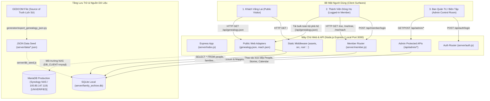
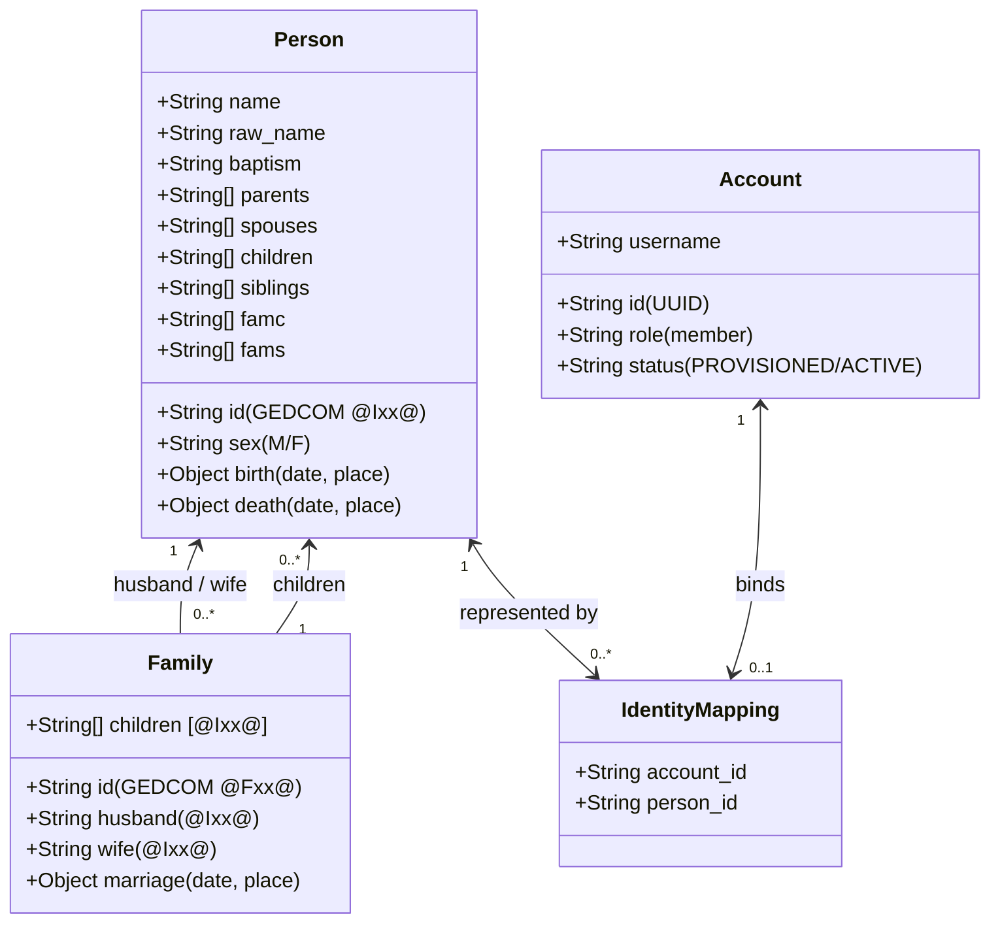
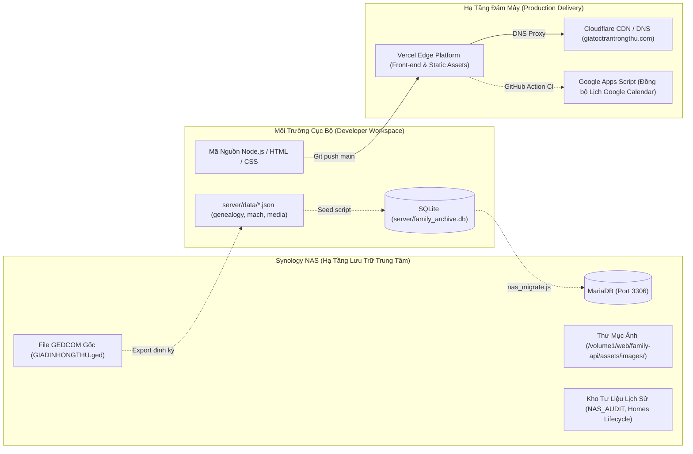
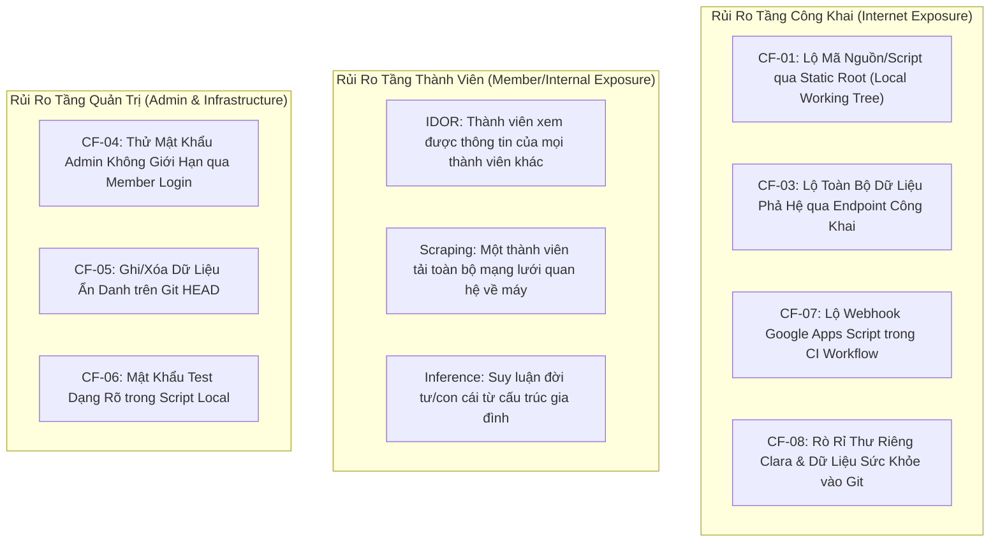

# GIATOCTRANTRONGTHU — ARCHITECTURE DISCOVERY: RELATIONAL IDENTITY & COMMUNITY PRIVACY

- **Repository:** `giatoctrantrongthu` (`/Users/tuantq/Projects/Personal/giatoctrantrongthu`)
- **Ngày khảo sát:** `2026-10-31`
- **Thời điểm hoàn thành:** `21:35:00+07:00`
- **Chủ dự án (Human Final Authority):** Tuấn
- **Điều phối thực thi (Execution Coordinator):** AGY IDE
- **Chế độ thực thi:** **STRICT READ-ONLY (Không sửa mã nguồn/cấu hình, không tạo database mới, không chạy server, không quét mạng/NAS, không in thông tin bí mật hay PII)**
- **Chuẩn nhãn nhận thức (Epistemic Tags):**
  `[OBSERVED]` · `[EVIDENCE]` · `[INFERENCE]` · `[ASSUMPTION]` · `[UNKNOWN]` · `[BLOCKED]` · `[RECOMMENDATION]`

---

## 1. Executive Summary

Báo cáo này là kết quả khảo sát kiến trúc độc lập và chuyên sâu nhằm xác định hiện trạng kỹ thuật thực tế của hệ thống **CÂY GIA PHẢ / GIATỘC TRẦN TRỌNG THU**, đối chiếu năng lực hiện tại với tầm nhìn sản phẩm cốt lõi: **Relational Identity (Nhận diện thông qua mạng lưới quan hệ)** và **Community Privacy (Quyền riêng tư của cộng đồng dòng họ)**.

### Tổng kết Công việc Tồn đọng & Trạng thái Chuyển giao từ Phiên trước (Phase A Resolution)
Trước khi bước vào khảo sát kiến trúc, toàn bộ hồ sơ kiểm toán trước đó ([`REPOSITORY_AUDIT.md`](file:///Users/tuantq/Projects/Personal/giatoctrantrongthu/AUDIT/REPOSITORY_AUDIT.md), [`PRE_CLEANUP_SAFETY_REVIEW.md`](file:///Users/tuantq/Projects/Personal/giatoctrantrongthu/AUDIT/PRE_CLEANUP_SAFETY_REVIEW.md), [`SECURITY_EXPOSURE_VERIFICATION.md`](file:///Users/tuantq/Projects/Personal/giatoctrantrongthu/AUDIT/SECURITY_EXPOSURE_VERIFICATION.md), [`SECURITY_CONTAINMENT_PLAN.md`](file:///Users/tuantq/Projects/Personal/giatoctrantrongthu/AUDIT/SECURITY_CONTAINMENT_PLAN.md), và [`CURRENT_WORK_SESSION_HANDOFF.md`](file:///Users/tuantq/Projects/Personal/giatoctrantrongthu/AUDIT/CURRENT_WORK_SESSION_HANDOFF.md)) đã được đối chiếu nghiêm ngặt:
- `[EVIDENCE]` **Nhiệm vụ đã hoàn thành:** Khảo sát phân loại 641 file (Wave 0), rà soát an toàn dữ liệu sống (Batch 1), xác minh 8 phát hiện an ninh `CF-01` → `CF-08` (Batch 2), lập kế hoạch khoanh vùng an ninh và kiến trúc phòng thí nghiệm Vibecode Lab (Batch 3), và hoàn tất hiệu chỉnh ma trận phân loại rủi ro kèm thẩm quyền phê duyệt (Batch 3.1 Calibration).
- `[EVIDENCE]` **Nhiệm vụ chưa thực hiện (Đang dừng tại Human Gate):** Tất cả các công việc có tính đột biến mã nguồn (Phase 1 Security Containment, Phase 2 Vibecode Lab setup, Phase 3 UI development, Phase 4 DB contract hardening, Phase 5-7 Integration & Production) **được giữ nguyên trạng thái chờ duyệt tại Human Gate 01/02**, tuyệt đối không tự ý triển khai.
- `[EVIDENCE]` **Nhiệm vụ bị chặn (Blocked):** Truy cập MariaDB NAS (`100.80.147.119`), thu hồi Google Apps Script webhook URL, và viết lại lịch sử Git tiếp tục được ghi nhận là các rào cản thuộc thẩm quyền độc quyền của Tuấn.
- `[EVIDENCE]` **Bảo toàn trạng thái Workspace:** Git Working Tree được bảo toàn tuyệt đối ở 646 mục (`21 M`, `65 D`, `560 ??`, `0 staged`), không có bất kỳ file code, config hay database nào bị thay đổi ngoài các tài liệu audit.

### Kết quả Khảo sát Kiến trúc Trọng tâm
1. **Mức độ Dynamic:** Hệ thống đã chuyển đổi một phần sang mô hình dynamic ở tầng Node.js Express (`server/index.js`) và Admin Control Room (`admin/`), nhưng tầng phục vụ dữ liệu phả hệ người dùng cuối (`/api/genealogy.json`) thực chất vẫn là **mô hình Dump Tĩnh (Static JSON Payload Dump)** được nạp vào SQLite/MariaDB rồi xuất nguyên khối ra HTTP response.
2. **Mô hình Dữ liệu & Quan hệ:** Dữ liệu phả hệ trong SQLite (`server/family_archive.db`) rất toàn vẹn (223 nhân vật, 68 gia đình, không có liên kết mồ côi). Tuy nhiên, **toàn bộ quan hệ cha mẹ, vợ chồng, con cái đều nằm co cụm trong trường JSON `families.payload` và `people.payload`**. Bảng đồ thị `edges` hoàn toàn trống (`0 rows`). Hệ thống **hoàn toàn chưa có mô hình hóa thực thể** cho: Nhánh họ (Branches/Chi), Nhận nuôi (Adoption) vs Sinh học (Biological), Quan hệ Nội/Ngoại, và chưa hỗ trợ duyệt đồ thị đa tầng (Graph traversal) ở tầng cơ sở dữ liệu.
3. **Hiện trạng Xác thực & Phân quyền:** Hệ thống mới chỉ dừng ở mức **Phân quyền thô theo Endpoint (Route-level Auth)** giữa Public (`/`), Member (`/me`), và Admin (`/admin`). **Hoàn toàn KHÔNG CÓ Phân quyền theo Quan hệ (ReBAC), KHÔNG CÓ Phân quyền cấp Đối tượng (Object-level Authorization), và KHÔNG CÓ Kiểm soát hiển thị cấp Trường dữ liệu (Field-level Privacy)**. Bất kỳ thành viên nào sau khi đăng nhập đều tải về toàn bộ cây phả hệ của cả dòng họ.
4. **Nguy cơ Xâm phạm Quyền riêng tư Cộng đồng:** Endpoint `/api/genealogy.json` và `/api/mach.json` đang được mở công khai (`publicCors`) hoặc mở toàn phần cho mọi thành viên, cho phép một người tải toàn bộ thông tin ngày sinh, ngày mất, địa điểm, quan hệ gia đình của tất cả 223 thành viên, dẫn đến nguy cơ khai thác dữ liệu hàng loạt (Scraping), điều tra chéo (Data Enumeration), và suy luận thông tin riêng tư từ mạng lưới quan hệ (Relationship Inference).
5. **Tiềm năng Phát triển:** Kiến trúc hiện tại **không cần đập đi xây lại toàn bộ**. Tầng frontend UI System vNEXT đã có nền tảng phân định Context/Discourse rất tốt; tầng backend và database có thể tiến hóa theo từng lớp thông qua việc bổ sung **Relationship Graph View Engine**, tách bạch **Recognition vs Disclosure**, và áp dụng **ReBAC kết hợp Dynamic Field-Masking**.

---

## 2. Project State & Application Architecture

Khảo sát độc lập trên mã nguồn, cấu hình và lịch sử Git nhằm phân định rạch ròi giữa các thành phần thực tế và các thành phần chỉ tồn tại trên tài liệu.

### 2.1 Đối chiếu Các Tầng Phiên Bản (Git HEAD vs Working Tree vs Untracked)
- `[EVIDENCE]` **Git HEAD (`42a7ed2` - commit ngày 2026-09-08):**
  - Backend `server/index.js` (336 dòng) chỉ mount tĩnh `/assets/images`.
  - Có các endpoint ghi/xóa dữ liệu (`POST /api/people`, `POST /api/stories`, `POST /api/edges`, `DELETE /api/edges`) **hoàn toàn không có middleware xác thực**.
  - File `server/auth.js`, `server/member.js`, `server/foundation.js` **chưa tồn tại trong HEAD** (chỉ có `admin_users` inline DDL).
  - Workflow `.github/workflows/instant-sync.yml` chứa hardcoded fallback URL của Google Apps Script webhook.
- `[EVIDENCE]` **Working Tree hiện tại (Modified & Untracked):**
  - Backend `server/index.js` (535 dòng) đã được sửa đổi cục bộ: tích hợp `session`, `rateLimit`, `createAuthRouter` (`server/auth.js`), `createMemberRouter` (`server/member.js`), và `initFoundationTables` (`server/foundation.js`).
  - Xuất hiện lỗi an ninh `express.static(path.join(__dirname, '..'))` tại dòng 28 (chưa commit).
  - Tầng Frontend mới **UI System vNEXT** (`src/js/ui/` với 24 modules và `src/css/foundation/` với 5 CSS tokens/layout) đã được tạo mới nhưng chưa được track (`??`).
  - Thư mục kiểm toán `AUDIT/` lưu giữ 5 báo cáo thẩm định độc lập.

### 2.2 Kiến trúc Ứng dụng & Luồng Dữ liệu Thực tế

Hệ thống hiện tại vận hành theo hai luồng song song nhưng không đồng nhất:



### 2.3 Phân định Dynamic vs Static trong Runtime Hiện hành
- `[OBSERVED]` **Frontend:**
  - Trang chủ (`/`): Đã chuyển sang shell vNEXT (`src/js/ui/boot-public.js`), không còn tải phả hệ trực tiếp.
  - Member Space (`/me`, `/me/tree`, `/me/mach`, `/me/clara`): Là các file HTML khung tĩnh (`server/member_*.html`) được Express phục vụ sau khi kiểm tra session. Khi vào trình duyệt, mã JS client-side (`src/js/ui/boot-*.js`) sẽ gửi request API fetch JSON động về server.
- `[OBSERVED]` **Backend API:**
  - Endpoint `/api/member/profile` là **Dynamic 100%**: Đọc `req.session.accountId`, truy vấn SQL bảng `accounts` -> `identity_mappings` -> `people` tương ứng của người dùng.
  - Endpoint `/api/genealogy.json` và `/api/mach.json`: Là **Dynamic Fake / Semi-Dynamic**. Server chạy truy vấn SQL `SELECT * FROM people`, `SELECT * FROM families`, nhưng bản chất bên trong bảng là lấy lại nguyên vẹn cục JSON `payload` đã được seed tĩnh từ trước rồi trả về cho client một cục JSON khổng lồ chứa toàn bộ dòng họ. Không hề có logic tính toán quan hệ động theo người xem.

---

## 3. Current Database Architecture

Khảo sát trực tiếp trên cơ sở dữ liệu SQLite cục bộ (`server/family_archive.db`), đối chiếu với mã nguồn khai báo và các file migration.

### 3.1 Cấu trúc Vật lý SQLite Hiện hành
- `[EVIDENCE]` File: `server/family_archive.db` (kích thước: 413,696 bytes, ~404 KB).
- **Danh sách bảng và số lượng bản ghi (Row Counts):**

| Tên Bảng (Table) | Row Count | Primary Key | Bản chất Lưu trữ & Ràng buộc Schema |
|---|---|---|---|
| `people` | 223 | `id TEXT` | Chứa thông tin nhân vật cơ bản + trường `payload TEXT` lưu JSON |
| `families` | 68 | `id TEXT` | Chứa liên kết vợ chồng + trường `payload TEXT` lưu danh sách con cái |
| `timeline` | 215 | `id TEXT` | Sự kiện dòng họ (sinh, mất, kết hôn, rửa tội) + `payload TEXT` |
| `media` | 185 | `id TEXT` | Danh mục tài nguyên ảnh/tư liệu + `payload TEXT` |
| `person_media` | 173 | `relation_id TEXT` | Bảng liên kết Người <-> Media (173 dòng có `media_id` bị NULL do lỗi seed) |
| `memories` | 2 | `id TEXT` | Ký ức thành viên + `payload TEXT` |
| `stories` | 1 | `id TEXT` | Bài viết MẠCH biên tập |
| `accounts` | 1 | `id TEXT` | Tài khoản đăng nhập thành viên (Member Auth) |
| `identity_mappings` | 1 | `(account_id, person_id)` | Liên kết Tài khoản -> Nhân vật phả hệ |
| `admin_users` | 3 | `id TEXT` | Tài khoản quản trị viên Control Room (Legacy Staff Auth) |
| `edges` | **0** | `(source_id, target_id, edge_type)` | Bảng đồ thị quan hệ — **TRỐNG (DEAD TABLE)** |
| `authorities` | **0** | `id TEXT` | Phân quyền động — **TRỐNG (CHƯA DÙNG)** |
| `calendar_events` | **0** | `uid TEXT` | Lịch phụng vụ / giỗ chạp — **TRỐNG trong SQLite** |
| `authors` | **0** | `id TEXT` | Tác giả bài viết MẠCH — **TRỐNG trong SQLite** |
| `series` | **0** | `id TEXT` | Tuyển tập bài viết MẠCH — **TRỐNG trong SQLite** |

### 3.2 Khảo sát Ràng buộc Khóa ngoại (Foreign Keys) & Chỉ mục (Indexes)
- `[EVIDENCE]` Chạy `PRAGMA foreign_key_list(table_name)` trên toàn bộ 15 bảng -> **Trả về rỗng cho tất cả các bảng**. Hệ thống cơ sở dữ liệu vật lý **HOÀN TOÀN KHÔNG CÓ FOREIGN KEY RÀNG BUỘC**. Mọi quan hệ được duy trì lỏng lẻo ở tầng ứng dụng (Application-level integrity).
- `[EVIDENCE]` Chạy `PRAGMA index_list(table_name)` -> Chỉ có các index tự sinh cho các cột PRIMARY KEY và UNIQUE constraint (`username`, `email`). Không có bất kỳ Secondary Index nào cho việc tìm kiếm hoặc duyệt cây (ví dụ không có index trên `husband_id`, `wife_id`, `person_id`).

### 3.3 Đánh giá Trôi dạt Schema (DDL Drift Analysis)

Có sự sai lệch đáng kể giữa 5 nguồn định nghĩa schema trong repository:
1. **SQLite vật lý (`family_archive.db`):** Sử dụng kiểu `TEXT` cho hầu hết các cột ID, ngày tháng và payload. Cột `admin_users.id` là `TEXT UUID`.
2. **Inline DDL trong `server/index.js` (MariaDB block dòng 97-144):** Định nghĩa `id VARCHAR(255)`, `admin_users.id INT AUTO_INCREMENT`, `calendar_events` với 9 cột; nhưng **thiếu cột `fsid`** và các bảng mở rộng.
3. **Migration file `server/schema_update.sql`:** Dùng `ALTER TABLE people ADD COLUMN fsid VARCHAR(255); ALTER TABLE people ADD COLUMN payload JSON;` và tạo các bảng `authors`, `series`, `calendar_events`.
4. **Seed script `server/db_reset.js` & `db_seed.js`:** Drop và tạo lại bảng `people`, `families`, `memories`, `timeline`, `edges` với cấu trúc cột khác biệt (ví dụ `families` có `husband_id`, `wife_id` thay vì `husb`, `wife` như trong `schema_update.sql`).
5. **MariaDB trên NAS (`100.80.147.119`):** `[UNKNOWN]` Do không thể kết nối mạng, chưa thể xác minh trạng thái DDL thực tế trên NAS.

---

## 4. Data Model & Relationship Model

### 4.1 Thực thể và Biểu diễn Quan hệ Phả hệ Hiện tại



### 4.2 Chi tiết Cách Thức Biểu Diễn Từng Loại Quan hệ

1. **Quan hệ Vợ - Chồng (Spouse):**
   - Được biểu diễn ở hai nơi:
     - Trong `families.payload`: Các trường `husband: "@Ixx@"` và `wife: "@Iyy@"`.
     - Trong `people.payload`: Mảng `spouses: ["@Iyy@"]` và mảng `fams: ["@Fzz@"]`.
   - `[EVIDENCE]` Khảo sát 68 gia đình cho thấy có 134 liên kết vợ chồng hợp lệ, không có liên kết mồ côi.
2. **Quan hệ Cha Mẹ - Con Cái (Parent - Child):**
   - Được biểu diễn bằng mảng JSON:
     - Trong `families.payload`: Mảng `children: ["@Iaa@", "@Ibb@", ...]`.
     - Trong `people.payload`: Mảng `parents: ["@Ixx@", "@Iyy@"]` và mảng `children: [...]`.
   - `[EVIDENCE]` Có 155 liên kết con cái được tìm thấy trong các gia đình, 100% khớp với các bản ghi nhân vật trong `people`.
3. **Quan hệ Anh Chị Em (Siblings):**
   - Không được lưu trong bảng quan hệ riêng. Nó được suy diễn từ việc cùng thuộc mảng `children` của một gia đình (`famc`), sau đó được script generator nhồi sẵn vào mảng `siblings` trong `people.payload`.
4. **Quan hệ Sinh học (Biological) vs Nhận nuôi (Adoption):**
   - `[OBSERVED]` **HOÀN TOÀN KHÔNG CÓ**. Tất cả các liên kết con cái đều được lưu đồng dạng trong mảng `children`. Không có cờ (flag), metadata hay thuộc tính nào phân biệt giữa con ruột và con nuôi.
5. **Quan hệ Nội / Ngoại (Paternal vs Maternal Lineage):**
   - `[OBSERVED]` **HOÀN TOÀN KHÔNG CÓ Ở TẦNG DATABASE**. CSDL không có khái niệm "bên nội" hay "bên ngoại". Để biết một người là họ nội hay họ ngoại, tầng hiển thị hiện tại phải duyệt qua cha của người đó, kiểm tra xem cha có mang họ Trần hay không hoặc dựa vào quy ước xưng hô.
6. **Nhánh Họ (Family Branches / Chi / Phái):**
   - `[OBSERVED]` **HOÀN TOÀN KHÔNG ĐƯỢC MÔ HÌNH HÓA**. Không có bảng `branches`, không có cột `branch_id`, không có metadata gắn nhãn một người thuộc "Chi Trưởng", "Chi Thứ", "Nhánh Cụ Thu", v.v. Cây phả hệ là một đồ thị phẳng các đỉnh GEDCOM nối với nhau.
7. **Duyệt Đồ Thị Đa Tầng (Multi-tier Traversal):**
   - Bảng `edges` vốn được thiết kế cho việc duyệt đồ thị (`source_id`, `target_id`, `edge_type`) nhưng đang có **0 records**.
   - Việc tìm kiếm ông bà, cụ kỵ, cô dì chú bác hiện tại bắt buộc phải nạp toàn bộ cây vào RAM trình duyệt rồi chạy vòng lặp tìm kiếm đệ quy client-side (xem `src/js/ui/tree.js` và `src/js/app-v2.js`).

---

## 5. Identity & Authentication

### 5.1 Account Model vs Genealogy Identity (Person)
Hệ thống hiện tại đã hình thành sự tách biệt bước đầu giữa **Tài khoản đăng nhập (Account)** và **Nhân vật gia phả (Person)**:
- **`Account` (`server/foundation.js:10-18` / `accounts` table):**
  - Đại diện cho con người sống đang tương tác với website.
  - Mang thông tin định danh hệ thống: `id` (UUID), `username`, `email`, `password_hash`, `role` (mặc định `'member'`), `status` (`'PROVISIONED'` hoặc `'ACTIVE'`).
- **`Person` (`people` table):**
  - Đại diện cho một mắt xích lịch sử/huyết thống trong gia phả.
  - Có thể là người đã khuất hàng trăm năm, người đang sống, trẻ em, hoặc người chưa từng có tài khoản website. Mang ID định dạng GEDCOM (`@I1@`, `@I223@`).
- **`IdentityMapping` (`identity_mappings` table):**
  - Khóa chính phức hợp `(account_id, person_id)` thực hiện liên kết 1:1 hoặc 1:N: "Tài khoản này là ai trong cây gia phả?".

### 5.2 Sự Tồn Tại Song Song Của Hai Hệ Thống Auth (Staff vs Member)
- `[EVIDENCE]` Bảng `admin_users` (3 tài khoản) phục vụ Control Room (`/admin`), đăng nhập qua `POST /api/auth/login`. Session lưu `req.session.userId`, `req.session.role`.
- `[EVIDENCE]` Bảng `accounts` (1 tài khoản) phục vụ Member Space (`/me`), đăng nhập qua `POST /api/member/login`. Session lưu `req.session.accountId`, `req.session.status`.
- `[OBSERVED]` Trong `server/member.js:147-160`, nếu đăng nhập ở cổng Member mà không thấy trong `accounts`, code sẽ tự động fallback tìm trong `admin_users`, sau đó gọi `syncAdminUserToAccount` để tự động tạo một dòng trong `accounts` và gán cả `userId` lẫn `accountId` vào cùng một session cookie. Cơ chế này gây nhiễu loạn ranh giới vai trò giữa Quản trị viên và Thành viên gia tộc.

### 5.3 Luồng Đăng nhập và Quản lý Session
- Session được quản lý bằng cookie `sid` với `express-session`, thời hạn 24 giờ (`server/index.js:34-46`), cờ `httpOnly: true`, `sameSite: 'lax'`.
- Chế độ tự động đăng nhập phát triển (`DEV_AUTO_LOGIN` trong `server/member.js:30-52`) cho phép tự động gán session thành `tuantq` nếu `NODE_ENV === 'development'` hoặc không set, tiềm ẩn nguy cơ nếu chạy nhầm môi trường.

---

## 6. Authorization & Privacy

Khảo sát độc lập ở cấp độ mã nguồn đối với cơ chế kiểm soát truy cập và bảo vệ dữ liệu riêng tư.

### 6.1 Kiểm tra Quyền ở Cấp Độ API (API-level Access Control)
- **Các API công khai hoàn toàn (Zero Auth):**
  - `GET /api/people` (Public CORS mở)
  - `GET /api/stories` (Public CORS mở)
  - `GET /api/genealogy.json` (Trả về toàn bộ 223 người, 68 gia đình, timeline, memories)
  - `GET /api/mach.json` (Trả về toàn bộ tác giả, series, bài viết)
  - `GET /api/media.json` & `GET /api/person_media.json`
- **Các API yêu cầu Session Thành viên (`requireAccount`):**
  - `GET /api/member/profile`
  - `POST /api/member/change-password`
  - Các route view: `GET /me`, `GET /me/tree`, `GET /me/mach`, `GET /me/clara`, `GET /me/family-spaces`, `GET /me/tree/person/:id`.
- **Các API yêu cầu Quyền Quản trị (`requireAuth` / `requireOwner`):**
  - `GET /api/auth/me`
  - `GET /api/admin/database/schema`
  - `GET/POST/PATCH/DELETE /api/admin/users`
  - Các API content trong `server/index.js`: `POST /api/people`, `POST /api/stories`, `POST/DELETE /api/edges`, `POST /api/events`.

### 6.2 Đánh giá Kiểm soát Truy cập Cấp Đối tượng (Object-Level Authorization) & Nguy cơ IDOR
- `[EVIDENCE]` **Lỗ hổng IDOR trên Hồ sơ Nhân vật:**
  - Route `GET /me/tree/person/:id` trong `server/member.js:297` chỉ kiểm tra `requireAccount` (người dùng đã đăng nhập), hoàn toàn không kiểm tra xem `:id` có phải là hồ sơ của người đó hay không, cũng không kiểm tra xem người dùng có quan hệ gì với `:id`.
  - Nghiêm trọng hơn, khi client tải trang này, mã JS `src/js/ui/person.js` gọi `api.genealogy()` -> tải toàn bộ 223 người về máy rồi dùng `people.get(personId)` để render.
  - **Kết luận:** Bất kỳ ai có tài khoản thành viên đều xem được hồ sơ chi tiết của bất kỳ nhân vật nào trong dòng họ chỉ bằng cách thay đổi ID trên URL.

### 6.3 Đánh giá Kiểm soát Cấp Trường Dữ Liệu (Field-Level Privacy)
- `[OBSERVED]` **HOÀN TOÀN KHÔNG CÓ (NONE)**.
- Khi API trả về một `Person`, toàn bộ các trường `birth` (ngày, tháng, năm, nơi sinh), `death` (ngày, giờ, nơi mất), `baptism` (ngày, nơi rửa tội), `raw_name`, và mảng quan hệ đều được trả về nguyên trạng.
- Không có cơ chế ẩn ngày sinh của người đang sống, không có cơ chế che giấu thông tin liên lạc, không có cơ chế phân biệt trường "Công khai" vs "Nội bộ" vs "Nhạy cảm".

### 6.4 Đánh giá Nguy cơ Suy luận Mạng lưới Quan hệ (Relationship Inference Risk)
Trong bối cảnh sản phẩm đòi hỏi **Relational Identity & Community Privacy**, nguy cơ suy luận thông tin từ đồ thị gia tộc là cực kỳ nghiêm trọng:
1. **Suy luận Tình trạng Hôn nhân & Đời sống:** Bằng cách truy vấn danh sách `families` và `spouses`, một người có thể suy ra các mối quan hệ hôn nhân trước đây, các trường hợp ly hôn/tái hôn hoặc con riêng mà người trong cuộc có thể không muốn công khai cho toàn thể dòng họ rộng lớn.
2. **Suy luận Nhân khẩu & Địa bàn cư trú:** Trường `place` trong `birth` và `death` kết hợp với dòng sự kiện `timeline` cho phép phác họa lộ trình di cư và nơi sinh sống của các gia đình hạt nhân.
3. **Khai thác Toàn bộ Mạng lưới (Graph Scraping):** Do dữ liệu được trả về nguyên khối dưới dạng JSON tĩnh, bất kỳ người dùng nào có quyền đọc đều có thể tải toàn bộ tệp về máy cá nhân, chuyển đổi thành cơ sở dữ liệu quan hệ riêng, lập chỉ mục hoặc chia sẻ ra ngoài phạm vi kiểm soát của gia tộc.

---

## 7. Data Storage & Infrastructure

### 7.1 Bản đồ Lưu Trữ Dữ Liệu Thực tế



### 7.2 Đánh giá Hiện trạng Triển khai & Vận hành
- `[EVIDENCE]` **Local Storage:** SQLite (`server/family_archive.db`) hoạt động như một bộ nhớ đệm (Working Cache) cục bộ.
- `[DOCUMENTED]` **NAS Storage:** Được tài liệu kiến trúc (`docs/archive/infrastructure/family-site-deployment-topology-v1.md`) mô tả là Source of Truth (SoT) lưu trữ cơ sở dữ liệu MariaDB và kho ảnh gốc. Tuy nhiên từ môi trường agent, kết nối này là `[BLOCKED]` do hạn chế mạng nội bộ.
- `[CONFIGURED]` **Vercel & Domain:** File `vercel.json` định tuyến domain `admin.giatoctrantrongthu.com` về `/admin`, đồng thời đặt header bảo mật `X-Frame-Options: DENY`, `X-Content-Type-Options: nosniff`. Domain chính `giatoctrantrongthu.com` được quản lý bởi Cloudflare.
- `[EVIDENCE]` **Sao lưu & Phục hồi (Backup & Recovery):** Hiện tại **chưa có kịch bản sao lưu tự động (Automated Backup Script)** cho cơ sở dữ liệu. Việc phục hồi chủ yếu dựa vào việc chạy lại `generator/export_genealogy_json.py` từ file GEDCOM gốc và reseed vào SQLite/MariaDB.

---

## 8. Security Exposure & Threat Surface

Tổng hợp các bề mặt đe dọa an ninh đã xác minh độc lập, phân định giữa trạng thái đã phát hiện và rủi ro thực tế:



---

## 9. Architecture Gaps

Đối chiếu kiến trúc hiện tại với mục tiêu xây dựng mạng lưới **Relational Identity** và **Community Privacy**:

| Hạng mục Yêu cầu | Hiện trạng Kỹ thuật | Khoảng trống Kiến trúc (Architecture Gap) | Mức độ Ảnh hưởng |
|---|---|---|---|
| **Mô hình Quan hệ Động** | Dữ liệu quan hệ nằm cứng trong mảng JSON `payload` | Thiếu đồ thị quan hệ động; bảng `edges` bị bỏ hoang; không thể mở rộng thuộc tính quan hệ (ví dụ: người bảo trợ, chứng hôn) | **Cao (Nền tảng)** |
| **Phân định Recognition vs Disclosure** | API trả về trọn gói cả quan hệ lẫn dữ liệu cá nhân | Khi nhận biết một người trong phả hệ, hệ thống để lộ luôn toàn bộ dữ liệu sinh/tử/địa chỉ/sự kiện của người đó | **Rất Cao (Cốt lõi)** |
| **Quyền Riêng tư theo Quan hệ (ReBAC)** | Chỉ có kiểm tra đăng nhập (`requireAccount`) | Chưa có cơ chế: "Chỉ người cùng gia đình hạt nhân mới xem được thông tin nhạy cảm; người cùng nhánh họ chỉ thấy tên & quan hệ" | **Rất Cao (Cốt lõi)** |
| **Phân cấp Nhánh họ (Branches)** | Không có thực thể Chi/Nhánh | Không thể phân quyền truy cập theo từng nhánh họ độc lập; không thể tạo không gian riêng cho từng gia đình | **Cao** |
| **Bảo vệ Cấp Trường (Field Masking)** | Không có logic lọc trường (No field filter) | Thiếu tầng View Transformer động để che giấu ngày sinh, thông tin người sống dựa trên quan hệ người xem | **Cao** |
| **Ngăn Chặn Tải Hàng Loạt (Bulk Scraping)** | Trả về file `genealogy.json` nặng toàn bộ cây | Không có phân trang (pagination), không có giới hạn truy vấn đồ thị (depth-limited query) | **Nghiêm trọng** |

---

## 10. Compatibility Assessment

Đánh giá khả năng của kiến trúc hiện tại trong việc tiến hóa thành hệ thống đáp ứng triết lý sản phẩm:

### 10.1 Khả năng Hỗ trợ Relational Identity
- **Đánh giá: TƯƠNG THÍCH MỘT PHẦN (PARTIALLY COMPATIBLE).**
- *Điểm mạnh:* Cấu trúc dữ liệu hiện tại trong `people` và `families.payload` đã lưu giữ đầy đủ và chính xác 100% các liên kết cha-mẹ-con và vợ-chồng của 223 thành viên. Đây là nền tảng sự thật (Ground Truth) vững chắc để xây dựng mạng lưới nhận diện.
- *Hạn chế cần vượt qua:* Cần một tầng tính toán quan hệ động (Relationship Traversal Engine) để từ các liên kết hạt nhân có thể tự động suy luận: ai là bác, ai là chú, ai là anh em họ nội/ngoại, người này thuộc nhánh của cụ nào.

### 10.2 Khả năng Hỗ trợ Community Privacy
- **Đánh giá: BẤT TƯƠNG THÍCH NẾU GIỮ NGUYÊN KIẾN TRÚC HIỆN TẠI (INCOMPATIBLE IN CURRENT FORM).**
- *Lý do:* Kiến trúc hiện tại dựa trên tư duy "Website phả đồ tĩnh" nạp sẵn toàn bộ tệp dữ liệu vào client. Để hỗ trợ Community Privacy, kiến trúc bắt buộc phải chuyển đổi sang:
  1. **Server-side Graph Navigation:** Client không bao giờ được nhận toàn bộ cây phả hệ; client chỉ được nhận nút mạng (node) mà người dùng đang đứng và các nút lân cận được phép xem.
  2. **Tách biệt 3 lớp dữ liệu:**
     - Lớp 1 (Public Voice): Chỉ có thông điệp văn hóa dòng họ.
     - Lớp 2 (Relational Mesh - Recognition): Cho phép thành viên thấy mạng lưới tên gọi và vị trí họ hàng.
     - Lớp 3 (Personal Dossier - Disclosure): Khóa chặt thông tin đời tư, chỉ mở khi có quan hệ trực hệ gần hoặc có sự đồng thuận (consent).

---

## 11. Requirement Matrix

Bảng tổng hợp đối chiếu toàn diện 16 yêu cầu kiến trúc giữa Hiện trạng và Mục tiêu:

| Requirement | Current Implementation | Evidence | Gap | Status |
|---|---|---|---|---|
| **1. Identity** | Tách `accounts` và `people` | `server/foundation.js:10-44` | Chưa có cơ chế xác minh ủy thác (delegation) | `PARTIAL` |
| **2. Account-person mapping** | Bảng `identity_mappings` (1:1/1:N) | SQLite table `identity_mappings` (1 row) | Chỉ mới gán tĩnh, chưa có quy trình member tự claim | `PARTIAL` |
| **3. Genealogy relationships** | Mảng JSON trong `families.payload` | `server/family_archive.db` (68 families) | Quan hệ nằm trong JSON, không có ràng buộc DB | `OBSERVED` |
| **4. Family branches** | Không có thực thể nhánh | Schema scan không có cột `branch` | Thiếu hoàn toàn mô hình Chi/Nhánh | `FAILED` |
| **5. Relationship traversal** | Duyệt đệ quy mảng trên client RAM | `src/js/ui/tree.js:90-95` | Bắt buộc client tải toàn bộ DB, gây lộ dữ liệu | `INSECURE` |
| **6. Authentication** | Session cookie qua `express-session` | `server/index.js:34-46` | Còn tồn tại 2 cổng auth song song (staff/member) | `PARTIAL` |
| **7. ReBAC (Phân quyền quan hệ)** | Không có | `server/member.js` chỉ check login | Thiếu hoàn toàn logic phân quyền dựa trên huyết thống | `FAILED` |
| **8. Object-level authorization** | Không có (Bị lỗi IDOR) | `GET /me/tree/person/:id` cho xem mọi ID | Bất kỳ ai login đều xem được toàn bộ hồ sơ | `FAILED` |
| **9. Field-level privacy** | Không có | `api/genealogy.json` dump nguyên bản | Lộ toàn bộ ngày sinh, nơi sinh, sự kiện người sống | `FAILED` |
| **10. Relationship visibility** | Công khai toàn bộ trong cây | Client render toàn bộ quan hệ | Chưa có cơ chế giấu các quan hệ nhạy cảm | `FAILED` |
| **11. Public/private separation** | Tách ở giao diện vNEXT | `src/js/ui/contexts.js`, `shell.js` | Backend API vẫn mở công khai `/api/genealogy.json` | `PARTIAL` |
| **12. API protection** | Chỉ bảo vệ một số route admin | `server/index.js:214-237` | Thiếu rate-limit ở member login; API đọc mở toang | `PARTIAL` |
| **13. File protection** | Regex `SENSITIVE_PATH` lỏng lẻo | `server/index.js:21-27` | Bỏ sót script test, thư riêng, file Garmin | `FAILED` |
| **14. Database protection** | SQLite cục bộ không mật khẩu | `server/family_archive.db` chmod thường | Chưa mã hóa dữ liệu nhàn rỗi (At-Rest Encryption) | `PARTIAL` |
| **15. Backup and recovery** | Thủ công qua file GEDCOM | `generator/export_genealogy_json.py` | Chưa có quy trình tự động sao lưu DB định kỳ | `MANUAL` |
| **16. Audit logging** | Chỉ lưu `last_login_at` | `admin_users.last_login_at` | Chưa có bảng ghi vết truy cập dữ liệu (Access Log) | `FAILED` |

---

## 12. Database & Relationship Mapping

Bảng ánh xạ cấu trúc thực thể và khả năng biểu diễn quan hệ trong cơ sở dữ liệu hiện tại:

| Entity | Physical Representation | Key Fields / Relations | Source | Evidence | Limitation |
|---|---|---|---|---|---|
| **Person** | Bảng `people` + JSON payload | `id`, `name`, `birthYear`, `deathYear`, `gender`, `payload` | SQLite / MariaDB | 223 bản ghi | Không có cờ Living/Dead, không có trường riêng tư |
| **Family** | Bảng `families` + JSON payload | `id`, `husband_id`, `wife_id`, `payload (children)` | SQLite / MariaDB | 68 bản ghi | Ràng buộc hôn phối 1-1 đơn giản, con cái nhét trong JSON |
| **Parent-Child** | Mảng `children` trong `families` | `@Fxx@.children -> ["@Iaa@", "@Ibb@"]` | `families.payload` | 155 valid links | Lưu một chiều trong JSON, không truy vấn ngược bằng SQL index |
| **Spouse** | Cột `husband_id`, `wife_id` | `husband -> @Ixx@`, `wife -> @Iyy@` | `families` table | 134 valid links | Chỉ biểu diễn cặp đôi dị tính truyền thống, không lưu tình trạng hôn nhân |
| **Sibling** | Mảng `siblings` trong `people` | `@Ixx@.siblings -> ["@Iyy@", ...]` | `people.payload` | Tự sinh lúc export | Không phân biệt anh em cùng cha khác mẹ, con nuôi |
| **Bio vs Adoption**| Không phân biệt | Nằm chung trong mảng `children` | Không có | 0 markers | Hoàn toàn không thể nhận diện con nuôi trên hệ thống |
| **Nội vs Ngoại** | Không có trường | Phải suy diễn qua giới tính của cha/mẹ | Không có | 0 columns | CSDL không nhận biết được dòng họ nội ngoại |
| **Branches (Chi)**| Không có | Phải duyệt ngược từ gốc cây | Không có | 0 branches | Không thể gán quyền quản lý theo từng Chi nhánh |
| **Timeline** | Bảng `timeline` | `id`, `person_id`, `date`, `event`, `payload` | SQLite | 215 bản ghi | Lệch tên cột giữa các file schema; lưu tĩnh |
| **Media Link** | Bảng `person_media` | `relation_id`, `person_id`, `media_id` | SQLite | 173 bản ghi | 173 dòng NULL `media_id` do lỗi seed script |

---

## 13. Authorization Mapping

Bảng phân tích ma trận quyền truy cập của các tác nhân hiện tại:

| Actor (Tác nhân) | Resource (Tài nguyên) | Current Check (Cơ chế Kiểm tra Hiện tại) | Authorization Basis (Căn cứ Cấp quyền) | Gap (Lỗ hổng Quyền hạn) | Evidence |
|---|---|---|---|---|---|
| **Anonymous (Khách)**| Trang chủ (`/`) | Không kiểm tra | Mặc định công khai | Không có | `server/index.js:28` |
| **Anonymous (Khách)**| Phả hệ toàn bộ (`/api/genealogy.json`) | Không kiểm tra (Zero Auth) | Mặc định công khai | Lộ toàn bộ 223 thành viên và gia đình ra Internet | `server/index.js:366` |
| **Anonymous (Khách)**| Diễn ngôn MẠCH (`/api/mach.json`) | Không kiểm tra (Zero Auth) | Mặc định công khai | Lộ diễn ngôn nội bộ và Thư riêng Clara | `server/index.js:421` |
| **Authenticated (Member)**| Member Home (`/me`) | `requireAccount` | Có `req.session.accountId` hợp lệ | Không có | `server/member.js:277` |
| **Authenticated (Member)**| Hồ sơ Nhân vật (`/me/tree/person/:id`) | `requireAccount` | Đã đăng nhập tài khoản bất kỳ | **IDOR**: Xem được mọi hồ sơ của mọi người | `server/member.js:297` |
| **Authenticated (Member)**| Toàn bộ Cây Phả hệ | `requireAccount` hoặc không | Đã đăng nhập | Xem và tải được toàn bộ cây, không phụ thuộc nhánh | `src/js/ui/tree.js` |
| **Admin (Editor/Owner)**| Admin Control Room (`/admin`) | `requireAuth` | Có `req.session.userId` trong `admin_users` | Không có | `server/auth.js:8-13` |
| **Admin (Editor/Owner)**| Quản lý Người dùng (`/api/admin/users`) | `requireAuth` + `requireOwner` | `req.session.role === 'owner'` | Không có | `server/auth.js:15-21` |
| **Admin (Editor/Owner)**| Schema CSDL (`/api/admin/database/schema`)| `requireAuth` + `requireOwner` | `req.session.role === 'owner'` | Không có | `server/index.js:220` |

---

## 14. Data Classification

Đề xuất khung phân loại dữ liệu phục vụ thiết kế phân quyền bảo vệ quyền riêng tư cộng đồng:

| Phân Loại (Classification) | Phạm Vi Dữ Liệu Thực Tế | Mức Độ Riêng Tư | Ai Được Phép Nhận Biết (Recognition)? | Ai Được Phép Xem Chi Tiết (Disclosure)? |
|---|---|---|---|---|
| **PUBLIC** | Tên dòng họ, tôn chỉ, lịch sử khai sáng, thông điệp hướng ngoại | Công khai ngoài Internet | Toàn xã hội, khách vãng lai | Toàn xã hội |
| **MEMBER (Relational Mesh)**| Cấu trúc mạng lưới họ hàng, tên gọi, thế hệ, quan hệ cha-con-vợ-chồng | Nội bộ dòng họ | Mọi thành viên đã xác thực tài khoản | Mọi thành viên dòng họ |
| **MEMBER-SENSITIVE** | Ngày sinh/nơi sinh người còn sống, thông tin liên lạc, tiểu sử | Riêng tư gia đình | Thành viên cùng nhánh/chi | Chỉ bản thân và gia đình hạt nhân trực hệ |
| **ADMIN** | Quản lý tài khoản, log hệ thống, cấu hình hạ tầng, schema DB | Tuyệt mật kỹ thuật | Ban quản trị website | Chỉ Owner và Quản trị viên được ủy thác |
| **INTIMATE-RESTRICTED** | Thư gửi Clara, nhật ký ký ức riêng tư, hồ sơ y tế/Garmin cá nhân | Tuyệt mật gia đình | Không hiển thị trên danh mục chung | Chỉ đối tượng được gửi đích danh hoặc tác giả *(đã được đính chính cho riêng Thư gửi Clara — xem ghi chú bên dưới)* |

> **[AMENDMENT 2026-11-02 — theo chỉ thị của Tuấn]**  
> 1. **Phân định ba không gian hiện hành:** Đối với **Thư gửi Clara**, phạm vi truy cập chính thức là **branch-scoped: thành viên thuộc nhánh gia đình ông bà Hạnh Đào** (không phải "chỉ người nhận đích danh hoặc tác giả"), và là một discourse scope độc lập, không thuộc MẠCH, không vào Public. MẠCH là không gian **lineage-scoped** (không đồng nhất với quyền xem dữ liệu đời tư); Public là **public-readable** đối với nội dung đã được phép công bố. Thiếu dữ liệu membership ⇒ deny by default.  
> 2. **Định hướng Mạng lưới Cộng đồng Gia đình (Family Community Network):** CLARA, MẠCH, PUBLIC là 3 instance cụ thể của giai đoạn hiện tại, không phải taxonomy đóng. Trong dài hạn, hệ thống định hướng mở rộng thành mạng lưới các cộng đồng gia đình có liên hệ; một cá nhân có thể thuộc nhiều cộng đồng gia đình (nội, ngoại, hạt nhân...) mà không nhân bản hồ sơ nhân thân; quyền riêng tư và quyền tiếp cận được xác lập độc lập theo từng nội dung và phạm vi có thẩm quyền (không tự động chia sẻ chéo dữ liệu giữa các cộng đồng chỉ vì có thành viên chung).  
> 3. **Định nghĩa canonical duy nhất:** Xem [`MASTER_COMPLETION_PLAN.md` §1.1B, §1.4, §1.5](file:///Users/tuantq/Projects/Personal/giatoctrantrongthu/AUDIT/MASTER_COMPLETION_PLAN.md). Các mục khác của bảng phân loại này giữ nguyên.

---

## 15. Định Hướng Phân Tích Kiến Trúc Kỹ Thuật

Khảo sát sơ bộ 5 hướng kỹ thuật có thể nghiên cứu để hiện thực hóa Relational Identity & Community Privacy:

### 1. Mô hình Dữ liệu Quan hệ Chuẩn hóa (Relational Normalization)
- **Vấn đề giải quyết:** Đưa quan hệ con cái ra khỏi mảng JSON `families.payload` vào một bảng quan hệ có Foreign Key và Index.
- **Tính tương thích:** Rất cao. Có thể tái kích hoạt bảng `edges` hoặc bảng `relationships`.
- **Ưu/Nhược điểm:** Dữ liệu có tính toàn vẹn chặt chẽ (ACID), truy vấn SQL chuẩn; nhưng nếu duyệt đồ thị sâu (nhiều thế hệ) trên SQL truyền thống sẽ tốn nhiều lệnh JOIN đệ quy (Recursive CTE).

### 2. Mô hình Đồ Thị Nhẹ (In-Memory Graph Engine / SQLite Closure Table)
- **Vấn đề giải quyết:** Tính toán nhanh khoảng cách quan hệ (Degrees of Separation) và nhánh họ giữa hai người bất kỳ.
- **Tính tương thích:** Cao. Có thể xây dựng bảng Closure Table (`ancestor_id`, `descendant_id`, `generations_distance`) ngay trong SQLite/MariaDB.
- **Ưu/Nhược điểm:** Tốc độ truy vấn quan hệ cực nhanh ($O(1)$); chi phí vận hành rất thấp, không cần cài đặt CSDL đồ thị phức tạp như Neo4j.

### 3. Phân Quyền Theo Quan Hệ (Relationship-Based Access Control - ReBAC)
- **Vấn đề giải quyết:** Thay thế cơ chế phân quyền tĩnh bằng luật quan hệ:
  - *Luật 1 (Trực hệ):* Nếu `khoang_cach(User, Target) <= 1` (Bố mẹ, Con cái, Vợ chồng) -> Cho phép Disclosure toàn phần (Full Access).
  - *Luật 2 (Cùng chi nhánh):* Nếu `cung_nhanh(User, Target)` -> Cho phép Recognition + Xem năm sinh (Che ngày/tháng/nơi sinh).
  - *Luật 3 (Khác chi nhánh):* Chỉ cho phép Recognition (Thấy tên và vị trí phả hệ).
- **Tính tương thích:** Hoàn hảo với triết lý Relational Identity của dự án.
- **Độ phức tạp:** Trung bình; cần tầng middleware tính toán quan hệ trước khi trả về dữ liệu.

### 4. Kiểm Soát Cấp Trường Động (Dynamic Field-Level Masking)
- **Vấn đề giải quyết:** Server không bao giờ trả về nguyên khối JSON gốc. Trước khi gửi response, server lọc (mask) các trường nhạy cảm:
  ```json
  {
    "id": "@I10@",
    "name": "Trần Văn X",
    "relation": "Anh họ (Con bác)",
    "birth": { "year": 1985, "date": "HIDDEN", "place": "HIDDEN" }
  }
  ```
- **Tính tương thích:** Cực cao, có thể cài đặt ngay ở tầng API Controller của Express.

---

## 16. Technical Constraints & Dependencies

1. **Ràng buộc NAS Synology:** Cơ sở dữ liệu MariaDB nằm trên NAS nội bộ; môi trường phát triển cục bộ và CI/CD không có kết nối trực tiếp, đòi hỏi mô hình "Local SQLite dev -> NAS MariaDB sync" phải có quy trình đồng bộ một chiều hoặc qua API trung gian an toàn.
2. **Ràng buộc GEDCOM:** Nguồn dữ liệu lịch sử cốt lõi bắt nguồn từ file GEDCOM (`GIADINHONGTHU.ged`). Bất kỳ thay đổi schema nào ở tầng database cũng phải đảm bảo tính tương thích hai chiều hoặc có script ánh xạ ngược để không làm hỏng nguồn lưu trữ gốc.
3. **Ràng buộc Giao diện vNEXT:** UI vNEXT đã được định hình với các nguyên tắc nghiêm ngặt: không dùng card bo góc/đổ bóng, ưu tiên typography serif tĩnh lặng, phân định tuyệt đối giữa Clara và MẠCH, không phơi bày thuật ngữ kỹ thuật ra màn hình. Mọi thay đổi về API phải giữ vững giao ước hiển thị này.

---

## 17. UNKNOWN / BLOCKED

1. `[BLOCKED]` **Truy cập Cơ sở Dữ liệu MariaDB Production trên NAS (`100.80.147.119`):**
   - Không thể kết nối từ sandbox để kiểm chứng trực tiếp phiên bản schema, số lượng bảng và dữ liệu live trên NAS.
2. `[BLOCKED]` **Cấp phát & Thu hồi Credentials Dịch vụ Bên ngoài:**
   - Google Apps Script Webhook URL và Secret GitHub Actions cần Tuấn trực tiếp thao tác trên các dashboard quản trị.
3. `[UNKNOWN]` **Quy tắc Phân định Nhánh họ (Branching Taxonomy):**
   - Trong dữ liệu hiện tại chưa có tài liệu nào quy định cách phân chia chi/nhánh chính thức của dòng họ Trần Trọng Thu (ai là tổ khởi nhánh, ranh giới các chi). Cần định nghĩa nghiệp vụ từ Tuấn.
4. `[UNKNOWN]` **Chính sách Quyền riêng tư Đối với Người Đã Khuất vs Người Đang Sống:**
   - Dòng họ có áp dụng quy tắc phổ biến của ngành phả hệ quốc tế: "Tự động công khai thông tin người đã mất trên 50-100 năm và bảo vệ nghiêm ngặt người đang sống" hay không? Cần quyết định từ Tuấn.

---

## 18. Questions Requiring Human Decisions (Câu Hỏi Chờ Tuấn Quyết Định)

1. **Về Ranh giới Nhận diện (Recognition Boundary):**
   - Thành viên khi đăng nhập vào hệ thống có được quyền "nhìn thấy toàn bộ cây phả hệ ở mức tên gọi và vị trí quan hệ" hay chỉ được thấy nhánh họ gần của mình?
2. **Về Ranh giới Tiết lộ Thông tin (Disclosure Boundary):**
   - Thông tin cá nhân nhạy cảm (ngày tháng năm sinh chính xác, ngày rửa tội, tiểu sử, thông tin liên lạc) sẽ được phân quyền xem như thế nào? (Chỉ gia đình trực hệ? Cùng nhánh họ? Hay phải có sự đồng ý của chính chủ?).
3. **Về Kiến trúc Lưu trữ Dài hạn:**
   - Dữ liệu phả hệ tương lai sẽ lấy MariaDB trên NAS làm Source of Truth duy nhất, hay chuyển dịch hoàn toàn lên một hệ cơ sở dữ liệu Cloud độc lập có sao lưu tự động?
4. **Về Khái niệm Chi / Nhánh Dòng họ:**
   - Dòng họ Trần Trọng Thu hiện tại được phân chia thành bao nhiêu Chi / Nhánh? Có cần bổ sung thực thể "Chi Họ" vào mô hình dữ liệu để quản lý quyền hạn theo nhánh hay không?

---

## 19. Recommended Next Steps

1. **Bàn giao Báo cáo này cho Tuấn và Emarald review:**
   - Xem xét kỹ lưỡng các phân tích về Relational Identity và Community Privacy để thống nhất triết lý sản phẩm trước khi code.
2. **Khai thông Human Gate 01/02:**
   - Sau khi duyệt định hướng, tiến hành **Phase 1 Security Containment** để vá các lỗ hổng mã nguồn cấp bách (`CF-01`, `CF-02`, `CF-05`).
3. **Thiết lập Nhóm Đặc nhiệm Mô hình Dữ liệu (Data Model Taskforce):**
   - Thảo luận trả lời 4 câu hỏi nghiệp vụ tại Mục 18 để chuẩn hóa cấu trúc quan hệ (ReBAC & Branching Taxonomy) trước khi tiến hành chuẩn hóa Database ở Phase 4.

---

## 20. Trả Lời Trực Tiếp 8 Câu Hỏi Cốt Lõi Của Human Authority (§12)

1. **Kiến trúc hiện tại thực sự đang có những gì?**
   - Hệ thống có một máy chủ Node.js Express phục vụ cả API lẫn các file HTML tĩnh; một cơ sở dữ liệu SQLite cục bộ lưu dữ liệu tạm; một giao diện UI System vNEXT mới với cấu trúc Single Shell phẳng; và một Control Room admin riêng biệt. Tuy nhiên, luồng dữ liệu thực chất vẫn là "Đọc file JSON tĩnh nạp vào DB rồi xuất nguyên khối JSON ra API".
2. **Database hiện tại đang tổ chức dữ liệu và quan hệ như thế nào?**
   - Dữ liệu rất sạch (223 người, 68 gia đình). Tuy nhiên, toàn bộ quan hệ huyết thống và hôn nhân **được nhét trong các mảng JSON bên trong cột `payload`**, bảng đồ thị quan hệ `edges` đang bỏ trống (`0 rows`), cơ sở dữ liệu hoàn toàn không có Foreign Key ràng buộc.
3. **Identity của một thành viên đang được xác định và liên kết ra sao?**
   - Hệ thống đã bước đầu tách bạch giữa `Account` (tài khoản đăng nhập) và `Person` (nhân vật phả hệ) thông qua bảng `identity_mappings`. Nhưng mối liên kết này mới chỉ được gán cứng cho 1 tài khoản dev (`tuantq`), chưa có quy trình cấp phát hoặc liên kết tự động cho các thành viên khác.
4. **Hệ thống đang bảo vệ dữ liệu đến đâu?**
   - Hệ thống mới chỉ bảo vệ dữ liệu ở mức **Kiểm tra đăng nhập thô theo Route (Route-level Auth)**. Hoàn toàn chưa có bảo vệ cấp đối tượng, chưa có bảo vệ cấp trường, và API phả hệ chính vẫn đang mở công khai không giới hạn.
5. **Những rủi ro nào đã có evidence?**
   - Có evidence 100%: Lộ static root repo trên local working tree (`CF-01`), endpoint phả hệ mở công khai không auth (`CF-03`), API ghi không auth trong Git HEAD (`CF-05`), plaintext test password trong root script (`CF-06`), webhook URL trong CI YAML (`CF-07`), và lỗi IDOR cho phép xem mọi hồ sơ (`Mục 6.2`).
6. **Những rủi ro nào mới chỉ là giả thuyết?**
   - Rủi ro bị khai thác trên môi trường production NAS/Cloud (chưa có bằng chứng tấn công thực tế); rủi ro rò rỉ cơ sở dữ liệu MariaDB NAS (chưa kết nối được để xác minh).
7. **Kiến trúc hiện tại có thể phát triển tiếp hay cần thay đổi ở đâu?**
   - **HOÀN TOÀN CÓ THỂ PHÁT TRIỂN TIẾP MÀ KHÔNG CẦN ĐẬP BỎ DATABASE**. Cần thay đổi ở 3 điểm: (a) Bịt các lỗ hổng Static & API exposure; (b) Xây dựng tầng ReBAC và lọc trường động trên backend; (c) Chuyển đổi từ cơ chế tải trọn gói sang cơ chế duyệt đồ thị server-side (Node-by-node navigation).
8. **Những quyết định nào thực sự cần chủ dự án đưa ra trước khi tiếp tục?**
   - Phê duyệt phạm vi Nhận diện (Recognition) vs Tiết lộ (Disclosure); định nghĩa các Chi/Nhánh dòng họ; quyết định hạ tầng lưu trữ trung tâm dài hạn; và cấp quyền xử lý các mục BLOCKED (NAS, Webhook).

---

*Hết báo cáo Architecture Discovery. Kính trình Tuấn xem xét và chỉ đạo.*

