# CURRENT WEBSITE SITEMAP — EDITABLE MINDMAP (`AS-IS` RECONSTRUCTION)

> [!IMPORTANT]
> **Chế độ Kiểm toán:** `STRICT READ-ONLY / EVIDENCE-BASED` — Tái dựng trung thực 100% cấu trúc website đang tồn tại trong mã nguồn và runtime tại thời điểm `2026-11-07`. **Không đề xuất kiến trúc mới, không tự ý gộp/xóa/thêm trang.**
>
> **3 Định dạng Chỉnh sửa Trực tiếp (Editable Formats) đi kèm:**
> 1. **Mục 1 (Bên dưới):** Sơ đồ trực quan `Mermaid flowchart LR` phân màu theo Không gian & Cờ kiểm toán (chỉnh sửa trực tiếp bằng văn bản Markdown).
> 2. **Mục 2 (Bên dưới):** Cây phân cấp chuẩn **Markmap / Obsidian / MindNode / XMind Markdown** (`# / ## / ### / -`) — có thể copy/mở trực tiếp trong mọi phần mềm Mindmap hỗ trợ Markdown.
> 3. **Mục 3 (Bên dưới) & File `.mm` độc lập:** Cây ASCII chuẩn truyền thống của dự án + Tệp XML Mindmap chuẩn [`CURRENT_WEBSITE_SITEMAP.mm`](file:///Users/tuantq/.gemini/antigravity/brain/8e761875-7940-4acc-b007-3843da5943fb/CURRENT_WEBSITE_SITEMAP.mm) mở trực tiếp bằng **XMind, Freeplane, FreeMind, MindManager, hoặc Draw.io (`diagrams.net`)**.

---

## Chú giải Ký hiệu & Phân loại Thực thể (Legend)

| Nhãn Phân Loại | Ý nghĩa Kiến trúc                                                                         | Cờ Trạng Thái Kiểm Toán | Ý nghĩa Kiểm toán                                                                            |
| :------------- | :---------------------------------------------------------------------------------------- | :---------------------- | :------------------------------------------------------------------------------------------- |
| `[PAGE]`       | Trang HTML độc lập / đường dẫn URL server riêng                                           | `✅ ACTIVE`              | Đang chạy và kết nối end-to-end                                                              |
| `[SPA_VIEW]`   | Màn hình chuyển đổi phía client (`#hash`, `#view=`, hoặc state nội bộ) bên trong 1 `PAGE` | `⚠️ CONFLICT`           | Xung đột cấu trúc, chồng 2 shell, đụng độ hash, hoặc lệch tài liệu vs code                   |
| `[ANCHOR]`     | Điểm neo cuộn trong cùng một trang (`#van-de`...) — **không phải trang**                  | `🚫 BROKEN`             | Liên kết chết (`404`, rơi rỗng, vòng lặp redirect, hoặc chặn sai quyền `403`)                |
| `[COMPONENT]`  | Khối giao diện, drawer, modal, lightbox — **không phải trang**                            | `🕳️ MISSING`           | Đã chốt trong tài liệu kiến trúc / điều hướng nhưng chưa triển khai hoặc bị bỏ sót trên menu |
| `[FEATURE]`    | Tương tác cục bộ, bộ lọc, công cụ chuyển đổi — **không phải trang**                       | `👻 ORPHAN`             | Tệp / route / API tồn tại trong repo nhưng không được gắn kết vào sản phẩm đang chạy         |
| `[API]`        | Điểm cuối dữ liệu / xác thực Backend — **không phải trang**                               | `⏳ PLACEHOLDER`         | Đã tạo vỏ trang/tab nhưng nội dung báo *"Chưa có sẵn"* / *"Đang xây dựng"*                   |

---

## 1. Sơ đồ Mindmap Trực quan Phân tầng (`Mermaid Editable Flowchart`)

```mermaid
flowchart LR
  ROOT["🏛️ GIA TỘC TRẦN TRỌNG THU<br/>AS-IS WEBSITE SITEMAP<br/>(Express :3000 vs Vercel vs Lab :8888)"]

  %% ================= 1. PUBLIC SPACE =================
  ROOT --> S_PUB["1. PUBLIC SPACE<br/>(Không gian Đối ngoại & Cổng vào)"]
  S_PUB --> P_ROOT["[PAGE | STATIC+JS | PUBLIC]<br/>GET / & GET /index.html<br/>📄 index.html + boot-public.js + public-home.js<br/>⚠️ CONFLICT: Chồng 2 Header + 2 Nav + 2 Footer"]:::conflict

  P_ROOT --> P_SEC["[ANCHOR — 6 Khu vực cuộn trong trang /]<br/>#dinh-vi · #van-de · #noi-dung<br/>#mach (⚠️ đụng độ Gateway!)<br/>#nguon-goc · #doi-thoai<br/>📄 src/js/ui/public-home.js"]:::publicNode
  P_ROOT --> P_GW["[SPA_VIEW — 9 Cửa ngõ Mời Xác minh]<br/>#/mach · #/tu-lieu · #/gia-pha · #/gia-pha/ky-uc<br/>#/lich · #/tim-kiem · #/tu-cach-thanh-vien<br/>#/thanh-vien · #/ve-du-an<br/>✅ ACTIVE · 📄 boot-public.js + gateway.js"]:::gatewayNode
  P_ROOT --> P_DEAD["[DEAD HASH LINK]<br/>#/cai-dat (nút ⚙ trên Utility Strip)<br/>🚫 BROKEN: Bấm không phản hồi<br/>📄 index.html:28"]:::brokenNode

  %% ================= 2. AUTH & ONBOARDING =================
  ROOT --> S_AUTH["2. AUTH & ONBOARDING GATE<br/>(Cổng Xác thực Phiên)"]
  S_AUTH --> A_LOGIN["[PAGE | DYNAMIC INLINE HTML | PUBLIC]<br/>GET /login (?force_auto=1)<br/>✅ ACTIVE · 📄 server/member.js:28"]:::authNode
  S_AUTH --> A_CHGPW["[PAGE | DYNAMIC INLINE HTML | PROVISIONED ONLY]<br/>GET /me/change-password<br/>⚠️ CONFLICT: ACTIVE bấm từ menu bị đẩy 302 về /me<br/>📄 server/member.js:187"]:::conflict
  S_AUTH --> A_LOGOUT["[REDIRECT | SESSION DESTROY]<br/>GET /logout → 302 /<br/>✅ ACTIVE · 📄 server/member.js:428"]:::authNode
  S_AUTH --> A_ADMLOGIN["[PAGE | STATIC HTML | PUBLIC]<br/>GET /admin/login.html<br/>✅ ACTIVE · 📄 admin/login.html"]:::authNode

  %% ================= 3. MEMBER INNER SITE =================
  ROOT --> S_MEM["3. MEMBER INNER SITE (/me/*)<br/>(Không gian Nội bộ — requireAccount)"]
  S_MEM --> M_DASH["[PAGE | DYNAMIC SHELL | AUTH: MEMBER]<br/>GET /me — Không gian của tôi<br/>✅ ACTIVE (⚠️ Race condition ẩn cửa Clara)<br/>📄 server/member_dashboard.html + dashboard.js"]:::memberNode

  M_DASH --> M_TREE["[PAGE | DYNAMIC SHELL | AUTH: MEMBER]<br/>GET /me/tree (?focus=:id) — Cây phả đồ<br/>✅ ACTIVE · 📄 member_tree.html + tree.js"]:::memberNode
  M_TREE --> M_PERSON["[PAGE | DYNAMIC PARAM :id | AUTH: MEMBER]<br/>GET /me/tree/person/:id — Hồ sơ nhân vật 6 tầng<br/>✅ ACTIVE · 📄 member_person.html + person.js"]:::memberNode

  M_DASH --> M_MACH["[PAGE + IN-MEMORY VIEW | AUTH: MEMBER]<br/>GET /me/mach — Chuyên san MẠCH<br/>✅ ACTIVE (⚠️ Đọc bài không đổi URL + lỗi entity title)<br/>📄 member_mach.html + discourse.js"]:::memberNode

  M_DASH --> M_CLARA["[PAGE | AUTH: RESTRICTED ALLOWLIST]<br/>GET /me/clara — Thư gửi Clara<br/>🚫 BROKEN AUTH & NAV LEAK: Lộ trên MEMBER_NAV;<br/>login qua /login bị 403 ngay cả với tuantq!<br/>📄 member_clara.html + server/member.js:140,365"]:::brokenNode

  M_DASH --> M_GAL["[PAGE | DYNAMIC SHELL | AUTH: MEMBER]<br/>GET /me/gallery (?personId=&kind=) — Kho tư liệu ảnh<br/>⚠️ MISSING FROM MEMBER_NAV (chỉ vào được từ /me, Hồ sơ, Sự kiện)<br/>📄 member_gallery.html + gallery.js"]:::conflict

  M_DASH --> M_EVT["[PAGE | DYNAMIC SHELL | AUTH: MEMBER]<br/>GET /me/events — Lịch giỗ & Niên biểu<br/>⚠️ MISSING FROM MEMBER_NAV (chỉ vào được từ /me, Hồ sơ)<br/>📄 member_events.html + events.js"]:::conflict

  M_DASH --> M_SPC["[PAGE | DYNAMIC SHELL | AUTH: MEMBER]<br/>GET /me/family-spaces — Không gian gia đình<br/>⏳ PLACEHOLDER: Báo 'Đang xây dựng' (không nối /api/spaces/*)<br/>📄 member_spaces.html + spaces.js"]:::placeholderNode

  M_DASH -.-> M_MISS_SEARCH["[INTENDED BUT MISSING]<br/>Global Permission-Aware Search UI & /api/search<br/>🕳️ MISSING (Đã chốt tại Product Spec v1.0)"]:::missingNode
  M_DASH -.-> M_MISS_PERSONAL["[INTENDED BUT MISSING]<br/>Personal Space / Sổ tay cá nhân cô lập<br/>🕳️ MISSING UI (Chỉ có API mồ côi /api/spaces/personal)"]:::missingNode

  %% ================= 4. ADMIN CONTROL PLANE =================
  ROOT --> S_ADM["4. ADMIN CONTROL PLANE (/admin/*)<br/>(Phòng Điều khiển — admin_users)"]
  S_ADM --> AD_IDX["[PAGE | STATIC SPA HOST | CLIENT AUTH CHECK]<br/>GET /admin (/admin/index.html)<br/>✅ ACTIVE (⚠️ Thiếu link về / và /me)<br/>📄 admin/index.html + admin/js/admin.js"]:::adminNode

  AD_IDX --> AD_ACTIVE["[SPA_VIEW — 6 Module đang hoạt động]<br/>#/ (Tổng quan) · #/people & #/people/:id<br/>#/stories & #/stories/:id · #/events & #/events/:id<br/>#/database (Owner) · #/users (Owner)<br/>✅ ACTIVE (⚠️ dư typo #/eventsgiat)"]:::adminNode
  AD_IDX --> AD_STUB["[SPA_VIEW — 2 Mục Sidebar chưa nối DB]<br/>#/inbox (Inbox) · #/archive (Di sản)<br/>⏳ PLACEHOLDER: Báo 'Chưa có sẵn'<br/>📄 admin/index.html:24,30 + admin.js:89"]:::placeholderNode
  AD_IDX -.-> AD_MISS["[INTENDED IN ADMIN SPEC v2.1 BUT MISSING]<br/>#/genealogy (Proposals/Disputes) · #/media<br/>#/content/public · #/community (accounts/ReBAC)<br/>#/lab (Embedded Lab) · #/system/backup<br/>🕳️ MISSING"]:::missingNode

  %% ================= 5. STUDIO, LAB & ORPHANS =================
  ROOT --> S_DEV["5. STUDIO, LAB & ORPHAN SURFACES<br/>(Môi trường Thử nghiệm & Di tích Code)"]
  S_DEV --> D_LAB["[PAGE + 9 SPA_VIEWS | PUBLIC MOCK STUDIO]<br/>GET /lab.html (#view=public|dashboard|tree|person|<br/>mach|clara|spaces|gallery|events)<br/>⚠️ Interceptor bỏ sót /me/gallery, /me/events & link /mirror.html bị 404 trên :3000<br/>📄 lab.html + src/js/ui/lab.js"]:::labNode
  S_DEV --> D_MIRROR["[PAGE + 7 SPA_VIEWS | ORPHAN ON EXPRESS]<br/>mirror.html + src/js/mirror.js<br/>👻 ORPHAN: 404 trên Express :3000 (chỉ mở trên :8888 / static)<br/>+ 2 dead routes #/cai-dat, #/thanh-vien"]:::orphanNode
  S_DEV --> D_ORPHANS["[ORPHAN FILES & APPS — 404 TRÊN EXPRESS]<br/>👻 server/member_baseline.html + member-app.js (14 legacy routes)<br/>👻 src/js/app-v2.js + server/spaces_router.js (/api/spaces/*)<br/>👻 prototype/* · design-playground/* · chatbot-demo.html · chatbot-app/"]:::orphanNode

  classDef publicNode fill:#eff6ff,stroke:#1d4ed8,color:#1e3a8a
  classDef gatewayNode fill:#fef3c7,stroke:#b45309,color:#78350f
  classDef authNode fill:#ecfdf5,stroke:#047857,color:#064e3b
  classDef memberNode fill:#fdf8f6,stroke:#9a3412,color:#431407
  classDef adminNode fill:#f5f3ff,stroke:#6d28d9,color:#2e1065
  classDef labNode fill:#f0fdfa,stroke:#0f766e,color:#134e4a
  classDef conflict fill:#fff7ed,stroke:#ea580c,stroke-width:2px,color:#7c2d12
  classDef brokenNode fill:#fef2f2,stroke:#dc2626,stroke-width:2px,color:#7f1d1d
  classDef placeholderNode fill:#f9fafb,stroke:#6b7280,stroke-dasharray: 5 5,color:#374151
  classDef missingNode fill:#fdf4ff,stroke:#a21caf,stroke-dasharray: 4 4,color:#701a75
  classDef orphanNode fill:#f3f4f6,stroke:#4b5563,stroke-dasharray: 3 3,color:#1f2937
```



---

## 2. Editable Markdown Mindmap (`Markmap / XMind / MindNode / Obsidian Ready`)

> [!TIP]
> Toàn bộ cấu trúc phân cấp `# / ## / ### / -` dưới đây tuân thủ chuẩn **Markmap** và **Markdown Outline**. Tuấn có thể sửa trực tiếp ngay trong tệp này hoặc dán vào trình soạn Mindmap để kéo thả các nhánh.

# GIA TỘC TRẦN TRỌNG THU — CURRENT WEBSITE SITEMAP (`2026-11-07`)

## 1. PUBLIC SPACE (Không gian Đối ngoại & Cổng vào — Không yêu cầu đăng nhập)
### `GET /` & `GET /index.html` — Trang chủ Đối ngoại `[PAGE | STATIC+JS | PUBLIC | ⚠️ CONFLICT: DOUBLE-SHELL]` (`index.html`, `src/js/ui/boot-public.js`, `src/js/ui/public-home.js`)
- **Khung vỏ #1 (Tĩnh ngoài `#gi-app` — `⚠️ DUPLICATE`):** `.gi-util-strip` + `<header class="gi-masthead">` + `<nav id="pubNav">` (6 mục `#/...`) + `<footer class="gi-colophon">` + nút nổi `#backTop` / `#chatFab` không gắn JS (`index.html:12-83`)
- **Khung vỏ #2 (Động trong `#gi-app` — `⚠️ DUPLICATE`):** `InstitutionHeader` + `GlobalNav(PUBLIC_NAV)` (7 mục `/`, `#van-de`, `#noi-dung`, `#mach`, `#nguon-goc`, `#doi-thoai`, `/login`) + `Footer` (`src/js/ui/shell.js:30-38, 90-143`)
- **6 Khu vực Nội dung Cuộn trên Trang chủ `[ANCHOR — KHÔNG PHẢI PAGE]`** (`src/js/ui/public-home.js:30-289`)
  - `#dinh-vi` — 01. Định vị Không gian (`public-home.js:30`)
  - `#van-de` — 02. Câu hỏi Nghiên cứu & Khảo sát (`public-home.js:86`)
  - `#noi-dung` — 03. Nội dung & Ấn phẩm Đã Công bố (`public-home.js:134`)
  - `#mach` — 04. MẠCH Showcase `[⚠️ CONFLICT: Bấm #mach từ menu hoặc card bị boot-public.js:45 biến thành Gateway khóa trang!]` (`public-home.js:167`)
  - `#nguon-goc` — 05. Nguồn gốc & Phương pháp Khảo cứu (`public-home.js:205`)
  - `#doi-thoai` — 06. Đối thoại, Đóng góp & Banner Cổng Thành viên (`public-home.js:244`)
- **9 Cửa ngõ Mời Xác minh `[SPA_VIEW | PUBLIC GATEWAY | ✅ ACTIVE]`** (`src/js/ui/boot-public.js:20-28`, `src/js/ui/gateway.js:24-183`)
  - `#/mach` (và `#mach`) — Cửa ngõ MẠCH (`gateway.js:25`)
  - `#/tu-lieu` — Cửa ngõ Tư liệu Di sản (`gateway.js:33`)
  - `#/gia-pha` — Cửa ngõ Phả hệ & Cây Gia phả (`gateway.js:41`)
  - `#/gia-pha/ky-uc` — Cửa ngõ Ký ức Gia tộc (`gateway.js:49`)
  - `#/lich` — Cửa ngõ Lịch Dòng họ (`gateway.js:57`)
  - `#/tim-kiem` — Cửa ngõ Tra cứu Nội bộ (`gateway.js:65`)
  - `#/tu-cach-thanh-vien` — Cửa ngõ Tư cách Thành viên (`gateway.js:73`)
  - `#/thanh-vien` — Cửa ngõ Không gian Thành viên (`gateway.js:81`)
  - `#/ve-du-an` — Cửa ngõ Về Dự án Số hóa (`gateway.js:89`)
- **Liên kết chết trên Utility Strip `[🚫 BROKEN DEAD LINK]`**
  - `#/cai-dat` — Biểu tượng `⚙` không nằm trong `GATEWAY_ROUTES` và không có phần tử `#cai-dat` (`index.html:28`)

## 2. AUTH & ONBOARDING GATE (Cổng Xác thực & Khởi tạo Tài khoản)
### `GET /login` (`?force_auto=1`) — Cổng Đăng nhập Thành viên `[PAGE | DYNAMIC INLINE HTML | PUBLIC | ✅ ACTIVE]` (`server/member.js:28-126`)
### `GET /me/change-password` — Thiết lập Mật khẩu Mới lần đầu `[PAGE | DYNAMIC INLINE HTML | AUTH: PROVISIONED ONLY | ⚠️ CONFLICT]` (`server/member.js:187-253`)
- Chỉ mở cho phiên `status === 'PROVISIONED'`; tài khoản `ACTIVE` bấm mục "Đổi mật khẩu" trên `MEMBER_NAV` bị đẩy `302` ngược về `/me` (`server/member.js:189`)
### `GET /logout` — Hủy phiên & Đăng xuất `[REDIRECT -> / | ✅ ACTIVE]` (`server/member.js:428-435`)
### `GET /admin/login.html` — Đăng nhập Phòng Điều khiển Admin `[PAGE | STATIC HTML | PUBLIC | ✅ ACTIVE]` (`admin/login.html`, `admin/js/login.js`)

## 3. MEMBER INNER SITE — `/me/*` (Không gian Nội bộ Đã Xác thực — `requireAccount`)
### `GET /me` — Không gian của tôi (Sảnh chờ Nội bộ) `[PAGE | DYNAMIC SHELL | AUTH: MEMBER | ✅ ACTIVE]` (`server/member_dashboard.html`, `src/js/ui/boot-dashboard.js`, `src/js/ui/dashboard.js`)
- **5 Khu vực hiển thị động `[COMPONENT ZONES]`:** Lời chào vai vế & Thống kê (`#dashboard-welcome`), Sự kiện sắp tới, Kỷ vật & Di ảnh, Ấn phẩm MẠCH mới nhất, 6 Cánh cửa dẫn lối (`#zone-doors` — `⚠️ Race condition làm mất cửa Clara lúc mới tải trang` tại `dashboard.js:587`)
### `GET /me/tree` (`?focus=:id`) — Cây phả đồ `[PAGE | DYNAMIC SHELL | AUTH: MEMBER | ✅ ACTIVE]` (`server/member_tree.html`, `src/js/ui/boot-tree.js`, `src/js/ui/tree.js`)
- **2 Chế độ hiển thị nội trang `[FEATURE]`:** `🌳 Phả đồ tương tác 3 tầng` ↔ `📋 Danh sách tra cứu` (`tree.js:516-560`)
- **`GET /me/tree/person/:id` — Hồ sơ Nhân vật 6 tầng `[PAGE | DYNAMIC :id | AUTH: MEMBER | ✅ ACTIVE]`** (`server/member_person.html`, `src/js/ui/boot-person.js`, `src/js/ui/person.js`)
  - Bao gồm: Hero Archival Plaque, Tưởng niệm Âm lịch, Dòng thời gian cuộc đời, Gia đình & Thân thuộc, Di ảnh & Tư liệu, Đề xuất bổ sung (`Proposal Form` -> `POST /api/member/proposals` hiện là **RAM Stub** không lưu DB tại `server/member.js:277`)
### `GET /me/mach` — Chuyên san MẠCH nội bộ `[PAGE + IN-MEMORY VIEW | AUTH: MEMBER | ✅ ACTIVE]` (`server/member_mach.html`, `src/js/ui/boot-discourse.js`, `src/js/ui/discourse.js`, `src/js/ui/editorial.js`)
- Chuyển đổi giữa **Danh mục 12 bài viết** ↔ **Trình đọc toàn văn (`openArticle`)** ngay trên bộ nhớ RAM (`⚠️ Không đổi URL/hash nên bấm Back trình duyệt sẽ văng khỏi /me/mach`; `<title>` bị lỗi mã hóa HTML entity tại `member_mach.html:10`)
### `GET /me/clara` — Thư gửi Clara `[PAGE | AUTH: RESTRICTED ALLOWLIST | 🚫 BROKEN AUTH & NAV LEAK]` (`server/member_clara.html`, `src/js/ui/discourse.js`, `server/member.js:365-414`)
- `⚠️ NAV LEAK`: Hiển thị cố định trên `MEMBER_NAV` cho mọi thành viên đăng nhập (`shell.js:42`), trái quy tắc *Zero-Hint*
- `🚫 BROKEN SESSION AUTH`: `POST /api/member/login` (`server/member.js:140-142`) chỉ gán `accountId` & `status`, bỏ sót `username`, `role`, `personId` -> ngay cả `tuantq` đăng nhập qua `/login` cũng bị **`403 FORBIDDEN_RESTRICTED_BRANCH`** khi tải `/api/member/clara.json`!
### `GET /me/gallery` (`?personId=:id&kind=...`) — Kho Tư liệu & Di ảnh `[PAGE | AUTH: MEMBER | ⚠️ MISSING FROM MEMBER_NAV]` (`server/member_gallery.html`, `src/js/ui/boot-gallery.js`, `src/js/ui/gallery.js`)
- Đã hoàn thiện lọc theo loại ảnh / nhân vật / từ khóa + Modal chi tiết ảnh, nhưng **bị bỏ sót khỏi thanh điều hướng chính `MEMBER_NAV`** (`shell.js:39-48`, `config/navigation.json:11-20`)
### `GET /me/events` — Lịch giỗ & Niên biểu `[PAGE | AUTH: MEMBER | ⚠️ MISSING FROM MEMBER_NAV]` (`server/member_events.html`, `src/js/ui/boot-events.js`, `src/js/ui/events.js`)
- Đã hoàn thiện 2 tab (`🕯️ Lịch Cúng Giỗ Âm Lịch` ↔ `📜 Niên Biểu Gia Tộc`) + chọn năm Can Chi, nhưng **bị bỏ sót khỏi thanh điều hướng chính `MEMBER_NAV`** (`shell.js:39-48`)
### `GET /me/family-spaces` — Không gian Gia đình `[PAGE | AUTH: MEMBER | ⏳ PLACEHOLDER / DISCONNECTED]` (`server/member_spaces.html`, `src/js/ui/boot-spaces.js`, `src/js/ui/spaces.js`)
- Hiển thị cứng `STATE.NOT_AVAILABLE` (*"Không gian đang được xây dựng"*), hoàn toàn không kết nối với `server/spaces_router.js` (`/api/spaces/*`)
### Các miền Nội bộ Đã chốt trong Đặc tả `v1.0` nhưng Chưa triển khai `[🕳️ INTENDED BUT MISSING]`
- **Global Permission-Aware Search** (`/me/tim-kiem` hoặc thanh tìm kiếm toàn cục + `/api/search` — `PRODUCT_EXPERIENCE_SPECIFICATION_v1.0.md:163-176`)
- **Personal Space / Sổ tay Cá nhân cô lập** (Nhật ký, Ghi chú nghiên cứu, Tư liệu riêng — `PRODUCT_EXPERIENCE_SPECIFICATION_v1.0.md:142-151`)

## 4. ADMIN CONTROL PLANE — `/admin/*` (Phòng Điều khiển Quản trị — `admin_users`)
### `GET /admin` (`/admin/index.html`) — Admin SPA Host `[PAGE | STATIC HTML + CLIENT AUTH GUARD | ✅ ACTIVE]` (`admin/index.html`, `admin/js/admin.js`)
- **6 Module Hash Views đang hoạt động `[SPA_VIEW | ✅ ACTIVE]`**
  - `#/` — Tổng quan hệ thống & Bảng sự kiện gần đây (`admin.js:81, 93-128`)
  - `#/people` & `#/people/:id` (`#/people/new`) — Quản lý Hồ sơ Con người & Nối cạnh Phả hệ (`admin.js:82, 130-272`)
  - `#/stories` & `#/stories/:id` (`#/stories/new`) — Quản lý & Biên tập Bài viết MẠCH (`admin.js:83, 275-403`)
  - `#/events` & `#/events/:uid` (+ nhánh gõ nhầm `#/eventsgiat`, `#/eventsgiat/:id`) — Quản lý Sự kiện Lịch (`admin.js:84, 86, 430-629`)
  - `#/database` — Kiểm tra Sơ đồ & Số dòng CSDL `[AUTH: OWNER]` (`admin.js:87, 739-778`)
  - `#/users` — Quản lý Tài khoản `admin_users` `[AUTH: OWNER]` (`admin.js:88, 632-736`)
- **2 Mục Sidebar Chết / Chưa nối DB `[SPA_VIEW | ⏳ PLACEHOLDER]`**
  - `#/inbox` — Inbox đóng góp (`admin/index.html:24` -> rơi vào `admin.js:89` *"Chưa có sẵn"*)
  - `#/archive` — Di sản / Archive (`admin/index.html:30` -> rơi vào `admin.js:89` *"Chưa có sẵn"*)
- **Các Module thuộc Kiến trúc Hợp nhất `ADMIN_CONTROL_CENTER_ARCHITECTURE_v2.1.md` chưa hiện thực hóa `[🕳️ INTENDED BUT MISSING]`**
  - `#/genealogy` (duyệt Proposals & xử lý Disputes), `#/media` (quản trị 185 di ảnh), `#/content/public` (chờ `DEC-A03`), `#/community` (quản lý `accounts` thành viên, `identity_mappings`, Clara allowlist), `#/lab` (nhúng Vibecode Lab), `#/system/backup` (sao lưu vật lý & Audit Logs)

## 5. STUDIO, LAB, MIRROR & ORPHAN SURFACES (Môi trường Thử nghiệm & Di tích Mã nguồn)
### `GET /lab.html` — Vibecode Lab UI Studio `[PAGE + 9 SPA_VIEWS | PUBLIC MOCK | ✅ ACTIVE]` (`lab.html`, `src/js/ui/lab.js`, `scripts/serve_lab.mjs`)
- 9 bề mặt `#view=public | dashboard | tree | person(&id=) | mach | clara | spaces | gallery | events` + 6 Persona giả lập + Visual Text Editor + Navigator Config Modal
- `⚠️ BROKEN LINKS IN LAB`: `lab.js:412` trỏ `/mirror.html` (`404` trên cổng `3000`); `attachNavigationInterception` (`lab.js:1412-1449`) bỏ sót `/me/gallery` và `/me/events` khiến click từ Lab trên cổng `8888` bị `404`
### `mirror.html` — Production Baseline Local Mirror `[PAGE + 7 SPA_VIEWS | 👻 ORPHAN 404 ON EXPRESS]` (`mirror.html`, `src/js/mirror.js`)
- Chứa 7 `data-view` (`home`, `gia-pha`, `nhan-vat`, `mach`, `bai`, `lich`, `ve-du-an`) + 2 route gãy (`#/thanh-vien`, `#/cai-dat`); trả về **`404`** trên Express `:3000`
### Các Tệp & Bộ Định tuyến Mồ côi khác `[👻 ORPHAN / ARCHIVED]`
- `server/member_baseline.html` + `src/js/member-app.js` (Legacy V0 Member SPA 14 routes — không được mount ở bất kỳ đâu, `404`)
- `src/js/app-v2.js` + `server/spaces_router.js` (`/api/spaces/context|public|member|personal` — `index.html` không còn nạp `app-v2.js`, không UI active nào gọi `/api/spaces/*`)
- `prototype/index.html`, `prototype/design-001-public/index.html` (hỏng đường dẫn CSS/JS), `design-playground/index.html`, `chatbot-demo.html`, `chatbot-app/` (Next.js độc lập), `archive/legacy_frontend/index.html`

---

## 3. Canonical Unicode ASCII Tree (Định dạng truyền thống của Dự án)

```text
giatoctrantrongthu (AS-IS IMPLEMENTED TOPOLOGY — 2026-11-07)
│
├── [SPACE 1: PUBLIC — Express :3000 & Static]
│   ├── GET / (index.html + boot-public.js + public-home.js) .... [PAGE | PUBLIC | ⚠️ DOUBLE-SHELL]
│   │   ├── Outer Static Shell (index.html:12-83) ............... [COMPONENT | ⚠️ DUPLICATE CHROME + DEAD #/cai-dat]
│   │   ├── Inner Mounted Shell (shell.js:30-38, 90-143) ........ [COMPONENT | ⚠️ DUPLICATE CHROME]
│   │   ├── In-Page Sections (#dinh-vi, #van-de, #noi-dung,
│   │   │   #mach [⚠️ COLLIDES WITH GATEWAY], #nguon-goc, #doi-thoai) [ANCHOR — NOT PAGES]
│   │   └── Invitation Gateways (#/mach, #/tu-lieu, #/gia-pha,
│   │       #/gia-pha/ky-uc, #/lich, #/tim-kiem, #/thanh-vien,
│   │       #/tu-cach-thanh-vien, #/ve-du-an) ................... [SPA_VIEW | PUBLIC | ✅ ACTIVE]
│   └── GET /robots.txt, GET /favicon.ico ....................... [STATIC META | PUBLIC]
│
├── [SPACE 2: AUTH & ONBOARDING GATE — Express :3000 ONLY (404 on Vercel Static)]
│   ├── GET /login (?force_auto=1) .............................. [PAGE | INLINE HTML | PUBLIC | ✅ ACTIVE]
│   ├── GET /me/change-password ................................. [PAGE | INLINE HTML | PROVISIONED | ⚠️ 302 LOOP FOR ACTIVE]
│   ├── GET /logout ............................................. [REDIRECT -> / | ✅ ACTIVE]
│   └── GET /admin/login.html ................................... [PAGE | STATIC HTML | PUBLIC | ✅ ACTIVE]
│
├── [SPACE 3: MEMBER INNER SITE — Express :3000 ONLY (requireAccount)]
│   ├── GET /me (member_dashboard.html + dashboard.js) .......... [PAGE | MEMBER | ✅ ACTIVE (⚠️ Clara Door Race Bug)]
│   ├── GET /me/tree (?focus=:id) (member_tree.html + tree.js) .. [PAGE | MEMBER | ✅ ACTIVE]
│   │   └── GET /me/tree/person/:id (member_person.html) ........ [PAGE | MEMBER | ✅ ACTIVE (⚠️ Proposal = RAM Stub)]
│   ├── GET /me/mach (member_mach.html + discourse.js) .......... [PAGE + RAM VIEW | MEMBER | ✅ ACTIVE (⚠️ No Article URL)]
│   ├── GET /me/clara (member_clara.html + discourse.js) ........ [PAGE | RESTRICTED | 🚫 403 ON /login + LEAKED IN NAV]
│   ├── GET /me/gallery (?personId=&kind=) (member_gallery.html)  [PAGE | MEMBER | ⚠️ OMITTED FROM MEMBER_NAV]
│   ├── GET /me/events (member_events.html + events.js) ......... [PAGE | MEMBER | ⚠️ OMITTED FROM MEMBER_NAV]
│   ├── GET /me/family-spaces (member_spaces.html + spaces.js) .. [PAGE | MEMBER | ⏳ PLACEHOLDER (Ignores /api/spaces/*)]
│   ├── (Global Search: /me/tim-kiem + /api/search) ............. [🕳️ INTENDED IN SPEC v1.0 — NOT IMPLEMENTED]
│   └── (Personal Space: Sổ tay cá nhân cô lập) ................. [🕳️ INTENDED IN SPEC v1.0 — NOT IMPLEMENTED]
│
├── [SPACE 4: ADMIN CONTROL PLANE — /admin/* (admin_users)]
│   └── GET /admin -> admin/index.html + admin/js/admin.js ...... [PAGE | CLIENT AUTH GUARD | ✅ ACTIVE]
│       ├── #/ (Overview), #/people(/:id), #/stories(/:id),
│       │   #/events(/:uid) (+ typo #/eventsgiat) ............... [SPA_VIEW | ADMIN | ✅ ACTIVE]
│       ├── #/database, #/users ................................. [SPA_VIEW | OWNER ONLY | ✅ ACTIVE]
│       ├── #/inbox, #/archive .................................. [SPA_VIEW | ⏳ PLACEHOLDER "Chưa có sẵn"]
│       └── (#/genealogy, #/media, #/content/public, #/community,
│           #/lab, #/system/backup) ............................. [🕳️ INTENDED IN ADMIN SPEC v2.1 — NOT IMPLEMENTED]
│
└── [SPACE 5: STUDIO / LAB / MIRROR / ORPHANS]
    ├── GET /lab.html (#view=public|dashboard|tree|person|mach|
    │   clara|spaces|gallery|events) ............................ [PAGE + 9 LAB VIEWS | ✅ ACTIVE (⚠️ Partial Interceptor)]
    ├── mirror.html (#/, #/gia-pha, #/mach, #/lich, #/ve-du-an) . [👻 ORPHAN: 404 ON EXPRESS :3000]
    ├── server/member_baseline.html + src/js/member-app.js ...... [👻 ORPHAN: UNMOUNTED LEGACY V0 SPA (14 routes)]
    ├── src/js/app-v2.js + server/spaces_router.js .............. [👻 ORPHAN: UNUSED V2 ROUTER & /api/spaces/*]
    └── prototype/*, design-playground/*, chatbot-demo.html,
        chatbot-app/, archive/legacy_frontend/index.html ........ [👻 ORPHAN / ARCHIVED]
```
