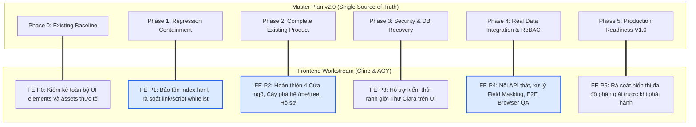

# GIATOCTRANTRONGTHU — KẾ HOẠCH HOÀN THÀNH TẦNG FRONTEND v2.0
## FRONTEND WORKSTREAM ALIGNMENT (PRODUCT BASELINE SYNCHRONIZATION)
### Tài liệu Triển khai Chuyên trách Căn chiếu theo Master Completion Plan v2.0

- **Repository:** `giatoctrantrongthu` (`/Users/tuantq/Projects/Personal/giatoctrantrongthu`)
- **Tên miền mục tiêu:** `https://giatoctrantrongthu.com`
- **Ngày ban hành v1.0:** `2026-10-31` · **Đồng bộ Master Plan v2.0:** `2026-11-02`
- **Phiên bản tài liệu:** `v2.0 (Product Baseline Centric & Live Site Synchronization)`
- **Tài liệu gốc tham chiếu tối cao (Single Source of Truth):** [`AUDIT/MASTER_COMPLETION_PLAN.md`](file:///Users/tuantq/Projects/Personal/giatoctrantrongthu/AUDIT/MASTER_COMPLETION_PLAN.md)
- **Thẩm quyền phân công:**
  - **Tuấn:** Human Final Authority (Quyết định tối cao về sản phẩm & duyệt các Human Gates).
  - **Emarald:** Analysis Authority (Thẩm định kiến trúc & kiểm soát chất lượng).
  - **AGY:** Primary Agent (Thực thi xuyên suốt, điều phối và đảm bảo tính nhất quán full-stack).
  - **Cline:** Specialized Execution Resource (Huy động chuyên biệt cho CSS, Visual QA, Playwright browser test khi có lợi thế rõ rệt).
- **Chế độ thực thi hiện tại:** **PLANNING REVISION ONLY (Không sửa code/HTML/CSS/JS, không tự động chuyển sang triển khai)**.

---

## 1. NGUYÊN TẮC CỐT LÕI & ĐỊNH HƯỚNG SẢN PHẨM FRONTEND

### 1.1 Website Hiện Tại Là Baseline Duy Nhất (Preserve The Live Product)
- **Điểm xuất phát bắt buộc:** Website đang chạy trên production `https://giatoctrantrongthu.com` (Bản mẫu xuất bản DESIGN-001 Revision) là biểu hiện cụ thể của Product Intent và là baseline duy nhất để hoàn thiện.
- **Bảo tồn và hoàn thiện:**
  - Hoàn thiện sản phẩm hiện hữu; không xây dựng website thứ hai.
  - Không thay thế sản phẩm hiện tại bằng một prototype khác.
  - Không tự ý redesign hoặc tạo Design System mới.
  - Kế thừa nguyên vẹn ngôn ngữ DESIGN-001: Masthead logo ngang vector, thanh điều hướng xuất bản, typography serif truyền thống, bảng màu di sản ấm áp (Crimson `#8b261e`, Dó, Điệp).

### 1.2 Đính Chính Cốt Lõi: Bản Chất 4 Cửa Ngõ Hash Routes
> **QUY TẮC BẮT BUỘC TRÊN GIAO DIỆN:**  
> - **Chỉ có Trang nhất (`#/`) là giao diện xã hội duy nhất hướng ra bên ngoài.**  
> - Bốn hash routes hiện hữu: **`#/mach`**, **`#/gia-pha`**, **`#/lich`**, **`#/tim-kiem`** **KHÔNG PHẢI là các trang nội dung công khai.**  
> - Chúng là **CÁC CỬA NGÕ / ĐIỂM MỜI (Gateways / Invitation Points)** người dùng xác thực tư cách thành viên để đi vào không gian nội bộ.  
> - Khi người ngoài truy cập 4 routes này, giao diện **bắt buộc hiển thị thông báo mời xác minh tư cách thành viên**, tuyệt đối **KHÔNG hiển thị nội dung nội bộ**.  
> - Tuyệt đối không dùng các thuật ngữ: *"Public Preview"*, *"Public Content Pages"*, *"Public Access to Internal Content"*.

### 1.3 Phân Biệt Các Lớp Quyền Trên Giao Diện (UI Access Layers)
1. **Xác minh tư cách thành viên (Membership Verification):** Người dùng chứng minh mình thuộc dòng họ Trần Trọng Thu.
2. **Xác thực đăng nhập (Authentication):** Người dùng có phiên đăng nhập hợp lệ.
3. **Phân quyền nội dung (Authorization):** 
   - Đăng nhập thành công **không đồng nghĩa** được xem toàn bộ dữ liệu.
   - Thư gửi Clara: **Branch-scoped** (chỉ mở cho nhánh ông bà Hạnh Đào, người ngoài nhánh không biết trang tồn tại).
   - MẠCH & Phả đồ: Mở cho thành viên toàn dòng họ theo chính sách Recognition/Disclosure.
   - Personal Space: Hồ sơ cá nhân có trường dữ liệu và quyền chỉnh sửa riêng.

### 1.4 Vai Trò Chuẩn Xác Của Vibecode Lab
> **Vibecode Lab là môi trường UI/UX Review và Design Approval.**  
> - Local đóng vai trò là **Baseline Mirror** tương đương với website Online hiện tại để Tuấn trực tiếp kiểm tra và điều chỉnh.  
> - Quy trình:
>   $$\text{Production Baseline} \longrightarrow \text{Local Mirror (Lab)} \longrightarrow \text{Tuấn Điều Chỉnh UI/UX} \longrightarrow \text{Review \& Approval} \longrightarrow \text{Human Approval Gate} \longrightarrow \text{Promotion to Production}$$  
> - Lab không phát triển thành giao diện khác biệt; không tự động đẩy lên Online; phân biệt rõ source code, configuration, data và runtime giữa Local và Production.

---

## 2. CHECKLIST ĐỊNH LƯỢNG BẢO TỒN NGUYÊN BẢN DESIGN-001

Cline và AGY bắt buộc đối soát theo checklist có thể kiểm tra được (kèm bằng chứng baseline):

| Hạng Mục Nhận Diện | Quy Chuẩn Thiết Kế Bắt Buộc | Bằng Chứng Baseline (Evidence) | Trạng Thái Kiểm Tra |
|---|---|---|:---:|
| **1. Masthead Logo** | Sử dụng duy nhất `assets/images/logoGiaToc_ngang.svg`, khẩu hiệu nằm trong vector, không lặp lại thẻ HTML. | `live_home.png` | **VERIFIED (Bảo tồn 100%)** |
| **2. Utility Strip** | Dải tiện ích trên đỉnh: Ngày tháng âm dương bên trái; cụm `⌂`, `⌕`, `⚙` và nút `Tư cách thành viên →` bên phải. | `live_inspection_result.json` | **VERIFIED (Bảo tồn 100%)** |
| **3. Sticky Navigation** | 6 tab rõ ràng: `Trang chủ`, `MẠCH`, `Tư Liệu`, `Gia Phả`, `Lịch`, `Tìm kiếm`. | `live_home.png` | **VERIFIED (Bảo tồn 100%)** |
| **4. Typography** | Playfair Display / Noto Serif cho tiêu đề; Sans-serif thanh thoát cho nội dung đọc dài. | `prototype.css` | **VERIFIED (Bảo tồn 100%)** |
| **5. Color Palette** | Heritage Crimson `#8b261e`, Hoàng kim nhạt, nền giấy Dó xưa và giấy Điệp. | `prototype.css` | **VERIFIED (Bảo tồn 100%)** |
| **6. Layout Rhythm** | Bố cục xuất bản ấn phẩm đơn cột, nhịp kẻ ngang đơn thanh, khoảng trắng trang trọng. | `live_home.png` | **VERIFIED (Bảo tồn 100%)** |
| **7. Homepage Narrative** | 5 tầng diễn ngôn: Định danh -> Giới thiệu -> Điểm mời vào -> Tư liệu -> Khám phá sâu. | `index.html` HEAD `42a7ed2` | **VERIFIED (Bảo tồn 100%)** |
| **8. Responsive** | Không tràn ngang màn hình trên 4 viewports: Mobile 375px, Tablet 768px, Laptop 1024px, Desktop 1440px. | `docs/audit/evidence/agy_phase1_audit/` | **VERIFIED (Bảo tồn 100%)** |
| **9. Colophon Footer** | Footer ấn phẩm số, lời lạc khoản bản quyền và ghi chú Owner Control Plane độc lập. | `live_home.png` | **VERIFIED (Bảo tồn 100%)** |

---

## 3. PHÂN RÃ NHIỆM VỤ FRONTEND THEO 6 PHASES (CHỐNG ĐẢO PHỤ THUỘC)

Frontend Workstream không đảo thứ tự phụ thuộc, phân rã rạch ròi theo 6 Phase của Master Plan v2.0:

---

## 4. CHI TIẾT CÁC ĐẦU VIỆC CHUYÊN TRÁCH FRONTEND (BACKLOG)

### FE-P0: Khảo Sát & Kiểm Kê Baseline Giao Diện (Phase 0)
- **Mục tiêu:** Kiểm kê toàn bộ các route, module JS, class CSS đang vận hành trên `https://giatoctrantrongthu.com`.
- **Trạng thái:** **HOÀN THÀNH (100% DONE)** qua báo cáo `live_inspection_result.json` `[PROVEN]`.

### FE-P1: Bảo Tồn Vỏ Trang Chủ `index.html` & Ngăn Ngừa Thoái Lui (Phase 1)
- **Mã Task:** `FE-P1-01` (Tương ứng `TASK-P1-01` trong Master Plan v2.0)
- **Mô tả:** Khôi phục và bảo tồn cấu trúc trang chủ giàu nội dung của bản DESIGN-001 trên `index.html`. Không biến `index.html` thành vỏ rỗng 18 dòng phụ thuộc JS nạp động. Đảm bảo toàn bộ thẻ `<link>` và `<script>` trỏ đúng whitelist tĩnh (`/assets/`, `/src/`).
- **Độ ưu tiên:** **P0** (Bắt buộc).
- **Tiêu chí nghiệm thu:** Mở website cục bộ hiển thị ngay lập tức trang chủ hoàn chỉnh, không có lỗi console 404.

### FE-P2: Hoàn Thiện Các Cửa Ngõ & Giao Diện Thành Viên (Phase 2)
- **Mã Task:** 
  - `FE-P2-01` (4 Gateway Routes): Hiển thị thông báo mời xác minh tư cách thành viên tại `#/mach`, `#/gia-pha`, `#/lich`, `#/tim-kiem` khi người ngoài truy cập; mở nội dung khi đã đăng nhập.
  - `FE-P2-02` (Cây Phả Hệ `/me/tree`): Xây dựng subsystem Cây phả đồ tương tác mới cho thành viên, hiển thị thế hệ và quan hệ huyết thống rõ ràng.
  - `FE-P2-03` (Hồ Sơ Nhân Vật `/me/tree/person/:id`): Trình bày nhân thân trang trọng: Họ tên, năm sinh, năm mất, chức vị, ảnh chân dung phục hồi, mối quan hệ gia tộc.
  - `FE-P2-04` (Khảo Cứu MẠCH `/me/mach`): Hiển thị 12 bài nghiên cứu lịch sử dòng họ với nhịp điệu biên tập chuẩn mực; tuyệt đối không có Thư Clara tại đây.
  - `FE-P2-05` (Lịch Gia Tộc `/me/calendar`): Hiển thị các ngày giỗ chạp trong năm tính toán theo âm lịch.
- **Độ ưu tiên:** **P1**.
- **Chốt chặn nghiệm thu:** Trình Tuấn review và phê duyệt tại **GATE-03 (Vibecode Lab Mirror)**.

### FE-P3: Hỗ Trợ Kiểm Thử Ranh Giới An Ninh Thư Clara (Phase 3)
- **Mã Task:** `FE-P3-01`
- **Mô tả:** Đảm bảo toàn bộ giao diện công khai và thanh điều hướng chính **hoàn toàn không** chứa bất kỳ đường dẫn hay tab nào đến Thư gửi Clara. Chỉ hiển thị không gian này khi người dùng thuộc nhánh ông bà Hạnh Đào (`A-HD`).
- **Độ ưu tiên:** **P0**.

### FE-P4: Nối API Dữ Liệu Thật & Chạy Browser QA (Phase 4)
- **Mã Task:** `FE-P4-01` (Kết nối API thật), `FE-P4-02` (Browser QA 4 viewports).
- **Mô tả:** Chuyển đổi các hàm nạp dữ liệu sang gọi API thật `/api/genealogy.json`, `/api/mach.json` từ backend Express. Chạy Playwright Browser QA trên 4 kích thước màn hình: 375px, 768px, 1024px, 1440px.
- **Độ ưu tiên:** **P1**.
- **Tiêu chí nghiệm thu:** Không có lỗi console, không tràn ngang màn hình, 100% assertions kiểm thử tự động đạt PASS.

### FE-P5: Rà Soát Cuối Cùng Trước Khi Phát Hành V1.0 (Phase 5)
- **Mã Task:** `FE-P5-01`
- **Mô tả:** Kiểm tra toàn diện giao diện thực tế trên môi trường Staging/Production tên miền chính thức, đối soát tính sắc nét của hình ảnh di sản và sự ổn định của phông chữ tiếng Việt.
- **Chốt chặn phê duyệt:** Trình Tuấn phê duyệt phát hành tại **GATE-06**.

---
*Tài liệu hoàn thành tầng Frontend được đồng bộ 100% với Master Completion Plan v2.0.*
