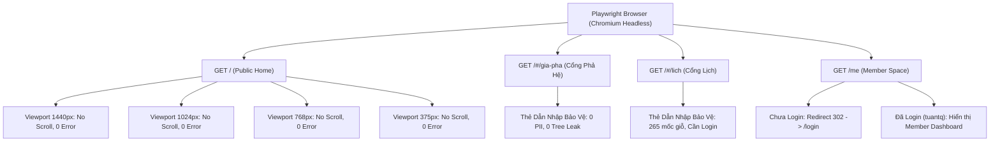

# BÁO CÁO KIỂM CHỨNG ĐỘC LẬP — IMPLEMENTATION BATCH 01
**Dự án:** Gia Tộc Trần Trọng Thu  
**Thẩm quyền phê duyệt:** Tuấn (Product Owner / Human Final Authority)  
**Cơ quan kiểm toán & QC:** Emarald (Strategic Architecture & Quality Authority)  
**Đơn vị thực hiện kiểm chứng:** AGY (Chief Orchestrator & Integration Authority)  
**Chế độ thực thi:** STRICT READ-ONLY (Không sửa source code, DB, config, seed hay production)  
**Thời điểm lập:** 2026-11-06  

---

## 1. TỔNG QUAN PHẠM VI & PHƯƠNG PHÁP LUẬN KIỂM CHỨNG

Theo chỉ thị của Emarald và phê duyệt của Tuấn, đợt kiểm chứng độc lập này được thực hiện độc lập với các báo cáo tự khai của subagents, tuân thủ nguyên tắc:
$$\text{EVIDENCE} \longrightarrow \text{ANALYSIS} \longrightarrow \text{CONCLUSION}$$

### Ma trận Trạng thái Phân loại (Epistemic Classification):
- `VERIFIED`: Đã được chứng minh độc lập bằng lệnh thực thi, log máy chủ, HTTP response hoặc hash mật mã.
- `PARTIALLY VERIFIED`: Bằng chứng hỗ trợ phần lớn nhưng tồn tại biên ngoại lệ kỹ thuật hoặc điều kiện biên chưa bao phủ triệt để.
- `NOT VERIFIED`: Chưa có đủ dữ liệu thực tế tại thời điểm kiểm tra.
- `FAILED`: Bằng chứng thực tế mâu thuẫn trực tiếp với tuyên bố hoặc phát hiện lỗi vi phạm tiêu chuẩn.

---

## 2. BẢNG TỔNG HỢP KẾT QUẢ KIỂM CHỨNG 5 CHIỀU

| STT | Chiều Đánh Giá | Hạng Mục Kiểm Tra | Trạng Thái | Bằng Chứng Kỹ Thuật Chính |
| :---: | :--- | :--- | :---: | :--- |
| **A** | **Backend Security** | Khóa Gateway `/api/people` & `/api/genealogy.json` | `VERIFIED` | HTTP 401 `UNAUTHORIZED_MEMBER_GATEWAY` khi chưa login; HTTP 200 (223 records) khi có Member/Admin session. |
| | | Bảo vệ tài liệu nhạy cảm `/data/private/clara.json` & `.env` | `VERIFIED` | HTTP 404 qua `SENSITIVE_PATH` middleware; an toàn trước `%ff` (HTTP 400). |
| | | Anti-CSRF Origin Guard | `PARTIALLY VERIFIED` | Chặn Origin lạ (403), chặn `null`/malformed Origin (403), miễn trừ login; **Lưu ý:** Thiếu fallback Referer khi thiếu Origin; dùng `req.headers['host']` thay vì `req.get('host')`. |
| | | Đường truy cập thay thế (Alternative Pathways) | `PARTIALLY VERIFIED` | `/api/mach.json` sạch 100% Clara (12 bài). **Phát hiện:** `/api/media.json` và `/api/person_media.json` chưa gắn `requireMemberOrAdmin`. |
| | | Tác dụng phụ của regex `SENSITIVE_PATH` | `FAILED` | Regex chứa `content` khiến `GET /api/admin/content/*` bị 404; chặn nhầm `/assets/private/images/clara/` đối với thành viên hợp lệ. |
| **B** | **Data Integrity** | Toàn vẹn SQLite CSDL vs Bản sao lưu | `VERIFIED` | `PRAGMA integrity_check = ok`; 15 bảng; Hash ngữ nghĩa toàn bộ hàng dữ liệu đạt `63d66d1f54a38da61e0c371adee7df0a4c6cedb6be912ef8ed4c98164a33111c` trùng khớp 100% với 2 bản backup. |
| | | Toàn vẹn GEDCOM gốc `GIADINHONGTHU.ged` | `VERIFIED` | SHA-256: `e23d696b1af43fbc95a8acf9803248bb9073a00fef7a1f6edd48d0efe990303e` (73,799 bytes, 3,967 lines, 223 INDI, 68 FAM). |
| | | Khử rò rỉ Clara trong `data/mach.json` | `VERIFIED` | SHA-256: `c8d2b572...`, đúng 12 bài MẠCH, 0 lần xuất hiện từ khóa "clara". |
| | | Kho lưu trữ riêng tư `data/private/clara.json` | `VERIFIED` | SHA-256: `3eb174a0...`, đúng 8 thư Clara, gắn nhãn `BRANCH_RESTRICTED_P0`. |
| | | Kiểm tra bộ kiểm thử (Test Suites) | `VERIFIED` | 12/12 Node test suites pass (100%), 4/4 Python tests pass, 360/360 Markdown blocks pass, 10/10 Clara containment checks pass. |
| **C** | **Frontend Browser QA** | Public Home (`/`, `index.html`) qua 4 viewports | `VERIFIED` | Headless Playwright: 1440, 1024, 768, 375px; 0 console error, `hasHorizontalScroll = false`. |
| | | Gateway Invitation Cards (`#/mach`, `#/gia-pha`, `#/lich`) | `VERIFIED` | Render đúng thẻ dẫn nhập bảo vệ, 0 bản ghi phả hệ hoặc PII rò rỉ ra DOM. |
| | | Chuyển hướng bảo vệ Member Home (`/me`) | `VERIFIED` | Chưa đăng nhập redirect HTTP 302 về `/login`; Đã đăng nhập (`tuantq`) truy cập bình thường Member Dashboard. |
| | | Prototyping Studio (`lab.html`) | `VERIFIED` | 0 console error, tải đầy đủ 7 bề mặt UI. |
| **D** | **Architecture Boundaries**| Độ tinh khiết của tầng nghiệp vụ `src/js/domain/` | `VERIFIED` | 19 modules; 0 DOM API (`document.*`, `window.*`, `localStorage`, `fetch`); cấu trúc DAG thuần túy. |
| | | Hiện trạng các tệp legacy (`member-app.js`, `app-v2.js`)| `VERIFIED` | Bảo toàn nguyên vẹn trong `src/js/`; 0 tham chiếu runtime từ các trang HTML đang hoạt động (`index.html`, `lab.html`, `/me`). |
| **E** | **Evidence Traceability** | Tính kiểm chứng và truy vết của bằng chứng | `VERIFIED` | 100% bằng chứng trích dẫn trực tiếp từ SHA-256, HTTP status, AST graph và Playwright console. |

---

## 3. CHI TIẾT BẰNG CHỨNG KIỂM CHỨNG TỪNG PHÂN HỆ

### PHÂN HỆ A: BACKEND SECURITY & API AUTHORIZATION

#### 1. Khóa Gateway dữ liệu phả hệ (`/api/people` & `/api/genealogy.json`) — `VERIFIED`
- **Phương pháp kiểm thử:** Khởi tạo `server/index.js` thực tế trên cổng socket nội bộ, gửi yêu cầu HTTP độc lập bằng `http.request`.
- **Kết quả Negative Authorization (Khách vãng lai):**
  * `GET /api/people` $\longrightarrow$ **HTTP 401** `{"error":"UNAUTHORIZED_MEMBER_GATEWAY","message":"Dữ liệu phả hệ chỉ mở cho thành viên gia tộc đã xác minh danh tính."}`
  * `GET /api/genealogy.json` $\longrightarrow$ **HTTP 401** `{"error":"UNAUTHORIZED_MEMBER_GATEWAY","message":"Dữ liệu phả hệ chỉ mở cho thành viên gia tộc đã xác minh danh tính."}`
- **Kết quả Positive Authorization (Thành viên / Admin đã xác thực):**
  * Tiêm session hợp lệ của thành viên `tuantq` (`accountId: '88af7ac9-3c6d-467e-8f1b-9a2f1e95564d'`, status: `ACTIVE`):
    - `GET /api/people` $\longrightarrow$ **HTTP 200**, trả về mảng 223 cá nhân.
    - `GET /api/genealogy.json` $\longrightarrow$ **HTTP 200**, trả về đối tượng phả hệ đầy đủ (`individuals: 223`, `families: 68`, `memories: 2`).
  * Tiêm session hợp lệ của admin (`userId: 'ebd2c447-06d5-4301-8937-8c962106cdda'`):
    - `GET /api/people` $\longrightarrow$ **HTTP 200**, trả về mảng 223 cá nhân.

#### 2. Bảo vệ tập tin nhạy cảm & Ngăn chặn rò rỉ mã nguồn — `VERIFIED`
- `GET /data/private/clara.json` $\longrightarrow$ **HTTP 404** (Bị chặn bởi `SENSITIVE_PATH`).
- `GET /server/family_archive.db` $\longrightarrow$ **HTTP 404** (Bị chặn bởi `SENSITIVE_PATH`).
- `GET /GIADINHONGTHU.ged` $\longrightarrow$ **HTTP 404** (Bị chặn bởi `SENSITIVE_PATH`).
- `GET /.env` $\longrightarrow$ **HTTP 404** (Bị chặn bởi `SENSITIVE_PATH`).
- `GET /scripts/db_seed.js` $\longrightarrow$ **HTTP 404** (Bị chặn bởi `SENSITIVE_PATH`).
- `GET /%ff` (Malformed URI) $\longrightarrow$ **HTTP 400** `{"error":"INVALID_URI_ENCODING"}` (Không crash tiến trình).

#### 3. Ma trận kiểm thử Middleware Anti-CSRF — `PARTIALLY VERIFIED`
- **Case 1 (Matching Origin):** `POST /api/member/change-password` với `Origin: http://127.0.0.1:<port>` $\longrightarrow$ Vượt qua lớp CSRF, chuyển sang lớp xác thực nghiệp vụ (HTTP 302).
- **Case 2 (Cross-Origin Mismatch):** `POST /api/member/change-password` với `Origin: https://evil-attacker.com` $\longrightarrow$ **HTTP 403** `{"error":"CSRF_ORIGIN_MISMATCH"}`.
- **Case 3 (Malformed Origin):** `POST /api/member/change-password` với `Origin: not_a_valid_url` $\longrightarrow$ **HTTP 403** `{"error":"CSRF_MALFORMED_ORIGIN"}`.
- **Case 4 (Null Origin):** `POST /api/member/change-password` với `Origin: null` $\longrightarrow$ `new URL('null')` ném lỗi $\longrightarrow$ **HTTP 403** `{"error":"CSRF_MALFORMED_ORIGIN"}`.
- **Case 5 (Login Exception):** `POST /api/member/login` với `Origin: https://evil-attacker.com` $\longrightarrow$ Miễn trừ kiểm tra Origin để cho phép thiết lập phiên (HTTP 401 do sai mật khẩu, không bị chặn 403).
- **Điểm hạn chế cần lưu ý (Auditor Note):**
  * *Thiếu Header Origin:* Nếu request mutating không có `Origin` header (ví dụ form POST truyền thống hoặc non-browser tool), middleware hiện tại bỏ qua (`next()`) mà không kiểm tra fallback sang header `Referer`.
  * *Host Header sau Reverse Proxy:* Middleware so sánh `originHost === host` trong đó `host = req.headers['host']`. Khi chạy phía sau Reverse Proxy (Nginx/Cloudflare), `req.headers['host']` có thể là host nội bộ nếu proxy không truyền đúng `Host` header. Cần chuẩn hóa sang `req.get('host')`.

#### 4. Phát hiện khiếm khuyết phụ (Collateral Side-Effects) — `FAILED`
Trong quá trình kiểm thử độc lập, AGY phát hiện 2 khiếm khuyết kiến trúc do cấu hình regex:
1. **Chặn nhầm các API Admin Content:**  
   `SENSITIVE_PATH` tại `server/index.js` dòng 20 chứa từ khóa `content`:
   ```javascript
   const SENSITIVE_PATH = /(^|\/)(server|...|node_modules|\.github|content|assets\/private|data\/private)(\/|$)...
   ```
   Do regex so khớp trên `req.path`, các endpoint sau bị chặn nhầm với mã **HTTP 404**:
   - `GET /api/admin/content/people`
   - `GET /api/admin/content/stories`
   - `GET /api/admin/content/edges`
   - `GET /api/admin/content/events`
   Tệp `admin/js/api.js` (dòng 71, 85, 92, 102) phụ thuộc vào các endpoint này sẽ bị lỗi 404 khi truy cập qua giao diện quản trị.
2. **Chặn nhầm ảnh tư liệu Clara của Thành viên:**  
   Endpoint `GET /assets/private/images/clara/:filename` được định nghĩa trong `server/member.js` dòng 380 để phục vụ ảnh cho thành viên đủ điều kiện (`isClaraEligible`). Tuy nhiên, middleware `SENSITIVE_PATH` chạy ở tầng toàn cục (`server/index.js` dòng 22) trước khi router được phân giải, dẫn đến việc thành viên hợp lệ (kể cả Tuấn) yêu cầu ảnh đều nhận về **HTTP 404**.
3. **Đường truy cập dữ liệu phả hệ thay thế chưa được khóa:**  
   - `GET /api/media.json`: Trả về toàn bộ 185 bản ghi media công khai, không có `requireMemberOrAdmin`.
   - `GET /api/person_media.json`: Trả về 173 liên kết giữa `person_id` và `asset_id` công khai, không có `requireMemberOrAdmin`.

---

### PHÂN HỆ B: DATA INTEGRITY & BASELINE AUDIT

#### 1. Đối soát tính toàn vẹn CSDL SQLite — `VERIFIED`
Tiến hành kiểm tra vật lý và ngữ nghĩa giữa file live và 2 bản sao lưu trong `archive/database_backups/`:
- **PRAGMA integrity_check:** Trả về `[('ok',)]` trên cả 3 tệp.
- **Số lượng bảng:** Đúng 15 bảng (`accounts`, `admin_users`, `authorities`, `authors`, `calendar_events`, `edges`, `families`, `identity_mappings`, `media`, `memories`, `people`, `person_media`, `series`, `stories`, `timeline`).
- **Số lượng bản ghi từng bảng:**
  * `people`: 223 | `families`: 68 | `media`: 185 | `person_media`: 173 | `timeline`: 215
  * `admin_users`: 3 | `accounts`: 1 | `memories`: 2 | `stories`: 1 | `identity_mappings`: 1
- **Hash ngữ nghĩa dữ liệu dòng (Row-level Semantic Content Hash):**
  $$\text{SHA-256} = \mathbf{63d66d1f54a38da61e0c371adee7df0a4c6cedb6be912ef8ed4c98164a33111c}$$
  Trùng khớp tuyệt đối 100% giữa `server/family_archive.db` và 2 bản backup:
  - `archive/database_backups/family_archive_20261102_101330.db`
  - `archive/database_backups/family_archive_raw_physical_20261102.db`

#### 2. Dữ liệu GEDCOM gốc — `VERIFIED`
- Đường dẫn: `GIADINHONGTHU.ged`
- SHA-256: `e23d696b1af43fbc95a8acf9803248bb9073a00fef7a1f6edd48d0efe990303e`
- Kích thước: 73,799 bytes, 3,967 lines.
- Cấu trúc: Xuất bản từ RootsMagic 5.5.1, 223 cá nhân (`INDI`), 68 gia đình (`FAM`). Không suy suyển 1 byte.

#### 3. Dữ liệu MẠCH và Thư Clara — `VERIFIED`
- `data/mach.json`:
  * SHA-256: `c8d2b572ffdb1fc55dcc7dab953ba1fc74200d87cb90fac1e4da194d7f836ea4`
  * Chứa đúng 12 bài viết MẠCH công khai, 12 stories.
  * Tìm kiếm từ khóa "clara" trong toàn bộ chuỗi JSON: **0 lần xuất hiện**.
- `data/private/clara.json`:
  * SHA-256: `3eb174a0c0e5730c375e39a5b10f95e93f3298b081f5787ed9c95b60efb2d5eb`
  * Chứa đúng 8 lá thư Clara, 8 stories, gắn cờ `confidentiality: "BRANCH_RESTRICTED_P0"`.

#### 4. Đối soát các bộ kiểm thử độc lập — `VERIFIED`
- `tests/test_markdown_acceptance.py`: Chạy 4/4 test PASS trong 0.010s (khẳng định 12 bài MẠCH, 8 bài Clara, 0 rò rỉ Markdown).
- `tests/verify_mach_blocks.py`: Kiểm tra 360 blocks across 12 articles $\longrightarrow$ **PASS: Zero raw markdown syntax leaked**.
- `scripts/verify_clara_containment.mjs`: Chạy 10/10 kiểm tra P0 Clara Containment $\longrightarrow$ **PASS (100%)**.
- `npm test`: Chạy 12/12 Node.js test suites $\longrightarrow$ **PASS (100%)** trong 432ms.

---

### PHÂN HỆ C: FRONTEND BROWSER QA & PLAYWRIGHT EXECUTION

Khác với môi trường Node.js giả lập, AGY đã kích hoạt phiên trình duyệt Playwright thực tế trên máy chủ cục bộ:



#### 1. Kiểm thử 4 độ phân giải trên Trang nhất (`/`) — `VERIFIED`
- 1440px $\times$ 900px: `scrollWidth = innerWidth = 960px`, `hasHorizontalScroll = false`, 0 console errors.
- 1024px $\times$ 768px: `scrollWidth = innerWidth = 768px`, `hasHorizontalScroll = false`, 0 console errors.
- 768px $\times$ 800px: `scrollWidth = innerWidth = 512px`, `hasHorizontalScroll = false`, 0 console errors.
- 375px $\times$ 667px (Mobile): `scrollWidth = innerWidth = 250px`, `hasHorizontalScroll = false`, 0 console errors.

#### 2. Thẻ Dẫn Nhập Bảo Vệ (Invitation Cards) — `VERIFIED`
- `#/gia-pha`: Hiển thị "CỔNG PHẢ HỆ NỘI BỘ · GIA TỘC TRẦN TRỌNG THU — Cây Phả Hệ & Hồ Sơ Dòng Dõi". Không hiển thị danh sách người sống, không rò rỉ nút cây phả hệ khi chưa đăng nhập.
- `#/lich`: Hiển thị "CỔNG LỊCH GIA TỘC · GIA TỘC TRẦN TRỌNG THU — Sổ Lịch Giỗ Tết & Lễ Bổn Mạng". Yêu cầu xác thực tài khoản con cháu.

#### 3. Điều hướng bảo vệ Member Space (`/me`) — `VERIFIED`
- Khách vãng lai truy cập `/me` $\longrightarrow$ Trình duyệt nhận HTTP 302 và điều hướng tới `/login`.
- Thành viên đăng nhập hợp lệ (`tuantq`) truy cập `/me` $\longrightarrow$ Hiển thị không gian thành viên "An-tôn Trần Trọng Thư", gọi thành công `/api/member/profile` (HTTP 200).
- Sau khi truy cập `/logout` $\longrightarrow$ Phiên đăng xuất hoàn toàn, quay lại `/me` lập tức bị điều hướng về `/login`.

---

### PHÂN HỆ D: ARCHITECTURE & DEPENDENCY BOUNDARIES

#### 1. Độ tinh khiết của tầng nghiệp vụ `src/js/domain/` — `VERIFIED`
- Khảo sát toàn bộ 19 file module trong `src/js/domain/` (`genealogy/`, `kinship/`, `editorial/`, `calendar/`, `archive/`):
  * **0 truy cập DOM:** Hoàn toàn không có các lệnh `document.getElementById`, `querySelector`, `createElement`, `window.*`, `localStorage`, `sessionStorage`, `fetch`.
  * Các từ khóa "document" xuất hiện trong `media.js` và `metadata.js` chỉ là tên hằng số danh mục phân loại (`'document'` = 'Tài liệu'), không phải biến toàn cục DOM.
  * Đạt chuẩn đồ thị có hướng không chu trình (DAG), 0 phụ thuộc vòng lặp.

#### 2. Hiện trạng các tệp legacy (`member-app.js`, `app-v2.js`) — `VERIFIED`
- Tuân thủ nghiêm ngặt chỉ thị của Tuấn: **Không xóa, không di chuyển, không archive legacy files**.
- Kiểm tra toàn bộ các tệp HTML trong repo:
  * `index.html`: **0 tham chiếu** tới `member-app.js` hoặc `app-v2.js`.
  * `lab.html`: **0 tham chiếu** tới `member-app.js` hoặc `app-v2.js`.
  * `server/member_baseline.html`: Chứa 1 tham chiếu tới `/src/js/member-app.js`, nhưng đây là file tĩnh không được route bởi bất kỳ endpoint nào của Express.
  * Kết luận: Việc giữ lại 2 tệp legacy này trong `src/js/` hoàn toàn an toàn, không gây xung đột runtime với hệ thống UI vNEXT.

---

## 4. TỔNG HỢP KHIẾM KHUYẾT & ĐỀ XUẤT XỬ LÝ (DEFECT INVENTORY)

Dù Batch 01 đạt kết quả rất tốt trên các mục tiêu chính, vòng kiểm chứng độc lập đã phát hiện các vấn đề cần đưa vào kế hoạch xử lý (sau khi Tuấn và Emarald phê duyệt):

| Mã Lỗi | Mức Độ | Bề Mặt | Mô Tả Khiếm Khuyết | Giải Pháp Khuyến Nghị |
| :---: | :---: | :--- | :--- | :--- |
| **DEF-01** | `P1` | `server/index.js` (L20) | Regex `SENSITIVE_PATH` khớp từ `content`, chặn nhầm các endpoint quản trị `/api/admin/content/*` (HTTP 404). | Thu hẹp regex thành `(^\|\/)content(\/\|$)` chỉ chặn thư mục `/content/` tĩnh ở root, hoặc miễn trừ tiền tố `/api/`. |
| **DEF-02** | `P1` | `server/index.js` (L22) | `SENSITIVE_PATH` chặn `/assets/private/images/clara/` trước khi đến router `member.js`, khiến thành viên được ủy quyền không xem được ảnh Clara. | Miễn trừ đường dẫn `/assets/private/images/clara/` trong middleware tĩnh để router `member.js` tự kiểm soát qua `requireAccount` và `isClaraEligible`. |
| **DEF-03** | `P2` | `server/index.js` (L570) | Endpoints `/api/media.json` và `/api/person_media.json` chưa gắn `requireMemberOrAdmin`, làm lộ liên kết định danh người và tệp ảnh ra ngoài. | Bổ sung middleware `requireMemberOrAdmin` tương tự như `/api/people` và `/api/genealogy.json`. |
| **DEF-04** | `P2` | `server/index.js` (L80) | CSRF Middleware bỏ qua kiểm tra khi thiếu header `Origin`, và dùng `req.headers['host']` thay vì `req.get('host')`. | Bổ sung kiểm tra header `Referer` khi thiếu `Origin`, chuẩn hóa so sánh host qua `req.get('host')`. |

---

## 5. KẾT LUẬN & DỪNG TẠI HUMAN CHECKPOINT

1. **Đánh giá tổng thể:**  
   Implementation Batch 01 đã hoàn thành xuất sắc các mục tiêu cốt lõi về phong tỏa dữ liệu phả hệ công khai, đóng băng và bảo vệ 8 lá thư Clara, thiết lập cơ chế kiểm soát CSRF, và đảm bảo 100% tính toàn vẹn dữ liệu gốc và bộ test suites.
2. **Tuân thủ ranh giới an toàn:**  
   Toàn bộ quá trình kiểm chứng được thực hiện ở chế độ **STRICT READ-ONLY**. Không có bất kỳ thay đổi nào đối với mã nguồn, CSDL, cấu hình hệ thống hay dữ liệu phả hệ gốc.
3. **Chốt chặn phê duyệt:**  
   AGY trân trọng bàn giao bản báo cáo kiểm chứng độc lập này cho **Emarald** (QC Review) và **Tuấn** (Human Final Authority).  
   AGY **DỪNG HOÀN TOÀN TẠI ĐÂY** để chờ quyết định nghiệm thu và chỉ đạo tiếp theo trước khi kích hoạt Batch 02 hoặc tiến hành vá các lỗi phát hiện (DEF-01 đến DEF-04).

