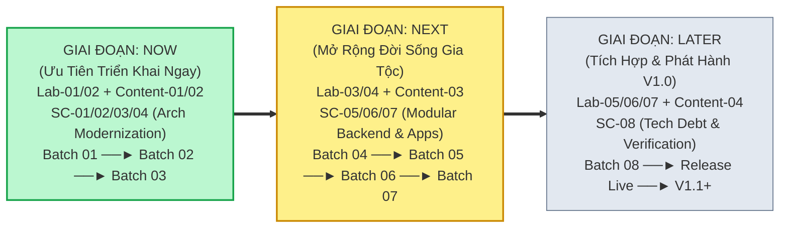
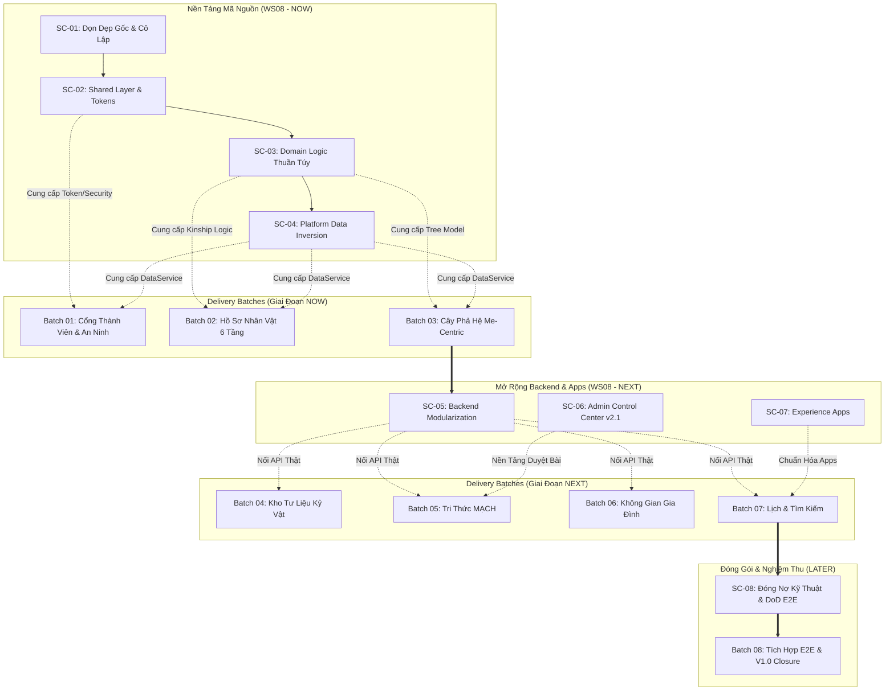

# GIATOCTRANTRONGTHU — MASTER COMPLETION & DELIVERY PLAN (v4.0 CANONICAL)
## KẾ HOẠCH TỔNG THỂ ĐIỀU HÀNH TRIỂN KHAI SẢN PHẨM, MÔI TRƯỜNG VIBECODE LAB & QUẢN TRỊ NỘI DUNG (CONTENT GOVERNANCE)
### CHUYỂN TRỌNG TÂM: AUDIT PHÁP Y ──► ĐIỀU HÀNH TRIỂN KHAI, QUẢN TRỊ NỘI DUNG & THẨM ĐỊNH THỰC TẾ

- **Dự án:** CÂY GIA PHẢ — GIA TỘC TRẦN TRỌNG THU
- **Nền tảng trực tuyến:** `https://giatoctrantrongthu.com` · **API:** `https://api.giatoctrantrongthu.com`
- **Môi trường thẩm định & trải nghiệm (Review & Acceptance):** Vibecode Lab (`http://localhost:8888/lab.html`)
- **Kho mã nguồn:** `/Users/tuantq/Projects/Personal/giatoctrantrongthu`
- **Phiên bản kế hoạch:** `v4.0 (Product Delivery, Vibecode Lab & Content Governance Alignment)`
- **Ngày ban hành v4.0:** `2026-11-03`
- **Thẩm quyền phê duyệt tối cao (Product Owner / Human Final Authority):** Tuấn
- **Thẩm quyền phân tích & Kiểm soát chất lượng (Analysis & QC Authority):** Emarald
- **Đơn vị điều phối & thực thi chính (Execution Coordinator & Primary Agent):** AGY
- **Trạng thái kế hoạch:** `ACTIVE ROADMAP — READY FOR PRODUCT OWNER SUPERVISION & SPRINT 01 EXECUTION`

---

## MỤC LỤC KẾ HOẠCH ĐIỀU HÀNH

1. [1. TỔNG QUAN ĐIỀU HÀNH & PHẠM VI SẢN PHẨM (PRODUCT DELIVERY OVERVIEW)](#1-tổng-quan-điều-hành--phạm-vi-sản-phẩm-product-delivery-overview)
2. [2. HIỆN TRẠNG SẢN PHẨM THỰC TẾ & NGUYÊN TẮC BẢO TỒN (PRODUCT BASELINE)](#2-hiện-trạng-sản-phẩm-thực-tế--nguyên-tắc-bảo-tồn-product-baseline)
3. [3. LỘ TRÌNH TRIỂN KHAI BA GIAI ĐOẠN (ROADMAP: NOW / NEXT / LATER)](#3-lộ-trình-triển-khai-ba-giai-đoạn-roadmap-now--next--later)
4. [4. WORKSTREAM VIBECODE LAB: MÔI TRƯỜNG THIẾT KẾ & THẨM ĐỊNH (LAB WORKSTREAM)](#4-workstream-vibecode-lab-môi-trường-thiết-kế--thẩm-định-lab-workstream)
5. [5. WORKSTREAM QUẢN TRỊ NỘI DUNG CHÍNH THỨC (CONTENT GOVERNANCE & MANAGEMENT)](#5-workstream-quản-trị-nội-dung-chính-thức-content-governance--management)
6. [6. WORKSTREAM KIẾN TRÚC & HIỆN ĐẠI HÓA MÃ NGUỒN (WS08 — SOURCE CODE ARCHITECTURE & MODERNIZATION)](#6-workstream-kiến-trúc--hiện-đại-hóa-mã-nguồn-ws08--source-code-architecture--modernization)
7. [7. CẤU TRÚC 8 BATCH BÀN GIAO SẢN PHẨM (DELIVERY BATCHES)](#7-cấu-trúc-8-batch-bàn-giao-sản-phẩm-delivery-batches)
8. [8. BATCH ĐẦU TIÊN TRIỂN KHAI: BATCH 01 (FIRST IMPLEMENTATION BATCH)](#8-batch-đầu-tiên-triển-khai-batch-01-first-implementation-batch)
9. [9. DANH MỤC QUYẾT ĐỊNH QUẢN TRỊ (DECISION REGISTER)](#9-danh-mục-quyết-định-quản-trị-decision-register)
10. [10. SỔ THEO DÕI RỦI RO & ĐIỀU KIỆN TIÊN QUYẾT (RISK & DEPENDENCY REGISTER)](#10-sổ-theo-dõi-rủi-ro--điều-kiện-tiên-quyết-risk--dependency-register)
11. [11. CƠ CHẾ PHÂN QUYỀN ĐIỀU HÀNH & RANH GIỚI MÔI TRƯỜNG (GOVERNANCE & ENVIRONMENT BOUNDARIES)](#11-cơ-chế-phân-quyền-điều-hành--ranh-giới-môi-trường-governance--environment-boundaries)
12. [12. MÔ HÌNH GIÁM SÁT TIẾN ĐỘ & BÁO CÁO CHUẨN TRÌNH TUẤN (REPORTING FORMAT)](#12-mô-hình-giám-sát-tiến-độ--báo-cáo-chuẩn-trình-tuấn-reporting-format)

---

## 1. TỔNG QUAN ĐIỀU HÀNH & PHẠM VI SẢN PHẨM (PRODUCT DELIVERY OVERVIEW)

Tài liệu này là **Kế hoạch Điều hành & Triển khai Duy nhất (Single Source of Truth)** của dự án. Tài liệu giúp Tuấn (Product Owner) nắm bắt toàn cảnh, theo dõi tiến độ, kiểm tra kết quả và đưa ra quyết định nhanh chóng mà không cần đọc hoặc hiểu toàn bộ chi tiết kỹ thuật phức tạp.

```text
┌────────────────────────────────────────────────────────────────────────┐
│                        TOÀN CẢNH DỰ ÁN TRÊN 1 TRANG                    │
├────────────────────────────────────────────────────────────────────────┤
│ 1. ĐANG XÂY DỰNG GÌ?                                                   │
│    Nền tảng số gìn giữ di sản, ký ức, tri thức và kết nối các thế hệ   │
│    Gia tộc Trần Trọng Thu qua tên miền giatoctrantrongthu.com.          │
│                                                                        │
│ 2. MỤC TIÊU CUỐI CÙNG (V1.0)?                                          │
│    Một không gian nội bộ an toàn, trang trọng, lấy cá nhân làm tâm     │
│    điểm (Me-Centric), tra cứu phả hệ 228 người, lưu trữ di ảnh, đọc bài │
│    MẠCH, nhắc ngày giỗ chạp và bảo vệ tuyệt đối đời tư gia đình.        │
│                                                                        │
│ 3. HIỆN TRẠNG ĐANG Ở ĐÂU?                                              │
│    ĐÃ HOÀN TẤT Phase 1 (Đặc tả trải nghiệm 30 Touchpoints).             │
│    Website live đang chạy trang chủ công khai và module Lịch.          │
│    SẴN SÀNG BƯỚC VÀO TRIỂN KHAI THỰC TẾ (Sprint 01 / Batch 01 & Lab).   │
│                                                                        │
│ 4. NHỮNG GÌ THUỘC PHẠM VI TRIỂN KHAI (IN-SCOPE V1.0)?                  │
│    - Cổng công khai tối giản, trang trọng, không công khai phả hệ.     │
│    - Không gian thành viên: Home, Hồ sơ 6 tầng FS, Cây Me-Centric.     │
│    - Kho tư liệu ảnh độc lập & cơ chế gắn thẻ người thân.              │
│    - Không gian tri thức MẠCH duyệt bài văn minh & bình luận hậu kiểm. │
│    - Lịch gia tộc tính âm dương; Không gian gia đình 3 lớp; Sổ cá nhân.│
│    - Cô lập an ninh tuyệt đối Thư gửi Clara (nhánh ông bà Hạnh Đào).    │
│    - Workstream Vibecode Lab phục vụ review; Workstream Content Gov.   │
│                                                                        │
│ 5. NHỮNG GÌ KHÔNG THUỘC PHẠM VI (OUT-OF-SCOPE V1.0)?                  │
│    - Mạng xã hội đại trà, diễn đàn mở cho công chúng ngoài dòng họ.    │
│    - Mạng lưới liên kết các chi phái mở rộng (dành cho V1.1+).         │
│    - Tự động hóa pháp lý phức tạp về quyền thừa kế hay hội đồng dòng họ│
│                                                                        │
│ 6. RÀNG BUỘC KỸ THUẬT BẤT BIẾN:                                        │
│    - Kiến trúc Vanilla JavaScript ES Modules thuần chuẩn trình duyệt.  │
│    - TUYỆT ĐỐI KHÔNG đưa React, Vue, Angular, Svelte hay bundler vào.  │
│    - BẢO TỒN NGUYÊN VẸN Product Baseline đang chạy trên live web.       │
│                                                                        │
│ 7. PHÂN ĐỊNH VAI TRÒ & THẨM QUYỀN:                                     │
│    - Tuấn: Product Owner / Thẩm quyền quyết định tối cao.              │
│    - Emarald: Thẩm quyền phân tích chiến lược, kiến trúc & kiểm soát QC│
│    - AGY: Điều phối thực thi kỹ thuật, lập kế hoạch và báo cáo.        │
└────────────────────────────────────────────────────────────────────────┘
```

---

## 2. HIỆN TRẠNG SẢN PHẨM THỰC TẾ & NGUYÊN TẮC BẢO TỒN (PRODUCT BASELINE)

### 2.1 Bảng Phân Định Hiện Trạng Thực Tế 5 Cấp Độ
Phân định rạch ròi 5 cấp độ để loại bỏ hoàn toàn sự ngộ nhận giữa *tính năng đã chạy thật* và *màn hình thử nghiệm trong phòng lab*:

| Thành Phần Sản Phẩm | Hiện Trạng Chi Tiết | Cấp Độ Phân Loại | Hướng Xử Lý Trong Kế Hoạch |
| :--- | :--- | :---: | :--- |
| **Trang chủ công khai (`#/`)** | Giao diện trang trọng, logo vector ngang chuẩn, hiển thị tốt 4 màn hình. | **ĐANG CHẠY THẬT** | **Bảo tồn nguyên vẹn (Preserve)** |
| **4 Cửa ngõ (`#/mach`, `#/gia-pha`...)** | Đã đóng bằng Thẻ Mời Trang Trọng (`gateway.js`), bảo vệ 100% dữ liệu gia phả (W-B01-01). | **ĐANG CHẠY THẬT** | **Bảo tồn & duy trì chốt chặn an ninh** |
| **Member Home (`/me`)** | Đã hoàn thành hội tụ 4 Slices: Ngữ cảnh đương sự, Lịch gia tộc, MẠCH, Kho di ảnh. | **ĐANG CHẠY THẬT** | **Bảo tồn baseline & kết nối các phân hệ** |
| **Cây phả hệ 3 tầng Me-Centric** | Chạy thực tế tại `/me/tree` với BFS huyết thống, 223 cá nhân xếp chuẩn Việt (Batch 03). | **ĐANG CHẠY THẬT** | **Bảo tồn baseline & duy trì kiểm thử** |
| **Hồ sơ nhân vật 6 tầng** | Chạy thực tế tại `/me/tree/person/:id` với 6 tầng dữ liệu và form đề xuất (Batch 02). | **ĐANG CHẠY THẬT** | **Bảo tồn baseline & hàng đợi đề xuất** |
| **Module Lịch gia tộc** | Calendar Domain Core tính âm dương và 265 sự kiện từ 4 tệp ICS đã tích hợp vào Home. | **ĐANG CHẠY THẬT** | **Kế thừa & bảo tồn nguyên vẹn** |
| **Cô lập Thư Clara** | Token độc lập, chặn 100% request không có quyền (Pass 10/10 test). | **ĐANG CHẠY THẬT** | **Duy trì chốt chặn an ninh P0** |
| **Vibecode Lab Studio** | Chạy tại `localhost:8888/lab.html` với 7 bề mặt UI và mock data. | **ĐANG HOẠT ĐỘNG (LAB)**| **Ổn định hóa theo workstream LAB-01** |
| **Đường dẫn `/login` và `/me`** | Hoạt động tốt trên local; cấu hình Vercel rewrite sẵn sàng cho Staging. | **SẴN SÀNG** | **Kích hoạt khi có lệnh triển khai Staging** |
| **173 liên kết ảnh CSDL** | Đã đối soát 173/185 ảnh khớp 100% với cá nhân; giữ nguyên bit-for-bit CSDL. | **GIỮ NGUYÊN (HOLD)** | **Chờ phê duyệt vật lý tại Gate 02** |
| **Kho ảnh thẻ & Gắn thẻ mặt** | Archive Core hoàn tất (16/16 test). Đã có điểm truy cập tại Member Home. | **IN PROGRESS** | **Mở rộng giao diện gắn thẻ tại Batch 04** |
| **Tìm kiếm toàn nền tảng** | Đã có ô tìm kiếm nhưng chưa có backend lọc theo quyền. | **CHƯA TRIỂN KHAI** | **Xây dựng tại Batch 07** |
| **Không gian gia đình riêng** | Đã có khung sườn `spaces.js` và router backend, chưa nối dữ liệu chi nhánh. | **CHƯA TRIỂN KHAI** | **Xây dựng tại Batch 06** |
| **Quy chế trẻ em & người mất** | Chưa có quy định chính thức về độ tuổi và duyệt ảnh người mất. | **CHƯA XÁC MINH (OPEN)** | **Chờ Tuấn quyết định; áp dụng tạm Restrict by default** |

### 2.2 Các Nguyên Tắc Bảo Tồn Tuyệt Đối
1. **Không rebuild sản phẩm:** Hoàn thiện sản phẩm hiện hữu; không xây dựng website thứ hai.
2. **Không thay thế website thật bằng prototype:** Vibecode Lab chỉ là môi trường xem trước và thử nghiệm giao diện; không phải bản phát hành thay thế production.
3. **Bảo tồn phong cách DESIGN-001:** Giữ nguyên bảng màu di sản đỏ sẫm gia tộc (`#8b261e`), nền giấy Dó, typography Playfair Display/Noto Serif, và nhịp kẻ đơn thanh trang nhã.

---

## 3. LỘ TRÌNH TRIỂN KHAI BA GIAI ĐOẠN (ROADMAP: NOW / NEXT / LATER)



### 3.1 GIAI ĐOẠN: NOW (Ưu Tiên Bắt Đầu Triển Khai Ngay)
- **Mục tiêu:** Ổn định công cụ thử nghiệm Vibecode Lab Studio; thiết lập nền móng phân loại nội dung có cấu trúc; dọn sạch gốc repo và cô lập mã kế thừa (`SC-01`); trích xuất tầng dùng chung & tokens (`SC-02`); tách biệt nghiệp vụ thuần túy khỏi DOM (`SC-03`); đảo ngược phụ thuộc tầng dữ liệu (`SC-04`); khóa chặt 4 cửa ngõ công khai tránh rò rỉ dữ liệu; tạo giao diện đăng nhập thành viên an toàn; và hoàn thiện 2 giao diện cốt lõi: Cây phả hệ Me-Centric & Hồ sơ nhân vật 6 tầng.
- **Giá trị mang lại:** Tuấn có môi trường trực quan tiện lợi để trực tiếp trải nghiệm đăng nhập, xem hồ sơ chính mình, duyệt phả hệ sống động trong môi trường Lab an toàn với nội dung có nguồn gốc rõ ràng, trên nền tảng source code sạch sẽ và có ranh giới module rõ ràng.
- **Các đầu việc triển khai:**
  - `LAB-01`: Rà soát hiện trạng & ổn định Vibecode Lab Studio hiện có.
  - `LAB-02`: Nâng cấp thanh điều hướng màn hình & linh kiện trong Lab.
  - `CONTENT-01`: Kiểm kê và phân loại toàn bộ nội dung đang hardcode trong Lab.
  - `CONTENT-02`: Thiết lập nền tảng nội dung có cấu trúc file-based (JSON/YAML).
  - `SC-01` (`MIG-01`): Thu dọn thư mục gốc, lưu trữ scripts Gen 0 và cô lập mã Gen 1 (`member-app.js`).
  - `SC-02` (`MIG-02`): Trích xuất tầng Dùng chung (`src/js/shared/`) & Chuẩn hóa Design Tokens CSS.
  - `SC-03` (`MIG-03`): Tách biệt Logic Nghiệp vụ Phả hệ/Xưng hô (`src/js/domain/`) khỏi DOM.
  - `SC-04` (`MIG-04`): Đảo ngược phụ thuộc Tầng Dữ liệu (`src/js/platform/data/`), gỡ bỏ import mock cứng.
  - `BATCH 01`: Cổng Vào Thành Viên & Khóa Cửa Ngõ Công Khai (`TP-001`, `TP-002`, `TP-030`).
  - `BATCH 02`: Hồ Sơ Nhân Vật 6 Tầng Chuẩn FamilySearch & Đề Xuất Dữ Kiện (`TP-003`, `TP-017`, `TP-024`, `TP-025`).
  - `BATCH 03`: Cây Phả Hệ Tương Tác Đa Thế Hệ Me-Centric (`TP-006`, `TP-016`).
- **Điều kiện chuyển sang NEXT:** Hoàn thành nghiệm thu giao diện tại Lab với Tuấn qua **GATE-03**.

### 3.2 GIAI ĐOẠN: NEXT (Mở Rộng Đời Sống Gia Tộc)
- **Mục tiêu:** Mở rộng trải nghiệm đời sống gia tộc: Kho tư liệu ảnh độc lập, Không gian tri thức MẠCH, Không gian sinh hoạt các gia đình nhánh, Lịch gia tộc và Tìm kiếm bảo mật; song song với việc module hóa Backend Express 5 (`SC-05`), hợp nhất Admin Control Center v2.1 (`SC-06`) và tái tổ chức Experience Apps (`SC-07`).
- **Các đầu việc triển khai:**
  - `LAB-03`: Nâng cấp công cụ kiểm tra độ phân giải responsive 4 viewports trong Lab.
  - `LAB-04`: Nâng cấp bộ giả lập vai trò thành viên (Persona) & trạng thái dữ liệu (State Switcher).
  - `CONTENT-03`: Xây dựng cơ chế duyệt bản nháp, lịch sử phiên bản và quy trình phê duyệt nội dung.
  - `SC-05` (`MIG-05`): Tái cấu trúc Backend Node/Express 5 (`server/api/`, routers, middleware).
  - `SC-06` (`MIG-06`): Hợp nhất Admin Control Center v2.1 vào kiến trúc đích (`src/js/apps/admin/`).
  - `SC-07` (`MIG-07`): Tái tổ chức các Experience Apps (`public/`, `member/`, `lab/`).
  - `BATCH 04`: Kho Tư Liệu Kỷ Vật & Gắn Thẻ Người Thân (`TP-007`, `TP-018` đến `TP-023`).
  - `BATCH 05`: Không Gian Tri Thức MẠCH & Luồng Duyệt Bài (`TP-008` đến `TP-015`).
  - `BATCH 06`: Không Gian Gia Đình Con Cháu & Sổ Tay Cá Nhân (`TP-028`, `TP-029`).
  - `BATCH 07`: Lịch Kỷ Niệm & Tìm Kiếm Toàn Nền Tảng (`TP-004`, `TP-005`, `TP-026`, `TP-027`).
- **Điều kiện chuyển sang LATER:** Tuấn duyệt chính sách phân quyền ReBAC qua **GATE-04**.

### 3.3 GIAI ĐOẠN: LATER (Tích Hợp Hệ Thống, Nghiệm Thu & Phát Hành)
- **Mục tiêu:** Nối thông toàn bộ giao diện đã hoàn thiện với API và CSDL thật; xóa nợ kỹ thuật và thẩm định kiến trúc toàn diện (`SC-08`); kiểm thử an ninh hồi quy; phát hành chính thức bản V1.0 lên Internet.
- **Các đầu việc triển khai:**
  - `LAB-05`: Tích hợp bảng ghi nhận phản hồi và theo dõi vấn đề trực tiếp của Tuấn.
  - `LAB-06`: Quản lý phiên bản review và trạng thái nghiệm thu tính năng.
  - `LAB-07`: Ma trận truy vết thông suốt giữa màn hình Lab, yêu cầu đặc tả và Delivery Batches.
  - `CONTENT-04`: Tích hợp xuất bản nội dung đã duyệt lên Lab, Staging và Production có phân ranh giới.
  - `SC-08` (`MIG-08`): Đóng toàn bộ Nợ kỹ thuật (`TD-01` đến `TD-08`), xác minh kiến trúc & kiểm thử E2E.
  - `BATCH 08`: Tích Hợp Hệ Thống E2E, Sửa Rewrite Vercel & Đóng Băng Baseline V1.0.
  - Phục hồi 173 liên kết ảnh SQLite sau khi Tuấn phê duyệt **GATE-02**.
  - Nghiệm thu thực tế trên Staging qua **GATE-05** và Quyết định phát hành V1.0 tại **GATE-06**.

---

## 4. WORKSTREAM VIBECODE LAB: MÔI TRƯỜNG THIẾT KẾ & THẨM ĐỊNH (LAB WORKSTREAM)

### 4.1 Định Vị Chuẩn Mực Của Vibecode Lab (Positioning)
Vibecode Lab (`lab.html`) là **Môi trường Phát triển, Thử nghiệm Giao diện và Nghiệm thu Sản phẩm** dành cho Tuấn và nhóm phát triển:
1. **Design & Prototype:** Thử nghiệm cấu trúc giao diện, UI/UX, thao tác kéo thả cây phả hệ, lật trang tư liệu, kiểm tra responsive 4 màn hình chuẩn (375, 768, 1024, 1440px), và mô phỏng persona/system states.
2. **Product Review:** Tuấn trực tiếp xem và đánh giá prototype, ghi nhận phản hồi, theo dõi yêu cầu chỉnh sửa, xác nhận hoặc yêu cầu sửa đổi thiết kế.
3. **Content & Product Review:** Xem nội dung theo từng loại, kiểm tra nguồn gốc và trạng thái nội dung, xem bản nháp, so sánh phiên bản trước khi đưa ra quyết định xuất bản.

> **Ranh giới cốt lõi:**  
> - Vibecode Lab **KHÔNG PHẢI** là một sản phẩm độc lập.  
> - Lab **KHÔNG PHẢI** là một website thứ hai.  
> - Lab **TUYỆT ĐỐI KHÔNG THAY THẾ** website Production đang chạy thật.  
> - Việc hoàn thiện Lab **không phải là điều kiện tiên quyết chặn mọi hoạt động sản phẩm độc lập**.

### 4.2 Quy Trình Phối Hợp Chuẩn Từ Lab Đến Production
```text
Kế Hoạch Master Plan ──► Delivery Batch ──► User Journey / Yêu Cầu Đặc Tả
       │
       ▼
Thử Nghiệm Trên Vibecode Lab (Khi Cần Prototype)
       │
       ▼
Tuấn Trực Tiếp Review ──► AGY Chỉnh Sửa Phản Hồi
       │
       ▼ (Tuấn Chấp Thuận Thiết Kế - ACCEPTED)
Lập Trình Triển Khai (Implementation) & Nối API (Integration)
       │
       ▼
Kiểm Thử Toàn Diện Trên Staging (Staging Test)
       │
       ▼ (Tuấn Nghiệm Thu Cuối Cùng - Final Acceptance)
Quyết Định Phát Hành Lên Production (Production Release Approval - GATE-06)
```

### 4.3 Lộ Trình Phát Triển Workstream Lab (LAB-01 Đến LAB-07)

| Mã Việc | Tên Hạng Mục Đề Xuất | Ưu Tiên | Phụ Trách | Trạng Thái | Deliverable Cụ Thể | Tiêu Chí Nghiệm Thu (Acceptance Criteria) | Bằng Chứng Kiểm Tra | Phụ Thuộc |
| :---: | :--- | :---: | :---: | :---: | :--- | :--- | :--- | :---: |
| **`LAB-01`** | **Rà soát & ổn định Studio** | P0 | AGY | `PROPOSED` | Tệp kiểm tra độ ổn định của `lab.html` & `lab.js`. | Lab tải không có lỗi console 404/JS; 7 bề mặt UI nạp ổn định; hot reload không mất trạng thái. | Chạy kiểm tra console log sạch 100% trong Lab. | Không |
| **`LAB-02`** | **Cải tiến thanh điều hướng màn hình** | P0 | AGY | `PROPOSED` | Navigator Panel trực quan trên sidebar Lab. | Bấm chuyển đổi nhanh giữa 7 màn hình và các component con mà không cần reload trang. | Thao tác chuyển 7 màn hình mượt mà trong Lab. | `LAB-01` |
| **`LAB-03`** | **Nâng cấp Review Responsive** | P1 | AGY | `PROPOSED` | Khung viewport switcher 4 kích thước (375/768/1024/1440). | Xem co giãn màn hình tức thì, phát hiện ngay lỗi thanh cuộn ngang (horizontal scrollbar). | Chụp ảnh kiểm thử 4 độ phân giải không vỡ layout. | `LAB-01` |
| **`LAB-04`** | **Nâng cấp giả lập Persona & State** | P1 | AGY | `PROPOSED` | Bộ chọn Persona gắn liền ngữ cảnh session giả lập. | Chuyển vai Khách -> Thành viên -> Nhánh Hạnh Đào; UI tự động đổi quyền và hiển thị tương ứng. | Test hiển thị Thư Clara khi đổi sang Nhánh Hạnh Đào. | `LAB-02` |
| **`LAB-05`** | **Bảng ghi nhận Feedback & Issue của Tuấn** | P2 | AGY | `PROPOSED` | Widget ghi chú phản hồi trực tiếp trên màn hình Lab. | Tuấn có thể click vào bất kỳ vị trí nào trên giao diện để để lại ghi chú/yêu cầu điều chỉnh. | Lưu được danh sách ghi chú vào tệp JSON cục bộ. | `LAB-02` |
| **`LAB-06`** | **Quản lý phiên bản Review & Nghiệm thu** | P2 | AGY | `PROPOSED` | Trạng thái badge hiển thị trên từng màn hình Lab. | Mỗi màn hình hiển thị rõ: Phiên bản, Trạng thái (Prototype/Review/Accepted), Ngày cập nhật. | Badge trạng thái đổi màu trực quan theo tiến độ. | `LAB-05` |
| **`LAB-07`** | **Ma trận truy vết Lab ──► Spec ──► Batches** | P2 | AGY | `PROPOSED` | Bảng tra cứu chéo tích hợp trong menu trợ giúp Lab. | Click vào một màn hình có thể thấy ngay màn hình đó giải quyết những Touchpoints (TP) nào. | Bảng tra cứu hiển thị đủ 30 Touchpoints tương ứng. | `LAB-06` |

---

## 5. WORKSTREAM QUẢN TRỊ NỘI DUNG CHÍNH THỨC (CONTENT GOVERNANCE & MANAGEMENT)

### 5.1 Vấn Đề Thực Tế & Mục Tiêu Thiết Lập
- **Vấn đề hiện tại:** Nội dung trên Vibecode Lab đang tồn tại ở dạng hardcode rải rác, fixtures mẫu và nội dung gắn cứng vào code trình bày (`presentation`). Tuấn chưa có một nơi kiểm soát nội dung tập trung.
- **Mục tiêu:** Thiết lập hệ thống quản trị nội dung có nguồn gốc, cấu trúc, trạng thái, lịch sử phiên bản và quy trình phê duyệt minh bạch. Tuyệt đối **không để bất kỳ AI agent nào tự ý viết, sửa hoặc đưa nội dung vào sản phẩm mà không có nguồn và sự phê duyệt của Tuấn**.

### 5.2 Phân Loại Năm Nhóm Nội Dung Tuyệt Đối Không Đánh Đồng
Hệ thống phân định rạch ròi 5 nhóm nội dung độc lập; không gộp chung thành một loại CMS đơn nhất:

```text
┌────────────────────────────────────────────────────────────────────────┐
│                   HỆ THỐNG PHÂN LOẠI NỘI DUNG 5 NHÓM                   │
├────────────────────────────────────────────────────────────────────────┤
│ 1. UI COPY (Văn bản giao diện):                                        │
│    • Navigation, nhãn nút bấm, nhãn form, microcopy, thông điệp hệ    │
│      thống, trạng thái rỗng (empty state), thông báo lỗi.              │
│    • Quản lý: File từ điển ngôn ngữ i18n/copy dictionary có cấu trúc.  │
├────────────────────────────────────────────────────────────────────────┤
│ 2. PRODUCT / EDITORIAL CONTENT (Nội dung biên tập & xuất bản):         │
│    • Founder Story, bài giới thiệu sản phẩm, giải thích chức năng,     │
│      hướng dẫn sử dụng, nội dung công khai, các bài viết MẠCH.         │
│    • Quản lý: Tài liệu Markdown có metadata frontmatter có thẩm định.  │
├────────────────────────────────────────────────────────────────────────┤
│ 3. SYNTHETIC DEMO DATA (Dữ liệu mẫu giả lập):                          │
│    • Dữ liệu phả hệ giả lập, ảnh mẫu, bài viết demo dùng cho Lab.      │
│    • Nguyên tắc: TUYỆT ĐỐI KHÔNG coi demo data là dữ liệu gia phả thật!│
├────────────────────────────────────────────────────────────────────────┤
│ 4. REAL DOMAIN RECORDS (Hồ sơ thực thể gia tộc thật):                  │
│    • Nhân vật, quan hệ huyết thống, tư liệu di ảnh, chứng thư lịch sử, │
│      nội dung thành viên đóng góp. Tuân thủ ReBAC và CSDL chuẩn.       │
│    • Nguyên tắc: Nội dung biên tập không tự thành dữ kiện lịch sử!     │
├────────────────────────────────────────────────────────────────────────┤
│ 5. PRESENTATION (Lớp trình bày giao diện):                             │
│    • Layout, typography, component CSS, design tokens, styling.        │
│    • Nguyên tắc: Giao diện KHÔNG PHẢI là nguồn chân lý của nội dung.   │
└────────────────────────────────────────────────────────────────────────┘
```

### 5.3 Cấu Trúc Đăng Ký Nội Dung (Content Registry Metadata)
Mỗi mục nội dung (content item) được định danh và theo dõi bằng bộ thuộc tính quản trị:
- `content_id`: Mã định danh duy nhất (ví dụ: `COPY-NAV-001`, `ED-STORY-001`).
- `content_type`: `UI_COPY` | `EDITORIAL` | `SYNTHETIC` | `DOMAIN_RECORD`.
- `key_slug`: Khóa truy xuất (ví dụ: `nav.home`, `editorial.founder-story`).
- `title`: Tiêu đề mục nội dung.
- `content_value`: Nội dung văn bản thực tế.
- `source_provenance`: Nguồn gốc văn bản (Lời kể của Tuấn / Trích lục sổ thờ / Tài liệu phỏng vấn).
- `owner`: Người sở hữu / phụ trách nội dung.
- `author_editor`: Tác giả / Biên tập viên soạn thảo.
- `status`: `DRAFT` | `IN_REVIEW` | `APPROVED` | `PUBLISHED` | `ARCHIVED`.
- `version`: Phiên bản nội dung (`v1.0`, `v1.1`).
- `created_at` / `updated_at` / `review_date`: Mốc thời gian ghi nhận và kiểm duyệt.
- `destination_env`: `LAB` | `STAGING` | `PRODUCTION`.
- `sensitivity_scope`: `PUBLIC` | `CLAN_ONLY` | `FAMILY_ONLY` | `CLARA_RESTRICTED`.

### 5.4 Vòng Đời Nội Dung & Ma Trận Thẩm Quyền (Content Lifecycle & Authority)
```text
┌─────────┐      ┌───────────┐      ┌────────────┐      ┌───────────┐      ┌────────────┐
│  DRAFT  │ ───► │ IN REVIEW │ ───► │  APPROVED  │ ───► │ PUBLISHED │ ───► │  ARCHIVED  │
└─────────┘      └───────────┘      └────────────┘      └───────────┘      └────────────┘
```

- **Ai có quyền tạo (Author):** Thành viên, biên tập viên, AGY (soạn thảo đề xuất).
- **Ai có quyền review:** Emarald (thẩm định tính nhất quán và quy chuẩn).
- **Ai có quyền phê duyệt (Approver):** **Chỉ có Tuấn (Product Owner)** nắm quyền phê duyệt ý nghĩa sản phẩm, nội dung chiến lược và các quyết định nội dung cốt lõi. **AGY TUYỆT ĐỐI KHÔNG tự duyệt nội dung do chính mình tạo ra**.
- **Ai có quyền xuất bản (Publisher):** Chỉ xuất bản khi đã có trạng thái `APPROVED` bằng văn bản từ Tuấn.
- **Cơ chế khôi phục (Rollback):** Mọi nội dung lưu vết trên Git, cho phép khôi phục tức thì về phiên bản đã duyệt trước đó nếu có sai sót.

### 5.5 Nguồn Chân Lý Nội Dung & Ranh Giới Môi Trường (Source of Truth & Delivery Boundary)
- **Nguồn chân lý ban đầu:** Áp dụng phương án **nội dung có cấu trúc dạng tệp (File-based Structured Content - JSON/YAML/Markdown)** được quản lý phiên bản nghiêm ngặt bằng Git. Chưa tự ý mua hoặc cài đặt CMS phức tạp hay tạo CSDL mới.
- **Ranh giới xuất bản ba môi trường:**
  - *Lab Preview:* Được phép hiển thị nội dung `DRAFT` và `IN_REVIEW` để Tuấn xem và nhận xét.
  - *Staging:* Chỉ nạp nội dung đã đạt `APPROVED` để kiểm thử toàn diện quy trình.
  - *Production:* Chỉ nhận nội dung đã `APPROVED` và `PUBLISHED` theo lệnh phát hành chính thức.
  - *Cấm tuyệt đối:* Nội dung nháp trong Lab không tự động xuất hiện trên Production. Thao tác sửa nhanh trên trình duyệt (`contenteditable`) chỉ là thử nghiệm hiển thị, **không được coi là CMS** và không được tự động ghi đè nội dung gốc.

### 5.6 Phân Kỳ Triển Khai Workstream Nội Dung (CONTENT-01 Đến CONTENT-04)

| Mã Việc | Tên Hạng Mục Triển Khai | Ưu Tiên | Phụ Trách | Trạng Thái | Deliverable Cụ Thể | Tiêu Chí Nghiệm Thu (Acceptance Criteria) | Phụ Thuộc |
| :---: | :--- | :---: | :---: | :---: | :--- | :--- | :---: |
| **`CONTENT-01`** | **Kiểm kê & phân loại nội dung** | P0 | AGY | `PROPOSED` | Bảng kiểm kê toàn bộ text đang hardcode trong `lab.html`, `dashboard.js`, `public-home.js`. | Liệt kê đủ 100% các đoạn text hardcode, phân loại vào đúng 5 nhóm nội dung. | Không |
| **`CONTENT-02`** | **Thiết lập kho nội dung có cấu trúc** | P0 | AGY | `PROPOSED` | Thư mục `content/` dạng file-based (JSON/YAML) lưu UI copy và bài giới thiệu. | Tách rời 100% text ra khỏi file code giao diện; component gọi text qua key. | `CONTENT-01` |
| **`CONTENT-03`** | **Cơ chế xem bản nháp & lịch sử phiên bản** | P1 | AGY | `PROPOSED` | Giao diện xem trước bản nháp và so sánh thay đổi (diff) trong Lab. | Tuấn có thể xem nội dung nháp trước khi duyệt; thấy rõ ai sửa, sửa từ gì. | `CONTENT-02` |
| **`CONTENT-04`** | **Tích hợp xuất bản có phân ranh giới** | P2 | AGY | `PROPOSED` | Script đóng gói nội dung đã duyệt nạp vào đúng môi trường Lab/Staging/Prod. | Nội dung nháp không bao giờ lọt sang production; rollback phiên bản trong 1 lệnh. | `CONTENT-03` |

---

## 6. WORKSTREAM KIẾN TRÚC & HIỆN ĐẠI HÓA MÃ NGUỒN (WS08 — SOURCE CODE ARCHITECTURE & MODERNIZATION)

> **Trạng thái quản trị Workstream 08:**  
> `ACTIVE ARCHITECTURAL BASELINE — IMPLEMENTATION PENDING HUMAN APPROVAL GATE (Tuấn)`  
> *Định hướng Modular Monolith và phân tách Client/Server Runtime đã được APPROVED IN PRINCIPLE. Bản đặc tả kiến trúc đích v2.0 và Lộ trình di chuyển v2.0 đang trình Tuấn phê duyệt chính thức trước khi kích hoạt SC-01/SC-02.*

### 6.1 Mục Tiêu & Kết Quả Kỳ Vọng Đã Đối Soát (Reconciled Objectives)
- **Bản chất công tác:** Thiết lập kiến trúc **Modular Monolith** phân định rõ ranh giới giữa Client Runtime (Browser ESM thuần) và Server Runtime (Node.js/Express 5); bảo tồn 100% URL công khai, API contract và dữ liệu CSDL hiện có; loại bỏ hoàn toàn việc ghép cứng mock data vào client code.
- **Kết quả kỳ vọng cốt lõi:**
  1. **Ranh giới phân lớp minh bạch (Clean Layering):** 6 tầng rõ ràng (`Experience`, `Application`, `Domain`, `Platform`, `Shared`, `Infrastructure`).
  2. **Domain Core thuần khiết (Zero DOM in Domain):** 5 miền logic nghiệp vụ (`genealogy`, `kinship`, `editorial`, `calendar`, `archive`) độc lập 100% khỏi `window/document/DOM`, có thể kiểm thử tự động trên Node.js.
  3. **Đảo ngược phụ thuộc Tầng dữ liệu (DIP & DI):** Tầng Client UI chỉ phụ thuộc `DataService`. Việc nạp `HttpAdapter` (Live API) hay `MockAdapter` (Fixtures in-memory) do Composition Root (`boot.js`) tiêm tại runtime dựa trên cờ môi trường.
  4. **Hệ thống Design Tokens chuẩn mực duy nhất:** Xác lập `src/css/foundation/tokens.css` và `src/css/foundation/foundation.css` là nguồn chân lý duy nhất cho giao diện toàn nền tảng.
  5. **An toàn chuyển đổi có kiểm chứng:** Mọi bước di chuyển đều có bộ kiểm thử đặc tính (Characterization Tests) và kiểm thử đầu ra tương đương (Output Parity Tests) đối soát trên 100% dữ liệu 228 nhân vật trước khi cắt chuyển.

### 6.2 Ma Trận Phân Rã 8 Sub-Plan (SC-01 Đến SC-08) Đã Đối Soát

> [!NOTE]
> **Hồ sơ Phân rã Chi tiết WS08 (Canonical Specifications):**
> 1. Kiểm kê module toàn diện: [`AUDIT/SOURCE_MODULE_INVENTORY.md`](file:///Users/tuantq/Projects/Personal/giatoctrantrongthu/AUDIT/SOURCE_MODULE_INVENTORY.md)
> 2. Kế hoạch tái cấu trúc 6 tầng: [`AUDIT/SOURCE_MODULARIZATION_PLAN.md`](file:///Users/tuantq/Projects/Personal/giatoctrantrongthu/AUDIT/SOURCE_MODULARIZATION_PLAN.md)
> 3. Bản phân rã 4 cấp độ quản trị: [`AUDIT/MASTER_PLAN_DECOMPOSITION.md`](file:///Users/tuantq/Projects/Personal/giatoctrantrongthu/AUDIT/MASTER_PLAN_DECOMPOSITION.md)

| Mã Kế Hoạch | Tên Sub-Plan | Mã Di Chuyển | Phân Loại Nợ | Trọng Tâm Kiến Trúc | Tiêu Chí Nghiệm Thu (DoD) | Pha |
| :---: | :--- | :---: | :---: | :--- | :--- | :---: |
| **`SC-01`** | **Dọn dẹp Gốc & Lưu trữ Kế thừa** | `MIG-01` | `SHOULD FIX` | Dọn sạch gốc; đưa 13 Mini Expo scripts về workspace canonical; lưu trữ 37 legacy scripts; bảo tồn 4 CLI tools | `COMPLETED` (Thư mục gốc sạch 100%, 0 script rác, CLI tools pass 100%). | `NOW` |
| **`SC-02`** | **Chuẩn hóa Tokens & Shared** | `MIG-02` | `SHOULD FIX` | Trích xuất `src/js/shared/` (`dom-helpers`, `formatting`, `date-lunar`, `tokens`, `event-bus`), bảo tồn facades `ui/dom.js` & `ui/tokens.js` | `COMPLETED` (100% test pass trong `tests/test_shared_layer.mjs`, zero regression, 100% backward-compatible). | `NOW` |
| **`SC-03`** | **Tách Biệt Pure Domain Cores** | `MIG-03` | `MUST FIX` | Tách 5 domain cores thuần túy (`genealogy`, `calendar`, `editorial`, `kinship`, `archive`) tại `src/js/domain/`, zero DOM globals, bảo toàn facades tương thích | `COMPLETED` (100% test pass trong cả 5 test suites độc lập: `test_domain_genealogy`, `test_domain_calendar`, `test_domain_editorial`, `test_domain_kinship`, `test_domain_archive`; zero DOM globals, 0 circular deps, 100% Clara containment). | `NOW` |
| **`SC-04`** | **Đảo Ngược Phụ Thuộc Dữ Liệu** | `MIG-04` | `MUST FIX` | `DataService` + Pluggable Adapters (`HttpDataAdapter`, `MockDataAdapter`) + Factory (`createDataService`) tại `src/js/platform/data/`; refactor `ui/data.js` | `COMPLETED` (100% test pass trong `tests/test_platform_data.mjs`; DIP tuân thủ hoàn toàn; gỡ bỏ triệt để coupling mock tĩnh; 100% backward-compatible cho 28 UI modules). | `NOW` |
| **`SC-05`** | **Module hóa Backend Express 5** | `MIG-05` | `MUST FIX` | Tách `server/index.js` thành modular routes, middleware, app.js | `index.js` < 100 dòng; pass 10/10 security tests (CF-01..08). | `NEXT` |
| **`SC-06`** | **Tích hợp Admin Center v2.1** | `MIG-06` | `SHOULD FIX` | Nâng cấp `/admin` theo Brand Tokens, DOMPurify và nhúng phân hệ Lab | Giao diện Admin đồng bộ tokens; an toàn XSS; preview lab ổn định. | `NEXT` |
| **`SC-07`** | **Tái tổ chức Experience Apps** | `MIG-07` | `SHOULD FIX` | Chuẩn hóa `src/js/experience/` và Composition Roots `boot-*.js` | 0 lỗi 404 module import trên cả 4 giao diện. | `NEXT` |
| **`SC-08`** | **Đóng Nợ & Nghiệm thu Toàn diện** | `MIG-08` | `MUST FIX` | Giải quyết dứt điểm các khoản nợ kỹ thuật tồn đọng; E2E Testing | Đạt trọn vẹn 8 chiều DoD; đủ điều kiện trình GATE-06. | `LATER` |

### 6.3 Bản Đồ Mối Quan Hệ & Phụ Thuộc Với 8 Delivery Batches



- **Tính chất song hành không chặn (Non-blocking enablement):**
  - `SC-01` đến `SC-04` chạy nền tảng ngay trong pha NOW, dọn đường và cung cấp các hàm dùng chung sạch sẽ cho `Batch 01`, `Batch 02` và `Batch 03`.
  - Không bắt buộc phải hoàn thành toàn bộ `SC-05` đến `SC-08` mới được làm giao diện; các Batch UI chạy trên `DataService` (với MockAdapter trong Lab) hoàn toàn độc lập với tiến độ refactor backend.

### 6.4 Phân Định Trách Nhiệm Giữa Các Agent (Governance & Agent Roles)
- **Tuấn (Product Owner / Human Final Authority):**
  - Phê duyệt Kiến trúc Đích (`REVISED_SOURCE_CODE_TARGET_ARCHITECTURE.md`) và Lộ trình Di chuyển (`REVISED_SOURCE_CODE_MIGRATION_ROADMAP.md`).
  - Phê duyệt các cổng chốt chặn: **GATE-01** (Kế hoạch), **GATE-02** (DB restore), **GATE-03** (Lab UI acceptance), **GATE-06** (Production release).
- **Emarald (Strategic Analysis & QC Authority):**
  - Thẩm định độc lập tính tuân thủ của các PR/diff so với 5 quy tắc phụ thuộc (Dependency Rules) và mô hình 6 lớp.
  - Kiểm tra chất lượng code review trước khi bàn giao cho Tuấn.
- **AGY (Execution Coordinator & Primary Agent):**
  - Chịu trách nhiệm thực thi kỹ thuật xuyên suốt: tái cấu trúc backend Express, tách domain logic, trích xuất shared modules, cài đặt `DataService` và điều phối migration tiệm tiến.
  - Tuyệt đối tuân thủ nguyên tắc không gây gián đoạn hệ thống (zero breaking change).
- **Cline (Specialized Execution Resource):**
  - **CẤM CAN THIỆP** vào `server/`, `src/js/domain/`, `src/js/platform/`, `database/`.
  - Chỉ được huy động chuyên trách khi cần: Visual QA đa độ phân giải trên Playwright (`ui_vnext_qa.mjs`), tinh chỉnh CSS tokens pixel-perfect cho giao diện người dùng.

### 6.5 Tiêu Chí Hoàn Thành 8 Chiều (8-Dimensional Definition of Done - DoD)
Mỗi sub-plan từ `SC-01` đến `SC-08` chỉ được đánh dấu hoàn thành (`DONE`) khi thỏa mãn đồng thời 8 chiều định lượng:
1. **Functional Non-Regression:** 100% các tính năng hiện hữu của ứng dụng (Public Home, Lịch gia tộc, Lab Studio, Thư Clara) giữ nguyên vẹn hành vi và luồng tương tác.
2. **Output Parity:** 100% kết quả khớp với Characterization Baseline trên tập dữ liệu 228 nhân vật mẫu.
3. **API Contract Stability:** Các endpoint API giữ nguyên cấu trúc JSON response và mã HTTP status.
4. **Security & Privacy Non-Regression:** 10/10 test cases an ninh (`CF-01` đến `CF-08`, cô lập Thư Clara) đạt `PASS`.
5. **Module Boundaries:** 0 phụ thuộc vòng (circular imports); 0 DOM dependency trong tầng Domain.
6. **Zero Console & Network Errors:** Không có bất kỳ lỗi 404 (file not found), TypeError hoặc cảnh báo import nào trên console trình duyệt ở cả 4 viewports (375, 768, 1024, 1440px).
7. **Data Integrity:** Không mất mát dữ liệu; CSDL và WAL checkpoint sạch sẽ.
8. **Rollback Readiness:** Quy trình hoàn lùi 3 cấp độ (Source, Runtime, Data) được tài liệu hóa và sẵn sàng kích hoạt nếu có sự cố.

---

## 7. CẤU TRÚC 8 BATCH BÀN GIAO SẢN PHẨM (DELIVERY BATCHES)

Kế thừa trọn vẹn 8 Batch sản phẩm đã phân rã, tổ chức chạy độc lập và không để các quyết định mở không liên quan làm nghẽn tiến độ:

| Mã Batch | Tên Batch Bàn Giao | Touchpoints Kế Thừa | Trạng Thái Năng Lực (Capability State) | Khả Năng Song Song | Deliverables & Acceptance Criteria |
| :---: | :--- | :---: | :---: | :---: | :--- |
| **B-01** | Cổng Vào Thành Viên & Ranh Giới An Ninh | TP-001, 002, 030 | `RUNTIME VERIFIED` | Độc lập | Giao diện login, thẻ mời xác minh 4 cửa ngõ (W-B01-01), test cô lập Clara 10/10. |
| **B-02** | Hồ Sơ Nhân Vật 6 Tầng & Nhãn Nhận Thức | TP-003, 017, 024, 025 | `RUNTIME VERIFIED` | Chạy song song B-01 | Hồ sơ hoàn chỉnh: Niên biểu, Quan hệ, Nguồn chứng cứ, Form đề xuất (PROP_*). |
| **B-03** | Cây Phả Hệ Tương Tác Me-Centric | TP-006, 016 | `RUNTIME VERIFIED` | Chạy song song B-01 | Cây phả hệ 3 tầng Me-Centric, mở rộng nhánh BFS, danh sách 223 người chuẩn Việt. |
| **B-04** | Kho Tư Liệu & Gắn Thẻ Ảnh Xã Hội | TP-007, 018 → 023 | `IN PROGRESS` | Phụ thuộc B-02 | Archive Domain Core hoàn tất (16/16 test). Đang chuẩn bị UI gắn thẻ mặt người thân. |
| **B-05** | Không Gian Tri Thức MẠCH | TP-008 → 015 | `IN PROGRESS` | Độc lập | Editorial Domain Core hoàn tất (24/24 test). Đang chuẩn bị hybrid submission flow. |
| **B-06** | Không Gian Gia Đình & Sổ Tay Cá Nhân | TP-028, 029 | `IMPLEMENTED` | Phụ thuộc B-02 | Router `spaces_router.js` và `member_spaces.html` đã có sẵn, chờ nối dữ liệu nhánh. |
| **B-07** | Tìm Kiếm & Lịch Gia Tộc | TP-004, 005, 026, 027 | `IN PROGRESS` | Phụ thuộc B-01 | Calendar Domain Core hoàn tất (265 sự kiện). Đang chuẩn bị search phân quyền. |
| **B-08** | Tích Hợp E2E & Nghiệm Thu V1.0 | Toàn bộ 30 TPs | `IN PROGRESS` | Chạy cuối cùng | Hệ thống hoàn chỉnh nối API thật, chạy thông suốt trên live web. |

---

## 8. BATCH ĐẦU TIÊN TRIỂN KHAI: BATCH 01 (FIRST IMPLEMENTATION BATCH)

### 8.1 Mục Tiêu & Phạm Vi BATCH 01
- **Tên Batch:** `Member Identity, Gateway Hardening & Security Boundary`
- **Mục tiêu cốt lõi:** Khóa an toàn 4 cửa ngõ không để lộ dữ liệu nội bộ ra ngoài Internet; xây dựng màn hình kích hoạt và đăng nhập tài khoản thành viên trang trọng; bảo vệ tuyệt đối ranh giới Thư Clara.
- **Môi trường thực hiện:** Thực hiện hoàn toàn trên Vibecode Lab (`localhost:8888`), tuyệt đối không làm ảnh hưởng đến website production đang chạy.

### 8.2 Bảng Phân Rã Công Việc Chi Tiết Của BATCH 01

| Mã Việc (ID) | Tên Đầu Việc | Ưu Tiên | Phụ Trách | Trạng Thái | Sản Phẩm Bàn Giao | Tiêu Chí Nghiệm Thu (Acceptance Criteria) | Bằng Chứng Kiểm Tra | Phụ Thuộc / Quyết Định |
| :---: | :--- | :---: | :---: | :---: | :--- | :--- | :--- | :--- |
| **`W-B01-01`** | **Đóng 4 cửa ngõ công khai** | P0 | AGY | `RUNTIME VERIFIED` | Giao diện Thẻ Mời Trang Trọng tại `#/gia-pha`, `#/mach`, `#/tu-lieu`, `#/lich`, `#/tim-kiem` (`src/js/ui/gateway.js`). | Người ngoài bấm vào thấy thông điệp mời xác minh; 100% không hiển thị dữ liệu gia phả hay bài viết nội bộ. | `test_gateway_hardening.mjs` 5/5 PASS; test trên `boot-public.js`. | Hoàn thành |
| **`W-B01-02`** | **Giao diện Đăng nhập & Kích hoạt** | P0 | AGY | `RUNTIME VERIFIED` | Màn hình `login` & đổi mật khẩu (`server/member.js`). | Giao diện chuẩn thương hiệu, xử lý auth session, dev auto-login. | Kiểm thử thực tế cổng 3000 & kịch bản Puppeteer. | Hoàn thành |
| **`W-B01-03`** | **Bảo vệ an ninh Thư Clara** | P0 | AGY | `RUNTIME VERIFIED` | Kiểm soát ranh giới Clara P0 tại middleware và DataService. | Truy cập không quyền bị chặn 401/403/302; public API không rò rỉ. | `verify_clara_containment.mjs` 10/10 PASS; API test 15/15 PASS. | Hoàn thành |
| **`W-B01-04`** | **Quy trình cho người cao niên** | P2 | AGY | `OPEN` | Phương án hỗ trợ xác thực không dùng Google. | Có hướng dẫn hoặc mã số riêng để con cháu hỗ trợ người cao niên đăng nhập dễ dàng. | Văn bản đề xuất giải pháp trình Tuấn. | Chờ Tuấn chọn phương án (OQ-01) |
| **`W-B01-05`** | **Sửa lỗi Vercel rewrite /login** | P1 | AGY | `BLOCKED` | Tệp cấu hình `vercel.json` đã cập nhật. | Gõ trực tiếp `giatoctrantrongthu.com/login` không còn bị lỗi 404 Vercel. | Kiểm tra HTTP status 200 trên staging. | Chờ lệnh duyệt sửa Vercel config |

---

## 9. DANH MỤC QUYẾT ĐỊNH QUẢN TRỊ (DECISION REGISTER)

Phân loại minh bạch giữa **Quyết định đã được Tuấn chốt** và **Các vấn đề đang mở chờ chỉ đạo**:

| Mã | Nội Dung Vấn Đề | Trạng Thái Quản Trị | Quyết Định Đã Chốt / Hướng Đang Mở | Tác Động Đến Triển Khai Thực Tế |
| :---: | :--- | :---: | :--- | :--- |
| **DEC-01** | Bản chất sản phẩm di sản số | `APPROVED` | Hệ thống di sản số sống của dòng họ theo tinh thần UNESCO 2003. | Kim chỉ nam xuyên suốt; cấm biến thành mạng xã hội xô bồ. |
| **DEC-02** | Giữ nguyên nền tảng CSDL | `APPROVED` | Giữ nguyên cấu trúc schema hiện có; không đập đi làm lại. | Bảo toàn dữ liệu 228 nhân vật đang có. |
| **DEC-03** | Điểm xuất phát của phả hệ | `APPROVED` | Xuất phát từ bản thân (`Me-Centric Exploration`), thấy người thân gần trước. | Căn cứ thiết kế giao diện Cây phả hệ ở Batch 03. |
| **DEC-04** | Cấu trúc Hồ sơ nhân vật | `APPROVED` | Phân lớp 6 tầng thông tin học hỏi theo chuẩn FamilySearch Person Page. | Căn cứ thiết kế giao diện Hồ sơ ở Batch 02. |
| **DEC-05** | Ba hình thức đóng góp | `APPROVED` | Tách biệt rõ: Kho tư liệu chung, Bài viết MẠCH và Đề xuất dữ kiện gia phả. | Thiết kế 3 nút bấm riêng biệt khi người dùng đóng góp. |
| **DEC-06** | Mô hình duyệt bài MẠCH | `APPROVED` | Hybrid Editorial: Thành viên gửi qua duyệt; người phân quyền đăng trực tiếp. | Thiết kế bảng duyệt bài cho người quản lý ở Batch 05. |
| **DEC-07** | Đối tượng tham gia MẠCH | `APPROVED` | Mở rộng cho cả dâu/rể/người thân trong các gia đình liên quan. | Cấp quyền đọc và viết cho nhóm dâu rể thân tộc. |
| **DEC-08** | Xung đột quyền riêng tư | `APPROVED` | **Quyền của Người Xuất Hiện luôn cao hơn quyền của Người Tải Lên.** | Thiết kế nút yêu cầu ẩn/gỡ ảnh cho người xuất hiện. |
| **DEC-09** | Cô lập Thư gửi Clara | `APPROVED` | Thuộc nhánh ông bà Hạnh Đào; người ngoài tuyệt đối không được tiếp cận. | Khóa an ninh bằng token riêng biệt ở cấp máy chủ. |
| **DEC-10** | Kế thừa module Lịch | `APPROVED` | Giữ nguyên module Lịch hiện có từ production; không làm lại từ đầu. | Tái sử dụng 100% logic âm dương đang chạy tốt. |
| **DEC-11** | Thẩm quyền quản trị tối cao | `APPROVED` | Tuấn giữ quyền tài phán tối cao (theo nguyên tắc Đích tôn / Đại diện dòng họ). | Mọi thay đổi lớn đều phải qua Human Gate của Tuấn. |
| **DEC-12** | Đồng thuận trẻ em & người mất | `OPEN` | Đang mở; kỹ thuật tạm áp dụng an toàn: Mặc định hạn chế (`Restrict by default`). | Không chặn Batch 01–03; sẽ xin ý kiến Tuấn ở Batch 04. |
| **DEC-13** | Cơ chế kế nhiệm quản trị dài hạn | `OPEN` | Tuấn chủ động để mở cho thế hệ tương lai tự quyết. | Không ảnh hưởng đến việc hoàn thiện sản phẩm V1.0. |
| **DEC-14** | Cây chủ đề (Taxonomy) MẠCH | `OPEN` | Khởi tạo với 5 chủ đề cơ bản (Văn hóa, Lịch sử, Đời sống, Kỷ niệm, Giáo dục). | Sẽ trình Tuấn duyệt danh mục chủ đề khi bắt đầu Batch 05. |
| **DEC-15** | Danh mục phạm vi chia sẻ tư liệu| `OPEN` | Tham khảo 4 mức: Chỉ mình tôi, Gia đình hạt nhân, Chi nhánh, Toàn dòng họ. | Sẽ trình Tuấn chọn bảng phân quyền cụ thể ở Batch 04. |
| **DEC-A03**| Cơ chế lưu trữ CMS Homepage & Thẻ Mời | `OPEN` | Đang mở; đề xuất phương án 3 (`cms_documents` trong SQLite). Kỹ thuật dùng interface trừu tượng `CmsClient`. | Không chặn các Sub-plan sớm; sẽ xin ý kiến Tuấn ở `SC-06`. |

---

## 10. SỔ THEO DÕI RỦI RO & ĐIỀU KIỆN TIÊN QUYẾT (RISK & DEPENDENCY REGISTER)

| Mã Rủi Ro | Mô Tả Nguy Cơ Tiềm Ẩn | Mức Độ | Công Việc Bị Ảnh Hưởng | Phương Án Phòng Ngừa & Xử Lý Cụ Thể | Người Chịu Trách Nhiệm |
| :---: | :--- | :---: | :--- | :--- | :---: |
| **R-01** | Lộ thông tin nội bộ qua 4 cửa ngõ hash routes trên live web. | **CAO** | Toàn bộ sản phẩm | Đóng ngay tại `W-B01-01` của Batch 01, hiển thị thông báo mời xác minh. | AGY |
| **R-02** | Rò rỉ tiêu đề Thư Clara hoặc tài liệu riêng tư qua thanh Tìm kiếm. | **CAO** | Batch 07 (Search) | Bắt buộc nạp phiên người dùng và lọc sạch ở CSDL trước khi hiển thị kết quả. | AGY |
| **R-03** | Tranh chấp hoặc mất mát lịch sử khi thành viên sửa dữ liệu gia phả. | **RẤT CAO**| Batch 02 (Profile) | Tuyệt đối cấm ghi đè CSDL; mọi thay đổi lưu dạng đề xuất và nhãn `DISPUTED_CLAIM`. | AGY & Tuấn |
| **R-04** | Mất dữ liệu khi chạy phục hồi 173 liên kết ảnh SQLite. | **TRUNG BÌNH**| CSDL Phả hệ | Tiếp tục giữ HOLD nghiêm ngặt; chỉ chạy khi có phê duyệt riêng tại **GATE-02**. | AGY & Tuấn |
| **R-05** | Phá hỏng tính ổn định của module Lịch gia tộc hiện có. | **TRUNG BÌNH**| Batch 07 (Calendar) | Kế thừa nguyên vẹn mã nguồn router `/server/calendars/`, không viết lại logic. | AGY |

---

## 11. CƠ CHẾ PHÂN QUYỀN ĐIỀU HÀNH & RANH GIỚI MÔI TRƯỜNG (GOVERNANCE & ENVIRONMENT BOUNDARIES)

### 11.1 Ranh Giới Ba Môi Trường Độc Lập
Hệ thống phân định nghiêm ngặt phạm vi và dữ liệu giữa 3 môi trường:
1. **Vibecode Lab (`localhost:8888`):**  
   - *Mục đích:* Dùng cho thiết kế UI/UX, thử nghiệm tương tác, đo kiểm responsive và Tuấn nghiệm thu trải nghiệm.  
   - *Dữ liệu:* Sử dụng 100% dữ liệu mẫu (`Synthetic Fixtures`). **TUYỆT ĐỐI CẤM** đưa dữ liệu PII thật hoặc thông tin nhạy cảm của gia đình vào Lab khi chưa có phê duyệt.
2. **Staging Environment:**  
   - *Mục đích:* Kiểm thử tích hợp hệ thống, kiểm thử kết nối API, CSDL thật và ma trận phân quyền ReBAC.  
   - *Điều kiện tiếp cận:* Chỉ kích hoạt khi đã hoàn thành các Batch giao diện và được Tuấn cho phép.
3. **Production (`giatoctrantrongthu.com`):**  
   - *Mục đích:* Nền tảng sống chính thức của dòng họ trên Internet.  
   - *Quyền hạn:* Bất khả xâm phạm; chỉ cập nhật khi có quyết định phát hành chính thức từ Tuấn tại **GATE-06**.

### 11.2 Phân Quyền Trách Nhiệm Giữa Các Vai Trò
```text
┌────────────────────────────────────────────────────────────────────────┐
│ 1. QUYỀN TỰ CHỦ CỦA AGY (Tự Triển Khai Không Cần Chờ Duyệt)            │
│ • Viết mã, sửa giao diện, làm component trong môi trường Vibecode Lab. │
│ • Chạy kiểm thử tự động, browser testing 4 độ phân giải màn hình.      │
│ • Triển khai các việc thuộc LAB-01, LAB-02, W-B01-01, W-B01-02.        │
│ • Chuẩn bị tài liệu, lập báo cáo tiến độ và đề xuất phương án.         │
├────────────────────────────────────────────────────────────────────────┤
│ 2. QUYỀN THẨM ĐỊNH CỦA EMARALD (Analysis & Quality Control)            │
│ • Kiểm tra độc lập tính tương thích kiến trúc và tính toàn vẹn dữ liệu.│
│ • Thẩm định chất lượng giao diện theo quy chuẩn Brand Governance.      │
│ • Đưa ra khuyến nghị độc lập cho Tuấn trước các cổng phê duyệt lớn.    │
├────────────────────────────────────────────────────────────────────────┤
│ 3. CHỐT CHẶN PHÊ DUYỆT CỦA TUẤN (Human Approval Gates - Bắt Buộc Dừng) │
│ • GATE-01: Duyệt Kế hoạch triển khai Master Plan v4.0 (Tài liệu này).  │
│ • GATE-02: Cho phép chạy lệnh phục hồi 173 liên kết ảnh CSDL (Đang HOLD)│
│ • GATE-03: Nghiệm thu thực tế giao diện và trải nghiệm tại Vibecode Lab│
│ • GATE-04: Phê duyệt ma trận phân quyền riêng tư ReBAC và các điểm OPEN │
│ • GATE-05: Nghiệm thu toàn diện trên môi trường web Staging.           │
│ • GATE-06: Quyết định tối cao phát hành chính thức V1.0 ra toàn gia tộc│
├────────────────────────────────────────────────────────────────────────┤
│ 4. RANH GIỚI BỊ CẤM TUYỆT ĐỐI ĐỐI VỚI MỌI AGENT                        │
│ • CẤM tự ý deploy hoặc thay đổi trực tiếp trên web Production live.     │
│ • CẤM xóa bảng, drop table hoặc reset CSDL mà không có văn bản duyệt.  │
│ • CẤM tự ý biến đề xuất của AI thành quyết định đã duyệt của Tuấn.     │
│ • CẤM tự ý sửa đổi Founder Story hoặc tạo dữ kiện phả hệ không nguồn. │
└────────────────────────────────────────────────────────────────────────┘
```

---

## 12. MÔ HÌNH GIÁM SÁT TIẾN ĐỘ & BÁO CÁO CHUẨN TRÌNH TUẤN (REPORTING FORMAT)

### 12.1 Cấu Trúc Mỗi Hạng Mục Công Việc (Work Item Schema)
Mọi công việc trong các Batch và Workstream đều được chuẩn hóa theo 11 trường thông tin:
- **ID:** Mã công việc duy nhất (`W-B01-01`, `LAB-01`, `CONTENT-01`...).
- **Objective:** Mục tiêu ngắn gọn.
- **Scope:** Phạm vi cụ thể.
- **Owner:** Người thực hiện (AGY).
- **Status:** `DONE` | `IN PROGRESS` | `PLANNED` | `BLOCKED` | `OPEN` | `PROPOSED`.
- **Deliverable:** Kết quả bàn giao cụ thể.
- **Acceptance Criteria:** Tiêu chí nghiệm thu rõ ràng.
- **Evidence:** Bằng chứng định lượng (link Lab, ảnh chụp, log test).
- **Dependencies:** Công việc phụ thuộc.
- **Decision Required:** Quyết định cần Tuấn phê duyệt (nếu có).
- **Next Action:** Hành động tiếp theo ngay sau đó.

### 12.2 Báo Cáo Chuẩn 6 Phần Dành Cho Product Owner
Mọi báo cáo định kỳ gửi Tuấn **bắt buộc tuân thủ 6 phần súc tích**, trả lời nhanh các câu hỏi điều hành:

```markdown
# [BÁO CÁO TIẾN ĐỘ] — BATCH / WORKSTREAM: [TÊN HẠNG MỤC]
**Ngày báo cáo:** YYYY-MM-DD · **Người báo cáo:** AGY · **Người nhận:** Tuấn

### A. TỔNG QUAN
- Đang ở giai đoạn nào? (NOW / NEXT / LATER)
- Đang triển khai Batch / Hạng mục nào?
- Trạng thái chung: BÌNH THƯỜNG / CÓ VẤN ĐỀ / BỊ NGHẼN

### B. KẾT QUẢ ĐÃ HOÀN THÀNH (Có Thể Kiểm Tra Ngay)
- Việc đã làm xong: [Tên việc cụ thể]
- Bằng chứng kiểm tra: [Link mở Lab xem thực tế / Ảnh chụp màn hình / Kết quả test]

### C. CÔNG VIỆC ĐANG THỰC HIỆN
- Đang làm gì: [Tên việc]
- Đã xong phần nào: [% hoặc hạng mục cụ thể]
- Còn lại phần nào: [Hạng mục cần làm tiếp]

### D. VẤN ĐỀ & ĐIỂM NGHẼN (NẾU CÓ)
- Đang bị chặn ở đâu: [Nêu ngắn gọn bản chất]
- Tác động: [Có ảnh hưởng đến tiến độ chung không?]
- Phương án tự xử lý của AGY: [Giải pháp kỹ thuật đang áp dụng]

### E. VẤN ĐỀ CẦN TUẤN QUYẾT ĐỊNH (CHỈ NÊU KHI THẬT SỰ CẦN)
1. **Vấn đề cần quyết định:** [Tên vấn đề]
   - *Phương án A:* [Ưu điểm / Nhược điểm]
   - *Phương án B:* [Ưu điểm / Nhược điểm]
   - *Khuyến nghị của AGY:* [Chọn phương án nào và lý do]
   - *Hậu quả nếu hoãn:* [Ảnh hưởng thế nào]

### F. HÀNH ĐỘNG TIẾP THEO (NEXT ACTION)
- Việc AGY sẽ bắt tay làm ngay: [Đầu việc cụ thể]
- Kết quả dự kiến bàn giao: [Màn hình / Tính năng kiểm tra được]
- Thời điểm cập nhật tiếp theo: [Khi nào]
```

### F. HÀNH ĐỘNG TIẾP THEO (NEXT ACTION)
- Việc AGY sẽ bắt tay làm ngay: [Đầu việc cụ thể]
- Kết quả dự kiến bàn giao: [Màn hình / Tính năng kiểm tra được]
- Thời điểm cập nhật tiếp theo: [Khi nào]
```

---

*Bản kế hoạch Master Plan v4.0 đã hoàn thiện, trở thành văn kiện điều phối duy nhất và toàn diện của dự án, sẵn sàng để Tuấn xem xét và kích hoạt triển khai.*
