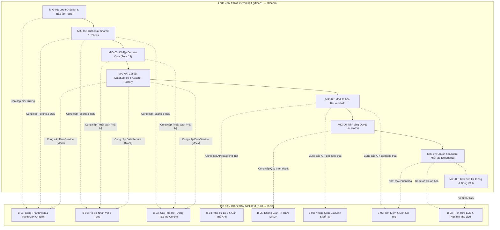

# BẢN PHÂN RÃ MASTER COMPLETION PLAN (MASTER PLAN DECOMPOSITION)
## HỆ THỐNG QUẢN TRỊ 4 CẤP: MASTER PLAN → DOMAIN PLAN → MODULE PLAN → TASK

- **Dự án:** Cây Gia Phả & Nền Tảng Tri Thức Gia Tộc Trần Trọng Thu
- **Repository:** `/Users/tuantq/Projects/Personal/giatoctrantrongthu`
- **Thẩm quyền tối cao:** Tuấn — Product Owner / Human Final Authority
- **Thẩm định & Kiểm soát chất lượng (QC):** Emarald
- **Điều phối thực thi kỹ thuật:** AGY — Primary Agent & Execution Coordinator
- **Tài liệu tham chiếu:** [`AUDIT/MASTER_COMPLETION_PLAN.md`](file:///Users/tuantq/Projects/Personal/giatoctrantrongthu/AUDIT/MASTER_COMPLETION_PLAN.md)
- **Tài liệu kế thừa:** [`AUDIT/SOURCE_MODULARIZATION_PLAN.md`](file:///Users/tuantq/Projects/Personal/giatoctrantrongthu/AUDIT/SOURCE_MODULARIZATION_PLAN.md)
- **Trạng thái:** `DRAFT — CHỜ DUYỆT TẠI CHECKPOINT 01`

---

## 1. CƠ CẤU PHÂN CẤP QUẢN TRỊ (HIERARCHY MODEL)

Để loại bỏ hoàn toàn tình trạng các gói công việc quá lớn hoặc mập mờ trách nhiệm, toàn bộ lộ trình triển khai được phân rã thành 4 cấp độ:

```
┌─────────────────────────────────────────────────────────────────────────┐
│ CẤP 1: MASTER COMPLETION PLAN (v4.0) — Chiến lược & Lộ trình tổng thể   │
└────────────────────────────────────┬────────────────────────────────────┘
                                     │ phân rã thành
┌────────────────────────────────────▼────────────────────────────────────┐
│ CẤP 2: DOMAIN PLANS (Kế hoạch Phân Hệ Nghiệp Vụ & Nền Tảng Kỹ Thuật)   │
│ - DP-01: Identity, Privacy & Security Domain                            │
│ - DP-02: Genealogy & Pedigree Domain                                    │
│ - DP-03: Media, Archive & Historical Records Domain                     │
│ - DP-04: Editorial & MACH Knowledge Domain                              │
│ - DP-05: Calendar & Lunar Traditions Domain                             │
│ - DP-06: Unified Admin & Lab Platform Infrastructure                    │
└────────────────────────────────────┬────────────────────────────────────┘
                                     │ phân rã thành
┌────────────────────────────────────▼────────────────────────────────────┐
│ CẤP 3: MODULE IMPLEMENTATION PLANS (Kế hoạch Triển khai Module Cụ Thể)  │
│ - PLAN-MIG01 đến PLAN-MIG08 (Kế hoạch Tái cấu trúc mã nguồn)            │
│ - PLAN-B01 đến PLAN-B08 (Kế hoạch Bàn giao Bề mặt Trải nghiệm)          │
└────────────────────────────────────┬────────────────────────────────────┘
                                     │ phân rã thành
┌────────────────────────────────────▼────────────────────────────────────┐
│ CẤP 4: EXECUTABLE TASKS (Nhiệm vụ Đơn Lẻ, Kiểm Thử Được, Độc Lập)       │
│ - T-xxx (Atomic tasks: input rõ ràng, DoD 8 chiều, thời gian thực thi) │
└─────────────────────────────────────────────────────────────────────────┘
```

---

## 2. MA TRẬN TƯƠNG HỖ GIỮA 8 SUB-PLANS KỸ THUẬT VÀ 8 BATCHES TRẢI NGHIỆM

Nguyên tắc **Non-blocking Enablement (Kích hoạt không nghẽn)**:
Các sub-plans kỹ thuật (`MIG-01` đến `MIG-04`) tạo dựng nền tảng dùng chung và bộ adapter, cho phép các Batches giao diện (`B-01` đến `B-03`) triển khai ngay trên Vibecode Lab mà không cần chờ đợi toàn bộ Backend hoàn thành.



---

## 3. PHÂN RÃ CHI TIẾT 8 SUB-PLANS TÁI CẤU TRÚC KỸ THUẬT (MIG-01 → MIG-08)

### SUB-PLAN MIG-01: Dọn Dẹp & Lưu Trữ Scripts Cũ, Bảo Tồn Công Cụ CLI
- **Mã Kế Hoạch:** `PLAN-MIG01-01`
- **Mục tiêu:** Dọn sạch 54 tệp script tại thư mục gốc; giải quyết dứt điểm project boundary bằng cách chuyển trả 13 scripts chiến dịch Mini Expo 2026 về đúng workspace canonical ngoài repository; lưu trữ 37 scripts lịch sử của repo vào `scripts/archive/legacy/` (chia 2 nhóm: code_patches, doc_generators); bảo tồn 4 công cụ CLI chẩn đoán CSDL & dev tools tại `scripts/tools/`.
- **Phạm vi tác động:** Thư mục gốc (`/`), `scripts/tools/`, `scripts/archive/legacy/`, Mini Expo Workspace.
- **Đầu vào & Phụ thuộc:** [`AUDIT/SOURCE_MODULE_INVENTORY.md`](file:///Users/tuantq/Projects/Personal/giatoctrantrongthu/AUDIT/SOURCE_MODULE_INVENTORY.md) Mục 5.
- **Nhiệm vụ chi tiết:**
  - `T-MIG01-01`: Tạo cấu trúc thư mục `scripts/tools/` và `scripts/archive/legacy/{code_patches,doc_generators}`.
  - `T-MIG01-02`: Di chuyển 4 công cụ CLI (`test_relationships.py`, `test_media_assoc.py`, `patch_global_mcp.js`, `patch_vscode_mcp.js`) sang `scripts/tools/`.
  - `T-MIG01-03`: Di chuyển 37 scripts của repo (`33 code patches`, `4 doc generators`) sang `scripts/archive/legacy/`.
  - `T-MIG01-04`: Đối soát SHA-256 byte-for-byte và chuyển trả 13 scripts Mini Expo về thư mục canonical `ARCHIVE/root_scripts/` của workspace Mini Expo, gỡ bỏ hoàn toàn khỏi repo gia phả.
  - `T-MIG01-05`: Chạy thử và xác nhận 100% công cụ chẩn đoán trong `scripts/tools/` hoạt động bình thường (`Total families: 68, Valid: 134, Orphan: 0 | Total PM: 173, Mapped: 173`).
  - `T-MIG01-06`: Soạn thảo `scripts/tools/README.md` và `scripts/archive/legacy/README.md`.
- **Sản phẩm bàn giao:** Thư mục gốc sạch sẽ (0 file script rác), 4 công cụ CLI được tài liệu hóa và bảo tồn, 37 file lưu trữ nội bộ có thể truy vết, 13 file ngoài đã về đúng project gốc, zero file thuộc dự án khác nằm trong repo.
- **Định nghĩa hoàn thành (DoD 8 chiều):**
  1. *Functionality:* 100% công cụ CLI chạy chính xác không lỗi.
  2. *Tests:* Chạy thành công `python3 scripts/tools/test_relationships.py` và `test_media_assoc.py`.
  3. *Contracts:* Giữ nguyên CLI argument signatures và output data structure.
  4. *Security:* Không để lộ file `.env` hoặc credential; bảo vệ ranh giới an ninh (Security Tests 8/8 PASS, Clara 10/10 PASS).
  5. *Performance:* Zero runtime impact; dev servers (port 3000, port 8888) hoạt động liên tục.
  6. *Documentation:* Cập nhật danh mục trong `scripts/tools/README.md` và `scripts/archive/legacy/README.md`.
  7. *Backward Compatibility:* Thư mục gốc sạch 100%, không còn file script rác; project boundary phân định triệt để.
  8. *Rollback:* Đã lập bảng ánh xạ 54 tệp gốc kèm SHA-256, hoàn lùi tức thì nếu cần.
- **Trạng thái:** `COMPLETED` (Đã hoàn tất ngày 2026-11-04)

---

### SUB-PLAN MIG-02: Trích Xuất Tầng Dùng Chung (Shared Utilities & Design Tokens)
- **Mã Kế Hoạch:** `PLAN-MIG02-01`
- **Mục tiêu:** Tách các hàm tiện ích (`date-lunar`, `formatting`, `validation`, `dom-helpers`, `event-bus`) thành các ES Modules thuần túy trong `src/js/shared/` và đóng băng Single Source of Truth cho Design Tokens tại `src/css/foundation/tokens.css`.
- **Phạm vi tác động:** `src/js/shared/`, `src/js/ui/lunar-date.js`, `src/css/foundation/`.
- **Đầu vào & Phụ thuộc:** `PLAN-MIG01-01`.
- **Nhiệm vụ chi tiết:**
  - `T-MIG02-01`: Tạo `src/js/shared/utils/date-lunar.js` kế thừa từ `src/js/ui/lunar-date.js`, loại bỏ mọi phụ thuộc DOM nếu có.
  - `T-MIG02-02`: Tạo `src/js/shared/utils/formatting.js` (format ngày, họ tên, danh xưng).
  - `T-MIG02-03`: Tạo `src/js/shared/utils/dom-helpers.js` (render an toàn chống XSS, tạo phần tử HTML).
  - `T-MIG02-04`: Tạo `src/js/shared/event-bus.js` phục vụ liên lạc nội bộ giữa các view module.
  - `T-MIG02-05`: Thiết lập re-export aliases tại `src/js/ui/lunar-date.js` để bảo đảm mã cũ gọi không bị gãy (`export * from '../shared/utils/date-lunar.js'`).
- **Sản phẩm bàn giao:** Thư viện tiện ích dùng chung chuẩn ES Modules không có phụ thuộc ngược.
- **Định nghĩa hoàn thành (DoD 8 chiều):**
  1. *Functionality:* Toàn bộ tính năng tính lịch âm hiển thị chính xác trên Public Home và Lab.
  2. *Tests:* Viết kịch bản kiểm tra độc lập các thuật toán đổi ngày âm dương.
  3. *Contracts:* Chữ ký hàm giữ nguyên 100%.
  4. *Security:* `dom-helpers.js` áp dụng cơ chế escape HTML tự động ngăn chặn XSS.
  5. *Performance:* Zero overhead, zero dependency bên thứ ba.
  6. *Documentation:* JSDoc đầy đủ cho từng hàm tiện ích.
  7. *Backward Compatibility:* Mã cũ tại `src/js/ui/` hoạt động bình thường qua re-export.
  8. *Rollback:* Khôi phục lại nội dung `src/js/ui/lunar-date.js` ban đầu.
- **Trạng thái:** `PLANNED`

---

### SUB-PLAN MIG-03: Cô Lập Lõi Nghiệp Vụ Thuần Túy (Domain Core Isolation)
- **Mã Kế Hoạch:** `PLAN-MIG03-01`
- **Mục tiêu:** Trích xuất toàn bộ thuật toán nghiệp vụ phả hệ, xưng hô họ hàng, lịch âm giỗ tết và quy trình bài viết MẠCH thành các pure modules trong `src/js/domain/`, tuân thủ nghiêm ngặt nguyên tắc **ZERO DOM, ZERO NETWORK, ZERO STORAGE**.
- **Phạm vi tác động:** `src/js/domain/genealogy/`, `src/js/domain/kinship/`, `src/js/domain/calendar/`, `src/js/domain/editorial/`, `src/js/member-app.js`.
- **Đầu vào & Phụ thuộc:** `PLAN-MIG02-01`.
- **Nhiệm vụ chi tiết:**
  - `T-MIG03-01`: Trích xuất thuật toán phả hệ từ `src/js/member-app.js` và `src/js/ui/family-tree.js` sang `src/js/domain/genealogy/pedigree.js` và `family-tree.js`.
  - `T-MIG03-02`: Trích xuất logic xưng hô dòng họ sang `src/js/domain/kinship/address-system.js`.
  - `T-MIG03-03`: Trích xuất thuật toán tính ngày giỗ và đối soát tiết khí sang `src/js/domain/calendar/anniversary.js`.
  - `T-MIG03-04`: Xây dựng quy tắc trạng thái bài viết MẠCH sang `src/js/domain/editorial/article-workflow.js`.
  - `T-MIG03-05`: Thiết lập re-export aliases trong các tệp UI tương ứng.
- **Sản phẩm bàn giao:** Bộ module nghiệp vụ gia phả độc lập có thể chạy được cả trên Node.js (Backend) và Trình duyệt (Frontend).
- **Định nghĩa hoàn thành (DoD 8 chiều):**
  1. *Functionality:* Cây phả hệ và xưng hô hiển thị chuẩn xác 100% trên tập dữ liệu 228 người.
  2. *Tests:* Kiểm thử tự động trên Node.js bằng CLI runner độc lập không cần browser.
  3. *Contracts:* Export rõ ràng các class và pure functions.
  4. *Security:* Không xử lý thông tin đăng nhập trong domain core.
  5. *Performance:* Xử lý thuật toán cây 228 người trong < 15ms.
  6. *Documentation:* Tài liệu thuật toán tính quan hệ và bậc thế hệ.
  7. *Backward Compatibility:* Tương thích ngược qua re-export.
  8. *Rollback:* Hoàn lùi bằng Git commit.
- **Trạng thái:** `PLANNED`

---

### SUB-PLAN MIG-04: Cài Đặt Tầng Dữ Liệu & Bộ Thích Ứng (Infra DataService & Adapter Factory)
- **Mã Kế Hoạch:** `PLAN-MIG04-01`
- **Mục tiêu:** Xây dựng cổng giao tiếp dữ liệu duy nhất `DataService` cho Frontend, hỗ trợ chuyển đổi mềm giữa `MockAdapter` (dùng cho Vibecode Lab Studio trên cổng 8888) và `ApiAdapter` (gọi Express API thật trên cổng 3000).
- **Phạm vi tác động:** `src/js/infra/data-service.js`, `src/js/infra/adapters/`, `src/js/ui/person-service.js`, `src/js/ui/lab.js`.
- **Đầu vào & Phụ thuộc:** `PLAN-MIG02-01`, `PLAN-MIG03-01`.
- **Nhiệm vụ chi tiết:**
  - `T-MIG04-01`: Xây dựng `DataService` interface chuẩn hóa các phương thức đọc/ghi dữ liệu.
  - `T-MIG04-02`: Xây dựng `MockAdapter` nạp dữ liệu mẫu 228 nhân vật từ `fixtures/mock-persons-228.json`.
  - `T-MIG04-03`: Xây dựng `ApiAdapter` bọc các lệnh gọi `fetch` tới REST endpoints của Express Backend.
  - `T-MIG04-04`: Xây dựng `AdapterFactory` tự động chọn adapter dựa theo cấu hình cổng chạy hoặc tham số query URL.
  - `T-MIG04-05`: Tái cấu trúc `src/js/ui/person-service.js` để ủy thác sang `DataService`.
- **Sản phẩm bàn giao:** Khung giao tiếp dữ liệu linh hoạt, tách rời hoàn toàn Frontend UI khỏi sự phụ thuộc cứng vào Backend.
- **Định nghĩa hoàn thành (DoD 8 chiều):**
  1. *Functionality:* Vibecode Lab chạy thông suốt ở chế độ Mock không cần Backend server. Khi mở chế độ API, kết nối mượt mà với server cổng 3000.
  2. *Tests:* Kiểm thử chuyển đổi chế độ Adapter thành công trên trình duyệt.
  3. *Contracts:* 100% khớp JSON Schema contract giữa MockAdapter và ApiAdapter.
  4. *Security:* Không gửi token xác thực sang các domain không tin cậy.
  5. *Performance:* Mock adapter phản hồi trong < 5ms.
  6. *Documentation:* Hướng dẫn sử dụng DataService cho các lập trình viên UI.
  7. *Backward Compatibility:* Các tệp UI cũ gọi `person-service.js` vẫn nhận được dữ liệu như cũ.
  8. *Rollback:* Cờ cấu hình fallback về `person-service.js` nguyên bản.
- **Trạng thái:** `PLANNED`

---

### SUB-PLAN MIG-05: Phân Tách & Module Hóa Backend Express (Backend API Modularization)
- **Mã Kế Hoạch:** `PLAN-MIG05-01`
- **Mục tiêu:** Chia nhỏ tệp god file `server/index.js` (596 dòng) thành các controller routes, middleware bảo vệ và services độc lập, tuân thủ chuẩn REST và mô hình bảo mật ReBAC.
- **Phạm vi tác động:** `server/index.js`, `server/routes/`, `server/middleware/`, `server/services/`.
- **Đầu vào & Phụ thuộc:** `PLAN-MIG04-01`.
- **Nhiệm vụ chi tiết:**
  - `T-MIG05-01`: Tách middleware bảo mật (`rate-limiter.js`, `security-headers.js`, `cors.js`) vào `server/middleware/`.
  - `T-MIG05-02`: Tách các REST API endpoints cho thực thể Persons thành `server/routes/persons.js`.
  - `T-MIG05-03`: Tách các API endpoints cho Media và Thư viện ảnh thành `server/routes/media.js`.
  - `T-MIG05-04`: Tách các API endpoints cho Sự kiện và Ngày giỗ thành `server/routes/events.js`.
  - `T-MIG05-05`: Giữ `server/index.js` là file bootstrap mỏng (< 100 dòng) chỉ thực hiện gán routes và lắng nghe cổng.
- **Sản phẩm bàn giao:** Backend Express được module hóa sạch sẽ, có cấu trúc rõ ràng và dễ bảo trì.
- **Định nghĩa hoàn thành (DoD 8 chiều):**
  1. *Functionality:* 100% API endpoints giữ nguyên URL và phản hồi đúng định dạng JSON.
  2. *Tests:* Chạy bộ kiểm thử tự động `tests/run_all_tests.sh` đạt 100% PASS.
  3. *Contracts:* Mã phản hồi HTTP (200, 400, 401, 403, 404, 500) không đổi.
  4. *Security:* 8 lỗ hổng an ninh (`CF-01` đến `CF-08`) giữ vững trạng thái đã khắc phục.
  5. *Performance:* Thời gian phản hồi API duy trì < 50ms cho các truy vấn chính.
  6. *Documentation:* OpenAPI / Swagger JSON contract cho các API endpoints.
  7. *Backward Compatibility:* Không gây lỗi cho bất kỳ client nào đang kết nối.
  8. *Rollback:* Bản sao lưu `server/index.js.bak` sẵn sàng khôi phục ngay lập tức.
- **Trạng thái:** `PLANNED`

---

### SUB-PLAN MIG-06: Tái Cấu Trúc Nền Tảng Biên Tập & Bài Viết MẠCH
- **Mã Kế Hoạch:** `PLAN-MIG06-01`
- **Mục tiêu:** Hiện thực hóa quy trình duyệt bài 4 bước của MẠCH (Bản thảo → Đề xuất biên tập → Thẩm định → Xuất bản) và chuẩn bị hạ tầng lưu trữ CMS theo quyết định `DEC-A03`.
- **Phạm vi tác động:** `src/js/domain/editorial/`, `server/routes/articles.js`, `admin/js/views/content-view.js`.
- **Đầu vào & Phụ thuộc:** `PLAN-MIG04-01`, `PLAN-MIG05-01`.
- **Ghi chú về quyết định mở:**  
  > [!IMPORTANT]
  > Quyết định **`DEC-A03` (Lưu trữ CMS Trang chủ & Thẻ mời)** hiện đang ở trạng thái **`OPEN` (Chờ Tuấn phê duyệt)**.  
  > Sub-plan này chuẩn bị sẵn interface trừu tượng `CmsClient`, cho phép hỗ trợ cả 2 phương án (File JSON trong Git hoặc bảng `cms_documents` trong CSDL) mà không làm nghẽn tiến độ.
- **Nhiệm vụ chi tiết:**
  - `T-MIG06-01`: Xây dựng máy trạng thái hữu hạn (State Machine) quản lý vòng đời bài viết MẠCH.
  - `T-MIG06-02`: Xây dựng `CmsClient` interface và implement adapter mẫu.
  - `T-MIG06-03`: Tích hợp giao diện quản trị bài viết trong Unified Admin Control Center.
- **Định nghĩa hoàn thành (DoD 8 chiều):** Vòng đời duyệt bài hoạt động chuẩn xác; tuân thủ quyết định của Tuấn khi `DEC-A03` được chốt.
- **Trạng thái:** `PLANNED`

---

### SUB-PLAN MIG-07: Chuẩn Hóa Bề Mặt Ứng Dụng & Điểm Khởi Tạo (Experience Bootstrapping)
- **Mã Kế Hoạch:** `PLAN-MIG07-01`
- **Mục tiêu:** Phân tách và làm mỏng 2 god files Frontend còn lại (`src/js/member-app.js` 2,964 dòng và `src/js/ui/lab.js` 1,469 dòng), đồng thời thiết lập 4 Composition Roots (`boot-public.js`, `boot-member.js`, `boot-admin.js`, `boot-lab.js`).
- **Phạm vi tác động:** `src/js/experience/`, `src/js/application/`, `src/js/member-app.js`, `src/js/ui/lab.js`.
- **Đầu vào & Phụ thuộc:** `PLAN-MIG03-01`, `PLAN-MIG04-01`.
- **Nhiệm vụ chi tiết:**
  - `T-MIG07-01`: Phân rã `member-app.js` thành các view modules riêng: cây phả hệ, hồ sơ thành viên, sổ tay gia đình.
  - `T-MIG07-02`: Phân rã `lab.js` thành các modules điều khiển studio, kiểm thử viewport và audit panel.
  - `T-MIG07-03`: Chuẩn hóa 4 điểm khởi tạo ứng dụng, tiêm `DataService` tương ứng vào từng bề mặt.
- **Định nghĩa hoàn thành (DoD 8 chiều):** Không có tệp JS nào vượt quá 400 dòng; 4 bề mặt trải nghiệm hoạt động mượt mà.
- **Trạng thái:** `PLANNED`

---

### SUB-PLAN MIG-08: Tích Hợp Hệ Thống & Bàn Giao V1.0 (End-to-End System Integration)
- **Mã Kế Hoạch:** `PLAN-MIG08-01`
- **Mục tiêu:** Nối toàn bộ các module và bề mặt trải nghiệm vào hệ thống hoàn chỉnh, chạy kiểm thử Playwright Browser QA trên 4 độ phân giải (375, 768, 1024, 1440px), đối soát an ninh toàn diện và lập biên bản nghiệm thu trình Tuấn phê duyệt GATE-06.
- **Phạm vi tác động:** Toàn bộ repository.
- **Đầu vào & Phụ thuộc:** Hoàn thành toàn bộ `MIG-01` đến `MIG-07` và các Batches `B-01` đến `B-07`.
- **Nhiệm vụ chi tiết:**
  - `T-MIG08-01`: Chạy kịch bản kiểm thử tự động Browser QA đa độ phân giải (`ui_vnext_qa.mjs`).
  - `T-MIG08-02`: Chạy kiểm tra an ninh và rò rỉ dữ liệu (Security Verification Suite).
  - `T-MIG08-03`: Đối soát tính toàn vẹn CSDL và hình ảnh liên kết.
  - `T-MIG08-04`: Lập hồ sơ nghiệm thu kỹ thuật và biên bản đóng V1.0.
- **Định nghĩa hoàn thành (DoD 8 chiều):** 0 lỗi console, 0 lỗi network, 100% test cases an ninh đạt PASS, Tuấn phê duyệt văn bản.
- **Trạng thái:** `PLANNED`

---

## 4. CHI TIẾT BATCH ĐẦU TIÊN TRIỂN KHAI: BATCH 01 (MEMBER IDENTITY & SECURITY GATEWAY)

Nhằm đảm bảo an toàn tuyệt đối và tính khả thi cao nhất, **BATCH 01** được chọn là điểm kích hoạt thực thi đầu tiên:

```
┌────────────────────────────────────────────────────────────────────────┐
│ BATCH 01: MEMBER IDENTITY, GATEWAY HARDENING & SECURITY BOUNDARY       │
│ - Môi trường: Vibecode Lab Studio (http://localhost:8888)              │
│ - Tác động Production: ZERO (Cách ly hoàn toàn trong môi trường Lab)   │
│ - Nhân lực: AGY điều phối thực thi; Cline hỗ trợ Visual QA nếu cần    │
└────────────────────────────────────────────────────────────────────────┘
```

### Bảng Phân Rã Công Việc Chi Tiết BATCH 01:

| Mã Nhiệm Vụ | Tên Nhiệm Vụ | Phụ Trách | Ưu Tiên | Trạng Thái | Mô Tả & Tiêu Chí Nghiệm Thu | Sản Phẩm Bàn Giao |
| :---: | :--- | :---: | :---: | :---: | :--- | :--- |
| **`W-B01-01`** | **Đóng 4 cửa ngõ công khai** | AGY | P0 | `PLANNED` | Thay thế các nội dung nhạy cảm tại `#/mach`, `#/gia-pha`, `#/lich`, `#/tim-kiem` bằng Giao diện Thẻ Mời Trang Trọng (Invitation Card). Người ngoài bấm vào không xem được dữ liệu bên trong. | Giao diện Thẻ Mời 4 cửa ngõ trong Lab. |
| **`W-B01-02`** | **Màn hình Đăng nhập & Xác minh Thành viên** | AGY | P0 | `PLANNED` | Xây dựng giao diện đăng nhập thành viên trang trọng, phù hợp nhận diện thương hiệu Gia Tộc. Hỗ trợ nhập mã mời và định danh an toàn. | Giao diện form đăng nhập và xác minh. |
| **`W-B01-03`** | **Bảo vệ tuyệt đối ranh giới Thư Clara** | AGY | P0 | `PLANNED` | Kiểm chứng cơ chế cô lập: Tài liệu Thư Clara chỉ hiển thị cho tài khoản có quyền truy cập hợp lệ; hoàn toàn không rò rỉ qua client state hay API công khai. | Kịch bản kiểm thử tự động ranh giới Clara. |
| **`W-B01-04`** | **Visual QA 4 độ phân giải cho B-01** | Cline / AGY | P1 | `PLANNED` | Chạy kịch bản Playwright kiểm tra hiển thị Thẻ Mời và Form Đăng nhập trên 4 kích thước: 375px (Mobile), 768px (Tablet), 1024px (Laptop), 1440px (Desktop). | Bộ 4 ảnh chụp màn hình kiểm thử không lỗi vỡ khung. |

---

## 5. BẢNG THEO DÕI CÁC QUYẾT ĐỊNH MỞ (OPEN DECISIONS REGISTER)

Mọi quyết định chưa được phê duyệt chính thức bởi Tuấn đều được duy trì trạng thái `OPEN` minh bạch, không giả định và có phương án xử lý kỹ thuật không gây nghẽn:

| Mã Quyết Định | Nội Dung Quyết Định | Trạng Thái | Phương Án Xử Lý Kỹ Thuật (Mitigation) | Tác Động Tiến Độ |
| :---: | :--- | :---: | :--- | :--- |
| **`DEC-12`** | **Chính sách Đồng thuận Trẻ Em & Người Đã Mất** | `OPEN` | Áp dụng nguyên tắc an toàn cao nhất: **Mặc định hạn chế (`Restrict by default`)**. Dữ liệu trẻ em và người quá cố chỉ hiển thị thông tin cơ bản với tài khoản thành viên đã xác minh. | Không chặn `Batch 01`, `02`, `03`. Sẽ trình Tuấn xem xét ở `Batch 04`. |
| **`DEC-A03`** | **Cơ chế Lưu trữ CMS Trang Chủ & Thẻ Mời** | `OPEN` | Thiết kế lớp trừu tượng `CmsClient` trong Tầng Platform. Hỗ trợ chuyển đổi giữa file JSON trong Git hoặc bảng `cms_documents` trong CSDL. | Không chặn các sub-plans kỹ thuật. Sẽ xin ý kiến Tuấn khi triển khai `MIG-06`. |

---

## 6. KẾT LUẬN & SẴN SÀNG CHUYỂN GIAO

Bản phân rã Master Plan này đã:
1. Thiết lập cấu trúc phân cấp 4 tầng mạch lạc, có thể quản trị và giao việc độc lập cho các AI agents.
2. Định nghĩa chi tiết 8 sub-plans kỹ thuật (`MIG-01` → `MIG-08`) với tiêu chuẩn hoàn thành 8 chiều (DoD 8D).
3. Đóng băng ranh giới an toàn cho `BATCH 01` thực hiện độc lập trên môi trường Vibecode Lab Studio.
4. Minh định rõ ràng hai quyết định mở `DEC-12` và `DEC-A03`, bảo đảm không gây gián đoạn tiến độ.

