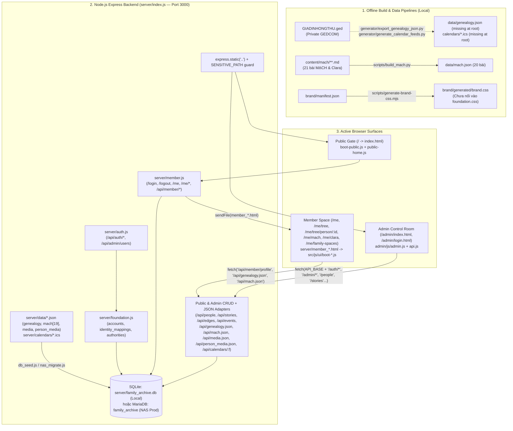

# GIATOCTRANTRONGTHU — SOURCE CODE AUDIT & REPOSITORY REORGANIZATION REPORT

- **Repository:** `giatoctrantrongthu` (`/Users/tuantq/Projects/Personal/giatoctrantrongthu`)
- **Ngày kiểm toán:** `2026-10-31`
- **Chế độ kiểm toán:** **STRICT READ-ONLY (Đợt 1 — Khảo sát & Phân loại)**
- **Git `HEAD` hiện tại:** `42a7ed2` (`main`, đồng bộ `origin/main`) — kèm **641 thay đổi chưa commit** trên working tree (`[OBSERVED]`)
- **Chuẩn bằng chứng áp dụng:**
  - `[OBSERVED]`: Quan sát trực tiếp trong mã nguồn, cấu hình, cây thư mục hoặc cơ sở dữ liệu cục bộ.
  - `[TESTED]`: Đã chạy lệnh kiểm tra thực tế ở chế độ read-only (`node --check`, `python3 -B`, SQLite read-only query).
  - `[DOCUMENTED]`: Được ghi nhận trong tài liệu nội bộ của repo nhưng không thể tự chứng minh chỉ bằng mã nguồn local.
  - `[INFERRED]`: Suy luận có căn cứ từ nhiều bằng chứng kỹ thuật kết hợp.
  - `[UNKNOWN]`: Chưa đủ bằng chứng cục bộ để kết luận (đặc biệt là hạ tầng live trên Synology NAS, MariaDB production, Cloudflare Tunnel, Vercel Dashboard).

---

## 1. Executive Summary

`giatoctrantrongthu` là hệ thống **Không gian Số & Lưu trữ Sống của Gia tộc Trần Trọng Thu** (*Family Digital Institution & Living Archive*), kết hợp hai bán cầu: **Dữ liệu Phả hệ Chuẩn (Genealogy / People / Relationships / Calendar)** và **Không gian Diễn ngôn phân lớp (Public External Voice · MẠCH Internal Discourse · Thư gửi Clara Intimate Discourse)**, vận hành dưới cơ chế quản trị đa tác nhân **AIOS Governance** (`.aios/PROJECT_CONTRACT.json`, `AGENTS.md`) (`[OBSERVED]`, `[DOCUMENTED]`).

Tuy nhiên, quá trình phát triển qua nhiều thế hệ kiến trúc và nhiều phiên làm việc của các AI agent đã khiến repository rơi vào trạng thái **nhiễu loạn cấu trúc nghiêm trọng**:

1. **Đứt gãy giữa Git `HEAD` và Working Tree (`[OBSERVED]`):** Kể từ commit cuối `42a7ed2`, có **641 mục thay đổi chưa được commit** (`21 modified`, `65 deleted`, `555 untracked`). Toàn bộ hệ thống UI mới (`UI System vNEXT` tại `src/js/ui/` + `src/css/foundation/`), tầng Member Space (`server/member.js`, `server/foundation.js`), cấu hình quản trị AIOS (`.aios/`, `.opencode/`, `opencode.jsonc`, `.clinerules`), và đợt quy hoạch `docs/archive/` đều đang nằm lơ lửng dưới dạng untracked/unstaged files.
2. **Nhiễm bẩn từ 2 dự án hoàn toàn không liên quan (`[OBSERVED]`):**
   - **15 script ở thư mục gốc** (`add_dec006.py`, `create_m05.py`, `create_m08.py`, `edit_m01.py`..`edit_m06.py`, `edit_index.py`, `final_check.py`, `final_status.py`, `final_verify.py`, `fix_website.py`, `verify_all.py`, `integrated_compiler.js`) thực chất thao tác trên dự án **`OneDrive-PVCFC/.../MINI EXPO CAY CA PHE NAM 2026`** nhưng bị sinh nhầm tại CWD của `giatoctrantrongthu`.
   - Thư mục nghĩa đen **`./~/Desktop/Garmin_Forensic_Audit/`** (25 file `.fit`/`.BIN`/`.TXT`, `0.66 MiB`) chứa dữ liệu đồng hồ sức khỏe Garmin sinh ra do lỗi không expand ký tự `~` trong shell.
3. **Rác vận hành của Agent ở Root & Subfolders (`[OBSERVED]`):** Ngoài 15 script ngoại lai, tại root còn **37 script vá lỗi dùng 1 lần** (`patch_*.js`, `patch_*.py`, `fix_*.js`, `enforce_gate.js`, `restore_hero.js`, `remove_threshold.js`...), cùng các thư mục dump tạm `.playwright-mcp/` (33 file), `.tmp-cg/` (1 file), `shots/` (1 file), và ứng dụng thử nghiệm `chatbot-app/` chiếm tới **456.79 MiB** (riêng `chatbot-app/node_modules/` chiếm >30,600 file cho một câu trả lời demo gán cứng).
4. **4 thế hệ Frontend cùng tồn tại chồng lấn (`[OBSERVED]`):**
   - **Gen 4 (ACTIVE trên working tree):** `index.html` + `server/member_*.html` + `src/js/ui/*` (24 ES modules) + `src/css/foundation/*` (5 file CSS).
   - **Gen 3 (DESIGN-001 Revision — vẫn đang là bản commit trên `origin/main` nhưng không còn được `index.html` local gọi):** `src/js/app-v2.js` + `src/css/prototype.css` (bị nhân bản y hệt tại `prototype/design-001-public/` và biến thể tại `design-playground/`).
   - **Gen 2 (Prototype Tailwind CDN):** `prototype/index.html`.
   - **Gen 1 (Monolithic Hash-SPA cũ):** `archive/legacy_frontend/app.js`, `src/js/member-app.js`, `server/member_baseline.html`, `src/css/main.css`.
5. **Mâu thuẫn nghiêm trọng giữa kiến trúc Deploy (Vercel Static) và Runtime mới (Express SSR Routes) (`[OBSERVED]`):** `index.html` mới dẫn người dùng bấm vào `<a href="/login">`. Nhưng `/login` và toàn bộ `/me/*` chỉ tồn tại dưới dạng route động trong `server/member.js` (Express), không phải file tĩnh và không có rewrite trong `vercel.json`. Nếu commit và push thẳng trạng thái hiện tại lên `main`, trang public trên Vercel sẽ bị **404 tại `/login`**.
6. **Tài liệu định vị gốc bị đứt liên kết & lỗi thời (`[OBSERVED]`, `[TESTED]`):**
   - `README.md` trỏ tới 4 file `PROJECT.md`, `PROJECT_MAP.md`, `SOURCE_OF_TRUTH.md`, `HELP.md` — **cả 4 đường dẫn ở root đều không tồn tại** (`HELP.md` thực tế nằm ở `docs/HELP.md`).
   - `docs/README.md` trỏ tới `docs/architecture/ARCHITECTURE.md`, `DATA_CONTRACT.md`, `SITEMAP_01_INFORMATION_ARCHITECTURE.md` — tất cả đã bị dời sang `docs/archive/architecture/`.
   - CI workflow `.github/workflows/validate-data.yml` chạy `generator/validate_integrity.py` **báo FAIL ngay lập tức** (`[TESTED]`) vì tìm `data/genealogy.json` và `calendars/*.ics` ở root thay vì `server/data/` và `server/calendars/`.

---

## 2. Repository Inventory

### 2.1. Thống kê tổng lượng File, Thư mục & Dung lượng (`[OBSERVED]`)

| Phạm vi đo lường | Số lượng File | Số lượng Thư mục | Dung lượng (Bytes) | Dung lượng (MiB) | Ghi chú |
|---|---:|---:|---:|---:|---|
| **Toàn bộ đĩa (gồm cả `.git` & mọi `node_modules`)** | `40,790` | `4,113` | `893,905,124` | `852.49 MiB` | Chiếm dụng thực tế trên ổ cứng local |
| **Không tính `.git` (vẫn gồm 4 cây `node_modules`)** | `39,683` | `3,832` | `685,187,924` | `653.45 MiB` | `node_modules` chiếm 84.5% dung lượng này |
| **Workspace thực chất (loại trừ `.git` & `node_modules`)** | **`916`** | **`121`** | **`106,233,596`** | **`101.31 MiB`** | Phạm vi source, data, media, docs & rác |

> **Lưu ý kiểm chứng (`[TESTED]`):** Trong quá trình chạy read-only `unittest` của Python trên `tests/test_markdown_acceptance.py`, trình thông dịch Python tạo thêm `tests/__pycache__/` (1 file `.pyc`, đã nằm trong `.gitignore`, không ảnh hưởng `git status`). Số liệu gốc trước khi chạy test là chính xác `916` workspace files như bảng trên.

### 2.2. Phân bổ 4 cây `node_modules/` và `.git/` (`[OBSERVED]`)

| Đường dẫn | Số lượng package cấp 1 | Tổng số file | Dung lượng | Đánh giá |
|---|---:|---:|---:|---|
| `chatbot-app/node_modules/` | 414 | ~30,649 | ~`456.47 MiB` | Phụ thuộc của prototype Next.js không kết nối hệ thống |
| `.git/` | — | 1,107 | `199.05 MiB` | Lịch sử Git repository |
| `.opencode/node_modules/` | 26 | ~3,651 | ~`52.34 MiB` | Phụ thuộc của `@opencode-ai/plugin` |
| `node_modules/` (root) | 25 | 2,268 | `23.29 MiB` | Cài `puppeteer` nhưng **không khai báo** trong `package.json` gốc |
| `server/node_modules/` | 140 | ~2,199 | ~`21.40 MiB` | Phụ thuộc runtime thật duy nhất của Backend Express |

### 2.3. Phân nhóm theo phần mở rộng (Workspace 916 files — không tính `.git` & `node_modules`) (`[OBSERVED]`)

| Phần mở rộng | Số file | Dung lượng (Bytes) | Vai trò chính |
|---|---:|---:|---|
| `.md` | 313 | 2,568,329 | Tài liệu kiến trúc, brand, audit, nội dung gốc MẠCH & Clara (`content/`), OpenCode agents/skills |
| `.jpg` / `.jpeg` | 204 | 43,615,605 | 185 ảnh avatar gia phả (`FS_AVATAR_*.jpg`), ảnh MẠCH/Clara, và 10 ảnh trùng lặp trong `prototype/` |
| `.js` / `.mjs` | 101 | 710,329 | Backend Express (`server/`), Frontend ESM (`src/js/ui/`), Admin SPA (`admin/`), và hàng chục script vá lỗi ở root / `scripts/archive/` |
| `.py` | 64 | 345,680 | Compiler MẠCH (`scripts/build_mach.py`), GEDCOM generators (`generator/`), tests (`tests/`), cùng 50+ script tạm/ngoại lai |
| `.png` | 62 | 52,948,143 | Ảnh tư liệu Clara (riêng `007.png` nặng `23.6 MB`), ảnh chụp QA trong `docs/audit/evidence/`, `.playwright-mcp/`, `.tmp-cg/`, `shots/` |
| `.json` / `.jsonc` | 32 | 3,701,561 | Snapshots dữ liệu (`mach.json`, `genealogy.json`, `media.json`), manifests, `PROJECT_CONTRACT.json`, `opencode.jsonc`, `package.json` |
| `.fit` / `.bin` / `.bak` | 21 | 480,179 | Toàn bộ nằm trong thư mục ngoại lai `./~/Desktop/Garmin_Forensic_Audit/` |
| `.tsx` / `.ts` | 21 | 25,474 | Toàn bộ nằm trong `chatbot-app/` (Next.js demo) |
| `.yml` | 17 | 129,243 | 2 GitHub Actions workflows + 14 DOM snapshots trong `.playwright-mcp/` + 1 file tạm trong `archive/temp_outputs/` |
| `.html` | 15 | 272,044 | `index.html`, `admin/*.html` (2), `server/member_*.html` (7), `prototype/` (3), `design-playground/` (1), `chatbot-demo.html` (1) |
| `.css` | 12 | 264,619 | `src/css/foundation/*` (5), `src/css/main.css`, `src/css/prototype.css`, `admin/css/admin.css`, `brand/generated/brand.css`, `prototype/`, `design-playground/`, `chatbot-app/` |
| `.txt` / `.log` / `.csv` | 21 | 240,955 | Logs, Garmin text logs, `robots.txt`, `cookies_dev.txt`, CSV audit cũ |
| `.svg` | 9 | 141,122 | Logo & favicon thương hiệu Gia Tộc (có 5 bản trùng lặp SHA-256) |
| `.ics` | 4 | 215,896 | 4 file lịch chuẩn trong `server/calendars/` |
| `.sql` | 3 | 4,342 | `server/schema_update.sql` + 2 file legacy trong `archive/legacy_database/` |
| `.db` | 1 | 413,696 | `server/family_archive.db` (SQLite local working DB — gitignored) |
| `.ged` | 1 | 73,799 | `GIADINHONGTHU.ged` (GEDCOM nguồn riêng tư — gitignored) |
| Khác (`.DS_Store`, `.env*`, `.sh`, `.pyc`...) | 15 | 89,932 | Config môi trường local, OS metadata, bytecode cache |

### 2.4. Bản đồ cấu trúc thư mục cấp 1 hiện tại (`[OBSERVED]`)

```text
giatoctrantrongthu/
├── .aios/                  # [2 files] AIOS Governance Contract & Project State
├── .cline/                 # [0 files] Thư mục rỗng (.cline/hooks/)
├── .clinerules             # [1 file]  Ràng buộc quyền hạn Cline Persona
├── .env.local              # [1 file]  Biến môi trường local (Vercel/dev, gitignored)
├── .github/workflows/      # [2 files] CI/CD GitHub Actions (đang gãy path)
├── .gitignore              # [1 file]  Cấu hình loại trừ Git
├── .nojekyll               # [1 file]  Cờ GitHub Pages cũ (0 byte)
├── .opencode/              # [20 source files + node_modules] Cấu hình agents & skills cho OpenCode
├── .playwright-mcp/        # [33 files] Dump log/ảnh chụp trình duyệt tạm của Playwright MCP
├── .tmp-cg/                # [1 file]  Ảnh tham chiếu tạm (ref.png)
├── .vercel/                # [2 files] Liên kết project Vercel ("gionghotrantrongthu", gitignored)
├── ~                       # [25 files] Thư mục lỗi unexpanded tilde (Garmin_Forensic_Audit)
├── admin/                  # [7 files] Giao diện Admin Control Room (SPA ES Modules)
├── archive/                # [14 files] Lưu trữ frontend V1, SQL cũ & temp_outputs
├── assets/                 # [213 files, 67.74 MiB] ASSET_MANIFEST.json, logo SVG, 185 avatars, ảnh MẠCH/Clara
├── brand/                  # [10 files] Hiến chương thương hiệu, manifest.json & generated/brand.css
├── chatbot-app/            # [31 source files + 456 MiB node_modules] Prototype Next.js 16 AI Chat rời rạc
├── content/                # [21 files] Nguồn Markdown gốc của MẠCH (issue-01) và Thư gửi Clara
├── data/                   # [1 file]  data/mach.json (20 bài — đầu ra của scripts/build_mach.py)
├── design-playground/      # [10 files] Bản nháp DESIGN-001 Revision độc lập
├── docs/                   # [290 files, 6.94 MiB] Kiến trúc, ontology, database, design, audit & archive
├── generator/              # [3 files] Bộ công cụ Python xuất GEDCOM -> JSON/ICS & kiểm tra toàn vẹn
├── node_modules/           # [2,268 files, 23.29 MiB] Puppeteer cài lẻ ở root không ghi vào package.json
├── prototype/              # [17 files, 18.15 MiB] Lưu trữ bản mẫu DESIGN-001 & Prototype V2 (kèm 18 MB ảnh trùng)
├── scripts/                # [9 files + 46 trong scripts/archive/] Build MẠCH, Brand CSS, QA Puppeteer & script cũ
├── server/                 # [36 source/data files + node_modules] Backend Express, Auth, Member SSR shells, SQLite DB
├── shots/                  # [1 file]  Ảnh chụp màn hình rời (01-home.png)
├── src/                    # [35 files] UI System vNEXT (src/css/foundation, src/js/ui), core lunar/ics & file cũ
├── tests/                  # [2 files] Kiểm thử tự động trình biên dịch Markdown MẠCH
├── index.html              # [1 file]  Entry point Public Shell hiện tại (gọi boot-public.js)
├── opencode.jsonc          # [1 file]  Chính sách bảo mật & phân quyền lệnh của OpenCode
├── package.json            # [1 file]  Scripts điều phối dev/db gốc
├── robots.txt              # [1 file]  Cấu hình crawler
├── vercel.json             # [1 file]  Cấu hình routing & security headers trên Vercel
└── [73 file lẻ khác ở root]# 15 file .md tài liệu/rác + 52 script .py/.js dùng 1 lần/ngoại lai + GIADINHONGTHU.ged + cookies_dev.txt + server.log + chatbot-demo.html + .DS_Store
```

### 2.5. Trạng thái Git Working Tree (`[OBSERVED]`)

- **Tracked trong Git Index (`git ls-files`):** `400` files.
- **Thay đổi chưa stage (`git status --porcelain=v1 -uall`):** `641` mục:
  - `21` file **Modified (` M`)**: gồm `index.html`, `package.json`, `vercel.json`, `AGENTS.md`, `README.md`, `docs/README.md`, `brand/README.md`, `admin/*`, `server/index.js`, `server/package.json`, `scripts/build_mach.py`, `src/js/core/lunar-engine.js`, `src/js/app-v2.js`, `src/css/prototype.css`...
  - `65` file **Deleted (` D`)**: do đã di chuyển thủ công sang `docs/archive/`, `archive/`, và `scripts/archive/` mà chưa chạy `git add`.
  - `555` file **Untracked (`??`)**: bao gồm toàn bộ `src/js/ui/*`, `src/css/foundation/*`, `server/member.js`, `server/foundation.js`, `server/auth.js`, `server/data/*`, `server/calendars/*`, `.aios/*`, `.opencode/*`, `docs/audit/*`, `docs/database/*`, cùng toàn bộ các file rác tại root, `.playwright-mcp/`, và `~`.

---

## 3. Current Architecture

Kiến trúc thực tế đang tồn tại trong source code local (không tính các bản mẫu đã ngắt kết nối) là một mô hình **Hybrid Multi-Page ES Module Web App + Express Session Backend + Dual SQL Adapter + Markdown/GEDCOM Offline Compilers** (`[OBSERVED]`).

### 3.1. Sơ đồ kiến trúc thực tế đang tồn tại trong Codebase (`[OBSERVED]`)



### 3.2. Application Entry Points thực tế (`[OBSERVED]`)

1. **Backend Entry Point:** [`server/index.js`](file:///Users/tuantq/Projects/Personal/giatoctrantrongthu/server/index.js) (chạy qua `npm run dev` từ `package.json` gốc: `cd server && DB_CLIENT=sqlite3 DB_PATH=./family_archive.db node index.js`, lắng nghe tại `127.0.0.1:3000`).
2. **Public Web Entry Point:** [`index.html`](file:///Users/tuantq/Projects/Personal/giatoctrantrongthu/index.html) → nạp [`/src/css/foundation/foundation.css`](file:///Users/tuantq/Projects/Personal/giatoctrantrongthu/src/css/foundation/foundation.css) và ES module [`/src/js/ui/boot-public.js`](file:///Users/tuantq/Projects/Personal/giatoctrantrongthu/src/js/ui/boot-public.js). Chỉ hiển thị cổng định danh dòng họ (*The Threshold / Gate*) và nút dẫn sang `/login`, hoàn toàn không tải dữ liệu phả hệ hay bài viết MẠCH ra ngoài công khai.
3. **Member Space Entry Points (6 route có kiểm tra session `requireAccount` trong [`server/member.js`](file:///Users/tuantq/Projects/Personal/giatoctrantrongthu/server/member.js)):**
   - `GET /login` và `GET /me/change-password`: Render HTML trực tiếp bằng template string trong `server/member.js`, dùng chung `/src/css/foundation/foundation.css`.
   - `GET /me` → `server/member_dashboard.html` → `/src/js/ui/boot-dashboard.js` (`dashboard.js`).
   - `GET /me/tree` → `server/member_tree.html` → `/src/js/ui/boot-tree.js` (`tree.js`).
   - `GET /me/tree/person/:id` → `server/member_person.html` → `/src/js/ui/boot-person.js` (`person.js`).
   - `GET /me/mach` → `server/member_mach.html` → `/src/js/ui/boot-discourse.js` (`discourse.js`, scope `mach`).
   - `GET /me/clara` → `server/member_clara.html` → `/src/js/ui/boot-discourse.js` (`discourse.js`, scope `clara`).
   - `GET /me/family-spaces` → `server/member_spaces.html` → `/src/js/ui/boot-spaces.js` (`spaces.js`, trạng thái `NOT_AVAILABLE` trung thực).
4. **Admin Control Room Entry Points:**
   - [`admin/login.html`](file:///Users/tuantq/Projects/Personal/giatoctrantrongthu/admin/login.html) → [`admin/js/login.js`](file:///Users/tuantq/Projects/Personal/giatoctrantrongthu/admin/js/login.js).
   - [`admin/index.html`](file:///Users/tuantq/Projects/Personal/giatoctrantrongthu/admin/index.html) → [`admin/js/admin.js`](file:///Users/tuantq/Projects/Personal/giatoctrantrongthu/admin/js/admin.js) + [`admin/js/api.js`](file:///Users/tuantq/Projects/Personal/giatoctrantrongthu/admin/js/api.js) (SPA điều hướng bằng `window.location.hash`: `#/`, `#/inbox`, `#/people`, `#/stories`, `#/archive`, `#/events`, `#/users`, `#/database`).

### 3.3. Routing, API & Data Flow (`[OBSERVED]`, `[TESTED]`)

- **Phân tách hai luồng Auth song song nhưng nối qua `foundation.js`:**
  - Admin gọi `POST /api/auth/login` (`server/auth.js`) kiểm tra bảng `admin_users`, đồng bộ sang `accounts` qua `syncAdminUserToAccount()`, gán `req.session.userId` + `req.session.accountId`.
  - Member gọi `POST /api/member/login` (`server/member.js`) kiểm tra bảng `accounts` trước, nếu không có thì fallback sang `admin_users` và hỗ trợ luồng ép đổi mật khẩu lần đầu khi `status === 'PROVISIONED'`.
- **Cơ sở dữ liệu & Schema thực tế (`[OBSERVED]`, `[TESTED]`):**
  - Hỗ trợ `DB_CLIENT=mysql` (MariaDB qua `mysql2/promise`) hoặc mặc định SQLite (`server/family_archive.db` qua `sqlite3`).
  - Kiểm tra thực tế `server/family_archive.db` ở chế độ read-only (`[TESTED]`) ghi nhận **15 bảng**: `people` (223 dòng), `families` (68), `timeline` (215), `media` (185), `person_media` (173), `memories` (2), `admin_users` (3), `accounts` (1), `identity_mappings` (1), `stories` (1), và 5 bảng rỗng (`authorities`, `authors`, `calendar_events`, `edges`, `series`).
  - **Đứt gãy dữ liệu đã kiểm chứng (`[OBSERVED]`, `[TESTED]`):**
    1. Bảng `person_media` trong SQLite có cột `media_id` (tạo bởi `db_seed.js` dòng 25, lại đọc nhầm `pm.mediaId` vốn không tồn tại trong `person_media.json` nơi tên trường là `assetId`), trong khi `server/index.js` dòng 494 đọc `r.asset_id` → API `/api/person_media.json` trên local trả về `assetId: undefined`.
    2. Bảng `timeline` trong SQLite có cột `(id, person_id, date, event, payload)`, trong khi `server/index.js` dòng 396–402 đọc `(r.id, r.date, r.title, r.description, r.icon)` → mất `title`/`description` khi chạy SQLite.
    3. `POST /api/stories` (`server/index.js` dòng 307–314) dùng `REPLACE INTO` với 6 cột cơ bản, **không bảo toàn cột `payload` JSON** (khác với `POST /api/people` đã có logic giữ `payload`), và trong SQLite bảng `stories` thậm chí chưa có cột `payload`, dẫn tới `/me/mach` và `/me/clara` hiện luôn hiển thị trạng thái rỗng khi chạy local.
    4. `data/mach.json` ở root có **20 bài** (do `scripts/build_mach.py` xuất ra), còn `server/data/mach.json` (nguồn nạp cho `server/nas_migrate.js`) chỉ có **19 bài** (`[TESTED]`).

### 3.4. Asset Management & Build/Deployment Flow (`[OBSERVED]`, `[DOCUMENTED]`, `[UNKNOWN]`)

- **Assets:** UI System vNEXT tra cứu logo/favicon thông qua [`assets/ASSET_MANIFEST.json`](file:///Users/tuantq/Projects/Personal/giatoctrantrongthu/assets/ASSET_MANIFEST.json) (`src/js/ui/assets.js`), không hardcode tên file. Trong `server/index.js` dòng 17 có mount `/assets/images` vào `path.join(__dirname, 'assets/images')` (`server/assets/images` — không tồn tại ở local `[TESTED]`), nên ở local ảnh thực chất được phục vụ nhờ middleware fallback `express.static(path.join(__dirname, '..'))` ở dòng 28! Ngoài ra, các adapter `/api/genealogy.json`, `/api/mach.json`, `/api/media.json` đang nối cứng tiền tố `https://api.giatoctrantrongthu.com/` vào mọi đường dẫn ảnh tương đối.
- **Deployment (`[DOCUMENTED]` vs `[OBSERVED]`):**
  - Theo `PROJECT_ARCHITECTURE.md`: Vercel phục vụ tĩnh Frontend (`giatoctrantrongthu.com` & `admin.giatoctrantrongthu.com`), còn Synology NAS chạy `server/index.js` + MariaDB phía sau Cloudflare Tunnel (`api.giatoctrantrongthu.com`).
  - Thực tế trong code (`[OBSERVED]`): `admin/js/api.js` gọi sang `https://api.giatoctrantrongthu.com/api` khi không chạy ở localhost, **nhưng** `src/js/ui/data.js` gọi đường dẫn tương đối cùng origin (`/api/member/profile`, `/api/genealogy.json`...) và `index.html` điều hướng sang `/login`, `/me/*` trên cùng origin. Cấu hình `vercel.json` hiện chỉ có redirect cho `admin.giatoctrantrongthu.com -> /admin` và HTTP headers, **chưa có bất kỳ rewrite/proxy nào** nối `/login`, `/me/*`, `/api/*` về NAS API. Trạng thái cấu hình thực tế trên Vercel Dashboard và Cloudflare Tunnel là `[UNKNOWN]` từ góc nhìn local repo.

---

## 4. Technology Stack

| Hạng mục | Công nghệ / Công cụ | Trạng thái | Bằng chứng |
|---|---|---|---|
| **Backend Runtime** | Node.js (CommonJS, kiểm tra trên máy: `v26.12.1`) + Express `^5.2.1` | ACTIVE | `[OBSERVED]` `server/package.json`, `[TESTED]` `node --check` |
| **Authentication & Security** | `express-session` (`^1.19.0`), `bcrypt` (`^6.0.0`), `express-rate-limit` (`^8.7.0`), `cors` (`^2.8.6`), regex `SENSITIVE_PATH` | ACTIVE | `[OBSERVED]` `server/index.js`, `server/auth.js`, `server/member.js` |
| **Database (Local Dev)** | SQLite 3 (`sqlite3` `^6.0.1` → `server/family_archive.db`) | ACTIVE (Working Copy) | `[OBSERVED]` `package.json`, `[TESTED]` SQLite RO query |
| **Database (Production)** | MariaDB 10 (`mysql2` `^3.24.3` → database `family_archive` trên Synology NAS) | ACTIVE (Code) / LIVE UNVERIFIED | `[OBSERVED]` `server/index.js`, `[DOCUMENTED]` `PROJECT_ARCHITECTURE.md`, `[UNKNOWN]` live state |
| **Frontend (Public & Member)** | Vanilla HTML5 + Native Browser ES Modules (`src/js/ui/*.js`) + CSS Custom Properties (`src/css/foundation/*.css`), không dùng bundler | ACTIVE | `[OBSERVED]` `index.html`, `server/member_*.html`, `[TESTED]` `node --input-type=module --check` |
| **Frontend (Admin)** | Vanilla HTML5 + Native ES Modules (`admin/js/*.js`) + Hash Router + `admin/css/admin.css` | ACTIVE | `[OBSERVED]` `admin/index.html`, `admin/js/admin.js` |
| **Content & Data Tooling** | Python 3 (`scripts/build_mach.py`, `generator/*.py`, `tests/*.py`) — thư viện chuẩn Python | ACTIVE | `[OBSERVED]`, `[TESTED]` `python3 -B tests/verify_mach_blocks.py` |
| **Visual QA Harness** | Puppeteer (`scripts/ui_vnext_qa.mjs`, cài trong root `node_modules/` nhưng thiếu trong `package.json`) | ACTIVE (Dev/QA) | `[OBSERVED]` `scripts/ui_vnext_qa.mjs`, `node_modules/puppeteer` |
| **Package Manager** | `npm` (`package-lock.json` tại `server/`, `.opencode/`, `chatbot-app/`; root chưa có lockfile) | ACTIVE | `[OBSERVED]` |
| **Hosting & Edge** | Vercel Static Hosting (`vercel.json`, `.vercel/project.json`) + Cloudflare Tunnel + Synology NAS | DOCUMENTED / PARTIAL | `[OBSERVED]` `vercel.json`, `[DOCUMENTED]` `PROJECT_ARCHITECTURE.md`, `[UNKNOWN]` live routing |
| **CI/CD** | GitHub Actions (`.github/workflows/validate-data.yml`, `instant-sync.yml`) | BROKEN / STALE | `[OBSERVED]`, `[TESTED]` `validate_integrity.py` báo lỗi thiếu file |
| **AIOS Governance & Harnesses** | `.aios/PROJECT_CONTRACT.json`, `AGENTS.md`, `opencode.jsonc`, `.opencode/` (`@opencode-ai/plugin` `1.18.34`), `.clinerules` | ACTIVE (Dev Governance) | `[OBSERVED]` |
| **Experimental Stack (Rời rạc)** | Next.js `16.3.5` + React `19.3.0` + TailwindCSS + Vercel AI SDK (`chatbot-app/`) | ARCHIVE CANDIDATE | `[OBSERVED]` `chatbot-app/package.json` — không gắn vào sản phẩm chính |

---

## 5. Dependency Overview

### 5.1. Ma trận quan hệ phụ thuộc giữa các Module nội bộ (`[OBSERVED]`)

| Thành phần nguồn | Phụ thuộc vào | Loại phụ thuộc | Ghi chú kiểm chứng |
|---|---|---|---|
| `index.html` | `src/css/foundation/foundation.css`, `src/js/ui/boot-public.js` | Direct / Runtime | Entry point trang công khai `/` |
| `src/css/foundation/foundation.css` | `tokens.css` → `layout.css` → `components.css` → `states.css` | Direct / Runtime | Thứ tự `@import` bắt buộc; **không** nạp `brand/generated/brand.css` |
| `server/member_*.html` (6 files: `dashboard`, `tree`, `person`, `mach`, `clara`, `spaces`) | `src/css/foundation/foundation.css`, `src/js/ui/boot-*.js` | Direct / Runtime | Được `server/member.js` trả về qua `res.sendFile()` |
| `src/js/ui/boot-*.js` (6 files) | `navigation.js`, `shell.js`, `assets.js`, `tokens.js` + từng controller trang (`public-home.js`, `dashboard.js`, `tree.js`, `person.js`, `discourse.js`, `spaces.js`) | Direct / Runtime | Toàn bộ 24 module trong `src/js/ui/` đều được import trực tiếp hoặc gián tiếp trong đồ thị active (`epistemic.js` là module dự phòng duy nhất trong `src/js/ui/` chưa được controller nào import trực tiếp vì DB chưa có cột provenance, nhưng `EpistemicBadge` trong `components.js` đã sẵn sàng) |
| `src/js/ui/assets.js` | `/assets/ASSET_MANIFEST.json` → `/assets/images/logoGiaToc_*.svg` | Runtime (HTTP fetch) | Nếu thiếu manifest sẽ graceful degrade về chữ thuần |
| `src/js/ui/data.js` | `/api/member/profile`, `/api/genealogy.json`, `/api/media.json`, `/api/person_media.json`, `/api/mach.json` | Runtime (HTTP fetch) | Yêu cầu cùng origin với Express server hoặc có reverse proxy |
| `admin/index.html` & `admin/login.html` | `admin/css/admin.css`, `admin/js/admin.js`, `admin/js/login.js` → `admin/js/api.js` | Direct / Runtime | **Không** import `admin/js/mockData.js` (`[TESTED]`) |
| `server/index.js` | `server/auth.js`, `server/foundation.js`, `server/member.js`, `express`, `cors`, `dotenv`, `express-session`, `express-rate-limit`, `sqlite3` / `mysql2` | Direct / Runtime | Trái tim của Backend API & Member Space |
| `server/db_seed.js` & `server/nas_migrate.js` | `server/data/{genealogy,mach,media,person_media}.json`, `server/calendars/*.ics`, `server/schema_update.sql` | Build / Seed | Nạp dữ liệu vào SQLite local hoặc MariaDB trên NAS |
| `scripts/build_mach.py` | `content/mach/issue-01/*.md`, `content/mach/thu-gui-clara/*.md`, `assets/images/mach/**` → xuất `data/mach.json` | Build | Được import trực tiếp bởi `tests/test_markdown_acceptance.py` |
| `scripts/generate-brand-css.mjs` | `brand/manifest.json` → ghi `brand/generated/brand.css` | Build | Đầu ra `brand.css` hiện chỉ được `@import` bởi `src/css/main.css` (legacy) |
| `scripts/ui_vnext_qa.mjs` | `puppeteer` (từ root `node_modules/`), server chạy tại `:3000`/`:3100` → ghi `docs/audit/evidence/ui_vnext/` | Development-only (QA) | `puppeteer` chưa được khai báo trong `package.json` gốc |
| `server/member_baseline.html` | `src/css/main.css`, `src/js/core/lunar-engine.js`, `src/js/core/ics-parser.js`, `src/js/member-app.js`, `chatbot-demo.html` | Historical / Unused | Không còn route nào trong `server/member.js` trỏ tới `member_baseline.html` |
| `prototype/design-001-public/index.html` | `src/css/prototype.css`, `src/js/core/ics-parser.js`, `src/js/app-v2.js` | Historical reference | Bản lưu trữ prototype công khai cũ |

### 5.2. Phân loại Package Dependencies (`[OBSERVED]`)

- **Runtime Dependencies thật sự (`server/package.json`):** `express`, `express-session`, `express-rate-limit`, `cors`, `dotenv`, `bcrypt`, `mysql2`, `sqlite3`.
- **Development / Agent Harness Dependencies:**
  - `.opencode/package.json`: `@opencode-ai/plugin` (`1.18.34`).
  - Root `node_modules/` (undeclared): `puppeteer` (dùng bởi `scripts/ui_vnext_qa.mjs`).
- **Unused / Isolated Prototype Dependencies (`chatbot-app/package.json`):** `next`, `react`, `react-dom`, `ai`, `@ai-sdk/react`, `@radix-ui/*`, `framer-motion`, `lucide-react`, `tailwindcss`, `zod`... (tạo ra `456.47 MiB` trong `chatbot-app/node_modules/`, hoàn toàn không phục vụ web chính).

---

## 6. ACTIVE Files (Hành động dự kiến: `KEEP`)

Các thành phần dưới đây đang đóng vai trò trực tiếp trong runtime, dữ liệu nguồn, build, kiểm thử, thương hiệu hoặc quản trị AIOS của hệ thống hiện tại (`[OBSERVED]`, `[TESTED]`):

### 6.1. Root Configuration, Governance & Public Entry (`KEEP`)
- `index.html` — Entry point trang công khai `/` (UI System vNEXT).
- `package.json` — Scripts điều phối `dev`, `db:reset`, `db:seed`, `db:verify` (cần bổ sung `devDependencies` và script test/lint ở đợt sau).
- `vercel.json` — Cấu hình headers bảo mật và redirect domain Admin trên Vercel.
- `robots.txt` — Cấu hình robot tìm kiếm.
- `.gitignore` — Quy tắc bảo vệ secret/DB/GEDCOM (cần bổ sung thêm các thư mục tạm mới phát hiện).
- `AGENTS.md` — Quy ước điều phối AIOS Soft Governance cho toàn bộ Agent.
- `.aios/PROJECT_CONTRACT.json` — Hợp đồng phân quyền thực thi cứng (Hard Enforcement).
- `.aios/PROJECT_STATE.json` — Trạng thái tiến độ dự án theo AIOS (cần cập nhật nội dung ở đợt sau).
- `.clinerules` — Quy tắc ranh giới bề mặt ghi của Cline CLI.
- `opencode.jsonc` — Chính sách bảo mật chặn đọc `.env`/`.ged` và lệnh nguy hiểm cho OpenCode.
- `.opencode/.gitignore`, `.opencode/package.json`, `.opencode/package-lock.json`, `.opencode/agents/*.md` (9 files), `.opencode/skills/*/SKILL.md` (8 files) — Định nghĩa subagents và skills chuyên biệt của dự án.
- `README.md` — Điểm vào tài liệu gốc (KEEP vị trí, nhưng nội dung bị đứt link phải sửa ở đợt cập nhật docs).
- `PROJECT_DECISIONS.md` — Sổ đăng ký quyết định của Owner (`D01`–`D09`) đang còn hiệu lực ràng buộc kiến trúc (KEEP nội dung chuẩn cho tới khi hợp nhất chính thức vào `docs/`).
- `.env.local` & `.vercel/project.json` — Cấu hình môi trường/liên kết local đang gitignored (không commit, giữ nguyên tại máy local).

### 6.2. Frontend UI System vNEXT & Domain Core (`src/`) (`KEEP`)
- **CSS Foundation (5 files):**
  - `src/css/foundation/foundation.css`
  - `src/css/foundation/tokens.css`
  - `src/css/foundation/layout.css`
  - `src/css/foundation/components.css`
  - `src/css/foundation/states.css`
- **UI ES Modules (24 files):**
  - Bootstrappers: `src/js/ui/boot-public.js`, `boot-dashboard.js`, `boot-tree.js`, `boot-person.js`, `boot-discourse.js`, `boot-spaces.js`.
  - Page Controllers: `src/js/ui/public-home.js`, `dashboard.js`, `tree.js`, `person.js`, `discourse.js`, `spaces.js`.
  - Shared Infrastructure & Primitives: `src/js/ui/shell.js`, `navigation.js`, `contexts.js`, `components.js`, `editorial.js`, `visibility.js`, `states.js`, `epistemic.js`, `data.js`, `assets.js`, `tokens.js`, `dom.js`.
- **Core Domain Utilities (2 files — giữ bảo toàn trong `src/js/core/`):**
  - `src/js/core/lunar-engine.js` — Bộ tính lịch Âm–Dương Việt Nam (đang có bản sửa local trên `git diff`, thuộc bề mặt lõi của OpenCode trong `PROJECT_CONTRACT.json`, phục vụ tính năng Lịch dòng họ).
  - `src/js/core/ics-parser.js` — Bộ đọc chuẩn RFC 5545 `.ics` cho trình duyệt.

### 6.3. Admin Control Room (`admin/`) (`KEEP` — trừ `mockData.js`)
- `admin/index.html`, `admin/login.html`
- `admin/css/admin.css`
- `admin/js/admin.js`, `admin/js/api.js`, `admin/js/login.js`

### 6.4. Backend Express, Member Space Hosts & Seed Data (`server/`) (`KEEP` — trừ 3 file legacy nêu ở Mục 7)
- **Runtime & Routers:** `server/index.js`, `server/auth.js`, `server/foundation.js`, `server/member.js`, `server/package.json`, `server/package-lock.json`, `server/.env.example`, `server/README-admin.md`, cùng `server/.env` và `server/family_archive.db` (local gitignored).
- **Member HTML Host Shells (6 files):** `server/member_dashboard.html`, `server/member_tree.html`, `server/member_person.html`, `server/member_mach.html`, `server/member_clara.html`, `server/member_spaces.html`.
- **Operational DB / Migration Scripts:** `server/db_reset.js`, `server/db_seed.js`, `server/dev_setup_onboarding.js`, `server/verify_mvp.js`, `server/create_admin_user.js`, `server/schema_update.sql`, `server/nas_migrate.js`, `server/migrate_events_schema.js`, `server/test_mariadb.js`.
- **Data Snapshots & Feeds:** `server/data/genealogy.json`, `server/data/mach.json`, `server/data/media.json`, `server/data/person_media.json`, `server/calendars/CAL_01_BIRTHDAYS.ics`, `CAL_02_PATRON_FEASTS.ics`, `CAL_03_MEMORIALS.ics`, `CAL_04_FAMILY_MILESTONES.ics`.

### 6.5. Brand Governance, Content Corpus, Assets, Build/QA Scripts & Tests (`KEEP`)
- **Brand (`brand/` — 10 files):** `01_BRAND_CONSTITUTION.md` đến `05_DESIGN_LANGUAGE.md`, `BRAND_GOVERNANCE_v0.1.md`, `README.md`, `briefs/README.md`, `manifest.json`, `generated/brand.css`.
- **Canonical Markdown Content (`content/` — 21 files):** `content/mach/issue-01/*.md` (13 files), `content/mach/thu-gui-clara/*.md` (8 files), và đầu ra biên dịch `data/mach.json`.
- **Assets (`assets/` — 210/213 files):** `assets/ASSET_MANIFEST.json`, `assets/images/logoGiaToc*.{svg,jpg}` (5 files), `assets/images/avatars/FS_AVATAR_*.jpg` (185 files), `assets/images/mach/issue-01/*` (10 files), `assets/images/mach/thu-gui-clara/*` (9 files). *(3 file SVG trùng lặp đặt sai cấp ở `assets/logoGiaToc_*` nằm ở nhóm JUNK Mục 8).*
- **Generator, Scripts & Tests:**
  - `generator/export_genealogy_json.py`, `generator/generate_calendar_feeds.py`, `generator/validate_integrity.py`.
  - `scripts/build_mach.py`, `scripts/generate-brand-css.mjs`, `scripts/ui_vnext_qa.mjs`, `scripts/test_p01_onboarding.js`.
  - `tests/test_markdown_acceptance.py`, `tests/verify_mach_blocks.py`.
  - `.github/workflows/validate-data.yml` (cần sửa đường dẫn `server/data` & `server/calendars`).
- **Active Documentation Core trong `docs/`:**
  - Điều hướng & vận hành: `docs/README.md`, `docs/HELP.md`, `docs/SOURCE_MAP.md`, `docs/AGENT_OS.md`, `docs/AIOS_PROJECT_RUNTIME_CONTEXT.md`, `docs/OPENCODE_RUNTIME_PROFILE.md`, `docs/LOCAL_DATABASE_MVP.md`.
  - Kiến trúc, Ontology, Database, Design, Security hiện hành: `docs/architecture/*.md` (15 files), `docs/ontology/ONTOLOGY_AND_RULES.md`, `docs/publication/PUBLICATION_MODEL_01.md`, `docs/database/*.md` (10 files), `docs/design/*.md` (12 files), `docs/security/OPENCODE_SECURITY_POLICY_v0.1.md`, và tài liệu chốt hợp nhất `docs/audit/GIATOC_ARCHITECTURE_CONSOLIDATION_v0.1.md` + `docs/audit/GIATOC_PROJECT_PURPOSE_SOURCE_MAP_AUDIT_v0.1.md`.

---

## 7. ARCHIVE Candidates (Hành động dự kiến: `MOVE TO ARCHIVE`)

Các file/thư mục dưới đây là phiên bản cũ, bản mẫu lịch sử hoặc báo cáo thời điểm đã hoàn thành sứ mệnh, không còn tham gia vào runtime hiện tại nhưng có giá trị đối chiếu lịch sử hoặc khôi phục (`[OBSERVED]`, `[TESTED]`):

| Đường dẫn cụ thể | Nhóm hiện tại | Căn cứ phân loại (Evidence) | Đích đề xuất trong `archive/` |
|---|---|---|---|
| `server/member_baseline.html` | Legacy Member SPA | `[OBSERVED]` File HTML 1,198 dòng của Member SPA cũ; comment trong `src/js/ui/tree.js` & `boot-tree.js` xác nhận đã bị thay thế bởi `server/member_tree.html`. Không còn route nào trong `server/member.js` gọi tới. | `archive/legacy-v1-spa/member_baseline.html` |
| `src/js/member-app.js` | Legacy Member JS | `[OBSERVED]`, `[TESTED]` Controller monolithic 134 KB chỉ được nạp bởi `server/member_baseline.html`. Không có tham chiếu từ UI System vNEXT. | `archive/legacy-v1-spa/member-app.js` |
| `src/css/main.css` | Legacy V0/V1 CSS | `[OBSERVED]`, `[TESTED]` Stylesheet 138 KB của hệ giao diện cũ, chỉ còn được nạp bởi `server/member_baseline.html`. Đã được thay thế bởi `src/css/foundation/foundation.css`. | `archive/legacy-v1-spa/main.css` |
| `src/js/app-v2.js` | Superseded Public JS | `[OBSERVED]`, `[TESTED]` Trùng khớp 100% SHA-256 (`6001f4a2bd3c7586`) với `prototype/design-001-public/app-v2.js`. `index.html` hiện tại đã chuyển sang `src/js/ui/boot-public.js`. *(Lưu ý: Chỉ dời sau khi chốt phương án deploy vNEXT thay commit `42a7ed2`).* | Đã có bản sao y hệt tại `archive/prototypes/design-001-public/app-v2.js` |
| `src/css/prototype.css` | Superseded Public CSS | `[OBSERVED]`, `[TESTED]` Trùng khớp 100% SHA-256 (`ab1cfef525caca74`) với `prototype/design-001-public/prototype.css`. `index.html` hiện tại chỉ nạp `foundation.css`. | Đã có bản sao y hệt tại `archive/prototypes/design-001-public/prototype.css` |
| `admin/js/mockData.js` | Prototype Admin State | `[OBSERVED]`, `[TESTED]` Dữ liệu giả lập lưu `localStorage` thời kỳ đầu làm Admin UI; kiểm tra `admin/js/*.js` xác nhận 0 lệnh import tới file này. | `archive/legacy-admin/mockData.js` |
| `server/create_schema.js` | Legacy DB Script | `[OBSERVED]` Tạo bảng `events` và `images` (với đường dẫn cứng `/volume1/web/web_images/family.jpg`) thuộc schema đời đầu, xung đột với `calendar_events` và `media` hiện tại. | `archive/legacy-database/create_schema.js` |
| `server/setup_db.js` | Redundant DB Script | `[OBSERVED]` Script tạo bảng SQLite sơ khai (bảng `authors` và `series` chỉ có duy nhất cột `id`), chồng lấn trực tiếp với `npm run db:reset` (`server/db_reset.js`). | `archive/legacy-database/setup_db.js` |
| `prototype/index.html` & `prototype/design-001-public/{index.html,app-v2.js,prototype.css}` | UI Prototypes | `[OBSERVED]` Các bản mẫu giao diện giai đoạn Prototype V2 & DESIGN-001 được lưu giữ để tham chiếu thiết kế (theo comment trong `index.html` dòng 15). *(Không tính 10 ảnh trùng và `.vercel` bên trong `prototype/` thuộc nhóm JUNK).* | `archive/prototypes/` |
| `design-playground/` (9 files code/data/svg, trừ `.DS_Store`) | UI Playground | `[OBSERVED]` Không gian thử nghiệm DESIGN-001 độc lập (7 views, hash router, `genealogy-snapshot.json`), không được mount vào production hay server runtime. *(Lưu ý: cần cập nhật `.aios/PROJECT_CONTRACT.json` và `.clinerules` khi dời).* | `archive/prototypes/design-playground/` |
| `chatbot-app/` (31 files mã nguồn, **bỏ** `node_modules/`) & `chatbot-demo.html` | AI Chat Prototype | `[OBSERVED]` Bản thử nghiệm giao diện trợ lý AI độc lập (Next.js 16 & HTML tĩnh) trả về câu mẫu gán cứng, chưa nối dữ liệu hay backend thật. | `archive/prototypes/chatbot-app/` & `archive/prototypes/chatbot-demo.html` |
| `archive/legacy_database/**` (2 files) & `archive/legacy_frontend/**` (2 files) | Existing Archive | `[OBSERVED]` Đã nằm sẵn trong `archive/`, giữ nguyên vai trò lưu trữ lịch sử schema baseline `001`/`002` và `app.js` V1. | Giữ trong `archive/` |
| `scripts/archive/**` (46 files) | Archived Scripts | `[OBSERVED]` Đã được gom vào `scripts/archive/` từ đợt trước (gồm các script pilot FamilySearch/descendancy, NAS migration cũ, benchmark...). Nên chuyển hẳn sang `archive/scripts/` để thư mục `scripts/` chỉ chứa công cụ đang sống. | `archive/scripts/` |
| `scripts/nas_audit.py` & `scripts/phase2_cartography.py` | Completed Audit Scripts | `[OBSERVED]` Script quét ổ `/volume1/TUAN_ATLAS` và `/volume1/TUAN_FORGE` phục vụ đợt kiểm toán NAS mà kết quả đã được đóng băng trong `docs/archive/NAS_AUDIT/`. | `archive/scripts/` |
| **10 file báo cáo/khảo cổ đặt lẻ ở Root:** `ARCHITECTURE_CONFLICTS.md`, `CURRENT_SCHEMA_MAP.md`, `DOCUMENTATION_AUDIT.md`, `FINAL_REPORT.md`, `GIATOC_ARCHAEOLOGY_EVIDENCE_INDEX.md`, `GIATOC_DATA_ARCHAEOLOGY.md`, `MEDIA_DEPENDENCY_MAP.md`, `PROJECT_ARCHITECTURE.md`, `PROJECT_ROADMAP.md`, `PROJECT_STATE.md` | Root Historical Docs | `[OBSERVED]` Các báo cáo khảo cổ (ngày `2026-09-19`) và trạng thái cũ đặt tràn ở thư mục gốc. Nhiều thông tin đã lỗi thời (VD: `PROJECT_STATE.md` ghi Admin chưa có Auth; `GIATOC_DATA_ARCHAEOLOGY.md` khảo sát lúc `index.html` còn nạp `app-v2.js`). Giá trị lịch sử cao nhưng đặt ở root gây nhiễu nghiêm trọng cho AI agent mới tiếp quản. | `docs/archive/root-reports-2026-09/` (sau khi trích xuất phần topology còn đúng của `PROJECT_ARCHITECTURE.md` vào `ARCHITECTURE.md` chuẩn) |
| **Báo cáo lịch sử trong `docs/`:** `docs/FINAL_REPORT_MEMBER_BASELINE.md`, `docs/FINAL_REPORT_MVP.md`, `docs/FINAL_REPORT_UI_FOUNDATION.md`, `docs/REPORT_LOGIN_FIX.md`, toàn bộ `docs/audit/**` (trừ 2 file Consolidation/Purpose Canonical), `docs/research/**`, và các file `*_REPORT.md` / `*_AUDIT.md` trong `docs/ux/` | Historical Reports & Audits | `[OBSERVED]` Báo cáo nghiệm thu theo từng nhiệm vụ (P0.1, P0.2, v0.1..v0.9) và ảnh chụp bằng chứng (`docs/audit/evidence/`, 38 files ~5 MiB), cùng `docs/archive/**` (120 files đã lưu trữ sẵn). | Quy hoạch gọn trong `docs/archive/` |

---

## 8. JUNK Candidates (Hành động dự kiến: `DELETE`)

Mọi mục đề xuất xóa dưới đây đều có bằng chứng trực tiếp (`[OBSERVED]` / `[TESTED]`) chứng minh là: dữ liệu ngoại lai từ dự án khác, file tạm/log/screenshot nháp, cache tái tạo được, hoặc bản sao trùng lặp 100% SHA-256 không có bất kỳ tham chiếu nào.

### 8.1. Nhiễm bẩn từ dự án ngoại lai (Foreign Project Contamination — 40 files) (`[OBSERVED]`)

1. **Thư mục `./~` (`~/Desktop/Garmin_Forensic_Audit/HEALTH_DATA/raw/**` — 25 files, `693,537 bytes`):**
   - Bao gồm: `Activity/*.fit` (5 files), `ChngLog/chnglog.fit`, `Debug/{ERR_LOG.BAK,NWK_ERR.BIN,SNS_ERR.BIN,SNS_ERR.TXT}`, `EVNTLOGS/{000000AA.TXT,000000AB.TXT}`, `Metrics_NOT_PRESENT.txt`, `Records/Records.fit`, `Settings/Settings.fit`, `Sleep/*.FIT` (10 files).
   - **Lý do xóa:** Dữ liệu sức khỏe đồng hồ Garmin cá nhân bị ghi nhầm vào thư mục tên `~` ngay trong repo do chạy lệnh không mở rộng biến `$HOME`. Hoàn toàn không liên quan tới Gia Tộc.
2. **15 script ở Root thuộc dự án `MINI EXPO CÂY CÀ PHÊ NĂM 2026` (`OneDrive-PVCFC`):**
   - Danh sách đường dẫn cụ thể:
     - `add_dec006.py`
     - `create_m05.py`
     - `create_m08.py`
     - `edit_index.py`
     - `edit_m01.py`
     - `edit_m02.py`
     - `edit_m03.py`
     - `edit_m04.py`
     - `edit_m06.py`
     - `final_check.py`
     - `final_status.py`
     - `final_verify.py`
     - `fix_website.py`
     - `integrated_compiler.js`
     - `verify_all.py`
   - **Lý do xóa:** Kiểm tra nội dung mã nguồn (`[OBSERVED]`) cho thấy cả 15 file đều hardcode đường dẫn `/Users/tuantq/Library/CloudStorage/OneDrive-PVCFC/TEAM DESIGN/2026/MINI EXPO CAY CA PHE NAM 2026/...` hoặc `MiniExpo_CaPhe_2026_Design_Documentation.html`. Không thuộc repository này.

### 8.2. Mẫu khởi tạo rỗng của OpenClaw không thuộc dự án (3 files) (`[OBSERVED]`)
- `IDENTITY.md`, `SOUL.md`, `USER.md`
- **Lý do xóa:** Cả 3 file chứa nội dung template mặc định chưa điền (`_(pick something you like)_`, `<!-- observed: YYYY-MM-DD --> - Prefer ...`, dẫn link `/concepts/agent-workspace` của `openclaw`), không chứa bất kỳ thông tin nào của dự án hay của Tuấn, và gây xung đột trực tiếp với hệ quản trị `.aios/PROJECT_CONTRACT.json` + `AGENTS.md`.

### 8.3. Các Script vá file dùng 1 lần (One-shot Mutation / Patch Scripts) ở Root (37 files) (`[OBSERVED]`)
- Danh sách đường dẫn cụ thể:
  - `create_grammar_audit.py`, `enforce_gate.js`, `fix_footer.js`, `fix_member.js`
  - `patch_admin_js.js`, `patch_agents.js`, `patch_api_fetch.js`, `patch_app.js`, `patch_comments.py`, `patch_components.js`, `patch_components_v0.8.js`, `patch_contract.js`, `patch_css_v02.js`, `patch_db_route.js`, `patch_dom.js`, `patch_footer.js`, `patch_footer_v0.8.js`, `patch_global_mcp.js`, `patch_login.js`, `patch_logout.js`, `patch_public_css.js`, `patch_public_home.js`, `patch_public_home_content.js`, `patch_public_home_v02.js`, `patch_shell.js`, `patch_shell_footer.js`, `patch_shell_nav.js`, `patch_states.js`, `patch_threshold.py`, `patch_tokens.js`, `patch_v06.js`, `patch_v0_3_research_impl.js`, `patch_vscode_mcp.js`
  - `remove_threshold.js`, `restore_hero.js`, `revert_pass.js`, `test_media_assoc.py`, `test_relationships.py`, `update_public_home.js`, `update_report.py`
- **Lý do xóa:** Đã đọc kiểm tra từng file (`[OBSERVED]`): đây là các script ngắn do AI agent sinh tạm để chạy `fs.readFileSync(...).replace(...)` sửa trực tiếp `src/js/ui/*`, `src/css/foundation/*`, `server/member.js`, `AGENTS.md`, hoặc thậm chí sửa `~/.cline/.../cline_mcp_settings.json` (`patch_global_mcp.js`, `patch_vscode_mcp.js`). Kết quả sửa đã nằm trong mã nguồn đích; giữ lại các script này ở root rất nguy hiểm nếu ai đó chạy nhầm làm ghi đè lùi phiên bản code hiện tại.

### 8.4. File tạm, Log, Browser Dump & OS Metadata (52 files + 1 thư mục rỗng) (`[OBSERVED]`)
- `.DS_Store`, `design-playground/.DS_Store`, `docs/.DS_Store`, `docs/architecture/.DS_Store` (4 files) — Metadata Finder của macOS.
- `.playwright-mcp/**` (33 files: `console-2026-10-04*.log`, `page-2026-10-04*.yml`, `page-2026-10-04*.png`, `1.05 MiB`) — Dump phiên chạy trình duyệt tự động của Playwright MCP.
- `.tmp-cg/ref.png` (`852 KB`) — Ảnh tham chiếu tạm.
- `shots/01-home.png` (`35 KB`) — Ảnh chụp màn hình thử nghiệm lẻ.
- `cookies_dev.txt` (`131 bytes`) — Cookie phiên đăng nhập thử nghiệm local.
- `server.log` (`353 bytes`) — Log chạy server cũ tại root.
- `archive/temp_outputs/**` (10 files: `audit_after_cutoff.csv`, `audit_results.csv`, `benchmark_results.json`, `patch_css.sh`, `people.json`, `server_8084.log`, `test_model_patch.yml`, `tmp_renderHome.txt`, `tmp_renderHome_old.txt`, `zone.json`) — Các kết quả dump trung gian từ các đợt benchmark/debug cũ.
- `scripts/__pycache__/build_mach.cpython-314.pyc` (và `tests/__pycache__/`) — Bytecode cache Python tự tái tạo.
- `prototype/.vercel/` (`README.txt`, `project.json`) — Liên kết project Vercel phụ của thư mục prototype cũ.
- `.cline/` (`.cline/hooks/`, 0 files) — Thư mục rỗng không chứa hook nào.

### 8.5. Các File Media & Asset trùng lặp 100% SHA-256 không có tham chiếu (13 files — tiết kiệm `18.13 MiB`) (`[TESTED]`)
- `assets/logoGiaToc_ ngang.svg` (`26,518 bytes`, có khoảng trắng lỗi trong tên file — trùng khớp SHA-256 `0cb0ee1302885a28` với `assets/images/logoGiaToc_ngang.svg`, 0 tham chiếu trong toàn repo).
- `assets/logoGiaToc_icon.svg` (`1,312 bytes` — trùng khớp SHA-256 `9dbb03c39b0f19b3` với `assets/images/logoGiaToc.svg`, 0 tham chiếu).
- `assets/logoGiaToc_original.svg` (`28,160 bytes` — trùng khớp SHA-256 `1643e92f97e66a52` với `assets/images/logoGiaToc_original.svg`, đặt nhầm ngoài `assets/images/`).
- `prototype/assets/images/mach/issue-01/*` (10 files ảnh, tổng cộng **`18,947,363 bytes` / `18.07 MiB`** — trùng khớp 100% SHA-256 từng file một với `assets/images/mach/issue-01/*`).

### 8.6. Thư mục `node_modules/` dư thừa có thể tái tạo / không thuộc sản phẩm (`479.76 MiB`) (`[OBSERVED]`)
- `chatbot-app/node_modules/` (`~456.47 MiB`, ~30,649 files) — Xóa ngay để giải phóng hơn nửa dung lượng repo trên đĩa; nếu cần chạy lại bản mẫu `chatbot-app` trong `archive/` luôn có thể tái tạo từ `package-lock.json`.
- `node_modules/` ở root (`23.29 MiB`, 2,268 files) — Sau khi khai báo tường minh `"puppeteer"` vào `devDependencies` của `package.json` gốc (hoặc gom về workspace chuẩn), có thể cài lại sạch kèm `package-lock.json`.

---

## 9. UNKNOWN Files (Phải giữ nguyên cho tới khi xác minh thêm)

Tuân thủ nguyên tắc không suy đoán xóa nhầm khi chưa đủ bằng chứng ngoài phạm vi local repo:

| Đường dẫn | Hiện trạng quan sát được (`[OBSERVED]`) | Điều chưa xác minh được (`[UNKNOWN]`) | Hành động bắt buộc |
|---|---|---|---|
| `GIADINHONGTHU.ged` | File GEDCOM `73,799 bytes` nằm ở root, đang được `.gitignore` bảo vệ (`*.ged`) và `opencode.jsonc` chặn đọc. Các script `generator/*.py` mặc định trỏ tới một đường dẫn OneDrive khác nhưng cho phép truyền `GEDCOM_FILE_PATH` qua env/CLI. | Đây có phải bản GEDCOM mới nhất của Tuấn hay bản copy tạm từ OneDrive? | **KEEP PRIVATE (Không xóa, không commit)** — chờ Tuấn xác nhận vị trí lưu trữ chuẩn ngoài/trong repo. |
| `.github/workflows/instant-sync.yml` & `.nojekyll` | Workflow lắng nghe thay đổi `calendars/**` trên nhánh `main`, ngủ 25s đợi GitHub Pages rồi gọi Google Apps Script Webhook để đồng bộ Google Calendar gia đình. | Webhook Google Apps Script và GitHub Pages hiện còn đang được Tuấn sử dụng cho lịch điện thoại của các thành viên trong họ không, hay đã chuyển hẳn sang `/api/calendars/:filename` trên NAS? | **UNKNOWN — KEEP nguyên trạng** cho đến khi Tuấn xác nhận tắt hay cập nhật path sang `server/calendars/**`. |
| `scripts/rebuild_mach_issue01.py` | Script Python đồng bộ bài viết Markdown từ kho Obsidian cá nhân (`/Users/tuantq/Obsidian/20_PROJECTS/Mach/PROJECTS/ISSUE_01/CANONICAL`) vào repo. | Tuấn hiện còn viết nháp trên Obsidian rồi kéo về `content/mach/` bằng script này không, hay sửa trực tiếp trong `content/mach/`? | **UNKNOWN — KEEP** trong `scripts/` cho tới khi Tuấn xác nhận quy trình biên tập MẠCH hiện tại. |
| `assets/images/mach/thu-gui-clara/007.png` (`23.6 MB`) vs `007.jpg` (`6.15 MB`) | `scripts/build_mach.py` tham chiếu `007.png`, trong khi trong cùng thư mục có thêm `007.jpg` và `008.jpg` (không có `008.png`). | `007.jpg` là bản nén thay thế dang dở cho `007.png` (23.6 MB quá nặng cho web) hay là một ảnh tư liệu khác trong bài số 7/8? | **UNKNOWN — KEEP cả hai**, chờ đối chiếu nội dung bài Thư gửi Clara 007 & 008 trước khi tối ưu dung lượng ảnh. |

---

## 10. Structural Problems (Các vấn đề cấu trúc lớn nhất)

1. **641 thay đổi chưa commit làm lệch hoàn toàn trạng thái Git `HEAD` so với thực tế (`[OBSERVED]`):**
   - Mọi AI agent hoặc CI/CD đọc Git history sẽ thấy commit `42a7ed2` (DESIGN-001 Revision), nhưng trên ổ đĩa đã là một kiến trúc hoàn toàn khác (UI System vNEXT + Member Space + AIOS Governance). Nếu lỡ tay chạy lệnh Git bất cẩn hoặc deploy tự động, nguy cơ mất việc hoặc hỏng production rất cao.
2. **Thư mục gốc (Root Directory) bị biến thành bãi đáp hỗn tạp (`[OBSERVED]`):**
   - Root hiện chứa **113 mục** (trong đó có 52 script `.py`/`.js` rời, 17 file `.md`, file dữ liệu `.ged`, cookie, log, demo HTML, và cả thư mục `~` chứa dữ liệu đồng hồ Garmin lẫn 15 script của dự án Cà Phê PVCFC). Một AI agent mới mở repo sẽ bị ngập trong nhiễu ngay từ `ls` đầu tiên.
3. **Đứt gãy kiến trúc triển khai giữa Vercel Static và Express Member Routes (`[OBSERVED]`):**
   - Giao diện mới đã chuyển từ SPA hash-routing (`/#/gia-pha`) sang multi-page route phẳng (`/login`, `/me`, `/me/tree`, `/me/mach`, `/me/clara`, `/me/family-spaces`) do Express (`server/member.js`) phục vụ và gọi API cùng origin (`/api/...`). Nhưng `vercel.json` vẫn cấu hình như một static site thuần không có rewrite/proxy về `api.giatoctrantrongthu.com`.
4. **Phân mảnh Schema Cơ sở dữ liệu thành 5 nguồn mâu thuẫn nhau (`[OBSERVED]`, `[TESTED]`):**
   - Cùng một cơ sở dữ liệu `family_archive` nhưng định nghĩa bảng nằm rải rác và lệch cột nhau ở 5 nơi: (1) inline DDL nhánh MariaDB trong `server/index.js`, (2) inline DDL nhánh SQLite trong `server/index.js`, (3) `server/foundation.js`, (4) `server/schema_update.sql`, và (5) `server/db_reset.js` + `server/db_seed.js` (gây lỗi lệch cột `media_id` vs `asset_id`, thiếu `stories.payload` trên SQLite, thiếu cột `title`/`description` trong `timeline`).
5. **Chia đôi nguồn dữ liệu JSON & đứt gãy CI Gate (`[OBSERVED]`, `[TESTED]`):**
   - tồn tại song song `data/mach.json` (20 bài — đầu ra của `scripts/build_mach.py`) và `server/data/mach.json` (19 bài — đầu vào của `server/nas_migrate.js`), trong khi `data/genealogy.json` và `calendars/` ở root đã bị xóa/chuyển vào `server/`, làm hỏng cả `generator/validate_integrity.py` lẫn GitHub Actions `.github/workflows/validate-data.yml`, đồng thời làm fail `tests/test_markdown_acceptance.py` (kỳ vọng 19 bài thay vì 20).
6. **Hệ thống Tài liệu "Mê cung" — Entry Points chỉ dẫn sai (`[OBSERVED]`):**
   - `README.md` trỏ tới 4 file không tồn tại ở root (`PROJECT.md`, `PROJECT_MAP.md`, `SOURCE_OF_TRUTH.md`, `HELP.md`).
   - `docs/README.md` trỏ tới hàng loạt file Canonical đã bị dời sang `docs/archive/architecture/`.
   - `docs/SOURCE_MAP.md` và `docs/architecture/IMPLEMENTATION_BASELINE.md` vẫn khẳng định `index.html` nạp `src/js/app-v2.js` ở dòng 379 (thực tế `index.html` chỉ còn 18 dòng và nạp `src/js/ui/boot-public.js`).
7. **Đứt kết nối giữa Brand Token Generator và UI Foundation CSS (`[OBSERVED]`):**
   - `scripts/generate-brand-css.mjs` sinh ra `brand/generated/brand.css` từ `brand/manifest.json`, nhưng `src/css/foundation/tokens.css` không `@import` file này mà định nghĩa tay bộ biến riêng.

---

## 11. Proposed Repository Structure

Cấu trúc đề xuất dưới đây **giữ nguyên 100% công nghệ, đường dẫn URL runtime (`/src/css/foundation/*`, `/src/js/ui/*`, `/assets/*`, `/admin/*`) và ranh giới thực thi trong `.aios/PROJECT_CONTRACT.json`**, không phân tầng thừa, không đổi framework, nhưng gom sạch toàn bộ rác/bản cũ và làm cho repo tự giải thích ngay từ cấp thư mục đầu tiên:

```text
giatoctrantrongthu/
├── AGENTS.md                        # [AIOS Entry Point] Điểm bắt đầu bắt buộc cho mọi AI Agent
├── README.md                        # Tổng quan dự án, bản đồ nhanh & cách chạy local
├── ARCHITECTURE.md                  # Kiến trúc thực tế, mô hình 3 diễn ngôn, DB/API & Topology
├── DEVELOPMENT.md                   # Quy trình chạy dev, seed DB, build MẠCH/Brand, chạy test & QA
├── package.json                     # Scripts chuẩn hóa (dev, db:*, build:mach, build:brand, test, qa)
├── package-lock.json                # Lockfile cho devDependencies ở root (puppeteer)
├── vercel.json                      # Cấu hình triển khai Vercel
├── robots.txt                       # Quy tắc crawler cho trang Public
├── opencode.jsonc                   # Chính sách bảo mật & phân quyền lệnh OpenCode
├── .clinerules                      # Ranh giới quyền hạn của Cline
├── .gitignore                       # Cập nhật đầy đủ để chặn mọi file tạm/log/cache/bí mật
│
├── .aios/                           # Quản trị cứng AIOS
│   ├── PROJECT_CONTRACT.json        # Phân vai, quyền hạn, bề mặt ghi & Human Gates
│   └── PROJECT_STATE.json           # Trạng thái vòng đời hiện tại (được cập nhật đồng bộ)
├── .opencode/                       # Subagents & Skills của dự án (gitignored node_modules/)
├── .github/workflows/               # CI/CD đã cập nhật đúng đường dẫn dữ liệu
│
├── index.html                       # [Surface 1: Public Gate] -> /src/js/ui/boot-public.js
├── src/                             # Mã nguồn Frontend chính thức
│   ├── css/
│   │   └── foundation/              # Design tokens, layout, components, states (UI System vNEXT)
│   └── js/
│       ├── core/                    # Thư viện nghiệp vụ dùng chung (lunar-engine.js, ics-parser.js)
│       └── ui/                      # 24 ES Modules của Public Gate & Member Space
│
├── admin/                           # [Surface 2: Admin Control Room SPA]
│   ├── index.html
│   ├── login.html
│   ├── css/admin.css
│   └── js/                          # admin.js, api.js, login.js
│
├── server/                          # [Backend Express API & Member Space Host]
│   ├── index.js                     # Express entrypoint & Public/Admin API adapters
│   ├── auth.js                      # Admin session auth & user management router
│   ├── member.js                    # Member Space auth & page routes (/login, /me/*)
│   ├── foundation.js                # Accounts, IdentityMappings & Authorities layer
│   ├── views/ (hoặc giữ member_*.html nếu chưa muốn sửa path sendFile ở đợt đầu)
│   ├── sql/                         # Hợp nhất schema_update.sql & migrations chuẩn
│   ├── seeds/ (hoặc giữ data/ & calendars/) # Dữ liệu chuẩn nạp DB & xuất ICS
│   ├── scripts/ (db_reset, db_seed, create_admin_user, nas_migrate, verify_mvp...)
│   ├── .env.example
│   ├── package.json
│   └── package-lock.json
│
├── content/                         # Nguồn Markdown biên tập gốc (MẠCH & Thư gửi Clara)
│   └── mach/
│       ├── issue-01/
│       └── thu-gui-clara/
│
├── brand/                           # Nguồn chuẩn Thương hiệu & Ngôn ngữ Thiết kế (01..05, manifest.json)
│   └── generated/brand.css
│
├── assets/                          # Tài sản tĩnh dùng chung & ASSET_MANIFEST.json
│   ├── ASSET_MANIFEST.json
│   └── images/                      # Logo SVG/JPG, avatars/, mach/
│
├── scripts/                         # CHỈ giữ các script build/tool đang hoạt động
│   ├── build_mach.py
│   ├── generate-brand-css.mjs
│   ├── rebuild_mach_issue01.py      # (Giữ tới khi xác nhận luồng Obsidian)
│   ├── test_p01_onboarding.js
│   └── ui_vnext_qa.mjs
│
├── generator/                       # Công cụ xuất GEDCOM -> JSON/ICS & kiểm tra toàn vẹn dữ liệu
├── tests/                           # Kiểm thử tự động (Markdown compiler, data integrity)
│
├── docs/                            # Tài liệu chuẩn đang còn hiệu lực (Active Specs only)
│   ├── README.md                    # Mục lục tài liệu đã đồng bộ đường dẫn thật
│   ├── HELP.md                      # Hỏi đáp & xử lý sự cố
│   ├── ontology/                    # ONTOLOGY_AND_RULES.md
│   ├── architecture/                # ERD, Domain Model, Consolidation Baseline, Capability Model
│   ├── database/                    # Đặc tả & hướng dẫn quản trị DB
│   ├── design/                      # UI System vNEXT, Inner Site UX/IA Spec, Stability Contract
│   ├── publication/                 # Mô hình xuất bản
│   ├── security/                    # Chính sách bảo mật Agent/System
│   └── archive/                     # Toàn bộ báo cáo lịch sử, khảo cổ, audit & research cũ
│
└── archive/                         # Mã nguồn lịch sử & các bản Prototype cũ (tách biệt khỏi runtime)
    ├── legacy-v1-spa/               # app.js, member-app.js, member_baseline.html, main.css
    ├── legacy-admin/                # mockData.js
    ├── legacy-database/             # 001_baseline_schema.sql, 002_seed_test_data.sql, create_schema.js, setup_db.js
    ├── prototypes/                  # design-001-public/, design-playground/, prototype-v2, chatbot-app (no node_modules)
    └── scripts/                     # Toàn bộ scripts/archive/* + nas_audit.py + phase2_cartography.py
```

> **Nguyên tắc an toàn đường dẫn:** Ở bước dọn dẹp vật lý đầu tiên, giữ nguyên tên `server/member_*.html`, `server/data/`, `server/calendars/`, `src/css/foundation/`, `src/js/ui/`, `assets/images/` để **không làm gãy bất kỳ đường dẫn import/fetch nào đang chạy**, chỉ gom file thừa ra `archive/` và xóa `JUNK`. Việc tinh chỉnh cấu trúc con bên trong `server/` (như gom `server/views/` hay thống nhất `data/mach.json` với `server/data/mach.json`) sẽ thực hiện ở pha refactor có kiểm thử riêng.

---

## 12. AI Agent Onboarding Recommendations

Để một AI agent mới tiếp quản project trong vòng dưới 2 phút mà không đọc nhầm tài liệu cũ hay sửa nhầm vùng cấm, bộ **4 tài liệu chuẩn ở Root** được đề xuất kế thừa và chuẩn hóa từ tài sản sẵn có (không viết trùng lặp):

1. **`AGENTS.md` (Entry Point bắt buộc cho AI Agent — Kế thừa & Cập nhật file `AGENTS.md` hiện có):**
   - **Thứ tự đọc bắt buộc (Reading Order):** `AGENTS.md` → `.aios/PROJECT_CONTRACT.json` → `README.md` → `ARCHITECTURE.md` → `DEVELOPMENT.md` → (tùy domain: `brand/README.md` cho UI/Brand, `docs/ontology/ONTOLOGY_AND_RULES.md` cho ngữ nghĩa di sản, `docs/database/` cho DB).
   - **Bản đồ mã nguồn đang sống (Live Source Map):** Chỉ rõ `index.html` + `src/js/ui/` + `src/css/foundation/` là giao diện hiện hành; `server/` là backend; `admin/` là Control Room; cảnh báo rõ `archive/` và `docs/archive/` là lịch sử chỉ đọc.
   - **Khu vực nhạy cảm cấm tự ý thay đổi (Protected Core & Human Gates):**
     - Không gộp 3 phạm vi diễn ngôn (`Thư gửi Clara` ≠ `MẠCH` ≠ `Public`).
     - Không đưa dữ liệu phả hệ hay ID thô (`@I...@`) ra trang Public.
     - Không đọc/in/commit `.env*`, `*.ged`, `cookies*`, `server/family_archive.db`.
     - Không sinh script vá tạm (`patch_*.js`, `fix_*.py`) ra thư mục gốc.
     - Bắt buộc qua Human Gate của Tuấn trước khi chạm vào production deployment, DB migration, hoặc sửa `PROJECT_CONTRACT.json` / Ontology.
2. **`README.md` (Project Overview — Viết lại file `README.md` hiện đang đứt link):**
   - Giải thích ngắn gọn Gia Tộc Trần Trọng Thu là gì, giải quyết bài toán gì, cấu trúc 3 bề mặt (`Public Gate`, `Member Space`, `Admin Control Room`), bảng điều hướng tới `AGENTS.md`, `ARCHITECTURE.md`, `DEVELOPMENT.md`, `brand/README.md`, `docs/README.md` (xóa hoàn toàn 4 link chết `PROJECT.md`, `PROJECT_MAP.md`, `SOURCE_OF_TRUTH.md`, `HELP.md` ở root).
3. **`ARCHITECTURE.md` (System Architecture — Hợp nhất từ `PROJECT_ARCHITECTURE.md` + `PROJECT_DECISIONS.md` + `docs/audit/GIATOC_ARCHITECTURE_CONSOLIDATION_v0.1.md` + `docs/SOURCE_MAP.md`):**
   - Phản ánh đúng thực tế code hiện tại (UI System vNEXT ES Modules + Express Session/Member Router + SQLite/MariaDB + MẠCH Compiler), ghi rõ các quyết định Owner `D01`–`D09`, và liệt kê trung thực các `[IMPLEMENTATION GAP]` còn mở (như đồng bộ schema SQLite/MariaDB, tách scope dữ liệu Clara/MẠCH ở tầng API, cấu hình proxy/routing cho Vercel ↔ NAS).
4. **`DEVELOPMENT.md` (Workflow, Run, Build & Test — Kế thừa từ `docs/HELP.md`, `docs/LOCAL_DATABASE_MVP.md` và `server/README-admin.md`):**
   - Hướng dẫn từng bước cài đặt (`cd server && npm ci`), cấu hình `server/.env` từ `server/.env.example`, khởi tạo SQLite local (`npm run db:reset && npm run db:seed`), tạo tài khoản Admin (`node server/create_admin_user.js`), chạy dev server (`npm run dev`), biên dịch MẠCH (`python3 scripts/build_mach.py`), sinh Brand CSS (`node scripts/generate-brand-css.mjs`), và chạy bộ kiểm thử (`tests/` + `scripts/ui_vnext_qa.mjs`).

---

## 13. Cleanup Execution Plan (Kế hoạch thực thi cho Đợt 2 — Chờ Tuấn phê duyệt)

> **CẢNH BÁO:** Kế hoạch dưới đây **CHƯA ĐƯỢC THỰC THI** trong Đợt 1 này. Chỉ triển khai từng bước sau khi Tuấn xem xét và phê duyệt.

### Pha 0 — Chốt an toàn trước khi chạm vào file (Pre-flight Safety Backup)
1. Tạo bản sao lưu toàn bộ working tree hiện tại (bao gồm cả untracked files, trừ `node_modules`) ra một gói tar/zip ngoài repo hoặc nhánh backup tạm để mọi thao tác ở Đợt 2 đều có thể hoàn tác 100%.
2. Xác nhận với Tuấn về 4 mục `UNKNOWN` tại Mục 9 (`GIADINHONGTHU.ged`, `instant-sync.yml`/`.nojekyll`, `rebuild_mach_issue01.py`, cặp ảnh `007.png`/`007.jpg`).

### Pha 1 — Dọn sạch `JUNK` & Giải phóng ~498 MiB dung lượng (Low Risk)
1. Xóa thư mục lỗi `./~` (`Garmin_Forensic_Audit`, 25 files) và 15 script ngoại lai thuộc dự án `MINI EXPO CÂY CÀ PHÊ` ở root (sau khi Tuấn xác nhận không cần copy đi nơi khác).
2. Xóa 3 file boilerplate rỗng của OpenClaw (`IDENTITY.md`, `SOUL.md`, `USER.md`).
3. Xóa 37 script vá lỗi dùng 1 lần (`patch_*`, `fix_*`, `enforce_gate.js`...) tại root.
4. Xóa các thư mục/file tạm: `.playwright-mcp/`, `.tmp-cg/`, `shots/`, `archive/temp_outputs/`, `cookies_dev.txt`, `server.log`, `.cline/`, 4 file `.DS_Store`, `prototype/.vercel/`.
5. Xóa 13 file ảnh/SVG trùng lặp 100% SHA-256 (`prototype/assets/images/mach/issue-01/*` và 3 file `assets/logoGiaToc_*` đặt sai thư mục).
6. Xóa `chatbot-app/node_modules/` (~456.5 MiB).
7. Cập nhật `.gitignore` để khóa vĩnh viễn `.playwright-mcp/`, `.tmp-cg/`, `shots/`, `.cline/`, `.opencode/node_modules/`, `AUDIT/` (tùy quyết định lưu trữ của Tuấn).

### Pha 2 — Quy hoạch `ARCHIVE` để làm sạch khu vực Operational Source (Medium Risk)
1. Tạo cấu trúc chuẩn dưới `archive/` (`legacy-v1-spa/`, `legacy-admin/`, `legacy-database/`, `prototypes/`, `scripts/`) và di chuyển:
   - `server/member_baseline.html`, `src/js/member-app.js`, `src/css/main.css` → `archive/legacy-v1-spa/`.
   - `admin/js/mockData.js` → `archive/legacy-admin/`.
   - `server/create_schema.js`, `server/setup_db.js` → `archive/legacy-database/`.
   - `prototype/` (phần code còn lại), `design-playground/`, `chatbot-app/` (mã nguồn 31 files), `chatbot-demo.html` → `archive/prototypes/`. *(Xin phê duyệt Human Gate để cập nhật đường dẫn `design-playground/` trong `.aios/PROJECT_CONTRACT.json` và `.clinerules`).*
   - `scripts/archive/*`, `scripts/nas_audit.py`, `scripts/phase2_cartography.py` → `archive/scripts/`.
   - `src/js/app-v2.js` và `src/css/prototype.css` → xóa bản trùng ở `src/` vì đã có bản giống hệt SHA-256 trong `archive/prototypes/design-001-public/` *(lưu ý kiểm tra điều kiện deploy Vercel trước khi commit lên `main`)*.
2. Di chuyển 10 file báo cáo khảo cổ lẻ ở root và các file `FINAL_REPORT_*.md`, `REPORT_*.md`, `docs/audit/*` (trừ 2 bản chốt Canonical), `docs/research/*` vào `docs/archive/` theo phân mục rõ ràng.

### Pha 3 — Chuẩn hóa Tài liệu Onboarding & Khắc phục đứt gãy Test/Tooling (Controlled Update)
1. Biên soạn/chuẩn hóa bộ 4 tài liệu gốc: `AGENTS.md`, `README.md`, `ARCHITECTURE.md`, `DEVELOPMENT.md` và cập nhật lại mục lục `docs/README.md` để không còn bất kỳ broken link nào.
2. Đồng bộ đường dẫn dữ liệu cho `generator/validate_integrity.py`, `.github/workflows/validate-data.yml`, đồng bộ `data/mach.json` ↔ `server/data/mach.json` (20 bài) và cập nhật số lượng bài trong `tests/test_markdown_acceptance.py` (tách thành task kỹ thuật rõ ràng).
3. Khai báo `"puppeteer"` vào `devDependencies` của `package.json` gốc kèm scripts chuẩn (`test`, `qa`, `build:mach`, `build:brand`).
4. Thực hiện kiểm tra toàn diện (`git status`, syntax check, unit tests, local server smoke test) và tạo commit chuẩn hóa cấu trúc theo quyết định nhánh (`main` hoặc nhánh staging riêng).

---

## 14. Risks and Uncertainties

1. **Rủi ro số 1 — Bẫy tự động Deploy của Vercel trên nhánh `main` (`[OBSERVED]` + `[INFERRED]`):**
   - Hiện tại `origin/main` (`42a7ed2`) vẫn đang chạy giao diện tĩnh `app-v2.js`. Working tree local đã đổi `index.html` sang `boot-public.js` với nút dẫn tới `/login` (route của Express `server/member.js`), trong khi `vercel.json` chưa có cấu hình rewrite sang máy chủ Node/NAS. **Nếu commit toàn bộ working tree và push thẳng lên `main` ngay sau khi dọn repo, website live trên Vercel sẽ mất nội dung cũ và bị lỗi 404 khi bấm Đăng nhập.** Khuyến nghị: Commit đợt chuẩn hóa cấu trúc trên một **nhánh riêng** (ví dụ `chore/repo-reorganization-vnext`) cho tới khi giải quyết xong bài toán routing Vercel ↔ NAS API và được Tuấn duyệt Gate Deploy.
2. **Trạng thái thực tế của Synology NAS, MariaDB Production & Cloudflare Tunnel (`[UNKNOWN]`):**
   - Từ mã nguồn local không thể xác minh MariaDB trên NAS đang có chính xác những cột nào, dữ liệu nào là mới nhất trên NAS (so với `server/data/*.json` trong repo), hay thư mục ảnh vật lý trên NAS đặt tại `/volume1/web/family-api/assets/images/` như tài liệu ghi hay đường dẫn khác. Tuyệt đối không chạy `server/nas_migrate.js` (`REPLACE INTO`) lên production trước khi kiểm tra trực tiếp schema/data trên MariaDB.
3. **Ràng buộc Hợp đồng AIOS (`.aios/PROJECT_CONTRACT.json`) (`[OBSERVED]`):**
   - `PROJECT_CONTRACT.json` quy định `design-playground/` thuộc `execution_surfaces` của `Cline`, và mọi thay đổi đối với `PROJECT_CONTRACT.json` đều nằm trong danh mục **Human Gate bắt buộc**. Do đó việc dời `design-playground/` vào `archive/prototypes/` cần sự phê duyệt rõ ràng của Tuấn.
4. **Dữ liệu nhạy cảm tại Local (`[OBSERVED]`):**
   - `server/.env`, `.env.local`, `GIADINHONGTHU.ged`, và `server/family_archive.db` chứa thông tin môi trường, dữ liệu phả hệ gốc và tài khoản local. Dù đã có trong `.gitignore`, mọi thao tác dọn dẹp hoặc đóng gói backup ở Đợt 2 phải giữ nguyên cơ chế loại trừ này, tuyệt đối không đưa vào Git index.

