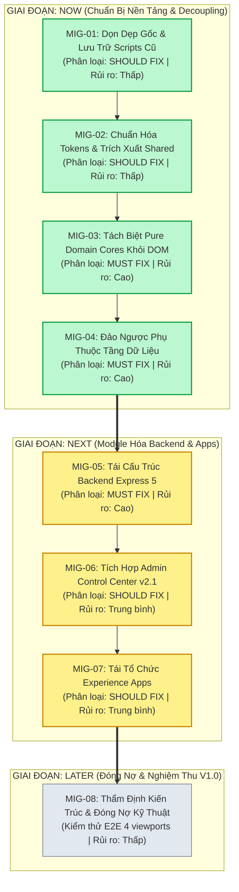

# LỘ TRÌNH DI CHUYỂN & TÁI CẤU TRÚC MÃ NGUỒN ĐÃ ĐỐI SOÁT (REVISED v2.0)
## (REVISED SOURCE CODE MIGRATION ROADMAP: MIG-01 ĐẾN MIG-08)

- **Mã tài liệu:** `AUDIT/REVISED_SOURCE_CODE_MIGRATION_ROADMAP.md`
- **Đường dẫn canonical:** `AUDIT/REVISED_SOURCE_CODE_MIGRATION_ROADMAP.md`
- **Tài liệu đối soát nền tảng:** [`AUDIT/ARCHITECTURE_RECONCILIATION_REPORT.md`](file:///Users/tuantq/Projects/Personal/giatoctrantrongthu/AUDIT/ARCHITECTURE_RECONCILIATION_REPORT.md)
- **Bản đặc tả kiến trúc đích:** [`AUDIT/REVISED_SOURCE_CODE_TARGET_ARCHITECTURE.md`](file:///Users/tuantq/Projects/Personal/giatoctrantrongthu/AUDIT/REVISED_SOURCE_CODE_TARGET_ARCHITECTURE.md)
- **Chỉ thị:** `# DIRECTIVE: WS08 ARCHITECTURE RECONCILIATION`
- **Dự án:** CÂY GIA PHẢ — GIA TỘC TRẦN TRỌNG THU (`giatoctrantrongthu.com`)
- **Product Owner / Thẩm quyền tối cao:** Tuấn
- **Thẩm định kiến trúc & QC:** Emarald
- **Đơn vị điều phối & thực thi:** AGY (Primary Agent)
- **Thời điểm hoàn thành:** 2026-11-03T23:20:00+07:00

---

## 1. NGUYÊN TẮC AN TOÀN CHUYỂN ĐỔI (MIGRATION SAFETY PRINCIPLES)

```text
┌─────────────────────────────────────────────────────────────────────────────┐
│                       5 NGUYÊN TẮC AN TOÀN CHUYỂN ĐỔI                       │
├─────────────────────────────────────────────────────────────────────────────┤
│ 1. TEST-BEFORE-TOUCH (Lập chốt kiểm thử trước khi sửa):                     │
│    Mọi gói di chuyển đụng chạm logic nghiệp vụ bắt buộc phải có Ca kiểm     │
│    thử đặc tính (Characterization Test) chụp ảnh snapshot đầu ra hiện tại   │
│    trước khi viết bất kỳ dòng mã trích xuất nào.                            │
│ 2. SHADOW EXTRACTION & FACADE (Trích xuất song hành có chuyển tiếp):        │
│    Module mới được xây dựng độc lập; module cũ đóng vai trò Facade ủy thác  │
│    sang module mới. Tuyệt đối không xóa mã cũ cho đến khi hoàn tất nghiệm   │
│    thu đầu ra tương đương 100%.                                             │
│ 3. OUTPUT PARITY REQUIREMENT (Bắt buộc tương đương đầu ra):                 │
│    Bộ kiểm thử Parity Test phải so sánh sâu (deep equality) giữa kết quả    │
│    của hàm mới và hàm cũ trên 100% dữ liệu 228 nhân vật và bài viết MẠCH.   │
│ 4. ATOMIC ROLLBACK READY (Sẵn sàng hoàn nguyên tức thì):                    │
│    Mỗi gói di chuyển là một đơn vị công việc độc lập (Atomic PR/Commit).    │
│    Nếu vi phạm bất kỳ Rollback Trigger nào, kích hoạt hoàn nguyên ngay.     │
│ 5. ZERO PRODUCTION INTERFERENCE (Không ảnh hưởng web đang chạy):            │
│    Mọi kiểm thử và chuyển đổi thực hiện trên môi trường Lab/Staging; cấm     │
│    thao tác trực tiếp trên môi trường Production sống khi chưa có GATE-06.  │
└─────────────────────────────────────────────────────────────────────────────┘
```

---

## 2. TỔNG QUAN 8 GÓI DI CHUYỂN TIỆM TIẾN (MIG-01 ĐẾN MIG-08)



---

## 3. CHI TIẾT 8 GÓI DI CHUYỂN & MA TRẬN AN TOÀN

### GÓI MIG-01: Thu Dọn Thư Mục Gốc & Lưu Trữ Kế Thừa (Legacy Archival)
- **Mã sub-plan:** `SC-01`
- **Mục tiêu:** Di chuyển 54 tệp script vá tạm thời tại root vào `archive/scripts/`; chuyển mã nguồn Gen 1 không còn sử dụng (`src/js/member-app.js`, `server/member_baseline.html`) vào `archive/legacy-frontend/`.
- **Phân loại nợ kỹ thuật:** `SHOULD FIX` (`TD-01`, `TD-02`).
- **Bằng chứng an toàn:** Đã kiểm tra 0 inbound references trên toàn repo (`Status: PROVEN`).
- **Tiêu chuẩn kiểm thử:**
  - Chạy `npm test`, khởi động server backend port 3000 và lab port 8888.
- **Tiêu chí hoàn nguyên (Rollback Trigger):** Bất kỳ lệnh dev nào báo lỗi `MODULE_NOT_FOUND` hoặc file missing.
- **Cơ chế hoàn lùi:** Chuyển tệp bị thiếu từ `archive/` trở lại vị trí cũ trong 1 lệnh shell.
- **Definition of Done (DoD):** Thư mục gốc sạch sẽ, chỉ còn các entry points chuẩn (`index.html`, `lab.html`, `package.json`, `vercel.json`); 0 lỗi khởi động.

---

### GÓI MIG-02: Chuẩn Hóa Design Tokens & Trích Xuất Tầng Dùng Chung (Shared Layer)
- **Mã sub-plan:** `SC-02`
- **Mục tiêu:** Xác lập `src/css/foundation/tokens.css` và `foundation.css` là nguồn chân lý duy nhất cho CSS. Khởi tạo `src/js/shared/dom/` (chứa `dom-builder.js`, `html-sanitizer.js` bọc DOMPurify) và `src/js/shared/contracts/` (epistemic labels, access levels).
- **Phân loại nợ kỹ thuật:** `SHOULD FIX` (`TD-05`), `ACCEPTED DEBT` (`TD-07`).
- **Bằng chứng an toàn:** File CSS foundation đang chạy tốt trên live web và lab (`Status: PROVEN`).
- **Tiêu chuẩn kiểm thử:**
  - Chạy `scripts/ui_vnext_qa.mjs` trên 4 viewports (375, 768, 1024, 1440px).
- **Tiêu chí hoàn nguyên (Rollback Trigger):** Phát hiện sai lệch giao diện (visual regression) > 1% hoặc vỡ biến CSS tokens.
- **Cơ chế hoàn lùi:** Khôi phục file cấu hình CSS từ Git working tree.
- **Definition of Done (DoD):** Mọi ứng dụng nạp tokens từ `src/css/foundation/foundation.css`; các hàm tạo thẻ HTML an toàn tập trung tại `shared/dom/`.

---

### GÓI MIG-03: Tách Biệt Pure Domain Cores Khỏi DOM (Domain Layer Extraction)
- **Mã sub-plan:** `SC-03`
- **Mục tiêu:** Tách toàn bộ logic nghiệp vụ thuần túy ra khỏi các file UI hiện có, tổ chức vào 5 Domain Cores chuyên biệt:
  - `src/js/domain/genealogy/`: Thuật toán dựng cây phả hệ, phân tầng thế hệ, niên biểu.
  - `src/js/domain/kinship/`: Thuật toán đại từ xưng hô, ma trận ReBAC thân tộc.
  - `src/js/domain/editorial/`: Phân giải Markdown, chuyên đề MẠCH, nhãn nhận thức.
  - `src/js/domain/calendar/`: Động cơ Âm lịch Việt Nam, tính tiết khí và ngày kỵ giỗ.
  - `src/js/domain/archive/`: Siêu dữ liệu tư liệu ảnh, tọa độ gắn thẻ mặt người thân.
- **Phân loại nợ kỹ thuật:** `MUST FIX` (`TD-06`).
- **Bằng chứng an toàn:** Logic phả hệ và âm lịch hiện đang chạy trong `pedigree-tree.js` và `server/calendars/` (`Status: OBSERVED`).
- **Tiêu chuẩn kiểm thử bắt buộc (Pre-requisites):**
  1. *Characterization Test:* Chụp baseline đầu ra của thuật toán xưng hô và cây trên 228 nhân vật.
  2. *Output Parity Test:* So sánh sâu `assert.deepStrictEqual(newDomainFunc(p), legacyFunc(p))` đạt 100% PASS trên Node.js mà không cần mock DOM.
- **Tiêu chí hoàn nguyên (Rollback Trigger):** Có bất kỳ sai lệch nào về phả đồ, thứ bậc xưng hô, hoặc ngày âm lịch.
- **Cơ chế hoàn lùi:** Kích hoạt Facade ủy thác ngược về hàm cũ.
- **Definition of Done (DoD):** 100% mã nguồn trong `src/js/domain/` không chứa `window`, `document`, hay `HTMLElement`; toàn bộ domain tests chạy pass trên Node.js.

---

### GÓI MIG-04: Đảo Ngược Phụ Thuộc Tầng Dữ Liệu (Platform Data Inversion)
- **Mã sub-plan:** `SC-04`
- **Mục tiêu:** Xây dựng `DataService` tại `src/js/platform/data/` giao tiếp qua Adapter trừu tượng. Tách `HttpAdapter` (gọi Live API) và `MockAdapter` (nạp fixture in-memory). Gỡ bỏ lệnh `import { mockApi } from './mock-adapter.js'` tại `src/js/ui/data.js:11`. Tiêm phụ thuộc tại `boot.js`.
- **Phân loại nợ kỹ thuật:** `MUST FIX` (`TD-03`).
- **Bằng chứng an toàn:** Kiểm tra trực tiếp coupling cứng tại `src/js/ui/data.js:11` (`Status: PROVEN`).
- **Tiêu chuẩn kiểm thử:**
  - Chạy Lab với `window.__GIATOC_MOCK__ = true` ──► nạp fixture thành công 100%.
  - Chạy Staging không có cờ ──► gọi Live API `/api/*` bình thường.
- **Tiêu chí hoàn nguyên (Rollback Trigger):** Lỗi `fetchJSON is not a function`, không nạp được profile thành viên, hoặc rò rỉ mock switcher vào môi trường live.
- **Cơ chế hoàn lùi:** Revert file `data.js` về trạng thái ban đầu.
- **Definition of Done (DoD):** Không còn bất kỳ lệnh import mock data nào trong code sản xuất; chuyển đổi data source tại runtime dựa trên Composition Root.

---

### GÓI MIG-05: Tái Cấu Trúc Backend Node/Express 5 (Backend Modularization)
- **Mã sub-plan:** `SC-05`
- **Mục tiêu:** Chia nhỏ `server/index.js` (596 dòng) thành cấu trúc module hóa chuyên biệt:
  - `server/src/app.js`: Cấu hình middleware an ninh, session cookie HttpOnly, CORS.
  - `server/src/routes/`: `auth-routes.js`, `member-routes.js`, `admin-routes.js`, `public-routes.js`.
  - `server/src/middleware/`: `session-guard.js`, `csrf-guard.js`, `rate-limiter.js`, `auth-policy.js`.
- **Phân loại nợ kỹ thuật:** `MUST FIX` (`TD-04`).
- **Bằng chứng an toàn:** Đã có bộ test an ninh `scripts/test_security_verification.mjs` kiểm tra 10/10 test case (`Status: TESTED`).
- **Tiêu chuẩn kiểm thử:**
  - Chạy lại bộ `test_security_verification.mjs` đạt 10/10 PASS (CF-01 đến CF-08).
  - Kiểm tra cô lập Thư Clara đạt 100% chặn truy cập không quyền.
- **Tiêu chí hoàn nguyên (Rollback Trigger):** Bất kỳ lỗi an ninh nào bị mở lại hoặc endpoint trả về HTTP 500 không xử lý.
- **Cơ chế hoàn lùi:** Revert commit trên thư mục `server/`.
- **Definition of Done (DoD):** `server/index.js` giảm xuống dưới 100 dòng (chỉ khởi động máy chủ); các routes độc lập; pass toàn bộ security test suites.

---

### GÓI MIG-06: Tích Hợp Admin Control Center v2.1 (Admin System Integration)
- **Mã sub-plan:** `SC-06`
- **Mục tiêu:** Nâng cấp `/admin` theo bản đặc tả kiến trúc v2.1:
  - Sử dụng chung Design Tokens từ `src/css/foundation/foundation.css`.
  - Khử độc 100% nội dung hiển thị bằng `DOMPurify` để chống triệt để XSS.
  - Tích hợp điều hướng module Design & Experience (`#/lab`) nhúng năng lực xem trước của Lab vào Admin.
- **Phân loại nợ kỹ thuật:** `SHOULD FIX` (`TD-05`).
- **Bằng chứng an toàn:** Tài liệu `ADMIN_CONTROL_CENTER_ARCHITECTURE_v2.1.md` đã được Emarald duyệt nguyên tắc (`Status: OBSERVED`).
- **Tiêu chuẩn kiểm thử:**
  - Đăng nhập admin, duyệt qua các tab Dashboard, Nhân sự, Mạch, Di sản, Hệ thống.
  - Kiểm tra XSS payload trong form soạn thảo MẠCH bị chặn sạch.
- **Tiêu chí hoàn nguyên (Rollback Trigger):** Không đăng nhập được vào Admin hoặc layout admin bị vỡ.
- **Cơ chế hoàn lùi:** Hoàn nguyên thư mục `admin/js/` và `admin/css/`.
- **Definition of Done (DoD):** Giao diện Admin đồng bộ Brand Governance; an toàn XSS 100%; nhúng phân hệ Design & Lab hoạt động trơn tru.

---

### GÓI MIG-07: Tái Tổ Chức Experience Apps (Applications Layer Alignment)
- **Mã sub-plan:** `SC-07`
- **Mục tiêu:** Chuẩn hóa cấu trúc thư mục ứng dụng đầu cuối tại `src/js/apps/`:
  - `src/js/apps/public/`: View Trang chủ và Thẻ Mời Cửa Ngõ (`index.html`).
  - `src/js/apps/member/`: View Không Gian Thành Viên (`server/member_*.html`).
  - `src/js/apps/admin/`: View Quản trị (`admin/index.html`).
  - `src/js/apps/lab/`: Studio thiết kế (`lab.html`).
- **Phân loại nợ kỹ thuật:** `SHOULD FIX`.
- **Tiêu chuẩn kiểm thử:**
  - Chạy `scripts/lab_browser_qa.mjs` và `scripts/ui_vnext_qa.mjs`.
- **Tiêu chí hoàn nguyên (Rollback Trigger):** Xuất hiện lỗi HTTP 404 trên Network Tab khi nạp các entry points.
- **Cơ chế hoàn lùi:** Giữ các file facade `src/js/ui/boot-*.js` trỏ về file mới.
- **Definition of Done (DoD):** Cả 4 ứng dụng hoạt động thông suốt, khớp 100% với cây thư mục Target Architecture.

---

### GÓI MIG-08: Thẩm Định Kiến Trúc Toàn Diện & Đóng Nợ Kỹ Thuật (Verification & Closure)
- **Mã sub-plan:** `SC-08`
- **Mục tiêu:** Rà soát lại toàn bộ 8 khoản nợ kỹ thuật (`TD-01` đến `TD-08`), xác minh không còn mã thừa, chạy kiểm thử tích hợp E2E trên môi trường Staging chuẩn bị phát hành V1.0.
- **Phân loại nợ kỹ thuật:** `MUST FIX` (`TD-08`), thẩm định đóng các nợ còn lại.
- **Tiêu chuẩn kiểm thử:**
  - Chạy bộ kiểm thử tự động toàn diện: Unit tests + Security tests + Browser QA 4 độ phân giải.
- **Tiêu chí hoàn nguyên (Rollback Trigger):** Phát hiện bất kỳ lỗi hồi quy nghiêm trọng nào ảnh hưởng đến trải nghiệm người dùng hoặc rò rỉ dữ liệu gia tộc.
- **Cơ chế hoàn lùi:** Dừng kích hoạt phát hành, duy trì trạng thái Staging an toàn, báo cáo Tuấn tại GATE-06.
- **Definition of Done (DoD):** Báo cáo nghiệm thu kiến trúc đạt 100% tiêu chí QC của Emarald; sẵn sàng trình Tuấn ký duyệt V1.0.

---

## 4. MA TRẬN PHÂN QUYỀN THỰC THI (AGENT ROLES & RESPONSIBILITIES)

| Vai Trò | Người Phụ Trách | Quyền Hạn & Trách Nhiệm Cụ Thể | Ranh Giới Bị Cấm |
| :--- | :--- | :--- | :--- |
| **Product Owner** | **Tuấn** | • Nắm thẩm quyền phê duyệt tối cao.<br>• Phê duyệt các Human Approval Gates (GATE-01 đến GATE-06).<br>• Phê duyệt ranh giới riêng tư và ý nghĩa sản phẩm. | N/A (Thẩm quyền tối cao). |
| **Architecture QC** | **Emarald** | • Thẩm định độc lập tính tuân thủ của các PR di chuyển.<br>• Kiểm tra ranh giới 6 tầng và ma trận import.<br>• Khuyến nghị kỹ thuật độc lập cho Tuấn trước khi merge. | Không trực tiếp viết mã tính năng; giữ vai trò giám sát khách quan. |
| **Primary Agent** | **AGY** | • Thực thi kỹ thuật xuyên suốt từ MIG-01 đến MIG-08.<br>• Viết tests, tái cấu trúc backend, trích xuất domain, cài đặt `DataService`.<br>• Lập báo cáo bàn giao chuẩn 10 mục. | CẤM can thiệp trực tiếp production; CẤM xóa file lịch sử; CẤM vi phạm chốt chặn an toàn. |
| **Specialized Resource**| **Cline** | • Huy động chuyên trách khi cần: Visual QA đa độ phân giải trên Playwright (`ui_vnext_qa.mjs`), tinh chỉnh CSS tokens pixel-perfect. | CẤM can thiệp vào `server/`, `src/js/domain/`, `src/js/platform/`, `database/`. |

---

*Bản Lộ Trình Di Chuyển Đã Đối Soát (Revised v2.0) là kim chỉ nam an toàn cho quá trình chuyển đổi mã nguồn, bảo đảm tính liên tục và độ bền bỉ dài hạn của nền tảng.*

