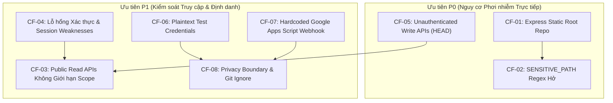
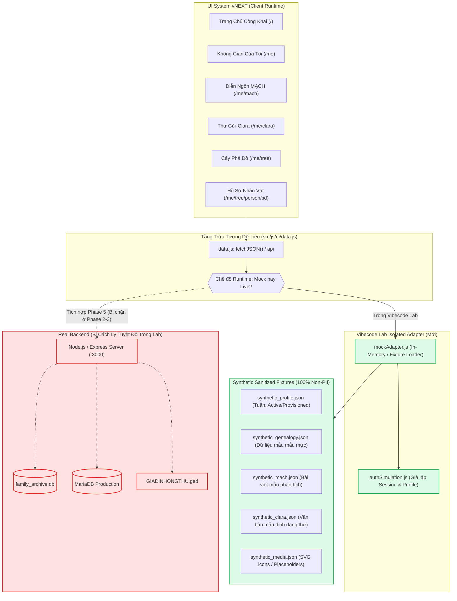
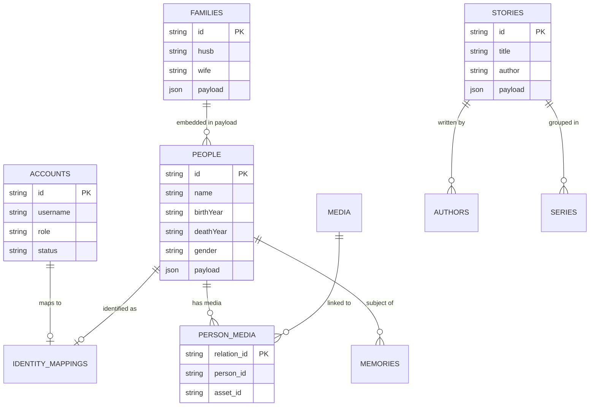

# GIATOCTRANTRONGTHU — BATCH 3: SECURITY CONTAINMENT & VIBECODE LAB INTEGRATION PLAN

- **Repository:** `giatoctrantrongthu` (`/Users/tuantq/Projects/Personal/giatoctrantrongthu`)
- **Ngày lập:** `2026-10-31`
- **Vai trò:** Execution Coordinator & Heritage / Product Architect (AGY)
- **Thẩm quyền phê duyệt tối cao (Human Final Authority):** Tuấn
- **Chế độ thực thi:** **STRICT READ-ONLY — PLANNING ONLY (Không sửa mã nguồn/cấu hình, không khởi chạy server, không thay đổi database, không in thông tin bí mật)**
- **Chuẩn nhãn nhận thức (Epistemic Tags):**
  `[OBSERVED]` · `[EVIDENCE]` · `[INFERENCE]` · `[ASSUMPTION]` · `[UNKNOWN]` · `[BLOCKED]` · `[RECOMMENDATION]`

---

## 1. Executive Summary

Báo cáo này thiết lập kế hoạch toàn diện nhằm hiện thực hóa định hướng chiến lược đã được Tuấn (Human Final Authority) phê duyệt:
1. **Tiếp tục phát triển UI System vNEXT (Vibecode)** trong một môi trường phòng thí nghiệm (Vibecode Lab) hoàn toàn độc lập, tách biệt 100% khỏi backend thật và database thật, sử dụng dữ liệu giả lập (mock/fixture) tổng hợp không chứa bất kỳ dữ liệu nhạy cảm hay PII nào.
2. **Khoanh vùng và xử lý triệt để 8 phát hiện an ninh (`CF-01` → `CF-08`)** đã được xác minh độc lập tại Batch 2 trước khi tiến hành tích hợp hệ thống.
3. **Bảo tồn nguyên vẹn kiến trúc Database và dữ liệu hiện tại**, không đập đi xây lại toàn bộ cơ sở dữ liệu khi chưa có bằng chứng kỹ thuật chứng minh sự cần thiết; thay vào đó thực hiện chuẩn hóa hợp đồng dữ liệu (Data & API Contract Hardening).
4. **Phân chia lộ trình thực thi thành 7 giai đoạn tuần tự**, kiểm soát nghiêm ngặt qua các chốt chặn phê duyệt của con người (Human Approval Gates), đảm bảo tính khả hồi (Rollback Strategy) và kiểm soát rủi ro tuyệt đối.

---

## 2. Evidence Review

Dựa trên kết quả khảo sát độc lập tại [REPOSITORY_AUDIT.md](file:///Users/tuantq/Projects/Personal/giatoctrantrongthu/AUDIT/REPOSITORY_AUDIT.md), [PRE_CLEANUP_SAFETY_REVIEW.md](file:///Users/tuantq/Projects/Personal/giatoctrantrongthu/AUDIT/PRE_CLEANUP_SAFETY_REVIEW.md), và [SECURITY_EXPOSURE_VERIFICATION.md](file:///Users/tuantq/Projects/Personal/giatoctrantrongthu/AUDIT/SECURITY_EXPOSURE_VERIFICATION.md):

- `[EVIDENCE]` **Trạng thái Git Working Tree:** Có 644 mục chưa commit (`21 M`, `65 D`, `558 ??`, `0 staged`), bao gồm mã nguồn UI vNEXT mới (`src/js/ui/`, `src/css/foundation/`), backend adapter (`server/member.js`, `server/auth.js`), nhưng cũng tồn đọng các script thử nghiệm, file nhạy cảm và tài liệu kiểm toán.
- `[EVIDENCE]` **Git HEAD (`42a7ed2`):** Được commit ngày 2026-09-08, KHÔNG chứa `express.static('..')` nhưng chứa các endpoint ghi/xóa chưa xác thực (`POST /api/people`, `POST /api/stories`, `POST /api/edges`, `DELETE /api/edges`) cùng URL webhook Google Apps Script cố định trong workflow CI/CD.
- `[EVIDENCE]` **Working Tree Exposure (`server/index.js:28`):** Middleware tĩnh `app.use(express.static(path.join(__dirname, '..')))` phục vụ toàn bộ thư mục gốc repository, kết hợp regex `SENSITIVE_PATH` chưa phủ kín dẫn đến nguy cơ lộ file kịch bản nội bộ, dữ liệu sức khỏe cá nhân và thư từ gia tộc.
- `[EVIDENCE]` **UI System vNEXT Readiness:** Giao diện vNEXT đã hoàn thiện kiến trúc Single Shell, ContextBar phân định rõ ràng 5 UX contexts và 3 discourse scopes (`CLARA`, `MẠCH`, `PUBLIC`). Đặc biệt, `src/js/ui/data.js` đã tập trung hóa toàn bộ các cuộc gọi API qua module `api = { memberProfile, genealogy, media, personMedia, mach }`, tạo tiền đề lý tưởng cho cơ chế adapter plug-and-play.
- `[EVIDENCE]` **Database State:** SQLite (`server/family_archive.db`) chứa dữ liệu phả hệ tương đối sạch (223 nhân vật, 68 gia đình, 215 mốc thời gian, 185 media), các liên kết phả hệ được lưu trữ toàn vẹn trong `families.payload`. Tuy nhiên có sự trôi dạt định nghĩa bảng (DDL drift) giữa SQLite cục bộ, `server/index.js`, `server/schema_update.sql` và MariaDB production.

---

## 3. Security Containment Matrix

Ma trận dưới đây chi tiết hóa phương án khoanh vùng và khắc phục cho 8 phát hiện an ninh đã xác minh (`CF-01` đến `CF-08`).



### 3.1. Phân loại Biện pháp Xử lý theo Mức độ Rủi ro & Thẩm quyền Phê duyệt (Batch 3.1 Review Calibration)

Nhằm chuyển hóa toàn diện các phát hiện an ninh `CF-01` → `CF-08` thành các biện pháp xử lý cụ thể, bảng chuẩn hóa dưới đây phân định rạch ròi giữa **Biện pháp kỹ thuật cục bộ** (có thể vá trên mã nguồn khi có lệnh duyệt) và **Hành động thuộc thẩm quyền độc quyền của Chủ dự án (Tuấn)**:

| Finding ID | Vấn đề An ninh Cốt lõi | Mức độ Rủi ro | Biện pháp Xử lý Cụ thể | Thẩm quyền Phê duyệt Cần thiết | Trạng thái Hiện tại |
|---|---|---|---|---|---|
| **CF-01** | Static root mount toàn bộ repo (`server/index.js:28`) | **P0 (Critical)** | Cắt bỏ mount `..`, chuyển thành whitelist chỉ phục vụ `/assets`, `/src/css`, `/src/js`. | **Human Gate 02** (Tuấn duyệt diff code) | Đã lập phương án, sẵn sàng patch khi có lệnh. |
| **CF-02** | Regex `SENSITIVE_PATH` bỏ sót & unhandled `URIError` | **P0 (Critical DoS)** | Chuyển sang Allow-list tường minh, bọc `decodeURIComponent` trong `try...catch`. | **Human Gate 02** (Tuấn duyệt diff code) | Đã lập phương án, sẵn sàng patch khi có lệnh. |
| **CF-03** | Public read APIs không giới hạn scope (`/api/genealogy.json`, `mach.json`) | **P1 (High)** | Bọc `requireAccount` cho dữ liệu phả hệ & MẠCH; tách endpoint riêng cho Thư gửi Clara. | **Human Gate 02** (Tuấn duyệt diff & contract) | Đã lập phương án, sẵn sàng patch khi có lệnh. |
| **CF-04** | Điểm yếu auth: thiếu rate limit, rò rỉ `password_hash`, secret dev fallback | **P1 (High)** | Gắn `loginLimiter`, bỏ `password_hash` khỏi query `accounts`, cấm dev secret trên prod. | **Human Gate 02** (Tuấn duyệt diff code) | Đã lập phương án, sẵn sàng patch khi có lệnh. |
| **CF-05** | API ghi/xóa dữ liệu không có auth trong Git HEAD (`HEAD:server/index.js`) | **P0 (Critical)** | Gắn `requireAuth` và `adminCors` vào `POST /people`, `stories`, `edges`, `DELETE /edges`. | **Human Gate 02** (Tuấn duyệt diff code & sync HEAD) | Đã lập phương án, sẵn sàng patch khi có lệnh. |
| **CF-06** | Plaintext test credentials trong `revert_pass.js` và dev scripts | **P1 (High)** | 1. Cách ly `revert_pass.js` ra khỏi thư mục repo.<br>2. Thay mật khẩu cứng bằng biến môi trường.<br>3. Tuấn đổi mật khẩu tài khoản nếu từng dùng chung mật khẩu này trên prod. | 1-2: **Human Gate 02** (Duyệt di chuyển file/script)<br>3: **Tuấn thực hiện riêng** (Credential Rotation) | 1-2: Sẵn sàng thực thi.<br>3: **BLOCKED** (Chờ hành động của Tuấn). |
| **CF-07** | Hardcoded Google Apps Script Webhook URL trong CI YAML | **P1 (High)** | 1. Xóa chuỗi URL fallback trong `.github/workflows/instant-sync.yml`.<br>2. Tuấn thu hồi deployment ID cũ trên script.google.com và cấp secret mới. | 1: **Human Gate 02** (Duyệt diff YAML)<br>2: **Tuấn thực hiện riêng** (Google Cloud/Workspace Console) | 1: Sẵn sàng thực thi.<br>2: **BLOCKED** (Chờ hành động của Tuấn). |
| **CF-08** | Lỗ hổng Privacy boundary và thiếu cấu hình Git ignore | **P1 (High)** | 1. Bổ sung `.gitignore` và `vercel.json` chặn thư Clara, dữ liệu Garmin, test scripts.<br>2. Xem xét dọn lịch sử commit Git trong tương lai. | 1: **Human Gate 02** (Duyệt file ignore/config)<br>2: **Human Gate 04** (Phiên riêng về Git history rewrite) | 1: Sẵn sàng thực thi.<br>2: **BLOCKED** (Chờ quyết định của Tuấn). |

### Chi tiết từng Finding:

#### 1. CF-01: Express static root exposure
- **Trạng thái bằng chứng:** `[PROVEN]` trên Working Tree (`server/index.js:28`). `[PROVEN FALSE]` trên Git HEAD (`42a7ed2`).
- **Phạm vi ảnh hưởng:** `Working Tree Local`. (Chưa triển khai lên production do file `server/index.js` chưa commit).
- **Mức độ ưu tiên:** `P0 (Khẩn cấp)`.
- **Biện pháp containment tối thiểu:**
  - Gỡ bỏ hoàn toàn `app.use(express.static(path.join(__dirname, '..')))` ở dòng 28 của `server/index.js`.
  - Chỉ mount các thư mục tài nguyên tĩnh công khai cần thiết:
    - `app.use('/assets', express.static(path.join(__dirname, '../assets')))`
    - `app.use('/src/css', express.static(path.join(__dirname, '../src/css')))`
    - `app.use('/src/js', express.static(path.join(__dirname, '../src/js')))`
    - `app.use('/admin', requireAuth, express.static(path.join(__dirname, '../admin')))` (nếu phục vụ admin qua Express).
- **Files/modules dự kiến thay đổi:** `server/index.js`.
- **Dependencies & Side effects:** Giao diện frontend yêu cầu file tĩnh (JS/CSS) phải tải đúng đường dẫn; không làm gãy các trang HTML tĩnh do HTML vẫn gọi qua `/src/...` hoặc `/assets/...`.
- **Phương pháp kiểm chứng an toàn:** Gửi request HTTP GET tới `/package.json`, `/server/index.js`, `/revert_pass.js`, `/data/mach.json` -> Tất cả phải trả về `HTTP 404 Not Found`. Các file `/assets/images/logoGiaToc.svg` và `/src/js/ui/boot-public.js` phải trả về `HTTP 200 OK`.
- **Rollback strategy:** Khôi phục lại khối middleware trong `server/index.js` từ stash/git checkout của nhánh thử nghiệm.
- **Acceptance criteria:** Không thể truy cập bất kỳ file nào nằm ngoài thư mục asset/client qua HTTP static middleware.

#### 2. CF-02: SENSITIVE_PATH deny-list
- **Trạng thái bằng chứng:** `[PROVEN]` trên Working Tree (`server/index.js:21-27`).
- **Phạm vi ảnh hưởng:** `Working Tree Local`.
- **Mức độ ưu tiên:** `P0 (Khẩn cấp)`.
- **Biện pháp containment tối thiểu:**
  - Chuyển từ mô hình "Deny-list dựa trên Regex" sang kiến trúc "Allow-list tường minh" kết hợp với việc cô lập static root ở CF-01.
  - Bọc khối kiểm tra `decodeURIComponent(req.path)` trong `try...catch` để bắt lỗi `URIError`, ngăn chặn tấn công DoS / crash HTTP 500 khi gặp URL-encoding dị dạng.
- **Files/modules dự kiến thay đổi:** `server/index.js`.
- **Dependencies & Side effects:** Không ảnh hưởng đến client hợp lệ.
- **Phương pháp kiểm chứng an toàn:** Kiểm thử tự động với request malformed URL (ví dụ: `GET /%c0%ae%c0%ae/`) -> Phải trả về `HTTP 400 Bad Request` hoặc `404 Not Found`, không sinh unhandled crash.
- **Rollback strategy:** Revert thay đổi trong `server/index.js`.
- **Acceptance criteria:** Bắt triệt để ngoại lệ giải mã URI, không cho phép truy cập traversal hoặc bypass danh sách cấm.

#### 3. CF-03: Public API authorization
- **Trạng thái bằng chứng:** `[PROVEN]` trên Working Tree & Git HEAD (`server/index.js:244, 293, 366, 421, 471, 488, 505`).
- **Phạm vi ảnh hưởng:** `Working Tree`, `Git HEAD`, `Production (nếu API live)`.
- **Mức độ ưu tiên:** `P1 (Cao)`.
- **Biện pháp containment tối thiểu:**
  - Tách bạch endpoint công khai và nội bộ:
    - `/api/public/voice`: Chỉ trả về các thông điệp đại diện gia tộc hướng ngoại.
    - `/api/genealogy.json`, `/api/mach.json`, `/api/media.json`: Bắt buộc bảo vệ bằng middleware `requireAccount` (chỉ thành viên đăng nhập mới đọc được phả hệ và diễn ngôn MẠCH).
    - Tách riêng corpus `Thư gửi Clara` khỏi `/api/mach.json` thành `/api/member/clara.json` có quyền truy cập riêng biệt (`requireAccount` + phân quyền mức gia đình nếu cần).
- **Files/modules dự kiến thay đổi:** `server/index.js`, `server/member.js`.
- **Dependencies & Side effects:** Frontend Public Home không bị ảnh hưởng vì theo chuẩn vNEXT, Public Home không đọc `genealogy.json` hay `mach.json`. UI Member Space đã có sẵn cơ chế session cookie.
- **Phương pháp kiểm chứng an toàn:** Request không kèm cookie tới `/api/genealogy.json` phải nhận `HTTP 401 Unauthorized`. Request có session hợp lệ nhận `HTTP 200 OK`.
- **Rollback strategy:** Revert các wrapper middleware trên route.
- **Acceptance criteria:** Không một endpoint chứa dữ liệu gia phả hoặc thư từ nội bộ nào có thể truy cập ẩn danh qua Internet.

#### 4. CF-04: Authentication/session weaknesses
- **Trạng thái bằng chứng:** `[PROVEN]` trên Working Tree (`server/member.js:30-52, 129-166`, `server/auth.js:129-151`, `server/index.js:36, 214`).
- **Phạm vi ảnh hưởng:** `Working Tree Local`.
- **Mức độ ưu tiên:** `P1 (Cao)`.
- **Biện pháp containment tối thiểu:**
  1. Gắn `loginLimiter` và `adminCors` vào endpoint `POST /api/member/login`.
  2. Bỏ cột `password_hash` khỏi câu truy vấn `SELECT * FROM accounts WHERE id = ?` trong `GET /api/auth/me/identity` (`server/auth.js:137`).
  3. Cấm fallback `'dev-only-insecure-secret'`: Trong môi trường production, nếu `SESSION_SECRET` thiếu, ứng dụng phải từ chối khởi động (`process.exit(1)`).
  4. Khóa cứng điều kiện `DEV_AUTO_LOGIN`: Chỉ kích hoạt khi `NODE_ENV === 'development'` VÀ `DEV_AUTO_LOGIN === 'true'` VÀ cổng kết nối là loopback cục bộ.
- **Files/modules dự kiến thay đổi:** `server/member.js`, `server/auth.js`, `server/index.js`.
- **Dependencies & Side effects:** Tránh lộ mật mã băm ra frontend; ngăn ngừa brute-force mật khẩu thành viên/admin.
- **Phương pháp kiểm chứng an toàn:** Gọi `GET /api/auth/me/identity` kiểm tra response JSON tuyệt đối không có trường `password_hash`. Thực hiện 15 lần login sai liên tiếp để kiểm chứng rate limiting chặn từ lần thứ 11.
- **Rollback strategy:** Revert các commit liên quan trong thư mục `server/`.
- **Acceptance criteria:** Không rò rỉ hash mật khẩu; rate limiter hoạt động đồng nhất trên cả 2 cổng đăng nhập.

#### 5. CF-05: Unauthenticated write/delete APIs trong Git HEAD
- **Trạng thái bằng chứng:** `[PROVEN]` trong Git HEAD (`HEAD:server/index.js:112-151`).
- **Phạm vi ảnh hưởng:** `Git HEAD` và `Production` (nếu nhánh `main` đang được deploy trên máy chủ NAS/Cloud).
- **Mức độ ưu tiên:** `P0 (Khẩn cấp trên môi trường triển khai)`.
- **Biện pháp containment tối thiểu:**
  - Chuẩn hóa việc áp dụng middleware `requireAuth` và `adminCors` cho tất cả các HTTP method có tính đột biến (`POST /api/people`, `POST /api/stories`, `POST /api/edges`, `DELETE /api/edges`).
  - Đảm bảo module `server/auth.js` được track và hợp nhất vào nhánh chính một cách đồng bộ.
- **Files/modules dự kiến thay đổi:** `server/index.js`.
- **Dependencies & Side effects:** Các client quản trị (Admin Control Room) phải đăng nhập hợp lệ trước khi gửi lệnh chỉnh sửa dữ liệu.
- **Phương pháp kiểm chứng an toàn:** Gửi lệnh `POST /api/people` không mang cookie -> Kiểm chứng server phản hồi `HTTP 401 Unauthorized`.
- **Rollback strategy:** Giữ bản sao commit trước đó; tuy nhiên việc khóa quyền là bắt buộc, không được rollback về trạng thái hở.
- **Acceptance criteria:** Toàn bộ API ghi/xóa đều từ chối yêu cầu không xác thực.

#### 6. CF-06: Plaintext test credentials
- **Trạng thái bằng chứng:** `[PROVEN]` trên Working Tree (`revert_pass.js:15,22`, `server/dev_setup_onboarding.js:44`, `scripts/test_p01_onboarding.js:24,31,38`). `0` commits trong Git history.
- **Phạm vi ảnh hưởng:** `Working Tree Local`.
- **Mức độ ưu tiên:** `P1 (Cao)`.
- **Biện pháp containment tối thiểu:**
  - Di chuyển `revert_pass.js` ra khỏi thư mục gốc repository vào thư mục lưu trữ nội bộ không track (`.archive_quarantine/` hoặc thư mục bảo mật ngoài repo).
  - Thay thế các mật khẩu cứng trong kịch bản onboarding/test bằng biến môi trường `SEED_PASSWORD` hoặc sinh ngẫu nhiên an toàn.
  - Khuyến nghị Tuấn đổi mật khẩu tài khoản `tuantq` nếu chuỗi mật khẩu thử nghiệm đó từng trùng với mật khẩu production.
- **Files/modules dự kiến thay đổi:** `revert_pass.js`, `server/dev_setup_onboarding.js`, `scripts/test_p01_onboarding.js`.
- **Dependencies & Side effects:** Kịch bản test dev cần nạp biến môi trường để chạy.
- **Phương pháp kiểm chứng an toàn:** Quét regex mật khẩu trên toàn bộ repository, đảm bảo không còn chuỗi plaintext.
- **Rollback strategy:** Khôi phục từ bản backup an toàn nếu script test cần chạy lại.
- **Acceptance criteria:** Không tồn tại mật khẩu tài khoản người dùng thực dạng plaintext trong mã nguồn.

#### 7. CF-07: Hardcoded Google Apps Script webhook
- **Trạng thái bằng chứng:** `[PROVEN]` trong Git commit `b67254d` và Git HEAD (`.github/workflows/instant-sync.yml:20`).
- **Phạm vi ảnh hưởng:** `Git HEAD`, `GitHub Remote Repository`.
- **Mức độ ưu tiên:** `P1 (Cao)`.
- **Biện pháp containment tối thiểu:**
  - Xóa chuỗi URL fallback cứng tại dòng 20 file `.github/workflows/instant-sync.yml`, chỉ giữ lại tham chiếu Secret: `"${{ secrets.GAS_SYNC_WEBHOOK_URL }}"`.
  - Nếu `secrets.GAS_SYNC_WEBHOOK_URL` không được cấu hình, workflow sẽ dừng một cách an toàn (`echo "Webhook URL not configured, skipping sync."`).
  - Đề xuất Tuấn thu hồi (revoke) deployment ID hiện tại của Google Apps Script và phát hành deployment URL mới nạp vào GitHub Secrets.
- **Files/modules dự kiến thay đổi:** `.github/workflows/instant-sync.yml`.
- **Dependencies & Side effects:** CI/CD sync lịch chỉ chạy khi secret được cung cấp.
- **Phương pháp kiểm chứng an toàn:** Kiểm tra cú pháp YAML của workflow; xác nhận không còn chuỗi `AKfycbzpP_...` trong file.
- **Rollback strategy:** Revert commit cập nhật file YAML.
- **Acceptance criteria:** File CI workflow sạch 100% token/webhook URL.

#### 8. CF-08: Privacy boundary và Git exposure
- **Trạng thái bằng chứng:** `[PROVEN]` trên Git metadata, `.gitignore`, và Working Tree.
- **Phạm vi ảnh hưởng:** `Working Tree`, `Git History`.
- **Mức độ ưu tiên:** `P1 (Cao)`.
- **Biện pháp containment tối thiểu:**
  - Cập nhật `.gitignore` để chặn vĩnh viễn các nguy cơ commit nhầm:
    - `cookies*.txt`, `cookie*.txt`
    - `revert_pass.js`
    - `~/Desktop/**`, `Desktop/**`
    - `server/data/` (đặc biệt `genealogy.json`, `mach.json`)
    - `content/mach/thu-gui-clara/` (8 bức thư riêng tư)
    - `*.fit`, `*.BIN`, `*.TXT` (dữ liệu sức khỏe Garmin)
  - Cập nhật `vercel.json` để chặn không cho Vercel deploy tĩnh thư mục `/content/*` và `/data/*`.
  - Lập phương án rà soát lịch sử Git (sẽ thực hiện riêng biệt dưới Human Gate, không chạy tự động).
- **Files/modules dự kiến thay đổi:** `.gitignore`, `vercel.json`.
- **Dependencies & Side effects:** Tránh việc vô tình gõ `git add .` đẩy dữ liệu nhạy cảm lên GitHub.
- **Phương pháp kiểm chứng an toàn:** Chạy `git check-ignore -v` với từng file nhạy cảm nêu trên, đảm bảo git nhận diện bị ignore.
- **Rollback strategy:** Revert thay đổi `.gitignore`.
- **Acceptance criteria:** Toàn bộ file dữ liệu gia đình nhạy cảm và credential được `.gitignore` bảo vệ tuyệt đối.

---

## 4. Vibecode Lab Architecture

Mục tiêu cốt lõi của **Vibecode Lab** là tạo ra một môi trường phát triển UI độc lập hoàn toàn, cho phép đội ngũ Frontend (Cline persona) tiếp tục hoàn thiện UI System vNEXT mà không cần chạm vào backend thật, không kết nối cơ sở dữ liệu SQLite/MariaDB, và không tiếp xúc với bất kỳ dữ liệu nhạy cảm nào của dòng họ.

### 4.1 Sơ đồ Kiến trúc Vibecode Lab



### 4.2 Chi tiết Kiến trúc Thành phần

#### A. Runtime Architecture
- **Môi trường chạy:** Sử dụng một static dev server nhẹ (như `python3 -m http.server`, Vite hoặc Node.js http-server tĩnh) phục vụ các file frontend từ thư mục gốc, **tuyệt đối không chạy `server/index.js`**.
- **Không có backend runtime:** Mọi tương tác dữ liệu được giải quyết ngay trên trình duyệt hoặc qua Service Worker / Mock Adapter cục bộ.

#### B. Mock Data Architecture (Bộ Fixture Dữ liệu Giả lập Hợp chuẩn)
Bộ dữ liệu giả lập được tạo mới hoàn toàn, đảm bảo tính thẩm mỹ của thiết kế thương hiệu (Brand System) nhưng **không sử dụng bất kỳ thông tin thực nào của gia tộc**:
1. `fixtures/synthetic_genealogy.json`: Chứa 5–10 nhân vật mẫu (Ví dụ: "Cụ Tổ Mẫu", "Nhân Vật A", "Nhân Vật B") với các mối quan hệ đa thế hệ chuẩn, phục vụ kiểm thử tìm kiếm, hiển thị vòng đời, quan hệ gia đình mà không rò rỉ 223 nhân vật thật.
2. `fixtures/synthetic_mach.json`: Chứa 2 bài viết mẫu mang phong cách nghị luận văn hóa trí tuệ (editorial rhythm), không chứa nội dung sáng tác gia đình.
3. `fixtures/synthetic_clara.json`: Chứa 2 bức thư mẫu ngắn để kiểm tra độ giãn khoảng trắng (whitespace) và kiểu chữ serif tĩnh lặng của surface Thư gửi Clara.
4. `fixtures/synthetic_profile.json`: Cung cấp 4 kịch bản danh tính người dùng:
   - `ACTIVE_MEMBER`: Thành viên đã gắn hồ sơ nhân vật (Full display).
   - `UNMAPPED_MEMBER`: Tài khoản chưa gắn nhân vật trong gia phả (Empty state display).
   - `PROVISIONED_MEMBER`: Thành viên đăng nhập lần đầu cần đổi mật khẩu.
   - `UNAUTHENTICATED`: Khách chưa đăng nhập (Redirect hoặc Empty/Gate state).

#### C. API Adapter Boundary
Module `src/js/ui/data.js` hiện tại đang gọi trực tiếp `fetchJSON()`. Ta thiết lập ranh giới adapter sạch:
- Giữ nguyên chữ ký hàm (interface) của đối tượng `api`:
  ```javascript
  export const api = {
    memberProfile: () => adapter.getMemberProfile(),
    genealogy: () => adapter.getGenealogy(),
    media: () => adapter.getMedia(),
    personMedia: () => adapter.getPersonMedia(),
    mach: () => adapter.getMach()
  };
  ```
- Biến môi trường hoặc flag kiểm thử (`window.__GIATOC_MOCK__ = true`) sẽ quyết định nạp `mockAdapter` thay vì `httpAdapter`.

#### D. Authentication Simulation
- Giả lập phiên đăng nhập thông qua `localStorage` hoặc Session Storage.
- Cung cấp một thanh công cụ thử nghiệm thu gọn (Lab Dev Toolbar) chỉ hiển thị trong môi trường Lab, cho phép chuyển đổi nhanh giữa các Persona: "Tuấn (Owner)", "Thành viên Mới (Provisioned)", "Thành viên Ẩn danh (Unmapped)".

#### E. Phân định Thành phần Hiện hữu vs Cần xây dựng

| Thành phần | Hiện trạng | Hành động trong Vibecode Lab |
|---|---|---|
| `src/js/ui/shell.js`, `navigation.js`, `contexts.js` | `[OBSERVED]` Đã có, hoạt động hoàn hảo | Giữ nguyên 100%, không viết lại |
| `src/js/ui/dashboard.js`, `tree.js`, `person.js` | `[OBSERVED]` Đã có cấu trúc chuẩn vNEXT | Giữ nguyên logic hiển thị |
| `src/js/ui/editorial.js`, `discourse.js`, `spaces.js` | `[OBSERVED]` Đã có component | Giữ nguyên logic hiển thị |
| `src/js/ui/states.js`, `epistemic.js`, `visibility.js` | `[OBSERVED]` Đã chuẩn hóa 9 trạng thái | Giữ nguyên |
| `src/js/ui/data.js` | `[OBSERVED]` Fetch cứng vào `/api/*` | **CẦN TÁCH ADAPTER**: Tách logic fetch thành Adapter pattern |
| `fixtures/synthetic_*.json` | Chưa có trong thư mục client | **CẦN XÂY DỰNG**: Tạo bộ dữ liệu mẫu sạch 100% PII |
| `src/js/ui/mock-adapter.js` | Chưa có | **CẦN XÂY DỰNG**: Cung cấp dữ liệu từ fixtures |
| `scripts/run_vibecode_lab.mjs` | Chưa có | **CẦN XÂY DỰNG**: Kịch bản chạy server tĩnh độc lập |

---

## 5. Database & API Contract Assessment

Quyết định hiện tại của Tuấn: **KHÔNG xây dựng lại toàn bộ database ở giai đoạn này**. Dưới đây là kết quả kiểm định kỹ thuật chứng minh cấu trúc cơ sở dữ liệu hiện tại hoàn toàn có thể tiếp tục sử dụng và nâng cấp theo hướng làm sạch hợp đồng (Contract Hardening) thay vì đập đi xây lại.



### 5.1 Đánh giá Tương thích SQLite ↔ MariaDB & Schema Drift
- `[OBSERVED]` **DDL Drift giữa các tầng:**
  - `server/index.js:97-144` (MariaDB inline DDL) tạo `people` với `id VARCHAR(255)` nhưng thiếu cột `fsid`.
  - `server/schema_update.sql` lại chứa lệnh `ALTER TABLE people ADD COLUMN fsid VARCHAR(255); ALTER TABLE people ADD COLUMN payload JSON;`.
  - SQLite cục bộ (`family_archive.db`) chứa cả cột `payload` và các bảng `accounts`, `identity_mappings`, `authorities` từ `foundation.js`.
  - Bảng `admin_users` dùng `INT AUTO_INCREMENT` trên MariaDB nhưng dùng `TEXT UUID` trên SQLite.
- `[INFERENCE]` Sự khác biệt này là do quá trình phát triển qua nhiều giai đoạn (Stage-based evolution). Dữ liệu vật lý cốt lõi trong SQLite hiện tại rất đầy đủ và sạch.
- `[RECOMMENDATION]` **FIX**: Đồng bộ hóa một file DDL Migration duy nhất (Single Source of Truth DDL) chuẩn hóa cho cả SQLite (Local Dev) và MariaDB (NAS/Production), không thiết kế lại bảng.

### 5.2 Khảo sát Hợp đồng Dữ liệu (JSON ↔ SQL ↔ API)
- `[EVIDENCE]` Bảng `families`: Quan hệ vợ chồng (134 links) và con cái (155 links) được lưu giữ 100% trong trường `families.payload` dạng JSON. Không có liên kết mồ côi (`0 orphans`).
- `[EVIDENCE]` Bảng `edges`: Bảng này đang trống (`0 rows`), không được dùng trong runtime thực tế. Toàn bộ phả hệ hoạt động thông qua `families.payload` và `people`.
- `[RECOMMENDATION]` **KEEP**: Giữ nguyên kiến trúc lưu trữ quan hệ trong `families.payload` ở giai đoạn này. Dữ liệu hoàn toàn toàn vẹn. Việc chuẩn hóa tách bảng `edges` quan hệ nhiều-nhiều chỉ thực hiện khi có nhu cầu mở rộng quy mô (Scale-up) ở các phiên bản sau.

### 5.3 Phân tích Nguyên nhân Gốc rễ các Lỗi Đã Ghi Nhận
1. **Lỗi `person_media` (173 rows có `media_id` NULL trong SQLite):**
   - *Nguyên nhân gốc rễ:* `[EVIDENCE]` Kiểm tra `server/db_seed.js:85` phát hiện script insert: `insertPM.run(pm.relationId, pm.personId, pm.mediaId)`. Tuy nhiên trong file `server/data/person_media.json`, trường dữ liệu có tên là `assetId` chứ không phải `mediaId`! Do đó `pm.mediaId` luôn là `undefined/NULL`. Đồng thời, trong `relationId` (định dạng `PMR_<person_id>_<asset_id>`), mã hash của asset vẫn còn nguyên vẹn 100%.
   - *Kết luận:* **FIX**. Dữ liệu ảnh không bị mất, liên kết không bị gãy. Chỉ cần sửa script reseed đọc đúng trường `pm.assetId` là khắc phục hoàn toàn.
2. **Lỗi `timeline`:**
   - *Nguyên nhân gốc rễ:* Cột `timeline.payload` trong SQLite chứa object sự kiện, nhưng bảng `timeline` trong `schema_update.sql` định nghĩa `(id, date, title, description, icon)`.
   - *Kết luận:* **FIX**. Điều chỉnh câu lệnh mapping trong `server/index.js:396-402` để đảm bảo fallback mượt mà giữa các trường schema cũ và mới.
3. **Lỗi `stories`:**
   - *Nguyên nhân gốc rễ:* Khi admin lưu story (`POST /api/stories`), câu lệnh SQL dùng `REPLACE INTO stories (id, title, author, content, status, updatedAt)` -> Câu lệnh này ghi đè toàn bộ dòng và làm mất cột `payload` (vốn chứa series, coverImage, tags của bài viết).
   - *Kết luận:* **FIX**. Cập nhật câu lệnh UPDATE trong `server/index.js:307-314` để bảo toàn cột `payload`.

### 5.4 Bảng Kết Luận Đánh Giá Từng Nhóm

| Thực thể / Bảng | Phân loại | Bằng chứng kỹ thuật & Lý do | Hành động khuyến nghị |
|---|---|---|---|
| `people` | **KEEP** | 223 bản ghi toàn vẹn, chứa đủ metadata vòng đời và payload JSON | Giữ nguyên schema, chỉ chuẩn hóa kiểu dữ liệu VARCHAR/TEXT |
| `families` | **KEEP** | 68 gia đình, 134 spouse links, 155 children links toàn vẹn 100% trong JSON payload | Giữ nguyên, không phá vỡ cấu trúc JSON hiện hành |
| `media` | **KEEP** | 185 tài nguyên hình ảnh toàn vẹn, khớp hoàn toàn với asset ID | Giữ nguyên |
| `person_media` | **FIX** | 173 dòng NULL do nhầm tên thuộc tính `assetId` vs `mediaId` trong seed script | Sửa script seed/import, chạy reseed phục hồi 100% liên kết ảnh |
| `timeline` | **FIX** | Lệch tên cột giữa `schema_update.sql` và JSON payload | Bổ sung fallback mapping trong API adapter |
| `stories` | **FIX** | `REPLACE INTO` làm rớt trường `payload` khi cập nhật bài viết | Sửa câu lệnh SQL cập nhật để giữ trường payload JSON |
| `accounts` & `identity_mappings` | **KEEP** | Đã tách bạch đúng giữa danh tính đăng nhập và hồ sơ phả hệ theo chuẩn vNEXT | Giữ nguyên kiến trúc Identity của `foundation.js` |
| `admin_users` | **REFACTOR** | Đang tồn tại song song 2 bảng auth (staff vs member) gây chồng chéo session | Lập kế hoạch hợp nhất dần quyền quản trị vào bảng `accounts` qua RBAC/Authority |
| `edges` | **KEEP** | Bảng trống, không tham gia runtime hiện hành | Giữ nguyên trạng thái chờ, không kích hoạt khi chưa cần thiết |
| **Toàn bộ Database** | **KHÔNG REDESIGN** | Dữ liệu bên trong cực kỳ sạch và toàn vẹn; các khiếm khuyết chỉ ở tầng script import và câu lệnh API | **Bảo tồn kiến trúc hiện tại, tập trung Hardening & Contract Fix** |

---

## 6. Dependency & Impact Matrix

| Hành động Đề xuất | Thành phần Tác động | Phụ thuộc Tiên quyết | Rủi ro Tiềm ẩn | Biện pháp Giảm thiểu Rủi ro |
|---|---|---|---|---|
| **Cắt bỏ Static Root (CF-01, CF-02)** | `server/index.js` | Không | Trang HTML có thể 404 nếu tham chiếu sai asset path | Kiểm tra lại toàn bộ thẻ `<link>` và `<script>` trên các file HTML host |
| **Khóa Authentication API (CF-03, CF-05)** | `server/index.js`, client Admin | Cấu hình Session hoạt động | Admin UI hoặc Client cũ bị 401 nếu chưa đăng nhập | Đảm bảo Admin Control Room chạy qua luồng login chuẩn |
| **Thiết lập Vibecode Lab (Phase 2)** | `src/js/ui/data.js`, `fixtures/` | Không đụng vào Backend | Xung đột git nếu sửa file chung | Chỉ bổ sung file mới, bọc adapter trong `data.js` bằng flag an toàn |
| **Sửa Seed Script `person_media`** | `server/db_seed.js`, SQLite DB | Backup DB trước khi chạy | Reseed sai có thể làm mất dữ liệu SQLite | SQLite là bản copy, có thể tái tạo từ `data/genealogy.json` |
| **Hợp nhất DDL Migration** | `server/schema_update.sql` | Quyền truy cập MariaDB | Lệch kiểu dữ liệu trên môi trường NAS | Chạy dry-run test trên SQLite trước, xin Human Gate trước khi chạy NAS |

---

## 7. Rollback Strategy

Nguyên tắc an toàn tối thượng: **Mọi thao tác thay đổi mã nguồn hoặc cấu hình phải có kế hoạch hoàn tác tức thì (Instant Rollback) mà không gây mất mát dữ liệu.**

1. **Đối với Mã nguồn (Git Layer):**
   - Mọi thay đổi trong Phase 1 (Containment) và Phase 2 (Vibecode Lab) phải được thực hiện trên một Git Branch chuyên biệt (ví dụ: `security-containment-v1` và `vibecode-lab-v1`).
   - Nhánh `main` được giữ nguyên trạng thái. Nếu có bất kỳ sự cố nào, chỉ cần chuyển nhánh về `main` là toàn bộ runtime trở về trạng thái ban đầu.
2. **Đối với Dữ liệu (Database Layer):**
   - Trước khi thực hiện bất kỳ script sửa lỗi DDL hoặc reseed nào trên SQLite (`server/family_archive.db`), phải tạo một bản sao lưu vật lý nguyên trạng: `cp server/family_archive.db server/family_archive.db.bak_<timestamp>`.
   - Nếu dữ liệu sau khi reseed không khớp kỳ vọng, xóa file hiện tại và phục hồi từ file `.bak`.
3. **Đối với Biến Môi trường & Secrets:**
   - Không ghi đè trực tiếp các file `.env`. Sử dụng template `.env.example` và hướng dẫn cấu hình thủ công cho Human.

---

## 8. Phased Execution Roadmap

Lộ trình thực hiện được chia thành 7 giai đoạn nghiêm ngặt. Không gộp các giai đoạn. Mỗi giai đoạn chỉ được bắt đầu khi giai đoạn trước đã đạt tiêu chí nghiệm thu và được phê duyệt.

```mermaid
flowchart LR
    P1["Phase 1: Security Containment"] --> P2["Phase 2: Vibecode Lab Isolation"]
    P2 --> P3["Phase 3: Frontend Development"]
    P3 --> P4["Phase 4: Database & API Contract Hardening"]
    P4 --> P5["Phase 5: Frontend–Backend Integration"]
    P5 --> P6["Phase 6: Security Verification"]
    P6 --> P7["Phase 7: Production Readiness"]

    classDef humanGate fill:#fef08a,stroke:#ca8a04,stroke-width:2px;
    class P1,P4,P6,P7 humanGate;
```



### Phase 1: Security Containment (Khoanh vùng An ninh Mã nguồn & Backend)
- **Mục tiêu:** Loại bỏ hoàn toàn nguy cơ phơi nhiễm static root, vá các endpoint ghi hở và cập nhật ranh giới Git ignore.
- **Phạm vi (Scope):** `server/index.js`, `server/member.js`, `server/auth.js`, `.gitignore`, `vercel.json`, `.github/workflows/instant-sync.yml`.
- **Phụ thuộc:** Báo cáo xác minh Batch 2.
- **Sản phẩm bàn giao (Deliverables):**
  - Patch an ninh cho `server/index.js` (gỡ `express.static('..')`, bọc URI decode, khóa API ghi).
  - Bản cập nhật `.gitignore` và `vercel.json` bảo vệ dữ liệu phả hệ và thư riêng.
  - Workflow CI/CD đã xóa URL webhook cố định.
- **Tiêu chí nghiệm thu (Acceptance Criteria):** Toàn bộ 8 finding `CF-01` đến `CF-08` được khắc phục trên mã nguồn; không còn endpoint ghi ẩn danh.
- **Human Approval Gate (Tuấn):** **BẮT BUỘC**. Tuấn phê duyệt pull request / diff trước khi merge.
- **Đề xuất phân vai AIOS:** `OpenCode` (Technical Lead / Systems Engineer).

### Phase 2: Vibecode Lab Isolation (Thiết lập Phòng Thí nghiệm Frontend Độc lập)
- **Mục tiêu:** Cung cấp môi trường dev frontend độc lập hoàn toàn, không kết nối backend thật, không dùng dữ liệu nhạy cảm.
- **Phạm vi (Scope):** `src/js/ui/data.js`, tạo `fixtures/synthetic_*.json`, tạo mock adapter, kịch bản khởi chạy dev server tĩnh.
- **Phụ thuộc:** Hoàn thành Phase 1.
- **Sản phẩm bàn giao (Deliverables):**
  - Thư mục `fixtures/` chứa dữ liệu mẫu chuẩn (100% Non-PII).
  - Module `mockAdapter` tích hợp mượt mà vào `src/js/ui/data.js`.
  - Hướng dẫn khởi chạy frontend tĩnh (Vibecode Lab Guide).
- **Tiêu chí nghiệm thu (Acceptance Criteria):** Frontend khởi chạy và điều hướng đầy đủ qua 5 contexts và 3 scopes (`/`, `/me`, `/me/mach`, `/me/clara`, `/me/tree`) trên dữ liệu synthetic mà không cần chạy Node.js server hay SQLite.
- **Human Approval Gate (Tuấn):** Tuấn kiểm tra xác nhận bộ dữ liệu fixture hoàn toàn sạch PII.
- **Đề xuất phân vai AIOS:** `Cline` phối hợp `AGY`.

### Phase 3: Frontend Development (Phát triển Trải nghiệm UI System vNEXT)
- **Mục tiêu:** Đội ngũ Frontend tự do hoàn thiện giao diện, vi chỉnh nhịp điệu typography, xử lý tương tác và browser QA trên Vibecode Lab.
- **Phạm vi (Scope):** `src/css/foundation/*`, `src/js/ui/*`, `index.html`.
- **Phụ thuộc:** Hoàn thành Phase 2.
- **Sản phẩm bàn giao (Deliverables):**
  - Bộ giao diện hoàn chỉnh đáp ứng trọn vẹn `GIATOC_INNER_SITE_UX_IA_SPEC_v0.1.md` và `BRAND_GOVERNANCE_v0.1.md`.
  - Kết quả kiểm thử tự động đa độ phân giải (`scripts/ui_vnext_qa.mjs`) với tỷ lệ pass 100%.
- **Tiêu chí nghiệm thu (Acceptance Criteria):** Không tràn ngang, không dùng card bo góc/đổ bóng, phân định tuyệt đối giữa Clara và MẠCH, không phơi bày ngôn ngữ kỹ thuật lên UI.
- **Human Approval Gate (Tuấn):** Tuấn review trải nghiệm thị giác và điều hướng trên trình duyệt.
- **Đề xuất phân vai AIOS:** `Cline` (Experience Architect / Visual QA).

### Phase 4: Database & API Contract Hardening (Chuẩn hóa Hợp đồng Dữ liệu & Vá Lỗi DB)
- **Mục tiêu:** Vá các lỗi seed/mapping đã xác định (`person_media`, `timeline`, `stories`), đồng bộ DDL schema giữa SQLite và MariaDB mà không thiết kế lại cấu trúc.
- **Phạm vi (Scope):** `server/db_seed.js`, `server/schema_update.sql`, logic query trong `server/index.js`.
- **Phụ thuộc:** Hoàn thành Phase 1. (Có thể chạy song song với Phase 3).
- **Sản phẩm bàn giao (Deliverables):**
  - Script reseed media đã sửa lỗi `assetId` -> Phục hồi 173 liên kết hình ảnh.
  - Bản DDL chuẩn hóa duy nhất hỗ trợ cả SQLite và MariaDB.
  - API query stories bảo toàn trường `payload`.
- **Tiêu chí nghiệm thu (Acceptance Criteria):** `SELECT COUNT(*) FROM person_media WHERE media_id IS NULL` trả về 0. Kiểm tra API trả về dữ liệu chuẩn khớp với hợp đồng mong đợi của UI.
- **Human Approval Gate (Tuấn):** **BẮT BUỘC**. Tuấn phê duyệt script tác động dữ liệu trước khi thực thi.
- **Đề xuất phân vai AIOS:** `OpenCode` (Tech Lead / DB Engineer).

### Phase 5: Frontend–Backend Integration (Tích hợp Hệ Thống)
- **Mục tiêu:** Chuyển đổi adapter trong `src/js/ui/data.js` từ mock sang live API đã được bảo vệ an ninh.
- **Phạm vi (Scope):** `src/js/ui/data.js`, cấu hình proxy tích hợp, kiểm tra CORS nội bộ.
- **Phụ thuộc:** Hoàn thành Phase 3 và Phase 4.
- **Sản phẩm bàn giao (Deliverables):**
  - Giao diện UI System vNEXT tải dữ liệu thật từ backend an toàn qua session xác thực.
- **Tiêu chí nghiệm thu (Acceptance Criteria):** Đăng nhập thành viên hoạt động trơn tru; các trang `/me`, `/me/tree`, `/me/mach` hiển thị đúng dữ liệu thật; Public Home không bị rò rỉ dữ liệu.
- **Human Approval Gate (Tuấn):** Tuấn nghiệm thu luồng trải nghiệm người dùng đầu-cuối (E2E).
- **Đề xuất phân vai AIOS:** `OpenCode` chủ trì, `Cline` hỗ trợ.

### Phase 6: Security Verification (Kiểm định An ninh Tổng thể)
- **Mục tiêu:** Tái kiểm định toàn diện hệ thống sau tích hợp bằng các công cụ kiểm thử tự động, xác nhận không còn lỗ hổng bảo mật nào tồn đọng.
- **Phạm vi (Scope):** Toàn bộ bề mặt API, Static routing, Cookie/Session flags, Headers bảo mật.
- **Phụ thuộc:** Hoàn thành Phase 5.
- **Sản phẩm bàn giao (Deliverables):**
  - Báo cáo kiểm định an ninh cuối cùng (Final Security Verification Report).
- **Tiêu chí nghiệm thu (Acceptance Criteria):** Tất cả các test case kiểm tra bảo mật (tương tự Batch 2) đều PASS; headers bảo mật (`X-Frame-Options`, `Content-Security-Policy`, `SameSite=Lax`) được xác nhận trên response thật.
- **Human Approval Gate (Tuấn):** **BẮT BUỘC**. Tuấn phê duyệt báo cáo an ninh.
- **Đề xuất phân vai AIOS:** `AGY` phối hợp `OpenCode`.

### Phase 7: Production Readiness (Sẵn sàng Phát hành V1)
- **Mục tiêu:** Chuẩn bị hạ tầng triển khai (Vercel, Synology NAS/MariaDB), đóng gói bản phát hành và lập kế hoạch dọn dẹp repository.
- **Phạm vi (Scope):** Kế hoạch triển khai, cấu hình máy chủ, dọn dẹp các file rác không còn sử dụng.
- **Phụ thuộc:** Hoàn thành Phase 6.
- **Sản phẩm bàn giao (Deliverables):**
  - Release candidate v1.0.
  - Bản kế hoạch dọn dẹp repository an toàn (dựa trên Batch 1 Review).
- **Tiêu chí nghiệm thu (Acceptance Criteria):** Hệ thống sẵn sàng vận hành trực tiếp; có phương án giám sát và sao lưu định kỳ.
- **Human Approval Gate (Tuấn):** **BẮT BUỘC**. Phê duyệt cuối cùng để release sản phẩm.
- **Đề xuất phân vai AIOS:** Orchestrator trình Tuấn quyết định.

---

## 9. Acceptance Criteria

Hệ thống được coi là hoàn thành mục tiêu của kế hoạch an ninh và sẵn sàng cho phát triển khi thỏa mãn các tiêu chí định lượng sau:

1. **Về An ninh & Bảo mật:**
   - [ ] Tuyệt đối không thể truy cập bất kỳ file mã nguồn, file cấu hình, cơ sở dữ liệu SQLite hay file kịch bản nội bộ nào qua HTTP GET.
   - [ ] 100% các endpoint đọc dữ liệu gia phả, diễn ngôn nội bộ và thư riêng đều yêu cầu phiên đăng nhập thành viên hợp lệ (`requireAccount`).
   - [ ] 100% các endpoint ghi/xóa dữ liệu yêu cầu phiên quản trị viên hợp lệ (`requireAuth`).
   - [ ] Không còn mật khẩu dạng plaintext trong toàn bộ cây thư mục repository.
   - [ ] Không còn URL webhook của Google Apps Script trong mã nguồn hay kịch bản CI/CD.
2. **Về Vibecode Lab:**
   - [ ] Đội ngũ frontend có thể chạy, sửa đổi và kiểm thử toàn bộ giao diện vNEXT mà không cần khởi động Node.js server và không kết nối database.
   - [ ] Bộ dữ liệu giả lập (fixtures) phản ánh đầy đủ các trường hợp biên (Empty, Loading, Error, Populated) nhưng 100% không chứa dữ liệu thực.
3. **Về Dữ liệu & Cơ sở Dữ liệu:**
   - [ ] Toàn bộ 223 hồ sơ nhân vật và 68 gia đình được bảo tồn nguyên vẹn.
   - [ ] Lỗi NULL trong bảng `person_media` được khắc phục, khôi phục đủ 173 liên kết hình ảnh.
   - [ ] Không tiến hành đập đi xây lại database; giữ vững tính ổn định của hệ thống hiện hữu.

---

## 10. Human Approval Gates

Tuân thủ nghiêm ngặt Quy chế Quản trị Dự án (`AGENTS.md` và `.aios/PROJECT_CONTRACT.json`), các chốt chặn sau **BẮT BUỘC phải có lệnh phê duyệt bằng văn bản từ Tuấn** trước khi thực thi:

| Gate ID | Nội dung Chốt chặn | Điều kiện Tiên quyết | Hậu quả nếu Tự ý Bypass |
|---|---|---|---|
| **GATE-01** | Phê duyệt Kế hoạch An ninh & Lộ trình Thực thi (Báo cáo này) | Tuấn đọc và đồng thuận với các giải pháp kỹ thuật | Vi phạm ranh giới quản trị; đình chỉ hoạt động agent |
| **GATE-02** | Phê duyệt Thay đổi Mã nguồn Backend & Gitignore (Phase 1) | Diff mã nguồn rõ ràng, có đối chiếu rollback | Nguy cơ làm gián đoạn runtime hiện tại |
| **GATE-03** | Phê duyệt Thao tác Reseed Dữ liệu SQLite (Phase 4) | Đã sao lưu file `.bak`, script reseed đã kiểm chứng dry-run | Nguy cơ mất mát dữ liệu lịch sử |
| **GATE-04** | Phê duyệt Triển khai Production / NAS MariaDB (Phase 7) | Hoàn thành kiểm định an ninh Phase 6 với 0 lỗ hổng nghiêm trọng | Nguy cơ rò rỉ thông tin dòng tộc trên môi trường internet live |

---

## 11. BLOCKED / UNKNOWN Items

Dưới đây là các hạng mục hiện đang bị khóa (`BLOCKED`) hoặc chưa thể xác minh (`UNKNOWN`) do ranh giới quyền hạn và môi trường sandbox, cần sự hỗ trợ hoặc quyết định từ Tuấn:

1. `[BLOCKED]` **Truy cập Cơ sở dữ liệu MariaDB trên NAS Synology (`100.80.147.119`):**
   - *Lý do:* Môi trường thực thi của Agent bị cô lập mạng (Sandbox), không có quyền SSH hay kết nối cổng 3306 tới NAS.
   - *Yêu cầu:* Cần Human kiểm tra trạng thái bảng và schema trực tiếp trên NAS hoặc cung cấp kênh đồng bộ an toàn khi bước vào Phase 4.
2. `[BLOCKED]` **Thu hồi & Cấp mới Google Apps Script Webhook URL:**
   - *Lý do:* Thuộc tài khoản Google cá nhân của Tuấn, Agent không có quyền truy cập Google Cloud / Google Workspace Console.
   - *Yêu cầu:* Tuấn chủ động thu hồi deployment cũ trên script.google.com và cập nhật secret `GAS_SYNC_WEBHOOK_URL` trong GitHub Repo Settings.
3. `[BLOCKED]` **Làm sạch Lịch sử Git (Git History Rewrite):**
   - *Lý do:* Thao tác `git filter-repo` hoặc BFG Rewrite History làm thay đổi toàn bộ commit hash của repository, có rủi ro cao gây xung đột cho các bản clone khác.
   - *Yêu cầu:* Tạm thời giữ an toàn bằng `.gitignore` và quy tắc không push; chỉ thực hiện dọn lịch sử Git khi Tuấn trực tiếp chỉ đạo một phiên làm việc riêng.
4. `[UNKNOWN]` **Cấu hình Reverse Proxy / WAF trên Production Host (Vercel & Cloudflare):**
   - *Lý do:* Agent không có quyền truy cập vào dashboard quản trị Vercel hoặc Cloudflare để kiểm tra các rule bảo vệ tầng network.
   - *Yêu cầu:* Xem xét cấu hình header bảo mật tại file `vercel.json` làm phòng tuyến chính.

---

### Kết luận của Execution Coordinator (AGY)
Bản kế hoạch này cung cấp một lộ trình rõ ràng, an toàn tuyệt đối và tôn trọng trọn vẹn di sản dữ liệu của dòng tộc. Bằng cách cô lập môi trường Vibecode Lab, tiến độ phát triển giao diện người dùng sẽ được đẩy nhanh mà không bị cản trở bởi các vấn đề kỹ thuật của backend, đồng thời đảm bảo mọi lỗ hổng an ninh đều được bịt kín trước ngày phát hành chính thức.

*Kính trình Tuấn xem xét, phê duyệt định hướng để bước vào thực thi Phase 1.*

