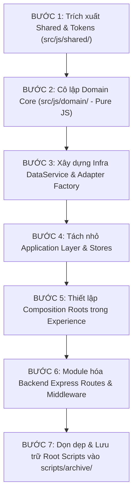

# KẾ HOẠCH TÁI CẤU TRÚC MÃ NGUỒN (SOURCE MODULARIZATION PLAN)
## KIẾN TRÚC MODULAR MONOLITH 6 TẦNG — GIA TỘC TRẦN TRỌNG THU

- **Dự án:** Cây Gia Phả & Nền Tảng Tri Thức Gia Tộc Trần Trọng Thu
- **Repository:** `/Users/tuantq/Projects/Personal/giatoctrantrongthu`
- **Thẩm quyền phê duyệt:** Tuấn — Product Owner / Human Final Authority
- **Thẩm định kiến trúc & QC:** Emarald
- **Điều phối thực thi:** AGY — Primary Agent & Execution Coordinator
- **Tài liệu căn cứ:** [`AUDIT/SOURCE_MODULE_INVENTORY.md`](file:///Users/tuantq/Projects/Personal/giatoctrantrongthu/AUDIT/SOURCE_MODULE_INVENTORY.md)
- **Trạng thái:** `DRAFT — CHỜ DUYỆT TẠI CHECKPOINT 01`
- **Phiên bản:** `v1.0-modularization`

---

## 1. NGUYÊN TẮC THIẾT KẾ & RÀNG BUỘC KIẾN TRÚC (ARCHITECTURAL CONSTRAINTS)

### 1.1 Ràng Buộc Công Nghệ Bất Biến (Immutable Runtime Constraints)
1. **Pure Vanilla JS ES Modules:** 100% mã nguồn Frontend sử dụng ES Modules trình duyệt (`import`/`export`), không cài đặt bundler (Webpack, Vite, Rollup, Parcel), không transpiler (Babel, SWC, TypeScript compiler).
2. **Zero Build Step:** Mọi tệp `.js` và `.css` phải chạy trực tiếp trên trình duyệt hiện đại không qua bước biên dịch.
3. **Single Source of Truth cho Design Tokens:** Thư mục `src/css/foundation/tokens.css` (được tổng hợp bởi `src/css/foundation/foundation.css`) là nguồn chân lý duy nhất cho toàn bộ hệ thống token màu sắc, typography, khoảng cách, elevation.
4. **Zero Downtime & Zero Regression:** Quá trình di chuyển từng module phải giữ nguyên 100% tính năng hiện có của 4 bề mặt (Public Home, Lịch gia tộc, Lab Studio, Thư Clara).

### 1.2 Ranh Giới 6 Tầng Kiến Trúc (The 6-Layer Architecture)

```
┌────────────────────────────────────────────────────────────────────────┐
│  TẦNG 1: EXPERIENCE LAYER (Bề mặt hiển thị, Routes & Mount Points)      │
│  - index.html (Public Home)            - lab.html (Vibecode Lab)        │
│  - admin/index.html (Admin Center)     - server/member_*.html (Member)  │
└───────────────────────────────────┬────────────────────────────────────┘
                                    │ consumes
┌───────────────────────────────────▼────────────────────────────────────┐
│  TẦNG 2: APPLICATION LAYER (Điều phối UI, State, ViewModels)           │
│  - ViewModels & Presenters             - Local UI State Stores          │
│  - Route Controllers                   - Screen Component Modules       │
└───────────────────────────────────┬────────────────────────────────────┘
                                    │ consumes
┌───────────────────────────────────▼────────────────────────────────────┐
│  TẦNG 3: DOMAIN LAYER (Quy tắc gia phả thuần túy - PURE JS, ZERO DOM)   │
│  - genealogy/ (Huyết thống, Phả hệ)   - kinship/ (Xưng hô họ hàng)     │
│  - editorial/ (Nghiệp vụ MẠCH)        - calendar/ (Âm lịch, Tiết khí)  │
│  - archive/ (Phân loại tư liệu, mốc)                                    │
└───────────────────────────────────┬────────────────────────────────────┘
                                    │ consumes
┌───────────────────────────────────▼────────────────────────────────────┐
│  TẦNG 4: PLATFORM LAYER (Dịch vụ nền tảng dùng chung client-side)       │
│  - identity/ (ReBAC client, Session)  - content/ (CMS documents)       │
│  - search/ (Engine tìm kiếm phả hệ)   - telemetry/ (Audit log client)  │
│  - storage/ (IndexedDB, LocalStorage)                                  │
└───────────────────────────────────┬────────────────────────────────────┘
                                    │ consumes
┌───────────────────────────────────▼────────────────────────────────────┐
│  TẦNG 5: SHARED LAYER (Tokens CSS, UI Foundation & Pure Utilities)     │
│  - tokens.css, foundation.css          - date-lunar.js, formatting.js   │
│  - dom-helpers.js, event-bus.js        - validation.js, http-client.js  │
└───────────────────────────────────┬────────────────────────────────────┘
                                    │ consumes
┌───────────────────────────────────▼────────────────────────────────────┐
│  TẦNG 6: INFRASTRUCTURE & BACKEND LAYER (Node/Express, DB, Adapters)    │
│  - server/ (Express API, Middleware)   - database/ (Knex, SQLite/Maria) │
│  - adapters/ (MockAdapter, ApiAdapter) - repositories/ (Data persistence)│
└────────────────────────────────────────────────────────────────────────┘
```

### 1.3 Ma Trận Phụ Thuộc Hợp Lệ & Cấm Đoán (Strict Dependency Matrix)

| Tầng gọi \ Tầng được gọi | 1. Experience | 2. Application | 3. Domain | 4. Platform | 5. Shared | 6. Infra / API |
| :--- | :---: | :---: | :---: | :---: | :---: | :---: |
| **1. Experience** | ❌ (Không cross) |  CHO PHÉP | ⚠️ Chỉ Types |  CHO PHÉP |  CHO PHÉP | ⚠️ Chỉ Composition |
| **2. Application** | ❌ CẤM | ❌ (Không cross) |  CHO PHÉP |  CHO PHÉP |  CHO PHÉP | ⚠️ Qua DataService |
| **3. Domain** | ❌ CẤM | ❌ CẤM | ⚠️ Nội bộ | ❌ CẤM |  Chỉ Pure Utils | ❌ CẤM |
| **4. Platform** | ❌ CẤM | ❌ CẤM | ⚠️ Chỉ Pure Rules| ⚠️ Nội bộ |  CHO PHÉP |  CHO PHÉP |
| **5. Shared** | ❌ CẤM | ❌ CẤM | ❌ CẤM | ❌ CẤM | ⚠️ Nội bộ | ❌ CẤM |
| **6. Infra / Backend**| ❌ CẤM | ❌ CẤM |  CHO PHÉP | ❌ CẤM |  Chỉ Server Utils| ⚠️ Nội bộ DB |

**5 Ràng Buộc Thép Về Phụ Thuộc:**
1. **Rule D-01 (Strict Downward Flow):** Tầng trên chỉ được gọi tầng dưới trực tiếp hoặc thông qua contract. Không có bất kỳ dependency nào gọi ngược từ dưới lên (No upward imports).
2. **Rule D-02 (Pure Domain Isolation):** Tầng 3 (Domain) là mã JavaScript thuần (Pure Functions / Classes), **tuyệt đối 0 DOM (không `document`, `window`, `HTMLElement`), 0 Network (không `fetch`, `XMLHttpRequest`), 0 Storage (không `localStorage`, `indexedDB`)**.
3. **Rule D-03 (Zero Circular Imports):** 0 chấp nhận phụ thuộc vòng trực tiếp hoặc gián tiếp giữa bất kỳ 2 tệp mã nguồn nào.
4. **Rule D-04 (Shared Independence):** Tầng 5 (Shared) độc lập hoàn toàn, không import bất kỳ module nào thuộc Tầng 1, 2, 3, 4, 6.
5. **Rule D-05 (Backend Containment):** Mã `server/` và `database/` hoàn toàn chạy trên môi trường Node.js. Mã Client trong `src/js/` chỉ tương tác với Backend thông qua HTTP API Contract hoặc `DataService` Adapter.

---

## 2. CƠ CẤU THƯ MỤC MỤC TIÊU (TARGET DIRECTORY STRUCTURE)

Cơ cấu mã nguồn chuẩn hóa được thiết kế song song với cấu trúc hiện có để bảo đảm chuyển đổi mềm:

```
giatoctrantrongthu/
├── admin/                         # [Tầng 1] Admin Control Center (Surface hiện hữu)
│   ├── index.html
│   ├── css/
│   │   ├── admin-components.css
│   │   └── admin-layout.css
│   └── js/
│       ├── admin.js               # Entry point
│       └── views/                 # View controllers của Admin
├── lab.html                       # [Tầng 1] Vibecode Lab Studio (Surface hiện hữu)
├── index.html                     # [Tầng 1] Public Web Portal (Surface hiện hữu)
│
├── src/
│   ├── css/                       # [Tầng 5] Design System & Foundation CSS
│   │   ├── foundation/
│   │   │   ├── tokens.css         # SOT duy nhất của Design Tokens
│   │   │   ├── typography.css
│   │   │   ├── layout.css
│   │   │   ├── reset.css
│   │   │   └── foundation.css     # Master aggregator
│   │   ├── components/            # Reusable CSS components
│   │   └── surfaces/              # Surface-specific styling
│   │
│   └── js/
│       ├── experience/            # [Tầng 1] Experience Mount Points & Composition Roots
│       │   ├── boot-public.js     # Khởi tạo Public Home
│       │   ├── boot-member.js     # Khởi tạo Member Experience
│       │   ├── boot-admin.js      # Khởi tạo Unified Admin
│       │   └── boot-lab.js        # Khởi tạo Vibecode Lab Studio
│       │
│       ├── application/           # [Tầng 2] Application & View State Modules
│       │   ├── controllers/       # Điều phối điều hướng và vòng đời màn hình
│       │   ├── stores/            # Quản lý trạng thái client UI
│       │   └── viewmodels/        # Chuẩn bị dữ liệu hiển thị (Presenter logic)
│       │
│       ├── domain/                # [Tầng 3] Pure Domain Logic (Pure JS, Zero DOM)
│       │   ├── genealogy/         # Thuật toán phả hệ: cây, cành, thế hệ, quan hệ
│       │   │   ├── pedigree.js
│       │   │   ├── family-tree.js
│       │   │   └── relationship.js
│       │   ├── kinship/           # Thuật toán xưng hô, tính đại, thứ bậc dòng họ
│       │   │   ├── address-system.js
│       │   │   └── branch-rules.js
│       │   ├── editorial/         # Nghiệp vụ duyệt bài, vòng đời MẠCH
│       │   │   └── article-workflow.js
│       │   ├── calendar/          # Thuật toán Âm Dương, Lịch giỗ, Tiết khí
│       │   │   ├── lunar-core.js
│       │   │   └── anniversary.js
│       │   └── archive/           # Quy chuẩn dữ liệu tư liệu, mốc lịch sử
│       │       └── media-metadata.js
│       │
│       ├── platform/              # [Tầng 4] Client Platform Services
│       │   ├── identity/          # ReBAC client, Auth token, Session checker
│       │   │   ├── rebac-client.js
│       │   │   └── auth-session.js
│       │   ├── content/           # CMS documents service (DEC-A03)
│       │   │   └── cms-client.js
│       │   ├── search/            # Client-side indexing & search engine
│       │   │   └── search-engine.js
│       │   └── telemetry/         # Client audit & telemetry recorder
│       │       └── client-logger.js
│       │
│       ├── shared/                # [Tầng 5] Shared Utilities & Foundation
│       │   ├── utils/
│       │   │   ├── date-lunar.js   # Wrapper hàm ngày âm lịch
│       │   │   ├── formatting.js   # Định dạng tên, ngày, tiền, chuỗi
│       │   │   ├── validation.js   # Kiểm tra tính hợp lệ dữ liệu
│       │   │   └── dom-helpers.js  # Tiện ích DOM an toàn (XSS-safe render)
│       │   ├── event-bus.js       # Pub/Sub nội bộ không phụ thuộc bên thứ 3
│       │   └── http-client.js     # Fetch wrapper chuẩn hóa lỗi & headers
│       │
│       ├── infra/                 # [Tầng 6] Client Data Services & Adapters
│       │   ├── data-service.js    # Cổng giao tiếp dữ liệu duy nhất của Client
│       │   ├── adapters/
│       │   │   ├── adapter-factory.js # Tạo adapter theo môi trường (Mock vs API)
│       │   │   ├── mock-adapter.js    # Dữ liệu mẫu 228 người trong Lab
│       │   │   └── api-adapter.js     # Gọi Backend Express API thật
│       │   └── contracts/         # JSON Schema / Contract chữ ký dữ liệu
│       │       └── api-contracts.js
│       │
│       └── ui/                    # Thư mục UI hiện hữu (DUY TRÌ RE-EXPORT ALIASES TRONG GIAI ĐOẠN TRANSITION)
│
├── server/                        # [Tầng 6] Backend Node.js / Express API
│   ├── index.js                   # Express server entry point
│   ├── member.js                  # Member authentication & router
│   ├── middleware/                # Rate limiter, Session, ReBAC guards
│   ├── routes/                    # REST API endpoints (/api/persons, /api/events, etc.)
│   └── services/                  # Backend business services
│
├── database/                      # [Tầng 6] Database Migrations, Knex & SQLite
│   ├── knexfile.js
│   ├── migrations/
│   └── family_archive.db
│
└── scripts/                       # Phân loại rõ ràng CLI diagnostic vs Archived
    ├── tools/                     # 6 CLI diagnostic tools cần bảo tồn
    │   ├── verify_all.py
    │   ├── test_relationships.py
    │   ├── test_media_assoc.py
    │   ├── verify_gedcom_complete.py
    │   ├── gedcom_verify_phase3.py
    │   └── test_server.py
    ├── dev/                       # Scripts phục vụ môi trường phát triển (serve_lab.mjs...)
    └── archive/legacy/            # Nơi lưu 38 ephemeral patch scripts sau khi gom
```

---

## 3. THIẾT KẾ PUBLIC INTERFACES & CONTRACTS GIỮA CÁC TẦNG

### 3.1 DataService Contract (Tầng 2 & 6)
`DataService` là interface duy nhất mà Tầng Application (hoặc UI) được phép gọi để lấy dữ liệu. Tuyệt đối không gọi trực tiếp `fetch('/api/...')` trong các components hiển thị:

```javascript
// src/js/infra/data-service.js
export class DataService {
  constructor(adapter) {
    this.adapter = adapter; // MockAdapter hoặc ApiAdapter
  }

  // Domain Persons
  async getPersons(filter = {}) { return this.adapter.getPersons(filter); }
  async getPersonDetail(id) { return this.adapter.getPersonDetail(id); }
  async searchPersons(keyword) { return this.adapter.searchPersons(keyword); }

  // Domain Genealogy & Tree
  async getGenealogyTree(rootId, depth = 5) { return this.adapter.getGenealogyTree(rootId, depth); }
  async getPedigree(personId) { return this.adapter.getPedigree(personId); }
  async getKinship(personAId, personBId) { return this.adapter.getKinship(personAId, personBId); }

  // Domain Calendar & Events
  async getAnniversaries(lunarMonth) { return this.adapter.getAnniversaries(lunarMonth); }
  async getUpcomingEvents(daysAhead = 30) { return this.adapter.getUpcomingEvents(daysAhead); }

  // Domain Media & Archive
  async getMediaList(filter = {}) { return this.adapter.getMediaList(filter); }
  async getPersonMedia(personId) { return this.adapter.getPersonMedia(personId); }

  // Domain Content (DEC-A03)
  async getCmsDocument(slug) { return this.adapter.getCmsDocument(slug); }
}
```

### 3.2 Adapter Factory Contract
```javascript
// src/js/infra/adapters/adapter-factory.js
import { MockAdapter } from './mock-adapter.js';
import { ApiAdapter } from './api-adapter.js';

export function createAdapter(config = {}) {
  const mode = config.mode || (window.location.port === '8888' ? 'mock' : 'api');
  if (mode === 'mock') {
    return new MockAdapter(config.mockData);
  }
  return new ApiAdapter({
    baseUrl: config.apiBaseUrl || '',
    token: config.authToken
  });
}
```

### 3.3 Domain Core Public Interfaces (Pure JS, Zero DOM)
1. **Genealogy Module (`src/js/domain/genealogy/index.js`):**
   - `buildFamilyTree(rawPersons, rootId, options): TreeGraph`
   - `calculateGenerationDepth(person, personList): number`
   - `findDirectAncestors(personId, personMap): Person[]`
   - `findDirectDescendants(personId, personMap): Person[]`
2. **Kinship Module (`src/js/domain/kinship/index.js`):**
   - `determineRelationship(sourcePerson, targetPerson, treeContext): RelationType`
   - `getKinshipTerm(sourcePerson, targetPerson, gender, hierarchy): string` (Ví dụ: "Bác ruột", "Cô út", "Cháu đích tôn")
3. **Calendar Module (`src/js/domain/calendar/index.js`):**
   - `solarToLunar(year, month, day): { lYear, lMonth, lDay, isLeap }`
   - `lunarToSolar(lYear, lMonth, lDay, isLeap): { year, month, day }`
   - `matchAnniversaries(lunarDate, deathRecords): Anniversary[]`

---

## 4. CHIẾN LƯỢC TÁCH VÀ THU HẸP 4 "GOD FILES" HIỆN HỮU

Từ kết quả kiểm kê tại [`AUDIT/SOURCE_MODULE_INVENTORY.md`](file:///Users/tuantq/Projects/Personal/giatoctrantrongthu/AUDIT/SOURCE_MODULE_INVENTORY.md), 4 tệp có kích thước và độ phức tạp cao nhất sẽ được chia tách có kiểm soát:

```
┌────────────────────────────────────────────────────────────────────────┐
│ 1. src/js/member-app.js (2,964 dòng)                                   │
│    ├── 1.1 Tách State & Store: src/js/application/stores/member-store.js│
│    ├── 1.2 Tách Family Tree View: src/js/application/views/tree-view.js│
│    ├── 1.3 Tách Member Profile: src/js/application/views/profile-view.js│
│    ├── 1.4 Tách Kinship Resolver: src/js/domain/kinship/index.js       │
│    └── 1.5 Giữ member-app.js làm Composition Facade (< 300 dòng)       │
├────────────────────────────────────────────────────────────────────────┤
│ 2. src/js/ui/lab.js (1,469 dòng)                                       │
│    ├── 2.1 Tách Fixture Data: fixtures/mock-persons-228.json           │
│    ├── 2.2 Tách Studio Viewports: src/js/ui/lab/lab-viewports.js       │
│    ├── 2.3 Tách Audit Panel: src/js/ui/lab/lab-audit-panel.js          │
│    └── 2.4 Giữ lab.js làm Controller điều hướng của Lab Studio         │
├────────────────────────────────────────────────────────────────────────┤
│ 3. admin/js/admin.js (778 dòng)                                        │
│    ├── 3.1 Tách Admin Router: admin/js/router.js                       │
│    ├── 3.2 Tách Content Editor: admin/js/views/content-view.js         │
│    ├── 3.3 Tách User Access Manager: admin/js/views/access-view.js     │
│    └── 3.4 Tách System Status Widget: admin/js/views/system-view.js    │
├────────────────────────────────────────────────────────────────────────┤
│ 4. server/index.js (596 dòng)                                          │
│    ├── 4.1 Tách Rate Limit Middleware: server/middleware/rate-limit.js  │
│    ├── 4.2 Tách CORS & Security Headers: server/middleware/security.js │
│    ├── 4.3 Tách API Person Routes: server/routes/persons.js            │
│    ├── 4.4 Tách API Media Routes: server/routes/media.js               │
│    └── 4.5 Giữ server/index.js thuần túy làm Bootstrap server Express  │
└────────────────────────────────────────────────────────────────────────┘
```

---

## 5. QUY TRÌNH CHUYỂN ĐỔI TIỆM TIẾN & KHÔNG GIÁN ĐOẠN (STEP-BY-STEP MIGRATION SEQUENCE)

Quá trình chuyển đổi mã nguồn tuân thủ nguyên tắc **Add Before Deprecate & Zero Breaking Changes**:



### Chi Tiết Từng Bước Triển Khai:

- **Bước 1 (Shared Extraction):** Tạo thư mục `src/js/shared/utils/`. Di chuyển logic `date-lunar`, `formatting`, `dom-helpers` thành các pure modules độc lập. Trong các tệp cũ, giữ nguyên hàm re-export để không làm hỏng code đang chạy.
- **Bước 2 (Domain Isolation):** Tạo `src/js/domain/{genealogy,kinship,calendar,editorial,archive}/`. Đưa thuật toán phả hệ, xưng hô và âm dương lịch vào đây. Viết unit tests kiểm thử độc lập cho Domain Layer mà không cần trình duyệt hay server.
- **Bước 3 (Infra & DataService):** Tạo `src/js/infra/data-service.js` và hai adapters `mock-adapter.js` / `api-adapter.js`. Cho phép Vibecode Lab (`lab.html`) chuyển đổi mượt mà giữa chế độ mock dữ liệu mẫu và chế độ gọi API backend.
- **Bước 4 (Application Refactoring):** Tách `src/js/member-app.js` và `src/js/ui/lab.js` thành các view modules chuyên trách theo kiến trúc MVVM/MVC.
- **Bước 5 (Experience Bootstrapping):** Chuẩn hóa 4 điểm khởi tạo (`boot-public.js`, `boot-member.js`, `boot-admin.js`, `boot-lab.js`). Mọi injection về dependencies và config đều được thực hiện tại Composition Root.
- **Bước 6 (Backend Modularization):** Chia nhỏ `server/index.js` thành các routes và middleware riêng trong `server/routes/` và `server/middleware/`.
- **Bước 7 (Root Scripts Consolidation):** Di chuyển 38 ephemeral patch scripts vào `scripts/archive/legacy/`. Giữ nguyên 6 diagnostic CLI tools tại `scripts/tools/`.

---

## 6. CHIẾN LƯỢC HOÀN LÙI 3 CẤP ĐỘ (3-TIER ROLLBACK STRATEGY)

Mọi thao tác di chuyển mã nguồn đều phải có phương án hoàn lùi ngay lập tức nếu phát hiện bất kỳ lỗi hồi quy nào:

1. **Cấp độ 1 — Source Code Rollback (Re-export Fallbacks):**
   - Trong suốt các pha chuyển đổi, toàn bộ đường dẫn import cũ (`src/js/ui/person-service.js`, `src/js/ui/public-home.js`, v.v.) sẽ là các tệp mỏng chỉ làm nhiệm vụ `export * from '../target-path.js'`.
   - Nếu module mới phát sinh lỗi, việc hoàn lùi chỉ đơn giản là revert nội dung file re-export về implementation cũ bằng Git.
2. **Cấp độ 2 — Runtime Rollback (Dual-Mode Flags):**
   - Bộ khởi tạo `boot-*.js` hỗ trợ cờ chuyển đổi cấu hình `CONFIG_USE_VNEXT_MODULES = true/false`.
   - Nếu cờ là `false`, ứng dụng tự động nạp module legacy ban đầu.
3. **Cấp độ 3 — Data & Database Rollback:**
   - Tuyệt đối không thay đổi schema CSDL trong quá trình tái cấu trúc cấu trúc mã nguồn.
   - Bản sao lưu vật lý SQLite `database/family_archive.db.bak` được duy trì liên tục và có thể khôi phục trong vòng 30 giây.

---

## 7. KẾT LUẬN & KIỂM CHỨNG

Kế hoạch tái cấu trúc mã nguồn này:
1. Đã bao phủ **100% tệp mã nguồn** được kiểm kê tại `AUDIT/SOURCE_MODULE_INVENTORY.md`.
2. Tuân thủ triệt để nguyên tắc **Zero Bundler / Zero Transpiler / Pure ES Modules**.
3. Bảo toàn nghiêm ngặt ranh giới an ninh, cô lập dữ liệu nhạy cảm (Thư Clara).
4. Phù hợp hoàn toàn với định hướng Unified Admin Control Center và Vibecode Lab Studio.
5. Cung cấp lộ trình triển khai chi tiết, sẵn sàng cho việc phân rã công việc trong `AUDIT/MASTER_PLAN_DECOMPOSITION.md`.

