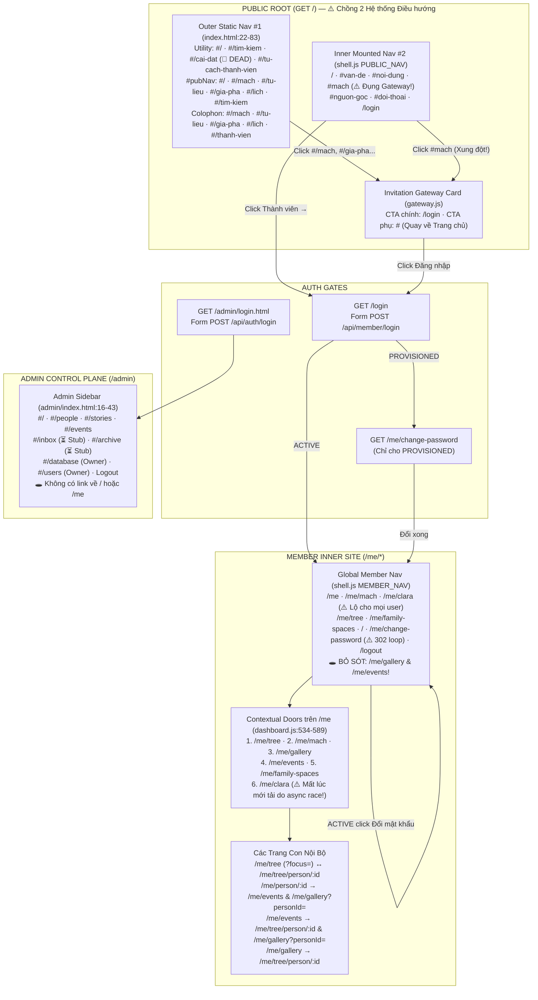

# BÁO CÁO KIỂM TOÁN PHÁP Y SITEMAP WEBSITE HIỆN TẠI (`DISCOVER → AUDIT → RECONSTRUCT → REPORT`)

- **Dự án:** Gia tộc Trần Trọng Thu (`giatoctrantrongthu`)
- **Chế độ thực thi:** `STRICT READ-ONLY / EVIDENCE-BASED` (`VERIFIED`: `0` tệp trong repository bị sửa, tạo mới, đổi tên hoặc xóa; `0` tác động lên `server/family_archive.db`)
- **Thời điểm kiểm toán:** `2026-11-07`
- **Tạo tác Mindmap chỉnh sửa trực tiếp đi kèm:**
  - Markdown / Mermaid / Markmap / ASCII Mindmap: [`CURRENT_WEBSITE_SITEMAP_MINDMAP.md`](file:///Users/tuantq/.gemini/antigravity/brain/8e761875-7940-4acc-b007-3843da5943fb/CURRENT_WEBSITE_SITEMAP_MINDMAP.md)
  - Tệp chuẩn XML Mindmap (`.mm` cho XMind / Freeplane / FreeMind / Draw.io): [`CURRENT_WEBSITE_SITEMAP.mm`](file:///Users/tuantq/.gemini/antigravity/brain/8e761875-7940-4acc-b007-3843da5943fb/CURRENT_WEBSITE_SITEMAP.mm)

> [!IMPORTANT]
> **Kỷ luật Nhận thức & Ranh giới Kiểm toán:**
> 1. Báo cáo này **tái dựng trung thực cấu trúc đang tồn tại thực tế** trong mã nguồn + runtime, đối chiếu với các quyết định lịch sử của Tuấn và dự án. **Không đề xuất kiến trúc mới, không tự ý thêm/bớt/gộp trang.**
> 2. Phân định tuyệt đối 6 loại thực thể: `PAGE` (tài liệu HTML / URL path độc lập), `SPA_VIEW` (màn hình chuyển đổi phía client bên trong một HTML shell), `ANCHOR` (điểm neo cuộn trong cùng 1 trang), `COMPONENT` (khối giao diện, modal, drawer, lightbox), `FEATURE` (tương tác cục bộ, bộ lọc, công cụ chuyển đổi), và `API` (điểm cuối dữ liệu/xác thực Backend).
> 3. Mọi nguyên nhân lịch sử không có văn bản/commit ghi nhận tường minh đều được gắn nhãn `UNKNOWN`.

---

## Tóm tắt Topo Phục vụ Hiện tại (`OBSERVATION` & `EVIDENCE`)

Website hiện không vận hành như một cây định tuyến duy nhất mà tồn tại **3 cơ chế phục vụ (serving topologies) lệch nhau** trên cùng một kho mã nguồn:

1. **Express Backend (`localhost:3000` — [`server/index.js`](file:///Users/tuantq/Projects/Personal/giatoctrantrongthu/server/index.js#L20-L66) + [`server/member.js`](file:///Users/tuantq/Projects/Personal/giatoctrantrongthu/server/member.js#L28-L436) + [`server/auth.js`](file:///Users/tuantq/Projects/Personal/giatoctrantrongthu/server/auth.js#L32-L257)):**
   - Phục vụ đầy đủ Cổng thành viên (`/login`, `/logout`), Không gian nội bộ `/me/*` (`8` shell HTML + `2` inline HTML/redirect), Phòng điều khiển `/admin/*`, Vibecode Lab `/lab.html`, và `27` API endpoints.
   - **Không** mount `express.static` ở thư mục gốc (`/`), chỉ whitelist `/`, `/index.html`, `/lab.html` -> dẫn tới `mirror.html`, `design-playground/`, `prototype/`, `chatbot-demo.html` đều trả về **`404`** trên cổng `3000`.
2. **Vercel Static Config ([`vercel.json`](file:///Users/tuantq/Projects/Personal/giatoctrantrongthu/vercel.json#L1-L66)):**
   - Chỉ cấu hình phục vụ tệp tĩnh (`cleanUrls: true`), **hoàn toàn không có `rewrites` cho `/login`, `/logout`, `/me/*`, hay `/api/*`**. Nếu triển khai tĩnh qua `vercel.json` hiện tại, toàn bộ Không gian Thành viên `/me/*` và `/login` đều trả về **`404`**, trong khi các tệp tĩnh phụ ở gốc/thư mục con (`mirror.html`, `lab.html`, `prototype/*`, `design-playground/*`, `archive/legacy_frontend/*`) lại có thể truy cập trực tiếp nếu không qua Express `SENSITIVE_PATH`.
3. **Vibecode Lab Dev Server (`localhost:8888` — [`scripts/serve_lab.mjs`](file:///Users/tuantq/Projects/Personal/giatoctrantrongthu/scripts/serve_lab.mjs#L1-L72)):**
   - Phục vụ tĩnh từ thư mục gốc, viết lại `/` sang `/lab.html`, chặn `SENSITIVE_PATH` (`/server/*` trả `404`), nên mọi liên kết `/me/*` không được hàm `attachNavigationInterception` chặn bắt sẽ rơi vào **`404`**.

---

## `D01` — CURRENT WEBSITE SITEMAP (Tái dựng Sitemap Thực tế Đang Tồn Tại)

> [!NOTE]
> Bản đồ Mindmap mở và chỉnh sửa trực tiếp tương ứng với `D01` nằm tại [`CURRENT_WEBSITE_SITEMAP_MINDMAP.md`](file:///Users/tuantq/.gemini/antigravity/brain/8e761875-7940-4acc-b007-3843da5943fb/CURRENT_WEBSITE_SITEMAP_MINDMAP.md) và [`CURRENT_WEBSITE_SITEMAP.mm`](file:///Users/tuantq/.gemini/antigravity/brain/8e761875-7940-4acc-b007-3843da5943fb/CURRENT_WEBSITE_SITEMAP.mm). Dưới đây là phân rã cấu trúc thực tế của cả **5 Không gian trang (`Spaces`)** và **3 Lớp phi trang (`Non-Page Layers`)**.

### 1.1. Cấu trúc Phân cấp Thực tế các Trang & Màn hình (`PAGE` & `SPA_VIEW`)

1. **SPACE 1 — PUBLIC SPACE (Không gian Đối ngoại & Cổng vào — Không yêu cầu đăng nhập)**
   - **`GET /` & `GET /index.html`** (`[PAGE]` — [`index.html`](file:///Users/tuantq/Projects/Personal/giatoctrantrongthu/index.html#L1-L88) nạp [`boot-public.js`](file:///Users/tuantq/Projects/Personal/giatoctrantrongthu/src/js/ui/boot-public.js#L1-L68))
     - **Màn hình mặc định:** `PublicHome` (`[SPA_VIEW]` — [`public-home.js`](file:///Users/tuantq/Projects/Personal/giatoctrantrongthu/src/js/ui/public-home.js#L22-L292)) gồm 6 khu vực neo cuộn (`[ANCHOR]` — `#dinh-vi`, `#van-de`, `#noi-dung`, `#mach`, `#nguon-goc`, `#doi-thoai`).
     - **9 Màn hình Cửa ngõ Mời Xác minh (`[SPA_VIEW]` — [`gateway.js`](file:///Users/tuantq/Projects/Personal/giatoctrantrongthu/src/js/ui/gateway.js#L24-L183)):** `#/mach` (và `#mach`), `#/tu-lieu`, `#/gia-pha`, `#/gia-pha/ky-uc`, `#/lich`, `#/tim-kiem`, `#/tu-cach-thanh-vien`, `#/thanh-vien`, `#/ve-du-an`.
     - **Liên kết chết trên vỏ tĩnh (`[DEAD HASH]`):** `#/cai-dat` ([`index.html`](file:///Users/tuantq/Projects/Personal/giatoctrantrongthu/index.html#L28)).

2. **SPACE 2 — AUTH & ONBOARDING GATE (Cổng Xác thực & Kích hoạt Tài khoản)**
   - **`GET /login`** (`?force_auto=1`) (`[PAGE — Inline HTML]` — [`server/member.js`](file:///Users/tuantq/Projects/Personal/giatoctrantrongthu/server/member.js#L28-L126)): Cổng đăng nhập thành viên.
   - **`GET /me/change-password`** (`[PAGE — Inline HTML]` — [`server/member.js`](file:///Users/tuantq/Projects/Personal/giatoctrantrongthu/server/member.js#L187-L253)): Bắt buộc đổi mật khẩu cho tài khoản `PROVISIONED` (tự redirect `302 -> /me` nếu `status === 'ACTIVE'`).
   - **`GET /logout`** (`[REDIRECT]` — [`server/member.js`](file:///Users/tuantq/Projects/Personal/giatoctrantrongthu/server/member.js#L428-L435)): Xóa session, đặt cookie `explicit_logout=1`, chuyển hướng `302 -> /`.
   - **`GET /admin/login.html`** (`[PAGE — Static HTML]` — [`admin/login.html`](file:///Users/tuantq/Projects/Personal/giatoctrantrongthu/admin/login.html#L1-L29)): Cổng đăng nhập riêng cho bảng `admin_users`.

3. **SPACE 3 — MEMBER INNER SITE (`/me/*` — Không gian Nội bộ Thành viên, bảo vệ bởi `requireAccount`)**
   - **`GET /me`** (`[PAGE]` — [`server/member_dashboard.html`](file:///Users/tuantq/Projects/Personal/giatoctrantrongthu/server/member_dashboard.html#L1-L17) + [`dashboard.js`](file:///Users/tuantq/Projects/Personal/giatoctrantrongthu/src/js/ui/dashboard.js#L500-L599)): *"Không gian của tôi"* (Sảnh đón tiếp nội bộ).
     - **`GET /me/tree`** (`?focus=:id`) (`[PAGE]` — [`server/member_tree.html`](file:///Users/tuantq/Projects/Personal/giatoctrantrongthu/server/member_tree.html#L1-L20) + [`tree.js`](file:///Users/tuantq/Projects/Personal/giatoctrantrongthu/src/js/ui/tree.js#L450-L579)): *"Cây phả đồ"* (Phả đồ tương tác 3 tầng + Danh bạ tra cứu).
       - **`GET /me/tree/person/:id`** (`[PAGE — Dynamic `:id`]` — [`server/member_person.html`](file:///Users/tuantq/Projects/Personal/giatoctrantrongthu/server/member_person.html#L1-L17) + [`person.js`](file:///Users/tuantq/Projects/Personal/giatoctrantrongthu/src/js/ui/person.js#L89-L565)): *"Hồ sơ nhân vật"* (Bố cục lưu trữ 2 cột / 6 nhóm thông tin).
     - **`GET /me/mach`** (`[PAGE + In-Memory Reader View]` — [`server/member_mach.html`](file:///Users/tuantq/Projects/Personal/giatoctrantrongthu/server/member_mach.html#L1-L17) + [`discourse.js`](file:///Users/tuantq/Projects/Personal/giatoctrantrongthu/src/js/ui/discourse.js#L24-L139)): *"MẠCH"* (Danh mục 12 bài khảo cứu + Trình đọc bài viết trên RAM).
     - **`GET /me/clara`** (`[PAGE + In-Memory Reader View]` — [`server/member_clara.html`](file:///Users/tuantq/Projects/Personal/giatoctrantrongthu/server/member_clara.html#L1-L17) + [`discourse.js`](file:///Users/tuantq/Projects/Personal/giatoctrantrongthu/src/js/ui/discourse.js#L24-L139)): *"Thư gửi Clara"* (Không gian riêng tư nhánh ông bà Hạnh – Đào, kiểm quyền dữ liệu ở `/api/member/clara.json`).
     - **`GET /me/gallery`** (`?personId=:id&kind=...`) (`[PAGE]` — [`server/member_gallery.html`](file:///Users/tuantq/Projects/Personal/giatoctrantrongthu/server/member_gallery.html#L1-L18) + [`gallery.js`](file:///Users/tuantq/Projects/Personal/giatoctrantrongthu/src/js/ui/gallery.js#L35-L556)): *"Kho tư liệu ảnh"* (185 tư liệu di ảnh + lọc đa tiêu chí + Modal xem ảnh).
     - **`GET /me/events`** (`[PAGE]` — [`server/member_events.html`](file:///Users/tuantq/Projects/Personal/giatoctrantrongthu/server/member_events.html#L1-L18) + [`events.js`](file:///Users/tuantq/Projects/Personal/giatoctrantrongthu/src/js/ui/events.js#L50-L588)): *"Lịch giỗ & Niên biểu"* (Lịch cúng giỗ âm lịch tính động theo năm Can Chi + Niên biểu gia tộc).
     - **`GET /me/family-spaces`** (`[PAGE — Placeholder]` — [`server/member_spaces.html`](file:///Users/tuantq/Projects/Personal/giatoctrantrongthu/server/member_spaces.html#L1-L15) + [`spaces.js`](file:///Users/tuantq/Projects/Personal/giatoctrantrongthu/src/js/ui/spaces.js#L21-L46)): *"Không gian gia đình"* (Hiển thị trạng thái `STATE.NOT_AVAILABLE` — *"Không gian đang được xây dựng"*).

4. **SPACE 4 — ADMIN CONTROL PLANE (`/admin/*` — Phòng Điều khiển Quản trị, bảo vệ bởi `admin_users`)**
   - **`GET /admin`** (`301 -> /admin/` -> [`admin/index.html`](file:///Users/tuantq/Projects/Personal/giatoctrantrongthu/admin/index.html#L1-L78) + [`admin/js/admin.js`](file:///Users/tuantq/Projects/Personal/giatoctrantrongthu/admin/js/admin.js#L61-L91)):
     - **6 Module `SPA_VIEW` hoạt động:** `#/` (Tổng quan), `#/people` & `#/people/:id` (Con người & Quan hệ), `#/stories` & `#/stories/:id` (Bài viết MẠCH), `#/events` & `#/events/:uid` (Sự kiện — kèm nhánh gõ nhầm `#/eventsgiat`), `#/database` (Sơ đồ CSDL — chỉ `owner`), `#/users` (Tài khoản `admin_users` — chỉ `owner`).
     - **2 Mục `SPA_VIEW` placeholder trên Sidebar:** `#/inbox` (*"Inbox"*), `#/archive` (*"Di sản (Archive)"*) -> báo *"Chưa có sẵn — Tính năng chưa tích hợp DB thật."*

5. **SPACE 5 — STUDIO, LAB, MIRROR & ORPHAN SURFACES (Môi trường Thử nghiệm & Tệp mồ côi trong Repo)**
   - **`GET /lab.html`** (`[PAGE + 9 SPA_VIEWS]` — [`lab.html`](file:///Users/tuantq/Projects/Personal/giatoctrantrongthu/lab.html#L1-L23) + [`src/js/ui/lab.js`](file:///Users/tuantq/Projects/Personal/giatoctrantrongthu/src/js/ui/lab.js#L48-L139)): Vibecode Lab Studio (`#view=public|dashboard|tree|person|mach|clara|spaces|gallery|events`).
   - **`mirror.html`** (`[ORPHAN PAGE on Express 404]` — [`mirror.html`](file:///Users/tuantq/Projects/Personal/giatoctrantrongthu/mirror.html#L1-L417) + [`src/js/mirror.js`](file:///Users/tuantq/Projects/Personal/giatoctrantrongthu/src/js/mirror.js#L116-L152)): Bản sao giao diện Production DESIGN-001 ở local (`#/`, `#/gia-pha`, `#/gia-pha/nhan-vat/:id`, `#/mach`, `#/mach/bai/:slug`, `#/lich`, `#/ve-du-an`).
   - **Tệp HTML / App Mồ côi & Lưu trữ (`[ORPHAN]`):** [`server/member_baseline.html`](file:///Users/tuantq/Projects/Personal/giatoctrantrongthu/server/member_baseline.html) (+ [`src/js/member-app.js`](file:///Users/tuantq/Projects/Personal/giatoctrantrongthu/src/js/member-app.js)), [`src/js/app-v2.js`](file:///Users/tuantq/Projects/Personal/giatoctrantrongthu/src/js/app-v2.js), [`prototype/index.html`](file:///Users/tuantq/Projects/Personal/giatoctrantrongthu/prototype/index.html), [`prototype/design-001-public/index.html`](file:///Users/tuantq/Projects/Personal/giatoctrantrongthu/prototype/design-001-public/index.html), [`design-playground/index.html`](file:///Users/tuantq/Projects/Personal/giatoctrantrongthu/design-playground/index.html), [`chatbot-demo.html`](file:///Users/tuantq/Projects/Personal/giatoctrantrongthu/chatbot-demo.html), [`chatbot-app/src/app/page.tsx`](file:///Users/tuantq/Projects/Personal/giatoctrantrongthu/chatbot-app/src/app/page.tsx), `archive/legacy_frontend/index.html`.

### 1.2. Phân tách Nghiêm ngặt các Thực thể KHÔNG PHẢI TRANG (`COMPONENT` / `FEATURE` / `API`)

- **`COMPONENT` (Khối UI / Modal / Drawer / Shell — tuyệt đối không tính là trang độc lập):**
  - Chrome dùng chung: [`InstitutionHeader`](file:///Users/tuantq/Projects/Personal/giatoctrantrongthu/src/js/ui/shell.js#L50-L63), [`GlobalNav`](file:///Users/tuantq/Projects/Personal/giatoctrantrongthu/src/js/ui/shell.js#L65-L78), [`Footer`](file:///Users/tuantq/Projects/Personal/giatoctrantrongthu/src/js/ui/shell.js#L80-L87), [`Breadcrumb`](file:///Users/tuantq/Projects/Personal/giatoctrantrongthu/src/js/ui/components.js#L65-L88), [`BackNavigation`](file:///Users/tuantq/Projects/Personal/giatoctrantrongthu/src/js/ui/components.js#L90-L114), [`StatePanel` / `Region`](file:///Users/tuantq/Projects/Personal/giatoctrantrongthu/src/js/ui/states.js#L74-L190).
  - Overlays & Modals: Modal chi tiết tư liệu ảnh ([`gallery.js`](file:///Users/tuantq/Projects/Personal/giatoctrantrongthu/src/js/ui/gallery.js#L156-L317)), Modal Typeahead & Preview trong Admin ([`admin/index.html`](file:///Users/tuantq/Projects/Personal/giatoctrantrongthu/admin/index.html#L49-L72)), Modal Quản lý Navigator & Proposal trong Lab ([`lab.js`](file:///Users/tuantq/Projects/Personal/giatoctrantrongthu/src/js/ui/lab.js#L919-L1258)), Thanh chuyển đổi Persona nổi `#gi-lab-switcher` ([`mock-adapter.js`](file:///Users/tuantq/Projects/Personal/giatoctrantrongthu/src/js/ui/mock-adapter.js#L91-L152)), Khung `#chatPanel` tĩnh chưa gắn JS ([`index.html`](file:///Users/tuantq/Projects/Personal/giatoctrantrongthu/index.html#L15-L19)).
- **`FEATURE` (Tương tác / Bộ lọc / Chế độ nội trang):**
  - Chuyển chế độ `Phả đồ tương tác` ↔ `Danh sách tra cứu` & chọn đương sự trọng tâm trên `/me/tree` ([`tree.js`](file:///Users/tuantq/Projects/Personal/giatoctrantrongthu/src/js/ui/tree.js#L516-L569)).
  - Lọc theo loại tư liệu / nhân vật / từ khóa trên `/me/gallery` ([`gallery.js`](file:///Users/tuantq/Projects/Personal/giatoctrantrongthu/src/js/ui/gallery.js#L326-L365)).
  - Chuyển tab `Lịch Cúng Giỗ Âm Lịch` ↔ `Niên Biểu Gia Tộc` & chọn năm Can Chi `2024–2030` trên `/me/events` ([`events.js`](file:///Users/tuantq/Projects/Personal/giatoctrantrongthu/src/js/ui/events.js#L164-L226)).
  - Biểu mẫu gửi đề xuất bổ sung thông tin hồ sơ nhân vật trên `/me/tree/person/:id` ([`person.js`](file:///Users/tuantq/Projects/Personal/giatoctrantrongthu/src/js/ui/person.js#L430-L560)).
  - Công cụ giả lập Persona / Viewport / System State / Visual Inline Editor trong `lab.html` ([`lab.js`](file:///Users/tuantq/Projects/Personal/giatoctrantrongthu/src/js/ui/lab.js#L126-L150)).
- **`API` (27 Điểm cuối Dữ liệu & Phiên phía Backend — xem Bảng 2.2 bên dưới).**

---

## `D02` — ROUTE REGISTRY (Sổ Đăng Ký Toàn Bộ Tuyến Đường Thực Tế)

### 2.1. Bảng Đăng ký Toàn bộ Tuyến Trang & Màn hình (`PAGE`, `SPA_VIEW`, `REDIRECT`, `ORPHAN_PAGE`)

| # | Route | Tên Trang / View | Loại (`Page Type`) | Cha / Phân vùng (`Parent / Section`) | Yêu cầu Xác thực (`Auth`) | Quyền Truy cập (`Access`) | Trạng thái Runtime Thực tế (`Express :3000` / `Vercel Static` / `Lab :8888`) | File Nguồn Chính | Bằng chứng (`Evidence`) |
| :--- | :--- | :--- | :--- | :--- | :--- | :--- | :--- | :--- | :--- |
| 1 | `GET /` (`GET /index.html`, `#/`) | Trang chủ Đối ngoại (`PublicHome`) | `PAGE` | Root / `Public Space` | Không (`Public`) | Công khai toàn cầu | `200 OK` (Express & Static); `302/Rewrite -> /lab.html` trên Lab `:8888`. **⚠️ Bị lỗi chồng 2 Header + 2 Nav + 2 Footer** | [`index.html`](file:///Users/tuantq/Projects/Personal/giatoctrantrongthu/index.html#L1-L88), [`boot-public.js`](file:///Users/tuantq/Projects/Personal/giatoctrantrongthu/src/js/ui/boot-public.js#L35-L67), [`public-home.js`](file:///Users/tuantq/Projects/Personal/giatoctrantrongthu/src/js/ui/public-home.js#L22-L292) | [`server/index.js:54-55`](file:///Users/tuantq/Projects/Personal/giatoctrantrongthu/server/index.js#L54-L55); Capture `ev_5405c599` |
| 2 | `/#/mach` (và `/#mach`) | Cửa ngõ Mời Xác minh — MẠCH | `SPA_VIEW` | `/` (`Public Space`) | Không (`Public`) | Công khai (0 byte nội bộ) | Render `InvitationGateway` trên `/`. **⚠️ Xung đột nuốt mất anchor `#mach` của Trang chủ!** | [`boot-public.js`](file:///Users/tuantq/Projects/Personal/giatoctrantrongthu/src/js/ui/boot-public.js#L20-L50), [`gateway.js`](file:///Users/tuantq/Projects/Personal/giatoctrantrongthu/src/js/ui/gateway.js#L25-L32) | `boot-public.js:45` xóa `#\/?` thành `'mach'` |
| 3 | `/#/tu-lieu` | Cửa ngõ Mời Xác minh — Tư liệu | `SPA_VIEW` | `/` (`Public Space`) | Không (`Public`) | Công khai (0 byte nội bộ) | Active (`renderInvitationGateway`) | [`boot-public.js`](file:///Users/tuantq/Projects/Personal/giatoctrantrongthu/src/js/ui/boot-public.js#L22), [`gateway.js`](file:///Users/tuantq/Projects/Personal/giatoctrantrongthu/src/js/ui/gateway.js#L33-L40) | Đã kiểm chứng mã nguồn & `GATEWAY_ROUTES` |
| 4 | `/#/gia-pha` | Cửa ngõ Mời Xác minh — Gia phả | `SPA_VIEW` | `/` (`Public Space`) | Không (`Public`) | Công khai (0 byte nội bộ) | Active (`renderInvitationGateway`) | [`boot-public.js`](file:///Users/tuantq/Projects/Personal/giatoctrantrongthu/src/js/ui/boot-public.js#L23), [`gateway.js`](file:///Users/tuantq/Projects/Personal/giatoctrantrongthu/src/js/ui/gateway.js#L41-L48) | Đã kiểm chứng `GATEWAY_ROUTES` |
| 5 | `/#/gia-pha/ky-uc` | Cửa ngõ Mời Xác minh — Ký ức | `SPA_VIEW` | `/#/gia-pha` (`Public`) | Không (`Public`) | Công khai (0 byte nội bộ) | Active (`renderInvitationGateway`, mồ côi link vào trên `/` hiện tại) | [`boot-public.js`](file:///Users/tuantq/Projects/Personal/giatoctrantrongthu/src/js/ui/boot-public.js#L24), [`gateway.js`](file:///Users/tuantq/Projects/Personal/giatoctrantrongthu/src/js/ui/gateway.js#L49-L56) | Có trong `GATEWAY_ROUTES`, không có link trên `index.html` |
| 6 | `/#/lich` | Cửa ngõ Mời Xác minh — Lịch | `SPA_VIEW` | `/` (`Public Space`) | Không (`Public`) | Công khai (0 byte nội bộ) | Active (`renderInvitationGateway`) | [`boot-public.js`](file:///Users/tuantq/Projects/Personal/giatoctrantrongthu/src/js/ui/boot-public.js#L25), [`gateway.js`](file:///Users/tuantq/Projects/Personal/giatoctrantrongthu/src/js/ui/gateway.js#L57-L64) | Link từ `#pubNav` (`index.html:48`) & footer |
| 7 | `/#/tim-kiem` | Cửa ngõ Mời Xác minh — Tìm kiếm | `SPA_VIEW` | `/` (`Public Space`) | Không (`Public`) | Công khai (0 byte nội bộ) | Active (`renderInvitationGateway`) | [`boot-public.js`](file:///Users/tuantq/Projects/Personal/giatoctrantrongthu/src/js/ui/boot-public.js#L26), [`gateway.js`](file:///Users/tuantq/Projects/Personal/giatoctrantrongthu/src/js/ui/gateway.js#L65-L72) | Link từ `index.html:27, 49` |
| 8 | `/#/tu-cach-thanh-vien` | Cửa ngõ — Tư cách Thành viên | `SPA_VIEW` | `/` (`Public Space`) | Không (`Public`) | Công khai | Active (`renderInvitationGateway`) | [`boot-public.js`](file:///Users/tuantq/Projects/Personal/giatoctrantrongthu/src/js/ui/boot-public.js#L27), [`gateway.js`](file:///Users/tuantq/Projects/Personal/giatoctrantrongthu/src/js/ui/gateway.js#L73-L80) | Link từ `index.html:29, 71` |
| 9 | `/#/thanh-vien` | Cửa ngõ — Không gian Thành viên | `SPA_VIEW` | `/` (`Public Space`) | Không (`Public`) | Công khai | Active (`renderInvitationGateway`) | [`boot-public.js`](file:///Users/tuantq/Projects/Personal/giatoctrantrongthu/src/js/ui/boot-public.js#L27), [`gateway.js`](file:///Users/tuantq/Projects/Personal/giatoctrantrongthu/src/js/ui/gateway.js#L81-L88) | Link từ `index.html:72` |
| 10 | `/#/ve-du-an` | Cửa ngõ — Về Dự án Số hóa | `SPA_VIEW` | `/` (`Public Space`) | Không (`Public`) | Công khai | Active (`renderInvitationGateway`, mồ côi link vào trên `/`) | [`boot-public.js`](file:///Users/tuantq/Projects/Personal/giatoctrantrongthu/src/js/ui/boot-public.js#L27), [`gateway.js`](file:///Users/tuantq/Projects/Personal/giatoctrantrongthu/src/js/ui/gateway.js#L89-L96) | Khai báo trong `GATEWAY_ROUTES` |
| 11 | `/#/cai-dat` | Biểu tượng Cài đặt `⚙` trên Utility Strip | `DEAD_HASH` | `/` (`Public Space`) | — | — | **🚫 BROKEN (No-op):** Không thuộc `GATEWAY_ROUTES`, không có `id="cai-dat"` | [`index.html`](file:///Users/tuantq/Projects/Personal/giatoctrantrongthu/index.html#L28) | `boot-public.js:52` tìm `#cai-dat` trả `null` |
| 12 | `GET /login` (`?force_auto=1`) | Cổng Thành Viên (Đăng nhập) | `PAGE` (Inline HTML) | `/` (`Auth Gate`) | Không (`Public`) | Công khai | `200 OK` trên Express `:3000`; **`404` trên Vercel Static & Lab `:8888`** | [`server/member.js`](file:///Users/tuantq/Projects/Personal/giatoctrantrongthu/server/member.js#L28-L126), [`navigation.js`](file:///Users/tuantq/Projects/Personal/giatoctrantrongthu/src/js/ui/navigation.js#L35-L38) | Runtime probe: `ANON -> 200 (3559 bytes)` |
| 13 | `GET /logout` | Đăng xuất Thành viên | `REDIRECT` | `/me` (`Auth Gate`) | Không bắt buộc | Mọi phiên | `302 -> /` (hủy session + set `explicit_logout=1`); **`404` trên Vercel Static** | [`server/member.js`](file:///Users/tuantq/Projects/Personal/giatoctrantrongthu/server/member.js#L428-L435) | Runtime probe: `302 Location: /` |
| 14 | `GET /me/change-password` | Thiết lập Mật khẩu Mới | `PAGE` (Inline HTML) | `/me` (`Auth Gate`) | `requireAccount` (`sid`) | **Chỉ `status === 'PROVISIONED'`** | `ANON -> 302 /login`; `PROVISIONED -> 200 OK`; **`ACTIVE -> 302 /me` (vòng lặp khi bấm từ menu!)** | [`server/member.js`](file:///Users/tuantq/Projects/Personal/giatoctrantrongthu/server/member.js#L187-L253) | Runtime matrix đã xác minh cả 3 trạng thái |
| 15 | `GET /me` | Không gian của tôi (Member Home) | `PAGE` | Root của `Member Space` | `requireAccount` | `accounts` (`ACTIVE`) hoặc `admin_users` | `ANON -> 302 /login`; `PROVISIONED -> 302 /me/change-password`; `ACTIVE -> 200 OK`; **`404` trên Vercel Static** | [`server/member_dashboard.html`](file:///Users/tuantq/Projects/Personal/giatoctrantrongthu/server/member_dashboard.html#L1-L17), [`boot-dashboard.js`](file:///Users/tuantq/Projects/Personal/giatoctrantrongthu/src/js/ui/boot-dashboard.js#L1-L37), [`dashboard.js`](file:///Users/tuantq/Projects/Personal/giatoctrantrongthu/src/js/ui/dashboard.js#L500-L599) | [`server/member.js:307-312`](file:///Users/tuantq/Projects/Personal/giatoctrantrongthu/server/member.js#L307-L312); Runtime `200` |
| 16 | `GET /me/tree` (`?focus=:id`) | Cây phả đồ | `PAGE` | `/me` (`Member Space`) | `requireAccount` | Thành viên `ACTIVE` | `ANON -> 302 /login`; `PROVISIONED -> 302 /me/change-password`; `ACTIVE -> 200 OK` | [`server/member_tree.html`](file:///Users/tuantq/Projects/Personal/giatoctrantrongthu/server/member_tree.html#L1-L20), [`boot-tree.js`](file:///Users/tuantq/Projects/Personal/giatoctrantrongthu/src/js/ui/boot-tree.js#L1-L34), [`tree.js`](file:///Users/tuantq/Projects/Personal/giatoctrantrongthu/src/js/ui/tree.js#L450-L579) | [`server/member.js:315-320`](file:///Users/tuantq/Projects/Personal/giatoctrantrongthu/server/member.js#L315-L320); `tree.js:502` đọc `?focus=` |
| 17 | `GET /me/tree/person/:id` | Hồ sơ nhân vật (6 tầng) | `PAGE` (Dynamic `:id`) | `/me/tree` (`Member Space`) | `requireAccount` | Thành viên `ACTIVE` | `ANON -> 302 /login`; `ACTIVE -> 200 OK` (Proposal submit gọi stub không lưu DB) | [`server/member_person.html`](file:///Users/tuantq/Projects/Personal/giatoctrantrongthu/server/member_person.html#L1-L17), [`boot-person.js`](file:///Users/tuantq/Projects/Personal/giatoctrantrongthu/src/js/ui/boot-person.js#L1-L35), [`person.js`](file:///Users/tuantq/Projects/Personal/giatoctrantrongthu/src/js/ui/person.js#L89-L565) | [`server/member.js:343-348`](file:///Users/tuantq/Projects/Personal/giatoctrantrongthu/server/member.js#L343-L348); Runtime `/me/tree/person/@I1@ -> 200` |
| 18 | `GET /me/mach` | Chuyên san MẠCH (Nội bộ) | `PAGE` (+ RAM Reader View) | `/me` (`Member Space`) | `requireAccount` | Thành viên `ACTIVE` | `ANON -> 302 /login`; `ACTIVE -> 200 OK` (Đọc bài chi tiết không có URL riêng) | [`server/member_mach.html`](file:///Users/tuantq/Projects/Personal/giatoctrantrongthu/server/member_mach.html#L1-L17), [`boot-discourse.js`](file:///Users/tuantq/Projects/Personal/giatoctrantrongthu/src/js/ui/boot-discourse.js#L1-L40), [`discourse.js`](file:///Users/tuantq/Projects/Personal/giatoctrantrongthu/src/js/ui/discourse.js#L24-L139) | [`server/member.js:358-363`](file:///Users/tuantq/Projects/Personal/giatoctrantrongthu/server/member.js#L358-L363); Runtime `200` |
| 19 | `GET /me/clara` | Thư gửi Clara | `PAGE` (+ RAM Reader View) | `/me` (`Restricted Branch`) | `requireAccount` ở HTML; `isClaraEligible` ở API | Nhánh Hạnh – Đào (`@I18@`, `@I170@`...) & `tuantq` | HTML trả `200` cho mọi member; **🚫 API `/api/member/clara.json` trả `403` cho MỌI người login qua `/login` (kể cả `tuantq`)!** Chỉ `200` khi login qua `/admin/login.html` | [`server/member_clara.html`](file:///Users/tuantq/Projects/Personal/giatoctrantrongthu/server/member_clara.html#L1-L17), [`server/member.js`](file:///Users/tuantq/Projects/Personal/giatoctrantrongthu/server/member.js#L135-L145), [`discourse.js`](file:///Users/tuantq/Projects/Personal/giatoctrantrongthu/src/js/ui/discourse.js#L24-L139) | Runtime matrix: `TUANTQ_VIA_MEMBER_LOGIN -> 403`, `TUANTQ_VIA_ADMIN_LOGIN -> 200` |
| 20 | `GET /me/gallery` (`?personId=&kind=`) | Kho tư liệu ảnh (185 di ảnh) | `PAGE` | `/me` (`Member Space`) | `requireAccount` | Thành viên `ACTIVE` | `ANON -> 302 /login`; `ACTIVE -> 200 OK`. **⚠️ Không có trên `MEMBER_NAV`!** | [`server/member_gallery.html`](file:///Users/tuantq/Projects/Personal/giatoctrantrongthu/server/member_gallery.html#L1-L18), [`boot-gallery.js`](file:///Users/tuantq/Projects/Personal/giatoctrantrongthu/src/js/ui/boot-gallery.js#L1-L41), [`gallery.js`](file:///Users/tuantq/Projects/Personal/giatoctrantrongthu/src/js/ui/gallery.js#L35-L556) | [`server/member.js:323-328`](file:///Users/tuantq/Projects/Personal/giatoctrantrongthu/server/member.js#L323-L328); `shell.js:39-48` thiếu link |
| 21 | `GET /me/events` | Lịch giỗ & Niên biểu | `PAGE` | `/me` (`Member Space`) | `requireAccount` | Thành viên `ACTIVE` | `ANON -> 302 /login`; `ACTIVE -> 200 OK`. **⚠️ Không có trên `MEMBER_NAV`!** | [`server/member_events.html`](file:///Users/tuantq/Projects/Personal/giatoctrantrongthu/server/member_events.html#L1-L18), [`boot-events.js`](file:///Users/tuantq/Projects/Personal/giatoctrantrongthu/src/js/ui/boot-events.js#L1-L37), [`events.js`](file:///Users/tuantq/Projects/Personal/giatoctrantrongthu/src/js/ui/events.js#L50-L588) | [`server/member.js:331-336`](file:///Users/tuantq/Projects/Personal/giatoctrantrongthu/server/member.js#L331-L336); `shell.js:39-48` thiếu link |
| 22 | `GET /me/family-spaces` | Không gian gia đình | `PAGE` (Placeholder) | `/me` (`Member Space`) | `requireAccount` | Thành viên `ACTIVE` | `200 OK` nhưng hiển thị tĩnh `STATE.NOT_AVAILABLE` (*"Không gian đang được xây dựng"*) | [`server/member_spaces.html`](file:///Users/tuantq/Projects/Personal/giatoctrantrongthu/server/member_spaces.html#L1-L15), [`boot-spaces.js`](file:///Users/tuantq/Projects/Personal/giatoctrantrongthu/src/js/ui/boot-spaces.js#L1-L34), [`spaces.js`](file:///Users/tuantq/Projects/Personal/giatoctrantrongthu/src/js/ui/spaces.js#L21-L46) | [`server/member.js:420-425`](file:///Users/tuantq/Projects/Personal/giatoctrantrongthu/server/member.js#L420-L425); `spaces.js:35` |
| 23 | `GET /admin/login.html` | Đăng nhập Control Room | `PAGE` | `/admin` (`Admin Plane`) | Không (`Public`) | Dành cho `admin_users` | `200 OK` trên cả Express & Static | [`admin/login.html`](file:///Users/tuantq/Projects/Personal/giatoctrantrongthu/admin/login.html#L1-L29), [`admin/js/login.js`](file:///Users/tuantq/Projects/Personal/giatoctrantrongthu/admin/js/login.js) | [`server/index.js:51`](file:///Users/tuantq/Projects/Personal/giatoctrantrongthu/server/index.js#L51); Runtime `200` |
| 24 | `GET /admin` (`/admin/index.html`, `#/`) | Admin Control Room — Tổng quan | `PAGE` + `SPA_VIEW` | Root của `Admin Plane` | HTML `Public`; JS gọi `/api/auth/me` | `admin_users` (`owner` / `editor`) | HTML `200 OK` ẩn danh, client JS redirect `/admin/login.html` nếu chưa có `req.session.userId` | [`admin/index.html`](file:///Users/tuantq/Projects/Personal/giatoctrantrongthu/admin/index.html#L1-L78), [`admin/js/admin.js`](file:///Users/tuantq/Projects/Personal/giatoctrantrongthu/admin/js/admin.js#L15-L128) | Runtime: `/admin -> 301 /admin/ -> 200` |
| 25 | `/admin/#/people` & `#/people/:id` | Quản lý Hồ sơ Con người & Quan hệ | `SPA_VIEW` | `/admin` | `requireAuth` (API) | `owner` / `editor` | Active (`#/people/new` tạo mới) | [`admin/js/admin.js`](file:///Users/tuantq/Projects/Personal/giatoctrantrongthu/admin/js/admin.js#L82-L272) | `admin.js:82, 130-272` |
| 26 | `/admin/#/stories` & `#/stories/:id` | Biên tập Bài viết MẠCH | `SPA_VIEW` | `/admin` | `requireAuth` (API) | `owner` / `editor` | Active (`#/stories/new` tạo mới) | [`admin/js/admin.js`](file:///Users/tuantq/Projects/Personal/giatoctrantrongthu/admin/js/admin.js#L83-L403) | `admin.js:83, 275-403` |
| 27 | `/admin/#/events` & `#/events/:uid` (+ `#/eventsgiat`) | Quản lý Sự kiện Lịch | `SPA_VIEW` | `/admin` | `requireAuth` (API) | `owner` / `editor` | Active (có nhánh gõ nhầm `#/eventsgiat` & `#/eventsgiat/:id`) | [`admin/js/admin.js`](file:///Users/tuantq/Projects/Personal/giatoctrantrongthu/admin/js/admin.js#L84-L86) | `admin.js:84, 86, 430-629` |
| 28 | `/admin/#/database` | Kiểm tra Sơ đồ CSDL (`Database`) | `SPA_VIEW` | `/admin` | `requireAuth` + `requireOwner` | Chỉ `owner` | Active trên SQLite (trên MariaDB trả bảng rỗng do `index.js:303`) | [`admin/js/admin.js`](file:///Users/tuantq/Projects/Personal/giatoctrantrongthu/admin/js/admin.js#L87-L778) | `admin.js:87, 739-778` |
| 29 | `/admin/#/users` | Quản lý Tài khoản Quản trị (`admin_users`) | `SPA_VIEW` | `/admin` | `requireAuth` + `requireOwner` | Chỉ `owner` | Active (chỉ quản lý `admin_users`, **không** quản lý `accounts` thành viên) | [`admin/js/admin.js`](file:///Users/tuantq/Projects/Personal/giatoctrantrongthu/admin/js/admin.js#L88-L736) | `admin.js:88, 632-736` |
| 30 | `/admin/#/inbox` & `/admin/#/archive` | Inbox & Di sản (Archive) | `SPA_VIEW` (Placeholder) | `/admin` | Client session | `owner` / `editor` | **⏳ PLACEHOLDER:** Rơi vào nhánh `else`, hiện *"Chưa có sẵn — Tính năng chưa tích hợp DB thật."* | [`admin/index.html`](file:///Users/tuantq/Projects/Personal/giatoctrantrongthu/admin/index.html#L24-L30), [`admin/js/admin.js`](file:///Users/tuantq/Projects/Personal/giatoctrantrongthu/admin/js/admin.js#L89) | `admin.js:89` |
| 31 | `GET /lab.html` (`#view=public\|dashboard\|tree\|person\|mach\|clara\|spaces\|gallery\|events`) | Vibecode Lab Studio (9 Bề mặt giả lập) | `PAGE` + `9 SPA_VIEWS` | `Studio / Lab` | Không (`Public` Mock) | Công khai (Synthetic Fixtures sạch PII) | `200 OK` trên Express `:3000`, Vercel Static, và Lab `:8888` (`/` rewrite sang `/lab.html`). **⚠️ Interceptor thiếu `/me/gallery` & `/me/events`** | [`lab.html`](file:///Users/tuantq/Projects/Personal/giatoctrantrongthu/lab.html#L1-L23), [`src/js/ui/lab.js`](file:///Users/tuantq/Projects/Personal/giatoctrantrongthu/src/js/ui/lab.js#L48-L139) | [`server/index.js:56`](file:///Users/tuantq/Projects/Personal/giatoctrantrongthu/server/index.js#L56), `lab.js:1412-1449` |
| 32 | `mirror.html` (`#/`, `#/gia-pha`, `#/mach`, `#/lich`, `#/ve-du-an`) | Production Baseline Local Mirror | `ORPHAN_PAGE` + `7 SPA_VIEWS` | `Studio / Mirror` | Không | Công khai trên Static/Lab | **🚫 `404` trên Express `:3000`** (nhưng `lab.js:412` vẫn gắn nút mở `/mirror.html`!). Có `2` dead routes `#/thanh-vien`, `#/cai-dat` | [`mirror.html`](file:///Users/tuantq/Projects/Personal/giatoctrantrongthu/mirror.html#L1-L417), [`src/js/mirror.js`](file:///Users/tuantq/Projects/Personal/giatoctrantrongthu/src/js/mirror.js#L116-L152) | Runtime matrix: `/mirror.html -> 404` trên Express |
| 33 | `server/member_baseline.html` (14 hash/path routes trong `member-app.js`) | Legacy V0 Member SPA | `ORPHAN_PAGE` | Đã bị thay thế bởi `/me/tree` | — | — | **👻 ORPHAN `404`** trên mọi môi trường (không route nào gọi; `/server/*` bị chặn) | [`server/member_baseline.html`](file:///Users/tuantq/Projects/Personal/giatoctrantrongthu/server/member_baseline.html), [`src/js/member-app.js`](file:///Users/tuantq/Projects/Personal/giatoctrantrongthu/src/js/member-app.js#L456-L515) | [`boot-tree.js:6-7`](file:///Users/tuantq/Projects/Personal/giatoctrantrongthu/src/js/ui/boot-tree.js#L6-L7) ghi nhận đã thay thế |
| 34 | `prototype/*`, `design-playground/*`, `chatbot-demo.html`, `chatbot-app/`, `archive/legacy_frontend/index.html` | Các bản mẫu & kho lưu trữ cũ | `ORPHAN_PAGE` | Ngoài sản phẩm chính | — | — | **👻 `404` trên Express `:3000`**; mở tĩnh trên Lab `:8888` / Vercel Static (trừ `archive` bị chặn trên Express/Lab, **chưa chặn trong `vercel.json`!**) | [`design-playground/index.html`](file:///Users/tuantq/Projects/Personal/giatoctrantrongthu/design-playground/index.html), [`prototype/index.html`](file:///Users/tuantq/Projects/Personal/giatoctrantrongthu/prototype/index.html), [`chatbot-demo.html`](file:///Users/tuantq/Projects/Personal/giatoctrantrongthu/chatbot-demo.html) | Runtime matrix xác minh `404` trên Express |

---

### 2.2. Bảng Đăng ký Tách biệt Toàn bộ 27 Backend API & Asset Endpoints (`API` — KHÔNG PHẢI `PAGE`)

| Nhóm API | Method & Đường dẫn | Middleware / Bảo vệ Thực tế | Trạng thái & Người tiêu thụ (`Consumers`) | File Nguồn |
| :--- | :--- | :--- | :--- | :--- |
| **Admin Auth (4)** | `POST /api/auth/login`, `POST /api/auth/logout`, `GET /api/auth/me`, `GET /api/auth/me/identity` | `adminCors`, `loginLimiter` (trên login), session `userId` (`me`) / `accountId` (`me/identity`) | `login`, `logout`, `me` dùng bởi `/admin`; **`GET /api/auth/me/identity` mồ côi (chưa UI nào gọi)** | [`server/auth.js:32-151`](file:///Users/tuantq/Projects/Personal/giatoctrantrongthu/server/auth.js#L32-L151) |
| **Admin Users & Schema (5)** | `GET/POST /api/admin/users`, `PATCH/DELETE /api/admin/users/:id`, `GET /api/admin/database/schema` | `adminCors`, CSRF, `requireAuth`, `requireOwner` | Dùng bởi `/admin/#/users` & `/admin/#/database` | [`server/auth.js:169-257`](file:///Users/tuantq/Projects/Personal/giatoctrantrongthu/server/auth.js#L169-L257), [`server/index.js:297-314`](file:///Users/tuantq/Projects/Personal/giatoctrantrongthu/server/index.js#L297-L314) |
| **Member Auth & Profile (3)** | `POST /api/member/login`, `GET /api/member/profile`, `POST /api/member/change-password` | `requireAccount` (trừ login). **⚠️ `POST /api/member/login` thiếu `loginLimiter` và bỏ sót `username`/`role`/`personId` trong session!** | Dùng bởi `/login`, `/me/change-password`, và mọi trang `/me/*` | [`server/member.js:129-274`](file:///Users/tuantq/Projects/Personal/giatoctrantrongthu/server/member.js#L129-L274) |
| **Member Proposals (1)** | `POST /api/member/proposals` | CSRF + `req.session.accountId` | **⏳ RAM NO-OP STUB:** Chỉ tạo mã `'PROP_' + Date.now()` trả `200`, **không ghi CSDL**. Gọi bởi `person.js` | [`server/member.js:277-304`](file:///Users/tuantq/Projects/Personal/giatoctrantrongthu/server/member.js#L277-L304) |
| **Clara Restricted Data & Media (2)** | `GET /api/member/clara.json`, `GET /assets/private/images/clara/:filename` | `requireAccount` + `isClaraEligible` | Dùng bởi `/me/clara`. **🚫 Trả `403` cho mọi phiên đăng nhập qua `/login` do thiếu biến session!** | [`server/member.js:365-407`](file:///Users/tuantq/Projects/Personal/giatoctrantrongthu/server/member.js#L365-L407) |
| **Admin CRUD Content (8)** | `GET /api/admin/content/people\|stories\|edges\|events`, `POST /api/people\|stories\|edges\|events`, `DELETE /api/edges` | `adminCors`, CSRF (cho write), `requireAuth` | Dùng bởi `/admin` (`#/`, `#/people`, `#/stories`, `#/events`) | [`server/index.js:340-446`](file:///Users/tuantq/Projects/Personal/giatoctrantrongthu/server/index.js#L340-L446) |
| **Legacy / Blocked Raw APIs (4)** | `GET /api/people` (`requireMemberOrAdmin`), `GET /api/stories` (**PUBLIC không auth**), `GET /api/edges` (`403`), `GET /api/events` (`403`) | 2 khóa cứng `403`, `people` cần session (nhưng **cho phép cả `PROVISIONED`**), `stories` mở công khai | Chỉ được tham chiếu bởi `src/js/app-v2.js` mồ côi | [`server/index.js:332-432`](file:///Users/tuantq/Projects/Personal/giatoctrantrongthu/server/index.js#L332-L432) |
| **Inner Site JSON & Calendar Feeds (5)** | `GET /api/genealogy.json`, `GET /api/media.json`, `GET /api/person_media.json`, `GET /api/mach.json`, `GET /api/calendars/:filename` | `genealogy`, `media`, `person_media` dùng `requireMemberOrAdmin` (**⚠️ mở `200 OK` cho cả `PROVISIONED`**); `mach.json` & **`/api/calendars/:filename` (`CAL_01..04.ics`) mở PUBLIC không cần đăng nhập!** | Dùng bởi `/me`, `/me/tree`, `/me/tree/person/:id`, `/me/gallery`, `/me/events`, `/me/mach` | [`server/index.js:454-641`](file:///Users/tuantq/Projects/Personal/giatoctrantrongthu/server/index.js#L454-L641) |
| **Spaces Router (4 — Orphan)** | `GET /api/spaces/context`, `/public`, `/member`, `/personal` | `devAccessAdapter` (**⚠️ trên localhost cho phép giả mạo `?persona=family` không cần login; mở cho cả `PROVISIONED`**) | **👻 ORPHAN:** Không một trang UI vNEXT active nào gọi (chỉ `app-v2.js` cũ gọi) | [`server/spaces_router.js:51-307`](file:///Users/tuantq/Projects/Personal/giatoctrantrongthu/server/spaces_router.js#L51-L307) |

---

## `D03` — NAVIGATION MAP (Bản Đồ Toàn Bộ Hệ Thống Điều Hướng Hiện Tại)

### 3.1. Sơ đồ Luồng Điều hướng Liên Không gian & Các Điểm Đứt Gãy (`Mermaid`)

### 3.2. Ma trận Kiểm toán 9 Tầng Điều hướng trên Toàn hệ thống

| Tầng Điều hướng | Public Root (`/`) | Member Inner Site (`/me/*`) | Admin (`/admin`) | Vibecode Lab (`/lab.html`) |
| :--- | :--- | :--- | :--- | :--- |
| **1. Primary Nav (Thanh điều hướng chính)** | **⚠️ Chồng 2 thanh menu:** • `#pubNav` tĩnh ([`index.html:42-51`](file:///Users/tuantq/Projects/Personal/giatoctrantrongthu/index.html#L42-L51)): `#/`, `#/mach`, `#/tu-lieu`, `#/gia-pha`, `#/lich`, `#/tim-kiem`. • `GlobalNav(PUBLIC_NAV)` động ([`shell.js:30-37`](file:///Users/tuantq/Projects/Personal/giatoctrantrongthu/src/js/ui/shell.js#L30-L37)): `/`, `#van-de`, `#noi-dung`, `#mach`, `#nguon-goc`, `#doi-thoai`, `/login`. | `GlobalNav(MEMBER_NAV)` ([`shell.js:39-48`](file:///Users/tuantq/Projects/Personal/giatoctrantrongthu/src/js/ui/shell.js#L39-L48), [`config/navigation.json:11-20`](file:///Users/tuantq/Projects/Personal/giatoctrantrongthu/config/navigation.json#L11-L20)): `/me`, `/me/mach`, `/me/clara`, `/me/tree`, `/me/family-spaces`, `/`, `/me/change-password`, `/logout`. **🕳️ Thiếu `/me/gallery` & `/me/events`; ⚠️ lộ `/me/clara` cho mọi user.** | Sidebar trái ([`admin/index.html:21-38`](file:///Users/tuantq/Projects/Personal/giatoctrantrongthu/admin/index.html#L21-L38)): `#/`, `#/inbox` (chết), `#/people`, `#/stories`, `#/events`, `#/archive` (chết), `#/database` (Owner), `#/users` (Owner). | Thanh Studio Header `#gi-lab-header` ([`lab.js:206-430`](file:///Users/tuantq/Projects/Personal/giatoctrantrongthu/src/js/ui/lab.js#L206-L430)): 9 tab `#view=` + nút `Quản lý Navigator` + nút `/mirror.html` (`404` trên `:3000`). |
| **2. Secondary / Utility Nav** | `.gi-util-strip` tĩnh ([`index.html:22-32`](file:///Users/tuantq/Projects/Personal/giatoctrantrongthu/index.html#L22-L32)): `⌂` (`#/`), `⌕` (`#/tim-kiem`), `⚙` (`#/cai-dat` — **🚫 DEAD**), `Tư cách thành viên →` (`#/tu-cach-thanh-vien`). | Gộp chung `Trang công khai` (`/`), `Đổi mật khẩu` (`/me/change-password` — **⚠️ redirect ngược về `/me`**), và `Đăng xuất` (`/logout`) vào chung thanh `MEMBER_NAV`. | Khối đáy Sidebar ([`admin/index.html:40-43`](file:///Users/tuantq/Projects/Personal/giatoctrantrongthu/admin/index.html#L40-L43)): Hiển thị username + nút `Đăng xuất`. | Persona Switcher, Viewport Simulator, State Simulator, Font Scale `A-/A/A+`, Visual Edit toggle. |
| **3. Local / In-page Nav (Tabs & Switchers)** | 6 pill loại hình văn bản tĩnh không gắn filter sự kiện ([`public-home.js:139-146`](file:///Users/tuantq/Projects/Personal/giatoctrantrongthu/src/js/ui/public-home.js#L139-L146)) + CTA cuộn `#van-de`, `#noi-dung`. | • `/me/tree`: Switcher `🌳 Phả đồ tương tác` ↔ `📋 Danh sách tra cứu` + thanh `Đường dẫn huyết thống` + dropdown nhảy nhân vật ([`tree.js:226-259, 516-560`](file:///Users/tuantq/Projects/Personal/giatoctrantrongthu/src/js/ui/tree.js#L226-L259)). • `/me/events`: 2 tab `🕯️ Lịch Cúng Giỗ Âm Lịch` ↔ `📜 Niên Biểu Gia Tộc` + chọn năm ([`events.js:140-226`](file:///Users/tuantq/Projects/Personal/giatoctrantrongthu/src/js/ui/events.js#L140-L226)). • `/me/gallery`: Pills lọc loại ảnh + chọn nhân vật ([`gallery.js:370-445`](file:///Users/tuantq/Projects/Personal/giatoctrantrongthu/src/js/ui/gallery.js#L370-L445)). | Bảng danh sách bấm dòng chuyển sang `#/people/:id`, `#/stories/:id`, `#/events/:uid`. | Dropdown chọn nhân vật mẫu (`@I1@`, `@I18@`...) khi ở `#view=person`. |
| **4. Contextual Nav (Doors & `nextByRoute`)** | Thẻ công bố & MẠCH Showcase gắn `href="#mach"` (**⚠️ tự kích hoạt Gateway xóa trắng Trang chủ!**) + Banner cuối trang gắn `/login` ([`public-home.js:157, 184, 284`](file:///Users/tuantq/Projects/Personal/giatoctrantrongthu/src/js/ui/public-home.js#L157)). | • `#zone-doors` trên `/me` ([`dashboard.js:534-589`](file:///Users/tuantq/Projects/Personal/giatoctrantrongthu/src/js/ui/dashboard.js#L534-L589)): 6 cánh cửa dẫn vào `/me/tree`, `/me/mach`, `/me/gallery`, `/me/events`, `/me/family-spaces`, `/me/clara` (cửa Clara bị ẩn lúc đầu do async race). • Liên kết chéo ngữ cảnh rất tốt giữa `person.js` ↔ `gallery.js` (`?personId=`) ↔ `events.js`. • `nextByRoute` định nghĩa trong [`navigation.js:76-86`](file:///Users/tuantq/Projects/Personal/giatoctrantrongthu/src/js/ui/navigation.js#L76-L86). | Chip cạnh quan hệ (`Cha Mẹ`, `Vợ/Chồng`, `Con cái`, `Nhân vật trong bài/sự kiện`) trong trình biên tập. | Bảng nổi `#gi-lab-switcher` khi bật `?mock=1` ([`mock-adapter.js:131-140`](file:///Users/tuantq/Projects/Personal/giatoctrantrongthu/src/js/ui/mock-adapter.js#L131-L140) — **⚠️ chỉ có 7 bề mặt, thiếu `gallery` & `events`**). |
| **5. Footer / Colophon** | **⚠️ Chồng 2 Footer:** • `.gi-colophon` tĩnh 4 cột ([`index.html:57-83`](file:///Users/tuantq/Projects/Personal/giatoctrantrongthu/index.html#L57-L83)) • `Footer()` động của `shell.js` ([`shell.js:80-87`](file:///Users/tuantq/Projects/Personal/giatoctrantrongthu/src/js/ui/shell.js#L80-L87)). | 1 `Footer()` dùng chung từ `shell.js` (*"Gia tộc Trần Trọng Thu — bản dựng nội bộ..."*). | Không có footer. | `#gi-lab-inspector-footer` hiển thị file nguồn & data adapter ([`lab.js:1455`](file:///Users/tuantq/Projects/Personal/giatoctrantrongthu/src/js/ui/lab.js#L1455)) + `Footer()` của `shell.js`. |
| **6. Breadcrumbs & Back Navigation** | Không hiển thị (`navigation.js:148-150`). | **⚠️ LỖI LẶP CRUMB TRÊN MỌI TRANG CON CẤP 1 CỦA `/me`:** [`navigation.js:137-138`](file:///Users/tuantq/Projects/Personal/giatoctrantrongthu/src/js/ui/navigation.js#L137-L138) push `'Không gian của tôi'` khi `id !== 'member.dashboard'`, rồi lại push `parent.label` (`'Không gian của tôi'`) -> sinh ra `Không gian của tôi / Không gian của tôi / Cây phả đồ`! Ngoài ra `person.js:291-300` vẽ lặp thêm khối nút Back ở cột trái. | Không có Breadcrumb; phải bấm lại Sidebar để quay về danh sách. | Giống Member Inner Site (thừa hưởng lỗi lặp Breadcrumb từ `navigation.js:137-138`). |
| **7. Cross-space Links** | `/` → `/login` (qua `PUBLIC_NAV`, Banner mục 06, và các thẻ Gateway). Không có link lộ `/admin` (đúng thiết kế). | `MEMBER_NAV` có mục `Trang công khai` (`/`). Không có link sang `/admin` kể cả khi là `owner`. | **🕳️ Cô lập một chiều:** Từ `/admin` không có bất kỳ link nào về `/` hay `/me`. | Chuyển đổi tự do giữa `#view=public` và 8 bề mặt nội bộ `#view=...`. |
| **8. Login / Member Entry Points** | 4 điểm vào khác nhau: `Tư cách thành viên →` (`#/tu-cach-thanh-vien`), `Member Space →` (`#/thanh-vien`), `Thành viên →` (`/login`), Banner cuối trang (`/login`), và nút trong `gateway.js` (`/login`). | Tự động redirect `302 -> /login` qua middleware `requireAccount` khi hết phiên. | Tự động redirect client-side sang `/admin/login.html` khi `/api/auth/me` trả `401`. | Giả lập bằng dropdown Persona (`ANONYMOUS` vs `ACTIVE` / `A-HD`...). |
| **9. Search Entry Points** | Icon `⌕` và mục `Tìm kiếm` trên `#pubNav` dẫn vào thẻ khóa `#/tim-kiem` (`gateway.js`). | **🕳️ Mất tìm kiếm toàn cục:** Không có ô tìm kiếm hay link tìm kiếm trên `shell.js` hoặc `/me`; chỉ có ô lọc cục bộ bên trong Danh sách của `/me/tree` và `/me/gallery`. | Ô lọc cục bộ trong `#/people` và Typeahead gắn nhân vật. | Chỉ có ô lọc cục bộ bên trong `#view=tree` và `#view=gallery`. |

---

## `D04` — INTENDED VS IMPLEMENTED (Ma Trận Đối Chiếu Kiến Trúc Đã Xác Lập vs Thực Tế Triển Khai)

Đối chiếu toàn bộ kho tài liệu quy chuẩn đã xác lập ([`MASTER_COMPLETION_PLAN.md`](file:///Users/tuantq/Projects/Personal/giatoctrantrongthu/AUDIT/MASTER_COMPLETION_PLAN.md), [`PRODUCT_EXPERIENCE_SPECIFICATION_v1.0.md`](file:///Users/tuantq/Projects/Personal/giatoctrantrongthu/docs/product/PRODUCT_EXPERIENCE_SPECIFICATION_v1.0.md), [`PUBLIC_COMMUNICATION_ARCHITECTURE_v1.0.md`](file:///Users/tuantq/Projects/Personal/giatoctrantrongthu/docs/architecture/PUBLIC_COMMUNICATION_ARCHITECTURE_v1.0.md), [`GIATOC_APPLICATION_SHELL_vNEXT.md`](file:///Users/tuantq/Projects/Personal/giatoctrantrongthu/docs/design/GIATOC_APPLICATION_SHELL_vNEXT.md), [`GIATOC_INNER_SITE_UX_IA_SPEC_v0.1.md`](file:///Users/tuantq/Projects/Personal/giatoctrantrongthu/docs/design/GIATOC_INNER_SITE_UX_IA_SPEC_v0.1.md), [`SITEMAP_IA_RECONSTRUCTION_v0.2.md`](file:///Users/tuantq/Projects/Personal/giatoctrantrongthu/docs/audit/SITEMAP_IA_RECONSTRUCTION_v0.2.md), [`ADMIN_CONTROL_CENTER_ARCHITECTURE_v2.1.md`](file:///Users/tuantq/Projects/Personal/giatoctrantrongthu/AUDIT/ADMIN_CONTROL_CENTER_ARCHITECTURE_v2.1.md), và [`SITEMAP_v0.1.md`](file:///Users/tuantq/Projects/Personal/giatoctrantrongthu/docs/architecture/SITEMAP_v0.1.md)) theo đúng **9 nhóm phân loại bắt buộc**:

| Phân loại Kiểm toán (9 Nhóm) | Hạng mục / Tuyến đường | Đặc tả Dự kiến (`Intended`) | Thực tế Mã nguồn & Runtime (`Implemented`) | Bằng chứng Đối chứng |
| :--- | :--- | :--- | :--- | :--- |
| **1. `Existing and implemented`** *(Đã xác lập & đã triển khai chạy thật)* | `/login`, `/logout`, `/me`, `/me/tree`, `/me/tree/person/:id`, `/me/mach`, `/lab.html` (9 surfaces), Cửa ngõ khóa `#/gia-pha`, `#/tu-lieu`, `#/lich`, `#/tim-kiem` | Cổng đăng nhập thành viên, Sảnh đón tiếp nội bộ, Phả đồ 3 tầng + Danh bạ, Hồ sơ nhân vật 6 tầng kèm `EpistemicBadge`, Chuyên san MẠCH 12 bài tách khỏi Clara, Lab 9 bề mặt sạch PII, khóa các hash công khai bằng Invitation Card | Đã triển khai và phản hồi `200 OK` trên Express `:3000` (lưu ý các lỗi điều hướng cục bộ ghi nhận tại `D06`) | [`server/member.js`](file:///Users/tuantq/Projects/Personal/giatoctrantrongthu/server/member.js), [`navigation.js`](file:///Users/tuantq/Projects/Personal/giatoctrantrongthu/src/js/ui/navigation.js), [`gateway.js`](file:///Users/tuantq/Projects/Personal/giatoctrantrongthu/src/js/ui/gateway.js), [`lab.js`](file:///Users/tuantq/Projects/Personal/giatoctrantrongthu/src/js/ui/lab.js) |
| **2. `Intended but missing`** *(Có trong đặc tả kiến trúc hiện hành nhưng chưa có trong sản phẩm)* | **2a.** Global Permission-Aware Search (`/me/tim-kiem` + `/api/search`) **2b.** Family Spaces 3 lớp (Danh mục chi nhánh → Hồ sơ gia đình → Không gian sinh hoạt nhánh) & **Personal Space (Sổ tay cá nhân cô lập)** **2c.** Lưu trữ thật cho Đề xuất (`Proposals`) & Đối thoại bài viết MẠCH hậu kiểm **2d.** URL đọc từng bài viết độc lập trên MẠCH / Clara (`/me/mach/:slug`) **2e.** 6/9 Module của `ADMIN_CONTROL_CENTER_ARCHITECTURE_v2.1` (`#/genealogy` Proposals/Disputes, `#/media`, `#/content/public` [đang chờ `DEC-A03`], `#/community` quản lý `accounts` & `identity_mappings`, `#/lab` nhúng Lab vào `/admin`, `#/system/backup`) + `#/inbox`, `#/archive` | • `PRODUCT_EXPERIENCE_SPECIFICATION_v1.0.md:69-176` quy định 7 không gian nội bộ + Global Search tôn trọng ReBAC. • `ADMIN_CONTROL_CENTER_ARCHITECTURE_v2.1.md:88-122, 484-511` quy định 9 module quản trị hợp nhất. | • Global Search hoàn toàn vắng mặt ở cả UI và API. • `/me/family-spaces` chỉ hiện `STATE.NOT_AVAILABLE`; Sổ tay cá nhân chưa có trang UI. • `POST /api/member/proposals` là stub RAM không lưu DB. • Đọc bài trong `/me/mach` chỉ đổi DOM trong RAM. • `/admin` vẫn chạy bản V1 cũ (6 view cơ bản + 2 nút Sidebar báo *"Chưa có sẵn"*). | [`PRODUCT_EXPERIENCE_SPECIFICATION_v1.0.md`](file:///Users/tuantq/Projects/Personal/giatoctrantrongthu/docs/product/PRODUCT_EXPERIENCE_SPECIFICATION_v1.0.md#L69-L176); [`spaces.js:35`](file:///Users/tuantq/Projects/Personal/giatoctrantrongthu/src/js/ui/spaces.js#L35); [`server/member.js:277`](file:///Users/tuantq/Projects/Personal/giatoctrantrongthu/server/member.js#L277); [`admin/js/admin.js:79-90`](file:///Users/tuantq/Projects/Personal/giatoctrantrongthu/admin/js/admin.js#L79-L90) |
| **3. `Implemented but not documented`** *(Đang tồn tại trong code nhưng không có trong tài liệu Sitemap quy chuẩn)* | • Query `?mock=1` trên trang thật tự ghi vĩnh viễn `localStorage['giatoc_mock']='true'` và gắn thanh nổi `#gi-lab-switcher` • Query `/login?force_auto=1` • Endpoint `GET /api/auth/me/identity` • Nhánh hash gõ nhầm `#/eventsgiat` & `#/eventsgiat/:id` trong Admin • Tệp `chatbot-demo.html` và ứng dụng Next.js `chatbot-app/` | Không xuất hiện trong bất kỳ bảng Sitemap hay Route Matrix nào của dự án | Đang nằm trực tiếp trong mã nguồn runtime hoặc thư mục gốc repository | [`mock-adapter.js:25-30`](file:///Users/tuantq/Projects/Personal/giatoctrantrongthu/src/js/ui/mock-adapter.js#L25-L30); [`server/member.js:37`](file:///Users/tuantq/Projects/Personal/giatoctrantrongthu/server/member.js#L37); [`server/auth.js:129`](file:///Users/tuantq/Projects/Personal/giatoctrantrongthu/server/auth.js#L129); [`admin/js/admin.js:84,86`](file:///Users/tuantq/Projects/Personal/giatoctrantrongthu/admin/js/admin.js#L84-L86) |
| **4. `Moved`** *(Đã chuyển vị trí phân vùng / ranh giới truy cập)* | • Toàn bộ Gia phả (`#/gia-pha`, `#/person/:id`), MẠCH toàn văn (`#/mach`), Tư liệu (`#/tu-lieu`), Lịch (`#/lich`) • `Thư gửi Clara` | • Ban đầu ở Public Hash SPA (`/#/...`), sau chuyển toàn bộ vào sau ranh giới xác thực Express `/me/*` (ngoài `#/...` chỉ giữ vỏ Gateway Card). • `Thư gửi Clara` chuyển từ 1 `series` bên trong `MẠCH` (`/#/mach/series/thu-gui-clara`) sang không gian riêng biệt `/me/clara` với dữ liệu tách sang `server/data/private/clara.json`. | Đã chuyển sang `/me/tree`, `/me/tree/person/:id`, `/me/mach`, `/me/gallery`, `/me/events`, và `/me/clara` | [`GIATOC_ARCHITECTURE_CONSOLIDATION_v0.1.md:25-35`](file:///Users/tuantq/Projects/Personal/giatoctrantrongthu/docs/audit/GIATOC_ARCHITECTURE_CONSOLIDATION_v0.1.md#L25-L35); [`navigation.js:25-73`](file:///Users/tuantq/Projects/Personal/giatoctrantrongthu/src/js/ui/navigation.js#L25-L73) |
| **5. `Renamed`** *(Đã đổi đường dẫn URL hoặc nhãn hiển thị)* | • `/me` (*"Member Dashboard"* → *"Không gian của tôi"*) • `/me/tu-lieu` (đề xuất trong IA v0.2) → `/me/gallery` (*"Kho tư liệu ảnh"* / *"Kho tư liệu & Di ảnh"*) • `/me/lich` (đề xuất trong IA v0.2) → `/me/events` (*"Lịch giỗ & Niên biểu"*) • `/admin/#/mach` (trên nhãn Sidebar là *"Mạch (Bài viết)"* nhưng href thực tế là `#/stories`) | `GIATOC_ARCHITECTURE_CONSOLIDATION_v0.1.md` cấm từ *"Admin/Member Dashboard"* cho `/me`; `SITEMAP_IA_RECONSTRUCTION_v0.2.md:29-30` đề xuất `/me/tu-lieu` & `/me/lich` | Code triển khai nhãn *"Không gian của tôi"* cho `/me`, nhưng đặt URL tiếng Anh `/me/gallery` và `/me/events` | [`navigation.js:41, 52-56`](file:///Users/tuantq/Projects/Personal/giatoctrantrongthu/src/js/ui/navigation.js#L41); [`SITEMAP_IA_RECONSTRUCTION_v0.2.md:29-30`](file:///Users/tuantq/Projects/Personal/giatoctrantrongthu/docs/audit/SITEMAP_IA_RECONSTRUCTION_v0.2.md#L29-L30); [`admin/index.html:28`](file:///Users/tuantq/Projects/Personal/giatoctrantrongthu/admin/index.html#L28) |
| **6. `Duplicated`** *(Trùng lặp vỏ khung, điều hướng hoặc bộ dữ liệu/adapter)* | **6a.** Hai bộ Shell đầy đủ (Header + Primary Nav + Footer) render cùng lúc trên `/` (`index.html` tĩnh + `shell.js` động) **6b.** Hai lớp Mock Adapter song song (`src/js/ui/mock-adapter.js` vs `src/js/platform/data/mock-adapter.js`) **6c.** Hai bản `clara.json` & `mach.json` (`data/` ở gốc vs `server/data/`) **6d.** Hai hệ thống bảng tài khoản (`accounts` vs `admin_users`) có 2 trang login riêng (`/login` vs `/admin/login.html`) **6e.** Lặp 2 lần crumb `Không gian của tôi / Không gian của tôi` trên mọi trang con cấp 1 của `/me` | Mỗi trang chỉ được phép có 1 Application Shell duy nhất (`GIATOC_APPLICATION_SHELL_vNEXT.md`); 1 chuỗi Breadcrumb không lặp | Cả 5 sự trùng lặp đang tồn tại thực tế trong mã nguồn và trên DOM | Capture `ev_5405c599` ([`screenshot-1440.png`](file:///Users/tuantq/.gemini/antigravity/brain/8e761875-7940-4acc-b007-3843da5943fb/audit-public-root-capture/screenshot-1440.png)); [`navigation.js:137-138`](file:///Users/tuantq/Projects/Personal/giatoctrantrongthu/src/js/ui/navigation.js#L137-L138) |
| **7. `Orphaned`** *(Tồn tại trong repo nhưng bị đứt khỏi sản phẩm đang chạy)* | • `mirror.html` + `src/js/mirror.js` (`404` trên Express `:3000`) • `server/member_baseline.html` + `src/js/member-app.js` (2.964 dòng, 14 route cũ, `404` toàn tập) • `src/js/app-v2.js` (576 dòng, không còn HTML active nào nạp) • `server/spaces_router.js` (`/api/spaces/context\|public\|member\|personal` — đã mount trên Express nhưng không UI active nào gọi) • `prototype/*`, `design-playground/*`, `chatbot-demo.html`, `chatbot-app/`, `archive/legacy_frontend/index.html` | Là các thế hệ giao diện/router thử nghiệm trước đây chưa được dọn dẹp hoặc chưa được kết nối | Nằm song song trong repo gây nhiễu nhận thức giữa cái gì đang chạy thật và cái gì đã ngưng dùng | [`server/index.js:42-56, 644`](file:///Users/tuantq/Projects/Personal/giatoctrantrongthu/server/index.js#L42-L56); [`boot-tree.js:6-7`](file:///Users/tuantq/Projects/Personal/giatoctrantrongthu/src/js/ui/boot-tree.js#L6-L7) |
| **8. `Conflicting`** *(Tài liệu mâu thuẫn nhau hoặc code tự mâu thuẫn nội tại)* | **8a.** `docs/architecture/SITEMAP_v0.1.md` (vẫn nằm ở thư mục chính `docs/architecture/` nói `/me/tree` bọc SPA cũ `#/...`) mâu thuẫn trực tiếp với `GIATOC_ARCHITECTURE_CONSOLIDATION_v0.1.md:14` (tuyên bố `SITEMAP_v0.1.md` OBSOLETE) và `tree.js` mới. **8b.** `README.md:10-22` mô tả Sitemap tĩnh 3 nhánh thời kỳ đầu mâu thuẫn hoàn toàn với kiến trúc Express `/me/*` hiện tại. **8c.** `PUBLIC_COMMUNICATION_ARCHITECTURE_v1.0.md:289-299` ghi rõ *"chưa đổ thẳng vào code khi chưa duyệt chuyển thể"*, nhưng `public-home.js` đã code cứng 6 khu vực đó đồng thời nhét vào bên trong vỏ tĩnh DESIGN-001 của `index.html` gây tai nạn Double-Shell! **8d.** `href="#mach"` vừa là anchor cuộn tới mục 04 của `public-home.js`, vừa là khóa kích hoạt `gateway.js` trong `boot-public.js`! **8e.** `MEMBER_NAV` thiếu `/me/gallery` & `/me/events`, lộ `/me/clara`, và dẫn người dùng `ACTIVE` vào `/me/change-password` bị đá ngược về `/me`! **8f.** `vercel.json` (`/calendars/*`, thuần tĩnh) mâu thuẫn với Express (`/api/calendars/*`, dynamic `/me/*`). | Cấu trúc Sitemap, Điều hướng, Phân quyền và Tài liệu kiến trúc phải thống nhất 1 nguồn sự thật (Single Source of Truth) | Đang xung đột trực tiếp giữa các tài liệu trong `docs/` và giữa HTML / JS / Server / Config | Xem chi tiết từng mục kèm dòng lệnh tại `D06` (`AF-01` → `AF-15`) |
| **9. `Unknown provenance`** *(Không tìm thấy tài liệu giải thích lý do thiết kế/đổi tên)* | • Lý do chọn slug tiếng Anh `/me/gallery` và `/me/events` thay vì đề xuất tiếng Việt `/me/tu-lieu` và `/me/lich` trong `SITEMAP_IA_RECONSTRUCTION_v0.2.md` • Lý do giữ lại `chatbot-app/` (Next.js riêng) và `chatbot-demo.html` ngoài lộ trình `MASTER_COMPLETION_PLAN.md` • Lý do để `/api/calendars/:filename` (`CAL_01_BIRTHDAYS.ics`..`CAL_04.ics`) và `/api/stories` mở công khai không có `requireMemberOrAdmin` sau khi đã khóa `#/lich` bằng Gateway | `UNKNOWN` | Không có ADR hay Decision Log ghi nhận quyết định tường minh của Tuấn cho 3 điểm này | Đã quét toàn bộ `DECISION_LOG.md`, `PROJECT_DECISIONS.md`, `MASTER_COMPLETION_PLAN.md`, và `git log --all` |

---

## `D05` — STRUCTURAL CHANGE LOG (Nhật Ký Biến Đổi Cấu Trúc Có Truy Vết)

> [!NOTE]
> Nhánh Git `main` hiện dừng ở commit `42a7ed2` (`2026-09-15 16:01:09 +0700`); toàn bộ các đợt tiến hóa từ `2026-09-20` đến `2026-11-07` diễn ra trực tiếp trên working tree (`332` mục trong `git status --porcelain`) và được truy vết qua dấu thời gian ban hành trong tài liệu kiểm toán/thiết kế cùng `mtime` hệ thống tệp. Tuyệt đối không suy đoán nguyên nhân khi thiếu chứng cứ (`UNKNOWN`).

| Mã | Cấu trúc Ban đầu (`Initial Structure`) | Cấu trúc Sau Thay đổi (`Changed Structure`) | File / Commit | Thời điểm (`Timestamp`) | Bằng chứng (`Evidence`) | Nguyên nhân có Tài liệu Chứng minh (`Documented Cause`) |
| :--- | :--- | :--- | :--- | :--- | :--- | :--- |
| **CHG-01** | Trang đơn xem Lịch gia tộc & đồng bộ 4 file `.ics` (`index.html`, chưa có multi-route). | Public Hash SPA 7 tab phẳng ngang hàng (`#/`, `#/calendar`, `#/tree`, `#/people`, `#/families`, `#/timeline`, `#/memories`) + `#/person/:id`, `#/family/:id`. | Commit `b87e44d` (chuẩn hóa ở `b917193`) | `2026-09-05 15:58:03 +0700` | `git show 3cf3f57:docs/architecture/SITEMAP_01_INFORMATION_ARCHITECTURE.md:40-49`; [`PRODUCT_HISTORY.md:47-53`](file:///Users/tuantq/Projects/Personal/giatoctrantrongthu/docs/PRODUCT_HISTORY.md#L47-L53) | Mở rộng từ công cụ xem lịch sang ứng dụng phả hệ tĩnh từ dữ liệu `GIADINHONGTHU.ged` trên Vercel. |
| **CHG-02** | 7 tab phẳng ngang hàng gây quá tải điều hướng; chưa có không gian bài viết biên tập. | Gom thành **4 Không gian Tri thức** (`Home`, `1.0 GIA PHẢ`, `2.0 MẠCH`, `3.0 LỊCH`, `4.0 TƯ LIỆU`) và chuẩn hóa toàn bộ sang slug tiếng Việt (`#/gia-pha/*`, `#/nguoi/:id`, `#/mach/*`, `#/lich/*`, `#/tu-lieu/*`); bỏ `#/memories`; xếp `thu-gui-clara` làm 1 `series` trong `MẠCH`. | Commit `3cf3f57` (`MACH_01` & `ROUTE_01B`) | `2026-09-05 18:13:30 +0700` | [`ROUTE_01_ROUTE_ENTITY_MODEL.md:34-68, 156-169`](file:///Users/tuantq/Projects/Personal/giatoctrantrongthu/docs/archive/architecture/ROUTE_01_ROUTE_ENTITY_MODEL.md#L34-L68) | Giảm quá tải thanh điều hướng phẳng, bổ sung chuyên san MẠCH từ kho bài viết Obsidian và Việt hóa hệ thống định tuyến. |
| **CHG-03** | 4 Không gian ngang hàng; `Lịch` đứng ngang `Gia phả`/`MẠCH`; `Memory` bị xóa đường dẫn riêng. | Chuyển sang **3 Lãnh thổ Nội dung** (`/gia-pha`, `/mach`, `/tu-lieu`) + **2 Trang Thiết chế** (`/ve-dong-ho`, `/ve-du-an`) + hạ `/lich` & `/tim-kiem` thành **Năng lực Xuyên hệ thống** trên Header; khôi phục `/gia-pha/ky-uc`; đổi `series` → `chuyen-de`. | Commits `ac08c68` & `3b3b884` | `2026-09-06 00:57:32` → `21:36:45 +0700` | [`SITEMAP_REORGANIZATION_01.md:19-61`](file:///Users/tuantq/Projects/Personal/giatoctrantrongthu/docs/archive/architecture/SITEMAP_REORGANIZATION_01.md#L19-L61); [`SITEMAP_vNEXT_PROPOSED_02.md:45-127`](file:///Users/tuantq/Projects/Personal/giatoctrantrongthu/docs/archive/architecture/SITEMAP_vNEXT_PROPOSED_02.md#L45-L127) | Định vị `Lịch` và `Tìm kiếm` là tiện ích xuyên hệ thống thay vì lãnh thổ xuất bản; bảo toàn `Ký ức` làm lăng kính khám phá độc lập. |
| **CHG-04** | Chưa có đường dẫn quản trị thống nhất (thử nghiệm subdomain `admin.*`). | Thiết lập Admin Control Room tại `/admin` (`admin/index.html`) và redirect từ `admin.giatoctrantrongthu.com/` về `/admin`. | Commits `722c5fa` & `dca57a1` | `2026-09-07 19:28` → `2026-09-08 00:49 +0700` | `git log -n 1 dca57a1`; [`vercel.json:6-16`](file:///Users/tuantq/Projects/Personal/giatoctrantrongthu/vercel.json#L6-L16) | Hợp nhất đường dẫn quản trị về cùng gốc tên miền `/admin` để đồng bộ vận hành và phiên xác thực. |
| **CHG-05** | Cây phả hệ và danh sách 223 nhân vật mở công khai hoàn toàn trên Internet. | Phân tách **3 Vùng Độc giả** (`PUBLIC / WORLD`, `MEMBER / INSIDE`, `OWNER CONTROL PLANE`) và triển khai **DESIGN-001 Revision** (10 hash routes: `#/`, `#/mach`, `#/mach/bai-viet/:slug`, `#/tu-lieu`, `#/gia-pha` chỉ hiện teaser thống kê, `#/gia-pha/ky-uc`, `#/lich`, `#/tim-kiem`, `#/tu-cach-thanh-vien`, `#/cai-dat`). | Commits `bcf3f80`, `9e2270d`, `9166ed6`, `42a7ed2` | `2026-09-08 11:17` → `2026-09-15 16:01:09 +0700` | [`PROJECT_DECISIONS.md:72-95`](file:///Users/tuantq/Projects/Personal/giatoctrantrongthu/PROJECT_DECISIONS.md#L72-L95); [`DESIGN_001_PROTOTYPE_REPORT.md:11-57`](file:///Users/tuantq/Projects/Personal/giatoctrantrongthu/docs/archive/architecture/DESIGN_001_PROTOTYPE_REPORT.md#L11-L57) | Chỉ đạo của Tuấn: chấm dứt kiểu *"đổ CSDL ra mặt tiền"*, bảo vệ thông tin thành viên còn sống và định hình trang công khai như một ấn phẩm văn hóa. |
| **CHG-06** | Ranh giới thành viên chỉ mới mô phỏng ở tầng giao diện client (`DESIGN-001`). | Dựng **Member System phía máy chủ Express** (`GET /login`, `GET /me`, `GET /me/change-password`, `GET /logout`, `GET /me/tree` nhúng tạm `member_baseline.html`, `GET /me/tree/person/:id`) ghi nhận trong `SITEMAP_v0.1.md`. | Working tree (`server/member.js`, `SITEMAP_v0.1.md`) | `2026-10-03 14:08` → `2026-10-04 01:33` | [`MEMBER_SYSTEM_SPECIFICATION.md:108-123`](file:///Users/tuantq/Projects/Personal/giatoctrantrongthu/docs/architecture/MEMBER_SYSTEM_SPECIFICATION.md#L108-L123); [`SITEMAP_v0.1.md:27-64`](file:///Users/tuantq/Projects/Personal/giatoctrantrongthu/docs/architecture/SITEMAP_v0.1.md#L27-L64) | Thực thi mô hình `Person ≠ Account` và khóa truy cập dữ liệu phả hệ bằng cookie phiên server-side (`requireAccount`). |
| **CHG-07** | `Thư gửi Clara` vẫn nằm chung trong `mach.json`; `/me/tree` bọc SPA cũ mang theo hàng loạt `#/...` chồng chéo. | Tuyên bố `SITEMAP_v0.1.md` lỗi thời; khai tử 5 hash công khai (`RETIRED_PUBLIC_ROUTES`); phẳng hóa **UI System vNEXT** thành `/`, `/login`, và 8 tuyến `/me/*` (`/me`, `/me/mach`, `/me/clara` tách riêng, `/me/tree` viết mới bằng `tree.js`, `/me/tree/person/:id`, `/me/family-spaces`, `/me/change-password`, `/logout`); ngưng mount `member_baseline.html`. | Working tree (`GIATOC_APPLICATION_SHELL_vNEXT.md`, `navigation.js`, `tree.js`) | `2026-10-04 11:39` → `14:57` | [`GIATOC_ARCHITECTURE_CONSOLIDATION_v0.1.md:14, 25-35`](file:///Users/tuantq/Projects/Personal/giatoctrantrongthu/docs/audit/GIATOC_ARCHITECTURE_CONSOLIDATION_v0.1.md#L14); [`GIATOC_APPLICATION_SHELL_vNEXT.md:48-60, 107-113`](file:///Users/tuantq/Projects/Personal/giatoctrantrongthu/docs/design/GIATOC_APPLICATION_SHELL_vNEXT.md#L48-L60) | Tách bạch tuyệt đối 3 phạm vi diễn ngôn (`Public` ≠ `MẠCH` ≠ `Clara`), tách `GenealogyConstruct` khỏi `FamilySpace` và loại bỏ SPA cũ. |
| **CHG-08** | Đợt phẳng hóa sáng `04/10/2026` làm rơi rụng `Tư liệu`, `Lịch` và `Tìm kiếm` khỏi `/me/*`. | Kiểm toán tối `04/10/2026` xác lập trạng thái `LOST` cho 3 miền trên và lập bản thiết kế khôi phục `/me/tu-lieu`, `/me/lich` trong `SITEMAP_IA_RECONSTRUCTION_v0.2.md`. | Working tree (`SITEMAP_IA_SYSTEM_AUDIT_v0.1.md`, `SITEMAP_IA_RECONSTRUCTION_v0.2.md`) | `2026-10-04 21:45` → `23:15` | [`SITEMAP_IA_SYSTEM_AUDIT_v0.1.md:64-136`](file:///Users/tuantq/Projects/Personal/giatoctrantrongthu/docs/audit/SITEMAP_IA_SYSTEM_AUDIT_v0.1.md#L64-L136) | Khắc phục hệ quả dịch chuyển từng mảnh từ `#/...` sang `/me/...` không đối soát tổng thể với Sitemap gốc. |
| **CHG-09** | `index.html` giữ vỏ tĩnh của DESIGN-001 trong khi `public-home.js` & `boot-public.js` được lắp thêm để dựng kiến trúc 6 vùng truyền thông công cộng và khóa các hash `#/...` bằng `gateway.js`. | `index.html` nạp `/src/js/ui/boot-public.js` (thay vì `app-v2.js`): các hash `#/mach`, `#/gia-pha`, `#/tu-lieu`, `#/lich`, `#/tim-kiem` chuyển thành Thẻ Mời `gateway.js`, nhưng vỏ HTML tĩnh ngoài `#gi-app` không được gỡ bỏ nên sinh ra **2 Shell chồng nhau** trên `/`. | Working tree (`index.html`, `boot-public.js`, `public-home.js`, `gateway.js`) | `2026-11-02 11:13` → `16:47` | [`FRONTEND_COMPLETION_PLAN.md:21-36, 59-69`](file:///Users/tuantq/Projects/Personal/giatoctrantrongthu/AUDIT/FRONTEND_COMPLETION_PLAN.md#L21-L36); [`index.html:12-86`](file:///Users/tuantq/Projects/Personal/giatoctrantrongthu/index.html#L12-L86); [`boot-public.js:38`](file:///Users/tuantq/Projects/Personal/giatoctrantrongthu/src/js/ui/boot-public.js#L38) | Chủ đích tài liệu là vừa bảo tồn diện mạo DESIGN-001 vừa khóa rò rỉ dữ liệu (`W-B01-01`), nhưng khi gắn `boot-public.js` gọi `renderShell('#gi-app')` vào trong `index.html` đã có sẵn masthead/nav/footer tĩnh đã tạo ra lỗi ghép chồng 2 lớp vỏ (`INFERENCE` trực tiếp từ code diff; không có tài liệu nào chủ trương vẽ 2 header). |
| **CHG-10** | Đặc tả sản phẩm nội bộ & quản trị còn phân tán giữa nhiều bản nháp. | Ban hành 2 quy chuẩn kiến trúc: **7 Không gian Trải nghiệm Nội bộ + Global Search** (`PRODUCT_EXPERIENCE_SPECIFICATION_v1.0.md`) và **Unified Admin Control Center `v2.1` 9 Module** (`ADMIN_CONTROL_CENTER_ARCHITECTURE_v2.1.md`), hợp nhất vào lộ trình `MASTER_COMPLETION_PLAN.md` v4.0. | Working tree (`docs/product/`, `AUDIT/`) | `2026-11-03` → `2026-11-04 19:33` | [`PRODUCT_EXPERIENCE_SPECIFICATION_v1.0.md:66-176`](file:///Users/tuantq/Projects/Personal/giatoctrantrongthu/docs/product/PRODUCT_EXPERIENCE_SPECIFICATION_v1.0.md#L66-L176); [`ADMIN_CONTROL_CENTER_ARCHITECTURE_v2.1.md:88-122`](file:///Users/tuantq/Projects/Personal/giatoctrantrongthu/AUDIT/ADMIN_CONTROL_CENTER_ARCHITECTURE_v2.1.md#L88-L122) | Chuyển hóa toàn diện ý định sản phẩm từ bài phỏng vấn Tuấn thành kiến trúc đích V1.0. |
| **CHG-11** | Member Space có 8 tuyến (thiếu Tư liệu & Lịch); Vibecode Lab có 7 bề mặt; `MEMBER_NAV` có 8 mục cố định. | Bổ sung `GET /me/gallery` (`member_gallery.html` + `gallery.js`) và `GET /me/events` (`member_events.html` + `events.js`) vào `server/member.js`, `navigation.js` và `lab.js` (nâng lên 10 tuyến Member / 9 bề mặt Lab), nhưng **không cập nhật `MEMBER_NAV`** (`shell.js`, `config/navigation.json`) và **không cập nhật `attachNavigationInterception`** trong `lab.js`. | Working tree (`server/member.js`, `navigation.js`, `gallery.js`, `events.js`, `lab.js`) | `2026-11-06 17:13` → `2026-11-07 01:07` | [`navigation.js:52-57`](file:///Users/tuantq/Projects/Personal/giatoctrantrongthu/src/js/ui/navigation.js#L52-L57); [`server/member.js:323-336`](file:///Users/tuantq/Projects/Personal/giatoctrantrongthu/server/member.js#L323-L336); [`shell.js:39-48`](file:///Users/tuantq/Projects/Personal/giatoctrantrongthu/src/js/ui/shell.js#L39-L48) | **Nguyên nhân thêm 2 trang:** Thực thi Increment 02 (Family Photo Gallery) và Increment 03A (Event & Memorial System). **Nguyên nhân đặt tên `/me/gallery` & `/me/events` (thay vì `/me/tu-lieu` & `/me/lich`) và bỏ sót khỏi `MEMBER_NAV`:** `UNKNOWN` (không có tài liệu giải thích đổi slug; việc thiếu trên `MEMBER_NAV` là sót tích hợp giữa `navigation.js` và `shell.js`/`config/navigation.json`). |

---

## `D06` — AUDIT FINDINGS (15 Phát Hiện Kiểm Toán Kèm Chứng Cứ & Mức Độ Nghiêm Trọng)

> [!CAUTION]
> Các phát hiện dưới đây chỉ ra nguyên nhân kỹ thuật và bằng chứng chính xác gây mất kiểm soát cấu trúc và đứt gãy trải nghiệm người dùng hiện tại. Theo đúng quy tắc kiểm toán Mục 7, báo cáo **chỉ chẩn đoán hiện trạng, không tự ý sửa code hay đề xuất thiết kế lại sitemap**.

### Bằng chứng Trực quan trên Trình duyệt Thật (`Craft Anything Live Capture` tại `http://127.0.0.1:3000/`)

### Danh mục Chi tiết 15 Vấn đề Cấu trúc, Điều hướng & Hành trình Người dùng (`AF-01` → `AF-15`)

| Mã | Nhóm Vấn đề | Mức độ | Mô tả Hiện tượng & Tác động tới Hành trình Người dùng | Bằng chứng Xác minh Độc lập (`File:Line` & `Runtime`) |
| :--- | :--- | :--- | :--- | :--- |
| **AF-01** | **Trùng chức năng & Xung đột Shell** (`Duplicate Shell`) | **CRITICAL** | **Trang chủ `/` hiển thị chồng 2 Header/Logo + 2 Thanh Điều hướng chính khác nhau + 2 Footer:** [`index.html`](file:///Users/tuantq/Projects/Personal/giatoctrantrongthu/index.html#L22-L83) giữ nguyên vỏ tĩnh DESIGN-001 bên ngoài `
`, đồng thời nạp [`boot-public.js`](file:///Users/tuantq/Projects/Personal/giatoctrantrongthu/src/js/ui/boot-public.js#L38) gọi `renderShell('#gi-app')` bơm thêm toàn bộ `InstitutionHeader` + `GlobalNav(PUBLIC_NAV)` + `Footer` vào bên trong `#gi-app`. Thêm vào đó 2 nút nổi `#backTop` và `#chatFab` (`index.html:13-19`) không có JS xử lý nên bấm vô tác dụng. | Live Chrome Capture `ev_5405c599` ([`README.md:29-45`](file:///Users/tuantq/.gemini/antigravity/brain/8e761875-7940-4acc-b007-3843da5943fb/audit-public-root-capture/README.md#L29-L45), [`screenshot-1440.png`](file:///Users/tuantq/.gemini/antigravity/brain/8e761875-7940-4acc-b007-3843da5943fb/audit-public-root-capture/screenshot-1440.png)); [`index.html:22-85`](file:///Users/tuantq/Projects/Personal/giatoctrantrongthu/index.html#L22-L85); [`boot-public.js:38`](file:///Users/tuantq/Projects/Personal/giatoctrantrongthu/src/js/ui/boot-public.js#L38) |
| **AF-02** | **Đứt gãy hành trình người dùng** (`Broken Auth Gate`) | **CRITICAL** | **Lỗi gán biến Session trên `/login` làm khóa nhầm `403` không gian Thư gửi Clara ngay cả với `tuantq`:** Khi đăng nhập qua trang thành viên `/login` (`POST /api/member/login`), [`server/member.js:140-142`](file:///Users/tuantq/Projects/Personal/giatoctrantrongthu/server/member.js#L140-L142) chỉ gán `req.session.accountId` và `req.session.status`, **bỏ sót hoàn toàn `username`, `role`, và `personId`**. Khi người dùng mở `/me/clara`, hàm `isClaraEligible` ([`server/member.js:365-373`](file:///Users/tuantq/Projects/Personal/giatoctrantrongthu/server/member.js#L365-L373)) kiểm tra `username === 'tuantq'` / `personId` đều nhận `undefined` và trả về **`403 FORBIDDEN_RESTRICTED_BRANCH`**! Chỉ khi lách sang đăng nhập ở `/admin/login.html` mới đọc được Clara. | Runtime probe (`audit_routes_edge.cjs`): `TUANTQ_VIA_MEMBER_LOGIN` gọi `/api/member/clara.json` -> **`403`**; `TUANTQ_VIA_ADMIN_LOGIN` -> **`200 OK`** |
| **AF-03** | **Đứt gãy hành trình người dùng** (`Hash Collision`) | **HIGH** | **Đụng độ `#mach` vs `#/mach` xóa trắng Trang chủ khi bấm đọc giới thiệu MẠCH:** Thanh menu `PUBLIC_NAV` ([`shell.js:33`](file:///Users/tuantq/Projects/Personal/giatoctrantrongthu/src/js/ui/shell.js#L33)), 3 thẻ ấn phẩm (`public-home.js:157`) và nút CTA MẠCH Showcase (`public-home.js:184`) dùng `href="#mach"` để cuộn tới `<section id="mach">` (`public-home.js:167`). Nhưng [`boot-public.js:45-50`](file:///Users/tuantq/Projects/Personal/giatoctrantrongthu/src/js/ui/boot-public.js#L45-L50) xóa tiền tố `#\/?` biến `#mach` thành `'mach'`, khớp `GATEWAY_ROUTES.has('mach')`, lập tức **xóa sạch nội dung Trang chủ** và hiện màn hình khóa `gateway.js`! | [`shell.js:33`](file:///Users/tuantq/Projects/Personal/giatoctrantrongthu/src/js/ui/shell.js#L33); [`public-home.js:157, 167, 184`](file:///Users/tuantq/Projects/Personal/giatoctrantrongthu/src/js/ui/public-home.js#L157); [`boot-public.js:21, 45-50`](file:///Users/tuantq/Projects/Personal/giatoctrantrongthu/src/js/ui/boot-public.js#L45-L50) |
| **AF-04** | **Điều hướng không nhất quán** (`Inconsistent Nav`) | **HIGH** | **Thanh điều hướng chính của Thành viên (`MEMBER_NAV`) bỏ sót `/me/gallery` và `/me/events`:** Dù `Kho tư liệu ảnh` (`/me/gallery`) và `Lịch giỗ & Niên biểu` (`/me/events`) đã hoàn thiện và đăng ký trong [`navigation.js:52-56`](file:///Users/tuantq/Projects/Personal/giatoctrantrongthu/src/js/ui/navigation.js#L52-L56), cả [`shell.js:39-48`](file:///Users/tuantq/Projects/Personal/giatoctrantrongthu/src/js/ui/shell.js#L39-L48), [`nav-store.js:21-30`](file:///Users/tuantq/Projects/Personal/giatoctrantrongthu/src/js/ui/nav-store.js#L21-L30) và [`config/navigation.json:11-20`](file:///Users/tuantq/Projects/Personal/giatoctrantrongthu/config/navigation.json#L11-L20) đều không có 2 trang này. Khi đang ở `/me/mach` hoặc `/me/family-spaces`, người dùng không thấy đường sang Kho ảnh hay Lịch giỗ trên menu đầu trang. | Đối chiếu trực tiếp [`navigation.js:40-73`](file:///Users/tuantq/Projects/Personal/giatoctrantrongthu/src/js/ui/navigation.js#L40-L73) với [`shell.js:39-48`](file:///Users/tuantq/Projects/Personal/giatoctrantrongthu/src/js/ui/shell.js#L39-L48) |
| **AF-05** | **Nội dung / Liên kết đặt sai ranh giới** (`Boundary Leak`) | **HIGH** | **Lộ liên kết `Thư gửi Clara` trên `MEMBER_NAV` cho toàn bộ thành viên + Race condition ẩn mất cửa Clara trên `/me`:** Ngược lại với quy tắc *Zero-Hint* ([`dashboard.js:15`](file:///Users/tuantq/Projects/Personal/giatoctrantrongthu/src/js/ui/dashboard.js#L15)), `MEMBER_NAV` (`shell.js:42`) luôn hiển thị mục `Thư gửi Clara` (`/me/clara`) cho mọi thành viên dẫn họ vào màn hình lỗi `403`. Trong khi đó trên `/me`, `#zone-doors` ([`dashboard.js:587`](file:///Users/tuantq/Projects/Personal/giatoctrantrongthu/src/js/ui/dashboard.js#L587)) lại kiểm tra `window.__CLARA_ELIGIBLE__` đồng bộ trước khi `api.memberProfile()` kịp tải xong (`line 207`), khiến cánh cửa Clara không bao giờ hiện ra ở lần mở `/me` đầu tiên! | [`shell.js:42`](file:///Users/tuantq/Projects/Personal/giatoctrantrongthu/src/js/ui/shell.js#L42); [`dashboard.js:15, 207, 587`](file:///Users/tuantq/Projects/Personal/giatoctrantrongthu/src/js/ui/dashboard.js#L587) |
| **AF-06** | **Đứt gãy hành trình người dùng** (`Redirect Trap`) | **HIGH** | **Mục `Đổi mật khẩu` (`/me/change-password`) trên `MEMBER_NAV` đá ngược thành viên `ACTIVE` về `/me`:** Mục này hiển thị cố định trên thanh menu cho mọi thành viên đang hoạt động (`shell.js:46`), nhưng backend [`server/member.js:188-190`](file:///Users/tuantq/Projects/Personal/giatoctrantrongthu/server/member.js#L188-L190) chặn cứng `if (req.session.status !== 'PROVISIONED') return res.redirect('/me')`. Thành viên muốn chủ động đổi mật khẩu bấm vào chỉ thấy trang tự tải lại `/me` mà không hiểu chuyện gì xảy ra. | Runtime matrix: `STD_MEMBER (ACTIVE)` gọi `GET /me/change-password` -> `302 Location: /me` |
| **AF-07** | **Tài liệu / Cấu hình mâu thuẫn với Code** (`Topology Drift`) | **HIGH** | **Ba môi trường phục vụ (`Express :3000`, `Vercel vercel.json`, `Lab :8888`) bất tương thích đường dẫn:** (1) `vercel.json` không có rewrites cho `/login`, `/logout`, `/me/*`, `/api/*` và khai báo header cho `/calendars/*` trong khi Express phục vụ tại `/api/calendars/*` (`/calendars/*` trả `404` trên Express); (2) `lab.js:412` gắn nút mở `/mirror.html` nhưng `/mirror.html` trả `404` trên Express `:3000`; (3) `lab.js:1412-1449` bỏ sót không chặn `/me/gallery` và `/me/events`, khiến bấm 2 cánh cửa này trong Lab trên cổng `8888` bị rơi sang `404`! | [`vercel.json:1-66`](file:///Users/tuantq/Projects/Personal/giatoctrantrongthu/vercel.json#L1-L66); [`server/index.js:42-56, 612`](file:///Users/tuantq/Projects/Personal/giatoctrantrongthu/server/index.js#L42-L56); [`lab.js:412, 1412-1449`](file:///Users/tuantq/Projects/Personal/giatoctrantrongthu/src/js/ui/lab.js#L1412-L1449); Runtime matrix xác nhận `404` |
| **AF-08** | **Nội dung đặt sai ranh giới bảo vệ** (`Auth Asymmetry`) | **HIGH** | **Rò rỉ quyền đọc API cho tài khoản `PROVISIONED` và mở công khai 4 file lịch `.ics`:** Tài khoản `PROVISIONED` (chưa đổi mật khẩu lần đầu) bị chặn `302` trên các trang HTML `/me/*`, nhưng lại lấy được **`200 OK`** toàn bộ dữ liệu `/api/genealogy.json`, `/api/media.json`, `/api/person_media.json`, `/api/people` do `requireMemberOrAdmin` không kiểm tra `status === 'ACTIVE'`. Đồng thời `/api/calendars/:filename` (`CAL_01_BIRTHDAYS.ics`..`CAL_04.ics`) và `/api/stories` mở `200 OK` hoàn toàn không cần đăng nhập dù `#/lich` ngoài trang chủ đã khóa! | Runtime matrix (`audit_routes_runtime.cjs`): `PROVISIONED` nhận `200` trên `/api/genealogy.json`; [`server/index.js:321-329, 381, 612`](file:///Users/tuantq/Projects/Personal/giatoctrantrongthu/server/index.js#L321-L329) |
| **AF-09** | **Sai cấp bậc & Lặp phân cấp** (`Mis-hierarchy`) | **MEDIUM** | **Lặp đúp Breadcrumb `Không gian của tôi / Không gian của tôi / <Tên trang>` trên tất cả trang con cấp 1 của `/me`:** Trong [`navigation.js:137-138`](file:///Users/tuantq/Projects/Personal/giatoctrantrongthu/src/js/ui/navigation.js#L137-L138), hàm `resolveContext` luôn thêm `{ label: 'Không gian của tôi', href: '/me' }` khi `route.id !== 'member.dashboard'`, sau đó nếu `parent` tồn tại lại thêm tiếp `{ label: parent.label, href: parent.path }`. Vì `/me/tree`, `/me/mach`, `/me/clara`, `/me/gallery`, `/me/events`, `/me/family-spaces` đều khai báo `parent: '/me'`, cả 6 trang đều bị nhân đôi gốc Breadcrumb! | [`navigation.js:44-66, 137-138`](file:///Users/tuantq/Projects/Personal/giatoctrantrongthu/src/js/ui/navigation.js#L137-L138) |
| **AF-10** | **Thiếu trang & Tính năng giả lập** (`Missing Pages & Stubs`) | **MEDIUM** | **Thiếu các mảnh ghép cốt lõi của Đặc tả V1.0 & Stub đánh lừa cảm nhận hoàn tất:** (1) Chưa có Global Search (`/me/tim-kiem` + `/api/search`); (2) `/me/family-spaces` báo *"Đang xây dựng"* dù backend đã mount `/api/spaces/*` mồ côi, và chưa có Sổ tay cá nhân (Personal Space); (3) Gửi đề xuất chỉnh sửa nhân vật trên `/me/tree/person/:id` báo thành công kèm mã `PROP_...` nhưng [`server/member.js:277-304`](file:///Users/tuantq/Projects/Personal/giatoctrantrongthu/server/member.js#L277-L304) không lưu vào CSDL; (4) Admin thiếu trình quản lý `accounts` thành viên, `identity_mappings`, duyệt `Proposals`, quản trị `media`, và 2 mục Sidebar `#/inbox`, `#/archive` báo *"Chưa có sẵn"*. | [`spaces.js:35`](file:///Users/tuantq/Projects/Personal/giatoctrantrongthu/src/js/ui/spaces.js#L35); [`server/member.js:277-304`](file:///Users/tuantq/Projects/Personal/giatoctrantrongthu/server/member.js#L277-L304); [`admin/js/admin.js:89`](file:///Users/tuantq/Projects/Personal/giatoctrantrongthu/admin/js/admin.js#L89) |
| **AF-11** | **Đứt gãy hành trình đọc** (`Missing Sub-routes`) | **MEDIUM** | **Đọc bài viết trong `/me/mach` và `/me/clara` không có URL/hash riêng:** Khi người dùng bấm mở một bài khảo cứu MẠCH hoặc một bức thư Clara ([`discourse.js:90-108`](file:///Users/tuantq/Projects/Personal/giatoctrantrongthu/src/js/ui/discourse.js#L90-L108)), giao diện thay đổi hoàn toàn trong RAM nhưng thanh địa chỉ giữ nguyên `/me/mach`. Người dùng không thể chia sẻ link bài viết cho người thân trong họ, và nếu theo thói quen bấm nút `Back` của trình duyệt/điện thoại sẽ bị văng thẳng ra trang trước đó thay vì quay về danh mục bài! | [`discourse.js:61-108`](file:///Users/tuantq/Projects/Personal/giatoctrantrongthu/src/js/ui/discourse.js#L61-L108) |
| **AF-12** | **Điều hướng chết** (`Dead Links`) | **MEDIUM** | **Các liên kết chết `#/cai-dat` & `#/thanh-vien` và cô lập điều hướng `/admin`:** Nút `⚙` (`href="#/cai-dat"`) trên [`index.html:28`](file:///Users/tuantq/Projects/Personal/giatoctrantrongthu/index.html#L28) bấm không có bất kỳ phản hồi nào; trong [`mirror.html:160`](file:///Users/tuantq/Projects/Personal/giatoctrantrongthu/mirror.html#L160) và [`mirror.js:135-136`](file:///Users/tuantq/Projects/Personal/giatoctrantrongthu/src/js/mirror.js#L135-L136), `#/cai-dat` và `#/thanh-vien` trỏ tới `data-view` không tồn tại nên tự rơi về trang chủ; trên `/admin` không có link nào để quay về `/` hoặc `/me`. | [`index.html:28`](file:///Users/tuantq/Projects/Personal/giatoctrantrongthu/index.html#L28); [`mirror.js:135-145`](file:///Users/tuantq/Projects/Personal/giatoctrantrongthu/src/js/mirror.js#L135-L145); [`admin/index.html:16-44`](file:///Users/tuantq/Projects/Personal/giatoctrantrongthu/admin/index.html#L16-L44) |
| **AF-13** | **Trùng lặp & Dư thừa Di tích Mã nguồn** (`Orphan Bloat`) | **MEDIUM** | **4 thế hệ trang và router nằm chồng lấn trong repo gây nhầm lẫn nghiêm trọng khi phát triển/kiểm thử:** `server/member_baseline.html` + `src/js/member-app.js` (2.964 dòng), `src/js/app-v2.js` (576 dòng) + `server/spaces_router.js` (393 dòng), `mirror.html` + `src/js/mirror.js`, `design-playground/`, `prototype/` (hỏng đường dẫn CSS/JS), `chatbot-demo.html`, `chatbot-app/`. | Kiểm chứng toàn bộ 21 entry HTML/TSX trong kho mã nguồn (xem `D02` mục 32–34) |
| **AF-14** | **Tài liệu mâu thuẫn với Code** (`Doc-vs-Code Conflict`) | **MEDIUM** | **Tài liệu lỗi thời vẫn nằm ở vị trí chính thức:** [`docs/architecture/SITEMAP_v0.1.md`](file:///Users/tuantq/Projects/Personal/giatoctrantrongthu/docs/architecture/SITEMAP_v0.1.md) vẫn nằm ngay trong `docs/architecture/` dù đã bị `GIATOC_ARCHITECTURE_CONSOLIDATION_v0.1.md:14` tuyên bố `OBSOLETE`; [`README.md:10-22`](file:///Users/tuantq/Projects/Personal/giatoctrantrongthu/README.md#L10-L22) vẫn vẽ cây Sitemap tĩnh 3 nhánh từ ngày đầu dự án. | Đối chiếu [`SITEMAP_v0.1.md`](file:///Users/tuantq/Projects/Personal/giatoctrantrongthu/docs/architecture/SITEMAP_v0.1.md) vs [`GIATOC_ARCHITECTURE_CONSOLIDATION_v0.1.md:14`](file:///Users/tuantq/Projects/Personal/giatoctrantrongthu/docs/audit/GIATOC_ARCHITECTURE_CONSOLIDATION_v0.1.md#L14) |
| **AF-15** | **Lỗi hiển thị tiêu đề & Rò rỉ chế độ Mock** (`UI Hygiene`) | **LOW** | **(1) Lỗi mã hóa HTML Entity trên `<title>` & `<noscript>` của `/me/mach` và `/me/clara`:** Ghi nhầm mã hex vào cú pháp thập phân (`g&#1EE3;i` thay vì `g&#x1EE3;i`, `Gia T&#7886;c` chữ Ộ hoa giữa từ, `Tr&#7887;ng` thành Trọng dấu hỏi) tại [`server/member_clara.html:10,14`](file:///Users/tuantq/Projects/Personal/giatoctrantrongthu/server/member_clara.html#L10-L14) & [`server/member_mach.html:10,14`](file:///Users/tuantq/Projects/Personal/giatoctrantrongthu/server/member_mach.html#L10-L14). **(2) Bẫy `?mock=1` dính vĩnh viễn trên trình duyệt thật:** Mở bất kỳ URL thật nào kèm `?mock=1` sẽ ghi cứng `localStorage.setItem('giatoc_mock', 'true')` ([`mock-adapter.js:28`](file:///Users/tuantq/Projects/Personal/giatoctrantrongthu/src/js/ui/mock-adapter.js#L28)), làm toàn bộ website chuyển sang dữ liệu giả lập kể cả ở các lần mở sau không có `?mock=1`! | [`server/member_clara.html:10,14`](file:///Users/tuantq/Projects/Personal/giatoctrantrongthu/server/member_clara.html#L10-L14); [`server/member_mach.html:10,14`](file:///Users/tuantq/Projects/Personal/giatoctrantrongthu/server/member_mach.html#L10-L14); [`mock-adapter.js:25-30`](file:///Users/tuantq/Projects/Personal/giatoctrantrongthu/src/js/ui/mock-adapter.js#L25-L30) |

---

## Xác Minh Bảo Toàn Trạng Thái `STRICT READ-ONLY` (`VERIFICATION`)

- **Số dòng `git status --porcelain` trước và sau kiểm toán:** Giữ nguyên tuyệt đối `332` dòng.
- **Mã băm SHA-256 của `git status --porcelain`:** `8ab288bfa47d539494949f6261b066d0ac4c88e16912c1724a7d843406a5f28a` (khớp 100% trước và sau kiểm toán).
- **Mã băm SHA-256 của CSDL `server/family_archive.db`:** `defc1eb4d6b06c1dadfb64f4b757239b557354dcb58c38d449d8bd567419516b` (khớp 100% trước và sau kiểm toán; mọi truy vấn runtime đều chạy trên bản sao tạm trong `/tmp` và đã xóa sạch sau khi đo).
