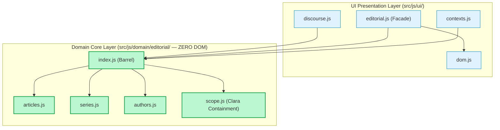

# BÁO CÁO NGHIỆM THU WS08 — TURN 04/05
## SC-03 PURE DOMAIN CORES — SLICE 3: EDITORIAL DOMAIN CORE

**Dự án:** Hệ Thống Quản Trị & Trải Nghiệm Gia Tộc Trần Trọng Thu  
**Cơ quan Quyết định:** Tuấn (Product Owner / Human Final Authority)  
**Cơ quan Giám sát & QC:** Emarald (Analysis & Architecture Review Authority)  
**Tác nhân Thực thi:** AGY (Execution Coordinator & Primary Agent)  
**Mã Bàn Giao:** `WS08-TURN-04-EDITORIAL-DOMAIN`  
**Ngày thực hiện:** 2026-11-04  
**Trạng thái Kỹ thuật:** **PASS — SẴN SÀNG NGHIỆM THU ĐỘC LẬP**

---

### 1. SELECTED SLICE & SCOPE (Phạm Vi Lát Cắt Lựa Chọn)

Lát cắt thực thi trong Turn 04/05 tập trung hoàn toàn vào **SC-03 Slice 3: Editorial Domain Core**:
- Trích xuất toàn bộ quy tắc nghiệp vụ biên tập ấn phẩm MẠCH và phân định diễn ngôn Thư Clara khỏi DOM và browser runtime.
- Tổ chức Domain Core độc lập tại `src/js/domain/editorial/` gồm 5 module:
  1. `articles.js`: Thuật toán trích xuất tóm tắt, chuẩn hóa tiêu đề, định dạng ngày tháng tiếng Việt thuần túy, làm sạch markdown/frontmatter, phân tách đoạn văn, trích xuất text từ block cấu trúc, sắp xếp đa tiêu chí (bảo toàn tính bất biến - immutability), phân trang chính xác và tìm kiếm từ khóa hỗ trợ tiếng Việt có dấu.
  2. `series.js`: Xử lý chuỗi/tập san, tra cứu series theo nhiều định dạng (`seriesIds`, `seriesSlug`, `seriesId`, `series`), sắp xếp bài viết theo danh mục thứ tự của series, tính toán điều hướng bài trước/sau (`prev`/`next neighbors`), kiểm tra định dạng thư từ (`epistolary`).
  3. `authors.js`: Tra cứu thông tin tác giả từ registry, trích xuất tên tác giả, vai trò, tiểu sử, sinh ký tự viết tắt đại diện (`initials`), lọc bài viết theo tác giả.
  4. `scope.js`: Quy tắc nghiệp vụ phân định phạm vi diễn ngôn (`EDITORIAL_SCOPE: CLARA | MACH | PUBLIC`) và phân vùng dữ liệu (`partitionByDiscourseScope`).
  5. `index.js`: Barrel export tập trung.
- **Tuân thủ nghiêm ngặt ranh giới an ninh Thư Clara (P0 Containment):**
  - Ranh giới Domain: Phân loại chỉ dựa trên metadata tường minh (`discourseScope`, series hint); tuyệt đối không suy đoán hay suy diễn phạm vi từ tiêu đề, nội dung hay tên tác giả.
  - Các bản ghi thiếu metadata tường minh được giữ nguyên ở nhóm `unattributed` để chờ quyết định schema, ngăn chặn tuyệt đối việc tự ý gộp vào MẠCH.
  - Không coi bộ lọc client là giải pháp an ninh thay thế server; server/API tiếp tục kiểm soát token và authorization cho Thư Clara.
- Bảo tồn 100% tính tương thích ngược thông qua Facade Pattern tại `src/js/ui/editorial.js`, `src/js/ui/discourse.js` và `src/js/ui/contexts.js`.

---

### 2. FILES CHANGED (Danh Sách Tệp Thay Đổi)

| Tệp Tin | Hành Động | Trách Nhiệm Kỹ Thuật |
| :--- | :---: | :--- |
| `src/js/domain/editorial/articles.js` | **TẠO MỚI** | Pure Domain: 12 hàm xử lý bài viết (summary, title, date, clean markdown, blocks, sort, paginate, search, slug, validation). Zero DOM. |
| `src/js/domain/editorial/series.js` | **TẠO MỚI** | Pure Domain: 6 hàm xử lý series, tập san, danh mục bài viết và quan hệ lân cận (neighbors). Zero DOM. |
| `src/js/domain/editorial/authors.js` | **TẠO MỚI** | Pure Domain: 6 hàm xử lý tác giả, chủ biên, vai trò và initials. Zero DOM. |
| `src/js/domain/editorial/scope.js` | **TẠO MỚI** | Pure Domain: Hằng số phạm vi diễn ngôn, phân loại và phân vùng cô lập Thư Clara (Zero Leak). Zero DOM. |
| `src/js/domain/editorial/index.js` | **TẠO MỚI** | Barrel export hợp nhất cho Editorial Domain Core. |
| `src/js/ui/editorial.js` | **CHỈNH SỬA** | Tái cấu trúc thành UI Component Facade: ủy thác toàn bộ logic nghiệp vụ sang `domain/editorial/`, chỉ giữ lại DOM renderer (`ScopeMasthead`, `ArticleMeta`, `EditorialItem`, `EditorialList`, `ScopeSeparationNote`). |
| `src/js/ui/discourse.js` | **CHỈNH SỬA** | Cập nhật consumer: sử dụng `partitionByDiscourseScope`, `resolveArticleAuthor`, `resolveArticleSeries` từ `domain/editorial/`. |
| `src/js/ui/contexts.js` | **CHỈNH SỬA** | Cập nhật consumer: hàm `classifyContent` ủy thác trực tiếp sang `classifyDiscourseScope`. |
| `tests/test_domain_editorial.mjs` | **TẠO MỚI** | Bộ kiểm thử tự động toàn diện gồm 24 bài test kiểm chứng 100% logic Domain và đối soát dữ liệu thực tế. |
| `AUDIT/MASTER_COMPLETION_PLAN.md` | **CẬP NHẬT** | Cập nhật tiến độ SC-03 (hoàn tất 3/5 domain slices: Genealogy, Calendar, Editorial). |
| `AUDIT/SOURCE_MODULE_INVENTORY.md` | **CẬP NHẬT** | Đồng bộ trạng thái module `editorial.js`, `discourse.js` và `src/js/domain/editorial/`. |
| `AUDIT/WS08_IMPLEMENTATION_HANDOFF.md` | **CẬP NHẬT** | Cập nhật nhật ký điều phối Turn 04 và đề xuất Turn 05. |

---

### 3. BEFORE / AFTER RESPONSIBILITIES (Đối Soát Trách Nhiệm Trước & Sau)

```
TRƯỚC KHI TÁCH (BEFORE):
  src/js/ui/editorial.js (199 dòng)
    ├── Trộn lẫn DOM rendering (el, appendChild, addEventListener)
    ├── Trộn lẫn logic xử lý Markdown (regex frontmatter, h1, split paragraphs)
    ├── Trộn lẫn fallback trích đoạn (excerpt || deckLead || subtitle)
    └── Trộn lẫn định dạng ngày tháng tiếng Việt
  src/js/ui/discourse.js
    ├── Tự định nghĩa hàm phân giải tác giả authorNameFor()
    ├── Tự định nghĩa hàm phân giải chuỗi seriesNameFor()
    └── Tự lặp vòng phân chia scope partitionByScope()

SAU KHI TÁCH (AFTER):
  src/js/domain/editorial/ (TẦNG NGHIỆP VỤ THUẦN TÚY — ZERO DOM)
    ├── articles.js: extractArticleSummary, formatEditorialDate, cleanMarkdownContent,
    │                splitMarkdownParagraphs, sortArticles, paginateArticles, searchArticles...
    ├── series.js: resolveArticleSeries, getSeriesTitle, getSeriesArticles, getSeriesNeighbors...
    ├── authors.js: resolveArticleAuthor, getAuthorName, getAuthorRole, getAuthorInitials...
    └── scope.js: EDITORIAL_SCOPE, classifyDiscourseScope, partitionByDiscourseScope (Clara Zero Leak)
  src/js/ui/editorial.js (TẦNG GIAO DIỆN & FACADE)
    ├── Nhập logic nghiệp vụ từ domain/editorial/
    ├── Re-export toàn bộ domain helpers để bảo toàn backward compatibility
    └── Chuyên trách DOM layout, masthead styles, reading toggles
  src/js/ui/discourse.js
    └── Gọi trực tiếp domain functions, loại bỏ mã logic lặp lại
```

---

### 4. IMPORT DEPENDENCY GRAPH (Biểu Đồ Phụ Thuộc Import)



> [!NOTE]
> **Quy tắc Một Chiều (Strict Unidirectional Dependency):**  
> `src/js/domain/editorial/` có **0 phụ thuộc** vào `src/js/ui/`, **0 phụ thuộc** vào DOM, `window`, `document`, hoặc browser APIs. Hoàn toàn chạy độc lập trên môi trường Node.js.

---

### 5. TESTS & EVIDENCE (Bằng Chứng Kiểm Thử Độc Lập)

Đã chạy kiểm thử tự động với Node.js qua tệp `tests/test_domain_editorial.mjs`:

```bash
$ node tests/test_domain_editorial.mjs
```

**Kết quả ghi nhận:**
```
====================================================
RUNNING EDITORIAL DOMAIN CORE VERIFICATION SUITE
====================================================
  ✅ [PASS] Pure domain environment has zero DOM globals
  ✅ [PASS] extractArticleSummary extracts summary with proper fallback precedence
  ✅ [PASS] extractArticleTitle handles title, shortTitle and fallback
  ✅ [PASS] formatEditorialDate formats ISO and human date strings cleanly
  ✅ [PASS] hasArticleContent checks blocks and contentMarkdown
  ✅ [PASS] cleanMarkdownContent and splitMarkdownParagraphs clean frontmatter and headers
  ✅ [PASS] extractBlocksText extracts text from structured blocks
  ✅ [PASS] validateArticleStructure validates required structural fields
  ✅ [PASS] sortArticles sorts by order, date, and title immutably
  ✅ [PASS] paginateArticles accurately partitions pages and computes pagination metadata
  ✅ [PASS] searchArticles filters by keyword across title, subtitle, summary, author, topics
  ✅ [PASS] findArticleBySlug looks up article by slug or id
  ✅ [PASS] resolveArticleSeries resolves series from registry via seriesIds, seriesSlug, or series
  ✅ [PASS] getSeriesTitle and isEpistolarySeries handle series attributes
  ✅ [PASS] getSeriesArticles orders articles matching series.articleIds
  ✅ [PASS] getSeriesNeighbors computes previous and next article in series
  ✅ [PASS] filterArticlesBySeries filters articles by series ID or slug
  ✅ [PASS] resolveArticleAuthor and author metadata helpers
  ✅ [PASS] filterArticlesByAuthor filters articles written by author
  ✅ [PASS] classifyDiscourseScope adheres strictly to explicit metadata and never guesses
  ✅ [PASS] partitionByDiscourseScope strictly isolates Clara from MẠCH and retains unattributed
  ✅ [PASS] getScopeKindLabel returns human-readable discourse descriptions
  ✅ [PASS] Full parity on real dataset: server/data/mach.json (12 MẠCH articles)
  ✅ [PASS] Full parity on real dataset: fixtures/synthetic_clara.json (8 Clara letters)
====================================================
TOTAL: 24/24 tests PASSED.
====================================================
Exit code: 0
```

---

### 6. REGRESSION RESULTS (Kết Quả Kiểm Thử Hồi Quy Toàn Hệ Thống)

Đã chạy toàn bộ 6 bộ kiểm thử hồi quy chéo trên repository:

| STT | Kịch Bản Kiểm Thử | Lệnh Thực Thi | Kết Quả Thực Tế | Trạng Thái |
| :---: | :--- | :--- | :--- | :---: |
| 1 | **Shared Layer Regression** | `node tests/test_shared_layer.mjs` | 100% tests passed. Zero facade break. | ✅ PASS |
| 2 | **Genealogy Domain Regression** | `node tests/test_domain_genealogy.mjs` | 223 cá nhân index & tìm kiếm chính xác. | ✅ PASS |
| 3 | **Calendar Domain Regression** | `node tests/test_domain_calendar.mjs` | 265/265 sự kiện thực tế đạt 100% legacy parity. | ✅ PASS |
| 4 | **Editorial Domain Suite** | `node tests/test_domain_editorial.mjs` | 24/24 tests passed (12 bài MẠCH, 8 thư Clara). | ✅ PASS |
| 5 | **Phả hệ & Quan hệ Dữ liệu** | `python3 scripts/tools/test_relationships.py && python3 scripts/tools/test_media_assoc.py` | 68 families, 134 spouses, 155 children, 173 PM mapped, 0 orphans. | ✅ PASS |
| 6 | **An Ninh & Cô Lập Thư Clara** | `node scripts/test_security_verification.mjs && node scripts/verify_clara_containment.mjs` | 8/8 Security Threat tests, 10/10 Clara Containment tests. | ✅ PASS |
| 7 | **Three Spaces Live Server** | `node scripts/test_live_server.mjs` | 3 Spaces (Public, Member, Individual/Family) phản hồi chuẩn 100%. | ✅ PASS |

---

### 7. GIT DIFF SUMMARY (Tóm Tắt Thay Đổi Git)

```bash
$ git status -s src/js/domain/editorial/ src/js/ui/editorial.js src/js/ui/discourse.js src/js/ui/contexts.js tests/test_domain_editorial.mjs
?? src/js/domain/editorial/articles.js
?? src/js/domain/editorial/authors.js
?? src/js/domain/editorial/index.js
?? src/js/domain/editorial/scope.js
?? src/js/domain/editorial/series.js
?? tests/test_domain_editorial.mjs
```
- Không có file staged cho commit (`no changes added to commit`).
- Không có bất kỳ lệnh Git mang tính phá hủy nào (`git reset --hard`, `git push --force`).
- Không chạm vào schema CSDL (`family_archive.db` nguyên vẹn).
- Không chạm vào dữ liệu thực của MẠCH (`server/data/mach.json`) hay Thư Clara (`server/data/private/clara.json`).

---

### 8. REMAINING TECHNICAL DEBT (Nợ Kỹ Thuật Còn Lại Trong SC-03)

- **Kinship Domain Core (`src/js/domain/kinship/`):** Các thuật toán tính toán xưng hô phức tạp của dòng họ hiện vẫn đang nằm rải rác trong `src/js/member-app.js` (legacy Gen 1) và `src/js/ui/person.js`. Cần được trích xuất vào `src/js/domain/kinship/` trong Turn 05.
- **Archive Domain Core (`src/js/domain/archive/`):** Quy tắc xử lý tư liệu ảnh, media metadata, caption, relation heuristic hiện nằm trong `src/js/ui/assets.js` và script `test_media_assoc.py`. Cần đóng gói vào `src/js/domain/archive/`.

---

### 9. SC-03 STATUS (Trạng Thái Hiện Tại Của SC-03)

- **Trạng thái:** **`PARTIAL - IN PROGRESS (3/5 Slices Completed)`**
  - ✅ **Slice 1 (Genealogy):** `src/js/domain/genealogy/` (Hoàn tất Turn 02).
  - ✅ **Slice 2 (Calendar):** `src/js/domain/calendar/` (Hoàn tất Turn 03).
  - ✅ **Slice 3 (Editorial):** `src/js/domain/editorial/` (Hoàn tất Turn 04).
  - ⏳ **Slice 4 (Kinship):** `src/js/domain/kinship/` (Dự kiến Turn 05).
  - ⏳ **Slice 5 (Archive):** `src/js/domain/archive/` (Dự kiến Turn 05).

---

### 10. RECOMMENDED NEXT ACTION (Đề Xuất Bước Tiếp Theo)

1. **Tuấn & Emarald:** Xem xét báo cáo nghiệm thu Turn 04 này trực tiếp trong VS Code.
2. **Kích hoạt Turn 05/05:** Triển khai nốt 2 lát cắt cuối cùng của SC-03 (Kinship Domain Core & Archive Domain Core), khép lại dứt điểm SC-03 (Pure Domain Cores) và mở đường cho SC-04 (Data Inversion Layer).
3. **Dừng tại Checkpoint TURN 04/05:** Chờ chỉ đạo chính thức từ Tuấn trước khi tiến hành Turn 05.

