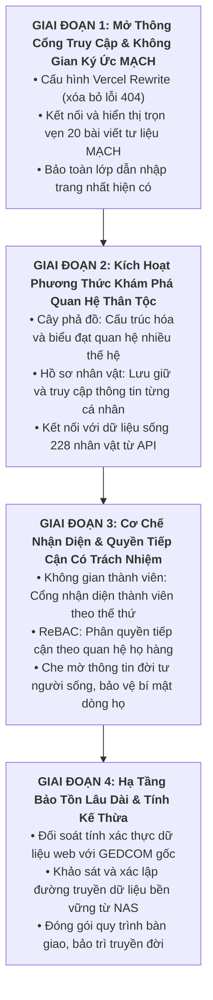

# BÁO CÁO TÁI ĐỊNH HƯỚNG DỰ ÁN THEO Ý ĐỊNH SẢN PHẨM: HỆ THỐNG DI SẢN SỐ
**Dự án:** CÂY GIA PHẢ — GIATỘC TRẦN TRỌNG THU  
**Website chính thức:** [https://giatoctrantrongthu.com](https://giatoctrantrongthu.com)  
**Thời gian hiệu chỉnh:** 01/11/2026 11:38 (GMT+7)  
**Cơ sở pháp lý & học thuật:** Hiến chương UNESCO (2003) về Bảo tồn Di sản Số (Charter on the Preservation of Digital Heritage)  
**Phân vai:** Tuấn (Human Final Authority) · Emarald (Analysis & Governance) · AGY (Execution Coordinator)  
**Chế độ:** DOCUMENT ALIGNMENT & READ-ONLY AUDIT  

---

## 1. KHÁI NIỆM NỀN TẢNG: DI SẢN SỐ KHÁC VỚI ẤN PHẨM SỐ

Sự điều chỉnh quan trọng nhất do Tuấn xác lập là sự phân định dứt khoát về tư duy sản phẩm:

| Tiêu Chí So Sánh | Ấn Phẩm Số (Digital Publication) | Di Sản Số (Digital Heritage System) |
| :--- | :--- | :--- |
| **Trọng tâm cốt lõi** | Tập trung vào nội dung được biên tập và hình thức trình bày. | **Tập trung vào di sản được lưu giữ, bảo tồn và tiếp nối.** |
| **Cấu trúc dữ liệu** | Cấu trúc xuất bản tương đối tĩnh, đóng băng sau phát hành. | **Cấu trúc dữ liệu sống, được bổ sung, hiệu chỉnh và làm giàu theo thời gian.** |
| **Vai trò người dùng** | Người đọc chủ yếu tiếp nhận nội dung thụ động một chiều. | **Thành viên vừa tiếp nhận, vừa đóng góp, xác minh và tiếp nối di sản.** |
| **Vai trò của Website** | Website là phương tiện xuất bản hoàn chỉnh cuối cùng. | **Website chỉ là một cổng truy cập và tương tác vào hệ thống di sản.** |
| **Bản chất giá trị** | Giá trị nằm ở sản phẩm nội dung hoàn thiện. | **Giá trị nằm ở tính xác thực, tính liên tục, tính toàn vẹn và khả năng truyền lại.** |

> Theo **Hiến chương UNESCO năm 2003 về Bảo tồn Di sản Số**: Di sản số bao gồm các tài nguyên độc nhất về tri thức và biểu đạt của con người (văn bản, cơ sở dữ liệu, hình ảnh, âm thanh) đòi hỏi các phương pháp chủ động để bảo vệ và duy trì khả năng tiếp cận lâu dài cho các thế hệ hiện tại và tương lai. Việc bảo tồn di sản số đòi hỏi tính liên tục, tính toàn vẹn nguồn gốc, và cơ chế bảo vệ nghiêm ngặt các thông tin nhạy cảm.

---

## A. ĐÍCH ĐẾN SẢN PHẨM (ĐỊNH VỊ CHUẨN XÁC)

> **CÂY GIA PHẢ GIATỘC TRẦN TRỌNG THU là một hệ thống di sản số của dòng họ, được xây dựng để lưu giữ, tổ chức, bảo tồn và tiếp nối ký ức, tư liệu, lịch sử cùng các mối quan hệ thân tộc qua nhiều thế hệ. Website là cổng truy cập và tương tác với di sản đó, không phải bản thân toàn bộ di sản.**

Trong hệ thống di sản số này, 6 năng lực cốt lõi (**P1 – P6**) là **6 năng lực bảo đảm sự tồn tại lâu dài và giá trị truyền đời của di sản**, chứ không đơn thuần là các tiêu chí nghiệm thu một trang web:

1. **P1 — Data Fidelity (Tính xác thực lịch sử):** Dữ liệu gia phả được đối chiếu nghiêm cẩn với nguồn gốc GEDCOM; không tự ý sáng tác, suy diễn hoặc làm sai lệch tư liệu lịch sử.
2. **P2 — Relational Integrity (Tính toàn vẹn cấu trúc thân tộc):** Bảo toàn cấu trúc huyết thống, hôn nhân, các thế hệ, nhánh nội ngoại và các mối quan hệ gia tộc đặc thù qua thời gian.
3. **P3 — Access & Privacy (Quyền tiếp cận có trách nhiệm):** Phân định ranh giới giữa việc nhận diện tổ tiên với việc bảo vệ đời tư người sống; bảo tồn di sản không đồng nghĩa với phơi bày toàn bộ dữ liệu cá nhân ra công chúng.
4. **P4 — Infrastructure Connectivity (Tính liên tục & Hạ tầng bảo tồn):** Dữ liệu di sản được lưu trữ bền vững tại kho lưu trữ gốc (**NAS gia đình**), kết nối thông suốt qua cơ sở dữ liệu, máy chủ API và đến cổng truy cập Web.
5. **P5 — Product Experience (Cổng tương tác di sản):** Cung cấp các phương thức trực quan, trang trọng và tiện lợi (Cây phả đồ, Hồ sơ nhân vật, Tập san MẠCH) để con cháu nhiều thế hệ dễ dàng tiếp cận và gắn kết với cội nguồn.
6. **P6 — Operational Reliability (Tính kế thừa công nghệ):** Hệ thống được thiết kế độc lập, có quy trình sao lưu, phục hồi và chuyển giao rõ ràng; không bị lệ thuộc vào một cá nhân, một thiết bị hay một nền tảng công nghệ duy nhất.

---

## B. HIỆN TRẠNG (ĐỐI SOÁT TRÊN THỰC TẾ)

| Thành Phần Di Sản | Hiện Trạng Thực Tế | Đánh Giá Theo Chuẩn Di Sản Số |
| :--- | :--- | :--- |
| **Cổng truy cập chính** (`giatoctrantrongthu.com`) | Đang hoạt động trên Vercel (bản 15/09/2026 - Commit `42a7ed2`). | **Giao diện trang nhất thể hiện bản sắc và tinh thần của di sản số dòng họ; đây là lớp trải nghiệm công khai, dẫn nhập vào hệ thống lưu trữ, tư liệu, ký ức và quan hệ gia tộc.** |
| **Máy chủ dữ liệu API** (`api.giatoctrantrongthu.com`) | Đang chạy trực tiếp qua Cloudflare, phục vụ dữ liệu sống: 228 nhân vật, 20 bài viết tư liệu MẠCH, 4 bộ lịch gia tộc. | Là lớp dịch vụ phân phối dữ liệu sống của di sản, đã vận hành thực tế nhưng chưa kết nối hoàn chỉnh với cổng web. |
| **Kho tư liệu gốc GEDCOM** (`GIADINHONGTHU.ged`) | Tệp dữ liệu gốc (73.8 KB) nguyên vẹn trong hệ thống. | Nguồn chứng tích phả hệ cốt lõi cần được bảo vệ ở mức tối cao (STRICT READ-ONLY). |
| **Các phương thức khám phá trong Lab** | Đã dựng xong Cây phả đồ (`tree.js`), Hồ sơ nhân vật (`person.js`), Bảng điều khiển (`dashboard.js`). | Là các công cụ trực quan hóa di sản đã được kiểm thử 100% không lỗi, sẵn sàng đưa vào cổng web chính. |
| **Cơ chế xác thực & Phân quyền trên Web** | Bấm "Đăng nhập Thành viên →" hoặc vào `/me` bị Vercel báo lỗi `404: This page doesn’t exist`. | **ĐIỂM NGHẼN:** Cổng truy cập chưa mở được đường vào không gian di sản riêng cho thành viên gia tộc. |
| **Tập san tư liệu MẠCH trên Web Live** | Bấm mục *MẠCH* bị trang trống do mã JavaScript cũ chưa gắn hàm hiển thị danh sách bài viết. | **ĐIỂM NGHẼN:** 20 bài viết tư liệu quý giá bị nghẽn ở lớp hiển thị, người trong họ chưa đọc được. |

---

## C. KHOẢNG CÁCH GIỮA HIỆN TRẠNG VÀ NĂNG LỰC DI SẢN (P1 – P6)

1. **Về Tính xác thực (P1):** Dữ liệu 228 người trên máy chủ chưa có công cụ tự động đối soát từng trường thông tin với tệp `GIADINHONGTHU.ged` gốc để đảm bảo không bị sai lệch trong quá trình chuyển đổi.
2. **Về Tính toàn vẹn (P2):** Cây phả hệ hiện mới hiển thị quan hệ huyết thống trực hệ, chưa có ma trận quan hệ thân tộc đầy đủ (xưng hô cô, dì, chú, bác; phân định dâu, rể, con nuôi).
3. **Về Quyền tiếp cận có trách nhiệm (P3):** Chưa có cơ chế đăng nhập hoạt động trên web (`/login` bị 404); chưa có bộ lọc che mờ thông tin người còn sống để bảo vệ quyền riêng tư cá nhân.
4. **Về Hạ tầng bảo tồn & Tính liên tục (P4):** Chưa kiểm chứng đường truyền tự động từ kho dữ liệu trên NAS của gia đình ra máy chủ API; cần đảm bảo dữ liệu gốc trên NAS là cội nguồn tối cao.
5. **Về Trải nghiệm cổng di sản (P5):** Người dùng mới chỉ xem được lớp giới thiệu công khai; toàn bộ các phương thức khám phá sâu (Cây phả đồ tương tác, Hồ sơ nhân vật, 20 bài viết MẠCH) chưa được ráp nối vào cổng chính thức.
6. **Về Khả năng kế thừa (P6):** Cần đóng gói cấu hình điều hướng (Vercel rewrite) và tài liệu hóa quy trình vận hành để con cháu thế hệ sau có thể duy trì hệ thống mà không phụ thuộc vào công cụ tạm thời.

---

## D. ĐỐI SOÁT TÀI LIỆU VÀ NHẬN DIỆN LỆCH ĐỊNH HƯỚNG (TASK 01 & TASK 02)

### 1. Bốn điểm lệch định hướng cần chấn chỉnh ngay:
- **Lệch 1 (Coi Lab là đích đến):** Sa đà vào việc tạo dữ liệu giả lập và làm các công cụ trong Vibecode Lab mà quên mất rằng Lab chỉ là nơi thử nghiệm công cụ; đích đến thực sự là kết nối cổng web với di sản sống thật.
- **Lệch 2 (Kế hoạch thiên về kỹ thuật thứ cấp):** `MASTER_COMPLETION_PLAN.md` hiện chia theo các Phase kỹ thuật cô lập (chạy script dọn dẹp, kiểm tra an ninh trên giấy) thay vì tập trung mở thông các phương thức tiếp cận di sản.
- **Lệch 3 (Nguy cơ làm mất bản sắc trang nhất):** Từng có sửa đổi biến `index.html` thành file rỗng 18 dòng; cần khẳng định: **Trang nhất hiện tại là lớp dẫn nhập di sản hoàn chỉnh, phải được giữ nguyên vẹn**.
- **Lệch 4 (Bỏ quên nguồn dữ liệu sống):** Máy chủ `api.giatoctrantrongthu.com` đã có sẵn 228 nhân vật và 20 bài viết quý giá, không được hành xử như thể phải làm lại cơ sở dữ liệu từ con số 0.

### 2. Định vị lại hệ thống tài liệu:
- **TẦNG 1 — Nguồn chỉ đạo tối cao:** Tuyên ngôn Di sản số của Tuấn (`DIRECTIVE: RE-ALIGN PROJECT TO PRODUCT INTENT`), Hiện trạng website live, và tệp gốc `GIADINHONGTHU.ged`.
- **TẦNG 2 — Kế hoạch tổng thể (`MASTER_COMPLETION_PLAN.md`):** Tái cấu trúc toàn bộ để phục vụ 6 năng lực bảo tồn di sản (P1–P6).
- **TẦNG 3 — Kế hoạch chuyên môn:** Điều chỉnh để phục vụ trực tiếp cho việc hoàn thiện các cổng di sản.
- **TẦNG 4 & 5 — Bằng chứng & Lab:** Chỉ đóng vai trò cung cấp dữ liệu kiểm định và công cụ thử nghiệm an toàn, không thay thế mục tiêu sản phẩm.

---

## E. LỘ TRÌNH TRIỂN KHAI HOÀN THIỆN HỆ THỐNG DI SẢN (TASK 03 & TASK 05)

Không tiếp cận theo hướng "đưa các file code từ Lab lên web", mà tổ chức thành **4 giai đoạn mở khóa các phương thức tiếp cận và bảo tồn di sản**:

### Nội hàm từng giai đoạn:
1. **Giai đoạn 1 — Mở thông Cổng truy cập & Không gian Ký ức MẠCH (Phục vụ P5, P4):**
   - Khắc phục lỗi điều hướng Vercel (`vercel.json`) để người dùng không còn gặp lỗi 404 khi vào `/login`, `/me`, `/me/tree`.
   - Mở khóa hiển thị 20 bài viết trong tập san MẠCH để các thế hệ có thể đọc ngay những câu chuyện di sản đầu tiên.
2. **Giai đoạn 2 — Kích hoạt các Phương thức Khám phá Quan hệ Thân tộc (Phục vụ P1, P2, P5):**
   - **Cây phả đồ tương tác:** Giúp người xem nhìn thấy trực quan dòng chảy thế hệ, các chi nhánh và vị trí của từng người trong dòng tộc.
   - **Hồ sơ nhân vật:** Điểm lưu giữ chi tiết tiểu sử, năm sinh năm mất, phối ngẫu, con cái và tư liệu ảnh của từng tiền nhân và hậu duệ.
3. **Giai đoạn 3 — Cơ chế Nhận diện & Quyền Tiếp cận có Trách nhiệm (Phục vụ P3):**
   - Thiết lập cổng Đăng nhập Thành viên để người trong họ nhận diện vai trò của mình trong gia phả.
   - Áp dụng nguyên tắc UNESCO: Bảo tồn không có nghĩa là phơi bày thông tin người sống; chỉ người có quan hệ thân thuộc mới xem được thông tin chi tiết.
4. **Giai đoạn 4 — Hạ tầng Bảo tồn Lâu dài & Tính Kế thừa (Phục vụ P1, P4, P6):**
   - Đối soát tính xác thực tuyệt đối giữa dữ liệu đang chạy và tệp GEDCOM gốc.
   - Kiểm chứng khả năng lưu trữ trên NAS gia đình và xây dựng quy trình cập nhật phả hệ khi có sinh nhật, ngày giỗ hoặc người mới sinh ra trong dòng họ.

---

## F. MA TRẬN NĂNG LỰC BẢO ĐẢM DI SẢN SỐ (TASK 04)

| Năng Lực Di Sản | Trạng Thái Hiện Tại | Bằng Chứng Thực Tế | Khoảng Cách Còn Thiếu | Hành Động Tiếp Theo | Ràng Buộc Phụ Thuộc | Đánh Giá Tồn Tại |
| :--- | :--- | :--- | :--- | :--- | :--- | :---: |
| **P1 — Tính xác thực (Data Fidelity)** | Dữ liệu 228 người đang chạy trên API. | `api.giatoctrantrongthu.com/api/genealogy.json` (HTTP 200). | Chưa có công cụ đối soát tự động từng trường với tệp gốc `GIADINHONGTHU.ged`. | Xây dựng kịch bản kiểm tra đối chiếu GEDCOM và API (READ-ONLY). | Phụ thuộc tệp GEDCOM gốc. | **PARTIAL** |
| **P2 — Toàn vẹn thân tộc (Relational Integrity)** | Cây phả hệ hiển thị huyết thống cơ bản. | Dữ liệu gia phả có cấu trúc `parents`, `spouses`, `children`. | Chưa hỗ trợ đầy đủ các quan hệ đặc thù, nhánh dâu rể và xưng hô chuẩn mực. | Bổ sung logic tính toán quan hệ thế thứ và danh xưng thân tộc. | Cần Tuấn phê chuẩn ma trận danh xưng. | **PARTIAL** |
| **P3 — Tiếp cận có trách nhiệm (Access & Privacy)** | Chưa có cơ chế phân quyền thật trên web live. | `/login` và `/api/auth/me/identity` đều trả về HTTP 404. | Chưa có trang đăng nhập thật; chưa có bộ lọc che mờ thông tin người sống. | Kích hoạt cổng đăng nhập và cài đặt bộ lọc che mờ trường thông tin nhạy cảm. | Phụ thuộc cơ chế phiên làm việc (Session) backend. | **BLOCKED** |
| **P4 — Hạ tầng bảo tồn (Infrastructure)** | Đang chạy tách rời giữa Vercel (web) và Cloudflare (API). | Header Vercel (`x-vercel-id`) và Header API (`server: cloudflare`). | Chưa xác minh máy chủ API chạy trên phần cứng nào (NAS hay VPS); chưa đo kiểm đường truyền từ NAS. | Khảo sát thực tế máy chủ API và làm rõ quy trình đồng bộ từ NAS. | Cần thông tin hạ tầng từ Tuấn. | **UNKNOWN** |
| **P5 — Trải nghiệm cổng di sản (Product Experience)** | Trang nhất đẹp; các trang khám phá bên trong bị lỗi 404 hoặc trống. | Ảnh chụp `live_home.png`, `live_login_direct.png`, `click_mach.png`. | Cây phả đồ và Hồ sơ nhân vật mới nằm trong Lab; danh sách MẠCH bị trống. | Cấu hình Vercel Rewrite và tích hợp các module khám phá di sản vào cổng chính. | Phụ thuộc mã nguồn `src/js/ui/`. | **PARTIAL** |
| **P6 — Vận hành tin cậy (Operational Reliability)** | Hệ thống Vercel chạy ổn định nhưng thiếu cấu hình chuyển trang SPA. | Header Cache Vercel hoạt động; chưa có `rewrites` trong `vercel.json`. | Chưa có quy trình sao lưu và kiểm thử hồi quy tự động trên web live. | Thêm cấu hình Vercel Rewrite; thiết lập kịch bản kiểm thử tự động toàn diện. | Cần Tuấn phê duyệt cấu hình Vercel. | **PARTIAL** |

---

## G. NHỮNG ĐIỂM CẦN TUẤN VÀ EMARALD QUYẾT ĐỊNH

1. **Phê duyệt Bản tuyên ngôn Di sản Số:**  
   Xác nhận việc sử dụng định vị *"Hệ thống Di sản số"* và Hiến chương UNESCO 2003 làm kim chỉ nam tối cao thay thế cho khái niệm *"Ấn phẩm số"* trong toàn bộ tài liệu quản trị của dự án.
2. **Phê duyệt Cấu trúc Điều chỉnh Kế hoạch Tổng thể:**  
   Chấp thuận để AGY tái cấu trúc tệp `AUDIT/MASTER_COMPLETION_PLAN.md` theo 6 Năng lực Di sản (**P1 – P6**) và Lộ trình 4 Giai đoạn nêu tại Mục E.
3. **Làm rõ nguồn gốc vật lý của Máy chủ API (P4):**  
   Xác nhận máy chủ `https://api.giatoctrantrongthu.com` hiện đang chạy trên thiết bị nào (trên máy chủ NAS tại nhà hay VPS riêng), và cách thức Tuấn mong muốn đồng bộ dữ liệu từ NAS ra máy chủ này.

---

**KẾT LUẬN & TRẠNG THÁI HIỆN TẠI:**  
AGY đã thấu suốt sâu sắc định vị **Di sản số** của Tuấn. AGY tiếp tục dừng lại ở chế độ **STRICT READ-ONLY**, sẵn sàng tiến hành hiệu chỉnh tài liệu `MASTER_COMPLETION_PLAN.md` ngay khi nhận được phê duyệt từ Tuấn và Emarald.
