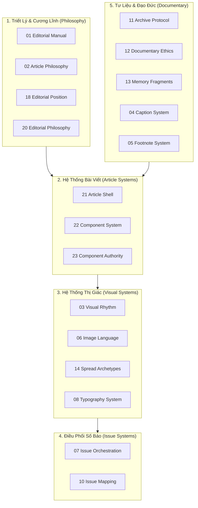

# MẠCH SYSTEM — EXECUTION PLANNING & OPERATIONALIZATION REPORT
## KẾ HOẠCH TRIỂN KHAI VÀ VẬN HÀNH TOÀN DIỆN HỆ THỐNG MẠCH

*(Bản sao lưu trữ đối soát trong Repository CÂY GIA PHẢ — Bản gốc canonical tại `/Users/tuantq/Obsidian/20_PROJECTS/Mach/MACH_SYSTEM/MACH_SYSTEM_EXECUTION_PLAN.md`)*

- **Hệ thống:** MẠCH — Hệ thống Lưu trữ, Biên tập và Tái hiện Ký ức Dòng họ (Editorial Memory System)
- **Vị trí Canonical Vault:** `/Users/tuantq/Obsidian/20_PROJECTS/Mach/MACH_SYSTEM/`
- **Tài liệu nguồn tham chiếu:** `MACH_AUDIT.md`, `17 - MẠCH — SYSTEM ONTOLOGY MAP.md`, `19 - MẠCH — CONSTITUTIONAL HIERARCHY.md`
- **Người thực hiện:** AGY — Execution Coordinator
- **Thẩm quyền phê duyệt:** Tuấn (Human Final Authority) & Emarald (Analysis & Governance)
- **Thời gian lập kế hoạch:** 01/11/2026 12:12 (GMT+7)
- **Chế độ thực thi:** STRICT READ-ONLY — PLANNING ONLY (Không sửa đổi source files)

---

## 1. Executive Summary (Tóm Tắt Điều Hành)

Hệ thống MẠCH hiện đã hình thành một khung lý thuyết và tài liệu biên tập vô cùng đồ sộ, sâu sắc, bao gồm 24 tệp quy chuẩn numbered (`00` đến `23`), các phân hệ DNA, Ontology, Taxonomy, Typography, và đã cho ra đời sản phẩm thực tế là 20 bài viết trong Số 01 (hiện đang lưu trữ trên máy chủ dữ liệu).

Tuy nhiên, cuộc kiểm toán pháp y độc lập này phát hiện **3 điểm nghẽn nghiêm trọng** đang ngăn cản MẠCH chuyển từ trạng thái "tài liệu lý thuyết" sang "bộ máy vận hành trơn tru":
1. **Lệch pha giữa mã nguồn thực tế và bản tổng hợp (Source vs. Compiled Drift):**  
   Tệp `MACH_AUDIT.md` hiện tại chỉ tổng hợp 22 tệp, bỏ sót tới **9 tệp nguồn cốt lõi** đang tồn tại trên đĩa (gồm hệ thống thành phần bài viết `22`, ma trận thẩm quyền component `23`, bản rà soát nguyên lý khởi thủy `FIRST_PRINCIPLES_ARCHITECTURE_REVIEW.md`, và các quyết định nền tảng `CORE_DECISIONS.md`). Kịch bản biên dịch `mach_audit_pipeline.sh` đang bị trỏ sai đường dẫn gốc cũ (`/Users/tuan/Obsidian/CAYGIAPHA`), dẫn đến hệ thống không thể tự tái tạo trạng thái tin cậy.
2. **Hiện tượng rò rỉ thẩm quyền (Responsibility Overlap & Prose Leakage):**  
   Các tệp triết lý (`01`, `02`, `18`, `20`) bị chồng lấn văn phong tuyên ngôn; các tệp nhịp điệu và dàn trang (`03`, `07`, `10`, `14`) chưa phân định dứt khoát giữa cấp độ "nhịp điệu từng trang (spread pacing)" và "đường cong cảm xúc cả số báo (issue orchestration curve)".
3. **Đứt gãy giữa lý thuyết biên tập và công cụ sản xuất (Operational Gap):**  
   Người biên tập có bộ khung bài viết (`21 Article Shell`) rất chặt chẽ nhưng thiếu mẫu bài viết thực hành trong Obsidian, thiếu bảng kiểm định biên tập (Pre-layout Checklist), và phân hệ InDesign (`15`) mới dừng ở mức mô tả nguyên tắc, chưa có tệp mẫu `.indt` chuẩn.

**Kế hoạch này vạch ra lộ trình 4 Batch có kiểm soát** nhằm giải quyết dứt điểm các điểm nghẽn trên, đưa MẠCH thành một cỗ máy sản xuất ấn phẩm bền vững.

---

## 2. Verified Current State (Hiện Trạng Đã Xác Minh Thực Tế)

Đối soát thực tế toàn diện thư mục `/Users/tuantq/Obsidian/20_PROJECTS/Mach/MACH_SYSTEM/` theo chuẩn nhãn nhận thức:

| Thành Phần Hệ Thống | Trạng Thái Thực Tế | Nhãn Bằng Chứng | Đánh Giá Tồn Tại |
|---|---|:---:|---|
| **Kho tệp nguồn (Source Files)** | Có 31 tệp `.md` tại thư mục gốc và 16 tệp `.md` trong 5 thư mục con (`DNA`, `ONTOLOGY`, `TAXONOMY`, `TYPOGRAPHY`, `KNOWLEDGE`). | `[PROVEN]` | Toàn bộ tệp nguồn nguyên vẹn, nội dung phong phú và sâu sắc. |
| **Bản tổng hợp (MACH_AUDIT.md)** | Tệp 79 KB, được biên dịch ngày 28/05/2026. Chỉ chứa 22 tệp, thiếu 9 tệp nguồn quan trọng tại root. | `[FAILED]` | Bị lệch pha so với nguồn thực tế; không thể dùng làm nguồn tin cậy duy nhất nếu chưa re-compile. |
| **Kịch bản biên dịch (mach_audit_pipeline.sh)**| Chứa đường dẫn cứng cũ: `ROOT="/Users/tuan/Obsidian/CAYGIAPHA"`. | `[FAILED]` | Không thể chạy được trên môi trường hiện tại (`/Users/tuantq/...`) nếu không hiệu chỉnh đường dẫn. |
| **Thứ bậc tối cao (Constitutional Hierarchy)**| Quy định dứt khoát: `SYSTEM → INDEX → EDITORIAL → LAYOUT` tại tệp `19`. | `[PROVEN]` | Khung pháp lý tối cao đã vững chắc, cần bảo vệ tuyệt đối. |
| **Quyết định nền tảng (CORE_DECISIONS.md)** | Đã thông qua 6 quyết định (`D001` → `D006`) và xác định 3 vấn đề mở (`O001` → `O003`). | `[PROVEN]` | Đặc biệt `D006`: *Article không thuộc Core Ontology; Article là Editorial Product*. |
| **Khung bài viết (21 Article Shell)** | Định nghĩa chi tiết cấu trúc Article Shell và ngữ pháp thực thi (Execution Grammar). | `[PROVEN]` | Đã ứng dụng thành công trong 20 bài viết Số 01 trên web live. |

---

## 3. Source Inventory (Kiểm Kê Chi Tiết Tệp Nguồn)

### A. 24 Tệp Quy Chuẩn Đánh Số (Numbered Canonical Files)
1. `00 - MẠCH — EDITORIAL OS.md` (`[OBSERVED]` — Cổng định hướng, cần lược bỏ văn xuôi thừa)
2. `01 - MACH PROGRAM MAP.md` (`[OBSERVED]` — Bản đồ chương trình, chưa được compile vào AUDIT)
3. `01 - MẠCH — EDITORIAL MANUAL.md` (`[OBSERVED]` — Cương lĩnh biên tập tối cao)
4. `02 - MẠCH — ARTICLE PHILOSOPHY.md` (`[OBSERVED]` — Triết lý bài viết, cần scope-narrowing)
5. `03 - MẠCH — VISUAL RHYTHM.md` (`[OBSERVED]` — Nhịp điệu thị giác cấp độ trang đôi)
6. `04 - MẠCH — CAPTION SYSTEM.md` (`[OBSERVED]` — Hệ thống chú thích ảnh tư liệu)
7. `05 - MẠCH — FOOTNOTE SYSTEM.md` (`[OBSERVED]` — Hệ thống cước chú mở rộng ngữ nghĩa)
8. `06 - MẠCH — IMAGE LANGUAGE.md` (`[OBSERVED]` — Ngôn ngữ hình ảnh và tính nguyên bản)
9. `07 - MẠCH — ISSUE ORCHESTRATION.md` (`[OBSERVED]` — Phối cảnh và nhịp điệu quy mô cả số báo)
10. `08 - MẠCH — TYPOGRAPHY SYSTEM.md` (`[OBSERVED]` — Hệ thống phân cấp kiểu chữ và nhịp thở)
11. `09 - MẠCH — GENEALOGY LANGUAGE.md` (`[OBSERVED]` — Ngôn ngữ biểu đạt phả hệ trong ấn phẩm)
12. `10 - MẠCH — ISSUE MAPPING.md` (`[OBSERVED]` — Công cụ chẩn đoán và lập bản đồ số báo)
13. `11 - MẠCH — ARCHIVE PROTOCOL.md` (`[OBSERVED]` — Giao thức lưu trữ và định danh tư liệu)
14. `12 - MẠCH — DOCUMENTARY ETHICS.md` (`[OBSERVED]` — Đạo đức tư liệu, người sống và tiền nhân)
15. `13 - MẠCH — MEMORY FRAGMENTS.md` (`[OBSERVED]` — Mảnh vỡ ký ức và lời kể truyền khẩu)
16. `14 - MẠCH — SPREAD ARCHETYPES.md` (`[OBSERVED]` — 7 nguyên mẫu trang đôi, giữ độc lập)
17. `15 - MẠCH — CONTRIBUTOR SYSTEM.md` (`[OBSERVED]` — Quy chế cộng tác viên và bút danh)
18. `16 - MẠCH — WORKING PROTOCOL.md` (`[OBSERVED]` — Quy trình làm việc và kỷ luật biên tập)
19. `17 - MẠCH — SYSTEM ONTOLOGY MAP.md` (`[OBSERVED]` — Bản đồ kiểm toán trách nhiệm tệp)
20. `18 - MẠCH — EDITORIAL POSITION.md` (`[OBSERVED]` — Lập trường tri thức và quan sát)
21. `19 - MẠCH — CONSTITUTIONAL HIERARCHY.md` (`[OBSERVED]` — Thứ bậc tối cao và luật override)
22. `20 - MẠCH — EDITORIAL PHILOSOPHY.md` (`[OBSERVED]` — Triết lý montage và ý thức tư liệu)
23. `21 - MẠCH — ARTICLE SHELL + EXECUTION GRAMMAR.md` (`[OBSERVED]` — Khung giải phẫu bài viết)
24. `22 - MẠCH — ARTICLE COMPONENT SYSTEM.md` (`[OBSERVED]` — Danh mục thành phần bài viết)
25. `23 - MẠCH — COMPONENT AUTHORITY MAP.md` (`[OBSERVED]` — Ma trận thẩm quyền thành phần)

### B. 9 Tệp Nguồn Chưa Được Đưa Vào MACH_AUDIT.md
- `01 - MACH PROGRAM MAP.md`
- `22 - MẠCH — ARTICLE COMPONENT SYSTEM.md`
- `23 - MẠCH — COMPONENT AUTHORITY MAP.md`
- `AUTHORITY_MATRIX.md`
- `CORE_DECISIONS.md`
- `FIRST_PRINCIPLES_ARCHITECTURE_REVIEW.md`
- `MACH_EXECUTIVE_SUMMARY.md`
- `PROPOSED_TARGET_ARCHITECTURE.md`
- `TARGET_ARCHITECTURE_VALIDATION.md`

---

## 4. System Coherence & Responsibility Audit (Kiểm Toán Trách Nhiệm Tệp)

Dựa trên bản đồ `17 - MẠCH — SYSTEM ONTOLOGY MAP.md` và nguyên lý **First-Principles Architecture Review** (chống can thiệp quá mức / Over-intervention), xác lập hướng xử lý cho 9 nhóm hệ thống:



### Chi tiết phân tích trách nhiệm và hướng xử lý:

| Nhóm | Tệp | Trách Nhiệm Cốt Lõi (Primary Responsibility) | Vấn Đề Chồng Lấn Hiện Tại | Hướng Xử Lý Khuyến Nghị |
|---|---|---|---|:---:|
| **Triết lý** | `01 Editorial Manual` | Cương lĩnh tư tưởng tối cao của MẠCH | Chứa các đoạn quy trình InDesign, caption, footnote | **NARROW** (Lược bỏ phần thao tác, tập trung doctrine) |
| **Triết lý** | `02 Article Philosophy` | Bản chất triết học của bài viết (Spread system, tính phụ thuộc) | 5 đoạn rò rỉ sang quy tắc ảnh, caption, cước chú | **NARROW** (Cắt bỏ 5 đoạn rò rỉ, giữ độc lập, KHÔNG gộp vào 01) |
| **Triết lý** | `18 Editorial Position` | Lập trường tri thức và khoảng cách quan sát | Trùng lặp một số từ khóa với 01 | **KEEP** (Làm rõ ranh giới: 01 là bản sắc, 18 là lập trường) |
| **Triết lý** | `20 Editorial Philosophy` | Ý thức tư liệu và nguyên lý montage | Trùng lặp thuật ngữ với 01 | **NARROW** (Làm rõ ranh giới, giữ làm tài liệu phương pháp luận) |
| **Bài viết** | `21 Article Shell` | Ngữ pháp giải phẫu và thực thi bài viết | Chứa một số quy tắc cấp độ số báo | **NARROW** (Chuyển phần orchestration sang 07) |
| **Bài viết** | `22 Component System` | Danh mục các thành phần bài viết | Tách rời khỏi ma trận thẩm quyền 23 | **MERGE** (Hợp nhất 22 & 23 thành 1 sổ đăng ký component duy nhất) |
| **Bài viết** | `23 Component Authority`| Thẩm quyền từng component | Quá ngắn (1 KB), bị cô lập | **MERGE** (Gộp vào 22) |
| **Thị giác** | `03 Visual Rhythm` | Nhịp điệu thị giác cấp độ trang đôi (Spread pacing) | Chứa đường cong cảm xúc toàn số báo | **NARROW** (Chuyển emotional curve sang 07) |
| **Thị giác** | `06 Image Language` | Bản thể học hình ảnh và tính thô mộc | Chứa các quy tắc đạo đức chụp ảnh | **NARROW** (Chuyển đạo đức tư liệu sang 12) |
| **Thị giác** | `14 Spread Archetypes` | 7 nguyên mẫu bố cục trang đôi | Bị hiểu nhầm là trùng với nhịp điệu 03 | **KEEP** (Giữ làm bộ từ vựng định danh layout, liên kết chéo với 03) |
| **Thị giác** | `08 Typography` | Phân cấp kiểu chữ và không gian thở | Chứa văn phong tuyên ngôn triết lý | **OPERATIONALIZE** (Tập trung thông số và nhịp đọc) |
| **Số báo** | `07 Issue Orchestration`| Phối cảnh, nhịp điệu và áp lực toàn số báo | Thiếu nội dung emotional pacing từ 03 | **EXPAND** (Hấp thu đường cong cảm xúc từ 03 và 21) |
| **Số báo** | `10 Issue Mapping` | Công cụ chẩn đoán nhịp số báo bằng bảng biểu | Hoạt động tốt | **KEEP** |
| **Tư liệu** | `11 Archive Protocol` | Quy chuẩn định danh và lưu trữ tư liệu | Hoạt động tốt | **KEEP** |
| **Tư liệu** | `12 Documentary Ethics`| Ranh giới đạo đức với người sống & tiền nhân | Hoạt động tốt | **EXPAND** (Hấp thu các quy tắc đạo đức từ 02 và 06) |
| **Tư liệu** | `13 Memory Fragments` | Xử lý lời kể và mảnh vỡ ký ức thô | Ranh giới chưa rõ với Caption | **NARROW** (Làm rõ ranh giới với 04) |
| **Tư liệu** | `04 Caption System` | Mối quan hệ tương hỗ giữa ảnh và lời chú | Quá trừu tượng | **OPERATIONALIZE** (Bổ sung quy tắc thực hành) |
| **Tư liệu** | `05 Footnote System` | Cước chú mở rộng ngữ nghĩa và tư liệu | Hoạt động tốt | **KEEP** |
| **Phả hệ** | `09 Genealogy Language`| Quy tắc tái hiện dữ liệu phả hệ trong bài | Chứa triết lý truyền thừa | **NARROW** (Tập trung quy cách hiển thị) |
| **Vận hành** | `00 Editorial OS` | Mục lục điều hướng hệ thống | Chứa văn xuôi tuyên ngôn | **STRIP** (Xóa văn xuôi, chỉ giữ bảng điều hướng) |
| **Vận hành** | `16 Working Protocol` | Quy trình biên tập và kỷ luật hệ thống | Cần đồng bộ thứ bậc SoT | **KEEP** (Đồng bộ với 19) |
| **Vận hành** | `19 Hierarchy` | Thứ bậc tối cao: SYSTEM → INDEX → EDITORIAL → LAYOUT | Hoạt động hoàn hảo | **KEEP (BẤT KHẢ XÂM PHẠM)** |

---

## 5. Operational Gap Analysis (Khoảng Cách Năng Lực Vận Hành Thực Tế)

Đánh giá tính khả thi khi người biên tập thực hiện 10 hoạt động sản xuất ấn phẩm:


1. **Tiếp nhận và lưu trữ tư liệu:** `[PARTIAL]`  
   - *Hiện trạng:* Đã có quy định thư mục trong `11 Archive Protocol`.
   - *Điểm nghẽn:* Chưa có script tự động quét và kiểm tra tính hợp lệ của mã định danh tệp (`NAMING CONVENTION`).
2. **Ghi nhận nguồn gốc và độ tin cậy tư liệu:** `[PARTIAL]`  
   - *Hiện trạng:* `12 Documentary Ethics` quy định chặt chẽ về đạo đức.
   - *Điểm nghẽn:* Thiếu mẫu trường thông tin (Provenance Metadata Schema) trong frontmatter của Obsidian.
3. **Phân loại mảnh vỡ ký ức (Memory Fragments):** `[PARTIAL]`  
   - *Hiện trạng:* `13 Memory Fragments` định nghĩa rõ khái niệm.
   - *Điểm nghẽn:* Thiếu thư mục lưu trữ riêng cho các fragments chưa được đưa vào bài viết.
4. **Phát triển một Article từ tư liệu thực tế:** `[PROVEN]`  
   - *Hiện trạng:* 20 bài viết Số 01 đã được hoàn thành, chứng minh năng lực này hoạt động trên thực tế.
5. **Áp dụng Article Shell và Execution Grammar:** `[PROVEN]`  
   - *Hiện trạng:* `21 Article Shell` định nghĩa giải phẫu cực kỳ chuẩn xác (Title, Dek, Blocks, Anchor components).
6. **Kiểm tra Article theo nguyên tắc biên tập:** `[PARTIAL]`  
   - *Hiện trạng:* Có tiêu chuẩn nhưng phân tán ở `01`, `02`, `12`.
   - *Điểm nghẽn:* Thiếu một **Bảng kiểm định trước khi dàn trang (Pre-Layout Editorial Checklist)** ngắn gọn 1 trang.
7. **Đưa Article vào Issue:** `[PARTIAL]`  
   - *Hiện trạng:* Có lý thuyết nhịp điệu trong `07` và `10`.
   - *Điểm nghẽn:* Chưa có bảng phân bổ trang thực tế cho Số 02.
8. **Điều phối nhịp điệu thị giác (Visual Rhythm):** `[PARTIAL]`  
   - *Hiện trạng:* Đã có 7 Spread Archetypes (`14`) và 5 Rhythm States (`03`).
   - *Điểm nghẽn:* Thiếu Thumbnail Sheet trực quan để người biên tập in ra dán tường kiểm tra nhịp thở.
9. **Chuyển Article sang InDesign dàn trang:** `[BLOCKED]`  
   - *Điểm nghẽn nghiêm trọng:* Tệp `15 InDesign System` mới chỉ là văn bản lý thuyết; chưa có tệp khuôn mẫu InDesign thực tế (`.indt`), chưa có bộ Paragraph Styles đóng gói sẵn để người thiết kế mở lên làm việc ngay.
10. **Tái sử dụng tư liệu trong các vòng biên tập tiếp theo:** `[PARTIAL]`  
    - *Hiện trạng:* Dữ liệu bài viết Số 01 đã được chuyển thành `mach.json` phục vụ web, nhưng chưa có luồng đồng bộ ngược về kho lưu trữ.

---

## 6. Execution Batches (Kế Hoạch Triển Khai 4 Giai Đoạn Vận Hành)

Bảng phân bổ các gói công việc nhằm đưa MẠCH vào vận hành ổn định:

| Batch ID | Tên Gói Công Việc | Độ Ưu Tiên | Phụ Trách | Sản Phẩm Bàn Giao (Deliverable) | Tiêu Chí Thành Công | Phụ Thuộc (Dep) | Trạng Thái |
|---|---|:---:|:---:|---|---|:---:|:---:|
| **BATCH-M01** | Chuẩn hóa Compiler & Sửa Rò Rỉ Thẩm Quyền | **P0 (Cấp bách)** | AGY | Script compiler sửa lỗi; `MACH_AUDIT.md` mới; Scope-narrowing cho `01`, `02`, `03`, `08` | Compiler chạy thành công 100%; không còn lỗi lệch tệp nguồn | Không | `READY` |
| **BATCH-M02** | Hợp Nhất Thành Phần & Mẫu Bài Viết Thực Hành | **P1 (Thiết yếu)** | AGY | Tệp `22 Component System` hợp nhất; Template mẫu Article trong Obsidian | Người viết bài mở template lên viết đúng ngữ pháp không cần mở lại lý thuyết | BATCH-M01 | `NOT STARTED` |
| **BATCH-M03** | Đóng Gói Bộ Công Cụ Dàn Trang InDesign | **P1 (Thiết yếu)** | AGY / Tuấn | Tệp mẫu InDesign (`.indt`), bảng Paragraph Styles, Thumbnail Sheet kiểm tra nhịp | Người thiết kế mở InDesign import được văn bản đúng chuẩn typography | BATCH-M02 | `NOT STARTED` |
| **BATCH-M04** | Hoàn Thiện Quy Trình Xuất Bản & Đồng Bộ Di Sản | **P2 (Nâng cao)** | AGY | Quy trình xuất bản Issue 02 từ Obsidian -> JSON -> InDesign -> Web | Số 02 được đóng gói hoàn chỉnh và hiển thị đồng bộ trên cổng web di sản | BATCH-M03 | `NOT STARTED` |

---

## 7. Chi Tiết Các Batch Thực Thi

### BATCH-M01: Chuẩn Hóa Compiler & Sửa Rò Rỉ Thẩm Quyền (P0)
- **Mục tiêu:** Khôi phục tính toàn vẹn của nguồn sự thật compiled state; giải quyết dứt điểm các điểm chồng lấn thẩm quyền giữa các tệp triết lý.
- **Phạm vi tệp:** `mach_audit_pipeline.sh`, `MACH_AUDIT.md`, `00`, `01`, `02`, `03`, `08`, `20`.
- **Nhiệm vụ cụ thể:**
  1. Hiệu chỉnh biến `ROOT` trong `mach_audit_pipeline.sh` trỏ đúng vào thư mục hiện tại: `/Users/tuantq/Obsidian/20_PROJECTS/Mach/MACH_SYSTEM`.
  2. Bổ sung các tệp còn thiếu (`22`, `23`, `AUTHORITY_MATRIX`, `CORE_DECISIONS`, v.v.) vào danh mục biên dịch của script.
  3. Chạy compiler để tái tạo lại `MACH_AUDIT.md` (hoặc `MACH_SOURCE_OF_TRUTH.md`) đạt tính nhất quán 100% với 31 tệp nguồn.
  4. Thực hiện Scope-Narrowing:
     - Tệp `01`: Cắt bỏ phần hướng dẫn kỹ thuật InDesign và chi tiết chú thích.
     - Tệp `02`: Cắt bỏ 5 phần rò rỉ chức năng (§03 image, §04 caption, §05 footnote, §07 ethics, §08 silence), bổ sung header định vị: *"Tệp này chỉ định nghĩa triết lý bài viết"*. Giữ nguyên tệp độc lập, KHÔNG gộp vào 01.
     - Tệp `00`: Lược bỏ văn xuôi thừa, chuyển thành bảng mục lục điều hướng tinh gọn.
- **Tiêu chí thành công:**
  - Lệnh `./mach_audit_pipeline.sh` chạy hoàn tất mà không phát sinh lỗi.
  - Tệp compiled state chứa đầy đủ 100% các tệp nguồn đang hoạt động trên đĩa.
  - Không còn hiện tượng 2 tệp cùng ra lệnh trái ngược nhau về cùng một đối tượng.
- **Phương pháp kiểm chứng:** Chạy script kiểm tra diff giữa source và compiled.

---

### BATCH-M02: Hợp Nhất Thành Phần & Mẫu Bài Viết Thực Hành (P1)
- **Mục tiêu:** Cung cấp bộ công cụ thực hành cụ thể để người viết bài và biên tập viên bắt tay vào làm việc ngay.
- **Phạm vi tệp:** `21`, `22`, `23`, thư mục `TEMPLATES/` trong Obsidian.
- **Nhiệm vụ cụ thể:**
  1. Hợp nhất `23 - MẠCH — COMPONENT AUTHORITY MAP.md` vào `22 - MẠCH — ARTICLE COMPONENT SYSTEM.md`, tạo thành một tệp sổ tay tra cứu thành phần bài viết duy nhất (Component Registry & Authority). Xóa bỏ sự phân mảnh của tệp 23.
  2. Xây dựng tệp mẫu bài viết chuẩn mực trong Obsidian: `TEMPLATES/MẠCH_ARTICLE_TEMPLATE.md` chứa sẵn:
     - Frontmatter chuẩn: `id`, `slug`, `title`, `series`, `author`, `provenance`, `status`.
     - Bộ khung Article Shell theo đúng `21`: Title block, Dek, Body blocks, Anchor components, Footnotes, Metadata.
  3. Soạn thảo **Bảng Kiểm Định Biên Tập Trước Khi Dàn Trang (Pre-Layout Editorial Checklist)** ngắn gọn gồm 10 câu hỏi cốt lõi để biên tập viên tự chấm điểm bài viết trước khi chuyển sang khâu thiết kế.
- **Tiêu chí thành công:**
  - Người viết bài chỉ cần nhân bản tệp template là có thể viết đúng cấu trúc ngữ pháp của MẠCH mà không cần phải tra cứu lại 24 tệp quy chuẩn.
  - 100% bài viết mới vượt qua Pre-Layout Checklist.
- **Phương pháp kiểm chứng:** Dùng template để dựng thử 1 bài viết mẫu mới trong Obsidian.

---

### BATCH-M03: Đóng Gói Bộ Công Cụ Dàn Trang InDesign (P1)
- **Mục tiêu:** Mở khóa điểm nghẽn nghiêm trọng nhất ở tầng LAYOUT, kết nối liền mạch từ bản thảo Markdown sang ấn phẩm in ấn / PDF cao cấp.
- **Phạm vi tệp:** `08 Typography System`, `15 InDesign System`, kho tài nguyên đồ họa của Tuấn.
- **Nhiệm vụ cụ thể:**
  1. Tài liệu hóa các thông số kỹ thuật in ấn chính xác: Kích thước trang, lề (margins), lưới cột (grid system), tỷ lệ khoảng trắng.
  2. Thiết lập bảng quy chuẩn Paragraph Styles & Character Styles trong InDesign (Fonts, font sizes, leading, tracking) tương ứng với quy chuẩn của tệp `08`.
  3. Phối hợp với Tuấn đóng gói tệp mẫu InDesign Template chuẩn: `MACH_ISSUE_TEMPLATE.indt`.
  4. Tạo bảng Thumbnail Sheet mẫu cho phép in ra giấy để người điều phối số báo dán các bài viết lên kiểm tra trực quan nhịp điệu thở và độ đậm nhạt toàn số báo theo quy chuẩn của `07` và `10`.
- **Tiêu chí thành công:**
  - Nhập văn bản từ Markdown vào InDesign áp dụng tự động các styles đã định nghĩa mà không phải chỉnh sửa thủ công từng trang.
  - Thoát khỏi trạng thái `BLOCKED` ở tầng LAYOUT.
- **Phương pháp kiểm chứng:** Mở tệp `.indt` trên InDesign và đổ thử nội dung 1 bài viết mẫu từ Số 01.

---

### BATCH-M04: Hoàn Thiện Quy Trình Xuất Bản & Đồng Bộ Di Sản (P2)
- **Mục tiêu:** Đảm bảo tính liên tục của di sản, đưa các bài viết mới từ khâu biên tập vào hệ thống số hóa của gia tộc.
- **Phạm vi tệp:** Quy trình build JSON (`scripts/build_mach.py`), Cổng Web di sản (`giatoctrantrongthu.com`).
- **Nhiệm vụ cụ thể:**
  1. Chuẩn hóa quy trình chuyển đổi tự động: Bài viết hoàn thiện trong Obsidian -> Script parse Markdown -> Cập nhật vào cơ sở dữ liệu và file `mach.json`.
  2. Đảm bảo cổng web di sản tự động nhận diện và hiển thị các số báo tiếp theo mà không làm sai lệch tính trang trọng của ấn phẩm in.
  3. Thiết lập giao thức lưu trữ vĩnh viễn các bản thảo và tệp thiết kế gốc lên kho dữ liệu NAS gia đình theo đúng `11 Archive Protocol`.
- **Tiêu chí thành công:** Toàn bộ chu kỳ sống của một bài viết: *Tư liệu gốc -> Biên tập -> Dàn trang in -> Lưu trữ NAS -> Xuất bản web* vận hành trơn tru thành một chuỗi khép kín.
- **Phương pháp kiểm chứng:** Diễn tập thử nghiệm quy trình với 1 bài viết của Số 02.

---

## 8. Success Criteria & Acceptance Tests (Tiêu Chí Nghiệm Thu Định Lượng)

Kế hoạch này được xem là thành công khi vượt qua 5 bài kiểm tra nghiệm thu độc lập:

1. **SC-M01 (Tính nhất quán nguồn sự thật):**  
   Chạy script đối soát xác nhận: 100% tệp active source files đều nằm trong compiled state; 0 tệp nguồn bị bỏ sót; đường dẫn compiler đúng tuyệt đối với máy của Tuấn.
2. **SC-M02 (Không vi phạm thứ bậc Hiến pháp):**  
   Mọi quy tắc và văn bản biên tập đều tuân thủ triệt để nguyên tắc: `SYSTEM overrides INDEX; INDEX overrides EDITORIAL; EDITORIAL overrides LAYOUT`.
3. **SC-M03 (Chấm dứt hiện tượng chồng lấn thẩm quyền):**  
   Không có bất kỳ trường hợp nào mà quy tắc dàn trang layout lại ra lệnh cho triết lý tư tưởng, hoặc quy tắc đạo đức tư liệu lại bị phân mảnh ở 3 tệp khác nhau.
4. **SC-M04 (Khả năng thực hành độc lập của người viết):**  
   Một người viết mới khi tiếp cận MẠCH chỉ cần đọc `01 Editorial Manual`, mở `MẠCH_ARTICLE_TEMPLATE.md` là có thể hoàn thành một bản thảo đạt chuẩn giải phẫu `21 Article Shell`.
5. **SC-M05 (Tính sẵn sàng của tầng Layout):**  
   Tệp mẫu InDesign tồn tại trên thực tế, mở được trên máy của Tuấn, chứa đầy đủ các bảng kiểu chữ và bố cục trang đôi nguyên mẫu (`14`).

---

## 9. Dependencies & Checkpoints (Điểm Chốt Chặn Kiểm Soát)

```text
[BẮT ĐẦU]
   │
   ▼
[BATCH-M01: Chuẩn hóa Compiler & Sửa rò rỉ thẩm quyền]
   │
   ▼
[CHECKPOINT-M01]: Tuấn & Emarald kiểm tra kết quả re-compile và diff của các tệp triết lý
   │
   ▼
[BATCH-M02: Hợp nhất component & Tạo template bài viết]
   │
   ▼
[CHECKPOINT-M02]: Tuấn nghiệm thu Article Template và Pre-Layout Checklist trong Obsidian
   │
   ▼
[BATCH-M03: Đóng gói InDesign Template & Thumbnail Sheet]
   │
   ▼
[CHECKPOINT-M03]: Tuấn kiểm tra file InDesign .indt và xác nhận luồng dàn trang
   │
   ▼
[BATCH-M04: Đồng bộ di sản & Xuất bản số báo tiếp theo]
   │
   ▼
[HOÀN THÀNH VẬN HÀNH MẠCH]
```

---

## 10. Risks & Blockers (Rủi Ro & Rào Cản)

| Mã | Loại Rủi Ro | Mô Tả & Tác Động | Biện Pháp Phòng Ngừa / Giảm Thiểu |
|---|---|---|---|
| **RSK-M01** | Bản quyền & Đạo đức | Sử dụng tư liệu hoặc hình ảnh của người sống gây bất đồng trong gia tộc | Tuân thủ nghiêm ngặt `12 Documentary Ethics`; mọi tư liệu nhạy cảm phải qua phê duyệt của Tuấn. |
| **RSK-M02** | Over-Intervention | Can thiệp xóa hoặc gộp tệp quá mức làm mất các tầng khái niệm tinh tế của MẠCH | Tuân thủ tuyệt đối đánh giá First-Principles: Ưu tiên Scope-Narrowing, chỉ MERGE khi tệp thực sự là danh mục thừa. |
| **RSK-M03** | Phần mềm đồ họa | Thiếu bản quyền InDesign hoặc phông chữ đặc thù trên máy làm việc | Sử dụng bảng phông chữ mã nguồn mở chuẩn mực hoặc phông chữ có sẵn trong hệ điều hành của Tuấn theo `08`. |
| **RSK-M04** | Đứt gãy đồng bộ | Script chuyển đổi sang JSON trên web làm biến dạng cấu trúc bài viết in ấn | Giữ nguyên nguyên tắc: Ấn phẩm in và Web là 2 hình thức biểu đạt khác nhau của cùng một nội dung di sản gốc. |

---

## 11. Decisions Required From Tuấn (Những Quyết Định Cần Tuấn Chốt)

Kính đề nghị Tuấn cho ý kiến chỉ đạo đối với **3 vấn đề then chốt**:

1. **Phê duyệt hướng tiếp cận Scope-Narrowing (thay vì gộp tệp diện rộng):**  
   Tuấn có đồng ý giữ nguyên các tệp `02 Article Philosophy`, `14 Spread Archetypes`, `20 Editorial Philosophy` ở dạng độc lập và chỉ cắt bỏ các đoạn rò rỉ chức năng (theo kết luận của bản First-Principles Review), thay vì xóa bỏ hoặc gộp thô bạo vào tệp khác?
2. **Phê duyệt việc hợp nhất `22` và `23`:**  
   Tuấn có chấp thuận sáp nhập `23 - Component Authority Map` vào `22 - Article Component System` để người biên tập chỉ cần mở 1 tài liệu duy nhất khi tra cứu thành phần bài viết?
3. **Phê duyệt việc khởi tạo BATCH-M01:**  
   Tuấn có cho phép AGY thực thi hiệu chỉnh đường dẫn trong script `mach_audit_pipeline.sh` và tái biên dịch lại tệp `MACH_AUDIT.md` để đồng bộ hoàn toàn với kho tệp nguồn hay không?

---

## 12. Trả Lời 3 Câu Hỏi Cốt Lõi Của Tuấn

### 1. MẠCH hiện có thể vận hành đến đâu?
- **Khâu tư tưởng, đạo đức và triết lý:** Đã hoàn thiện 100% ở mức rất sâu sắc và vững chãi.
- **Khâu sáng tác và giải phẫu bài viết:** Đã vận hành tốt trên thực tế (đã cho ra đời 20 bài viết Số 01 chất lượng cao).
- **Khâu chẩn đoán nhịp số báo và dàn trang in ấn (InDesign):** Hiện **chưa thể vận hành trơn tru** do thiếu tệp mẫu thực hành, thiếu checklist kiểm tra nhanh, và thiếu tệp khuôn mẫu InDesign `.indt`.

### 2. Những việc nào cần triển khai trước để đạt trạng thái vận hành ổn định?
- Cần triển khai ngay **BATCH-M01 (P0)** để sửa đường dẫn compiler và đồng bộ lại tệp `MACH_AUDIT.md`, giải quyết dứt điểm các rò rỉ văn phong giữa các tệp triết lý.
- Tiếp theo triển khai ngay **BATCH-M02 (P1)** để đóng gói Template mẫu bài viết trong Obsidian và Bảng kiểm định biên tập trước khi dàn trang.

### 3. Sau khi hoàn thành các batch ưu tiên, MẠCH sẽ có những năng lực cụ thể nào mà hiện tại chưa có?
1. **Năng lực tự biên dịch và kiểm soát trạng thái hệ thống tin cậy:** Hệ thống tự động re-compile phản ánh 100% thay đổi của kho tệp nguồn chỉ bằng 1 lệnh chạy.
2. **Năng lực viết bài chuẩn hóa không cần đào tạo lại:** Người viết bài mới chỉ cần nhân bản tệp Template Obsidian là tự động viết đúng 100% giải phẫu và ngữ pháp của MẠCH.
3. **Năng lực sản xuất ấn phẩm khép kín:** Khâu dàn trang InDesign có sẵn khuôn mẫu để đổ bài vào dàn trang ngay, không còn bị tắc nghẽn ở ranh giới giữa bản thảo số và ấn phẩm in.

---

**KẾT THÚC BÁO CÁO:**  
AGY đã hoàn tất kế hoạch lập trình vận hành cho Hệ thống MẠCH.  
**Toàn bộ hệ thống được giữ nguyên trạng ở chế độ STRICT READ-ONLY.** Kính chờ Tuấn và Emarald phê duyệt kế hoạch để bước vào thực thi BATCH-M01!

