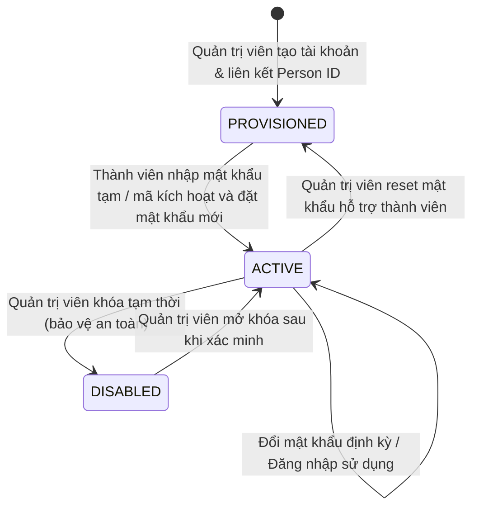

# MEMBER EXPERIENCE & INTERACTION SYSTEM — MASTER PLAN
## Hệ Thống Trải Nghiệm & Tương Tác Thành Viên — Gia Tộc Trần Trọng Thu

**Người phê duyệt:** Tuấn (Human Final Authority / Product Owner)  
**Kiến trúc & QC:** Emarald (Strategic Architecture & QC Authority)  
**Điều phối & Thực thi:** AGY (Execution Authority / Master Orchestrator)  
**Ngày khởi tạo:** 2026-11-11  
**Mục tiêu tối thượng:** Xây dựng hệ thống tương tác hoàn chỉnh, ấm áp, nhân văn, mobile-first, dễ hiểu cho mọi thế hệ người thân trong dòng họ, xóa bỏ hoàn toàn khoảng cách giữa năng lực kỹ thuật của hệ thống và trải nghiệm sử dụng thực tế.

---

## 1. NGUYÊN TẮC CỐT LÕI (CORE TENETS)

1. **Người thân không cần hiểu kỹ thuật để sử dụng:**
   - Tuyệt đối không hiển thị thuật ngữ kỹ thuật (`IDOR`, `ReBAC`, `SQLite`, `MariaDB`, `IdentityMapping`, `Token`, `Salt`, `WAF`, `Payload`).
   - Sử dụng tiếng Việt đời thường, xưng hô tôn kính, thân tình ("Người thân", "Bà con", "Dòng họ", "Kỷ vật", "Lời kể", "Gợi ý bổ sung").
2. **Không điểm cụt (Zero Dead-Ends):**
   - Mọi trang, mọi trạng thái lỗi, mọi màn hình rỗng (`Empty State`) đều phải có chỉ dẫn bước tiếp theo rõ ràng: "Phải làm gì?", "Liên hệ với ai?", "Quay về đâu?".
3. **Thấy tính năng là dùng được (No Ghost Features):**
   - Không tạo nút bấm giả lập, không hứa hẹn tính năng chưa chạy. Nếu tính năng cần sự hỗ trợ thủ công của người quản lý gia đình, hệ thống phải hướng dẫn kết nối trực tiếp (Zalo, số điện thoại người điều hành gia tộc).
4. **Tách biệt Thẩm quyền Hệ thống và Thẩm quyền Gia đình:**
   - Quản trị kỹ thuật (`admin`) ≠ Quản lý tư liệu gia đình (`family steward`).
   - Quyền Owner kỹ thuật không mặc nhiên có quyền đọc các tài liệu chi nhánh riêng tư (như Thư gửi Clara `BRANCH_RESTRICTED_P0`).
5. **Mobile-First & Thân thiện với Người lớn tuổi:**
   - Chữ to, tương phản đạt chuẩn WCAG AA, nút bấm cảm ứng tối thiểu 44x44px, không bắt nhớ quy trình phức tạp.

---

## 2. KIẾN TRÚC TỔNG THỂ & HỢP ĐỒNG CHUNG (SHARED ARCHITECTURAL CONTRACTS)

### 2.1. Bản đồ Tuyến đường (Route & Endpoint Map)

| Đường dẫn (URL) | Mục đích | Đối tượng | Giao diện Shell | Trạng thái Backend |
| :--- | :--- | :--- | :--- | :--- |
| `/login` | Đăng nhập tài khoản thành viên | Khách / Thành viên | Single Shell | Đã có, cần nâng cấp hướng dẫn |
| `/activate` | Kích hoạt tài khoản lần đầu qua mã/liên kết | Thành viên mới | Single Shell | Cần bổ sung UI & Handler |
| `/me` | Không gian cá nhân (Member Home) | Thành viên đăng nhập | Member Shell | Đã có, cần bổ sung thẻ điều hướng |
| `/me/account` | Trung tâm quản lý tài khoản & danh tính | Thành viên đăng nhập | Member Shell | Cần bổ sung |
| `/me/change-password` | Đổi mật khẩu tự nguyện & kích hoạt | Thành viên đăng nhập | Single Shell | Đã gia cố backend |
| `/help` hoặc `/me/help` | Trung tâm hướng dẫn & trợ giúp | Mọi đối tượng | Member / Public | Cần bổ sung |
| `/help/recovery` | Hướng dẫn khôi phục tài khoản khi quên | Thành viên mất mật khẩu | Single Shell | Cần bổ sung |
| `/me/requests` | Theo dõi trạng thái đóng góp / yêu cầu | Thành viên đăng nhập | Member Shell | Cần bổ sung |
| `/me/contribute` | Đóng góp di ảnh, tư liệu, hồi ức | Thành viên đăng nhập | Member Shell | Cần tích hợp với Proposals/Upload |
| `/me/letters` | Không gian Thư Gửi Nhau (Letters & Legacy) | Thành viên đăng nhập | Member Shell | First-Class Domain mới |
| `/me/letters/compose` | Soạn thảo thư di sản mới | Thành viên đăng nhập | Member Shell | First-Class Domain mới |
| `/admin/#/inbox` | Hộp thư tiếp nhận đề xuất & yêu cầu | Quản trị viên / Trưởng tộc | Admin Control Room | Đã có, mở rộng thêm loại yêu cầu |
| `/admin/#/members` | Quản lý tài khoản & mã kích hoạt | Quản trị viên / Owner | Admin Control Room | Đã có, hoàn thiện tính năng kích hoạt |

### 2.2. Hợp đồng Trạng thái Tài khoản (Account State Contract)



- **`PROVISIONED`**: Đã tạo tài khoản, đã liên kết nhân vật trong phả hệ. Bắt buộc đổi mật khẩu lần đầu tại `/me/change-password` trước khi được truy cập các tính năng ghi dữ liệu.
- **`ACTIVE`**: Tài khoản đầy đủ quyền năng thành viên.
- **`DISABLED`**: Bị khóa, không thể đăng nhập hoặc gọi API đột biến.

### 2.3. Hợp đồng Đóng góp & Yêu cầu Hỗ trợ (Contribution & Request Contract)

Tái sử dụng bảng `proposals` và cơ chế `governance.js` hiện có:
- **`field`**:
  * `FACT_UPDATE`: Đề xuất sửa đổi năm sinh, năm mất, tên, mộ phần, sự kiện.
  * `MEDIA_CONTRIBUTION`: Đóng góp ảnh, tư liệu gốc, gia bảo.
  * `MEMORY_STORY`: Đóng góp câu chuyện, ký ức dòng họ.
  * `ACCOUNT_SUPPORT`: Yêu cầu trợ giúp kỹ thuật, cập nhật thông tin liên hệ.
- **`status`**: `PENDING` ➔ `APPROVED` / `REJECTED`.
- **Nguyên tắc bảo vệ dữ liệu:** Không bao giờ ghi đè trực tiếp CSDL phả hệ từ client; mọi đóng góp phải qua hàng đợi xem xét của Người quản lý gia tộc.

### 2.4. Phân hệ Di sản Đệ nhất: Thư Gửi Nhau (Letters & Legacy Contract)
Theo chỉ đạo kiến trúc bổ sung của Tuấn (Architecture Addendum 2026-11-11):
- **Bản chất:** Thư Gửi Nhau là thể loại di sản tinh thần chính thức truyền trao giữa các thế hệ.
- **Phân loại đối tượng:** Cá nhân (`INDIVIDUAL`), Chi nhánh (`BRANCH`), Toàn gia tộc (`FAMILY`), Thế hệ tương lai (`FUTURE`), Tưởng niệm người đã khuất (`MEMORIAL`).
- **Phân quyền đa chiều:** Tác giả, Người nhận, Người được nhắc đến, Trách nhiệm trông nom di sản (`Stewardship`).
- **Bảo toàn Clara P0:** 8 lá thư Clara là trường hợp bộ sưu tập đặc biệt, tiếp tục được bảo vệ nghiêm ngặt theo chính sách `BRANCH_RESTRICTED_P0` hiện hành, cấm công khai hóa hoặc nới lỏng quyền đọc cho bên ngoài.
- **Chi tiết đặc tả:**
  * [`LETTERS_AND_LEGACY_PRODUCT_SPEC.md`](file:///Users/tuantq/Projects/Personal/giatoctrantrongthu/LETTERS_AND_LEGACY_PRODUCT_SPEC.md)
  * [`LETTERS_AND_LEGACY_DATA_MODEL.md`](file:///Users/tuantq/Projects/Personal/giatoctrantrongthu/LETTERS_AND_LEGACY_DATA_MODEL.md)
  * [`LETTERS_AND_LEGACY_ACCESS_POLICY.md`](file:///Users/tuantq/Projects/Personal/giatoctrantrongthu/LETTERS_AND_LEGACY_ACCESS_POLICY.md)
  * [`LETTERS_AND_LEGACY_UX_SPEC.md`](file:///Users/tuantq/Projects/Personal/giatoctrantrongthu/LETTERS_AND_LEGACY_UX_SPEC.md)

---

## 3. PHÂN BỔ WORKSTREAM & MA TRẬN TRÁCH NHIỆM

```text
                                Tuấn (Human Owner)
                                       │
                               Emarald (Architecture/QC)
                                       │
                         AGY (Master Orchestrator / AGENT 00)
                                       │
     ┌──────────────┬──────────────┼──────────────┬──────────────┬──────────────┐
     ▼              ▼              ▼              ▼              ▼              ▼
  AGENT 01       AGENT 02       AGENT 03       AGENT 04       AGENT 05       AGENT 06
  Product &       UX/UI &      Auth & Account   Admin Ops &    Governance &    QA & Security
  Journeys      Interactions     Lifecycle       Support       Permissions     Verification
```

Chi tiết phân công nhiệm vụ và hợp đồng liên kết được quy định tại [`MEMBER_EXPERIENCE_WORKSTREAMS.md`](file:///Users/tuantq/Projects/Personal/giatoctrantrongthu/MEMBER_EXPERIENCE_WORKSTREAMS.md).

---

## 4. KẾ HOẠCH TRIỂN KHAI & TIẾN ĐỘ THỰC THI (EXECUTION PHASING)

- **Giai đoạn 1: Khởi động Song song & Đóng băng Hợp đồng (Agents 00, 01, 05)**
  * Xác lập Master Plan, Journey Design và Governance Audit.
- **Giai đoạn 2: Triển khai Giao diện & Vòng đời Tài khoản (Agents 02, 03, 04)**
  * Xây dựng các trang HTML/JS cho Member Experience (`/me/account`, `/me/requests`, `/me/contribute`, `/help`, `/help/recovery`, `/activate`).
  * Gia cố các API Backend trong `server/member.js` và `server/admin_operations.js`.
  * Cập nhật Admin Inbox và Member Management.
- **Giai đoạn 3: Tích hợp Hệ thống & Độc lập Kiểm thử (Agents 00, 06)**
  * Chạy kịch bản kiểm thử End-to-End trên 4 kích thước màn hình (375, 768, 1024, 1440).
  * Kiểm tra bảo mật IDOR, rate-limit, session isolation, zero credential leakage.
- **Giai đoạn 4: Nghiệm thu & Lập Biên bản Bàn giao (Handoff)**
  * Lập báo cáo tổng hợp chuẩn mực, phân loại rõ `VERIFIED`, `IMPLEMENTED`, `BLOCKED`.
  * Trình Tuấn và Emarald xem xét tại Human Gate.

