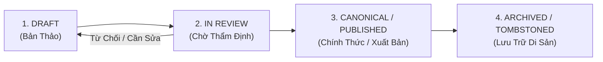

# KIẾN TRÚC QUẢN TRỊ NỘI DUNG (CONTENT MANAGEMENT ARCHITECTURE)
## PHÂN ĐỊNH RANH GIỚI BỐN LỚP: ADMIN/CMS · DATABASE · CONFIGURATION · CODE
### DỰ ÁN CÂY GIA PHẢ / GIATỘC TRẦN TRỌNG THU

> **Mã tài liệu:** `docs/architecture/CONTENT_MANAGEMENT_ARCHITECTURE.md`  
> **Trạng thái:** CANONICAL ARCHITECTURAL SPECIFICATION v1.0  
> **Human Final Authority:** Tuấn (Phê duyệt tối cao)  
> **Analysis & Architecture Authority:** Emarald  
> **Coordination & Drafting Owner:** AGY / OpenCode  
> **Ngày ban hành:** 02/11/2026  
> **Nguyên tắc cốt lõi:** *Tách rời tuyệt đối giữa Nội dung biên tập, Cơ sở dữ liệu, Cấu hình vận hành và Mã nguồn thực thi. Không hardcode dữ liệu nghiệp vụ vào Code; không lưu cấu hình trong Database; không yêu cầu quản trị viên sửa Database trực tiếp.*

---

## 1. PURPOSE & SCOPE (MỤC ĐÍCH & PHẠM VI)

### 1.1. Mục đích
Dự án **Cây Gia Phả / Gia Tộc Trần Trọng Thu** đang hoàn thiện giai đoạn chuyển dịch từ website tĩnh sang ứng dụng web di sản động. Trong quá trình này, nguy cơ lớn nhất là việc nhập nhằng giữa:
- Những gì thuộc về **Nội dung biên tập** (thay đổi thường xuyên bởi con người).
- Những gì thuộc về **Dữ liệu cấu trúc CSDL** (lưu trữ quan hệ thực thể, phả hệ, lịch sử).
- Những gì thuộc về **Cấu hình hệ thống** (tham số điều khiển hành vi không cần deploy).
- Những gì thuộc về **Mã nguồn phần mềm** (logic thuật toán, template giao diện, quy tắc phân quyền).

Tài liệu này xác lập ranh giới bất biến giữa bốn lớp kỹ thuật trên, cung cấp cơ sở kiến trúc vững chắc để đội ngũ kỹ thuật (AGY, OpenCode, Cline) phát triển giao diện và API mà không làm xáo trộn dữ liệu hiện hữu hoặc tạo ra sự phụ thuộc chéo nguy hiểm.

### 1.2. Phạm vi áp dụng
Áp dụng cho toàn bộ 11 nhóm nội dung và tài nguyên của hệ thống:
1. Phả hệ & Nhân vật (`Genealogy / Persons`)
2. Gia đình & Phân nhánh (`Families / Branches`)
3. Mối quan hệ thân tộc (`Relationships / Edges`)
4. Hồ sơ cá nhân & Ký ức (`Personal Profiles / Memories`)
5. Ấn phẩm MẠCH (`MẠCH Publication`)
6. Số báo / Bài viết / Metadata biên tập (`Issues / Articles / Metadata`)
7. Kho tư liệu số hóa & Ảnh (`Archives / Media Assets`)
8. Lịch gia tộc & Sự kiện (`Family Calendar / Events`)
9. Thông tin trang chủ & Tiếng nói công khai (`Homepage / Public Information`)
10. Tài khoản / Vai trò / Quyền hạn (`Users / Roles / Permissions`)
11. Điều hướng & Cấu hình hiển thị (`Navigation / Display Settings`)

---

## 2. ARCHITECTURE OVERVIEW (TỔNG QUAN KIẾN TRÚC BỐN LỚP)

Hệ thống được tổ chức thành 4 lớp độc lập có ranh giới bảo vệ nghiêm ngặt:

```text
┌─────────────────────────────────────────────────────────────────────────────┐
│ 1. ADMIN / CMS LAYER (Lớp Quản Trị & Biên Tập)                              │
│ • Giao diện web quản trị (/admin), công cụ biên tập Markdown (Obsidian)     │
│ • Thao tác: Tạo mới, Soát lỗi, Phê duyệt, Xuất bản, Gắn thẻ, Phân loại      │
│ • Đối tượng: Chủ gia đình (Tuấn), Biên tập viên dòng họ, Thành viên gia đình│
└──────────────────────────────────────┬──────────────────────────────────────┘
                                       │ (REST API / GraphQL / Ingestion Script)
                                       ▼
┌──────────────────────────────────────┴──────────────────────────────────────┐
│ 4. CODE LAYER (Lớp Mã Nguồn Thực Thi)                                       │
│ • Backend: Node/Express, Auth engine, ReBAC policy, Data validation, API     │
│ • Frontend: Web Shell, UI Components vNEXT, Template, Formatters            │
│ • Trách nhiệm: Định nghĩa cấu trúc, hành vi, kiểm soát an ninh tối cao      │
└──────────────┬───────────────────────────────────────────────┬──────────────┘
               │ (Đọc/Ghi qua ORM/QueryBuilder)                │ (Đọc tham số)
               ▼                                               ▼
┌──────────────────────────────────────────────┐ ┌────────────────────────────┐
│ 2. DATABASE LAYER (Lớp Cơ Sở Dữ Liệu)        │ │ 3. CONFIGURATION LAYER     │
│ • SQLite local / MariaDB Synology NAS        │ │ • Tệp cấu hình tĩnh (JSON) │
│ • Lưu trữ: Persons, Families, Timeline,      │ │ • Biến môi trường (.env)   │
│   Memories, Media metadata, Accounts, ReBAC  │ │ • Manifests (Assets, Nav)  │
│ • Kho tệp vật lý: /assets/media/ (SHA-256)   │ │ • Thay đổi không sửa code  │
└──────────────────────────────────────────────┘ └────────────────────────────┘
```

### Nguyên tắc tương tác cốt lõi:
1. **CMS $\rightarrow$ Database:** Người quản trị và người dùng tương tác thông qua giao diện CMS và API; tuyệt đối **không chạy lệnh SQL thủ công** trên Production CSDL.
2. **Database $\rightarrow$ Code:** Mã nguồn không chứa dữ liệu thực thể (zero hardcoded entities). Mọi thông tin nhân vật, bài viết, sự kiện được nạp động từ CSDL.
3. **Configuration $\rightarrow$ Code:** Các tham số về nhãn điều hướng, đường dẫn logo, cờ tính năng được tách vào tệp cấu hình JSON hoặc biến môi trường; thay đổi cấu hình không yêu cầu biên dịch hay sửa code logic.
4. **Code $\rightarrow$ UI:** Frontend lấy 100% dữ liệu thông qua API chuẩn hóa; Backend chịu trách nhiệm thẩm định quyền (authorization) và làm sạch dữ liệu trước khi trả về trình duyệt.

---

## 3. CONTENT OWNERSHIP MATRIX (MA TRẬN QUẢN TRỊ NỘI DUNG)

Bảng phân loại chi tiết cho toàn bộ 11 nhóm dữ liệu nghiệp vụ:

| Nhóm Dữ Liệu | Nơi Quản Trị (Admin/CMS) | Nơi Lưu Trữ (Storage SoT) | Cách Truy Xuất (API Contract) | Cách Cập Nhật (Update Method) | Thành Phần Hiển Thị (UI Component) | Sửa Code Khi Đổi Nội Dung? |
| :--- | :--- | :--- | :--- | :--- | :--- | :---: |
| **1. Genealogy / Persons** | Admin CMS (`/admin/#/people`) hoặc Pipeline GEDCOM | CSDL bảng `people` (payload JSON + structured columns) | `GET /api/people`, `GET /api/people/:id`, `GET /api/spaces/member` | Admin CMS Form hoặc script import có kiểm toán | `PersonDetailModal`, `MemberDirectoryGrid`, `TreePersonNode` | **KHÔNG** |
| **2. Families / Branches** | Admin CMS (`/admin/#/families`) | CSDL bảng `families` (`husband_id`, `wife_id`, `children`) | `GET /api/families`, `GET /api/spaces/member` | Admin Form cập nhật quan hệ hôn phối & con cái | `FamilyTreeCanvas`, `CloseFamilyGrid` (Tầng 2) | **KHÔNG** |
| **3. Relationships** | Admin CMS & Engine suy diễn phả hệ | CSDL bảng `edges` & liên kết `FAMC`/`FAMS` | `GET /api/edges`, Graph traversal nội bộ | `POST /api/edges`, `DELETE /api/edges` (Admin auth) | Đường nối Cây Phả Hệ, ReBAC Policy Evaluator | **KHÔNG** |
| **4. Personal Profiles** | Member Portal (`/me/profile`) & Admin CMS | CSDL bảng `memories`, `timeline`, `people.notes` | `GET /api/people/:id`, `GET /api/spaces/personal` | `PATCH /api/member/profile`, `POST /api/memories` | `PersonHeroCard` (Tầng 1), `TimelineStream` | **KHÔNG** |
| **5. MẠCH Publication** | Tác giả (Tuấn) soạn thảo Markdown tại `content/mach/` | CSDL bảng `stories` & tệp tĩnh `server/data/mach.json` | `GET /api/mach.json`, `GET /api/spaces/public` | Compiler `scripts/build_mach.py` hoặc Admin Story CMS | `MachShowcaseBanner`, `MachArticleReader` | **KHÔNG** |
| **6. Issues / Metadata** | Biên tập viên (Tuấn) duyệt số báo MẠCH | Tệp JSON `data/mach.json` (series, authors, articles) | `GET /api/mach.json` (chứa metadata số báo) | Cập nhật file manifest hoặc qua Admin CMS | `IssueHeader`, `ArticleMetaBadge`, `AuthorCard` | **KHÔNG** |
| **7. Archives / Media** | Thư viện Tư liệu Admin & Upload Portal | File vật lý tại `assets/media/` (băm SHA-256); CSDL bảng `media`, `person_media` | Static Server có bộ lọc an ninh + `GET /api/spaces/member` | Upload API `POST /api/media` + gán `media_id` vào `person_media` | `MediaArchiveGrid`, `AvatarThumbnail`, `LightboxModal` | **KHÔNG** |
| **8. Family Calendar** | Lịch Quản trị Admin & Bộ chuyển đổi iCalendar | 4 tệp RFC 5545 `.ics` tại `server/calendars/` & CSDL `calendar_events` | `GET /api/calendars/:feed.ics`, `GET /api/events` | Nạp tệp `.ics` hoặc tạo sự kiện qua Admin Form | `LineageCalendarView`, `MonthlyFeastList`, `LunarEngine` | **KHÔNG** |
| **9. Homepage Info** | Cấu hình Xuất bản (`config/publication.json`) | Configuration Layer + CSDL bảng `memories` nổi bật | `GET /api/spaces/public` | Form Cấu hình Trang chủ trên CMS hoặc chỉnh sửa JSON | `PublicHomeHero`, `IssuesOfInterestGrid`, `OriginsBox` | **KHÔNG** *(Chỉ sửa code nếu đổi cấu trúc 6 khu vực)* |
| **10. Users & Roles** | Admin Access Control (`/admin/#/users`) | CSDL bảng `admin_users`, `accounts`, `identity_mappings` | `GET /api/admin/users`, `GET /api/auth/me` | `POST /api/admin/users`, `PATCH /api/admin/users/:id` | `AdminUserTable`, `SessionIndicator`, `RoleBadge` | **KHÔNG** |
| **11. Nav & Display** | Cấu hình Ứng dụng (`assets/ASSET_MANIFEST.json`) | Configuration JSON (Tách khỏi mã nguồn shell) | `loadAssetManifest()`, `resolveContext()` | Cập nhật tệp JSON cấu hình hiển thị | `InstitutionHeader`, `GlobalNav`, `MemberNav`, `Breadcrumb` | **KHÔNG** *(Đã tách khỏi hardcode)* |

---

## 4. ADMIN MANAGEMENT SCOPE (PHẠM VI QUẢN TRỊ CMS)

### 4.1. Ma trận phân quyền quản trị (Administrative Roles)
Hệ thống xác lập 4 vai trò quản trị rõ ràng:

```text
┌─────────────────────────────────────────────────────────────────────────────┐
│ 1. OWNER (Tuấn — Quyền Tối Cao)                                             │
│ • Toàn quyền trên mọi phân hệ: Phả hệ, MẠCH, Clara, Quản lý tài khoản Admin │
│ • Duyệt các quyết định nhạy cảm: Chấp thuận phục hồi dữ liệu, đổi chính sách │
├─────────────────────────────────────────────────────────────────────────────┤
│ 2. EDITORIAL ADMIN (Biên Tập Viên Di Sản)                                   │
│ • Quản lý bài viết MẠCH, kiểm duyệt hồi ức thành viên đóng góp              │
│ • Biên tập chú thích ảnh, cập nhật mốc sự kiện Lịch gia tộc                 │
│ • KHÔNG có quyền truy cập Thư riêng tư Clara; KHÔNG sửa đổi tài khoản Owner │
├─────────────────────────────────────────────────────────────────────────────┤
│ 3. GENEALOGY CURATOR (Quản Thủ Phả Hệ)                                      │
│ • Cập nhật thông tin nhân vật, sửa đổi ngày sinh/mất có nguồn dẫn chứng     │
│ • Thẩm định các yêu cầu bổ sung con cháu mới sinh từ thành viên             │
│ • KHÔNG có quyền xuất bản bài viết MẠCH ra trang chủ                        │
├─────────────────────────────────────────────────────────────────────────────┤
│ 4. VERIFIED MEMBER (Thành Viên Đã Xác Thực)                                 │
│ • Tự quản lý hồ sơ cá nhân (Myself), viết ký ức gia đình trực hệ            │
│ • Đóng góp ảnh tư liệu vào Không Gian Gia Đình (Family Space)                │
│ • Gửi đề xuất (Proposal) khi phát hiện thông tin phả hệ cần đính chính      │
└─────────────────────────────────────────────────────────────────────────────┘
```

### 4.2. Các thao tác quản trị được chuẩn hóa:
- **Genealogy Management:** Thêm nhân vật, liên kết cha mẹ/con cái/vợ chồng, kiểm tra trùng lặp ID GEDCOM, gán nhánh Chi Trưởng/Chi Thứ.
- **Editorial Publishing:** Soạn thảo Rich Text / Markdown, xem trước (Preview) theo đúng typography di sản, lên lịch xuất bản bài viết MẠCH.
- **Media Asset Curation:** Upload ảnh chân dung/tư liệu, hệ thống tự động băm mã SHA-256, liên kết ảnh với một hoặc nhiều nhân vật (`person_media`).
- **Access Control:** Cấp phát tài khoản thành viên, kích hoạt/vô hiệu hóa tài khoản, ánh xạ danh tính tài khoản với nhân vật trong phả hệ (`identity_mappings`).

---

## 5. DATABASE RESPONSIBILITY (TRÁCH NHIỆM LỚP CƠ SỞ DỮ LIỆU)

### 5.1. Dữ liệu bắt buộc lưu trữ trong CSDL
1. **Dữ liệu cấu trúc có quan hệ (Relational & Graph Data):**
   - Mạng lưới phả hệ nhân vật (`people`, `families`, `edges`).
   - Niên biểu và mốc sự kiện cuộc đời (`timeline`).
   - Ký ức và hồi ký nhân vật (`memories`).
   - Quản trị tài khoản và phiên làm việc (`admin_users`, `accounts`, `identity_mappings`, `authorities`).
2. **Siêu dữ liệu tư liệu (Media Metadata):**
   - Bảng `media`: Lưu `id`, `assetId`, `kind` (portrait/document), `mimeType`, đường dẫn tương đối, mã băm `sha256`, dung lượng `byteSize`, nguồn gốc provenance.
   - Bảng `person_media`: Lưu bảng quan hệ N-N giữa `person_id` và `media_id`.

### 5.2. Dữ liệu KHÔNG lưu trong CSDL
- **Nội dung tệp nhị phân ảnh (Binary Blobs):** Tuyệt đối không lưu tệp ảnh trực tiếp vào CSDL dưới dạng BLOB. Toàn bộ tệp ảnh lưu trữ trên hệ thống tệp tĩnh (`assets/images/`, `assets/media/`, hoặc NAS Storage). CSDL chỉ lưu đường dẫn và mã băm toàn vẹn.
- **Cấu hình giao diện và Design Tokens:** Màu sắc, kích thước font chữ, khoảng đệm CSS lưu trữ trong CSS/JSON, không lưu trong CSDL.
- **Thư riêng tư Clara:** Lưu trữ độc quyền trong tệp dữ liệu cô lập `data/private/clara.json` và hệ thống tệp nhạy cảm; không hòa lẫn vào bảng `stories` công khai để tránh nguy cơ rò rỉ khi query tổng hợp.

### 5.3. Nguồn chân lý duy nhất (Single Source of Truth)
- Tại môi trường Local/Staging: SQLite [`server/family_archive.db`](file:///Users/tuantq/Projects/Personal/giatoctrantrongthu/server/family_archive.db) là Source of Truth tối cao cho toàn bộ dữ liệu phả hệ và tài khoản.
- Lịch gia tộc: 4 tệp vật lý RFC 5545 `.ics` tại [`server/calendars/`](file:///Users/tuantq/Projects/Personal/giatoctrantrongthu/server/calendars/) là Source of Truth cho 265 sự kiện lịch gia đình.

---

## 6. CONFIGURATION BOUNDARY (RANH GIỚI LỚP CẤU HÌNH)

Lớp Cấu hình bao gồm toàn bộ các tham số điều khiển vận hành có thể thay đổi mà **không cần sửa đổi mã nguồn** và **không cần can thiệp CSDL**:

### 6.1. Danh mục các tệp cấu hình chuẩn hóa:
1. **Biến môi trường (`server/.env`):**
   - Cổng mạng máy chủ (`PORT=3000`).
   - Loại CSDL (`DB_CLIENT=sqlite3` hoặc `mariadb`).
   - Đường dẫn CSDL (`DB_PATH=./family_archive.db`).
   - Bí mật phiên làm việc (`SESSION_SECRET=...`).
   - Tên miền cookie bảo mật (`COOKIE_DOMAIN=...`).
   - Nguồn gốc Admin cho phép CORS (`ADMIN_ORIGIN=...`).
2. **Asset Manifest ([`assets/ASSET_MANIFEST.json`](file:///Users/tuantq/Projects/Personal/giatoctrantrongthu/assets/ASSET_MANIFEST.json)):**
   - Khai báo đường dẫn logo ngang, logo dọc, logo icon, favicon.
   - Khi thay đổi asset thương hiệu, chỉ cần đổi đường dẫn trong file JSON này; toàn bộ Header, Masthead và Favicon tự động cập nhật đồng bộ.
3. **Cấu hình Hạ tầng & Định tuyến ([`vercel.json`](file:///Users/tuantq/Projects/Personal/giatoctrantrongthu/vercel.json)):**
   - Quy tắc chuyển hướng bảo vệ thư mục riêng tư (`/data/private/(.*) -> /`).
   - Tiêu đề bảo mật HTTP (CSP, X-Frame-Options, X-Content-Type-Options).
4. **Cấu hình Xuất bản MẠCH (`data/mach.json`):**
   - Danh sách các số báo, tiêu đề, tác giả, mô tả ngắn gọn từng bài viết xuất bản.

> [!WARNING] NGUYÊN TẮC CẤM KỴ
> Tuyệt đối không dùng tệp Cấu hình để lưu trữ dữ liệu thực thể nghiệp vụ (danh sách 223 con người, cây phả hệ, thông tin cá nhân PII).

---

## 7. CODE BOUNDARY (RANH GIỚI LỚP MÃ NGUỒN)

Lớp Mã Nguồn (Code Layer) chịu trách nhiệm định nghĩa **cấu trúc logic và hành vi hệ thống**, tuyệt đối không chứa nội dung văn bản cụ thể có tính chất biên tập thay đổi theo thời gian:

### 7.1. Trách nhiệm của Backend Code (`server/`):
- **Routing & Controllers:** Tiếp nhận HTTP request, phân luồng đến các router chuyên trách (`auth.js`, `member.js`, `spaces_router.js`).
- **Validation Engine:** Thẩm định tính hợp lệ của dữ liệu đầu vào (định dạng ngày tháng, giới tính, cấu trúc GEDCOM, ràng buộc không trùng lặp ID).
- **Authorization & Security Enforcement:** Kiểm tra phiên đăng nhập, thực thi ma trận phân quyền ReBAC, chặn đứng các truy cập trái phép vào dữ liệu mật (Clara, PII người sống).
- **Data Serialization:** Chuyển đổi dữ liệu thô từ CSDL thành các Data Contract chuẩn mực trả về cho client.

### 7.2. Trách nhiệm của Frontend Code (`src/`):
- **UI System & Design Tokens:** Quản lý bảng màu, typography, lưới bố cục, trạng thái responsive (`src/css/foundation/`).
- **Component Factories & Shell:** Xây dựng các khối giao diện tái sử dụng (`src/js/ui/components.js`, `shell.js`, `public-home.js`).
- **Client Routing:** Điều hướng trang thông qua URL hash (`#/`, `#/gia-pha`, `#/mach`...) mà không cần reload trang.
- **DOM Rendering & Sanitization:** Nạp dữ liệu từ API và hiển thị an toàn vào DOM (sử dụng `textContent` để triệt tiêu lỗ hổng XSS, không dùng `innerHTML` tùy tiện).

---

## 8. CONTENT LIFECYCLE (VÒNG ĐỜI DỮ LIỆU & NỘI DUNG)

Mọi nội dung trong hệ thống đều trải qua 4 trạng thái vòng đời có kiểm soát:



### Chi tiết từng giai đoạn:
1. **DRAFT (Bản Thảo):**
   - Bài viết MẠCH đang soạn thảo trong file Markdown hoặc bản thảo CMS.
   - Thông tin bổ sung nhân vật do thành viên đề xuất nhưng chưa gửi duyệt.
   - Sự kiện lịch mới tạo ở trạng thái nháp (`status: 'DRAFT'`).
   - *Phạm vi hiển thị:* Chỉ tác giả hoặc người tạo nhìn thấy.
2. **IN REVIEW (Chờ Thẩm Định):**
   - Đề xuất sửa đổi thông tin phả hệ được gửi lên hàng đợi (`proposals`).
   - Ký ức hoặc ảnh tư liệu mới upload chờ Quản thủ phả hệ kiểm tra tính xác thực.
   - *Phạm vi hiển thị:* Người gửi và ban quản trị (Owner / Curator).
3. **CANONICAL / PUBLISHED (Chính Thức / Xuất Bản):**
   - Dữ liệu phả hệ đã được đối soát nguồn chứng thực, ghi nhận vào CSDL chính thức.
   - Bài viết MẠCH được xuất bản ra công chúng hoặc số báo nội bộ.
   - Sự kiện lịch được đẩy vào feed iCalendar chính thức (`status: 'PUBLISHED'`).
   - *Phạm vi hiển thị:* Tùy thuộc vào không gian (Public, Member, hoặc Family).
4. **ARCHIVED / TOMBSTONED (Lưu Trữ Di Sản):**
   - Bài viết cũ được chuyển vào kho lưu trữ.
   - Nhân vật hoặc thông tin sai lệch lịch sử được đánh dấu tombstone (lưu vết lịch sử thay đổi, không xóa vật lý khỏi CSDL để bảo tồn chuỗi kiểm toán).

---

## 9. API & RENDERING RESPONSIBILITIES (HỢP ĐỒNG API & HIỂN THỊ)

Hệ thống tuân thủ nghiêm ngặt mô hình **API-driven Presentation**:

```text
┌─────────────────────────┐             HTTP JSON Response             ┌─────────────────────────┐
│      BACKEND API        │ ─────────────────────────────────────────> │   FRONTEND PRESENTATION │
│  (Data Provider & Gate) │ <───────────────────────────────────────── │    (Pure Rendering)     │
└─────────────────────────┘             HTTP GET / POST                └─────────────────────────┘
```

### Bảng phân định trách nhiệm cụ thể:

| Hành Động / Nhiệm Vụ | Trách Nhiệm Backend | Trách Nhiệm Frontend |
| :--- | :--- | :--- |
| **Phân quyền truy cập** | **Tuyệt đối chịu trách nhiệm:** Chặn HTTP 401/403 nếu không đủ quyền; lọc bỏ các trường nhạy cảm khỏi JSON payload trước khi gửi. | Chỉ ẩn/hiển thị nút bấm hoặc chuyển hướng giao diện; **không tin cậy** việc frontend tự ẩn UI để bảo mật. |
| **Hiển thị Nhân vật Phả hệ** | Trả về JSON danh sách nhân vật sạch, kèm thế hệ, chi họ, năm sinh/năm mất đã format. | Render lưới thẻ bài, xử lý bộ lọc tìm kiếm tức thì theo tên, xử lý hiệu ứng hover/click. |
| **Trưng bày bài viết MẠCH** | Đọc tệp `mach.json` hoặc CSDL, kiểm tra trạng thái xuất bản, trả về nội dung bài viết và siêu dữ liệu tác giả. | Định dạng văn bản theo Typography di sản (Cinzel/Playfair), ngắt đoạn, hiển thị trích dẫn, bọc ảnh minh họa. |
| **Lịch Gia Tộc** | Phục vụ các feed `.ics` chuẩn RFC 5545 từ CSDL hoặc tệp vật lý. | Thuật toán `IcsParser` bóc tách sự kiện, engine `lunar-engine.js` chuyển đổi ngày âm dương và hiển thị lên lịch tháng. |
| **Cửa ngõ Nhận diện (Gate)** | Trả về thông báo lỗi kèm mã chốt chặn `{ gate: 'SPACE_02_RECOGNITION_GATE' }` khi khách vãng lai gọi API thành viên. | Nhận diện mã chốt chặn để hiển thị khung thông báo trang trọng, mời con cháu xác thực danh tính. |

---

## 10. SECURITY & ACCESS CONTROL BOUNDARY (BẢO VỆ 3 KHÔNG GIAN)

Hệ thống bảo toàn tuyệt đối ranh giới quyền riêng tư giữa **3 Không Gian Diễn Ngôn Độc Lập** (theo DEC-10 và DEC-11):

```text
┌─────────────────────────────────────────────────────────────────────────────┐
│ 1. SPACE 01: PUBLIC / SOCIAL (Công Chúng & Xã Hội)                          │
│ • Đối tượng: Mọi độc giả Internet, bạn bè, giới nghiên cứu văn hóa          │
│ • Ranh giới an ninh: CẤM 100% rò rỉ PII người sống, cấm lộ hồ sơ cá nhân     │
│ • Nội dung: Trang chủ 6 khu vực, Tôn chỉ gia tộc, 12 bài viết MẠCH chọn lọc │
├─────────────────────────────────────────────────────────────────────────────┤
│ 2. SPACE 02: LINEAGE / MEMBER SPACE (Dòng Họ & Thành Viên)                  │
│ • Đối tượng: Con cháu trong dòng họ đã đăng nhập tài khoản hợp lệ           │
│ • Ranh giới an ninh: Xác thực phiên (Session Cookie), ReBAC cấp dòng họ      │
│ • Nội dung: Toàn bộ 223 nhân vật, 68 gia đình, 265 sự kiện Lịch gia tộc,    │
│   kho 185 tư liệu ảnh FamilySearch                                          │
├─────────────────────────────────────────────────────────────────────────────┤
│ 3. SPACE 03: PERSONAL & FAMILY SPACE (Cá Nhân & Gia Đình Gần Gũi)           │
│ • Tầng 1: Bản Thân (Myself) · Tầng 2: Gia Đình Trực Hệ · Tầng 3: Nhánh Mở Rộng│
│ • KHÔNG GIAN ĐẶC BIỆT: THƯ GỬI CLARA (8 bức thư gia đình)                   │
│ • Ranh giới an ninh: CÔ LẬP HOÀN TOÀN; từ chối cả Member thông thường;      │
│   chỉ mở khóa cho ngữ cảnh gia đình trực hệ của Tuấn (Persona: Family)     │
└─────────────────────────────────────────────────────────────────────────────┘
```

> [!CAUTION] QUY TẮC BẤT KHẢ XÂM PHẠM
> - Không gian Thư Gửi Clara tuyệt đối **không có API công khai**, không nằm trong static build của CDN, và được bọc regex `SENSITIVE_PATH` ở mức server để trả về `404 Not Found` đối với mọi truy cập trực tiếp.
> - Trên môi trường Production, Development Access Adapter bị **vô hiệu hóa 100%**; hệ thống bắt buộc kiểm tra phiên đăng nhập mã hóa bcrypt trong CSDL.

---

## 11. PRACTICAL MANAGEMENT SCENARIOS (KỊCH BẢN QUẢN TRỊ THỰC TẾ)

Dưới đây là quy trình 5 bước thực tế cho 5 tình huống phổ biến, minh chứng việc vận hành mà **không cần sửa code**:

### Kịch bản 1: Thêm một người con mới sinh vào gia phả
1. **Người thực hiện:** Thành viên gia đình đăng nhập vào Member Portal hoặc Quản thủ phả hệ vào Admin CMS.
2. **Thao tác:** Vào mục Quản lý Phả hệ $\rightarrow$ Chọn Gia đình cha mẹ $\rightarrow$ Bấm "Thêm thành viên mới" $\rightarrow$ Điền: Họ tên, Giới tính, Ngày sinh, Tên Thánh (nếu có) $\rightarrow$ Bấm "Lưu".
3. **Luồng dữ liệu:** CMS gửi `POST /api/people` kèm payload JSON. Backend kiểm tra quyền `owner/curator`, tạo ID mới (ví dụ `@I224@`), chèn bản ghi vào bảng `people`, cập nhật mảng con trong bảng `families`, và tạo bản ghi sinh nhật trong `calendar_events`.
4. **Hiển thị:** Cây phả hệ và danh bạ tự động nạp người mới từ API trong lần tải tiếp theo.
5. **Can thiệp Code:** **HOÀN TOÀN KHÔNG CẦN SỬA CODE.**

### Kịch bản 2: Xuất bản một bài viết mới trên tạp chí MẠCH
1. **Người thực hiện:** Tác giả / Chủ gia đình (Tuấn).
2. **Thao tác:** Soạn bài viết bằng Markdown kèm ảnh minh họa $\rightarrow$ Chạy kịch bản biên dịch xuất bản `scripts/build_mach.py` hoặc tạo bài viết qua CMS.
3. **Luồng dữ liệu:** Compiler tự động trích xuất tiêu đề, ngày tháng, tóm tắt, cập nhật tệp `data/mach.json` và đồng bộ vào bảng `stories` trong CSDL với `status: 'PUBLISHED'`.
4. **Hiển thị:** Trang chủ PUBLIC hiển thị bài viết mới trong mục "Nội dung đã công bố", phân hệ MẠCH cập nhật số báo tương ứng.
5. **Can thiệp Code:** **HOÀN TOÀN KHÔNG CẦN SỬA CODE.**

### Kịch bản 3: Cập nhật ngày giỗ một vị tiền nhân trong Lịch gia tộc
1. **Người thực hiện:** Biên tập viên di sản.
2. **Thao tác:** Vào Quản lý Lịch trên CMS $\rightarrow$ Tìm sự kiện ngày giỗ $\rightarrow$ Điều chỉnh ngày âm/dương $\rightarrow$ Bấm "Cập nhật".
3. **Luồng dữ liệu:** CMS gọi `PATCH /api/events/:uid`. Backend ghi dữ liệu vào bảng `calendar_events` và xuất bản lại tệp `CAL_03_MEMORIALS.ics`.
4. **Hiển thị:** Màn hình Lịch Gia Tộc (`#/lich`) và các ứng dụng đồng bộ lịch trên điện thoại của con cháu tự động cập nhật ngày giỗ mới.
5. **Can thiệp Code:** **HOÀN TOÀN KHÔNG CẦN SỬA CODE.**

### Kịch bản 4: Thay đổi thông điệp định vị trên Trang Chủ
1. **Người thực hiện:** Tuấn (Human Final Authority).
2. **Thao tác:** Mở giao diện Cấu hình Xuất bản trên CMS $\rightarrow$ Sửa câu văn thông điệp định vị $\rightarrow$ Bấm "Lưu cấu hình".
3. **Luồng dữ liệu:** CMS cập nhật tệp cấu hình `config/publication.json` thông qua API cấu hình.
4. **Hiển thị:** API `/api/spaces/public` đọc câu văn mới từ file cấu hình và render lên Hero trang chủ.
5. **Can thiệp Code:** **HOÀN TOÀN KHÔNG CẦN SỬA CODE.**

### Kịch bản 5: Thu hồi quyền truy cập của một tài khoản vi phạm
1. **Người thực hiện:** Tuấn (Owner).
2. **Thao tác:** Vào mục Quản lý Tài khoản (`/admin/#/users`) $\rightarrow$ Tìm tài khoản $\rightarrow$ Bấm chuyển trạng thái sang "Vô hiệu hóa" (`is_active: 0`).
3. **Luồng dữ liệu:** CMS gọi `PATCH /api/admin/users/:id`. Backend cập nhật CSDL và lập tức hủy bỏ (destroy) phiên session hiện tại của tài khoản đó trên Redis/Store.
4. **Hiển thị:** Người dùng bị đăng xuất ngay lập tức trong request tiếp theo; mọi nỗ lực truy cập Space 02/03 bị trả về mã lỗi `403 Forbidden`.
5. **Can thiệp Code:** **HOÀN TOÀN KHÔNG CẦN SỬA CODE.**

---

## 12. CURRENT STATE VS PROPOSED STATE (ĐỐI SOÁT HIỆN TRẠNG & ĐÍCH ĐẾN)

Bảng đối chiếu pháp y tình trạng thực thi hiện tại so với kiến trúc đích:

| Phân Hệ / Thành Phần | Hiện Trạng Mã Nguồn (Current State) | Nhãn Trạng Thái | Kiến Trúc Đích Chuẩn Hóa (Target State) | Khoảng Cách Kỹ Thuật Cần Giải Quyết |
| :--- | :--- | :---: | :--- | :--- |
| **Genealogy Data** | SQLite `people` (223) và `families` (68). Truy vấn đọc ổn định. | `[CURRENT]` | Giữ nguyên schema CSDL, kết nối với Admin CRUD hoàn chỉnh. | Hoàn thiện giao diện form nhập liệu phả hệ trong `/admin`. |
| **Media Association** | 185 bản ghi `media` có mã băm; 173 bản ghi `person_media` có `media_id = NULL`. | `[HOLD]` | 173 liên kết ảnh được phục hồi hoàn chỉnh sau khi Tuấn duyệt **GATE-02**. | Chờ phê duyệt GATE-02 để chạy transaction nạp ID ảnh. |
| **MẠCH Pipeline** | Lưu trữ tĩnh tại `data/mach.json` (12 bài). Bảng `stories` trong SQLite mới có 1 bản ghi mock. | `[PARTIAL]` | Đồng bộ 2 chiều: CMS quản lý bài viết $\rightarrow$ Ghi CSDL $\rightarrow$ Tự động sinh `mach.json` snapshot cho CDN. | Viết script đồng bộ 12 bài viết từ JSON vào bảng `stories`. |
| **Thư Gửi Clara** | Cô lập tại `data/private/clara.json` (8 thư), chặn static routes. | `[VERIFIED]` | Tiếp tục bảo toàn ranh giới cô lập tuyệt đối, chỉ mở ở Space 03 Persona Family. | Duy trì kiểm thử hồi quy `verify_clara_containment.mjs`. |
| **Lịch Gia Tộc** | 265 sự kiện trong 4 tệp `.ics`. Bảng `calendar_events` trong SQLite có 0 dòng. | `[PARTIAL]` | Nạp 265 sự kiện từ ICS vào bảng `calendar_events`; CMS hỗ trợ thêm/sửa sự kiện. | Viết script nạp dữ liệu lịch từ ICS vào bảng CSDL. |
| **Admin Authentication** | Bảng `admin_users`, route `/api/auth/*` bảo vệ bằng bcrypt và session cookie. | `[CURRENT]` | Hợp nhất tài khoản quản trị vào mô hình `accounts` & `identity_mappings`. | Chuyển đổi mô hình phân quyền ReBAC động tại Phase 4. |
| **Homepage Content** | 6 khu vực đã được dựng trong `public-home.js` với dữ liệu cấu trúc mẫu chuẩn hóa. | `[CURRENT]` | Tách các đoạn văn bản biên tập ra tệp cấu hình `config/publication.json`. | Chuyển các chuỗi text dài từ JS code sang tệp cấu hình. |
| **Development Adapter** | Persona Switcher cục bộ điều khiển qua `spaces_router.js` (4 personas). | `[CURRENT]` | Độc quyền cho Local/Vibecode Lab; tự động vô hiệu hóa trên Production. | Bổ sung script client ẩn thanh điều khiển khi non-localhost. |

---

## 13. ARCHITECTURAL DECISIONS REQUIRED (CÁC QUYẾT ĐỊNH CẦN TUẤN PHÊ DUYỆT)

Để hiện thực hóa trọn vẹn kiến trúc quản trị nội dung này, AGY và OpenCode kính trình Tuấn xem xét 3 quyết định kiến trúc:

### 1. Quyết định DEC-13: Mô hình Thẩm quyền Biên tập (Editorial & Admin Permissions)
- **Nội dung:** Xác định rõ ai có quyền duyệt các sửa đổi thông tin phả hệ do thành viên dòng họ đề xuất.
- **Lựa chọn khuyến nghị:**
  - *Phương án A (Khuyến nghị):* **Tập trung hóa:** Chỉ duy nhất Tuấn (Owner) và 1 Quản thủ phả hệ được ủy thác có quyền duyệt cập nhật CSDL phả hệ. Thành viên chỉ có quyền đóng góp ký ức và đề xuất sửa đổi.
  - *Phương án B:* **Phân quyền theo Chi nhánh:** Trưởng từng chi họ có quyền duyệt thông tin của con cháu trong chi nhánh của mình.
- **Trạng thái:** `PENDING HUMAN DECISION` *(Chờ Tuấn quyết định)*.

### 2. Quyết định về Nơi Lưu Trữ Gốc của Bài Viết MẠCH
- **Nội dung:** Xác lập công cụ soạn thảo chính thức cho các ấn phẩm MẠCH dài hạn.
- **Lựa chọn khuyến nghị:**
  - *Phương án A (Khuyến nghị):* **Markdown-First (Obsidian/Git):** Tuấn tiếp tục soạn thảo các bài viết dưới dạng Markdown trong kho nội bộ, hệ thống có kịch bản build tự động đẩy vào CSDL và sinh snapshot JSON. Giữ được vẻ đẹp biên tập và kiểm soát phiên bản Git tối cao.
  - *Phương án B:* **Web CMS Editor:** Xây dựng trình soạn thảo WYSIWYG trên giao diện `/admin` để biên tập trực tiếp vào CSDL.
- **Trạng thái:** `PENDING HUMAN DECISION` *(Chờ Tuấn quyết định)*.

### 3. Quyết định về Kênh Tiếp Nhận Tư Liệu & Đóng Góp Cộng Đồng (Scenario 06)
- **Nội dung:** Xác định phương thức an toàn để công chúng và con cháu gửi ảnh, tư liệu gia đình qua website.
- **Lựa chọn khuyến nghị:**
  - *Phương án A (Khuyến nghị):* **Staged Inbox:** Tư liệu gửi lên được lưu vào thư mục đệm cách ly (`/uploads/inbox/`) kèm thông tin người gửi, hoàn toàn không hiển thị công khai cho đến khi Tuấn duyệt trên Admin CMS.
  - *Phương án B:* **Email/Form Tích hợp:** Dẫn hướng người đóng góp gửi qua Google Form hoặc hòm thư di sản được cấu hình riêng.
- **Trạng thái:** `PENDING HUMAN DECISION` *(Chờ Tuấn quyết định)*.

---
*Tài liệu được AGY và OpenCode hoàn thiện ở chế độ DESIGN DOCUMENT ONLY, tuân thủ nghiêm ngặt các ranh giới quản trị tri thức GIATOC AIOS.*  
*Lưu trữ tại `docs/architecture/CONTENT_MANAGEMENT_ARCHITECTURE.md`.*

