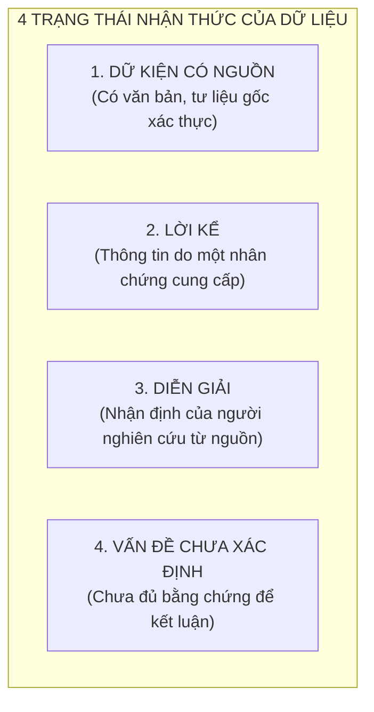

# KIẾN TRÚC TRUYỀN THÔNG PUBLIC 1.0
## ĐẶC TẢ CHIẾN LƯỢC, CHỦ THỂ, KHÔNG GIAN DIỄN NGÔN & TRẢI NGHIỆM CÔNG CHÚNG
### DỰ ÁN CÂY GIA PHẢ / GIATỘC TRẦN TRỌNG THU

> **Mã tài liệu:** `docs/architecture/PUBLIC_COMMUNICATION_ARCHITECTURE_v1.0.md`  
> **Trạng thái:** CANONICAL STRATEGY & COMMUNICATION ARCHITECTURE v1.0  
> **Người khởi xướng & Quyết định tối cao:** Tuấn (Human Final Authority)  
> **Cơ quan giám sát kiến trúc:** Emarald (Analysis Authority)  
> **Đơn vị điều phối thực thi:** AGY (Execution Coordinator)  
> **Ngày ban hành:** 02/11/2026  

---

## 1. BẢN CHẤT TRUYỀN THÔNG (COMMUNICATION ESSENCE)

Trước hết, cần phân biệt rõ ba hệ thống thường bị nhập làm một trong quá trình phát triển sản phẩm:

| Hệ Thống | Bản Chất | Câu Hỏi Trung Tâm |
| :--- | :--- | :--- |
| **Di Sản Dòng Họ** | Đối tượng được lưu giữ, nghiên cứu và diễn giải. | *Chúng ta có những gì, biết được những gì về lịch sử và đời sống dòng họ?* |
| **PUBLIC** | Không gian diễn ngôn hướng ra xã hội. | *Những tư liệu và trải nghiệm ấy gợi mở điều gì về gia đình Việt Nam?* |
| **MẠCH** | Không gian xuất bản và suy tư về văn hóa dòng họ. | *Những ký ức, con người, sự kiện và dấu vết ấy được ghi nhận như thế nào?* |

Ba hệ thống có quan hệ mật thiết với nhau nhưng **không đồng nhất**:

```text
       ┌────────────────────────────────────────────────────────┐
       │                 DI SẢN DÒNG HỌ                         │
       │   (Đối tượng lưu giữ, hồ sơ, ký ức, hiện vật gốc)      │
       └──────────────┬──────────────────────────┬──────────────┘
                      │                          │
                      ▼                          ▼
       ┌────────────────────────┐ ┌─────────────────────────────┐
       │         MẠCH           │ │          PUBLIC             │
       │ Không gian xuất bản &  │ │ Không gian diễn ngôn        │
       │ suy tư văn hóa dòng họ │ │ hướng ra xã hội             │
       └────────────────────────┘ └─────────────────────────────┘
```

> [!IMPORTANT] KHÁC BIỆT CHIẾN LƯỢC QUAN TRỌNG NHẤT
> **PUBLIC không đơn thuần đưa di sản dòng họ ra trưng bày.**  
> PUBLIC sử dụng quá trình tìm hiểu di sản như một **điểm xuất phát** để đặt những vấn đề rộng hơn về **đời sống gia đình Việt Nam**.

---

## 2. CHỦ THỂ TRUYỀN THÔNG: AI ĐANG NÓI? (COMMUNICATION SUBJECTIVITY)

Xác lập rõ ràng bốn thành phần cấu thành chủ thể:

| Thành Phần | Định Nghĩa Chuẩn Hóa |
| :--- | :--- |
| **Người khởi xướng** | **Tuấn** |
| **Chủ thể phát ngôn** | **Tuấn**, với tư cách người nghiên cứu và ghi nhận. |
| **Đối tượng nghiên cứu** | Lịch sử, văn hóa, cấu trúc gia đình và đời sống gia đình Việt Nam. |
| **Điểm xuất phát** | Quá trình tìm hiểu, lưu giữ và diễn giải di sản dòng họ Trần Trọng Thu. |

### Ranh giới đạo đức và thẩm quyền phát ngôn bắt buộc phải giữ:
- Anh có thể trình bày quan điểm cá nhân.
- Anh có thể diễn giải tư liệu và đưa ra nhận định.
- Anh có thể ghi nhận lời kể của các thành viên.
- **Anh KHÔNG mặc nhiên đại diện cho toàn bộ dòng họ.**
- **Anh KHÔNG THỂ biến một ký ức cá nhân thành ký ức tập thể nếu chưa có căn cứ.**

> [!NOTE] CÁCH ĐỊNH DANH ĐỀ XUẤT
> **PUBLIC là một không gian nghiên cứu và đối thoại do Tuấn khởi xướng.**  
> Tuyệt đối không tự định danh là *viện nghiên cứu*, *trung tâm nghiên cứu* hay *tổ chức học thuật* khi chưa có cơ sở tương ứng.  
> Do đó, PUBLIC cần một **giọng nói có chủ thể và trách nhiệm cá nhân**, thay vì một giọng nói tập thể mơ hồ.

---

## 3. ĐỐI TƯỢNG TIẾP NHẬN: PUBLIC ĐANG NÓI VỚI AI? (TARGET AUDIENCE)

Không phân nhóm công chúng theo quan hệ huyết thống trước tiên. Phân loại theo **mối quan tâm**:

| Nhóm Đối Tượng | Mối Quan Tâm Cốt Lõi | Điều Họ Tìm Kiếm Tại Không Gian |
| :--- | :--- | :--- |
| **Người quan tâm đến gia đình** | Gia đình, huyết thống, hôn nhân, thế hệ. | Những câu chuyện và góc nhìn sâu sắc về đời sống gia đình. |
| **Người quan tâm đến văn hóa – lịch sử** | Phong tục, nghi lễ, ký ức, truyền thống. | Tư liệu và diễn giải có căn cứ lịch sử, thực chứng. |
| **Người nghiên cứu, thực hành chuyên môn** | Xã hội học, nhân học, lịch sử, văn hóa gia đình. | Quan sát thực địa, tư liệu gốc, vấn đề nghiên cứu mở. |
| **Người có liên hệ với dòng họ** | Lịch sử và những con người cụ thể trong tư liệu. | Sự hiểu biết, ký ức thân tộc và cơ hội đóng góp tư liệu. |

> [!IMPORTANT] THAY ĐỔI TƯ DUY THIẾT KẾ CĂN BẢN
> **Thành viên dòng họ cũng là công chúng của PUBLIC.**  
> Họ không cần phải chuyển sang Không Gian Thành Viên (Member Space) chỉ để đọc những nội dung được công bố công khai.  
> *Quan hệ thành viên không phải là điều kiện tiên quyết để trở thành người tiếp nhận diễn ngôn PUBLIC.*

---

## 4. TRỤC THÔNG ĐIỆP TRUNG TÂM (CORE MESSAGING PILLARS)

Cấu trúc thông điệp chuẩn hóa theo ba tầng nhận thức:

```text
┌────────────────────────────────────────────────────────────────────────┐
│ TẦNG 1: THÔNG ĐIỆP ĐỊNH VỊ (Trang chủ / Hero)                          │
│ "Tìm hiểu đời sống gia đình Việt Nam từ những câu chuyện, ký ức và     │
│  dấu vết của một dòng họ."                                             │
├────────────────────────────────────────────────────────────────────────┤
│ TẦNG 2: THÔNG ĐIỆP GIẢI THÍCH (About / Rationale)                      │
│ PUBLIC nghiên cứu và ghi nhận những vấn đề về lịch sử, văn hóa, cấu    │
│ trúc gia đình và sự biến đổi của đời sống gia đình Việt Nam. Quá trình │
│ tìm hiểu di sản dòng họ Trần Trọng Thu là điểm xuất phát để tiếp cận   │
│ những vấn đề ấy.                                                       │
├────────────────────────────────────────────────────────────────────────┤
│ TẦNG 3: THÔNG ĐIỆP PHƯƠNG PHÁP (Methodology)                           │
│ PUBLIC không bắt đầu bằng những kết luận lớn về xã hội. Nó bắt đầu từ   │
│ những gì có thể quan sát, tìm hiểu và đối chiếu cụ thể:                │
│ • Một con người        • Một nghi lễ           • Một biến cố           │
│ • Một gia đình         • Một vật dụng          • Một sự thay đổi       │
│ • Một mối quan hệ      • Một ký ức               qua các thế hệ        │
└────────────────────────────────────────────────────────────────────────┘
```

> [!TIP] Ý NGHĨA PHƯƠNG PHÁP LUẬN
> Bắt đầu từ những dữ liệu cụ thể để hình thành các câu hỏi và nhận định là cách thức duy nhất ngăn chặn nguy cơ biến PUBLIC thành một trang đăng tải những triết lý chung chung, sáo rỗng về gia đình.

---

## 5. CÁC LĨNH VỰC DIỄN NGÔN (DISCOURSE DOMAINS)

Sáu lĩnh vực nội dung biên tập ban đầu *(Cấu trúc biên tập đề xuất, chưa phải phân loại học thuật đóng băng)*:

| Lĩnh Vực Diễn Ngôn | Nội Dung Khảo Sát Chi Tiết |
| :--- | :--- |
| **1. Lịch sử gia đình** | Nguồn gốc, di cư, quá trình hình thành và phát triển của các gia đình qua biến thiên thời cuộc. |
| **2. Cấu trúc gia đình** | Huyết thống, hôn nhân, tôn ty thế hệ, vai trò giới, quan hệ nội ngoại. |
| **3. Văn hóa gia đình** | Phong tục, nghi lễ phụng vụ, tín ngưỡng, tập quán nếp nhà, lễ gia tiên. |
| **4. Ký ức và truyền thừa** | Ký ức cá nhân, ký ức chung của gia đình, phương thức truyền lại ký ức giữa các thế hệ. |
| **5. Gia đình trong biến đổi xã hội** | Tác động của đô thị hóa, hiện đại hóa, chiến tranh, di tản và sự thay đổi mô hình gia đình Việt Nam. |
| **6. Con người và quan hệ** | Vị trí của cá nhân trong gia đình, trách nhiệm, sự gắn kết, hòa giải và những xung đột thế hệ. |

> [!WARNING] NGUYÊN TẮC BIÊN TẬP CỐT LÕI
> Không phải mọi nội dung đều phải xuất phát trực tiếp từ dòng họ Trần Trọng Thu. Nhưng **những nội dung sử dụng tư liệu của dòng họ bắt buộc phải chỉ rõ nguồn gốc và giới hạn diễn giải.**

---

## 6. KIẾN TRÚC NỘI DUNG VÀ TRẢI NGHIỆM TRANG CHỦ (HOMEPAGE ARCHITECTURE)

Trang chủ PUBLIC được cấu trúc thành **6 khu vực tuần tự**, chuyển hóa chiến lược truyền thông thành hành trình người đọc trên website:

```text
┌────────────────────────────────────────────────────────────────────────┐
│ 01. ĐỊNH VỊ (Hero Positioning)                                         │
│ • Đây là không gian gì?                                                │
│ • Ai khởi xướng? (Tuấn)                                                │
│ • Nghiên cứu điều gì? (Đời sống gia đình Việt Nam)                     │
│ • Vì sao lại bắt đầu từ một dòng họ?                                   │
│ ❌ TUYỆT ĐỐI KHÔNG đưa CTA đăng ký thành viên lên vị trí trung tâm.     │
├────────────────────────────────────────────────────────────────────────┤
│ 02. NHỮNG VẤN ĐỀ ĐANG ĐƯỢC QUAN TÂM (Inquiries & Questions)            │
│ Hiển thị các chủ đề nghiên cứu, câu hỏi mở đang khảo sát:              │
│ - Gia đình Việt Nam thay đổi như thế nào qua các thế hệ?               │
│ - Ký ức gia đình được lưu giữ và truyền lại bằng cách nào?             │
│ - Quan hệ huyết thống ảnh hưởng đến cấu trúc gia đình ra sao?          │
│ - Những nghi lễ gia đình còn giữ vai trò gì trong đời sống hiện đại?   │
├────────────────────────────────────────────────────────────────────────┤
│ 03. NỘI DUNG ĐÃ CÔNG BỐ (Curated Publications)                         │
│ Hiển thị bài viết, ghi nhận, phân định rõ 5 loại hình:                 │
│ [Nghiên Cứu] · [Khảo Sát] · [Ghi Nhận] · [Tư Liệu] · [Quan Điểm]       │
│ ❌ Không gộp chung thành một danh sách blog hỗn tạp.                    │
├────────────────────────────────────────────────────────────────────────┤
│ 04. KHÔNG GIAN MẠCH (MẠCH Showcase)                                    │
│ Giới thiệu MẠCH như một không gian xuất bản có bản sắc biên tập riêng. │
│ Dẫn người đọc sang MẠCH mà không biến MẠCH thành chuyên mục con.       │
├────────────────────────────────────────────────────────────────────────┤
│ 05. NGUỒN GỐC VÀ PHƯƠNG PHÁP (Provenance & Method)                     │
│ Xây dựng niềm tin học thuật & đạo đức:                                 │
│ - Vì sao chọn dòng họ Trần Trọng Thu làm điểm xuất phát?               │
│ - Tư liệu thu thập từ đâu?                                             │
│ - Phân biệt ký ức cá nhân với dữ kiện lịch sử như thế nào?            │
│ - Quy trình thẩm định, xác minh và giới hạn diễn giải tư liệu.         │
├────────────────────────────────────────────────────────────────────────┤
│ 06. ĐỐI THOẠI VÀ ĐÓNG GÓP (Dialogue & Contribution)                    │
│ Mở ra khả năng kết nối: Trao đổi quan điểm, gửi tư liệu, chia sẻ ký   │
│ ức, đề xuất chủ đề, kết nối với người nghiên cứu.                     │
│ ❌ Không hứa hẹn những chức năng tương tác phức tạp chưa triển khai.   │
└────────────────────────────────────────────────────────────────────────┘
```

---

## 7. HỆ THỐNG KÊU GỌI HÀNH ĐỘNG (CTA HIERARCHY)

Hệ thống Call-To-Action (CTA) phải phản ánh đúng **mục đích truyền thông văn hóa**, không phải mục tiêu kỹ thuật nhằm tăng số lượng tài khoản đăng ký:

| Mức Ưu Tiên | Lời Kêu Gọi Hành Động (CTA Label) | Mục Đích Trải Nghiệm Của Người Đọc |
| :---: | :--- | :--- |
| **1 (Cao nhất)** | **Khám phá chủ đề** | Đi sâu vào các vấn đề khảo sát gia đình Việt Nam. |
| **2** | **Đọc nghiên cứu và ghi nhận** | Tiếp cận trực tiếp các ấn phẩm và bài viết đã công bố. |
| **3** | **Khám phá MẠCH** | Chuyển tiếp sang không gian xuất bản văn hóa dòng họ. |
| **4** | **Gửi tư liệu và ký ức** | Khuyến khích cộng đồng đóng góp hiện vật, hồi ức. |
| **5** | **Trao đổi và liên hệ** | Thiết lập đối thoại trực tiếp với người nghiên cứu (Tuấn). |
| **6 (Thấp nhất)**| **Không gian thành viên** | Truy cập cổng dịch vụ gia phả nội bộ cho người trong họ. |

> [!IMPORTANT]
> CTA Không Gian Thành Viên vẫn cần tồn tại ở góc điều hướng trang trọng, **nhưng tuyệt đối không được chi phối thông điệp của toàn bộ trang chủ PUBLIC**.

---

## 8. QUAN HỆ GIỮA PUBLIC VÀ MẠCH (PUBLIC VS MẠCH BOUNDARY)

Đây là ranh giới bất biến cần được bảo vệ trong toàn bộ kiến trúc nội dung và định tuyến hệ thống:

| Tiêu Chí So Sánh | PUBLIC (Không Gian Diễn Ngôn) | MẠCH (Không Gian Xuất Bản) |
| :--- | :--- | :--- |
| **Định hướng** | **Hướng ra xã hội** rộng lớn. | **Hướng vào việc khảo sát**, ghi nhận và suy tư văn hóa nội bộ dòng họ. |
| **Chủ thể** | **Tuấn** (người nghiên cứu và khởi xướng). | Chủ thể biên tập được xác định theo từng nội dung / bài viết. |
| **Phạm vi** | Gia đình Việt Nam và những vấn đề biến đổi xã hội. | Đời sống, ký ức, con người, văn hóa và dấu vết của dòng họ. |
| **Cách tiếp cận** | Nghiên cứu, diễn giải, đối thoại mở. | Quan sát, tư liệu, ký ức, lối dựng montage văn hóa. |
| **Người đọc** | Công chúng rộng, giới nghiên cứu, người quan tâm. | Con cháu trong họ và người quan tâm sâu đến di sản dòng họ. |
| **Hình thức** | Bài nghiên cứu, khảo sát, ghi nhận, trao đổi. | Tuyển tập ấn phẩm với cấu trúc biên tập và mỹ thuật riêng. |

### Ví dụ minh họa cùng một vật chứng:
*Xét một bức ảnh gia đình xưa chụp thập niên 1950:*
- **Trong MẠCH:** Bức ảnh được đặt trong dòng chảy ký ức thân tộc, tái hiện chân dung con người cụ thể và dấu vết lịch sử một thời kỳ của gia đình.
- **Trong PUBLIC:** Bức ảnh trở thành điểm xuất phát để khảo sát cách các gia đình Việt Nam lưu giữ ký ức thị giác và nhận diện các thế hệ qua biến cố di cư.
- $\rightarrow$ *Cùng một vật chứng di sản, nhưng phục vụ hai mục đích diễn ngôn hoàn toàn khác nhau.*

---

## 9. NGUYÊN TẮC ĐẠO ĐỨC & ĐỘ TIN CẬY (ETHICS & PROVENANCE)

Nội dung của PUBLIC chạm đến con người, gia đình và ký ức — những đối tượng không phải lúc nào cũng thuộc quyền công bố tuyệt đối của người đang nắm giữ tư liệu vật lý.

Hệ thống áp dụng các nguyên tắc đạo đức quốc tế (UNESCO 2003 về Di sản văn hóa phi vật thể: tôn trọng cộng đồng, sự đồng thuận, tập quán tiếp cận tư liệu). PUBLIC phân biệt rõ ràng **4 trạng thái nhận thức**:



### Ranh giới ba vai trò đạo đức:
Trong mọi tài liệu công bố trên PUBLIC, hệ thống bắt buộc phân biệt rạch ròi:
1. **Ai là người cung cấp thông tin?**
2. **Ai là người được nhắc đến trong thông tin?**
3. **Ai là người có quyền quyết định việc công bố thông tin đó?**
*(Ba vai trò này tuyệt đối không mặc nhiên thuộc về cùng một người).*

---

## 10. TỔNG HỢP KIẾN TRÚC HỆ THỐNG (ARCHITECTURAL SYNTHESIS)

```text
                                XÃ HỘI
                                  │
                                  ▼
                              CÔNG CHÚNG
                                  │
                                  ▼
                       ┌──────────────────────┐
                       │       PUBLIC         │
                       │                      │
                       │ • Nghiên cứu         │
                       │ • Ghi nhận           │
                       │ • Diễn giải          │
                       │ • Đối thoại          │
                       └──────────┬───────────┘
                                  │
                           Người khởi xướng
                                TUẤN
                                  │
                                  ▼
                    DI SẢN DÒNG HỌ TRẦN TRỌNG THU
                                  │
                ┌─────────────────┼─────────────────┐
                ▼                 ▼                 ▼
             Con người          Ký ức             Tư liệu
                │                 │                 │
                └─────────────────┼─────────────────┘
                                  ▼
                          CÂU HỎI NGHIÊN CỨU
                                  │
                                  ▼
                        LỊCH SỬ – VĂN HÓA –
                        CẤU TRÚC GIA ĐÌNH –
                     ĐỜI SỐNG GIA ĐÌNH VIỆT NAM
```
*(MẠCH tồn tại như một hệ thống xuất bản riêng biệt, có thể tiếp nhận và diễn giải những chất liệu liên quan nhưng không bị hòa tan vào PUBLIC).*

---

## 11. BẢNG PHÂN LOẠI TRẠNG THÁI QUYẾT ĐỊNH (DECISION STATUS REGISTER)

| Hạng Mục Nội Dung / Kiến Trúc | Trạng Thái Quản Trị Hiện Tại |
| :--- | :---: |
| **PUBLIC hướng ra xã hội (Nghiên cứu đời sống gia đình VN)** | **ĐÃ ĐƯỢC TUẤN XÁC NHẬN (APPROVED)** |
| **Tuấn là người khởi xướng và chủ thể phát ngôn** | **ĐÃ ĐƯỢC TUẤN XÁC NHẬN (APPROVED)** |
| **Dòng họ Trần Trọng Thu là điểm xuất phát nghiên cứu** | **ĐÃ ĐƯỢC TUẤN XÁC NHẬN (APPROVED)** |
| **Sáu lĩnh vực nội dung diễn ngôn** | **ĐỀ XUẤT (PROPOSED - CHỜ DUYỆT CHI TIẾT)** |
| **Sáu khu vực trải nghiệm trang chủ** | **ĐỀ XUẤT (PROPOSED - CHỜ DUYỆT CHI TIẾT)** |
| **Hệ thống thứ bậc 6 CTA** | **ĐỀ XUẤT (PROPOSED - CHỜ DUYỆT CHI TIẾT)** |
| **Cơ chế ghi nhận nguồn & 4 trạng thái nhận thức** | **ĐỀ XUẤT (PROPOSED - CHỜ DUYỆT CHI TIẾT)** |
| **Cơ chế tiếp nhận tư liệu, phản hồi và đóng góp từ cộng đồng** | **CHƯA XÁC ĐỊNH (UNKNOWN - CẦN LÀM RÕ)** |

---

## 12. BƯỚC TIẾP THEO (NEXT ACTIONS)

1. **Không đưa kiến trúc này vội vã vào mã nguồn.**
2. **Xây dựng Bản thiết kế chi tiết (PUBLIC Communication Blueprint):**
   - Xác định chính xác cấu trúc từng trang, wireframe chức năng, định dạng bài viết và hành trình người đọc (user journey).
3. **Bàn giao Cline thiết kế giao diện:** Sau khi Tuấn duyệt bản Blueprint chi tiết, huy động Cline thực thi visual layout và responsive CSS chuẩn Brand Governance.

---
*Tài liệu thuộc Hệ thống Quản trị Tri thức Cốt lõi của Dự án Gia Tộc Trần Trọng Thu.*  
*Lưu trữ tại `docs/architecture/PUBLIC_COMMUNICATION_ARCHITECTURE_v1.0.md`.*

