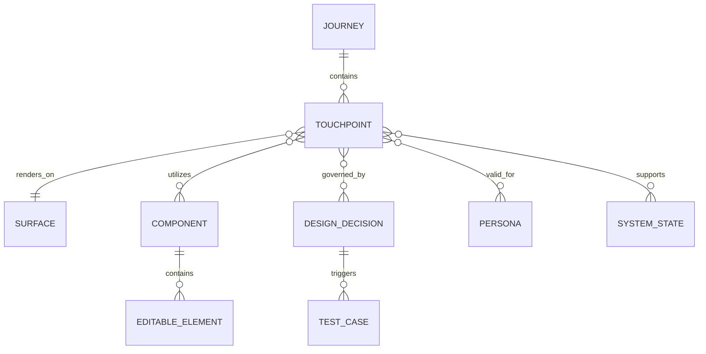

# MÔ HÌNH PHỤ THUỘC & TÁC ĐỘNG ĐIỂM CHẠM
# (TOUCHPOINT DEPENDENCY & IMPACT MODEL)

**Mã tài liệu:** `docs/architecture/TOUCHPOINT_DEPENDENCY_MODEL.md`  
**Dự án:** CÂY GIA PHẢ — GIATỘC TRẦN TRỌNG THU  
**Thẩm quyền:** Tuấn (Human Final Authority) · Emarald (Architecture & QC) · AGY (Execution Coordinator)  
**Phiên bản:** v1.0  
**Ngày ban hành:** 2026-11-03  

---

## 1. NGUYÊN LÝ THIẾT KẾ MÔ HÌNH

Một trong những rủi ro lớn nhất trong thiết kế và kiểm thử giao diện là **bùng nổ tổ hợp vô nghĩa (Cartesian Explosion)** — ví dụ nhân cơ học 7 bề mặt × 6 persona × 4 system states × 4 viewports tạo ra hơn 670 kịch bản kiểm thử, trong đó phần lớn là các tổ hợp không có thật trong đời sống sản phẩm (ví dụ: Persona vãng lai `ANONYMOUS` không bao giờ truy cập được vào trang đổi mật khẩu `/me/change-password` hay xem thư tuyệt mật Clara).

Mô hình phụ thuộc Touchpoint được xây dựng để giải quyết 3 bài toán trọng tâm:
1. Xác lập mối liên kết ngữ nghĩa giữa **Hành trình (Journey) ──► Điểm chạm (Touchpoint) ──► Thành phần giao diện (Component)**.
2. Xác định **phạm vi tác động (Blast Radius)** khi một quyết định thiết kế thay đổi.
3. Lọc ra **Ma trận Tổ Hợp Hợp Lệ (Valid Combinations Matrix)** để chỉ kiểm thử những gì thực sự có ý nghĩa đối với Tuấn và người dùng.

---

## 2. SƠ ĐỒ THỰC THỂ QUAN HỆ (ENTITY RELATIONSHIP GRAPH)



### Các mối quan hệ cốt lõi:
- **`Journey 1 ──► N Touchpoint`:** Một hành trình bao gồm nhiều điểm chạm tuần tự theo thời gian.
- **`Touchpoint N ──► 1 Surface`:** Mỗi điểm chạm nằm trên một bề mặt giao diện xác định (ví dụ: `TP-01` nằm trên `public`).
- **`Touchpoint N ──► N Component`:** Một điểm chạm có thể sử dụng nhiều Component (ví dụ: `InstitutionHeader`, `GlobalNav`, `Card`).
- **`Component 1 ──► N Editable Element`:** Một component chứa một hoặc nhiều phần tử có thể chỉnh sửa nội dung được định danh bởi `data-editable-id`.
- **`Component N ──► N Design Decision`:** Một quyết định thiết kế có thể thay đổi một Component dùng chung và tác động ngược lại lên nhiều Touchpoint.
- **`Design Decision 1 ──► N Test Case`:** Mỗi quyết định thiết kế kéo theo một tập hợp con các bài kiểm thử hồi quy tương ứng.

---

## 3. DANH MỤC THÀNH PHẦN DÙNG CHUNG (SHARED COMPONENTS REGISTRY)

Khi một quyết định thay đổi được đưa ra, hệ thống tra cứu bảng đăng ký này để tính toán phạm vi ảnh hưởng:

| Mã Component | Tên Thành Phần | Vị Trí Mã Nguồn | Các Bề Mặt Sử Dụng | Mức Độ Rủi Ro Thay Đổi |
| :--- | :--- | :--- | :--- | :---: |
| `COMP-SHELL` | Application Shell | `src/js/ui/shell.js` | Toàn bộ 7 bề mặt | **CRITICAL** (Ảnh hưởng toàn hệ thống) |
| `COMP-HEADER` | Institution Header | `src/js/ui/components.js` | Toàn bộ 7 bề mặt | **HIGH** (Ảnh hưởng nhận diện & header) |
| `COMP-NAV-PUB` | Global Nav (Public) | `src/js/ui/components.js` | `public` | **MEDIUM** (Ảnh hưởng điều hướng công khai) |
| `COMP-NAV-MEM` | Member Nav (Nội bộ) | `src/js/ui/components.js` | `dashboard`, `tree`, `mach`, `clara`, `spaces` | **HIGH** (Ảnh hưởng điều hướng nội bộ) |
| `COMP-FOOTER` | Standard Footer | `src/js/ui/components.js` | Toàn bộ 7 bề mặt | **LOW** (Ảnh hưởng chân trang) |
| `COMP-CARD` | Information Card | `src/js/ui/components.js` | `public`, `dashboard`, `mach` | **MEDIUM** (Ảnh hưởng hiển thị bài viết/thẻ) |
| `COMP-SECTION` | Semantic Section | `src/js/ui/components.js` | Toàn bộ 7 bề mặt | **LOW** (Ảnh hưởng cấu trúc khối) |
| `COMP-BREADCRUMB` | Breadcrumb Trail | `src/js/ui/components.js` | 6 bề mặt thành viên | **MEDIUM** (Ảnh hưởng định vị phân cấp) |

---

## 4. MA TRẬN TỔ HỢP HỢP LỆ (VALID COMBINATIONS MATRIX)

Hệ thống lọc bỏ hoàn toàn các tổ hợp vô nghĩa, chỉ kích hoạt kiểm thử trên các giao điểm có giá trị nghiệp vụ:

| Bề Mặt (Surface) | Persona Hợp Lệ | System States Hợp Lệ | Viewports Bắt Buộc | Ranh Giới Dữ Liệu (Privacy) |
| :--- | :--- | :--- | :--- | :--- |
| **`public`** (Cổng vào) | `ANONYMOUS`, `ACTIVE` | `default`, `loading`, `error` | 375px, 768px, 1024px, 1440px | Công khai xã hội, 0 PII, UNESCO 2003 |
| **`dashboard`** (Của tôi) | `ACTIVE`, `A-HD`, `A-OB`, `PROVISIONED`, `UNMAPPED` | `default`, `empty`, `loading`, `error` | 375px, 768px, 1440px | Không gian thành viên, dữ liệu phân quyền cá nhân |
| **`tree`** (Cây phả đồ) | `ACTIVE`, `A-HD`, `A-OB` | `default`, `loading`, `error` | 768px, 1024px, 1440px (Ưu tiên màn hình rộng) | Phả hệ nội tộc, không công khai bên ngoài |
| **`person`** (Hồ sơ nhân vật) | `ACTIVE`, `A-HD`, `A-OB` | `default`, `loading`, `error` | 375px, 768px, 1440px | Hồ sơ nhân vật, 4 trạng thái nhận thức dữ kiện |
| **`mach`** (Tuyển tập MẠCH) | `ACTIVE`, `A-HD`, `A-OB` | `default`, `empty`, `loading` | 375px, 768px, 1440px | Ấn phẩm nội bộ, suy tư văn hóa dòng họ |
| **`clara`** (Thư gửi Clara) | `ACTIVE`, `A-HD`, `A-OB` | `default`, `loading` | 375px, 768px, 1440px | Thư từ gia đình, ranh giới đạo đức tuyệt đối |
| **`spaces`** (Gia đình) | `ACTIVE`, `A-HD` | `default`, `empty`, `loading` | 375px, 768px, 1440px | Không gian chi nhánh / hạt nhân |

---

## 5. THUẬT TOÁN PHÂN TÍCH TÁC ĐỘNG & CHỌN LỌC KIỂM THỬ HỒI QUY

Khi Tuấn hoặc AI đưa ra một `Design Decision` chỉnh sửa một thành phần, hệ thống thực thi thuật toán phân tích tác động 3 bước:

```text
[BƯỚC 1: XÁC ĐỊNH MỤC TIÊU SỬA ĐỔI]
  └──► Ví dụ: Quyết định sửa Component `COMP-NAV-PUB` (Đổi nhãn hoặc thứ tự mục menu)

[BƯỚC 2: QUÉT BẢN ĐỒ TÁC ĐỘNG (BLAST RADIUS LOOKUP)]
  └──► Component: `COMP-NAV-PUB`
        └──► Các Touchpoint bị ảnh hưởng:
              • TP-PUB-01 (Định vị & Threshold)
              • TP-PUB-02 (Vấn đề quan tâm)
              • TP-PUB-03 (Nội dung công bố)
              • TP-PUB-04 (MẠCH Showcase)
              • TP-PUB-05 (Phương pháp luận)
              • TP-PUB-06 (Đối thoại & Gate)
        └──► Các Bề mặt bị ảnh hưởng: Duy nhất Surface `public` (Bề mặt thành viên KHÔNG bị ảnh hưởng)

[BƯỚC 3: KÍCH HOẠT TẬP KIỂM THỬ HỒI QUY CHỌN LỌC (TARGETED REGRESSION SELECTION)]
  └──► Bỏ qua các test cases của `dashboard`, `tree`, `person`, `clara` (Tiết kiệm 80% thời gian chạy)
  └──► Chỉ chạy đúng 4 kịch bản trọng yếu:
        1. TC-NAV-01: Kiểm tra render đúng số lượng và nhãn mới trên Public.
        2. TC-NAV-02: Kiểm tra scrollIntoView mượt mà và không va chạm hash `#view=public`.
        3. TC-NAV-03: Kiểm tra ScrollSpy gán `aria-current="location"` khi cuộn trang.
        4. TC-NAV-04: Kiểm tra hiển thị responsive không vỡ dòng trên 375px và 768px.
```

### Lợi ích của cơ chế:
- **Tốc độ phản hồi tức thì:** Thời gian chạy kiểm thử giảm từ hàng phút xuống còn 3-5 giây cho mỗi lần Tuấn sửa đổi.
- **Minh bạch trách nhiệm:** Tuấn luôn biết rõ trước khi bấm "Phê duyệt" thì hành động của mình sẽ làm biến đổi những màn hình nào khác.

