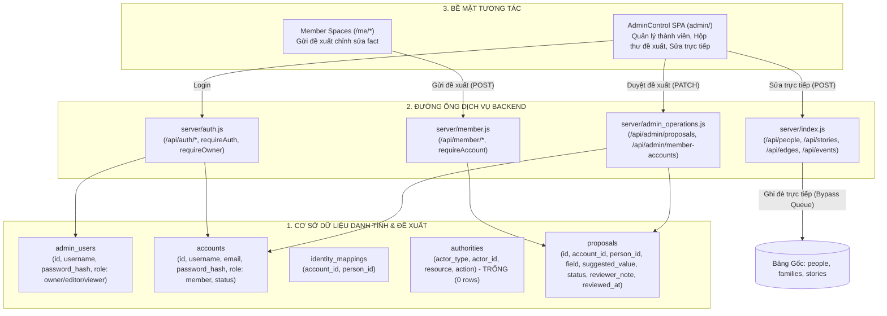

# BÁO CÁO KIỂM TOÁN KIẾN TRÚC QUẢN TRỊ VÀ PHÊ DUYỆT DỮ LIỆU (V2.0.0 — BATCH 05)
## GOVERNANCE & APPROVAL ARCHITECTURE AUDIT — STRICT READ-ONLY

- **Dự án:** Gia Tộc Trần Trọng Thu
- **Cơ quan thẩm quyền:**
  - **Tuấn:** Human Final Authority & Product Owner
  - **Emarald:** Strategic Architecture & QC Authority
  - **AGY:** Chief Orchestrator & Technical Investigation Lead
- **Mã tài liệu:** `V2_0_0_GOVERNANCE_APPROVAL_ARCHITECTURE_AUDIT_05`
- **Thời gian lập báo cáo:** 2026-11-10T21:10:00+07:00
- **Chế độ kiểm toán:** `STRICT READ-ONLY` (Khảo sát pháp y, không can thiệp code, không tạo role, không sửa database)
- **Chuẩn mực tuân thủ:** AIOS Governance, Bằng chứng 8 tầng (`PROVEN`, `OBSERVED`, `CONFIGURED`, `DOCUMENTED`, `PARTIAL`, `UNKNOWN`, `BLOCKED`, `FAILED`).

---

## 1. TỔNG QUAN ĐIỀU HÀNH (EXECUTIVE SUMMARY)

Báo cáo Batch 05 tiến hành khảo sát pháp y toàn diện đối với **Kiến trúc Quản trị Phân quyền (Governance Hierarchy)** và **Đường ống Phê duyệt Dữ liệu (Approval Pipeline)** của hệ thống, trực tiếp đối soát với 6 nguyên tắc quản trị tối cao do Tuấn xác nhận:
> *"Mô hình phân tầng: OWNER (tối cao) → MODERATOR (ủy quyền, có thể thu hồi) → MEMBER (đóng góp, gửi đề xuất). Mọi thay đổi dữ liệu chính thức phải qua chuỗi: Đề xuất → Thẩm định → Phê duyệt → Kiểm tra toàn vẹn → Ghi nhận (Commit) → Nhật ký kiểm toán (Audit Log)."*

### Các Phát hiện Cốt tử (Critical Findings):

1. **Thực trạng "Lối tắt cho Quản trị viên, Ngõ cụt cho Thành viên" (Bypass vs Dead-End Paradox):**
   - **Lối tắt Quản trị (Admin Bypass):** Các tài khoản Quản trị (`admin`, `editor`) trong AdminControl hiện đang **ghi trực tiếp** vào các bảng dữ liệu gốc (`people`, `stories`, `edges`, `events`) thông qua `POST /api/people`, `POST /api/stories`, hoàn toàn **bỏ qua 100% hàng đợi đề xuất và quy trình phê duyệt**.
   - **Ngõ cụt Đề xuất (Dead-End Approval):** Thành viên gửi đề xuất qua Member Spaces (`POST /api/member/proposals`) được ghi vào bảng `proposals`. Tuy nhiên, khi Quản trị viên bấm **"Chấp thuận" (APPROVED)** trong AdminControl, hệ thống **CHỈ CẬP NHẬT CỘT `status = 'APPROVED'`** trên bảng `proposals`. **Hoàn toàn KHÔNG CÓ mã lệnh nào chuyển đổi (Commit) dữ liệu đã duyệt sang bảng `people` hay `families`**. Đề xuất đã duyệt bị "chết lâm sàng" trong hàng đợi.

2. **Sự vắng mặt của vai trò `MODERATOR` (Role Absence):**
   - Vai trò `MODERATOR` **chưa từng được định nghĩa trong cơ sở dữ liệu lẫn mã nguồn** (`MISSING`).
   - Hệ thống hiện chỉ tồn tại 2 nhóm tài khoản tách rời:
     - Bảng `admin_users`: gồm `owner`, `admin`, `editor`, `viewer`.
     - Bảng `accounts`: gồm `member` (mặc định).
   - Chưa có bất kỳ cơ chế phân quyền theo phạm vi phân nhánh gia phả (Scoped/Branch Moderation) nào được thiết lập.

3. **Lỗ hổng Tự Phê duyệt và Thiếu Dấu vết Thẩm định (Self-Approval & Anonymous Review):**
   - API `PATCH /api/admin/proposals/:id` **không kiểm tra danh tính người duyệt so với người đề xuất**. Nếu một tài khoản vừa là thành viên gửi đề xuất vừa có quyền editor, họ hoàn toàn có thể **tự duyệt đề xuất của chính mình** (`PROVEN VULNERABILITY`).
   - Bảng `proposals` **không có cột `reviewer_id` hay `reviewed_by`**. Hệ thống chỉ lưu `reviewed_at` và `reviewer_note`, hoàn toàn không biết chính xác ai đã bấm nút phê duyệt.

4. **Sự thiếu vắng Hoàn toàn của Nhật ký Kiểm toán (Zero Audit Logging):**
   - Toàn bộ hệ sinh thái **hoàn toàn KHÔNG CÓ bảng `audit_logs`**, không có tệp nhật ký ghi nhận các hành vi thay đổi dữ liệu (`MISSING`).
   - Khi một hồ sơ nhân vật bị sửa đổi hoặc ghi đè, trạng thái dữ liệu cũ bị hủy bỏ hoàn toàn mà không thể truy vết ai đã làm, vào lúc nào, và tại sao.

5. **Trạng thái Phòng vệ Production:**
   - Quy tắc Cloudflare WAF `Emergency Block API Mutations` do Tuấn kích hoạt ngày 10/11/2026 đã **chặn đứng 100% các request mutating trái phép từ Internet vào Production API**, tạo ra vùng đệm an toàn tuyệt đối để tiến hành tái cấu trúc quản trị.

---

## 2. KIỂM KÊ KIẾN TRÚC HIỆN TẠI (CURRENT ARCHITECTURE INVENTORY)



---

## 3. MA TRẬN VAI TRÒ VÀ PHÂN QUYỀN (ROLE & PERMISSION MATRIX)

Bảng đối soát giữa nguyên tắc quản trị của Tuấn và hiện trạng mã nguồn:

| Tiêu chí Quản trị | OWNER | MODERATOR (Kỳ vọng) | ADMIN / EDITOR (Thực tế) | MEMBER / CONTRIBUTOR |
| :--- | :--- | :--- | :--- | :--- |
| **Định danh trong Code** | `req.session.role === 'owner'` | **KHÔNG TỒN TẠI (`MISSING`)** | `admin_users.role = 'editor'` | `accounts.role = 'member'` |
| **Quản trị Tài khoản** | Toàn quyền (Tạo, Sửa, Khóa, Đổi mật khẩu) | Không có quyền | Không có quyền (Chỉ Owner có `requireOwner`) | Chỉ tự đổi mật khẩu chính mình |
| **Sửa Dữ liệu Gốc (Canonical)**| Sửa trực tiếp (Bypass Proposal) | **Phải qua Proposal** | **Sửa trực tiếp (Bypass Proposal)** | **BỊ CẤM (Phải qua Proposal)** |
| **Duyệt Đề xuất (Review)**| Toàn quyền duyệt/bác bỏ | Duyệt trong phân nhánh được ủy quyền | Toàn quyền duyệt/bác bỏ toàn cây | Không có quyền |
| **Tự Phê duyệt Đề xuất mình**| Không được phép | **BỊ CẤM** | **CÓ THỂ LÀM ĐƯỢC (Lỗ hổng logic)**| Không có quyền |
| **Cơ chế Thu hồi Quyền** | Không áp dụng | Thu hồi ngay lập tức bởi Owner | Khóa tài khoản (`is_active=0`) nhưng **phiên cũ vẫn sống 24h** | Khóa tài khoản (`status='DISABLED'`) -> **Hết hiệu lực ngay lập tức** |
| **Override Quyết định** | Có quyền tối cao | Tuân thủ quyết định của Owner | Không có cơ chế Override có cấu trúc | Không có quyền |

---

## 4. PHÂN TÍCH ĐƯỜNG ỐNG: PROPOSAL → COMMIT (PROPOSAL-TO-COMMIT FLOW)

Khảo sát chi tiết 6 giai đoạn theo chu trình chuẩn:

```text
[MEMBER PROPOSAL] ──> [REVIEW] ──> [APPROVAL] ──> [VALIDATION] ──> [COMMIT] ──> [AUDIT LOG]
       ✅                  ✅             ⚠️              ❌            ❌            ❌
  (Triển khai)        (Triển khai)   (Một phần)       (Chưa có)     (Chưa có)     (Chưa có)
```

### Chi tiết Từng Giai đoạn:

1. **Giai đoạn 1: Member Proposal (`IMPLEMENTED`):**
   - *Mã nguồn:* `server/member.js:371–425` (`POST /api/member/proposals`).
   - *Cơ chế:* Yêu cầu đăng nhập (`requireAccount`), bắt buộc đã đổi mật khẩu lần đầu. Nhận `personId`, `field`, `suggestedValue`, `sourceEvidence`, `reason`.
   - *Bảo vệ:* Ghi vào bảng `proposals` với `status = 'PENDING'`, sinh mã `PROP_<timestamp>`. Tuyệt đối không chạm vào bảng `people`.
   - *Hạn chế:* Không lưu giá trị gốc (`original_value`) tại thời điểm gửi; nếu dữ liệu gốc bị sửa trước khi duyệt, người duyệt không biết giá trị cũ lúc gửi là gì.

2. **Giai đoạn 2: Review (`IMPLEMENTED`):**
   - *Mã nguồn:* `server/admin_operations.js:218–246` (`GET /api/admin/proposals`).
   - *Giao diện:* `admin/js/admin.js:821–947` (Hộp thư đề xuất với bộ đếm pending, hiển thị field label tiếng Việt).

3. **Giai đoạn 3: Approval / Rejection (`PARTIAL`):**
   - *Mã nguồn:* `server/admin_operations.js:249–282` (`PATCH /api/admin/proposals/:id`).
   - *Thực thi:* Nhận `status` (`APPROVED` hoặc `REJECTED`) và `reviewer_note`. Cập nhật `reviewed_at`.
   - *Lỗ hổng 1:* **Không ghi nhận `reviewer_id`**. Bảng `proposals` không lưu vết ai đã đưa ra quyết định duyệt.
   - *Lỗ hổng 2:* **Thiếu kiểm tra Self-Approval**. Người tạo đề xuất nếu có quyền editor có thể tự duyệt đề xuất của chính mình.
   - *Lỗ hổng 3:* **Thiếu kiểm tra trạng thái cũ (Optimistic Locking)**. Có thể đè quyết định của nhau mà không có thông báo xung đột.

4. **Giai đoạn 4: Validation (`MISSING`):**
   - Hoàn toàn không có bước kiểm tra ngữ nghĩa tự động trước khi chấp thuận (ví dụ: định dạng ngày sinh/mất hợp lệ, năm mất không nhỏ hơn năm sinh, kiểm tra xung đột quan hệ gia đình).

5. **Giai đoạn 5: Commit Engine (`MISSING — GHOST APPROVAL`):**
   - **ĐÂY LÀ ĐIỂM GÃY NGUY HIỂM NHẤT:** Khi API nhận `status = 'APPROVED'`, nó **CHỈ CHẠY DUY NHẤT LỆNH**:
     ```sql
     UPDATE proposals SET status = ?, reviewer_note = ?, reviewed_at = ? WHERE id = ?
     ```
   - **Không có bất kỳ dòng code nào lấy `suggested_value` để ghi vào bảng `people`**. Dữ liệu chính thức hoàn toàn không thay đổi sau khi được duyệt.

6. **Giai đoạn 6: Audit Log (`MISSING`):**
   - Không có bảng nhật ký, không có bản ghi lịch sử, không có sự kiện ghi nhận hành động phê duyệt.

---

## 5. ĐÁNH GIÁ NGUY CƠ GHI TRỰC TIẾP (API WRITE EXPOSURE ASSESSMENT)

### 5.1. Bề mặt Production (Sau khi kích hoạt Cloudflare WAF)
- **Tình trạng:** Cloudflare WAF Custom Rule `Emergency Block API Mutations` đang hoạt động:
  - Mọi request `POST`, `PUT`, `PATCH`, `DELETE` từ bên ngoài vào `api.giatoctrantrongthu.com` đều bị chặn với **HTTP 403 Forbidden**.
  - **Kết quả:** Nguy cơ phơi lộ ghi trái phép từ Internet đã được **CÔ LẬP HOÀN TOÀN TẠI BIÊN MẠNG** (`PROVEN MITIGATED`).
- **Điểm yếu tồn đọng:** Mã nguồn chạy trên máy chủ NAS (`commit 42a7ed2`) vẫn là mã cũ không có xác thực. Nếu bypass được WAF hoặc gọi trong mạng nội bộ, máy chủ NAS vẫn không tự bảo vệ được.

### 5.2. Bề mặt Local Development
- Mã nguồn Local `server/index.js:416` đã có `requireAuth` và CSRF Guard.
- Tuy nhiên, khi một tài khoản Admin/Editor đăng nhập vào AdminControl, họ có quyền gọi `POST /api/people` để ghi đè thẳng vào SQLite mà không qua hàng đợi đề xuất.

---

## 6. ĐÁNH GIÁ NHẬT KÝ KIỂM TOÁN (AUDIT LOG ASSESSMENT)

Kiểm tra 5 tiêu chí chuẩn mực của Audit Log:

| Tiêu chuẩn Kiểm toán | Hiện trạng Thực tế | Đánh giá | Bằng chứng Pháp y |
| :--- | :--- | :---: | :--- |
| **1. Tính Hiện diện (Storage)** | Không có bảng `audit_logs` trong CSDL | **MISSING** | `sqlite3 server/family_archive.db ".tables"` |
| **2. Tính Định danh (Who)** | Không lưu tài khoản thực hiện duyệt đề xuất | **MISSING** | `server/admin_operations.js:267` thiếu cột `reviewer_id` |
| **3. Tính Bất biến (Immutability)** | Không có cơ chế Append-Only hay chống xóa sửa | **MISSING** | Bảng `proposals` có thể bị `UPDATE` đè nhiều lần |
| **4. Tính Truy nguyên (Before/After)** | Không lưu giá trị cũ trước khi bị ghi đè | **MISSING** | `REPLACE INTO people` xóa sạch bản ghi cũ |
| **5. Tính Giải trình (Why)** | Đề xuất có lưu `reason`, nhưng sửa trực tiếp không có | **PARTIAL** | Cột `reason` trong `proposals`; 0 lý do trong Admin edit |

---

## 7. CÁC LỖ HỔNG AN NINH VÀ TOÀN VẸN DỮ LIỆU (SECURITY & INTEGRITY GAPS)

1. **LỖ HỔNG SEC-01: Ghost Approval (Phê duyệt Ảo):**
   - Đề xuất được duyệt thành công trên UI nhưng không bao giờ trở thành dữ liệu phả hệ thật. Người đóng góp tưởng thông tin đã được cập nhật nhưng cây phả hệ vẫn giữ nguyên.
2. **LỖ HỔNG SEC-02: Self-Approval (Tự Biên Tự Duyệt):**
   - Thiếu ràng buộc `proposals.account_id !== req.session.accountId` cho phép người dùng có quyền editor tự hợp thức hóa đề xuất của chính mình.
3. **LỖ HỔNG SEC-03: Delayed Admin Revocation (Thu hồi Quyền Chậm):**
   - `requireAuth` trong `server/auth.js:8` chỉ đọc cookie session, không truy vấn lại database xem `is_active` có còn bằng 1 hay không. Một Admin bị Owner sa thải vẫn tiếp tục thao tác được cho đến khi cookie hết hạn (24 giờ).
4. **LỖ HỔNG SEC-04: Non-Transactional Execution (Thiếu Giao dịch CSDL):**
   - Không sử dụng `BEGIN TRANSACTION` / `COMMIT`. Nếu phát triển tính năng commit proposal mà việc ghi `people` thành công nhưng việc đổi status `proposals` lỗi, CSDL sẽ rơi vào trạng thái bất nhất.
5. **LỖ HỔNG SEC-05: Missing Moderator Role & Scope:**
   - Chưa thể ủy quyền cho trưởng các chi/nhánh quản lý phần cây của họ vì hệ thống chỉ có mức quyền "toàn bộ" (Editor) hoặc "không gì cả" (Member).

---

## 8. SỔ ĐĂNG KÝ BẰNG CHỨNG (EVIDENCE REGISTER)

| Evidence ID | Vị trí Tệp & Dòng Code | Lệnh / Phương pháp Kiểm tra | Kết quả Xác minh | Ý nghĩa Pháp y |
| :---: | :--- | :--- | :--- | :--- |
| **EV-GOV-01** | `server/admin_operations.js:267–270` | Phân tích mã nguồn `PATCH /proposals/:id` | Chỉ `UPDATE proposals SET status = ...` | Chứng minh hiện tượng Ghost Approval (Không commit vào bảng `people`) |
| **EV-GOV-02** | `server/admin_operations.js:249–256` | Kiểm tra điều kiện kiểm tra logic | Không kiểm tra `existing.account_id` | Chứng minh lỗ hổng Self-Approval |
| **EV-GOV-03** | `server/auth.js:8–13` | Đọc logic hàm `requireAuth` | Chỉ kiểm tra `req.session.userId` | Chứng minh phiên làm việc của Admin không bị ngắt ngay khi bị khóa |
| **EV-GOV-04** | `server/member.js:34–49` | Đọc logic hàm `requireAccount` | `SELECT status FROM accounts... acc.status === 'DISABLED'` | Chứng minh tài khoản Member bị thu hồi quyền ngay lập tức |
| **EV-GOV-05** | `server/family_archive.db` | `sqlite3 server/family_archive.db ".schema"` | Không có bảng `audit_logs` | Chứng minh hệ thống thiếu hoàn toàn hạ tầng lưu vết kiểm toán |
| **EV-GOV-06** | `server/index.js:416–448` | Đọc logic `POST /api/people` | Gọi trực tiếp `REPLACE INTO people` | Chứng minh Quản trị viên ghi đè dữ liệu gốc không qua phê duyệt |
| **EV-GOV-07** | `server/index.js:180–315` | `grep -rn "beginTransaction" server/` | Không tìm thấy kết quả | Chứng minh hệ thống không có Transaction Isolation |

---

## 9. BẢNG PHÂN TÍCH KHOẢNG TRỐNG (GAP ANALYSIS SCORECARD)

| Phân hệ Quản trị | Hiện trạng Triển khai | Trạng thái | Khoảng trống Kỹ thuật (Gaps) |
| :--- | :--- | :---: | :--- |
| **Phân tầng Vai trò (Hierarchy)** | Có `owner`, `editor`, `member`. | `PARTIAL` | Thiếu vai trò `MODERATOR`; thiếu phân quyền theo phạm vi chi nhánh (Branch Scope). |
| **Hàng đợi Đề xuất (Queue)** | Lưu trữ vào bảng `proposals` với trạng thái `PENDING`. | `IMPLEMENTED` | Thiếu lưu trữ giá trị gốc (`original_value`) tại thời điểm tạo đề xuất. |
| **Quy trình Duyệt (Review Flow)** | Giao diện duyệt, cập nhật trạng thái `APPROVED`/`REJECTED`. | `PARTIAL` | Cho phép tự duyệt; không lưu ID người duyệt (`reviewer_id`); thiếu Optimistic Locking. |
| **Động cơ Áp dụng (Commit Engine)** | Không tồn tại. | `MISSING` | Đề xuất duyệt xong không được chuyển đổi sang bảng chính thức `people`. |
| **Nhật ký Kiểm toán (Audit Log)** | Không tồn tại. | `MISSING` | Không có bảng lưu vết; không thể giải trình trách nhiệm khi dữ liệu bị thay đổi. |
| **Thu hồi Quyền (Revocation)** | Member thu hồi ngay; Admin trễ 24h. | `PARTIAL` | `requireAuth` cần truy vấn trạng thái CSDL thời gian thực thay vì chỉ đọc cookie. |
| **Toàn vẹn Giao dịch (Transaction)** | Từng câu lệnh chạy riêng rẽ (Autocommit). | `MISSING` | Nguy cơ hỏng CSDL nếu tiến trình bị ngắt giữa chừng khi duyệt dữ liệu phức tạp. |
| **Bảo vệ Production Biên mạng** | Cloudflare WAF chặn mọi mutation. | `PROVEN ACTIVE` | Cần duy trì cho đến khi mã nguồn backend được nâng cấp hoàn chỉnh. |

---

## 10. KIẾN TRÚC MỤC TIÊU KHUYẾN NGHỊ (RECOMMENDED TARGET ARCHITECTURE)

Thiết kế kiến trúc chuẩn mực đáp ứng 100% nguyên tắc của Tuấn:

### 10.1. Máy Trạng thái Đề xuất (Proposal State Machine)
Mở rộng vòng đời đề xuất thành 5 trạng thái có kiểm soát:
```text
[PENDING] ──(Moderator/Owner nhận xét)──> [UNDER_REVIEW]
   │
   ├──(Không hợp lệ)────────────────────> [REJECTED]
   │
   └──(Hợp lệ & Không tự duyệt)─────────> [APPROVED]
                                             │
                                   (Commit Transaction)
                                             ▼
                                        [COMMITTED]
                                 (Áp dụng vào Bảng Gốc + Ghi Audit Log)
```

### 10.2. Lược đồ Bảng `audit_logs` Bắt buộc Thêm mới:
```sql
CREATE TABLE audit_logs (
    id TEXT PRIMARY KEY,
    timestamp TIMESTAMP DEFAULT CURRENT_TIMESTAMP,
    actor_id TEXT NOT NULL,
    actor_username TEXT NOT NULL,
    actor_role TEXT NOT NULL,
    action TEXT NOT NULL,          -- 'PROPOSAL_APPROVE', 'PROPOSAL_COMMIT', 'DIRECT_EDIT', 'USER_REVOKE'
    resource_type TEXT NOT NULL,   -- 'PEOPLE', 'STORIES', 'ACCOUNTS', 'PROPOSALS'
    resource_id TEXT NOT NULL,
    before_value TEXT,             -- JSON snapshot trước khi sửa
    after_value TEXT,              -- JSON snapshot sau khi sửa
    reason TEXT,
    ip_address TEXT
);
```

### 10.3. Động cơ Phê duyệt & Ghi nhận An toàn (Atomic Commit Service):
Khi Owner/Moderator phê duyệt đề xuất:
1. Mở giao dịch CSDL (`BEGIN TRANSACTION`).
2. Kiểm tra xung đột: `SELECT status FROM proposals WHERE id = ? AND status = 'PENDING'`.
3. Kiểm tra Self-Approval: `IF proposal.account_id === session.accountId THEN ROLLBACK & REJECT`.
4. Cập nhật bảng gốc `people` với `suggested_value`.
5. Đổi trạng thái đề xuất sang `COMMITTED`, ghi `reviewer_id = session.accountId`.
6. Ghi bản ghi vào `audit_logs` với snapshot cũ và mới.
7. Đóng giao dịch (`COMMIT`).

---

## 11. LỘ TRÌNH KHẮC PHỤC ƯU TIÊN (PRIORITIZED REMEDIATION ROADMAP)

- **Giai đoạn 1: Khắc phục Ngay Lập tức (P0 — Ngăn chặn Lỗi Logic & Lối tắt):**
  1. Thêm cột `reviewer_id` vào bảng `proposals`.
  2. Bổ sung điều kiện chặn Self-Approval trong `PATCH /api/admin/proposals/:id`.
  3. Xây dựng hàm `commitProposalToCanonical()` thực thi trong Transaction để đưa dữ liệu đã duyệt vào `people`.
  4. Sửa `requireAuth` để kiểm tra `is_active === 1` từ CSDL trên mỗi request nhằm thu hồi quyền Admin tức thì.

- **Giai đoạn 2: Thiết lập Nền tảng Quản trị Bền vững (P1 — Audit & Vai trò):**
  1. Tạo bảng `audit_logs` và gắn middleware tự động lưu vết mọi hành vi thay đổi dữ liệu.
  2. Chính thức hóa vai trò `MODERATOR` trong bảng `accounts`, thiết lập bảng `authorities` để giới hạn phạm vi duyệt theo nhánh chi tộc.
  3. Chuyển đổi toàn bộ thao tác sửa trực tiếp của Admin trong AdminControl thành việc tự động sinh đề xuất có gắn cờ `AUTO_APPROVED_BY_ADMIN` và lưu Audit Log.

- **Giai đoạn 3: Tối ưu hóa Trải nghiệm & Đối soát (P2 — Concurrency & Diff):**
  1. Bổ sung trường `original_value` khi tạo đề xuất để Admin dễ dàng đối chiếu trực quan diff trước/sau.
  2. Tích hợp Optimistic Locking chống sửa đè đồng thời.

---

## 12. CÁC QUYẾT ĐỊNH CỦA OWNER CẦN THỐNG NHẤT (OWNER DECISIONS REQUIRED)

Trước khi tiến hành viết mã cho Batch tiếp theo, AGY kính trình Tuấn xem xét 3 quyết định kiến trúc:

1. **Quyết định 1: Chính sách Ghi của Quản trị viên (Direct Edit vs Proposal-Only):**
   - *Lựa chọn A (Khuyến nghị):* Ngay cả Owner và Admin khi muốn sửa dữ liệu phả hệ đều đi qua quy trình sinh Proposal (hệ thống có thể tự động approve nếu là Owner), nhằm bắt buộc phải có lý do và lưu lại bản ghi lịch sử trong `audit_logs`.
   - *Lựa chọn B:* Cho phép Owner sửa trực tiếp, nhưng bắt buộc hệ thống phải ghi snapshot cũ/mới vào `audit_logs`.

2. **Quyết định 2: Phạm vi Phân quyền của Moderator (Scope of Moderation):**
   - *Lựa chọn A:* Moderator chỉ được duyệt các đề xuất liên quan đến con cháu thuộc nhánh của mình (dựa trên thuật toán truy vết quan hệ huyết thống).
   - *Lựa chọn B:* Moderator được duyệt toàn bộ đề xuất, nhưng quyết định chỉ trở thành chính thức sau khi Owner bấm nút "Phát hành" (Publish).

3. **Quyết định 3: Thời điểm Triển khai Nâng cấp Backend lên NAS:**
   - Quyết định thời điểm đồng bộ toàn bộ mã nguồn bảo vệ an ninh và quản trị mới lên máy chủ Synology NAS để thay thế phiên bản cũ `42a7ed2`.

---

## 13. HUMAN CHECKPOINT (ĐIỂM DỪNG PHÊ DUYỆT)

Theo đúng quy chuẩn AIOS Governance:
- **AGY DỪNG HOÀN TOÀN TẠI ĐÂY.**
- Không tự ý sửa code hoặc database.
- Không tự chuyển sang Batch 06.
- Bàn giao báo cáo kiểm toán cho **Tuấn** và **Emarald** đánh giá để thống nhất 3 quyết định kiến trúc nêu trên.

---
*Báo cáo được lập theo đúng quy chuẩn kiểm toán chứng cứ tối cao của AIOS.*

