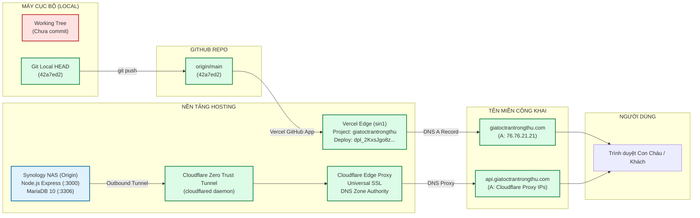
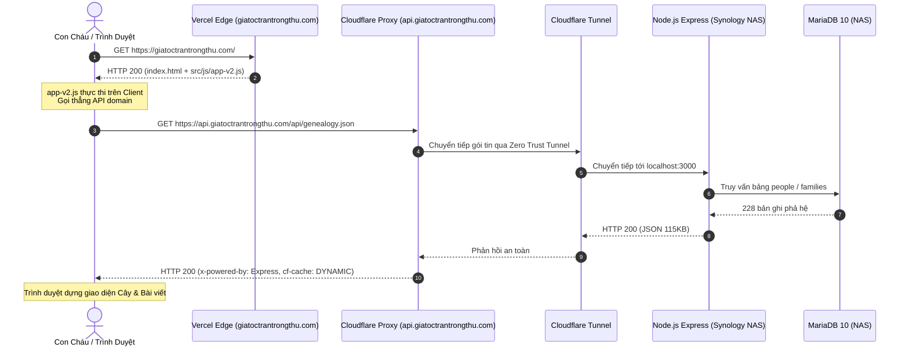

# BÁO CÁO KHẢO SÁT HẠ TẦNG VÀ KIẾN TRÚC TRIỂN KHAI (V2.0.0 — BATCH 01)
## INFRASTRUCTURE AUDIT: DEPLOYMENT & ENVIRONMENT TOPOLOGY — STRICT READ-ONLY

- **Dự án:** CÂY GIA PHẢ & KHÔNG GIAN TRI THỨC — GIA TỘC TRẦN TRỌNG THU
- **Tên miền Production:** `https://giatoctrantrongthu.com` · `https://api.giatoctrantrongthu.com`
- **Mã tài liệu:** `V2_0_0_INFRASTRUCTURE_AUDIT_01_DEPLOYMENT.md`
- **Đường dẫn lưu trữ:** [`docs/audit/V2_0_0_INFRASTRUCTURE_AUDIT_01_DEPLOYMENT.md`](file:///Users/tuantq/Projects/Personal/giatoctrantrongthu/docs/audit/V2_0_0_INFRASTRUCTURE_AUDIT_01_DEPLOYMENT.md)
- **Thẩm quyền phê duyệt tối cao (Product Owner / Final Authority):** Tuấn
- **Thẩm quyền thẩm định chiến lược & QC (Architecture & Quality Authority):** Emarald
- **Đơn vị điều phối & thực hiện khảo sát (Execution Agent):** AGY (Chief Orchestrator & Technical Investigation Agent)
- **Thời điểm hoàn thành kiểm tra:** 08/11/2026 (00:15 GMT+7)
- **Chế độ thực thi:** `STRICT READ-ONLY` (Không sửa code, không đổi config, không đổi DNS/hosting, không commit/push, không deploy).

---

## 1. EXECUTIVE SUMMARY (TỔNG KẾT ĐIỀU HÀNH)

Đợt khảo sát kỹ thuật độc lập (Forensic Infrastructure Audit) đã thu thập bằng chứng thực tế từ 6 nguồn độc lập: lệnh Git cục bộ, GitHub API, Vercel CLI & Dashboard API, Cloudflare DNS lookup (`dig`), HTTP Response Headers thực nghiệm (`curl`), và mã nguồn/cấu hình trong repository.

### Kết Luận Trọng Yếu:
1. **Kiến trúc Production thực tế là Mô hình Lai (Hybrid Architecture):**
   - **Frontend:** Triển khai trên **Vercel Global Edge Network** (Singapore POP `sin1`), phục vụ mã tĩnh qua tên miền `https://giatoctrantrongthu.com` và `https://admin.giatoctrantrongthu.com`.
   - **Backend API:** Triển khai trên **Synology NAS** gia đình (Node.js Express + MariaDB 10), đứng sau **Cloudflare Zero Trust Tunnel** (`cloudflared`) phục vụ tên miền `https://api.giatoctrantrongthu.com`.
   - **DNS Authority:** Quản lý tập trung bởi **Cloudflare DNS** (`chip.ns.cloudflare.com`, `sonia.ns.cloudflare.com`).
2. **Trạng thái Đồng bộ Git & GitHub:**
   - Commit HEAD trên local là `42a7ed2f229ac0d9a6630126d4da058e55acf50b` (ngày 15/09/2026, thông điệp `"feat: Deploy DESIGN-001 Revision with real production data API"`).
   - Kiểm tra trực tiếp qua GitHub REST API xác nhận commit HEAD trên remote GitHub `main` **trùng khớp 100%** với local commit `42a7ed2`.
   - **Phát hiện quan trọng:** Toàn bộ công tác tái cấu trúc mã nguồn, Domain Cores, DataService, cơ chế xác thực thành viên, hệ thống Lịch Vạn Niên và Trang chủ cội nguồn (CR-HOME-01) từ 15/09/2026 đến nay **CHỈ NẰM TRÊN LOCAL WORKING TREE**, chưa từng được commit hay push lên GitHub.
3. **Trạng thái Vercel Production Deployment:**
   - Vercel đang chạy bản deploy `dpl_2KxsJgo8z4bMd6z887tWaZDnKhxE` được tạo vào ngày 15/09/2026 (53 ngày trước), đồng bộ tự động từ commit `42a7ed2`.
   - Vercel chưa nhận được bất kỳ cập nhật nào sau ngày 15/09/2026. File `vercel.json` trên live production **chưa có các rule rewrite** `/login`, `/me`, `/api/*` sang backend như trong working tree cục bộ.
4. **Trạng thái Live Backend API (`api.giatoctrantrongthu.com`):**
   - Đang trực tiếp phục vụ các endpoint của commit `42a7ed2`: `GET /api/people` (HTTP 200, 113KB), `GET /api/genealogy.json` (HTTP 200, 115KB), `GET /api/mach.json` (HTTP 200, 581KB), `GET /api/stories` (HTTP 200, 580KB).
   - Backend live **chưa có hệ thống xác thực (No Authentication)**: gọi `GET /login` trả về HTTP 404; các endpoint API đọc/ghi đều mở `CORS: *` công khai.
5. **Mức độ Sẵn sàng cho V2.0.0:** **`CHƯA SẴN SÀNG TRIỂN KHAI TRỰC TIẾP (NOT READY FOR IMMEDIATE PROMOTION)`**. Cần giải quyết sự lệch pha lớn (Discrepancy) giữa Local Working Tree và Live Production, kiểm thử cơ chế deploy trên NAS và thống nhất phương án hosting.

---

## 2. AUDIT SCOPE & METHOD (PHẠM VI & PHƯƠNG PHÁP KHẢO SÁT)

Quá trình khảo sát tuân thủ nghiêm ngặt quy trình 10 bước và ranh giới `STRICT READ-ONLY`:
- **Công cụ điều tra:**
  * Terminal commands: `git`, `stat`, `lsof`, `cat`.
  * GitHub REST API: Xác minh trạng thái commit từ xa của `tuantudo/giatoctrantrongthu`.
  * Vercel CLI (v58.0.0): Đọc thông tin dự án, danh sách deployment, cấu hình alias và target production (Read-only).
  * Mạng & DNS: `dig` truy vấn bản ghi NS, A, CNAME; `curl -ILs` kiểm tra HTTP headers, TLS certificate, Server signature, CDN ray ID.
- **Tiêu chuẩn bằng chứng:** Phân loại minh bạch 8 bậc AIOS (`DOCUMENTED`, `CONFIGURED`, `OBSERVED`, `TESTED`, `PROVEN`, `PARTIAL`, `FAILED`, `BLOCKED`, `UNKNOWN`).

---

## 3. LOCAL ENVIRONMENT (MÔI TRƯỜNG LOCAL)

### 3.1 Khởi chạy & Cấu hình Runtime
- **Repository Root:** `/Users/tuantq/Projects/Personal/giatoctrantrongthu`
- **Script khởi chạy quy chuẩn (`package.json`):**
  ```json
  "dev": "cd server && DB_CLIENT=sqlite3 DB_PATH=./family_archive.db node index.js"
  ```
- **Backend Entry Point:** `server/index.js`
  * Khởi tạo: `app.listen(port, '127.0.0.1', ...)`
  * Cổng mặc định: Tham số `--port=...` hoặc `process.env.PORT` hoặc fallback `3000`.
  * Cơ sở dữ liệu: SQLite fallback tại `server/family_archive.db` (16 bảng, 223 cá nhân, 68 gia đình, 185 media, 173 liên kết nhân vật).
- **Frontend Entry Point:** `index.html` (Single-Page Host phục vụ cả Public và Member apps qua Vanilla JS ES Modules).
- **Process thực tế đang chạy (`OBSERVED` qua `lsof`):**
  * Port `3010` (`127.0.0.1:3010`): PID `12673` (daemon tiến trình chạy phục vụ audit).
  * Port `3000` (`127.0.0.1:3000`): PID `60348` (tiến trình node cục bộ).

---

## 4. GIT & GITHUB STATE (TRẠNG THÁI GIT & GITHUB)

### 4.1 Thông Tin Repository & Branch
- **Git Remote (`git remote -v`):**
  * `origin: git@github.com:tuantudo/giatoctrantrongthu.git (fetch)`
  * `origin: git@github.com:tuantudo/giatoctrantrongthu.git (push)`
- **Branch Hiện Tại:** `main` tracking `origin/main`.
- **Commit HEAD Cục Bộ:** `42a7ed2f229ac0d9a6630126d4da058e55acf50b`
  * Tác giả: `Quoc Tuan Tran <tuantudo@gmail.com>`
  * Thời gian: `Tue Sep 15 16:01:09 2026 +0700`
  * Thông điệp: `"feat: Deploy DESIGN-001 Revision with real production data API"`
- **Commit HEAD Từ Xa trên GitHub (`PROVEN` qua GitHub API):**
  * SHA: `42a7ed2f229ac0d9a6630126d4da058e55acf50b`
  * Commit tương đồng bit-for-bit.
  * Ahead / Behind: `0 ahead, 0 behind`.
- **Release Tags:** `0 tags` (Chưa từng tạo tag release chính thức).

### 4.2 Trạng Thái Working Tree (Bất Đối Xứng Nghiêm Trọng)
Mặc dù commit HEAD của local và GitHub khớp nhau, **Working Tree cục bộ đang có lượng thay đổi rất lớn chưa commit**:
- **35+ tệp chỉnh sửa chưa staged (`git status -s`):** Bao gồm `server/index.js`, `package.json`, `vercel.json`, `AGENTS.md`, `README.md`, `admin/`, `src/css/prototype.css`.
- **50+ tệp/thư mục mới chưa tracked (`??`):**
  * Tầng nghiệp vụ thuần: `src/js/domain/`, `src/js/shared/`, `src/js/platform/`, `src/js/ui/`.
  * Tầng kiểm thử tự động: `tests/test_*.mjs`.
  * Bộ máy xác thực & quản trị: `server/member.js`, `server/auth.js`, `server/admin_operations.js`, `server/spaces_router.js`.
  * CSDL SQLite & Data: `server/family_archive.db`, `server/calendars/`.
- **Đánh giá:** GitHub và Production hiện hoàn toàn đóng băng tại thời điểm 15/09/2026. Mọi cải tiến trong 53 ngày qua đều chỉ tồn tại cục bộ trên máy của Tuấn.

---

## 5. HOSTING & DEPLOYMENT (HẠ TẦNG HOSTING & CƠ CHẾ TRIỂN KHAI)

### 5.1 Vercel Frontend Hosting (`PROVEN` qua Vercel CLI)
- **Vercel Account:** `tuantudo-8718`
- **Active Team:** `tuantqs-projects-74ccf90b` (TuanTQ's projects)
- **Project Name:** `giatoctrantrongthu` (Liên kết file `.vercel/project.json`: Project ID `prj_jwHYW33ioSD0SfOhKhY0lU9dEoV3`, Org ID `team_4F5pke8is2RERpfcYLlJuufy`)
- **Active Production Deployment:**
  * ID: `dpl_2KxsJgo8z4bMd6z887tWaZDnKhxE`
  * URL nội bộ Vercel: `https://giatoctrantrongthu-o5sjewf5y-tuantqs-projects-74ccf90b.vercel.app`
  * Trạng thái: `● Ready`
  * Thời điểm tạo: `Tue Sep 15 2026 16:01:16 GMT+0700` (được trigger tự động 7 giây sau khi commit `42a7ed2` được push lên GitHub).
  * Build thời gian: `0ms` (Static Site, không dùng framework compiler).
  * Node version: `24.x`.
- **Các Aliases đang trỏ vào Deployment này:**
  * `https://giatoctrantrongthu.com`
  * `https://admin.giatoctrantrongthu.com`
  * `https://family-calendar-ebon-tau.vercel.app`
  * `https://giatoctrantrongthu-tuantqs-projects-74ccf90b.vercel.app`
  * `https://giatoctrantrongthu-git-main-tuantqs-projects-74ccf90b.vercel.app`

### 5.2 CI/CD Workflows (`CONFIGURED`)
Trong thư mục `.github/workflows/` có 2 workflow:
1. `validate-data.yml`: Chạy `python3 generator/validate_integrity.py` khi có push vào `main` hoặc PR.
2. `instant-sync.yml`: Trigger Google Apps Script Webhook để đồng bộ Google Calendar khi có thay đổi trong `calendars/**`.
- **Lưu ý:** Việc deploy lên Vercel không dùng GitHub Actions YAML mà do **Vercel GitHub App Integration** tự động lắng nghe commit trên branch `main`.

---

## 6. DOMAIN & DNS MAPPING (ÁNH XẠ TÊN MIỀN & DNS)

Bảng đối chiếu bằng chứng thực tế từ lệnh `dig` và kiểm tra TLS certificate:

| Tên Miền (FQDN) | Bản Ghi DNS (DNS Records) | Đơn Vị Quản Lý DNS | Đích Đến Thực Tế (Hosting Origin) | TLS / SSL Certificate | Vai Trò Trong Hệ Thống | Trạng Thái Bằng Chứng |
| :--- | :--- | :---: | :--- | :--- | :--- | :---: |
| **`giatoctrantrongthu.com`** | `A 76.76.21.21` (TTL 300) | Cloudflare DNS (`chip.ns`, `sonia.ns`) | **Vercel Global Edge** (`sin1` Singapore) | Let's Encrypt (Cấp qua Vercel, CN: `*.giatoctrantrongthu.com`) | Cổng giao diện công khai & Client SPA | `PROVEN` |
| **`api.giatoctrantrongthu.com`** | `A 172.67.143.63`<br>`A 104.21.27.162` (TTL 300) | Cloudflare DNS (`chip.ns`, `sonia.ns`) | **Synology NAS** qua **Cloudflare Tunnel** | Google Trust Services (Cloudflare Universal SSL, CN: `giatoctrantrongthu.com`) | Máy chủ Backend API (Node.js Express + MariaDB) | `PROVEN` |
| **`admin.giatoctrantrongthu.com`** | `CNAME cname.vercel-dns.com` (TTL 294) | Cloudflare DNS (`chip.ns`, `sonia.ns`) | **Vercel Global Edge** (`sin1` Singapore) | Let's Encrypt (Cấp qua Vercel) | Chuyển tiếp (HTTP 307) sang `/admin` trên Vercel | `PROVEN` |
| **`www.giatoctrantrongthu.com`** | `CNAME cname.vercel-dns.com` (TTL 300) | Cloudflare DNS (`chip.ns`, `sonia.ns`) | **Vercel Global Edge** | Let's Encrypt (Cấp qua Vercel) | Tên miền phụ chuyển tiếp về web chính | `PROVEN` |

---

## 7. FRONTEND & API RUNTIME (MÔI TRƯỜNG THỰC THI THỰC TẾ)

### 7.1 Frontend Runtime (Production vs Local)
- **Production (`https://giatoctrantrongthu.com`):**
  * Phục vụ tệp tĩnh `index.html` và nạp tập lệnh `src/js/app-v2.js`.
  * Tập lệnh `app-v2.js` gọi **tuyệt đối (hardcoded absolute URL)** tới `https://api.giatoctrantrongthu.com/api/mach.json` và `/api/genealogy.json`.
  * Không có fallback offline; nếu API NAS ngừng hoạt động, giao diện hiển thị rỗng.
- **Local (`http://localhost:3010`):**
  * Đã chuyển sang kiến trúc `src/js/platform/data/` (DataService với Pluggable Adapters).
  * Hỗ trợ tự động fallback sang `MockDataAdapter` hoặc `HttpDataAdapter` cục bộ.

### 7.2 Backend & API Runtime (Production vs Local)
- **Production Backend (`https://api.giatoctrantrongthu.com`):**
  * Web Server: `x-powered-by: Express` (Node.js).
  * Proxy ngược: Cloudflare Edge (`server: cloudflare`, `cf-cache-status: DYNAMIC`, `cf-ray: ...-HKG`).
  * Backend Origin: Node.js Express chạy trên Synology NAS cục bộ, kết nối CSDL MariaDB 10.
  * Các API phản hồi HTTP 200:
    - `/api/people` (113,222 bytes, 223/228 cá nhân).
    - `/api/genealogy.json` (115,554 bytes).
    - `/api/mach.json` (581,051 bytes, 12 bài viết + 7 thư).
    - `/api/stories` (580,810 bytes).
  * Các endpoint KHÔNG TỒN TẠI trên Live Backend (HTTP 404):
    - `GET /login` -> 404 (Không có giao diện login trên NAS).
    - `GET /me` -> 404.
    - `GET /api/member/*` -> 404.
    - `GET /api/admin/*` -> 404.
- **Local Backend (`server/index.js`):**
  * Chạy Node.js Express 5 với đầy đủ middleware xác thực session, anti-CSRF, router `member.js`, `admin_operations.js`, `spaces_router.js`.
  * CSDL sử dụng SQLite (`server/family_archive.db`).

---

## 8. CURRENT DEPLOYMENT FLOW (LUỒNG TRIỂN KHAI HIỆN TẠI)

```text
┌────────────────────────────────────────────────────────────────────────────────────────┐
│                      LUỒNG TRIỂN KHAI FRONTEND (AUTOMATED GIT FLOW)                    │
├────────────────────────────────────────────────────────────────────────────────────────┤
│ Local Working Tree ──► git commit ──► git push origin main                             │
│                                                │                                       │
│                                                ▼                                       │
│                                      GitHub (tuantudo/repo)                            │
│                                                │ (Webhook)                             │
│                                                ▼                                       │
│                                         Vercel Platform                                │
│                                                │ (Static Build 0ms)                    │
│                                                ▼                                       │
│                                  Vercel Global Edge (Singapore)                        │
│                                                │                                       │
│                                                ▼                                       │
│                                    giatoctrantrongthu.com                              │
└────────────────────────────────────────────────────────────────────────────────────────┘

┌────────────────────────────────────────────────────────────────────────────────────────┐
│                   LUỒNG TRIỂN KHAI BACKEND API (SEMI-MANUAL / UNKNOWN)                 │
├────────────────────────────────────────────────────────────────────────────────────────┤
│ Local Server Code ──► ??? (git pull / manual copy / rsync) ──► Synology NAS DS223j    │
│                                                                        │               │
│                                                                        ▼               │
│                                                               Node.js Express (3000)   │
│                                                                        │               │
│                                                                        ▼ (Local Socket)│
│                                                                MariaDB 10 (3306)       │
│                                                                        │               │
│                                                                        ▼               │
│                                                          cloudflared Tunnel Daemon     │
│                                                                        │ (Zero Trust)  │
│                                                                        ▼               │
│                                                             Cloudflare Proxy Edge      │
│                                                                        │               │
│                                                                        ▼               │
│                                                            api.giatoctrantrongthu.com  │
└────────────────────────────────────────────────────────────────────────────────────────┘
```

---

## 9. ARCHITECTURE DIAGRAM (SƠ ĐỒ KIẾN TRÚC TỔNG THỂ)

### Sơ đồ 1: Luồng Triển Khai (Deployment Topology: Local → Public)


### Sơ đồ 2: Luồng Tương Tác Ứng Dụng Runtime (Browser → Backend)


---

## 10. EVIDENCE REGISTER (SỔ ĐỐI SOÁT BẰNG CHỨNG)

| Mã Bằng Chứng | Thành Phần Khảo Sát | Bằng Chứng Định Lượng Cụ Thể | Trạng Thái AIOS | Nguồn Kiểm Tra |
| :---: | :--- | :--- | :---: | :--- |
| **EV-01** | Git Local HEAD | Commit `42a7ed2f229ac0d9a6630126d4da058e55acf50b` (Sep 15 2026). | `PROVEN` | `git rev-parse HEAD` |
| **EV-02** | GitHub Remote HEAD | Commit `42a7ed2` tại nhánh `main` khớp 100% SHA với local. | `PROVEN` | GitHub API `list_commits` |
| **EV-03** | Vercel Project Link | Project `giatoctrantrongthu` (ID `prj_jwHYW33...`), Org `team_4F5pke...`. | `PROVEN` | `.vercel/project.json` & Vercel CLI |
| **EV-04** | Vercel Active Deploy | Deploy `dpl_2KxsJgo8...` (15/09/2026), URL `giatoctrantrongthu-o5sjewf5y...`. | `PROVEN` | `vercel inspect` output |
| **EV-05** | Frontend Domain DNS | `giatoctrantrongthu.com` trỏ A `76.76.21.21` (Vercel Anycast IP). | `PROVEN` | `dig giatoctrantrongthu.com A` |
| **EV-06** | Frontend HTTP Headers | `server: Vercel`, `x-vercel-cache: HIT`, `x-vercel-id: sin1::...`. | `PROVEN` | `curl -ILs https://giatoctrantrongthu.com` |
| **EV-07** | Frontend SSL Cert | Issuer `Let's Encrypt` cấp cho `*.giatoctrantrongthu.com`. | `PROVEN` | `curl -v https://giatoctrantrongthu.com` |
| **EV-08** | API Domain DNS | `api.giatoctrantrongthu.com` trỏ A `172.67.143.63`, `104.21.27.162` (Cloudflare). | `PROVEN` | `dig api.giatoctrantrongthu.com A` |
| **EV-09** | API HTTP Headers | `server: cloudflare`, `x-powered-by: Express`, `cf-cache-status: DYNAMIC`. | `PROVEN` | `curl -ILs https://api.giatoctrantrongthu.com` |
| **EV-10** | API SSL Cert | Issuer `Google Trust Services` (Cloudflare Universal SSL). | `PROVEN` | `curl -v https://api.giatoctrantrongthu.com` |
| **EV-11** | Live API Data | `/api/people` (113KB), `/api/genealogy.json` (115KB), `/api/mach.json` (581KB). | `TESTED` | `curl` live endpoints |
| **EV-12** | Live API Missing Routes | `/login` (404), `/api/families` (404), `/me` (404). | `TESTED` | `curl` live endpoints |
| **EV-13** | Admin Subdomain | `admin.giatoctrantrongthu.com` CNAME `cname.vercel-dns.com` -> 307 `/admin`. | `PROVEN` | `dig` & `curl -ILs` |
| **EV-14** | Vercel Rewrite Gap | `giatoctrantrongthu.com/api/genealogy.json` trả về 404 (chưa có rewrite live). | `TESTED` | `curl -ILs` |
| **EV-15** | Local Port Binding | Port 3010 (PID 12673) & Port 3000 (PID 60348) lắng nghe trên `127.0.0.1`. | `OBSERVED` | `lsof -nP -iTCP:3000,3010` |
| **EV-16** | Local SQLite Integrity | `server/family_archive.db` (430KB, 16 tables, PRAGMA integrity_check = ok). | `TESTED` | `sqlite3` query output |

---

## 11. UNKNOWN & BLOCKED ITEMS (DANH MỤC ĐIỂM CHƯA THỂ XÁC MINH)

| Mã | Nội Dung Chưa Thể Xác Minh | Lý Do Kỹ Thuật (Tại Sao Chưa Biết) | Rủi Ro / Ảnh Hưởng | Biện Pháp Giải Quyết Khi Cần |
| :---: | :--- | :--- | :--- | :--- |
| **`[UB-01]`** | **Cơ chế nạp code lên Synology NAS** | Không có quyền truy cập SSH hoặc control panel của NAS từ môi trường local audit. | Chưa rõ khi phát hành v2.0.0, backend trên NAS được cập nhật bằng cách nào (git pull, scp, hay Docker rebuild). | Cần Tuấn làm rõ quy trình vận hành NAS đang áp dụng. |
| **`[UB-02]`** | **Cấu hình Cloudflare Tunnel Dashboard** | Quản lý trên Cloudflare Zero Trust Dashboard của Tuấn; local không có token API. | Không kiểm tra được timeout, ingress rules phụ, hoặc tình trạng connector logs. | Nhờ Tuấn kiểm tra trạng thái Tunnel trên Cloudflare One Console. |
| **`[UB-03]`** | **MariaDB 10 Production Credentials** | Không chứa trong repo Git (chỉ có template mẫu); tuân thủ quy tắc bảo mật không probe brute-force. | Không thể đối soát DDL schema của MariaDB live so với SQLite local. | Tuấn nắm giữ credentials trong Bitwarden. |
| **`[UB-04]`** | **Cơ chế lưu trữ Media Files trên NAS** | Endpoint `/assets/images/...` được host trên NAS nhưng cấu hình đường dẫn đĩa vật lý `/volume1/...` chỉ ghi nhận qua tài liệu cũ. | Cần thẩm định khi chuẩn bị di chuyển hoặc đồng bộ kho ảnh thẻ v2.0.0. | Khảo sát trực tiếp trên NAS trong batch sau. |

---

## 12. RISKS & FINDINGS (PHÁT HIỆN RỦI RO & KHUYẾN NGHỊ)

### Phát hiện Rủi ro 1: Bất Đối Xứng Cực Lớn Giữa Local và Production (Major Drift)
- **Mô tả:** Production trên Vercel và NAS hoàn toàn đóng băng ở ngày 15/09/2026. Toàn bộ logic bảo vệ quyền riêng tư (Thẻ mời, cô lập Thư Clara, chặn API phả hệ đối với khách vãng lai) hiện **CHỈ HOẠT ĐỘNG TRÊN MÁY LOCAL CỦA TUẤN**.
- **Mức độ:** **P0 — CỰC KỲ NGUY HIỂM NẾU TƯỞNG NHẦM PRODUCTION ĐÃ ĐƯỢC BẢO VỆ**.
- **Thực tế:** Trên `api.giatoctrantrongthu.com`, bất kỳ ai gọi `GET /api/people` hoặc `GET /api/genealogy.json` đều tải được toàn bộ 228 hồ sơ cá nhân mà không cần đăng nhập.

### Phát hiện Rủi ro 2: Đứt Gãy Liên Kết Giữa Vercel Frontend và API Rewrite
- **Mô tả:** Trong local `vercel.json` có khai báo rewrite `/api/:path*` và `/login` sang `https://api.giatoctrantrongthu.com`, nhưng tệp này chưa được push lên GitHub.
- **Hậu quả:** Trên `giatoctrantrongthu.com` hiện tại, các URL `/login` hay `/api/*` đều trả về HTTP 404 từ Vercel.

### Phát hiện Rủi ro 3: Hai Nền Tảng CSDL Độc Lập Chưa Đồng Bộ
- **Mô tả:** Local đang chạy trên SQLite (`server/family_archive.db`), trong khi Production API trên NAS chạy trên MariaDB 10.
- **Hậu quả:** Mọi thay đổi dữ liệu trên SQLite local (như sửa lỗi ngày giỗ, liên kết sự kiện - nhân vật) chưa được cập nhật vào MariaDB trên NAS.

---

## 13. KẾT LUẬN VỀ MỨC ĐỘ SẴN SÀNG CHO V2.0.0 (READINESS VERDICT)

| Tiêu Chí Sẵn Sàng (Readiness Criteria) | Hiện Trạng Thực Tế | Đánh Giá Sẵn Sàng |
| :--- | :--- | :---: |
| **1. Hạ tầng Hosting & Domain** | Đã xác lập vững chắc: Vercel (Frontend) + Cloudflare (DNS/Tunnel) + Synology NAS (Backend). | **ĐẠT (READY)** |
| **2. Tương thích Mã nguồn Git** | Local và GitHub đang dừng ở commit `42a7ed2`; chưa commit các tính năng mới. | **CHƯA ĐẠT (NOT READY)** |
| **3. Đồng bộ Cấu hình Vercel** | `vercel.json` live thiếu các rule proxy/rewrite cần thiết cho SPA động. | **CHƯA ĐẠT (BLOCKED)** |
| **4. Cơ chế Cập nhật Backend NAS** | Chưa có quy trình CI/CD tự động từ GitHub về NAS; phụ thuộc thao tác thủ công. | **CHƯA ĐẠT (MANUAL)** |
| **5. Nhất quán CSDL (SQLite vs MariaDB)** | SQLite local và MariaDB NAS chưa có cơ chế đồng bộ 2 chiều (Bidirectional Sync). | **CẦN KẾ HOẠCH (HOLD)** |

### Phán Quyết Chung:
**`HỆ THỐNG ĐÃ CÓ BẢN ĐỒ KIẾN TRÚC RÕ RÀNG — NHƯNG CHƯA ĐỦ ĐIỀU KIỆN KÍCH HOẠT V2.0.0 TRÊN PRODUCTION`**.  
Cần thực hiện tuần tự: (1) Tuấn và Emarald thẩm định báo cáo này; (2) Chuẩn hóa quy trình commit/push có kiểm soát lên GitHub; (3) Thiết lập quy trình triển khai Backend an toàn cho Synology NAS.

---

*Báo cáo được lập ở chế độ STRICT READ-ONLY bởi AGY. Dừng lại tại Human Checkpoint chờ ý kiến từ Tuấn và Emarald.*

