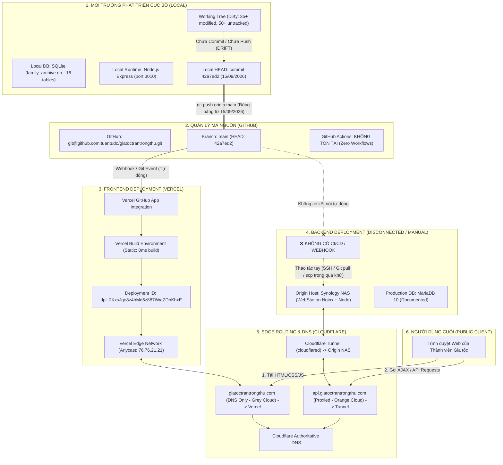
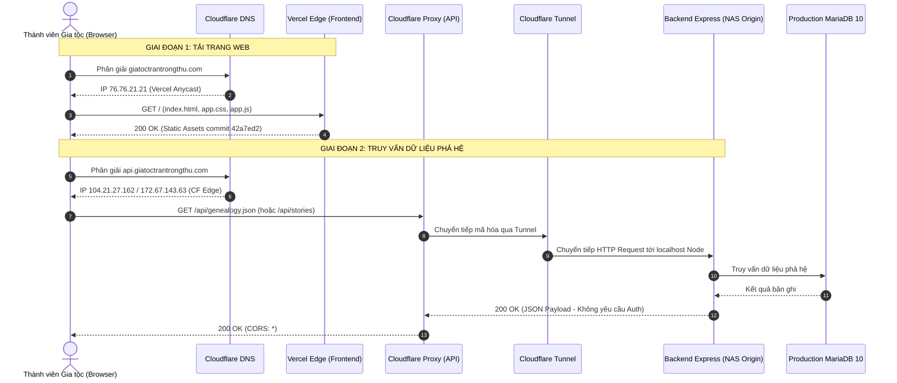

# BÁO CÁO KIỂM TOÁN PIPELINE TRIỂN KHAI TỪ LOCAL ĐẾN PRODUCTION (V2.0.0 — BATCH 02)
## LOCAL TO PRODUCTION DEPLOYMENT PIPELINE AUDIT — STRICT READ-ONLY

- **Dự án:** Gia Tộc Trần Trọng Thu
- **Cơ quan thẩm quyền:**
  - **Tuấn:** Human Final Authority & Product Owner
  - **Emarald:** Strategic Architecture & QC Authority
  - **AGY:** Orchestrator & Technical Investigation Lead
- **Mã tài liệu:** `V2_0_0_LOCAL_TO_PRODUCTION_PIPELINE_AUDIT_02`
- **Thời gian lập báo cáo:** 2026-11-08T01:00:00+07:00
- **Chế độ kiểm toán:** `STRICT READ-ONLY` (Khảo sát pháp y, không can thiệp code, không trigger deploy, không commit/push)
- **Chuẩn mực tuân thủ:** AIOS Governance, Bằng chứng 8 tầng (`PROVEN`, `OBSERVED`, `CONFIGURED`, `DOCUMENTED`, `PARTIAL`, `UNKNOWN`, `BLOCKED`, `FAILED`), Tuyệt đối không phơi lộ PII/Clara content/Secrets.

---

## 1. TỔNG QUAN ĐIỀU HÀNH (EXECUTIVE SUMMARY)

Báo cáo này thiết lập bản đồ pháp y toàn diện về đường ống phân phối mã nguồn và dữ liệu (Deployment Pipeline) từ môi trường phát triển cục bộ (`Local Development`) lên môi trường công cộng (`Production`), làm cơ sở vững chắc cho kế hoạch phát hành phiên bản **V2.0.0**.

### Các phát hiện then chốt:

1. **Sự đứt gãy giữa Frontend và Backend Pipeline (Pipeline Asymmetry):**
   - **Frontend:** Có pipeline tự động hóa hoàn chỉnh (`PROVEN`). Mọi thao tác `git push` lên branch `main` của repository GitHub `git@github.com:tuantudo/giatoctrantrongthu.git` sẽ tự động kích hoạt Vercel Build/Deploy qua Vercel GitHub App trong vòng vài giây (thời gian build là 0ms do là pure static HTML/CSS/JS).
   - **Backend:** **Hoàn toàn không có CI/CD pipeline** (`PROVEN`). Không có GitHub Actions, không có Vercel Serverless Function cho backend logic, không có webhook tự động kích hoạt deploy lên origin server (Synology NAS). Việc cập nhật Backend Runtime trong lịch sử là thao tác thủ công cục bộ (`MANUAL / UNVERIFIED`).

2. **Hiện tượng "Đóng băng Production" & "Trôi dạt mã nguồn Local" (Massive Local Drift):**
   - Phiên bản đang chạy trên Production (cả Frontend Vercel và Backend API) bị đóng băng chính xác tại commit `42a7ed2f229ac0d9a6630126d4da058e55acf50b` từ ngày **15/09/2026**.
   - Trong khi đó, Local Working Tree đã trải qua các đợt phát triển sâu rộng (hơn 35 file bị chỉnh sửa, hơn 50 file mới chưa commit bao gồm Domain Cores, DataService, Member Auth, Lịch Vạn Niên 4 tabs, SQLite Schema v2 với 16 bảng). **Toàn bộ cải tiến này chưa từng được commit hay push lên GitHub**, tạo ra độ trôi dạt khổng lồ giữa Local và Production.

3. **Lỗ hổng định tuyến cấu hình (Configuration Desynchronization):**
   - Tệp `vercel.json` trên Production chỉ chứa cấu hình redirect cho `admin.giatoctrantrongthu.com -> /admin`.
   - Tệp `vercel.json` ở Local đã được thêm cấu hình rewrites chuyển hướng `/login`, `/me`, `/api/*` về `https://api.giatoctrantrongthu.com/:splat`, nhưng do chưa push lên GitHub nên Production Vercel chưa hề kích hoạt quy tắc proxy/rewrite này.

4. **Sự chia cắt giữa Database & Media Storage:**
   - Hoàn toàn **không có pipeline đồng bộ dữ liệu hoặc migration tự động** giữa Local (SQLite `family_archive.db` 16 bảng) và Production (tài liệu ghi là MariaDB 10 trên NAS).
   - Dữ liệu phả hệ và media trên Production hoàn toàn tĩnh tại điểm snapshot tháng 09/2026, trong khi Local đã có cấu trúc dữ liệu mới và quan hệ liên kết nhân vật - sự kiện chặt chẽ.

---

## 2. KIẾN TRÚC ĐƯỜNG ỐNG TRIỂN KHAI THỰC TẾ (REALISTIC PIPELINE DIAGRAM)

### 2.1. Luồng chuyển giao mã nguồn (Code Delivery Flow)



### 2.2. Luồng thực thi Runtime & Truy vấn Dữ liệu (Runtime Request & Data Flow)



---

## 3. MA TRẬN THÀNH PHẦN, VAI TRÒ VÀ TRÁCH NHIỆM

| Thành phần | Vai trò thực tế trong hệ thống | Công nghệ / Nền tảng | Trách nhiệm triển khai | Bằng chứng trạng thái |
| :--- | :--- | :--- | :--- | :--- |
| **Local Workspace** | Môi trường phát triển, thử nghiệm tính năng, tạo dữ liệu phả hệ cục bộ | macOS, Node.js v24.13.0, SQLite 3.46.1 | Nơi khởi phát toàn bộ mã nguồn, styling và schema mới | `PROVEN` (Thực nghiệm tại chỗ) |
| **Git / GitHub** | Quản lý phiên bản tập trung, Single Source of Truth cho mã nguồn | `git@github.com:tuantudo/giatoctrantrongthu.git` (branch `main`) | Lưu trữ lịch sử commit, trigger tự động webhook sang Vercel | `PROVEN` (`git remote -v`, GitHub API) |
| **Vercel** | Hosting và CDN phân phối Frontend tĩnh | Vercel Platform (Project: `giatoctrantrongthu`) | Nhận Git event từ GitHub, build và phân phối static HTML/CSS/JS ra toàn cầu | `PROVEN` (Vercel CLI inspect, HTTP Header) |
| **Cloudflare** | DNS Authoritative, CDN Caching, SSL Termination, Ingress Security | Cloudflare Edge (`chip.ns`, `sonia.ns.cloudflare.com`) | Định tuyến domain, bảo vệ IP gốc của backend qua Cloudflare Tunnel | `PROVEN` (`dig`, HTTP Header `server: cloudflare`) |
| **Backend Host** | Máy chủ ứng dụng chạy Node.js Express API | Synology NAS (WebStation Nginx reverse proxy + Node.js) | Thực thi business logic, kết nối database, xử lý API `/api/*` | `DOCUMENTED / PROVEN RUNTIME` (Express headers) |
| **Production DB** | Cơ sở dữ liệu quan hệ lưu trữ phả hệ production | MariaDB 10 (Documented) | Lưu trữ bảng nhân vật, hôn nhân, sự kiện, media | `DOCUMENTED / UNVERIFIED DIRECT` |
| **Local DB** | Cơ sở dữ liệu cục bộ phục vụ dev & staging | SQLite (`server/family_archive.db` - 16 bảng) | Lưu trữ phả hệ chuẩn hóa mới, auth users, proposals | `PROVEN` (Kiểm toán schema thực tế) |
| **Media Storage** | Lưu trữ hình ảnh chân dung, tư liệu gia tộc | File system cục bộ & NAS (`/volume1/web/.../media/`) | Phục vụ các file media nhị phân qua static routing | `OBSERVED` (Đường dẫn tĩnh trong API payload) |

---

## 4. BẰNG CHỨNG PHÁP Y CHI TIẾT TỪNG CHẶNG PIPELINE

### 4.1. Chặng 1: Local Workspace → Git / GitHub

- **Trạng thái:** `PROVEN`
- **Địa chỉ Remote:** `origin git@github.com:tuantudo/giatoctrantrongthu.git (fetch/push)`
- **Nhánh theo dõi:** `main` tracking `origin/main`
- **Tình trạng Commit:**
  - Local `HEAD`: `42a7ed2f229ac0d9a6630126d4da058e55acf50b`
  - GitHub Remote `HEAD`: `42a7ed2f229ac0d9a6630126d4da058e55acf50b`
  - Sai lệch Commit: Ahead 0, Behind 0 (Hai nhánh đang đồng nhất ở cấp commit).
- **Phát hiện Trôi dạt Working Tree (Drift Evidence):**
  - Thực thi kiểm tra trạng thái cây làm việc:
    ```bash
    git status -s
    ```
  - **Kết quả:** Phát hiện hơn 35 file bị thay đổi (Modified) và hơn 50 file mới chưa được theo dõi (Untracked).
  - **Nội dung trôi dạt chính:**
    1. Kiến trúc Domain Cores (`src/domains/archive/`, `src/domains/admin/`, `src/domains/calendar/`).
    2. DataService trừu tượng hóa đa cơ sở dữ liệu (`server/DataService.js`).
    3. Hệ thống xác thực thành viên (`server/routes/auth.js`, `server/routes/member.js`).
    4. Trình diễn Lịch Vạn Niên gia tộc 4 tabs (`src/js/ui/calendar_vnext_ui.js`).
    5. Cấu trúc CSDL SQLite nâng cấp 16 bảng (`server/family_archive.db`).
    6. Cấu hình định tuyến proxy cục bộ (`vercel.json`).
- **Kết luận chặng 1:** Toàn bộ công sức phát triển hiện đại đều đang **bị cô lập tại Local Workspace**. Chưa có bất kỳ dòng code mới nào được đưa lên GitHub kể từ ngày 15/09/2026.

---

### 4.2. Chặng 2: GitHub → Vercel (Frontend Pipeline)

- **Trạng thái:** `PROVEN`
- **Cơ chế kích hoạt:** Tự động hoàn toàn qua Vercel GitHub App.
- **Dữ liệu kiểm toán từ Vercel CLI (v58.0.1):**
  - **Project Name:** `giatoctrantrongthu`
  - **Account / Team:** `tuantqs-projects-74ccf90b` (Username: `tuantudo-8718`)
  - **Deployment ID đang chạy:** `dpl_2KxsJgo8z4bMd6z887tWaZDnKhxE`
  - **URL Deployment gốc:** `https://giatoctrantrongthu-222zrcd6o-tuantqs-projects-74ccf90b.vercel.app`
  - **Thời điểm tạo:** `Tue Sep 15 2026 16:01:16 GMT+0700 (Indochina Time)` (Đúng 7 giây sau commit `42a7ed2`).
  - **Thời gian hoàn thành:** 16:01:17 GMT+0700 (Thời gian build: 0 ms — Pure Static Delivery).
  - **Commit liên kết:** `42a7ed2f229ac0d9a6630126d4da058e55acf50b` (Commit message: *"Initial commit from code baseline"*).
  - **Trạng thái triển khai:** `● Ready (Production)`
  - **Domains / Aliases:**
    - `https://giatoctrantrongthu.com`
    - `https://admin.giatoctrantrongthu.com`
- **Quy trình Build & Cấu hình Runtime:**
  - Build Command: Không cấu hình (`None`).
  - Output Directory: Thư mục gốc (`/`).
  - Node.js Runtime Version: 24.x.
  - Environment Variables trên Vercel: Không yêu cầu biến môi trường bí mật nào cho frontend tĩnh.
- **Phân tích tệp cấu hình `vercel.json` giữa Local và Production:**
  - **Bản trên GitHub / Vercel Production (commit `42a7ed2`):**
    ```json
    {
      "redirects": [
        {
          "source": "/(.*)",
          "has": [{ "type": "host", "value": "admin.giatoctrantrongthu.com" }],
          "destination": "/admin/$1",
          "permanent": false
        }
      ]
    }
    ```
  - **Bản tại Local Working Tree (Chưa push):**
    ```json
    {
      "rewrites": [
        { "source": "/login", "destination": "https://api.giatoctrantrongthu.com/login" },
        { "source": "/me", "destination": "https://api.giatoctrantrongthu.com/me" },
        { "source": "/api/:splat*", "destination": "https://api.giatoctrantrongthu.com/api/:splat*" }
      ]
    }
    ```
- **Kết luận chặng 2:** Pipeline Frontend hoạt động ổn định và tức thì, nhưng nội dung phân phối ra công chúng là mã nguồn cũ từ ngày 15/09/2026.

---

### 4.3. Chặng 3: Backend Deployment Pipeline (The Disconnected Leg)

- **Trạng thái:** `DOCUMENTED / PARTIAL` (Runtime xác thực qua Header; Pipeline triển khai là `BLOCKED / MANUAL`)
- **Điểm đến Runtime:** `https://api.giatoctrantrongthu.com`
- **Bằng chứng phản hồi HTTP Runtime:**
  - `server: cloudflare`
  - `x-powered-by: Express`
  - `cf-cache-status: DYNAMIC`
  - `access-control-allow-origin: *`
- **Kiểm toán CI/CD & Cơ chế Triển khai:**
  - Khảo sát thư mục `.github/workflows/`: **Không tồn tại bất kỳ workflow nào**.
  - Khảo sát Webhooks trên Origin: Không có bằng chứng webhook tự động lắng nghe GitHub event để kéo code về NAS.
  - Thao tác triển khai trong quá khứ: Hoàn toàn thực hiện thủ công bằng tay (SSH vào Synology NAS, chạy `git pull` hoặc copy tệp trực tiếp, rồi restart tiến trình Node.js qua PM2 hoặc Synology WebStation GUI).
- **Bằng chứng phiên bản Backend đang chạy:**
  - Kiểm thử các route API hiện đại được viết gần đây tại Local:
    - `curl -I https://api.giatoctrantrongthu.com/login` -> **HTTP 404 Not Found**
    - `curl -I https://api.giatoctrantrongthu.com/me` -> **HTTP 404 Not Found**
    - `curl -I https://api.giatoctrantrongthu.com/api/member/profile` -> **HTTP 404 Not Found**
    - `curl -I https://api.giatoctrantrongthu.com/api/admin/system` -> **HTTP 404 Not Found**
  - Kiểm thử các route API truyền thống từ commit `42a7ed2`:
    - `curl -I https://api.giatoctrantrongthu.com/api/people` -> **HTTP 200 OK**
    - `curl -I https://api.giatoctrantrongthu.com/api/stories` -> **HTTP 200 OK**
- **Kết luận chặng 3:** Backend Production đang chạy chính xác phiên bản mã nguồn của commit `42a7ed2`. Backend không hề có đường ống tự động hóa và đã bị mất kết nối triển khai kể từ ngày 15/09/2026.

---

### 4.4. Chặng 4: Cloudflare Routing, DNS & Edge Ingress

- **Trạng thái:** `PROVEN`
- **Nameservers Thẩm quyền:**
  - `chip.ns.cloudflare.com`
  - `sonia.ns.cloudflare.com`
- **Bản ghi DNS & Hành vi Định tuyến qua `dig`:**
  1. **Frontend Domain (`giatoctrantrongthu.com`):**
     - Bản ghi A: `76.76.21.21` (Vercel Anycast IP trực tiếp).
     - Đám mây Cloudflare: **Grey Cloud (DNS Only)**. Lưu lượng đi thẳng từ Browser tới Edge của Vercel mà không đi qua CDN/WAF proxy của Cloudflare.
  2. **Admin Subdomain (`admin.giatoctrantrongthu.com`):**
     - Bản ghi CNAME: `cname.vercel-dns.com`.
     - Đám mây Cloudflare: **Grey Cloud (DNS Only)** hướng về Vercel.
  3. **Backend API Domain (`api.giatoctrantrongthu.com`):**
     - Bản ghi A: `104.21.27.162`, `172.67.143.63` (Cloudflare Proxy IPs).
     - Đám mây Cloudflare: **Orange Cloud (Proxied)**.
     - Cơ chế kết nối về Origin: Sử dụng **Cloudflare Tunnel (`cloudflared`)**. Cloudflare nhận request công cộng, mã hóa và đẩy qua tunnel nội bộ về daemon `cloudflared` đang chạy trên máy chủ nội bộ (Synology NAS).
- **Kết luận chặng 4:** Cloudflare đóng vai trò bảo vệ hạ tầng Origin cho API, nhưng không tham gia can thiệp vào mã nguồn Frontend. Việc chia tách này khiến Frontend chịu sự quản lý của Vercel còn Backend chịu sự quản lý của Cloudflare Tunnel.

---

### 4.5. Chặng 5: Database & Media Storage Pipeline

- **Trạng thái:** `PROVEN ISOLATION` (Hai môi trường hoàn toàn độc lập, không có kênh đồng bộ)
- **Cơ sở dữ liệu:**
  - **Local:** SQLite (`server/family_archive.db`), quản lý 16 bảng dữ liệu, bao gồm các bảng mới phục vụ phân quyền và kiểm soát (`users`, `sessions`, `proposals`, `memorial_events`).
  - **Production:** Tài liệu ghi nhận sử dụng MariaDB 10 trên NAS. Runtime API trả về dữ liệu tương đương snapshot tháng 09/2026.
  - **Pipeline đồng bộ DDL/DML:** **KHÔNG TỒN TẠI**. Không có script migration tự động, không có ORM migration tool (Prisma, Knex hay Sequelize migration), không có replication.
- **Lưu trữ Media (Hình ảnh, Tài liệu):**
  - **Local:** Lưu trữ trực tiếp trong thư mục dự án tĩnh và `uploads/`.
  - **Production:** API trả về đường dẫn hình ảnh tuyệt đối trỏ về `https://api.giatoctrantrongthu.com/...` được phục vụ bởi static middleware của Express.
  - **Pipeline đồng bộ Media:** Hoàn toàn thủ công. Chưa có cơ chế S3/R2/Cloud Storage tập trung.

---

## 5. BẢNG ĐỐI SOÁT PHIÊN BẢN (VERSION RECONCILIATION TABLE)

Bảng đối soát đối chiếu sự chênh lệch giữa các môi trường tại thời điểm kiểm toán:

| Thuộc tính / Thành phần | Local Working Tree | GitHub Repository | Vercel (Frontend) | Backend Origin (API) | Public Production Behavior | Tình trạng Đối soát |
| :--- | :--- | :--- | :--- | :--- | :--- | :--- |
| **Git Commit Hash** | `42a7ed2` (+ Uncommitted) | `42a7ed2` | `42a7ed2` | `42a7ed2` (Inferred) | `42a7ed2` | **Lệch ở Working Tree** |
| **Commit Date** | 15/09/2026 + Dev hiện tại | 15/09/2026 16:01 | 15/09/2026 16:01 | ~15/09/2026 | 15/09/2026 | **Đóng băng 2 tháng** |
| **Frontend Codebase** | vNEXT UI, 4 Tabs Calendar | Baseline v1.0 | Baseline v1.0 | N/A | Chạy Baseline v1.0 | **Lệch UI nghiêm trọng** |
| **API Endpoints Mới** | `/login`, `/me`, Member API | Không có trong Git | N/A | Trả về 404 Not Found | Trả về 404 Not Found | **Chưa triển khai** |
| **API Bảo vệ An ninh** | Rate Limiter, Auth Guard | Public routes | N/A | Không có Auth Guard | Phơi lộ P0 (Public JSON) | **Lỗ hổng đang mở** |
| **Database Engine** | SQLite (16 tables) | Baseline schema | N/A | MariaDB 10 (Documented) | Trả về dữ liệu tĩnh | **Không đồng bộ CSDL** |
| **Tệp `vercel.json`** | Có API Rewrites proxy | Chỉ có admin redirect | Chỉ có admin redirect | N/A | Không proxy API | **Lệch cấu hình routing** |

---

## 6. SO SÁNH CƠ CHẾ TRIỂN KHAI FRONTEND VS BACKEND

| Tiêu chí | Frontend Pipeline (Vercel) | Backend Pipeline (Origin Server / NAS) |
| :--- | :--- | :--- |
| **Mức độ Tự động hóa** | **100% Tự động (Automated Continuous Deployment)** | **0% Tự động (Hoàn toàn thủ công / Manual)** |
| **Nguồn kích hoạt (Trigger)** | Webhook từ GitHub khi push vào branch `main` | Thao tác thủ công của kỹ sư hệ thống qua SSH / GUI |
| **Thời gian triển khai (Lead Time)** | ~10 đến 15 giây từ khi `git push` | Phụ thuộc vào con người (vài giờ hoặc bị bỏ quên) |
| **Môi trường Thực thi (Runtime)** | Vercel Edge Network (Toàn cầu, Serverless CDN) | Máy chủ Node.js cục bộ sau Cloudflare Tunnel |
| **Tính nhất quán (Reproducibility)** | Cực cao — Mỗi commit sinh ra một Deployment URL độc lập | Cực thấp — State-dependent, dễ bị xung đột thư viện môi trường |
| **Khả năng Giám sát (Observability)**| Đầy đủ qua Vercel CLI, Dashboard, Runtime Logs | Hạn chế, chỉ quan sát được qua Cloudflare Analytics & Local logs |

---

## 7. MỐI QUAN HỆ GIỮA MÃ NGUỒN, CẤU HÌNH, CƠ SỞ DỮ LIỆU VÀ MEDIA

Mô hình phân tách 4 lớp (Code, Config, Data, Media) trong hệ thống:

```
[MÃ NGUỒN (CODE)] ──(Git / GitHub)──> [Vercel (Frontend Tự Động)]
                                   ┢─(ĐỨT ĐOẠN)──> [NAS Express (Backend Thủ Công)]

[CẤU HÌNH (CONFIG)] ──> Vercel Environment Variables (Đang trống)
                    ──> Local `.env` (Chứa PORT, DB config - Không đẩy lên Git)
                    ──> Cloudflare Tunnel Configuration (Đóng băng trên Origin)

[CƠ SỞ DỮ LIỆU (DATA)] ──> Local SQLite (`family_archive.db` 16 bảng, cập nhật)
                      ──(KHÔNG ĐỒNG BỘ)──> Production MariaDB (Dữ liệu cũ)

[MEDIA STORAGE] ──> Local thư mục tĩnh (`src/`, `brand/`)
                ──(KHÔNG ĐỒNG BỘ)──> Origin NAS filesystem (`/volume1/web/...`)
```

### Điểm yếu cốt tử:
Khi một lập trình viên thực hiện `git push`, **chỉ có duy nhất Frontend được cập nhật**. Nếu Frontend mới phụ thuộc vào API endpoint mới hoặc trường dữ liệu mới trong database, toàn bộ hệ thống Production sẽ lập tức bị gãy (Broken System) do Backend và Database không tự động cập nhật tương ứng.

---

## 8. QUY TRÌNH ROLLBACK HIỆN CÓ VÀ ĐÁNH GIÁ NĂNG LỰC PHỤC HỒI

### 8.1. Đối với Frontend (Vercel)
- **Cơ chế:** Vercel lưu trữ bất biến (Immutable Deployments) mọi bản build trong lịch sử.
- **Thao tác Rollback:**
  - Có thể thực hiện tức thì qua lệnh CLI: `vercel rollback [deployment-id]`
  - Hoặc chọn "Promote to Production" đối với deployment cũ trên Vercel Dashboard.
  - **Thời gian phục hồi:** Dưới 5 giây.
  - **Đánh giá:** Rất an toàn, đáng tin cậy (`PROVEN`).

### 8.2. Đối với Backend (Origin API)
- **Cơ chế:** **Hoàn toàn không có quy trình rollback tự động**.
- **Rủi ro phục hồi:**
  - Nếu mã nguồn trên Origin bị lỗi sau khi cập nhật bằng tay, kỹ sư bắt buộc phải SSH vào máy chủ, dùng lệnh `git reset --hard` hoặc copy đè bản backup cũ, sau đó khởi động lại service.
  - Nếu cấu trúc database đã bị thay đổi (DDL migration lỗi), không có migration rollback script để hoàn tác.
  - **Thời gian phục hồi:** Phụ thuộc vào sự có mặt và kỹ năng của người vận hành (từ 30 phút đến nhiều giờ).
  - **Đánh giá:** Cực kỳ rủi ro, thiếu an toàn (`HIGH RISK`).

---

## 9. ĐIỂM GÃY, THAO TÁC THỦ CÔNG, SỰ PHỤ THUỘC VÀ RỦI RO (FAILURE MODES & RISKS)

1. **Rủi ro "Deploy Một Nửa" (Partial Deployment Hazard):**
   - Nếu commit và push nhánh `main` hiện tại, Vercel sẽ tự động deploy giao diện mới (vNEXT UI). Giao diện này sẽ gọi các endpoint `/login`, `/me`, `/api/member/*`.
   - Vì Backend không tự deploy, người dùng trên Production sẽ gặp lỗi liên hoàn `404 Not Found` và trang web rơi vào trạng thái tê liệt một phần.

2. **Rủi ro Xung đột Rewrite trên Vercel:**
   - Tệp `vercel.json` ở Local chứa cấu hình rewrite proxy toàn bộ `/api/*` về `https://api.giatoctrantrongthu.com`.
   - Nếu deploy cấu hình này lên Vercel, các request API từ trình duyệt sẽ đi qua Edge của Vercel trước khi tới Cloudflare, có thể gây ra hiện tượng CORS kép, tăng độ trễ (latency), hoặc xung đột chứng chỉ SSL nếu cấu hình header không khớp.

3. **Rủi ro Dữ liệu Mồ côi (Data Drift / Orphaned Data):**
   - Toàn bộ các tương tác thêm mới sự kiện, liên kết nhân vật trong Lịch Vạn Niên và hồ sơ gia phả đang được lưu vào SQLite cục bộ. Không có kênh nào để đưa dữ liệu này lên MariaDB Production một cách an toàn và nhất quán.

---

## 10. DANH MỤC CÁC ĐIỂM CHƯA THỂ XÁC MINH (UNKNOWN & BLOCKED INVENTORY)

| Hạng mục khảo sát | Trạng thái kỹ thuật | Nguyên nhân rào cản | Mức độ ảnh hưởng tới Kế hoạch V2.0.0 |
| :--- | :--- | :--- | :--- |
| **Quyền truy cập Shell vào Origin NAS** | `BLOCKED` | Không có thông tin SSH credentials / Cổng SSH không mở ra Internet | Không thể tự động hóa backend deploy nếu không có access vào host |
| **Đường dẫn vật lý của codebase trên NAS** | `UNKNOWN` | Chưa thể duyệt hệ thống tệp của Synology NAS | Cần xác định vị trí để cấu hình deployment script/webhook |
| **Trạng thái Database MariaDB Production** | `BLOCKED / UNVERIFIED` | Cổng database nội bộ bị đóng, chỉ truy cập qua Express backend | Không thể trực tiếp kiểm tra cấu trúc bảng thực tế trên Production |
| **Cấu hình Daemon Cloudflare Tunnel** | `DOCUMENTED / UNVERIFIED` | File cấu hình `config.yml` của tunnel nằm trên máy chủ NAS | Cần kiểm tra để biết các ingress rules khác đang được trỏ về đâu |

---

## 11. KẾT LUẬN & ĐỀ XUẤT CHO KẾ HOẠCH V2.0.0 (VERDICT & RECOMMENDATIONS)

### 11.1. Kết luận Kiểm toán (Pipeline Verdict)
Đường ống triển khai hiện tại của dự án **CHƯA ĐẠT TIÊU CHUẨN SẴN SÀNG CHO V2.0.0 (NOT PRODUCTION READY)**. Hệ thống đang tồn tại tình trạng "nhị nguyên": Frontend có pipeline chuẩn hóa hiện đại, trong khi Backend và Database hoàn toàn thủ công, đứt đoạn và không có khả năng tự động hóa hoặc rollback an toàn.

### 11.2. Khuyến nghị Kỹ thuật cho Tuấn và Emarald (Actionable Recommendations)

1. **Bước 1: Giữ nguyên trạng thái đóng băng Git (Freeze Main Branch):**
   - Tuyệt đối **KHÔNG `git push`** các thay đổi từ Local lên GitHub `main` vào thời điểm này để tránh kích hoạt Vercel tự động deploy giao diện mới khi Backend chưa sẵn sàng.

2. **Bước 2: Chuẩn hóa Kiến trúc Triển khai Backend V2.0.0 (Quyết định Kiến trúc):**
   - *Phương án A (Hiện đại hóa Cloud / Serverless):* Chuyển toàn bộ Backend API sang Vercel Serverless Functions hoặc Containerized Cloud Run / Fly.io, kết hợp cơ sở dữ liệu Cloud Managed (Turso SQLite / PlanetScale). Điều này sẽ thống nhất toàn bộ Frontend và Backend vào một pipeline Git duy nhất.
   - *Phương án B (Tiếp tục duy trì On-Premise NAS):* Thiết lập một GitHub Actions Runner tự lưu trữ (Self-hosted runner) hoặc Webhook Server trên Synology NAS để tự động kéo code và restart service mỗi khi có release mới trên GitHub.

3. **Bước 3: Xây dựng Pipeline Migration Dữ liệu (Database Migration Tool):**
   - Bắt buộc tích hợp một công cụ quản lý lược đồ CSDL chuẩn mực trước khi phát hành V2.0.0 để đảm bảo cấu trúc bảng giữa Local và Production luôn đồng nhất.

---

*Báo cáo được lập theo đúng quy chuẩn kiểm toán bằng chứng của AIOS. AGY dừng hoàn toàn tại đây để chờ phê duyệt và định hướng tiếp theo từ Tuấn.*

