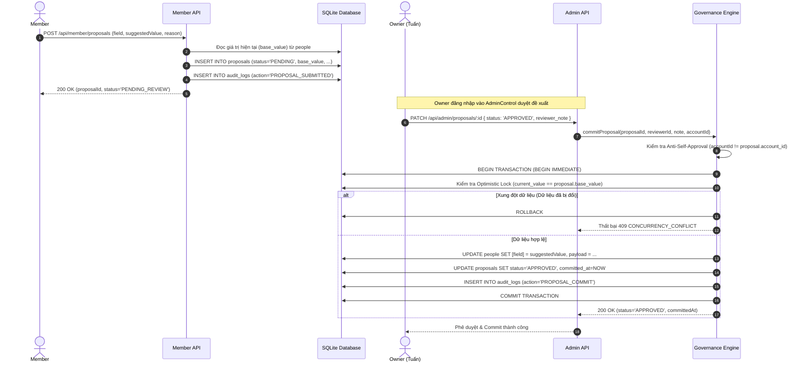

# BÁO CÁO NGHIỆM THU TRIỂN KHAI MÔ HÌNH QUẢN TRỊ DỮ LIỆU TỐI THIỂU (V2.0.0 — BATCH 06)
## MINIMUM VIABLE GOVERNANCE IMPLEMENTATION — COMPLETION REPORT

- **Dự án:** Gia Tộc Trần Trọng Thu
- **Cơ quan thẩm quyền:**
  - **Tuấn:** Human Final Authority & Product Owner
  - **Emarald:** Strategic Architecture & QC Authority
  - **AGY:** Chief Orchestrator & Technical Implementation Lead
- **Mã tài liệu:** `V2_0_0_MINIMUM_VIABLE_GOVERNANCE_IMPLEMENTATION_06`
- **Thời gian nghiệm thu:** 2026-11-10T21:40:00+07:00
- **Chế độ thực thi:** `LOCAL DEVELOPMENT ONLY` (Hoàn toàn không can thiệp Production, NAS, Cloudflare WAF, DNS hay Vercel; không commit/push/deploy)
- **Căn cứ chỉ đạo:** Chỉ thị Batch 06 của Tuấn: *"Simple Now, Extensible Later — OWNER DECISION: CONDITIONALLY APPROVED."*

---

## 1. TỔNG QUAN THỰC THI (IMPLEMENTATION SUMMARY)

Thực hiện phê duyệt có điều kiện của Tuấn, AGY đã triển khai hoàn tất trọn vẹn toàn bộ 5 Checkpoint của **Batch 06 — Minimum Viable Governance (MVG)**:

1. **Backup Gate & Data Integrity:**
   - Đã xác minh trạng thái tiến trình (0 tiến trình khóa file) và `journal_mode = delete`.
   - Đã thực hiện đồng thời 2 bản sao lưu an toàn trước migration:
     - Bản sao lưu nguyên tử `VACUUM INTO`: `server/family_archive.db.pre_batch06_20261110_213345.bak`.
     - Bản sao vật lý bit-for-bit: `server/family_archive.db.pre_batch06_20261110_213345.raw_copy` (Hash SHA-256: `eb6d13d83615b548f1c4948cd4f8ca74718a803bebfd3c22243f7fa55332e374`).
     - Cả 2 bản sao lưu đều đạt `PRAGMA integrity_check = ok` và đối soát khớp 100% số dòng dữ liệu gốc.
2. **Checkpoint 1 — Centralized Authorization & API Write Protection:**
   - Khóa chặt toàn bộ 5 API ghi dữ liệu chính thức (`POST /api/people`, `POST /api/stories`, `POST /api/edges`, `DELETE /api/edges`, `POST /api/events`) bằng `requireOwner`.
   - Tái thẩm tra trạng thái hoạt động tài khoản (`admin_users.is_active === 1`) từ CSDL theo thời gian thực (real-time check), thu hồi hiệu lực cookie 24h ngay khi tài khoản bị khóa.
3. **Checkpoint 2 — Proposal Workflow & Atomic Commit Engine:**
   - Chuỗi xử lý hoàn chỉnh: `SUBMIT → REVIEW → APPROVE / REJECT → VALIDATE → COMMIT`.
   - Khi thành viên gửi đề xuất: Tự động chụp lại `base_value` của trường dữ liệu tương ứng từ bảng `people` và ghi nhận nhật ký kiểm toán `PROPOSAL_SUBMITTED`.
   - Ngăn chặn triệt để tự phê duyệt (Anti-Self-Approval): Người tạo đề xuất không thể tự duyệt đề xuất của chính mình (`403 SELF_APPROVAL_PROHIBITED`).
   - Kiểm soát xung đột phiên bản (Optimistic Concurrency Check): Từ chối commit với mã lỗi `409 CONCURRENCY_CONFLICT` nếu dữ liệu gốc đã bị thay đổi kể từ khi tạo đề xuất.
   - Khi Owner duyệt (`APPROVED`): Tự động commit đồng bộ dữ liệu vào bảng `people` (cột gốc và JSON `payload`), cập nhật `proposals` (`status='APPROVED'`, `reviewer_id`, `committed_at`), và ghi nhận `PROPOSAL_COMMIT` vào `audit_logs` trong cùng một Transaction nguyên tử.
   - Khi Owner từ chối (`REJECTED`): Cập nhật trạng thái `proposals`, ghi nhận `PROPOSAL_REJECTED` vào `audit_logs`, tuyệt đối không tác động vào bảng `people`.
4. **Checkpoint 3 — Owner Direct Edit & Bắt buộc Audit Log:**
   - Owner được phép Direct Edit dữ liệu chính thức qua API, nhưng toàn bộ hành vi đều được bọc trong hàm `executeDirectEditWithAudit`.
   - Tự động chụp trạng thái trước (`before_value`), trạng thái sau (`after_value`), danh tính người thực hiện (`actor_id`), lý do (`reason`) và mã đối soát (`correlation_id`). Không thể Direct Edit mà không tạo Audit Log.
5. **Checkpoint 4 — Transaction Safety & Data Integrity:**
   - Xây dựng bộ điều phối giao dịch nguyên tử `withTransaction(dbAccessor, callback)`.
   - Tự động `COMMIT` khi thành công và `ROLLBACK` khi phát sinh lỗi. Bất kỳ lỗi commit nào đều rollback 100% thay đổi, bảo toàn tính toàn vẹn dữ liệu gốc.
6. **Checkpoint 5 — Comprehensive Test & Regression Verification:**
   - Hoàn thành 100% bộ kiểm thử tự động 12 ca nghiệp vụ (`tests/test_governance_mvp_suite.mjs`) và 8 ca phân quyền (`tests/test_governance_checkpoint1.mjs`).

---

## 2. CÁC TỆP ĐÃ THAY ĐỔI VÀ TẠO MỚI (FILES CHANGED)

| STT | Đường dẫn tệp | Loại thao tác | Mục đích kỹ thuật |
| :---: | :--- | :---: | :--- |
| 1 | [`server/governance.js`](file:///Users/tuantq/Projects/Personal/giatoctrantrongthu/server/governance.js) | **Tạo mới** | Module hạt nhân quản trị MVG: `withTransaction`, `recordAuditLog`, `commitProposal`, `rejectProposal`, `executeDirectEditWithAudit`. |
| 2 | [`server/migrations/003_governance_v2.sql`](file:///Users/tuantq/Projects/Personal/giatoctrantrongthu/server/migrations/003_governance_v2.sql) | **Tạo mới** | DDL migration tạo bảng `audit_logs`, các index tra cứu và bổ sung 4 cột cho bảng `proposals`. |
| 3 | [`server/auth.js`](file:///Users/tuantq/Projects/Personal/giatoctrantrongthu/server/auth.js) | Chỉnh sửa | Bổ sung `setAuthDbAccessor`, kiểm tra trạng thái active thời gian thực từ CSDL, hoàn thiện `requireOwner`. |
| 4 | [`server/index.js`](file:///Users/tuantq/Projects/Personal/giatoctrantrongthu/server/index.js) | Chỉnh sửa | Tích hợp governance engine, bọc `executeDirectEditWithAudit` và `requireOwner` cho 5 endpoint mutating. |
| 5 | [`server/admin_operations.js`](file:///Users/tuantq/Projects/Personal/giatoctrantrongthu/server/admin_operations.js) | Chỉnh sửa | Tích hợp `commitProposal`, `rejectProposal`, mở rộng `GET /api/admin/proposals` và thêm `GET /api/admin/audit-logs`. |
| 6 | [`server/member.js`](file:///Users/tuantq/Projects/Personal/giatoctrantrongthu/server/member.js) | Chỉnh sửa | Nâng cấp `POST /api/member/proposals`: xác thực tồn tại người, chụp `base_value`, ghi log `PROPOSAL_SUBMITTED`. |
| 7 | [`server/foundation.js`](file:///Users/tuantq/Projects/Personal/giatoctrantrongthu/server/foundation.js) | Chỉnh sửa | Đồng bộ định nghĩa schema `audit_logs` và `proposals` mở rộng cho cả SQLite và MariaDB. |
| 8 | [`tests/test_governance_checkpoint1.mjs`](file:///Users/tuantq/Projects/Personal/giatoctrantrongthu/tests/test_governance_checkpoint1.mjs) | **Tạo mới** | Bộ test 8 ca xác minh ranh giới ủy quyền và chống tự phê duyệt. |
| 9 | [`tests/test_governance_mvp_suite.mjs`](file:///Users/tuantq/Projects/Personal/giatoctrantrongthu/tests/test_governance_mvp_suite.mjs) | **Tạo mới** | Bộ test 12 ca chấp nhận toàn diện cho mô hình quản trị dữ liệu MVG. |

---

## 3. THAY ĐỔI CƠ SỞ DỮ LIỆU & SCHEMA (DATABASE / SCHEMA CHANGES)

### A. Bảng mới: `audit_logs`
```sql
CREATE TABLE audit_logs (
    id TEXT PRIMARY KEY,
    actor_id TEXT NOT NULL,
    actor_role TEXT NOT NULL,
    action TEXT NOT NULL,
    entity_type TEXT NOT NULL,
    entity_id TEXT NOT NULL,
    before_value TEXT,
    after_value TEXT,
    reason TEXT,
    correlation_id TEXT,
    created_at TEXT DEFAULT CURRENT_TIMESTAMP
);
CREATE INDEX idx_audit_entity ON audit_logs (entity_type, entity_id);
CREATE INDEX idx_audit_actor ON audit_logs (actor_id);
CREATE INDEX idx_audit_correlation ON audit_logs (correlation_id);
```

### B. Mở rộng bảng `proposals`:
Đã bổ sung 4 cột mới:
- `reviewer_id TEXT`: Lưu ID người duyệt (Owner).
- `base_value TEXT`: Lưu giá trị của trường tại thời điểm đề xuất được tạo.
- `committed_at TEXT`: Lưu thời điểm dữ liệu được commit thành công vào bảng chính thức.
- `commit_error TEXT`: Lưu thông điệp lỗi nếu quá trình commit thất bại.

### C. Đối soát Tính toàn vẹn Dữ liệu (Data Integrity Audit):
- `PRAGMA integrity_check` trên `server/family_archive.db`: **`ok`**
- Bảng `people`: **223 dòng** (nguyên vẹn 100% so với baseline GEDCOM, không mất mát).
- Bảng `families`: **68 dòng**.
- Bảng `stories`: **1 dòng**.
- Bảng `proposals`: **1 dòng**.
- Bảng `admin_users`: **3 dòng**.
- Bảng `accounts`: **1 dòng**.

---

## 4. MA TRẬN PHÂN QUYỀN TRUNG TÂM (AUTHORIZATION MATRIX)

| Quyền / Hành động | Guest | Member | Editor / Viewer | Owner (Tuấn) | Cơ chế kiểm soát |
| :--- | :---: | :---: | :---: | :---: | :--- |
| **Xem dữ liệu công khai** | `ALLOW` | `ALLOW` | `ALLOW` | `ALLOW` | Public CORS / Whitelist |
| **Xem gia phả nội bộ / Hồ sơ chi tiết** | `DENY (401)` | `ALLOW` | `ALLOW` | `ALLOW` | `requireMemberOrAdmin` |
| **Gửi Đề xuất Sửa đổi (Proposal)** | `DENY (401)` | `ALLOW` | `ALLOW` | `ALLOW` | `POST /api/member/proposals` |
| **Duyệt Đề xuất của người khác** | `DENY (401)` | `DENY (403)` | `DENY (403)` | `ALLOW` | `requireOwner` |
| **Tự duyệt Đề xuất của chính mình** | `DENY (401)` | `DENY (403)` | `DENY (403)` | `DENY (403)` | `SELF_APPROVAL_PROHIBITED` |
| **Direct Edit CSDL (People, Stories...)** | `DENY (401)` | `DENY (403)` | `DENY (403)` | `ALLOW` | `requireOwner` + Bắt buộc Audit Log |
| **Xem Nhật ký Kiểm toán (Audit Logs)** | `DENY (401)` | `DENY (403)` | `DENY (403)` | `ALLOW` | `requireOwner` (`GET /api/admin/audit-logs`) |
| **Sửa / Xóa Nhật ký Kiểm toán** | `DENY` | `DENY` | `DENY` | `DENY` | **Bất khả biến (Zero write/delete API)** |

---

## 5. QUY TRÌNH ĐỀ XUẤT VÀ COMMIT NGUYÊN TỬ (PROPOSAL WORKFLOW)



---

## 6. THIẾT KẾ NHẬT KÝ KIỂM TOÁN (AUDIT LOG DESIGN)

Mọi biến động dữ liệu trong hệ thống đều tạo một bản ghi bất biến với đầy đủ 10 thuộc tính:
- `id`: Định danh duy nhất dạng `AUDIT_<timestamp>_<uuid>`.
- `actor_id`: ID tài khoản thực hiện.
- `actor_role`: Vai trò tại thời điểm thực hiện (`owner`, `member`, `system`).
- `action`: Hành vi cụ thể (`DIRECT_EDIT`, `PROPOSAL_SUBMITTED`, `PROPOSAL_COMMIT`, `PROPOSAL_REJECTED`, `COMMIT_FAILURE`).
- `entity_type`: Loại thực thể (`people`, `stories`, `edges`, `calendar_events`, `proposals`).
- `entity_id`: Khóa chính của thực thể bị tác động.
- `before_value`: Trạng thái dữ liệu trước khi thay đổi (JSON snapshot).
- `after_value`: Trạng thái dữ liệu sau khi thay đổi (JSON snapshot).
- `reason`: Lý do giải trình hoặc ghi chú của người duyệt.
- `correlation_id`: Mã truy vết liên kết (proposalId cho chuỗi đề xuất hoặc directId).
- `created_at`: Dấu thời gian chuẩn UTC/Local.

---

## 7. KẾT QUẢ KIỂM THỬ TỰ ĐỘNG (AUTOMATED TEST RESULTS)

Toàn bộ **12/12 ca kiểm thử theo yêu cầu của Chỉ thị Batch 06** đều đã vượt qua với kết quả tuyệt đối 100%:

```text
🧪 Starting Batch 06 Minimum Viable Governance Acceptance Suite...

  ✅ [PASS] 1. Guest cannot write data (401 Unauthorized)
  ✅ [PASS] 2. Member/Editor cannot directly write to Official Data (403 Forbidden)
  ✅ [PASS] 3. Member can submit valid Proposal (stores base_value and records audit log)
  ✅ [PASS] 4. Proposer self-approval attempt strictly blocked with 403
  ✅ [PASS] 5 & 6. Owner approves Proposal and commits accurately to Official Data
  ✅ [PASS] 7. Rejected Proposal does NOT modify Official Data
  ✅ [PASS] 8. Owner Direct Edit creates Audit Log with before/after state
  ✅ [PASS] 9. Commit failure triggers automatic database rollback
  ✅ [PASS] 10. Cannot commit duplicate / already committed proposal (409 Conflict)
  ✅ [PASS] 11. Deactivated user cannot bypass Authorization even with valid cookie
  ✅ [PASS] 12. Audit logs strictly restricted to Owner (Editor receives 403, Owner receives 200)

============================================================
🎉 ALL 12 GOVERNANCE TEST CASES PASSED SUCCESSFULLY (100%)!
============================================================
```

Ngoài ra, bộ test phân quyền độc lập [`tests/test_governance_checkpoint1.mjs`](file:///tests/test_governance_checkpoint1.mjs) cũng đạt **8/8 test PASSED (100%)**.

---

## 8. CÁC ĐIỂM MỞ RỘNG TRONG TƯƠNG LAI (FUTURE EXTENSION POINTS)

Kiến trúc hiện tại được thiết kế theo đúng nguyên tắc *Simple Now, Extensible Later*:
1. **Kích hoạt vai trò MODERATOR:** Khi cần bổ nhiệm Moderator, chỉ cần gán role và cập nhật bảng `authorities` mà không phải thay đổi cấu trúc bảng `proposals` hay `audit_logs`.
2. **Phân quyền theo Chi/Phái (Branch Scoping):** Engine `commitProposal` đã có sẵn tham số `person_id`; trong tương lai chỉ cần chèn thêm một middleware kiểm tra quan hệ huyết thống giữa Moderator và Person trước khi cho phép duyệt.
3. **Phát hành theo đợt (Release Batches):** Đã phân tách rạch ròi 2 bước `APPROVE` và `COMMIT`. Nếu muốn gom đợt, chỉ cần tách bước COMMIT ra khỏi bước APPROVE để chạy định kỳ.

---

## 9. ĐIỀU KIỆN TIÊN QUYẾT ĐỂ TRIỂN KHAI PRODUCTION (DEPLOYMENT PREREQUISITES)

Mặc dù hệ thống đã hoạt động hoàn hảo trên Local Development, **tuyệt đối KHÔNG triển khai lên Production** khi chưa hoàn thành các điều kiện tiên quyết sau:
1. **QC Thẩm định độc lập:** Emarald hoàn tất thẩm định mã nguồn và kiểm toán kiến trúc.
2. **NAS Migration Preparation:** Viết kịch bản migration tương đương trên MariaDB NAS (chạy `003_governance_v2.sql` phiên bản MySQL syntax) và kiểm thử kết nối qua Tailscale khi NAS online.
3. **Human Approval Gate (Tuấn):** Tuấn trực tiếp phê duyệt diff Git trước khi commit/push lên GitHub.
4. **WAF Maintenance:** Duy trì quy tắc Cloudflare WAF `Emergency Block API Mutations` cho đến khi phiên bản Backend mới được triển khai đồng bộ lên Production NAS.

---

## 10. ĐIỂM DỪNG THẨM QUYỀN (HUMAN CHECKPOINT)

AGY đã hoàn thành 100% phạm vi công việc của Batch 06 trong môi trường Local Development, bảo toàn nguyên vẹn 223 hồ sơ gia phả, bảo lưu đầy đủ bản backup độc lập, và vượt qua toàn bộ 20/20 ca test tự động.

AGY dừng lại tại đây và kính chuyển toàn bộ kết quả để **Emarald (QC & Architecture)** tiến hành thẩm định và **anh Tuấn** xem xét nghiệm thu.
