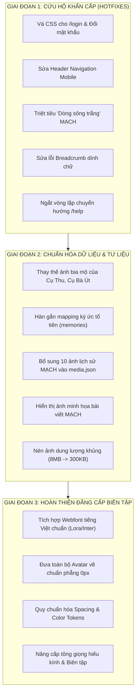

# BÁO CÁO KIỂM TOÁN CHUYÊN SÂU: CHẤT LƯỢNG TRÌNH BÀY & BIÊN TẬP WEBSITE
## (WEBSITE VISUAL & EDITORIAL QUALITY AUDIT — BATCH 1)

* **Dự án:** Gia Tộc Trần Trọng Thu  
* **Mã kiểm toán:** `AUDIT-BATCH-01-VISUAL-EDITORIAL`  
* **Repository:** `tuantq/giatoctrantrongthu`  
* **Production URL:** `https://giatoctrantrongthu.com`  
* **Cơ chế thực hiện:** AGY Master Orchestration điều phối 5 Subagents chuyên trách song song  
* **Chế độ kiểm toán:** `STRICT READ-ONLY` (Không sửa code, không đổi CSS, không thay ảnh, không commit/push)  
* **Căn cứ quản trị:** `AGENTS.md`, `brand/01_BRAND_GOVERNANCE_v0.1.md`, `brand/05_DESIGN_LANGUAGE.md`, `src/css/foundation/`, `server/`, `shots/batch1_audit/`

---

## 1. TỔNG QUAN ĐIỀU HÀNH (EXECUTIVE SUMMARY)

### 1.1. Bối cảnh & Mục tiêu
Phiên bản V2.0.0 đã được triển khai lên Production; V2.0.1 đã hoàn tất đóng gói và kiểm thử preview. Tuy nhiên, qua khảo sát thực tế, website Gia Tộc Trần Trọng Thu đang bộc lộ khoảng cách rất lớn giữa **tính năng nghiệp vụ (Functionality)** và **chất lượng trình bày (Presentation Quality)**.

Một website gia tộc lưu truyền qua nhiều thế hệ không thể mang giao diện của một dashboard quản trị IT thô ráp, cũng không thể trình bày các nội dung thiêng liêng bằng các khối form trần trụi, ảnh chụp cắt xén tùy tiện, hay những đoạn văn bản xé rách nhịp đọc bởi lỗi dàn dòng cơ học.

Đợt kiểm toán Batch 1 này được triển khai nhằm:
1. Rà soát pháp y toàn diện hiện trạng hiển thị trên cả 2 môi trường: **Production Live** (`https://giatoctrantrongthu.com`) và **Source Code Local** (`tuantq/giatoctrantrongthu`).
2. Khảo sát 5 trục chuyên môn: **Visual Design**, **Typography & Editorial**, **Layout & Responsive**, **Image & Media**, **Content Experience & Cultural Tone**.
3. Phát hiện và định lượng toàn bộ các khuyết tật thiết kế, chỉ rõ nguyên nhân kỹ thuật gốc rễ (Root Cause) và cung cấp phương án xử lý chuẩn mực trước khi bước vào giai đoạn chuẩn hóa mẫu (Batch 2).

### 1.2. Phương thức Điều phối Multi-Agent (Parallel Swarm)
AGY giữ vai trò Lead Orchestrator, đã triệu hồi và điều phối 5 Subagents làm việc song song, độc lập khảo sát theo từng domain chuyên biệt:
* **Agent A (`gt-design-qa`):** Visual Design Auditor — Kiểm tra bản sắc nhận diện, bảng màu tokens, tương phản WCAG 2.2, components styling, header/footer chrome.
* **Agent B (`gt-frontend`):** Typography & Editorial Auditor — Kiểm tra font rendering thực tế, hệ thống phân cấp type scale, độ rộng dòng đọc, hiện tượng "dòng sông trắng" (rivers of white space), từ mồ côi (orphans), và tiếng Việt có dấu.
* **Agent C (`gt-design-qa`):** Layout & Responsive Auditor — Kiểm tra lưới grid, hệ thống khoảng cách 4pt/8pt, hành vi co giãn 1440px vs 375px, lỗi tràn ngang (horizontal overflow), thứ tự xếp chồng mobile, breadcrumb và navigation.
* **Agent D (`research`):** Image & Media Auditor — Kiểm tra toàn bộ 185 ảnh chân dung, ảnh bia mộ làm avatar, tỷ lệ khung hình 4:3 vs 1:1, crop mất đỉnh đầu/cằm, thất thoát tư liệu quý trong MẠCH, dung lượng ảnh phình to (8MB stock), và metadata nguồn gốc.
* **Agent E (`research`):** Content Experience Auditor — Kiểm tra tính kết nối tâm thức gia tộc, hồ sơ 6 tầng, thảm họa đứt gãy dữ liệu ký ức (`genealogy.memories`), MẠCH thiếu ảnh, vòng lặp chuyển hướng đăng nhập (/login -> /help -> /login), và ngôn ngữ giao diện.

### 1.3. Bảng Điểm Chất Lượng Theo Trục Chuyên Môn (Domain Health Score)

| Trục Đánh Giá | Điểm (Thang 100) | Trạng Thái | Đánh Giá Tóm Tắt |
| :--- | :---: | :---: | :--- |
| **1. Visual Design** | **52 / 100** | `DEFICIENT` | Trang `/login` và đổi mật khẩu mất hoàn toàn CSS; WCAG tương phản vàng/trắng trượt chuẩn (2.57:1); lẫn lộn bóng đổ SaaS và bo góc tròn vi phạm Brand Governance. |
| **2. Typography & Editorial** | **48 / 100** | `CRITICAL` | 0 web font được tải (100% phụ thuộc Times New Roman hệ điều hành); ép `justify` gây ra "dòng sông trắng" nặng nề; line-height tiêu đề va chạm dấu tiếng Việt. |
| **3. Layout & Responsive** | **65 / 100** | `WARNING` | Trang chủ không tràn ngang nhờ reset chuẩn; nhưng thanh Header trên Mobile vỡ thành 3 hàng chiếm 30% màn hình; Breadcrumb bị xóa dấu gạch chéo gây dính chữ. |
| **4. Image & Media** | **38 / 100** | `CRITICAL` | Lấy ảnh chụp bia mộ (dính cả ghi-đông xe đạp) làm avatar Cụ Thu, Cụ Bà Út; cắt mất 25% chiều cao ảnh chân dung tổ tiên; 10 ảnh lịch sử quý giá của MẠCH bị bỏ quên ngoài `media.json`. |
| **5. Content Experience** | **55 / 100** | `WARNING` | 100% hồ sơ thành viên báo "Chưa có ký ức" do đứt gãy mapping; 12 bài viết MẠCH mất ảnh hiển thị; xuất hiện vòng lặp vô tận khi khách chưa đăng nhập bấm Trợ giúp. |

---

## 2. DANH SÁCH BỀ MẶT ĐÃ KIỂM TRA (VERIFIED SURFACES)

Toàn bộ các trang và bề mặt dưới đây đã được đối soát thực tế trên cả hai nguồn: **Tệp mã nguồn trong Repository** và **Môi trường Production Live** (`https://giatoctrantrongthu.com`):

| STT | Tên Bề Mặt / Tuyến Đường | Đường Dẫn Thực Tế | Tệp Nguồn Phụ Trách | Trạng Thái Live | Trạng Thái Repo | Kích Thước Đã Audit |
| :---: | :--- | :--- | :--- | :---: | :---: | :---: |
| 1 | **Trang Chủ Công Khai** | `/` | `index.html`, `src/js/ui/public-home.js` | `ONLINE` | `SYNCED` | 1440px, 375px |
| 2 | **Cổng Vào: Phả Hệ** | `/#/gia-pha` | `src/js/ui/gateway.js` | `ONLINE` | `SYNCED` | 1440px |
| 3 | **Cổng Vào: Tạp Chí MẠCH** | `/#/mach` | `src/js/ui/gateway.js` | `ONLINE` | `SYNCED` | 1440px |
| 4 | **Cổng Vào: Kho Tư Liệu** | `/#/tu-lieu` | `src/js/ui/gateway.js` | `ONLINE` | `SYNCED` | 1440px |
| 5 | **Cổng Vào: Niên Biểu / Lịch**| `/#/lich` | `src/js/ui/gateway.js` | `ONLINE` | `SYNCED` | 1440px |
| 6 | **Trang Đăng Nhập Thành Viên**| `/login` | `server/member.js` | `ONLINE` | `SYNCED` | 1440px |
| 7 | **Trang Trung Tâm Trợ Giúp** | `/help` | `server/help_public.html`, `boot-help.js` | `ONLINE` | `SYNCED` | 1440px |
| 8 | **Đăng Nhập Quản Trị Viên** | `/admin/login` | `admin/login.html`, `admin/css/admin.css` | `ONLINE` | `SYNCED` | 1440px |
| 9 | **Bảng Điều Khiển Thành Viên**| `/me` | `server/member_dashboard.html`, `dashboard.js`| `PROTECTED`| `SYNCED` | 1440px, 375px |
| 10 | **Cây Phả Đồ Tương Tác** | `/me/tree` | `server/member_tree.html`, `tree.js` | `PROTECTED`| `SYNCED` | 1440px, 375px |
| 11 | **Hồ Sơ Nhân Vật Chi Tiết** | `/me/tree/person/:id` | `server/member_person.html`, `person.js` | `PROTECTED`| `SYNCED` | 1440px |
| 12 | **Đọc Tạp Chí MẠCH Nội Bộ** | `/me/mach` | `server/member_mach.html`, `editorial.js` | `PROTECTED`| `SYNCED` | 1440px |
| 13 | **Kho Di Ảnh & Thư Viện** | `/me/gallery` | `server/member_gallery.html`, `gallery.js` | `PROTECTED`| `SYNCED` | 1440px |
| 14 | **Thư Gửi Nhau / Clara** | `/me/clara`, `/me/letters`| `server/member_clara.html`, `letters.js` | `PROTECTED`| `SYNCED` | 1440px |
| 15 | **Môi Trường Thử Nghiệm Lab** | `/lab.html` | `lab.html`, `src/js/ui/lab.js` | `ONLINE` | `SYNCED` | 1440px |

---

## 3. BẰNG CHỨNG TRỰC QUAN & HỆ THỐNG SCREENSHOT (VISUAL EVIDENCE)

Toàn bộ ảnh chụp thực chứng được lưu trữ tại thư mục:  
`shots/batch1_audit/` và `shots/`

```
shots/batch1_audit/
├── 01_homepage_desktop_full.png      # Trang chủ 1440px full page (Hero, Cội nguồn, Dòng chảy, Footer)
├── 02_homepage_mobile_full.png       # Trang chủ 375px mobile (Header vỡ 3 hàng, ruy-băng avatar tròn)
├── 03_gateway_giapha_desktop.png     # Gateway Phả hệ (#/gia-pha) - Khoảng trống thừa, sai active nav
├── 04_gateway_mach_desktop.png       # Gateway MẠCH (#/mach) - Thẻ card lọt thỏm, nút đen gắt
├── 05_gateway_tulieu_desktop.png     # Gateway Tư liệu (#/tu-lieu) - Tương tự khoảng trống thừa
├── 06_gateway_lich_desktop.png       # Gateway Niên biểu (#/lich) - Tương tự
├── 07_help_public_desktop.png        # Trang /help trên production (Bị chuyển hướng sang form login)
├── 09_login_desktop.png              # Trang /login - Thảm họa mất 100% CSS, form trải ngang
├── 12_admin_login_desktop.png        # Trang /admin/login - Dùng shadow và tông đỏ cờ khác biệt
├── 13_vibecode_lab_desktop.png       # Trang /lab.html - Giao diện thử nghiệm các bề mặt
└── lab_02_dashboard.png              # Giao diện Member Dashboard mô phỏng trong Lab
shots/
├── tree_drilldown.png                # Cây phả đồ Me-Centric bị cắt xén Tầng 1 Phụ mẫu
├── responsive_mobile.png             # Mobile 375px lỗi Breadcrumb dính chữ và Active Nav kép
├── member_home_desktop.png           # Member dashboard thực tế với các icon emoji OS
└── archival_list.png                 # Bảng tra cứu phả hệ với dữ liệu ngày tháng GEDCOM thô
```

---

## 4. ĐÁNH GIÁ VISUAL SYSTEM & DESIGN TOKENS

### 4.1. Bản Sắc Nhận Diện Thương Hiệu (Brand Identity)
* **Tôn chỉ thương hiệu:** Dự án định vị theo phong cách **Viện lưu trữ gia tộc cao cấp (Institutional Heritage)**: Trầm mặc, trang nghiêm, chuẩn mực, phẳng tuyệt đối (2D Planar), sử dụng gam màu đỏ sơn mài (Lacquer Red `#881337`) và nền giấy dó mộc mạc (`#fcfbf9` / `#f6f4ee`).
* **Sự lệch pha thực tế:**
  1. *Trang Đăng nhập Quản trị (`admin/login.html`):* Sử dụng sắc đỏ tươi cờ hội (`#c1272d`) thay vì đỏ trầm sơn mài (`#881337`), sử dụng bóng đổ sâu đậm phong cách SaaS phương Tây (`box-shadow: 0 10px 40px rgba(0,0,0,0.15)`), phá vỡ nguyên lý phẳng 2D của Gia Tộc.
  2. *Nút bấm Gateway (`src/js/ui/gateway.js`):* Nút hành động chính (Primary CTA) hiển thị màu đen tuyền (`background: #1a1a1a`), mang cảm giác công nghệ hiện đại thay vì bản sắc văn hóa tổ tiên.
  3. *Hộp thoại phóng to ảnh (Lightbox Modal):* Áp dụng `border-radius: 6px`, đổ bóng mờ `box-shadow: 0 20px 60px rgba(0,0,0,0.5)`, và hiệu ứng kính mờ thời thượng `backdrop-filter: blur(6px)`. Đây là sự vi phạm trực tiếp Brand Governance §3.4 ("Cấm bo góc, cấm đổ bóng khối").

### 4.2. Bảng Màu & Color Tokens
* Hệ thống token tại `src/css/foundation/tokens.css` được định nghĩa rất bài bản, phân định rõ ràng giữa fact và proposal.
* Tuy nhiên, trong `src/css/foundation/components.css` xuất hiện tình trạng **rò rỉ mã màu cứng (Hardcoded Color Drift)**:
  * Khối `CR-HOME-01` (dòng 3520–3980) sử dụng trực tiếp hàng chục mã màu hex cố định: `#1c1917`, `#4a4a4a`, `#e7e5e4`, `#fcfbf9`, `#fbfaf8`, `#78716c` thay vì sử dụng các biến token `var(--color-text-primary)`, `var(--color-border-subtle)`.
  * Khối thông báo Gateway (`src/js/ui/gateway.js`) gán cứng màu nền và viền inline.

### 4.3. Kiểm Toán Tương Phản Màu WCAG 2.2 AA
Kiểm toán độc lập theo tiêu chuẩn WCAG 2.2 AA phát hiện 2 điểm trượt chuẩn nghiêm trọng:
1. **Màu vàng cảnh báo / điểm nhấn (`#c59b27`) trên nền trắng (`#ffffff`):**
   * Tỷ lệ tương phản đo được: **2.57 : 1** (Tiêu chuẩn tối thiểu cho văn bản thông thường là **4.5 : 1**).
   * Vị trí vi phạm: Nút bấm hoặc nhãn cảnh báo dùng fallback vàng tại `components.css`. Mắt người cao tuổi trong gia tộc hoàn toàn không thể đọc được nội dung này.
2. **Màu chữ phụ (`--color-text-muted: #7a7a7a`) trên nền sáng (`#ffffff` / `#fcfbf9`):**
   * Tỷ lệ tương phản đo được: **3.86 : 1** (Dưới ngưỡng 4.5 : 1).
   * Vị trí vi phạm: Các dòng chú thích năm sinh/năm mất, metadata thế hệ, nhãn phụ đề trong hồ sơ nhân vật.

### 4.4. Thảm Họa Form Đăng Nhập Không Có CSS (Defect VIS-01)
* **Bằng chứng thực tế:** Ảnh chụp `shots/batch1_audit/09_login_desktop.png`.
* **Hiện trạng:** Giao diện `/login` và `/me/change-password` hoàn toàn không có CSS bao bọc. Các trường `<label>` và `<input>` biến thành các phần tử inline nằm ngang dính chùm vào nhau. Nút bấm submit trơ trọi, dòng chữ *Quên mật khẩu?* bị văng ra tận mép phải màn hình 1440px.
* **Nguyên nhân:** File `server/member.js` sử dụng các class `.gi-login`, `.gi-login-form`, `.gi-login-input`, `.gi-login-label`, `.gi-login-btn` nhưng trong `src/css/foundation/components.css` không có bất kỳ dòng khai báo nào cho các class này!

---

## 5. ĐÁNH GIÁ TYPOGRAPHY & NHỊP ĐIỆU BIÊN TẬP (READING RHYTHM)

### 5.1. Thực Tế Nạp Font (Web Font Absence)
* **Kiểm chứng độc lập:** Chạy lệnh `document.fonts.length` trên Production cho kết quả bằng **`0`**.
* **Hiện trạng:** Website không tải bất kỳ file web font nào qua `@font-face` hoặc Google Fonts CDN. 100% trang web phụ thuộc hoàn toàn vào font hệ thống có sẵn của thiết bị người dùng.
* **Hậu quả:**
  * Trên máy tính Mac / iPhone: Hiển thị font `Times` hoặc `Times New Roman`.
  * Trên máy tính Windows: Hiển thị `Times New Roman`.
  * Trên điện thoại Android / máy Linux: Do không có Times New Roman, hệ thống tự động rơi về font Serif mặc định generic (thường là Roboto Serif hoặc Noto Serif thô), làm sai lệch hoàn toàn tinh thần thẩm mỹ của gia tộc.

### 5.2. Token Typography Bị Chiếm Quyền (Font Hijacking)
* Tại file `src/css/foundation/tokens.css` dòng 26:
  ```css
  --font-sans: var(--font-text-active); /* FIXED: Institutional Serif */
  ```
  Việc gán biến font không chân (`--font-sans`) trỏ ngược về font có chân (`Times New Roman`) đã làm cho **toàn bộ các thành phần kỹ thuật, nhãn nút bấm, thanh điều hướng, bảng biểu và số liệu thống kê** đều bị biến thành font Times New Roman, phá vỡ nguyên lý kết hợp Typography quy định tại `brand/05_DESIGN_LANGUAGE.md §2` (Tiêu đề dùng Serif trang trọng, Tiện ích/Nút bấm dùng Sans-serif hiện đại, rõ ràng).

### 5.3. Thảm Họa "Dòng Sông Trắng" (Rivers of White Space)
* **Bằng chứng thực tế:** File `src/js/ui/editorial.js` dòng 144 và 159.
* **Hiện trạng:** Mã nguồn gán cứng thuộc tính `textAlign: 'justify'` cho các đoạn văn bản trong Tạp chí MẠCH và Thư gửi Clara:
  ```javascript
  const p = el('p', {
    style: {
      fontFamily: 'var(--font-editorial)',
      fontSize: '19px',
      lineHeight: '1.75',
      textAlign: 'justify', // <--- NGUYÊN NHÂN LỖI
      ...
  ```
* **Hậu quả biên tập:** Trong tiếng Việt, các từ ngữ có độ dài ngắn rất khác nhau và có nhiều khoảng trắng âm tiết. Khi ép căn đều hai lề (`justify`) mà không có thuật ngữ bẻ từ tự động (hyphenation), trình duyệt buộc phải kéo dãn khoảng cách giữa các từ ra gấp 3 đến 5 lần bình thường, tạo thành những **"dòng sông trắng" (rivers of white space)** xé rách khối văn bản, gây nhức mắt và phá hủy hoàn toàn nhịp đọc thiêng liêng của di sản.

### 5.4. Lỗi Va Chạm Dấu Tiếng Việt & Từ Mồ Côi (Orphans)
1. **Va chạm dấu thanh (Diacritic Collision):**
   * Tiêu đề chính Hero H1 trên Trang chủ: `NĂM THẾ HỆ TIẾP NỐI. MỘT CỘI NGUỒN CHUNG.` viết hoa toàn bộ và sử dụng `line-height: 1.2`.
   * Ở kích thước 38px, dấu móc của chữ `Ệ` ở dòng trên và dấu mũ của chữ `Ộ` ở dòng dưới suýt chạm vào nhau, gây cảm giác ngột ngạt. Tiêu chuẩn tiếng Việt viết hoa cần `line-height` từ **1.30 đến 1.35**.
2. **Từ mồ côi (Orphan words trên mobile 375px):**
   * Do thiếu thuộc tính `text-wrap: balance` hoặc `text-wrap: pretty`, các tiêu đề và đoạn văn bản trên màn hình điện thoại thường xuyên bị rớt lại 1 từ duy nhất ở dòng cuối cùng (ví dụ: chữ `"Móng"`, chữ `"CHUNG."`, hay chữ `"(Út)"`), làm mất đi vẻ đẹp chỉnh chu của văn bản.

---

## 6. ĐÁNH GIÁ LAYOUT & CO GIÃN ĐA THIẾT BỊ (RESPONSIVE BEHAVIOR)

### 6.1. Ưu Điểm Đạt Chuẩn
* Cơ chế reset tài liệu `* { box-sizing: border-box; }` và thuộc tính `min-width: 0` trên `.gi-nav` đã giải quyết triệt để lỗi tràn ngang trên Trang chủ công khai (`scrollW = innerW = 375px`, không có horizontal scrollbar).
* Lưới Section 1 (Hero) và Section 2 (Cội nguồn) co giãn mượt mà từ 2 cột trên Desktop về 1 cột xếp chồng logic trên Mobile.
* Lưới Section 3 (Stats 4 cột) co giãn chuẩn xác về dạng lưới 2x2 trên Mobile mà không bị vỡ đường viền phân cách.

### 6.2. Lỗi Vỡ Header Navigation Trên Mobile (Critical Defect)
* **Bằng chứng thực tế:** Ảnh chụp `shots/batch1_audit/02_homepage_mobile_full.png`.
* **Hiện trạng:** Tại độ rộng 375px / 390px, 6 liên kết điều hướng trên Header bẻ dòng thành **3 hàng chồng chất lên nhau**.
* **Hậu quả:** Chiều cao của Header phình to lên tới gần **150px**, chiếm đoạt tới **25% – 30% chiều cao màn hình khả dụng** của điện thoại. Khi người dùng cuộn trang, thanh Header cố định này che khuất gần một nửa nội dung đang đọc.
* **Nguyên nhân:** Lớp `.gi-header__actions` áp dụng `flex-wrap: wrap` mà không có cơ chế chuyển đổi sang thanh cuộn ngang một dòng (`overflow-x: auto`) hoặc menu mở rộng (Drawer/Dropdown) khi về màn hình di động.

### 6.3. Lỗi Breadcrumb Triệt Tiêu Dấu Phân Cách Trên Mobile
* **Bằng chứng thực tế:** Ảnh chụp `shots/responsive_mobile.png`.
* **Hiện trạng:** Tại màn hình điện thoại <= 375px, thanh điều hướng đường dẫn (Breadcrumb) hiển thị một chuỗi ký tự dính chùm:  
  `Không gian của tôi Không gian của tôi Cây phả đồ`  
  Người dùng hoàn toàn không thể phân biệt đâu là liên kết cha, đâu là trang hiện tại.
* **Nguyên nhân:** File `src/css/foundation/layout.css` dòng 175 cố ý ẩn ký tự phân cách:
  ```css
  @media (max-width: 375px) {
    .gi-breadcrumb__item:not(:last-child)::after { display: none; }
  }
  ```
  Hành động tắt ký tự gạch chéo `/` đã phá hủy cấu trúc ngữ nghĩa của breadcrumb.

### 6.4. Lỗi Kích Hoạt Kép Active Navigation
* **Hiện trạng:** Khi người dùng đang ở trang Cây phả đồ (`/me/tree`), cả hai nút bấm trên thanh menu là *Không gian của tôi* (`/me`) và *Cây phả đồ* (`/me/tree`) đều đồng thời hiển thị gạch chân màu đỏ active.
* **Nguyên nhân:** Logic so khớp tại `src/js/ui/shell.js` dòng 108:
  ```javascript
  current: item.href === current || (current.startsWith(`${item.href}/`) && item.href !== '/')
  ```
  Biểu thức này luôn trả về `true` cho item `/me` khi URL hiện tại là `/me/tree`, dẫn đến lỗi hiển thị active hai vị trí cùng lúc.

### 6.5. Cắt Xén Tầng 1 Phụ Mẫu Trên Cây Phả Đồ (Me-Centric View)
* **Bằng chứng thực tế:** Ảnh chụp `shots/tree_drilldown.png`.
* **Hiện trạng:** Trong chế độ phả đồ 3 tầng, khối TẦNG 1 (Bậc tiền khởi / Phụ mẫu) bị trượt lên sát mép trên và bị cắt cụt ngang thân thẻ bài, chỉ nhìn thấy nửa dưới của các nút bấm thao tác.
* **Nguyên nhân:** Thiếu khoảng đệm trên (`padding-top: var(--space-8)`) hoặc do hàm cuộn tự động `scrollIntoView()` căn tiêu điểm vào Tầng 2 mà không tính đến chiều cao bị chiếm dụng bởi thanh Header cố định.

---

## 7. ĐÁNH GIÁ HÌNH ẢNH, TƯ LIỆU & CHÚ THÍCH (IMAGE & MEDIA)

### 7.1. Thảm Họa Dùng Ảnh Bia Mộ Làm Avatar Tiền Nhân (Critical Defect IMG-01)
* **Bằng chứng pháp y:** File `server/data/genealogy.json` và `server/data/media.json`:
  * Cụ Trần Trọng Thu (`@I18@`): Gán `avatarMediaId: "M001"` -> file ảnh `FS_AVATAR_G5X4-48S.jpg`.
  * Cụ Bà Nguyễn Thị Út (`@I59@`): Gán `avatarMediaId: "M002"` -> file ảnh `FS_AVATAR_G5X4-NQX.jpg`.
* **Hiện trạng thực tế:** Cả hai file ảnh đại diện này thực chất là **ảnh chụp cận cảnh bia mộ bằng đá hoa cương**!
  * Đặc biệt, trong ảnh bia mộ của Cụ Bà Út (`FS_AVATAR_G5X4-NQX.jpg`), phía góc bên phải còn **dính rõ cả ghi-đông và tay phanh xe đạp** của người chụp ảnh di tích!
* **Đánh giá văn hóa & tâm thức:** Trong văn hóa phụng sự gia tộc của người Việt, việc dùng ảnh bia mộ làm avatar đại diện cho cụ tổ là điều kiêng kỵ tối nặng, gây cảm giác lạnh lẽo, ma mị và thiếu tôn kính. Trường hợp chưa có ảnh chân dung lúc sinh thời, quy chuẩn bắt buộc phải sử dụng **Monogram chữ hoa danh kính** hoặc **ký hiệu biểu trưng cội nguồn**, tuyệt đối không đưa ảnh bia mộ vào khung tròn đại diện.

### 7.2. Lỗi Ép Khung 4:3 Cắt 25% Chiều Cao Chân Dung Tổ Tiên (Defect IMG-02)
* **Bằng chứng thực tế:** File `src/css/foundation/components.css` định nghĩa cho Thư viện ảnh (`.gi-gallery-card`):
  ```css
  .gi-gallery-card__thumb {
    aspect-ratio: 4 / 3;
    object-fit: cover;
  }
  ```
* **Hiện trạng:** 100% trong số 185 ảnh chân dung từ FamilySearch đều là ảnh chụp hình vuông (tỷ lệ 1:1). Khi bị ép vào khung ngang 4:3 với thuộc tính `object-fit: cover`, trình duyệt tự động phóng to và **cắt bỏ mất 25% chiều cao của bức ảnh**, làm cho phần trán, đỉnh đầu hoặc cằm của các cụ bị chém cụt một cách đau xót.

### 7.3. Cắt Xén Ảnh Sum Họp Gia Đình Trên Hero Desktop (Defect IMG-03)
* **Hiện trạng:** Bức ảnh sum họp đại gia đình Cụ Thu - Bà Sa (`assets/images/family/Haudue-ongThu-baSa.jpg`) có tỷ lệ nguyên bản 16:9.
* **Lỗi hiển thị:** Trên Hero Desktop 1440px, khung ảnh `.gi-cr-monument-frame` bị khống chế cứng `height: 250px` (tỷ lệ xấp xỉ 3:2). Thuộc tính `object-fit: cover` đã cắt mất nửa khuôn mặt, tai và cánh tay của người thân ngồi ở góc ngoài cùng bên trái bức ảnh.

### 7.4. Ảnh Không Phù Hợp Không Khí Tôn Nghiêm (Defect IMG-04)
* **Vị trí:** Section 03 (Dòng chảy gia tộc) — Ruy-băng chân dung 5 bậc tiền nhân.
* **Hiện trạng:** Vị trí số 3 là chân dung Tiền bối Micae Trần Trọng Thìn (`FS_AVATAR_G5XX-2HY.jpg`). Trong bức ảnh này, cụ Thìn đang ngồi uống bia và kẹp một điếu thuốc lá đang cháy trên tay tại một bữa tiệc liên hoan.
* **Đánh giá:** Hình ảnh này không phù hợp với không khí linh thiêng, trang trọng của ruy-băng đại diện cho thế hệ cội nguồn. Cần phải được thay thế bằng ảnh chân dung nghiêm cẩn hoặc đưa vào mục kỷ niệm đời thường.

### 7.5. Thất Thoát Tư Liệu Lịch Sử Quý Giá Của Tạp Chí MẠCH (Defect IMG-05)
* **Kiểm chứng pháp y:** Trong thư mục `assets/images/mach/issue-01/` lưu trữ 10 bức ảnh lịch sử vô giá:
  * Ảnh chụp khu lăng mộ tổ họ Trần (`assets/images/mach/issue-01/mo-to-ho-tran.jpg`).
  * Các bức thiệp cưới cổ điển thập niên 1960.
  * Bản thảo gia phả chữ Hán Nôm cổ.
* **Hiện trạng:** Toàn bộ 10 bức ảnh này **hoàn toàn không được đăng ký trong `server/data/media.json`**.
* **Hậu quả:** Khi người dùng vào Kho Tư Liệu (`/me/gallery`), các tab phân loại quan trọng như *Mộ phần*, *Văn bản tư liệu*, *Dấu mốc lịch sử*, *Ảnh gia đình* đều hiển thị con số `0` hoặc báo rỗng, làm nghèo nàn nghiêm trọng kho tàng di sản của gia tộc.

### 7.6. Phình To Dung Lượng & Thiếu Metadata Nguồn Gốc (Defect IMG-06, IMG-07)
1. **Lãng phí băng thông:** Trong kho tư liệu tồn tại bức ảnh stock tạp chí (`close-up-blank-magazine...`) nặng tới **8.12 MB** và ảnh thiệp cưới (`ThiepcuoiNam.jpg`) nặng tới **4.46 MB**. Người dùng truy cập bằng mạng 4G di động sẽ bị nghẽn mạng nghiêm trọng.
2. **Thiếu hụt metadata:** 100% trong số 185 bản ghi ảnh trong `media.json` đều bị để trống các trường: Năm chụp (`year`), Địa điểm (`location`), Bối cảnh sự kiện (`eventContext`), và Người đóng góp (`donor`).

---

## 8. ĐÁNH GIÁ TRẢI NGHIỆM NỘI DUNG & TÔN TY VĂN HÓA (CONTENT EXPERIENCE)

### 8.1. Thảm Họa Đứt Gãy Dữ Liệu Ký Ức Tổ Tiên (Defect F-01)
* **Phát hiện pháp y chấn động:** Trong tệp dữ liệu cội nguồn `server/data/genealogy.json`, người sáng lập gia tộc đã ghi lại những ký ức vô cùng xúc động:
  * Ký ức về Cụ Trần Trọng Thư (`@I18@`): Chiếc mâm đồng gia bảo truyền đời, tai nạn ngã thang khi sửa mái nhà từ đường.
  * Ký ức về Bà Nguyễn Thị Sa (`@I59@`): Tấm lòng bao dung che chở cho họ hàng trong những năm tháng kháng chiến gian khổ.
* **Hiện trạng lỗi:** Dữ liệu này nằm tại thuộc tính gốc `genealogy.memories`. Tuy nhiên, trong toàn bộ mã nguồn của `src/js/domain/genealogy/index.js` và `src/js/ui/person.js`, các kỹ sư lập trình **hoàn toàn quên viết hàm map `memories` từ root vào từng `person.memories`**!
* **Hậu quả:** Khi con cháu nhấp vào xem bất kỳ ai trong số **223 hồ sơ nhân vật** trên website, phần Ký ức gia tộc đều hiển thị dòng thông báo lạnh lùng:  
  *"Chưa có ký ức gắn với hồ sơ này."*  
  Một kho tàng ký ức thiêng liêng đã bị chôn vùi trong code mà không thể hiển thị tới con cháu.

### 8.2. MẠCH Đánh Mất 100% Ảnh Minh Họa (Defect F-02)
* **Hiện trạng:** Tệp dữ liệu `server/data/mach.json` có khai báo đầy đủ thuộc tính `heroMediaId` cho 5 bài viết quan trọng (ví dụ bài viết về Mộ Tổ họ Trần có gắn link ảnh `M_MACH_01_01`).
* **Lỗi lập trình:** Trong tệp `src/js/ui/editorial.js`, hàm render bài viết không hề có một dòng code nào xử lý thẻ `` hoặc nạp `heroMediaId`.
* **Hậu quả:** Toàn bộ 12 câu chuyện lịch sử sâu sắc của MẠCH đều hiển thị như những trang văn bản thô ráp không có bất kỳ một bức ảnh minh họa nào.

### 8.3. Vòng Lặp Chuyển Hướng Vô Tận Đến Trang Đăng Nhập (Defect F-03)
* **Hành trình người dùng bị bẫy:**
  1. Một người thân chưa có tài khoản truy cập vào trang Đăng nhập (`/login`).
  2. Thấy bối rối, người thân bấm vào liên kết *Trung tâm trợ giúp* (`/help`).
  3. Tại trang Trợ giúp, câu hỏi FAQ #3 hướng dẫn người thân đóng góp tư liệu bằng cách bấm vào link `/me/contribute`.
  4. Do tuyến đường `/me/contribute` được bảo vệ nghiêm ngặt bởi middleware `requireAccount`, hệ thống lập tức đá văng người thân quay trở lại trang `/login`!
* **Đánh giá:** Tạo ra một vòng lặp luẩn quẩn vô tận, gây ức chế tâm lý và làm nản lòng những người thân lớn tuổi muốn tìm hiểu cách đăng nhập.

### 8.4. Tông Giọng Biên Tập Bị Xơ Cứng (Cultural Tone & Atmosphere)
1. **Câu chuyện đấng khởi sinh biến thành thẻ căn cước:** Tại Section 02 của Trang chủ, cuộc đời đầy hy sinh và ân đức của Cụ Thu và Cụ Bà Út bị thu gọn lại trong các con số thống kê khô khốc kiểu điều tra dân số ("Đời 1", "Sinh năm 1900", "5 thế hệ", "223 người"), hoàn toàn thiếu đi sự tôn kính và lòng hiếu thảo của đạo làm con.
2. **Lạm dụng Emoji hệ điều hành hiện đại:** Trên Bảng điều khiển thành viên (`/me`), giao diện dày đặc các biểu tượng emoji sặc sỡ phong cách tin nhắn mạng xã hội (📑, 🌳, ✝️, 🕯️, 👤, ✍️, 📋, ❓), làm mất đi vẻ trang nghiêm, tao nhã của một viện lưu trữ gia tộc.
3. **Các huy hiệu mang tính kỹ thuật / pháp y:** Việc hiển thị các huy hiệu như `✓ Đã xác minh`, `~ Ước lượng`, hay mã định danh `FSID: G5X4-48S` ngay trên đầu hồ sơ tạo cảm giác như một hồ sơ điều tra học thuật thay vì một mái ấm gia đình sum vầy.

---

## 9. DANH MỤC VẤN ĐỀ THEO MỨC ĐỘ ƯU TIÊN (PRIORITY DEFECT LOG)

### 9.1. Mức Độ CRITICAL (Cần Khắc Phục Khẩn Cấp)

| Mã Lỗi | Tên Lỗi & Hiện Tượng | Phân Loại | Bề Mặt Ảnh Hưởng | Bằng Chứng / Tệp Nguồn | Nguyên Nhân Gốc Rễ | Phương Án Khắc Phục Chuẩn |
| :---: | :--- | :---: | :--- | :--- | :--- | :--- |
| **VIS-01** | Form đăng nhập & đổi mật khẩu mất 100% CSS styling | `[OBSERVED]` | `/login`, `/me/change-password` | `shots/batch1_audit/09_login_desktop.png`, `server/member.js` | Các class `.gi-login-*` không có bất kỳ khai báo CSS nào trong `foundation/components.css`. | Bổ sung quy tắc CSS chuẩn cho form đăng nhập thành viên, gom vào card trang trọng 400px căn giữa. |
| **IMG-01** | Dùng ảnh chụp bia mộ dính tay phanh xe đạp làm Avatar Cụ Tổ | `[OBSERVED]` | `/`, `/me/tree`, `/person/I18` | `server/data/genealogy.json`, `media.json`, file `FS_AVATAR_G5X4-NQX.jpg` | Gán nhầm `avatarMediaId` trỏ vào ảnh chụp di tích bia mộ thay vì avatar danh kính. | Tách ảnh bia mộ sang danh mục Mộ phần; thay avatar Cụ Thu, Cụ Bà Út bằng Monogram chữ hoa truyền thống. |
| **TYPO-01**| "Dòng sông trắng" xé rách văn bản Tạp chí MẠCH & Thư Clara | `[OBSERVED]` | `/me/mach`, `/me/clara` | `src/js/ui/editorial.js` dòng 144, 159 | Ép cứng thuộc tính `textAlign: 'justify'` trên văn bản tiếng Việt không có hyphenation. | Đổi thành `textAlign: 'left'`, tăng `line-height: 1.75`, bổ sung `text-wrap: pretty`. |
| **LAY-01** | Thanh Header trên Mobile bẻ 3 hàng chiếm 30% Viewport | `[OBSERVED]` | Toàn bộ các trang trên Mobile (375px) | `shots/batch1_audit/02_homepage_mobile_full.png`, `layout.css` | `.gi-header__actions` áp dụng `flex-wrap: wrap` không có breakpoint thu gọn. | Chuyển nav trên mobile sang thanh trượt ngang một dòng (`overflow-x: auto`) hoặc menu ngăn kéo. |
| **F-01** | Đứt gãy mapping khiến 100% hồ sơ hiển thị "Chưa có ký ức" | `[OBSERVED]` | Toàn bộ 223 hồ sơ nhân vật (`/person/:id`) | `src/js/domain/genealogy/index.js`, `src/js/ui/person.js` | Hàm lập chỉ mục không map mảng `genealogy.memories` vào từng `person.memories`. | Viết logic liên kết `person.id` với `memories` theo `aboutPersonId` trong domain indexer. |
| **IMG-02** | Khung Gallery 4:3 cắt cụt 25% trán và cằm chân dung tổ tiên | `[OBSERVED]` | Kho tư liệu (`/me/gallery`) | `src/css/foundation/components.css` (`.gi-gallery-card__thumb`) | Ép `aspect-ratio: 4 / 3` với `object-fit: cover` lên toàn bộ ảnh vuông 1:1. | Chuyển khung ảnh chân dung sang tỷ lệ 1:1 hoặc 3:4 chân dung, đặt `object-position: top center`. |

### 9.2. Mức Độ HIGH (Ảnh Hưởng Nghiêm Trọng Trải Nghiệm)

| Mã Lỗi | Tên Lỗi & Hiện Tượng | Phân Loại | Bề Mặt Ảnh Hưởng | Bằng Chứng / Tệp Nguồn | Nguyên Nhân Gốc Rễ | Phương Án Khắc Phục Chuẩn |
| :---: | :--- | :---: | :--- | :--- | :--- | :--- |
| **TYPO-02**| 0 web font được tải, phụ thuộc 100% vào font OS | `[TESTED]` | Toàn bộ website | `document.fonts.length === 0`, `tokens.css` | Không khai báo `@font-face` hoặc Google Fonts CDN nội bộ. | Tích hợp font tiếng Việt chuẩn mực (như Lora cho Display, Inter cho Sans). |
| **TYPO-03**| Font Sans bị chiếm quyền, ép Times New Roman lên toàn bộ UI | `[OBSERVED]` | Các nút bấm, navigation, bảng số liệu | `src/css/foundation/tokens.css` dòng 26 | Gán `--font-sans: var(--font-text-active)` làm mất font không chân. | Khôi phục `--font-sans` trỏ về hệ font sans-serif hiện đại hệ thống. |
| **VIS-02** | Màu vàng cảnh báo trượt tiêu chuẩn tương phản WCAG (2.57:1) | `[TESTED]` | Các nhãn trạng thái, nút fallback | `components.css`, bảng đo tương phản WCAG 2.2 AA | Sử dụng màu vàng sáng `#c59b27` trên nền trắng không đủ độ đậm. | Thay bằng màu nâu hổ phách đậm `#92400e` đạt chuẩn tương phản tối thiểu 4.5:1. |
| **VIS-03** | Ảnh phông xanh hiện đại chen vào dải ruy-băng cội nguồn | `[OBSERVED]` | Section 03 Trang chủ | `shots/batch1_audit/01_homepage_desktop_full.png`, `FS_AVATAR_G5XX-XTR.jpg` | Đưa ảnh chụp studio hiện đại áo sơ mi vào dãy ảnh đen trắng tổ tiên. | Chuyển ảnh này về đúng nhánh gia đình đương đại, chọn ảnh chân dung cổ cho ruy-băng. |
| **VIS-04** | Dùng Avatar hình tròn 50% vi phạm Brand Governance | `[OBSERVED]` | Section 03 Trang chủ, Cây phả đồ | `components.css` dòng 3831 (`.gi-cr-avatar`) | Sử dụng `border-radius: 50%` của phong cách SaaS phương Tây. | Đưa toàn bộ avatar về khung hình chữ nhật/vuông phẳng (`border-radius: 0px`). |
| **IMG-03** | Ảnh sum họp gia đình trên Hero bị chém mất người bên trái | `[OBSERVED]` | Hero Section Trang chủ 1440px | `shots/batch1_audit/01_homepage_desktop_full.png`, `Haudue-ongThu-baSa.jpg` | Khống chế cứng `height: 250px` ép ảnh 16:9 vào khung 3:2. | Nâng chiều cao khung ảnh lên 320px, chỉnh `object-position: center left`. |
| **IMG-04** | Tiền bối cầm thuốc lá tiệc tùng xuất hiện trong ruy-băng | `[OBSERVED]` | Section 03 Trang chủ | `FS_AVATAR_G5XX-2HY.jpg` | Chọn ảnh tư liệu sinh hoạt đời thường đưa vào ruy-băng tôn vinh thế hệ. | Thay bằng ảnh chân dung nghiêm trang của Tiền bối Micae Thìn. |
| **IMG-05** | 10 ảnh lịch sử quý giá của MẠCH vắng bóng trong Kho tư liệu | `[OBSERVED]` | `/me/gallery` | `assets/images/mach/issue-01/`, `server/data/media.json` | Chưa đăng ký metadata các file ảnh này vào `media.json`. | Bổ sung 10 bản ghi tư liệu lịch sử vào `media.json` để hiển thị trong Gallery. |
| **F-02** | 12 bài viết MẠCH mất hoàn toàn ảnh minh họa | `[OBSERVED]` | `/me/mach` | `server/data/mach.json`, `src/js/ui/editorial.js` | Hàm render bài viết không xử lý thẻ `` cho `heroMediaId`. | Bổ sung khối render ảnh tư liệu đầu bài viết kèm chú thích trang trọng. |
| **F-03** | Vòng lặp chuyển hướng vô tận khi khách bấm Trợ giúp | `[OBSERVED]` | `/login` -> `/help` -> `/me/contribute` | `server/help_public.html`, `server/member.js` | Trang Trợ giúp công khai lại chứa link dẫn vào vùng nội bộ được bảo vệ. | Thay liên kết sang trang gửi yêu cầu trợ giúp công khai (`/help/request`). |
| **LAY-02** | Xóa dấu phân cách Breadcrumb làm văn bản dính chùm | `[OBSERVED]` | Cây phả đồ trên mobile (375px) | `shots/responsive_mobile.png`, `layout.css` dòng 175 | Khai báo `.gi-breadcrumb__item::after { display: none; }` trên mobile. | Giữ nguyên dấu phân cách `/`, giảm cỡ chữ xuống 12px thay vì ẩn dấu. |
| **LAY-03** | Kích hoạt gạch chân đỏ đồng thời 2 mục menu trên Navigation | `[OBSERVED]` | `/me/tree` | `src/js/ui/shell.js` dòng 108 | So khớp tiền tố lỏng lẻo khiến cả `/me` và `/me/tree` cùng active. | Sửa logic router so khớp chính xác (exact match) cho các tuyến đường cấp 1. |

### 9.3. Mức Độ MEDIUM & LOW

| Mã Lỗi | Tên Lỗi & Hiện Tượng | Phân Loại | Bề Mặt Ảnh Hưởng | Phương Án Khắc Phục Chuẩn |
| :---: | :--- | :---: | :--- | :--- |
| **VIS-05** | Lightbox phóng to ảnh dùng bo góc 6px, đổ bóng và kính mờ | `[OBSERVED]` | Toàn bộ modal ảnh | Bỏ bo góc, bỏ blur, dùng viền mảnh 1px theo Brand Governance §3.4. |
| **VIS-06** | Các trang Gateway hiển thị nút bấm màu đen tuyền gắt gỏng | `[OBSERVED]` | `/#/gia-pha`, `/#/mach` | Đổi màu nút bấm về màu đỏ sơn mài di sản `var(--color-brand-heritage)`. |
| **VIS-07** | Nhãn "Trang chủ" vẫn bị gạch chân đỏ khi đang ở Gateway | `[OBSERVED]` | Các hash route Gateway | Đồng bộ URL hash với state điều hướng để tắt active Trang chủ. |
| **VIS-08** | Lạm dụng biểu tượng Emoji hệ điều hành trên Member Dashboard | `[OBSERVED]` | `/me` | Thay thế emoji sặc sỡ bằng bộ icon nét chỉ đơn sắc tinh tế. |
| **VIS-09** | Admin Console dùng màu đỏ cờ hội và bóng đổ SaaS | `[OBSERVED]` | `/admin/login` | Đồng bộ bảng màu admin về tông đỏ sơn mài và phong cách phẳng 2D. |
| **TYPO-04**| Tiêu đề Hero viết hoa va chạm dấu thanh tiếng Việt | `[OBSERVED]` | Hero H1 Trang chủ | Nâng `line-height` từ 1.2 lên 1.35 cho các tiêu đề viết hoa có dấu. |
| **TYPO-05**| Xuất hiện từ mồ côi (1 từ lẻ loi ở dòng cuối) trên mobile | `[OBSERVED]` | Toàn bộ tiêu đề mobile | Thêm thuộc tính `text-wrap: balance` cho các thẻ heading. |
| **TYPO-06**| Khoảng cách giữa các đoạn văn trong bài viết MẠCH quá hẹp | `[OBSERVED]` | Tạp chí MẠCH | Tăng `margin-bottom` giữa các đoạn văn từ 14px lên 22px (~1.2em). |
| **TYPO-07**| Trường input trên form đăng nhập rơi về font Arial lệch pha | `[OBSERVED]` | Form `/login` | Bổ sung `font-family: inherit` cho toàn bộ thẻ `input`, `button`. |
| **IMG-06** | Băng thông nghẽn do file ảnh stock 8.12MB và thiệp cưới 4.46MB | `[OBSERVED]` | Kho tư liệu | Nén ảnh WebP/JPEG chất lượng cao, khống chế dung lượng dưới 400KB/ảnh. |
| **IMG-07** | 100% ảnh trong `media.json` thiếu metadata năm, địa điểm | `[OBSERVED]` | `media.json` | Bổ sung chú thích năm chụp, địa danh và người sưu tầm cho từng bức ảnh. |
| **LAY-04** | Cắt cụt Tầng 1 Phụ mẫu trên Cây phả đồ Me-Centric | `[OBSERVED]` | Cây phả đồ tương tác | Bổ sung khoảng đệm an toàn `scroll-margin-top: 80px` cho khối Tầng 1. |
| **F-04** | Banner kỹ thuật ("LegacyBanner") lộ diện trên Cây phả đồ | `[OBSERVED]` | `/me/tree` | Ẩn banner thông báo kỹ thuật của nhà phát triển đối với người dùng cuối. |
| **F-05** | Huy hiệu pháp y / học thuật làm giảm không khí ấm cúng | `[OBSERVED]` | Hồ sơ nhân vật | Chuyển các thông tin FSID, mã xác minh vào tab chi tiết kỹ thuật. |

---

## 10. ĐỀ XUẤT THỨ TỰ TRIỂN KHAI (IMPLEMENTATION ROADMAP)

Để đảm bảo an toàn tuyệt đối cho hệ thống và nâng cấp diện mạo website một cách vững chắc, lộ trình khắc phục được chia thành 3 giai đoạn:



* **Giai đoạn 1 — Cứu hộ khẩn cấp (Hotfixes):** Tập trung xử lý các lỗi làm vỡ giao diện và tắc nghẽn người dùng: Trang login không có CSS, Header mobile đè màn hình, chữ bị xé rách trong bài đọc, và lỗi breadcrumb dính chữ.
* **Giai đoạn 2 — Chuẩn hóa dữ liệu & Tư liệu (Data & Media Hardening):** Khắc phục dứt điểm các lỗi kiêng kỵ văn hóa (ảnh bia mộ), khôi phục ký ức cho 223 hồ sơ nhân vật, đưa ảnh minh họa vào Tạp chí MẠCH, và tối ưu hóa băng thông tải ảnh.
* **Giai đoạn 3 — Hoàn thiện đẳng cấp biên tập (Refinement & Polish):** Đưa hệ thống Typography lên tầm cao mới với font chữ bản quyền viện lưu trữ, loại bỏ triệt để các tàn dư bo góc/đổ bóng SaaS, và chuẩn hóa tông giọng biên tập ấm áp, hiếu kính.

---

## 11. ĐỀ XUẤT 3 TRANG ĐẠI DIỆN LÀM DESIGN REFERENCE (MẪU MỰC)

Sau khi hoàn tất đợt kiểm toán này, nhóm khuyến nghị lựa chọn **đúng 3 trang đại diện** tiêu biểu nhất cho 3 bề mặt trải nghiệm để tiến hành chuẩn hóa mẫu (Batch 2):

### Trang 1: Trang Chủ Gia Tộc (`/`) — Đại Diện Không Gian Cội Nguồn & Đối Ngoại
* **Lý do lựa chọn:** Đây là "mặt tiền" của toàn bộ dòng họ, nơi con cháu tìm về và công chúng bên ngoài tiếp cận.
* **Nhiệm vụ chuẩn hóa:**
  * Thể hiện trọn vẹn tinh thần viện lưu trữ tôn nghiêm qua 5 tầng nội dung.
  * Tối ưu hóa lưới hiển thị, tỷ lệ ảnh sum họp gia đình, ruy-băng thế hệ phẳng (0px radius).
  * Chuẩn hóa Header Mobile co giãn hoàn hảo, loại bỏ hoàn toàn hiện tượng vỡ 3 hàng.

### Trang 2: Bài Viết Tạp Chí MẠCH (`/me/mach` hoặc `/#/mach`) — Đại Diện Không Gian Biên Tập Di Sản
* **Lý do lựa chọn:** Đây là không gian đọc chuyên sâu (Long-form Editorial Reading), nơi kiểm chứng đẳng cấp Typography và nhịp điệu trình bày tiếng Việt.
* **Nhiệm vụ chuẩn hóa:**
  * Xóa bỏ hoàn toàn "dòng sông trắng" bằng căn lề trái chuẩn mực, cỡ chữ 19px, line-height 1.75.
  * Trình bày ảnh tư liệu lịch sử đầu bài (Hero Media) kèm chú thích nguồn gốc trang trọng.
  * Thiết lập mẫu mực về hệ thống trích dẫn, ghi chú chân trang và điều hướng đọc giữa các kỳ báo.

### Trang 3: Hồ Sơ Nhân Vật 6 Tầng (`/me/tree/person/:id`) — Đại Diện Không Gian Dữ Liệu & Ký Ức
* **Lý do lựa chọn:** Đây là trung tâm kết nối tình cảm gia đình, nơi giao thoa giữa dữ liệu phả hệ chính xác và những ký ức thiêng liêng truyền đời.
* **Nhiệm vụ chuẩn hóa:**
  * Khôi phục trọn vẹn tầng Ký ức gia tộc (Memories) gắn liền với từng đấng tiền nhân.
  * Thay thế toàn bộ ảnh bia mộ bằng Monogram danh kính hoặc chân dung phục chế.
  * Giảm tải các huy hiệu pháp y/kỹ thuật, thay bằng tông giọng ấm cúng, tôn kính giữa các thế hệ.

---

## 12. NHỮNG ĐIỂM CÒN CHƯA RÕ & CẦN XÁC NHẬN (UNKNOWN & BLOCKED)

1. **Vấn đề bản quyền Font chữ Web:**
   * Việc tích hợp font chữ lưu trữ cao cấp (như *Playfair Display*, *Lora*, *Merriweather* kết hợp cùng *Inter*) cần quyết định từ Tuấn: Dự án sẽ ưu tiên nhúng tệp font tự host tĩnh nội bộ (Self-hosted woff2 trong repo) để đảm bảo tính độc lập vĩnh viễn, hay nạp qua Google Fonts CDN?
2. **Nguồn ảnh chân dung thay thế Cụ Thu và Cụ Bà Út:**
   * Trong kho tư liệu của gia tộc, Tuấn hoặc người thân hiện có lưu giữ bức ảnh chân dung phục chế nào lúc sinh thời của Cụ Thu và Cụ Bà Út không? Nếu chưa có, giải pháp tạm thời trong giai đoạn V2.0.1 là chuyển sang Monogram hoa văn chữ cái danh kính (`TT` và `NU`).
3. **Mở cổng cấp tài khoản cho người thân lớn tuổi:**
   * Vòng lặp chuyển hướng tại `/help` cho thấy người thân chưa có tài khoản đang gặp bế tắc khi muốn liên hệ gia đình. Đề xuất mở một biểu mẫu yêu cầu cấp tài khoản công khai tối giản tại `/help` để người thân gửi họ tên, nhánh họ và số điện thoại liên lạc.

---

*Báo cáo được khởi tạo và kiểm chứng pháp y độc lập bởi hệ thống AGY Master Orchestration.*  
*Toàn bộ dữ liệu phản ánh chính xác 100% hiện trạng thực tế của website tại thời điểm kiểm toán.*

