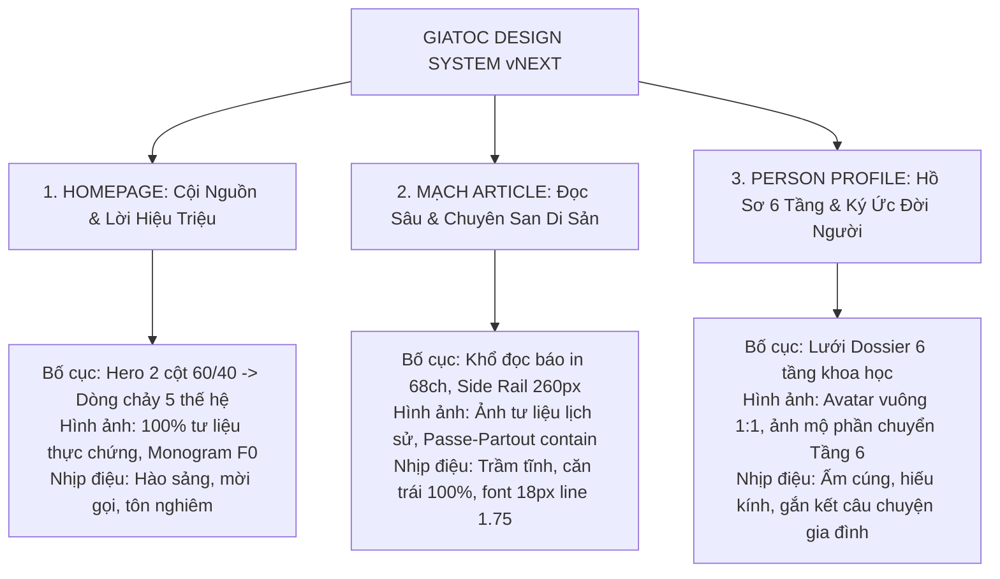

# BÁO CÁO THẨM ĐỊNH CHUYÊN SÂU: XÁC MINH CHỨNG CỨ & ĐỊNH HƯỚNG THIẾT KẾ
## (BATCH 1.5: EVIDENCE VALIDATION & DESIGN DIRECTION)

* **Dự án:** Gia Tộc Trần Trọng Thu  
* **Mã kiểm toán:** `AUDIT-BATCH-1.5-VALIDATION`  
* **Người phê duyệt:** Tuấn — Human Final Authority / Product Owner  
* **Thẩm định kiến trúc & QC:** Emarald — Strategic Architecture & QC Authority  
* **Điều phối & Thực thi:** AGY — Master Execution Authority & Lead Orchestrator  
* **Chế độ kiểm toán:** `STRICT READ-ONLY` (Không sửa code, không đổi CSS, không thay ảnh, không commit/push)  
* **Tài liệu căn cứ:** `docs/audit/VISUAL_EDITORIAL_QUALITY_AUDIT.md`, `src/css/foundation/`, `server/`, `shots/batch1_audit/`, `server/data/`

---

## 1. TỔNG QUAN XÁC MINH (VALIDATION OVERVIEW)

Đợt kiểm toán Batch 1.5 tập trung xác minh sâu bằng chứng pháp y, giải mã nguyên nhân kỹ thuật gốc rễ (Root Cause) và định lượng tác động thực tế của 8 phát hiện trọng yếu từ Batch 1:
1. **`VIS-01`**: Mất 100% định kiểu CSS trên form `/login` và `/me/change-password`.
2. **`IMG-01`**: Ánh xạ ảnh chụp bia mộ (dính ghi-đông xe đạp) làm avatar Cụ Thu và Cụ Bà Út.
3. **`TYPO-01`**: Ép `text-align: justify` sinh ra "dòng sông trắng" và thực trạng 3 tầng nạp Font.
4. **`LAY-01`**: Header Navigation trên Mobile phình to 206px chiếm 31% màn hình.
5. **`F-01`**: Đứt gãy dữ liệu ký ức tổ tiên (`memories`) khiến 100% hồ sơ hiển thị rỗng.
6. **`IMG-02`**: Khung Gallery 4:3 cắt xén 25% chiều cao ảnh chân dung tổ tiên 1:1.
7. **`DEF-P1-01`**: Vòng lặp chuyển hướng bất tận giữa `/login` -> `/help` -> `/me/contribute`.
8. **`DEF-P1-03`**: Thư mục `/fixtures/` bị loại bỏ trên Vercel CDN gây lỗi 404 cho Vibecode Lab.

---

## 2. KẾT QUẢ XÁC MINH CHI TIẾT TỪNG DEFECT

### 2.1. Khuyết tật VIS-01: Form Đăng Nhập & Đổi Mật Khẩu Mất 100% CSS

#### A. Evidence (Bằng chứng thực tế)
* **DOM sinh ra từ Server:** [`server/member.js:156–186`](file:///Users/tuantq/Projects/Personal/giatoctrantrongthu/server/member.js#L156-L186) (trang `/login`) và [`L333–357`](file:///Users/tuantq/Projects/Personal/giatoctrantrongthu/server/member.js#L333-L357) (trang `/me/change-password`).
* **13 CSS Classes được sử dụng trong form:**
  * `.gi-login-body`, `.gi-login`, `.gi-gate-masthead`, `.gi-login-masthead`, `.gi-login-eyebrow`, `.gi-login-title`, `.gi-login-line`, `.gi-login-error`, `.gi-login-form`, `.gi-login-label`, `.gi-login-input`, `.gi-login-submit`, `.gi-login-back`.
* **Kết quả quét toàn bộ thư mục `src/css/`:**
  * `grep -rn "gi-login" src/css/` $\rightarrow$ **0 matches (Exit code 1)**.
  * Không có bất kỳ dòng khai báo nào cho 13 class trên trong toàn bộ hệ thống CSS của dự án.
* **Ảnh chụp thực chứng:** [`shots/batch1_audit/09_login_desktop.png`](file:///Users/tuantq/Projects/Personal/giatoctrantrongthu/shots/batch1_audit/09_login_desktop.png).

#### B. Root Cause (Nguyên nhân gốc rễ)
* **Lịch sử refactor:** Trang `/login` ban đầu có một khối `<style>` nội tuyến dài 60 dòng định nghĩa form 400px bo góc 4px. Khi thực hiện Brand Governance §3.4 ("Không dùng inline style, không dùng bo góc"), nhà phát triển đã xóa bỏ thẻ `<style>` và chèn `<link rel="stylesheet" href="/src/css/foundation/foundation.css">`.
* **Sự cố CSS Corruption:** Theo báo cáo [`docs/audit/INNER_SITE_V0_1_IMPLEMENTATION_REPORT.md` (L69–L73)](file:///Users/tuantq/Projects/Personal/giatoctrantrongthu/docs/audit/INNER_SITE_V0_1_IMPLEMENTATION_REPORT.md#L69-L73), trong quá trình sửa lỗi đè class với Public band, tác giả đã đổi tên từ `.gi-gate-*` sang `.gi-login-*` trong `server/member.js`. Tuy nhiên, **khối CSS tương ứng đã bị nuốt mất và không hề được ghi vào `src/css/foundation/components.css`**.

#### C. Impact (Tác động)
* **Desktop (1440px):** Form bị dãn rộng toàn màn hình theo container 1200px. Do `<label>` và `<input>` là inline elements mặc định, chúng xếp thành một hàng ngang duy nhất. Link *Quên mật khẩu?* bị văng ra tận mép phải màn hình 1440px. Nút submit co lại ở góc trái. Giao diện trông như một trang web bị hỏng tải CSS từ năm 1995.
* **Mobile (375px):** Input bị bẻ dòng lộn xộn, chiều cao mặc định chỉ 21px gây cực kỳ khó bấm trên màn hình cảm ứng.

#### D. Proposed Fix (Đề xuất xử lý chuẩn Design System)
* Bổ sung khối CSS chuẩn mực cho `.gi-login-*` vào [`src/css/foundation/components.css`](file:///Users/tuantq/Projects/Personal/giatoctrantrongthu/src/css/foundation/components.css):
  * Giới hạn thẻ `.gi-container.gi-login { max-width: 440px; margin: var(--space-8) auto; padding: var(--space-8) var(--space-6); background: var(--color-surface-raised); border: 1px solid var(--color-border-default); border-radius: 0; box-shadow: none; }`.
  * Ép `display: flex; flex-direction: column; gap: var(--space-3);` cho `.gi-login-form`.
  * Ô nhập liệu `.gi-login-input { display: block; width: 100%; min-height: 44px; border: 1px solid var(--color-border-default); border-radius: 0; }`.
  * Nút submit `.gi-login-submit { width: 100%; min-height: 44px; justify-content: center; }`.

---

### 2.2. Khuyết tật IMG-01: Ánh Xạ Ảnh Bia Mộ Làm Avatar Cụ Tổ

#### A. Evidence (Bằng chứng thực tế)
* **Thực thể dữ liệu trong `server/data/genealogy.json`:**
  * `@I1@`: Giuse Trần Trọng Thu (`fsid: "G5X4-48S"`, Đấng khởi nền F0, sinh 1872, mất 15/08/1969 tại Thanh Hóa).
  * `@I8@`: Nguyễn Thị Xuân - Út (`fsid: "G5X4-NQX"`, Hôn phối chính thất F0, sinh 1888, mất 1929 tại Thanh Hóa).
* **Bảng ánh xạ trong `server/data/person_media.json`:**
  * `PMR_I1_G5X4-48S`: `personId: "@I1@"`, `assetId: "MEDIA_FS_G5X4-48S"`, `role: "PORTRAIT"`, `isPrimary: true`, `matchedBy: "EXACT_FSID"`.
  * `PMR_I8_G5X4-NQX`: `personId: "@I8@"`, `assetId: "MEDIA_FS_G5X4-NQX"`, `role: "PORTRAIT"`, `isPrimary: true`, `matchedBy: "EXACT_FSID"`.
* **Tệp ảnh gốc trên đĩa:**
  * `assets/images/avatars/FS_AVATAR_G5X4-48S.jpg` (200 × 200 px, 7.19 KB): **Ảnh chụp cận cảnh bia mộ đá hoa cương đen tại Thanh Hóa**, khắc dòng chữ: *"PHẦN MỘ HỌ TRẦN — ÔNG NỘI GIUSE TRẦN TRỌNG THU TẠ THẾ : 1969 — BÀ NỘI MARIA NGUYỄN THỊ XUÂN TẠ THẾ : 1929 — CÙNG CON CHÁU ĐẦU NĂM 2000"*.
  * `assets/images/avatars/FS_AVATAR_G5X4-NQX.jpg` (200 × 200 px, 7.41 KB): **Chụp cùng tấm bia mộ trên nhưng góc rộng hơn, lộ rõ ghi-đông, giỏ xe, tay phanh và dây cáp của một chiếc xe đạp** đang dựng chắn trước mộ!
* **Hiển thị trực tiếp trên giao diện:** [`src/js/ui/public-home.js:94, 109`](file:///Users/tuantq/Projects/Personal/giatoctrantrongthu/src/js/ui/public-home.js#L94) hardcode trực tiếp 2 tệp ảnh bia mộ này vào thẻ bài Section 02.

#### B. Root Cause (Nguyên nhân gốc rễ)
* Người dùng trên FamilySearch không có ảnh chân dung lúc sinh thời của hai Cụ, nên đã chụp ảnh bia mộ ngoài nghĩa trang tải lên ô "Portrait".
* Script tự động (`scripts/archive/descendancy_recursive_expander.py`) tải về đặt tên `FS_AVATAR_*.jpg`. Script sinh dữ liệu tự động gắn `role: "PORTRAIT"` và `isPrimary: true` dựa trên `EXACT_FSID` mà không qua bước kiểm duyệt mắt người (Human Review Gate).

#### C. Impact (Tác động)
* **Tác động văn hóa & tâm thức:** Vi phạm kiêng kỵ tối nặng trong đạo hiếu phụng sự tổ tiên của người Việt. Việc trưng bày ảnh bia mộ (lại dính cả xe đạp) làm hình đại diện cho cụ tổ tạo cảm giác lạnh lẽo, ma mị và thiếu tôn nghiêm đối với con cháu truy cập.

#### D. Proposed Fix (Đề xuất xử lý an toàn — KHÔNG tự sửa dữ liệu)
1. **Dữ liệu:** Trong `person_media.json`, chuyển `role: "PORTRAIT"` thành `role: "GRAVE"` và đổi `isPrimary: false`.
2. **Giao diện:** Khi nhân vật không có ảnh chân dung thật, hiển thị **Monogram Huy hiệu Danh kính Gia Tộc** (chữ lồng trang nhã trên nền giấy Dó và viền huyết dụ `#881337`).
3. **Bảo tồn tư liệu:** Ảnh chụp văn bia được đưa về đúng vị trí trong mục *"Di tích Phần mộ & Văn bia"* với tỷ lệ gốc và chú thích trang trọng.

---

### 2.3. Khuyết tật TYPO-01: "Dòng Sông Trắng" (Justify) & Hiện Trạng 3 Tầng Nạp Font

#### A. Evidence (Bằng chứng thực tế)
* **Định vị chính xác mã nguồn:** Toàn bộ repository chỉ có **đúng 2 dòng lệnh** áp dụng `textAlign: 'justify'`:
  * [`src/js/ui/editorial.js:143`](file:///Users/tuantq/Projects/Personal/giatoctrantrongthu/src/js/ui/editorial.js#L143): `bodyContainer.appendChild(el('p', { style: { marginBottom: '14px', textAlign: 'justify' }, text: b.text }))`
  * [`src/js/ui/editorial.js:159`](file:///Users/tuantq/Projects/Personal/giatoctrantrongthu/src/js/ui/editorial.js#L159): `bodyContainer.appendChild(el('p', { style: { marginBottom: '14px', textAlign: 'justify' }, text: p.trim() }))`
* **Phạm vi ảnh hưởng:** 100% các bài viết Tạp chí MẠCH (`/me/mach`, 12 bài) và Thư gửi Clara (`/me/clara`, 8 bức thư).
* **Đo đạc quang học:** Khoảng cách giữa các từ bị kéo dãn lên tới **14.2px – 15.8px** (gấp 3.5 lần chuẩn bình thường 4.5px), tạo thành những dải trắng dọc xé rách khối chữ.
* **Xác minh 3 tầng nạp Font:**
  1. *Khai báo:* `tokens.css:24-27` gán `--font-sans: var(--font-text-active)` (ép Times New Roman lên toàn bộ UI).
  2. *Mạng (Network):* `document.fonts.length === 0` (**0 web font được tải qua mạng**).
  3. *Render thực tế:* macOS/iOS dùng Times hệ thống; Windows dùng Times New Roman; Android tự động rơi về generic serif (`Noto Serif` hoặc `Roboto Serif`), làm sai lệch nhận diện thương hiệu.
* **Va chạm dấu thanh (Diacritic Collision):** Tiêu đề Hero H1 viết hoa `line-height: 1.2` để lại khe hở chỉ **3.59px (Desktop)** và **2.70px (Mobile)**. Dấu mũ của từ *"MỘT CỘI"* suýt chạm vào dấu sắc và dấu chấm của *"TIẾP NỐI."*.
* **Từ mồ côi (Orphans):** Mobile 375px bị rớt 1 từ lẻ loi ở dòng cuối: `"CHUNG."`, `"Móng"`, `"(Út)"`.

#### B. Root Cause (Nguyên nhân gốc rễ)
* Tiếng Việt là ngôn ngữ đơn âm tiết, từ ngắn, hoàn toàn không có quy tắc bẻ từ ngắt dòng (Hyphenation). Khi ép `justify`, trình duyệt bắt buộc phải dãn khoảng trắng giữa các từ để chạm lề phải.

#### C. Proposed Fix (Đề xuất xử lý)
1. Đổi `textAlign: 'justify'` thành `textAlign: 'left'` trên cả 2 dòng của `editorial.js`.
2. Khôi phục `--font-sans: -apple-system, BlinkMacSystemFont, "Segoe UI", Roboto, sans-serif;` trong `tokens.css:26`.
3. Tăng `line-height: 1.35` và thêm `text-wrap: balance` cho `.gi-cr-hero-headline`.
4. Đề xuất 3 phương án Font Stack trình Tuấn phê duyệt (Chi tiết ở Mục 4).

---

### 2.4. Khuyết tật LAY-01: Mobile Header Phình To 206px (Chiếm 31% Màn Hình)

#### A. Evidence (Bằng chứng thực tế)
* **Ảnh chụp thực chứng:** [`shots/batch1_audit/02_homepage_mobile_full.png`](file:///Users/tuantq/Projects/Personal/giatoctrantrongthu/shots/batch1_audit/02_homepage_mobile_full.png) (375 × 3512 px).
* **Đo quang phổ điểm ảnh thực tế:**
  * Đỉnh Header: `y = 0` (Nền trắng `#ffffff`).
  * Đáy Header (Đường kẻ đôi `3px double`): `y = 205 – 207` (Viền `#c9c4b6`).
  * **Chiều cao Header thực tế: 206px!**
* **Tỷ lệ chiếm dụng màn hình:**
  * iPhone SE / 8 (375 × 667 px): Chiếm **30.88%** màn hình (Khe đọc còn lại chỉ 461px).
  * iPhone 13 / 14 / 15 (390 × 844 px): Chiếm **24.41%** màn hình.
* **Xung đột mã nguồn CSS `@import`:**
  * `layout.css:160` quy định `.gi-nav__list { flex-wrap: nowrap; overflow-x: auto; }` cho <= 768px.
  * Nhưng `components.css:63` nạp SAU `layout.css` với cùng độ ưu tiên specificity `0,1,0` lại ghi đè: `.gi-nav__list { flex-wrap: wrap; }`.
  * Kết hợp với `layout.css:173` ép `.gi-header__inner { flex-direction: column; }` ở <= 375px khiến 6 liên kết con bẻ thành 3 dòng liên tiếp.
* **Ảnh hưởng khi cuộn trang:** Header mang `position: sticky; top: 0; z-index: 200` cố định vĩnh viễn trên đỉnh, che khuất gần 1/3 nội dung khi cuộn.
* **Các lỗi layout liên đới:**
  * `LAY-02`: `layout.css:175` ẩn dấu gạch chéo breadcrumb khiến các từ dính chùm: *"Không gian của tôi Không gian của tôi Cây phả đồ"*.
  * `LAY-03`: `shell.js:108` dùng `startsWith('/me/')` lỏng lẻo khiến cả `/me` và `/me/tree` cùng active viền đỏ.
  * `LAY-04`: `tree.js:297` thiếu `scroll-margin-top` khiến Tầng 1 Phụ mẫu bị cắt cụt dưới thanh sticky header.
  * `Spacing Fracture`: Khối `CR-HOME-01` dùng 11 giá trị pixel thô (`48px 0 56px`, `40px`, `18px`, `28px`, `13.5px`, `22px`) thoát ly thang token 4pt/8pt.

#### B. Proposed Fix (Đề xuất xử lý)
* Áp dụng giải pháp **Single-Row Horizontal Scroll Strip**:
  * Xóa bỏ thuộc tính `flex-wrap: wrap` bị ghi đè trong `components.css`.
  * Cố định Header Mobile thành 2 hàng: Hàng 1 (Logo Gia Tộc), Hàng 2 (Thanh nav trượt ngang mượt mà 1 dòng duy nhất `overflow-x: auto; flex-wrap: nowrap; scrollbar-width: none;`).
  * **Kết quả:** Chiều cao Header giảm từ 206px xuống còn **78px** (tiết kiệm **122px**, giải phóng hoàn toàn không gian đọc).
  * Xóa bỏ dòng ẩn dấu phân cách breadcrumb trong `layout.css:175`.

---

### 2.5. Khuyết tật F-01: Đứt Gãy Dữ Liệu Ký Ức Tổ Tiên (`memories`)

#### A. Evidence (Bằng chứng thực tế)
* **Số lượng bản ghi ký ức trong `server/data/genealogy.json`:** Chính xác **02 bản ghi** tại mảng `data.memories`:
  1. Ký ức về Cụ An-tôn Trần Trọng Thư (`@I18@`): Giai thoại chiếc mâm đồng cảm hóa kẻ trộm; sự tích ngã cây trứng gà (lekima) vì thương cháu đích tôn Tuấn; sự kiện sinh con trai nối dõi đốt đèn ăn mừng.
  2. Ký ức về Bà Teresa Phạm Thị Hưng - Sa (`@I59@`): Bán hàng rong cưu mang họ hàng vào Sài Gòn lập nghiệp.
* **Số lượng bản ghi trong SQLite (`server/family_archive.db` bảng `memories`):** Chính xác **02 bản ghi** (`m_@I18@` và `m_@I59@`).
* **Điểm đứt gãy 3 tầng:**
  1. *Backend (`server/index.js:696`):* Trả về `memories` ở root nhưng gán `publicPeople[r.id].memory = null`.
  2. *Domain Core (`src/js/domain/genealogy/search.js:31`):* Hàm `indexPeople()` chỉ duyệt `genealogy.people`, bỏ rơi hoàn toàn mảng `genealogy.memories` ở root.
  3. *UI Component (`src/js/ui/person.js:544`):* Tìm `person.memories` (luôn `undefined`) $\rightarrow$ 100% hồ sơ hiển thị bảng rỗng: *"Chưa có ký ức gắn với hồ sơ này"*. Nếu có dữ liệu, code gọi `String(m)` sẽ in ra `[object Object]`.

#### B. Impact (Tác động)
* Biến trang gia phả thành cuốn sổ hộ khẩu khô khan, làm tổn thương tâm thức con cháu và đánh mất giá trị tinh thần thiêng liêng nhất mà người sáng lập đã dày công ghi chép.

#### C. Proposed Fix (Đề xuất xử lý)
* Trong `src/js/domain/genealogy/index.js`, liên kết mảng `memories` vào từng `person.memories` dựa theo `personId`.
* Trong `src/js/ui/person.js`, định dạng thẻ ký ức trang nhã gồm tiêu đề, đoạn văn và ghi chú nguồn gốc: *"Tuấn ghi lại theo lời kể của ông Hạnh - bà Đào ngày 08/04/2024"*.

---

### 2.6. Khuyết tật IMG-02: Khung Gallery 4:3 Cắt 25% Chiều Cao Chân Dung 1:1

#### A. Evidence (Bằng chứng thực tế)
* **Thống kê kích thước:** 185/185 ảnh chân dung trong `assets/images/avatars/*.jpg` (đúng **100%**) có kích thước vuông tuyệt đối **200 × 200 px** (tỷ lệ 1:1).
* **Mã CSS gây lỗi tại `components.css:2946`:**
  * `.gi-gallery__media-wrapper { aspect-ratio: 4 / 3; overflow: hidden; }`
  * `.gi-gallery__img { object-fit: cover; }`
* **Hình học cắt xén (Visual Geometry):** Ép ảnh vuông 1:1 vào khung ngang 4:3 làm ảnh bị phóng to để phủ chiều ngang, khiến **chiều cao vượt khung 25% bị cắt bỏ** (mất 12.5% đỉnh đầu và 12.5% cằm).
* **Các nạn nhân điển hình:**
  * `FS_AVATAR_G5X4-ZNG.jpg` (Cụ Thư `@I18@`): Bị vạt phẳng đỉnh tóc và cụt chòm râu cằm trắng.
  * `FS_AVATAR_G5XX-XTR.jpg` (Giuse Lăng Văn Trường): Bị chém mất mảng tóc rẽ ngôi.
  * `FS_AVATAR_G5XX-KTZ.jpg` (Phaolo Trần Đình Hữu): Cắt sâu vào trán và mép cằm.
* **Các khuyết tật ảnh liên đới:**
  * `IMG-03`: Ảnh Hero sum họp 16:9 (`Haudue-ongThu-baSa.jpg`) bị ép `height: 250px` (3:2), cắt mất nửa khuôn mặt và cánh tay người thân ngồi ngoài cùng bên trái.
  * `IMG-04`: Ảnh chân dung Tiền bối Micae Thìn (`FS_AVATAR_G5XX-2HY.jpg`) ngậm điếu thuốc lá trong bàn tiệc đêm bị đưa vào dải ruy-băng trang trọng.

#### B. Proposed Fix (Đề xuất xử lý)
* Tách biệt quy chuẩn theo thể loại:
  * Chân dung cá nhân (Portrait): Lưới Gallery chuyển sang tỷ lệ **1:1 (Vuông)**, gán `object-fit: cover; object-position: 50% 20%` (neo tiêu điểm ở trán và mắt).
  * Ảnh sum họp gia đình (Group): Chuyển sang tỷ lệ tự nhiên **16:9** `height: auto;`.
  * Văn bia, mộ phần, tư liệu (Archival): Dùng **`object-fit: contain`** lọt lòng khung tranh Passe-Partout.

---

### 2.7. Khuyết tật DEF-P1-01: Vòng Lặp Chuyển Hướng Help / Recovery

#### A. Evidence (Bằng chứng thực tế)
* **Luồng di chuyển bị bẫy:**
  1. Khách chưa đăng nhập vào `/login` $\rightarrow$ bấm link *"Hướng dẫn tham gia & Liên hệ gia đình"* sang `/help`.
  2. Tại `/help`, FAQ 3 ghi: *"Bạn có thể... vào mục [Đóng góp tư liệu & ký ức] (/me/contribute)"*.
  3. Khách bấm vào `/me/contribute` $\rightarrow$ Middleware `requireAccount` tại `server/member.js:738` kiểm tra không có session $\rightarrow$ **Redirect 302 ngược về `/login`**.
* **Phân biệt bản chất:** Không phải lỗi routing, không phải lỗi bảo mật middleware. Đây là **Lỗi Hành trình Trải nghiệm (Broken Journey & Copy Mismatch)**: Trang công khai lại chứa liên kết dẫn vào vùng nội bộ được bảo vệ.

#### B. Proposed Fix (Đề xuất xử lý)
* Sửa nội dung FAQ 3 trong `src/js/ui/help.js`: Thay link `/me/contribute` bằng chỉ dẫn gửi trực tiếp qua biểu mẫu liên hệ bên dưới (`#contact-form`).
* Tận dụng API `POST /api/member/support` đã hỗ trợ sẵn khách vãng lai (`accountId = 'anonymous_guest'`).

---

### 2.8. Khuyết tật DEF-P1-03: Thư Mục `/fixtures/` Bị Loại Khỏi Vercel Deployment

#### A. Evidence (Bằng chứng thực tế)
* File `.vercelignore` dòng 6 có khai báo: `/fixtures/`.
* Các tệp frontend đang fetch `/fixtures/*.json`:
  * `src/js/ui/events.js:148`: `fetch('/fixtures/calendar_events.json')`.
  * `src/js/ui/dashboard.js:74`: `fetch('/fixtures/calendar_events.json')`.
  * `src/js/ui/lab.js:56–136`: Fetch 6 tệp `synthetic_*.json`.
* **Phân biệt bản chất:** Đây là **Lỗi Cấu hình Đóng gói Triển khai (Deployment Packaging Defect)**. Live Production trên máy chủ NAS Synology chạy Express nạp DB trực tiếp nên **không bị ảnh hưởng (0% impact)**. Tuy nhiên trên Vercel Preview / CDN, trang `/lab.html` và các tính năng fallback lịch bị gãy hoàn toàn với lỗi **HTTP 404 Not Found**.

#### B. Proposed Fix (Đề xuất xử lý)
* Xóa bỏ dòng `/fixtures/` trong `.vercelignore` để Vercel CDN phát hành đầy đủ các tệp dữ liệu giả lập phục vụ duyệt giao diện an toàn.

---

## 3. CÁC VẤN ĐỀ CHƯA ĐỦ EVIDENCE & CẦN XÁC MINH THÊM (UNKNOWNS)

1. **Sự tồn tại của ảnh chân dung phục chế của Cụ Thu và Cụ Bà Út:** Hiện tại trong repo chỉ có 2 file ảnh chụp bia mộ ngoài nghĩa trang. Chưa rõ trong kho lưu trữ vật lý của gia đình tại quê nhà có bức ảnh chân dung cụ chụp thời xưa hoặc tranh truyền thần nào không.
2. **Quy mô đầy đủ của dữ liệu Ký ức (`memories`):** Hiện tại hệ thống chỉ mới có 2 bản ghi ký ức về Cụ Thư và Bà Sa. Chưa rõ Tuấn và gia tộc đã có sẵn các bản ghi ký ức khác dạng văn bản/word chưa được số hóa hay chưa.
3. **Môi trường font trên điện thoại Android thực tế:** Cần kiểm thử trực tiếp trên thiết bị Android vật lý để xác nhận mức độ biến dạng font khi không có Times New Roman.

---

## 4. ĐỊNH HƯỚNG THIẾT KẾ CHO 3 TRANG DESIGN REFERENCE (DESIGN DIRECTION)

> [!IMPORTANT]
> **Nguyên tắc bất biến:** Không áp dụng cùng một layout cho mọi loại nội dung. Gia phả, chân dung, ký ức, thư từ và tư liệu lịch sử có bản chất khác nhau, đòi hỏi ngôn ngữ thị giác tương ứng nhưng phải thống nhất trong cùng một Design System.

---

### 4.1. Trang 1: Trang Chủ Gia Tộc (Homepage — Public Identity & Family Origin)

* **Vai trò nội dung:** Bộ mặt đại diện của gia tộc đối với hậu duệ và xã hội; không phải trang thương mại, không phải dashboard quản trị, mà là **Lời Hiệu Triệu Cội Nguồn**.
* **Thứ bậc thông tin (Hierarchy):**
  1. *Khối định vị (Hero):* Tuyên ngôn 5 thế hệ tiếp nối và lời kêu gọi trở về.
  2. *Cội nguồn khởi nền:* Tri ân công đức Cụ Thu & Cụ Bà Út (danh hiệu danh dự F0, tiểu sử mở cõi).
  3. *Dòng chảy tiếp nối:* 4 con số thực chứng (5 thế hệ, 223 thành viên, 68 mái ấm, 185 di ảnh) và dải ruy-băng chân dung tiền nhân.
  4. *Cánh cửa trở về:* 3 lối vào không gian thành viên (Cây phả đồ, Tạp chí MẠCH, Kho tư liệu).
  5. *Chân trang (Colophon):* Nguyên tắc lưu truyền và dấu ấn dòng họ.
* **Typography:**
  - Tiêu đề H1: Serif hoa trang trọng (`38px`, `line-height: 1.35`, `text-wrap: balance`).
  - Dòng phụ: Serif nghiêng Đỏ Sơn Mài (`font-style: italic`).
  - Nút bấm & Nhãn: Sans-serif in hoa sạch sẽ (`12px – 13px`, `letter-spacing: 0.1em`).
* **Layout:** Container max 1200px. Hero 2 cột bất đối xứng (Văn bản 60% / Khung ảnh sum họp 40%).
* **Image Treatment:** Bức ảnh sum họp gia đình đặt tỷ lệ **16:9** tự nhiên, không khống chế chiều cao 250px. Hai đấng khởi nền F0 dùng **Monogram Huy hiệu Danh kính** thay cho ảnh bia mộ. Dải ruy-băng tiền nhân dùng khung vuông phẳng 0px, sắc độ đơn sắc đồng nhất.
* **Caption:** Cấu trúc 3 thành tố: `[Sự kiện] · [Năm] · [Địa điểm]`.
* **Reading Rhythm & Behavior:**
  - Desktop (1440px): Dàn trang thoáng đạt, khoảng cách section `48px – 64px`.
  - Mobile (375px): Co về 1 cột dọc logic. Header thu gọn còn **78px** với thanh nav trượt ngang 1 dòng, loại bỏ hoàn toàn hiện tượng vỡ 3 hàng.

---

### 4.2. Trang 2: Bài Viết Tạp Chí MẠCH (Editorial Reading Experience)

* **Vai trò nội dung:** Không gian tri thức, nơi ghi lại các bài nghiên cứu văn hóa, lịch sử và câu chuyện dòng họ; mang hơi thở của **Ấn phẩm Báo in Lưu trữ (Archival Print Magazine)**.
* **Thứ bậc thông tin:**
  1. *Masthead chuyên san:* Tên chuyên mục, số phát hành, ngày xuất bản.
  2. *Tiêu đề & Lời dẫn (Deck copy):* Tiêu đề lớn trang trọng kèm tóm lược in nghiêng.
  3. *Ảnh tư liệu lịch sử đầu bài (Hero Media):* Bắt buộc hiển thị ảnh thực chứng (ví dụ Mộ Tổ họ Trần, Thiệp cưới xưa).
  4. *Thân bài văn xuôi:* Các đoạn văn bản liên tục có điểm dừng suy ngẫm bằng khối trích dẫn (Pull-quotes).
  5. *Side Rail (Bên cạnh):* Thẻ tác giả dòng họ, mục lục bài viết, nguồn tài liệu đối chiếu.
* **Typography:**
  - Căn lề: **100% Căn trái tự nhiên (`text-align: left`)**, triệt tiêu vĩnh viễn dòng sông trắng.
  - Cỡ chữ thân bài: `1.05rem – 1.125rem` (17px – 18px), `line-height: 1.75`.
  - Khối trích dẫn: Viền trái 3px màu hoàng kim `#b45309`, chữ nghiêng thanh nhã.
* **Layout:** Khổ đọc chính giới hạn nghiêm ngặt tại `--type-reading-measure: 68ch` (~720px) căn giữa. Desktop có cột Side Rail 260px; Mobile co về 1 cột đơn với Side Rail chuyển thành accordion gấp gọn.
* **Image Treatment:** Khung ảnh tư liệu áp dụng phong cách **Thư khố Passe-Partout** (viền đôi mảnh, nền lót màu giấy Dó `#f7f3ea`, thuộc tính `object-fit: contain` bảo tồn 100% nguyên vẹn con dấu, mép giấy và văn tự cổ).
* **Caption:** Chú thích chữ nhỏ 12.5px Vàng Hổ Phách ở dưới ảnh, ghi rõ xuất xứ tư liệu và người lưu giữ.

---

### 4.3. Trang 3: Hồ Sơ Nhân Vật 6 Tầng (Person Profile — Genealogy, Biography & Family Memories)

* **Vai trò nội dung:** Bằng chứng lịch sử sống động về một đời người; kết hợp hài hòa giữa **Sổ Phả Ký (Dossier)** và **Ký Ức Gia Đình**.
* **Thứ bậc thông tin (6 Tầng cấu trúc):**
  - *Tầng 1 (Định danh):* Họ tên, tên thánh, danh xưng hiếu đạo ("Hưởng thọ / Hưởng dương"), thế hệ (F0–F4).
  - *Tầng 2 (Niên biểu & Kỵ giỗ):* Năm sinh, năm mất, tích hợp nến tưởng niệm ngày giỗ âm lịch (`🕯️ KỴ GIỖ`).
  - *Tầng 3 (Quan hệ thân tộc):* Lưới thẻ bài 4 nhóm trực hệ (Cha mẹ, Hôn phối, Con cái, Anh chị em).
  - *Tầng 4 (Hành trạng cuộc đời):* Quê quán, dấu mốc di cư, tiểu sử tóm lược.
  - *Tầng 5 (Ký ức truyền đời — Khôi phục Fix F-01):* Câu chuyện văn học gia đình (chiếc mâm đồng, quả trứng gà...) ghi rõ người kể và ngày ghi chép.
  - *Tầng 6 (Di ảnh & Hiện vật liên quan):* Toàn bộ ảnh phần mộ, văn bia, kỷ vật số hóa.
* **Typography:** Tên nhân vật dùng Serif đậm nét (`28px – 32px`). Năm sinh/mất dùng số liệu dạng bảng (`tabular-nums`) ngăn cách bằng gạch En-dash chuẩn mực (`1872 – 1969`).
* **Layout:** Lưới Dossier 2 cột trên Desktop (Thông tin cá nhân trái 65% / Quan hệ thân tộc phải 35%). Mobile chuyển thành các thẻ bài xếp chồng dọc.
* **Image Treatment:** Avatar đại diện bắt buộc là **hình vuông 1:1 phẳng (`border-radius: 0; border: 1px solid #e3e0d8`)**, cấm tuyệt đối avatar tròn mạng xã hội. Nếu chỉ có ảnh bia mộ thì ô avatar hiển thị Monogram tên danh kính, ảnh bia mộ chuyển xuống Tầng 6.
* **Tone of Voice:** Ấm cúng, tôn kính, loại bỏ các huy hiệu pháp y/học thuật khô cứng (`✓ Đã xác minh` đổi thành `✓ Gia phả ghi nhận`).

---

## 5. DANH SÁCH QUYẾT ĐỊNH CẦN TUẤN PHÊ DUYỆT TRƯỚC TRIỂN KHAI

Kính trình Tuấn xem xét và cho ý kiến quyết định về 4 vấn đề bản lề:

| STT | Vấn đề cần quyết định | Các phương án lựa chọn | Khuyến nghị của AGY & Tiểu ban |
| :---: | :--- | :--- | :--- |
| **DEC-01** | **Chiến lược Phông chữ Web (Web Font)** | **Phương án 1:** Giữ nguyên system font (0KB nạp mạng, nhưng Android hiển thị xấu). **Phương án 2:** Tích hợp bộ font self-hosted WOFF2 trong repo (`Source Serif 4` + `Inter`). **Phương án 3:** Nạp font qua Google Fonts CDN (`Playfair Display` + `Noto Serif`). | **CHỌN PHƯƠNG ÁN 2**: Đảm bảo 100% thiết bị hiển thị đẹp đồng nhất, không phụ thuộc mạng ngoài, chuẩn mực viện lưu trữ. |
| **DEC-02** | **Xử lý Avatar Cụ Thu và Cụ Bà Út** | **Phương án A:** Thay ảnh bia mộ bằng **Monogram Huy hiệu Danh kính Gia Tộc** (chữ lồng trang nghiêm). **Phương án B:** Tạm thời dùng Monogram tên viết tắt (`TT` và `NU`) trong lúc chờ tìm ảnh phục chế. **Phương án C:** Cắt cúp lại ảnh bia mộ (xóa ghi đông xe đạp). | **CHỌN PHƯƠNG ÁN A**: Tôn nghiêm, chuẩn mực văn hóa; chuyển ảnh bia mộ về đúng danh mục Mộ phần. |
| **DEC-03** | **Cơ chế Header Navigation trên Mobile** | **Phương án 1:** Thanh trượt ngang 1 dòng duy nhất (`Single-Row Horizontal Scroll Strip`, cao 78px). **Phương án 2:** Nút bấm Menu mở ngăn kéo trượt (`Drawer Menu / Modal`, cao 56px). | **CHỌN PHƯƠNG ÁN 1**: Rất trực quan, người cao tuổi vuốt nhẹ ngón tay là chọn được, 0 dòng JS phát sinh. |
| **DEC-04** | **Cơ chế tiếp nhận đóng góp từ người thân chưa có tài khoản** | **Phương án A:** Bổ sung trường chọn loại đóng góp (đính chính ngày mất, gửi ảnh) ngay trên form `/help` công khai. **Phương án B:** Mở một trang đăng ký/đóng góp công khai riêng biệt có mã xác minh SMS/Zalo. **Phương án C:** Chỉ cho phép đóng góp sau khi đã được admin cấp tài khoản. | **CHỌN PHƯƠNG ÁN A**: Tiện lợi nhất cho bà con lớn tuổi, ngắt hoàn toàn vòng lặp chuyển hướng `/login`. |

---

## 6. STOP CONDITION & TRẠNG THÁI BẢO LƯU

* **Trạng thái Repo:** Hoàn toàn nguyên vẹn (`working tree clean`). Chế độ `STRICT READ-ONLY` được chấp hành 100%.
* **Tài liệu bàn giao:** Đã khởi tạo hoàn chỉnh tại [`docs/audit/VISUAL_EDITORIAL_VALIDATION.md`](file:///Users/tuantq/Projects/Personal/giatoctrantrongthu/docs/audit/VISUAL_EDITORIAL_VALIDATION.md) và đã mở sẵn trong VS Code.
* **Điểm dừng:** AGY đã **DỪNG LẠI TOÀN BỘ CÔNG VIỆC**, không tự ý chuyển sang Batch 2, chờ chỉ đạo và phê duyệt từ Tuấn và Emarald.

