# SƠ ĐỒ PHỤ THUỘC NỘI DUNG VÀ LUỒNG DỮ LIỆU (CONTENT DEPENDENCY MAP)

**Dự án:** Gia Tộc Trần Trọng Thu · **Phiên bản:** v2.0.1  
**Tài liệu tham chiếu:** [`docs/content/CONTENT_REGISTRY.md`](file:///Users/tuantq/Projects/Personal/giatoctrantrongthu/docs/content/CONTENT_REGISTRY.md), [`docs/content/MEDIA_REGISTRY.md`](file:///Users/tuantq/Projects/Personal/giatoctrantrongthu/docs/content/MEDIA_REGISTRY.md)  
**Phân loại:** Information Architecture & System Data Flow

---

## 1. MÔ HÌNH DÒNG CHẢY DỮ LIỆU 5 TẦNG (5-LAYER CONTENT PIPELINE)

Toàn bộ thông tin hiển thị trên website Gia Tộc Trần Trọng Thu được vận chuyển qua chuỗi cung ứng 5 tầng nghiêm ngặt:

```text
┌─────────────────────────────────────────────────────────────────┐
│ TẦNG 1: NGUỒN LƯU TRỮ CHÂN LÝ (STORAGE & SOT)                    │
│ Markdown (content/), JSON (server/data/), Assets (assets/), DB  │
└────────────────────────────────┬────────────────────────────────┘
                                 │
                                 ▼
┌─────────────────────────────────────────────────────────────────┐
│ TẦNG 2: BỘ NẠP & CHUẨN HÓA DỮ LIỆU (LOADER & ADAPTER)            │
│ http-adapter.js, mock-adapter.js, assets.js, domain parsers     │
└────────────────────────────────┬────────────────────────────────┘
                                 │
                                 ▼
┌─────────────────────────────────────────────────────────────────┐
│ TẦNG 3: BỘ ĐIỀU PHỐI GIAO DIỆN & TRẠNG THÁI (CONTROLLER / STATE) │
│ navigation.js, nav-store.js, states.js (Region, StatePanel)     │
└────────────────────────────────┬────────────────────────────────┘
                                 │
                                 ▼
┌─────────────────────────────────────────────────────────────────┐
│ TẦNG 4: KHỐI THÀNH PHẦN GIAO DIỆN (COMPONENTS & FOUNDATION)     │
│ InstitutionHeader, PageHeader, HeroPlaque, GalleryGrid, Cards  │
└────────────────────────────────┬────────────────────────────────┘
                                 │
                                 ▼
┌─────────────────────────────────────────────────────────────────┐
│ TẦNG 5: BỀ MẶT HIỂN THỊ CUỐI CÙNG (RENDERED SURFACES)           │
│ Trang chủ (/), Phả đồ (/me/tree), Hồ sơ (/me/tree/person/:id)   │
└─────────────────────────────────────────────────────────────────┘
```

---

## 2. BIỂU ĐỒ KIẾN TRÚC TỔNG QUAN (GLOBAL CONTENT TOPOLOGY)

```mermaid
flowchart TD
    subgraph SOT["1. Nguồn Lưu Trữ (Sources of Truth)"]
        S_HOME["src/js/ui/public-home.js (Hardcoded Editorial)"]
        S_NAV["src/js/ui/navigation.js & shell.js (Nav Config)"]
        S_ASSET["assets/ASSET_MANIFEST.json (Brand Assets)"]
        S_MACH["server/data/mach.json (Chuyên san MẠCH)"]
        S_GENEALOGY["server/data/genealogy.json / MariaDB"]
        S_MEDIA["server/data/media.json & person_media.json"]
        S_EVENTS["CALENDAR_FEEDS / fixtures/calendar_events.json"]
        S_HELP["src/js/ui/help.js (FAQs & Support)"]
        S_SCHEDULE["src/js/ui/server-schedule.js (Config giờ nghỉ)"]
    end

    subgraph ADAPTERS["2. Tầng Chuyển Đổi & Nạp (Adapters & Loaders)"]
        A_ASSET["loadAssetManifest() (assets.js)"]
        A_API["DataService / HttpAdapter (data.js)"]
        A_DOMAIN_ARCHIVE["archive/index.js"]
        A_DOMAIN_CAL["calendar/index.js"]
        A_SCHEDULE["initServerScheduleMonitoring()"]
    end

    subgraph COMPONENTS["3. Thành Phần Giao Diện (UI Components)"]
        C_HEADER["InstitutionHeader (Logo, Nav)"]
        C_BANNER["ServerScheduleBanner (.gi-schedule-banner)"]
        C_HOME_SEC["Section 01-05 (Hero, Monogram, Doors)"]
        C_TREE["TreeRenderer (.gi-tree-canvas)"]
        C_PLAQUE["HeroArchivalPlaque (.gi-hero-plaque)"]
        C_MEMORIES["MemoryStoryCard (.gi-memory)"]
        C_GALLERY["GalleryGrid (.gi-gallery__grid)"]
        C_CAL["CalendarApp & MemorialList (.gi-calendar-app)"]
        C_EDITORIAL["EditorialReader (.gi-editorial)"]
        C_HELP["HelpAccordion & SupportBox"]
    end

    subgraph SURFACES["4. Bề Mặt Người Dùng (Rendered Surfaces)"]
        SURF_HOME["Trang chủ Công khai (/)"]
        SURF_DASH["Không gian của tôi (/me)"]
        SURF_TREE["Cây Phả đồ (/me/tree)"]
        SURF_PERSON["Hồ sơ Nhân vật (/me/tree/person/:id)"]
        SURF_GALLERY["Kho Tư liệu ảnh (/me/gallery)"]
        SURF_EVENTS["Lịch giỗ & Niên biểu (/me/events)"]
        SURF_MACH["Chuyên san MẠCH (/me/mach)"]
        SURF_HELP["Trung tâm Trợ giúp (/help, /help/recovery)"]
    end

    %% Routing dependencies
    S_ASSET --> A_ASSET --> C_HEADER --> SURF_HOME & SURF_DASH & SURF_HELP
    S_SCHEDULE --> A_SCHEDULE --> C_BANNER --> SURF_HOME & SURF_DASH & SURF_HELP

    S_HOME --> C_HOME_SEC --> SURF_HOME
    S_NAV --> C_HEADER

    S_MACH --> A_API --> C_EDITORIAL --> SURF_MACH
    S_GENEALOGY --> A_API --> C_TREE --> SURF_TREE
    S_GENEALOGY --> A_API --> C_PLAQUE & C_MEMORIES --> SURF_PERSON

    S_MEDIA --> A_DOMAIN_ARCHIVE --> A_API --> C_GALLERY --> SURF_GALLERY
    S_MEDIA --> A_DOMAIN_ARCHIVE --> A_API --> C_PLAQUE --> SURF_PERSON

    S_EVENTS --> A_DOMAIN_CAL --> A_API --> C_CAL --> SURF_EVENTS
    S_HELP --> C_HELP --> SURF_HELP
```



---

## 3. MA TRẬN PHỤ THUỘC CHI TIẾT (CONTENT DEPENDENCY MATRIX)

| Vùng Nội Dung | Nguồn Dữ Liệu Gốc (SoT) | Tầng Nạp / Xử Lý | Thành Phần Tiêu Thụ | Tuyến Đường (Routes) | Cơ Chế Phục Hồi (Resilience / Fallback) |
| :--- | :--- | :--- | :--- | :--- | :--- |
| **Nhận diện Brand** | `assets/ASSET_MANIFEST.json` | `src/js/ui/assets.js` | `InstitutionHeader`, `applyFavicon` | Toàn bộ 16 routes | Fallback text tiêu đề nếu mất manifest |
| **Thông báo Giờ nghỉ NAS** | `src/js/ui/server-schedule.js` | Tính toán client theo múi giờ VN | `ServerScheduleBanner` | Toàn bộ routes | Chạy độc lập 100% tại Client Edge, không gọi API |
| **Trang chủ Công khai** | `src/js/ui/public-home.js` | Static Component Rendering | `renderPublicHome()` | `/` | Hoàn toàn độc lập, hiển thị ngay cả khi NAS tắt |
| **Cây Phả hệ** | `server/data/genealogy.json` | `http-adapter.js` / API Express | `TreeRenderer` | `/me/tree` | Nạp từ Mock Fixtures nếu server NAS nghỉ |
| **Hồ sơ & Di ảnh** | `media.json`, `person_media.json` | `src/js/domain/archive/` | `HeroArchivalPlaque`, `AvatarWrap` | `/me/tree/person/:id` | Monogram chữ vàng trên nền giấy dó |
| **Ký ức & Hồi ký (F-01)** | `server/data/genealogy.json` (memories) | `api.personMemories()` | `MemoryStoryCard` (`.gi-memory`) | `/me/tree/person/:id` | Bỏ qua khu vực Ký ức nếu nhân vật không có mẩu chuyện |
| **Kho Tư liệu Ảnh** | `server/data/media.json` | `indexMediaById()`, `filterMediaByKind()` | `GalleryGrid`, `LightboxModal` | `/me/gallery` | Hiển thị SVG khung di sản nếu ảnh hỏng |
| **Lịch Kỵ Giỗ & Niên biểu** | `calendar_events.json`, ICS Feeds | `src/js/domain/calendar/` | `CalendarApp`, `MemorialStream` | `/me/events` | Tính toán Can Chi âm dương thuần JavaScript |
| **Chuyên san MẠCH** | `server/data/mach.json` | `api.machArticles()` | `EditorialReader`, `ArticleGrid` | `/me/mach` | Nạp bản sao lưu tĩnh từ thư mục assets |
| **Trợ giúp & Khôi phục** | `src/js/ui/help.js`, `recovery.js` | Client Static Script (`boot-help.js`) | `HelpContainer`, `RecoveryWizard` | `/help`, `/help/recovery` | Chạy trực tiếp tại Vercel Edge, không gọi Tunnel NAS |

---

## 4. CHIẾN LƯỢC CÔ LẬP SỰ CỐ (FAILURE & DECOUPLING STRATEGY)

1. **Khắc phục lỗi Cloudflare Error 1033 (Zero NAS Dependency for Edge Surfaces):**  
   Các tuyến đường công khai `/`, `/help`, `/help/recovery` được biên dịch tĩnh và lưu trữ trực tiếp trên CDN của Vercel. Khi máy chủ Synology NAS tắt định kỳ từ `01:00 đến 09:05`, Vercel **KHÔNG** chuyển hướng người dùng qua Cloudflare Tunnel (`api.giatoctrantrongthu.com`), ngăn chặn 100% lỗi Error 1033.

2. **Cơ chế Fallback cho Dữ liệu Đọc (Graceful Read Fallback):**  
   Khi thành viên truy cập xem Phả đồ hoặc Tư liệu ảnh trong giờ máy chủ nghỉ:
   - Giao diện hiển thị thanh thông báo giờ nghỉ trang trọng phía trên cùng (`ServerScheduleBanner`).
   - Dữ liệu phả hệ đọc từ bộ đệm tĩnh (Edge Fixtures) phục vụ tra cứu thông thường.
   - Các tính năng ghi (Gửi đóng góp, Đổi mật khẩu) được vô hiệu hóa tạm thời với lời giải thích nhã nhặn.

