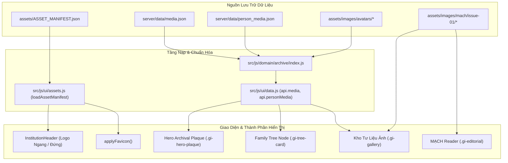

# BẢNG TRA CỨU TƯ LIỆU VÀ HÌNH ẢNH TOÀN HỆ THỐNG (MEDIA REGISTRY)

**Dự án:** Gia Tộc Trần Trọng Thu · **Phiên bản:** v2.0.1  
**Tài liệu tham chiếu:** [`AUDIT/MASTER_COMPLETION_PLAN.md`](file:///Users/tuantq/Projects/Personal/giatoctrantrongthu/AUDIT/MASTER_COMPLETION_PLAN.md), [`docs/content/CONTENT_REGISTRY.md`](file:///Users/tuantq/Projects/Personal/giatoctrantrongthu/docs/content/CONTENT_REGISTRY.md)  
**Phân loại:** Information Architecture & Media Asset Governance

---

## 1. NGUYÊN TẮC QUẢN TRỊ TƯ LIỆU THỊ GIÁC (MEDIA GOVERNANCE PRINCIPLES)

1. **Nguyên tắc "Thực chứng không bịa đặt" (No Placeholder Artwork):**  
   Mọi hình ảnh xuất hiện trên website phải là tệp tin vật lý thực sự tồn tại trên đĩa (`[FACT] verified to exist on disk`). Tuyệt đối không sử dụng hình ảnh giả lập (dummy/placeholder từ Unsplash, placeholder.com hay SVG tượng trưng) để lấp đầy giao diện. Nếu thiếu ảnh, hệ thống hiển thị Monogram huy hiệu gia tộc hoặc khung chữ trang trọng.

2. **Kỷ luật xuất xứ tư liệu (Provenance Tracking):**  
   Mỗi tư liệu số hóa đều phải lưu vết: Nguồn thu thập (`FamilySearch`, `Gia đình cung cấp`, `Sưu tầm điền dã`), URL gốc (nếu có), Tên nhân vật gốc và Thời điểm thu thập.

3. **Phân định rạch ròi vai trò hình ảnh (Role Separation - Khắc phục triệt để lỗi IMG-01):**  
   Tuyệt đối không gán ảnh chụp bia mộ, phần mộ (`grave_monument`) làm ảnh chân dung đại diện (`avatar/portrait`) của tiền nhân. Ảnh mộ chỉ được hiển thị trong tab di tích / tư liệu lịch sử.

4. **Phân vùng lưu trữ an toàn (Storage Topography):**
   - **Tư liệu công khai & tĩnh (Public CDN):** Đặt tại `assets/images/`, được phân phối toàn cầu qua Vercel Edge CDN với zero-downtime.
   - **Tư liệu gia tộc riêng tư (Private Archive):** Đặt tại máy chủ Synology NAS `assets/private/images/` có kiểm soát quyền truy cập ReBAC qua API tunnel.

---

## 2. BẢNG TRA CỨU TƯ LIỆU NHẬN DIỆN THƯƠNG HIỆU (BRAND ASSET REGISTRY)

*Nguồn quản trị: [`assets/ASSET_MANIFEST.json`](file:///Users/tuantq/Projects/Personal/giatoctrantrongthu/assets/ASSET_MANIFEST.json) & [`src/js/ui/assets.js`](file:///Users/tuantq/Projects/Personal/giatoctrantrongthu/src/js/ui/assets.js)*

| Asset Key | Đường dẫn tệp | Định dạng | Kích thước đề xuất | Vị trí hiển thị (Route) | Component sử dụng | Ghi chú quản trị & Quy tắc |
| :--- | :--- | :--- | :--- | :--- | :--- | :--- |
| `brand.logoHorizontal` | `/assets/images/logoGiaToc_ngang.svg` | SVG Vector | Chiều cao 44px – 56px | Toàn hệ thống (Header) | `InstitutionHeader` (`src/js/ui/components.js`) | Logo chữ ngang chính thức kế thừa từ V1. Hiển thị trên mọi breakpoint. |
| `brand.logoVertical` | `/assets/images/logoGiaToc_original.svg` | SVG Vector | Chiều cao 80px – 120px | Desktop Header, Giới thiệu | `InstitutionHeader` | Sử dụng tại màn hình desktop (>= 1024px) khi không gian cho phép. Đường dẫn tuyệt đối bắt buộc. |
| `brand.logoIcon` | `/assets/images/logoGiaToc.svg` | SVG Vector | 32×32px, 48×48px | Compact Nav, Mobile Gate | `shell.js`, Mobile header | Biểu trưng cô đọng hình quốc hoa và danh xưng dòng tộc. |
| `brand.favicon` | `/assets/images/logoGiaToc_favicon.svg` | SVG Vector | 32×32px | Trình duyệt tab icon | `applyFavicon()` (`assets.js`) | Tự động gắn thẻ `<link rel="icon">` bằng JavaScript, không hardcode từng trang HTML. |

---

## 3. BẢNG TRA CỨU TƯ LIỆU BIÊN TẬP VÀ ẤN PHẨM MẠCH (EDITORIAL MEDIA REGISTRY)

*Vị trí lưu trữ: `assets/images/mach/issue-01/`*

| File Name | Đường dẫn tệp | Thể loại | Bài viết / Ngữ cảnh MẠCH | Vị trí hiển thị | Alt Text chuẩn mực | Quy cách hiển thị |
| :--- | :--- | :--- | :--- | :--- | :--- | :--- |
| `mach_01.jpg` | `/assets/images/mach/issue-01/mach_01.jpg` | Bìa ấn phẩm | Chuyên san MẠCH Số 01 | `/`, `/me/mach` | Bìa Chuyên san MẠCH - Số 01: Cội Nguồn | Tỷ lệ 3:4, khung viền phẳng đơn sắc, không bo góc (`border-radius: 0`). |
| `caygiapha.jpg` | `/assets/images/mach/issue-01/caygiapha.jpg` | Phả đồ gốc | Bài viết "Cội nguồn dòng họ" | `/me/mach`, Trang chủ Section 01 | Sơ đồ Phả hệ Gia tộc Trần Trọng Thu qua các thế hệ | Chiều rộng tối đa 100%, có chức năng phóng to xem chi tiết trong lightbox. |
| `caygiapha_preview.png` | `/assets/images/mach/issue-01/caygiapha_preview.png` | Ảnh thumbnail | Bản xem trước Phả đồ | `/me/mach` Card | Bản thu nhỏ Sơ đồ Cây Phả Hệ | Tải nhanh, tối ưu băng thông di động. |
| `giayco.png` | `/assets/images/mach/issue-01/giayco.png` | Vân nền tài liệu | Trang trí nền bài ký ức | `/me/mach`, Editorial layout | Vân giấy dó cổ truyền | Hiển thị nền mờ tự nhiên phía sau đoạn trích dẫn gia huấn. |
| `Mo-to-ho-Tran.jpg` | `/assets/images/mach/issue-01/Mo-to-ho-Tran.jpg` | Di tích mộ phần | Bài viết di tích tiền nhân | `/me/mach`, `/me/gallery` (Grave tab) | Khu lăng mộ Cụ Tổ họ Trần Trọng | Chú thích rõ địa điểm, năm trùng tu. Tuyệt đối không dùng làm avatar. |
| `Mo-to-ho-Tran2.jpeg` | `/assets/images/mach/issue-01/Mo-to-ho-Tran2.jpeg` | Di tích mộ phần | Bài viết di tích tiền nhân | `/me/mach`, `/me/gallery` (Grave tab) | Bia đá khắc minh văn tại phần mộ Cụ Tổ | Ảnh tư liệu điền dã khảo sát văn bia. |
| `Haudue-ongThu-baSa.jpg` | `/assets/images/mach/issue-01/Haudue-ongThu-baSa.jpg` | Ảnh gia đình lịch sử | Ký ức đại gia đình | `/me/mach`, `/me/gallery` (Milestone) | Hậu duệ cụ Trần Trọng Thu và cụ bà Nguyễn Thị Sa | Ảnh tư liệu phục chế từ ảnh gốc gia đình. |
| `ThiepcuoiNam.jpg` | `/assets/images/mach/issue-01/ThiepcuoiNam.jpg` | Kỷ vật hôn lễ | Mẩu chuyện gia đình | `/me/mach` | Thiệp cưới lưu niệm cụ Trần Trọng Nam | Kỷ vật gia bảo thời kỳ kháng chiến. |
| `TANNHANLUC_TRITHIENMENH.jpg` | `/assets/images/mach/issue-01/TANNHANLUC_TRITHIENMENH.jpg` | Bản thảo bút tích | Bút tích tiền nhân | `/me/mach` | Bản thảo Tận Nhân Lực Tri Thiên Mệnh | Bản scan tư liệu Hán Nôm gia truyền. |

---

## 4. TƯ LIỆU GIA PHẢ VÀ CHÂN DUNG TIỀN NHÂN (GENEALOGY MEDIA REGISTRY)

*Nguồn quản trị: `server/data/media.json` (185 tư liệu) & `server/data/person_media.json` (173 liên kết nhân vật)*

### 4.1. Thống kê & Phân loại Danh mục
- **Tổng số tư liệu số hóa:** 185 tệp tin ảnh JPEG/PNG.
- **Thư mục lưu trữ:** `assets/images/avatars/`.
- **Quy tắc đặt tên:** `FS_AVATAR_<FamilySearchID>.jpg` (Ví dụ: `FS_AVATAR_G1B5-W5Y.jpg`).
- **Liên kết thực thể:** Gắn kết 1-1 hoặc 1-nhiều với Person ID trong Phả đồ (`@I1@`, `@I2@`, `@I18@`, `@I170@`...).

### 4.2. Danh sách Mẫu Tư liệu Chân dung Tiền nhân Tiêu biểu

| Media ID | Đường dẫn đĩa (`file`) | Kích thước (bytes) | Hash SHA-256 (rút gọn) | Nhân vật liên kết (`personId`) | Họ và tên nhân vật | Xuất xứ (`provenance`) |
| :--- | :--- | :--- | :--- | :--- | :--- | :--- |
| `MEDIA_FS_G1B5-W5Y` | `assets/images/avatars/FS_AVATAR_G1B5-W5Y.jpg` | 3,274 | `1025209a...` | `@I223@` | Maria Nguyễn Thị Hồng | FamilySearch Descendancy View |
| `MEDIA_FS_G1X9-1Z3` | `assets/images/avatars/FS_AVATAR_G1X9-1Z3.jpg` | 4,298 | `d4f4006b...` | `@I188@` | Nicola Nguyễn Hải Đông | FamilySearch Descendancy View |
| `MEDIA_FS_G1XS-W6K` | `assets/images/avatars/FS_AVATAR_G1XS-W6K.jpg` | 5,116 | `52664037...` | `@I219@` | Maria Trần Khánh Lam | FamilySearch Descendancy View |
| `MEDIA_FS_G52M-87Y` | `assets/images/avatars/FS_AVATAR_G52M-87Y.jpg` | 3,575 | `b75a4c89...` | `@I153@` | Gioan Baotixita Hứa Trần Bảo Nguyên | FamilySearch Descendancy View |
| `MEDIA_FS_G52M-S2S` | `assets/images/avatars/FS_AVATAR_G52M-S2S.jpg` | 3,978 | `6a878863...` | `@I157@` | Antôn Hứa Đình Hợp | FamilySearch Descendancy View |

### 4.3. Quy tắc Fallback khi Nhân vật Chưa có Ảnh Chân dung
Khi nhân vật không có file ảnh trong `person_media.json` hoặc file trên đĩa bị thiếu:
1. **Tuyệt đối không hiển thị hình mặt người hoạt họa vô danh.**
2. **Khung Monogram Danh xưng (Honorific Monogram Plaque):** Hiển thị khối chữ nhật phẳng với 2 chữ cái đầu của tên (Ví dụ: "TT" cho Trần Thu), nền Dó paper (`#fbf0e3`), viền Hoàng kim (`#b45309`), font Times New Roman hoa trang trọng.
3. **Đối với Cụ Tổ đời 1 & Cụ Bà (I1 & I2):** Hiển thị Biểu trưng Tri ân Cội nguồn đặc biệt với viền kép (`double rule`) thể hiện sự tôn kính cao nhất của dòng tộc.

---

## 5. BẢN ĐỒ TIÊU THỤ VÀ ẢNH HƯỞNG (MEDIA CONSUMPTION & DEPENDENCY MAP)

---

## 6. QUY TẮC BẢO TRÌ VÀ THÊM TƯ LIỆU MỚI (MAINTENANCE RUNBOOK)

Khi Tuấn muốn thêm hoặc thay đổi một hình ảnh trong hệ thống:
1. **Bước 1: Lưu tệp vật lý:** Copy tệp ảnh vào thư mục chuẩn (`assets/images/avatars/` cho ảnh chân dung, hoặc `assets/images/mach/issue-01/` cho ấn phẩm).
2. **Bước 2: Cập nhật chỉ mục Metadata:**
   - Nếu là ảnh đại diện nhận diện: Khai báo vào `assets/ASSET_MANIFEST.json`.
   - Nếu là ảnh chân dung gia phả: Khai báo ID và hash vào `server/data/media.json`, sau đó gán liên kết trong `server/data/person_media.json`.
3. **Bước 3: Kiểm tra hiển thị tại Preview:** Chạy `npm test` hoặc kiểm tra trên giao diện `/me/gallery` và `/me/tree/person/:id` trước khi đưa lên nhánh chính thức.

