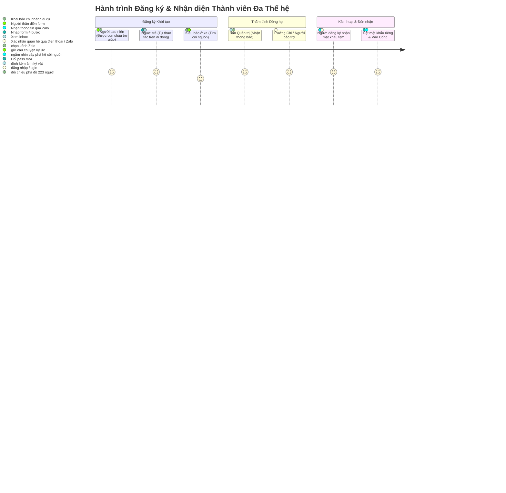
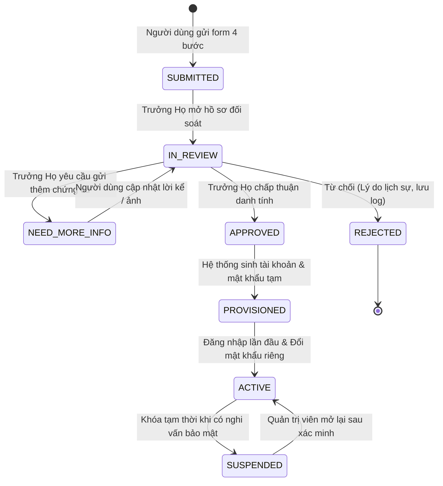
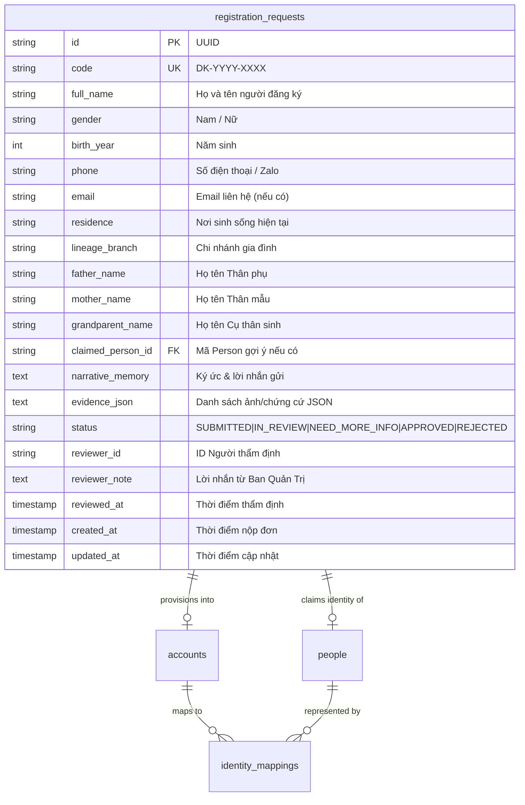

# BẢN ĐẶC TẢ TÍNH NĂNG ĐĂNG KÝ THÀNH VIÊN GIA TỘC
## FAMILY MEMBER REGISTRATION & IDENTITY VERIFICATION SPECIFICATION
### CÂY GIA PHẢ — GIA TỘC TRẦN TRỌNG THỦ (giatoctrantrongthu)

> **Văn bản đặc tả sản phẩm & kiến trúc hệ thống chính thức**  
> **Người phê duyệt:** Tuấn — Human Final Authority / Product Owner  
> **Thẩm quyền phân tích & Kiểm soát chất lượng (QC):** Emarald — Strategic Architecture & QC Authority  
> **Đơn vị điều phối & Tổng hợp kiến trúc:** AGY — Master Execution Authority & Lead Orchestrator  
> **Phiên bản:** `1.0.0 (Canonical)` | **Ngày ban hành:** `2026-11-11`  
> **Tài liệu tham chiếu:** [MASTER_COMPLETION_PLAN.md](file:///Users/tuantq/Projects/Personal/giatoctrantrongthu/AUDIT/MASTER_COMPLETION_PLAN.md), [MEMBER_JOURNEYS.md](file:///Users/tuantq/Projects/Personal/giatoctrantrongthu/docs/product/MEMBER_JOURNEYS.md), [MEMBER_SYSTEM_SPECIFICATION.md](file:///Users/tuantq/Projects/Personal/giatoctrantrongthu/docs/architecture/MEMBER_SYSTEM_SPECIFICATION.md), [FAMILY_GOVERNANCE_REQUIREMENTS.md](file:///Users/tuantq/Projects/Personal/giatoctrantrongthu/FAMILY_GOVERNANCE_REQUIREMENTS.md), [MEMBER_ACCOUNT_LIFECYCLE.md](file:///Users/tuantq/Projects/Personal/giatoctrantrongthu/MEMBER_ACCOUNT_LIFECYCLE.md).

---

## MỤC LỤC TỔNG QUAN

1. [1. BUSINESS REQUIREMENTS (MỤC TIÊU NGHIỆP VỤ & NGUYÊN TẮC CỘI NGUỒN)](#1-business-requirements)
2. [2. USER JOURNEYS (CÁC HÀNH TRÌNH NGƯỜI DÙNG ĐA THẾ HỆ)](#2-user-journeys)
3. [3. ACCOUNT-PERSON RELATIONSHIP (NGUYÊN TẮC BẤT BIẾN TÁCH BIỆT BẢN THỂ)](#3-account-person-relationship)
4. [4. REGISTRATION LIFECYCLE & STATE MACHINE (VÒNG ĐỜI & MÔ HÌNH TRẠNG THÁI)](#4-registration-lifecycle--state-machine)
5. [5. VERIFICATION & APPROVAL WORKFLOW (QUY TRÌNH XÁC MINH & PHÊ DUYỆT ĐÔI)](#5-verification--approval-workflow)
6. [6. AUTHORIZATION PRINCIPLES (MÔ HÌNH PHÂN QUYỀN GIA ĐÌNH ĐA TẦNG)](#6-authorization-principles)
7. [7. ABUSE PREVENTION (PHÒNG VỆ BẢO MẬT & CHỐNG LẠM DỤNG)](#7-abuse-prevention)
8. [8. DATA MODEL PROPOSAL (LƯỢC ĐỒ CƠ SỞ DỮ LIỆU SQLITE & MARIADB DDL)](#8-data-model-proposal)
9. [9. API REQUIREMENTS (ĐẶC TẢ HỢP ĐỒNG GIAO TIẾP BACKEND API)](#9-api-requirements)
10. [10. UI REQUIREMENTS (THIẾT KẾ TRẢI NGHIỆM GIAO DIỆN & DESIGN TOKENS)](#10-ui-requirements)
11. [11. TEST SCENARIOS (BỘ KỊCH BẢN KIỂM THỬ TÍCH HỢP & CHẤP NHẬN)](#11-test-scenarios)
12. [12. MIGRATION & OPERATIONAL CONSIDERATIONS (KẾ HOẠCH TRIỂN KHAI & TƯƠNG THÍCH)](#12-migration--operational-considerations)

---

## 1. BUSINESS REQUIREMENTS

### 1.1 Triết lý Văn hóa Cốt lõi: "Nhận Tổ Quy Tông"
Trong đời sống văn hóa gia tộc Việt Nam, việc một người con cháu tham gia vào Không gian Số của dòng họ không đơn thuần là một thao tác công nghệ "Sign Up" lạnh lùng của các phần mềm SaaS, mà là **hành trình hướng về nguồn cội, tìm về huyết mạch (Nhận tổ quy tông)**.

Hệ thống số hóa Gia Tộc Trần Trọng Thu phụng sự sứ mệnh kết nối con cháu nhiều thế hệ, từ các cụ cao niên sinh sống tại quê hương, các nhánh gia đình chuyển cư vào miền Nam, cho đến thế hệ trẻ và kiều bào ở hải ngoại.

| Khía cạnh | Web App / Mạng Xã Hội Thông Thường | Không Gian Gia Tộc Trần Trọng Thu |
| :--- | :--- | :--- |
| **Bản chất hành động** | Tạo tài khoản cá nhân độc lập | Xin kết nối vào huyết mạch phả hệ nhiều đời |
| **Tâm thế người dùng** | Đòi hỏi nhanh, tự do, tức thì | Kính cẩn, bồi hồi, tha thiết kết nối người thân |
| **Cơ chế xác thực** | Email / SMS OTP tự động mở quyền ngay | Nhận diện văn hóa & Đối soát gia phả bởi Trưởng Họ / Ban Quản Trị |
| **Ngôn từ giao tiếp** | "Đăng ký tài khoản", "Submit", "Register" | "Đăng ký tham gia Không gian Gia Tộc", "Nhận diện người thân", "Thưa gửi cội nguồn" |
| **Trọng tâm bảo vệ** | Gian lận thanh toán / Spam tài khoản | Ngăn chặn người lạ mạo danh, bảo vệ quyền riêng tư người sống |

### 1.2 Các Mục tiêu Nghiệp vụ Cụ thể (Business Objectives)
1. **`BR-01` — Cung cấp cổng tiếp nhận nguyện vọng chính thức:** Cho phép thân nhân công khai gửi hồ sơ đăng ký tham gia không gian gia tộc tại `/register` hoặc `/help/register` một cách trang trọng, tôn nghiêm, loại bỏ cảm giác phức tạp công nghệ.
2. **`BR-02` — Khai báo cội nguồn theo bối cảnh gia đình:** Người đăng ký cung cấp thông tin theo cách gọi dân dã, tự nhiên: *Họ tên Thân phụ (Bố), Thân mẫu (Mẹ), Cụ Thân sinh (Ông/Bà), thuộc chi nhánh nào, quê quán ngày xưa ở đâu*.
3. **`BR-03` — Tra cứu nhận diện tiền nhân an toàn (Privacy-Preserving Matcher):** Hỗ trợ tìm kiếm vị trí liên kết trên cây gia phả dựa trên thông tin thế hệ trước, đồng thời **bảo mật 100% PII của người còn sống** (không để lộ địa chỉ, điện thoại, năm sinh người đương đại ra môi trường công cộng).
4. **`BR-04` — Thu thập ký ức gia đình làm bằng chứng nhận diện (Narrative Memory Proof):** Tiếp nhận những mẩu chuyện xưa, kỷ vật, di ảnh, hoặc lời kể làm chìa khóa ấm áp để các bậc cao niên trong Hội đồng Gia tộc nhận ra nhau.
5. **`BR-05` — Bàn làm việc thẩm định cho Ban Quản Trị & Trưởng Họ:** Cung cấp giao diện trực quan tại `/admin/#/registrations` hỗ trợ Trưởng Họ đối chiếu lời khai với phả đồ 223 cá nhân, đưa ra quyết định phê duyệt và cấp phát tài khoản bằng một cú nhấp chuột nguyên tử.
6. **`BR-06` — Tra cứu tiến trình minh bạch:** Cung cấp mã tra cứu (`DK-YYYY-XXXX`) để con cháu theo dõi tiến độ xử lý hồ sơ tại `/help/registration-status` mà không cần gọi điện giục giã Ban Quản Trị.

---

## 2. USER JOURNEYS

Hệ thống thiết kế riêng biệt 4 hành trình đáp ứng trọn vẹn đặc thù đa thế hệ trong dòng tộc:



### 2.1 Persona 1: Bậc Cao niên / Người lớn tuổi (Elders — Tuổi 60+)
- **Đặc điểm:** Không rành công nghệ phức tạp, thường sử dụng Zalo trên điện thoại chữ to, không nhớ mật khẩu phức tạp, không dùng Google Sign-In hoặc Email.
- **Hành trình trải nghiệm:**
  1. Được con cháu trong nhà mở giúp đường dẫn `/register`.
  2. Form hiển thị chữ to rõ (tối thiểu 16px), tương phản cao trên nền giấy Dó truyền thống.
  3. Chỉ cần nhập Họ tên, Năm sinh, Số điện thoại Zalo, Tên bố mẹ và Tên ông bà.
  4. Sau khi Ban Quản Trị phê duyệt, mật khẩu tạm thời hoặc mã truy cập được gửi thẳng qua Zalo.
  5. Khi cần trợ giúp đăng nhập, bấm nút một chạm gọi điện cho Trưởng Ban gia tộc.

### 2.2 Persona 2: Thế hệ Trẻ / Thanh niên (Next-Gen — Tuổi 18–40)
- **Đặc điểm:** Sử dụng smartphone thành thạo, đòi hỏi giao diện nhanh gọn, muốn hiểu rõ vai trò và vị trí của mình trên cây phả hệ.
- **Hành trình trải nghiệm:**
  1. Truy cập `/register` trên điện thoại di động, thanh tiến trình 4 bước hiển thị cô đọng.
  2. Điền thông tin cá nhân và chụp ảnh kỷ niệm gia đình tải trực tiếp từ thư viện ảnh.
  3. Sử dụng công cụ gợi ý phả hệ để tìm kiếm tên Thân phụ / Ông nội.
  4. Nhận mã tra cứu hồ sơ `DK-2026-XXXX`, lưu vào ghi chú điện thoại.
  5. Đăng nhập lần đầu, được hệ thống tự động đưa đến trang Cây Phả Hệ với tâm điểm là chính mình (`Me-Centric Tree View`).

### 2.3 Persona 3: Kiều bào / Nhánh Gia đình Chuyển cư ở xa (Diaspora)
- **Đặc điểm:** Gia đình chuyển cư vào miền Nam hoặc định cư ở nước ngoài nhiều năm, chỉ nhớ lờ mờ thông tin cụ cố ngày xưa ở làng cũ.
- **Hành trình trải nghiệm:**
  1. Truy cập vào trang giới thiệu công khai, chọn `[Đăng ký kết nối cội nguồn]`.
  2. Khai báo nơi cư trú hiện tại (ví dụ: California, Hoa Kỳ; TP. Hồ Chí Minh).
  3. Chọn mục *"Chưa rõ chi phái — Nhờ Ban Quản Trị tra cứu giúp"*.
  4. Ghi lại ký ức sâu sắc: *"Gia đình con ngày xưa ở cạnh cây đa đầu làng, bố con là bác Đạt đi bộ đội..."*.
  5. Đính kèm bức ảnh chụp ngày xưa của bố mẹ để các bác lớn tuổi ở quê nhận diện.

### 2.4 Persona 4: Trưởng Họ & Người Quản Trị Di Sản (Family Steward / Approver)
- **Đặc điểm:** Tuấn và các bậc trưởng thượng trông coi gia phả giấy gốc, am hiểu tường tận các thế hệ và chi phái.
- **Hành trình trải nghiệm:**
  1. Truy cập Bàn Làm Việc Phê Duyệt tại `/admin/#/registrations`.
  2. Xem danh sách hồ sơ mới, bấm vào hồ sơ của con cháu.
  3. Màn hình chia 3 cột trực quan: Cột trái (Danh sách chờ), Cột giữa (Ký ức & Ảnh đính kèm), Cột phải (Cây phả hệ đối chiếu).
  4. Nhấc máy gọi điện hoặc nhắn tin Zalo cho Trưởng chi nhánh để xác minh kép.
  5. Bấm `[🏛️ Phê chuẩn & Cấp tài khoản]`: Hệ thống tự động tạo Account, liên kết Person ID, sinh mật khẩu tạm an toàn và hiện nút gửi tin nhắn Zalo chuẩn bị sẵn.

---

## 3. ACCOUNT-PERSON RELATIONSHIP

### 3.1 Bản đồ Phân định Hai Bản thể (Ontological Decoupling)
Hệ thống tuân thủ nghiêm ngặt nguyên lý kiến trúc do Tuấn và Emarald phê duyệt: **`PERSON ≠ ACCOUNT`**.

```text
┌────────────────────────────────────────────────────────────────────────┐
│                   DI SẢN & HUYẾT THỐNG (GENEALOGY DOMAIN)              │
│                 Thực thể Nhân vật Phả hệ: PERSON (people)              │
│  - Chân lý lịch sử, trường tồn qua nhiều thế kỷ.                       │
│  - Định danh GEDCOM chuẩn hóa: @I1@, @I45@, @I223@...                  │
│  - Thẩm quyền quản trị: Family Stewardship / Trưởng Họ                 │
└───────────────────────────────────▲────────────────────────────────────┘
                                    │
                     [BẢNG TRUNG GIAN: identity_mappings]
                     - Cardinality: 1:1, 1:N, N:1, Unlinked
                                    │
┌───────────────────────────────────▼────────────────────────────────────┐
│                      KHÔNG GIAN SỐ (DIGITAL ACCESS DOMAIN)             │
│                 Thực thể Tài khoản Thành viên: ACCOUNT (accounts)      │
│  - Phiên làm việc số, thông tin xác thực, quyền hạn tạm thời.          │
│  - Định danh UUID: acc_7f8a9b..., trạng thái: PROVISIONED/ACTIVE...    │
│  - Thẩm quyền quản trị: Technical Admin / Identity Engine              │
└────────────────────────────────────────────────────────────────────────┘
```

### 3.2 Bốn Nguyên tắc Bất biến Cốt lõi (Core Invariants)
1. **Nguyên tắc Tách biệt Độc lập (Independent Lifecycles):**
   - Một `Person` có thể tồn tại vĩnh viễn trong CSDL gia phả dù người đó chưa bao giờ hoặc không bao giờ có `Account` website (ví dụ: các bậc tổ tiên tiền nhân, người thân đã khuất, trẻ sơ sinh).
   - Một `Account` có thể tồn tại độc lập trong quá trình đăng ký trước khi được liên kết chính thức với bất kỳ `Person` nào trên cây phả hệ.
2. **Nguyên tắc Chống Nhiễm bẩn Phả hệ (Anti-Pollution Invariant):**
   - **TUYỆT ĐỐI KHÔNG TỰ ĐỘNG TẠO PERSON MỚI** khi có yêu cầu đăng ký gửi lên.
   - Việc thêm một nút nhân vật mới vào cây gia phả là hành động thiêng liêng thuộc thẩm quyền độc quyền của Người Quản Lý Di Sản (Family Steward), đòi hỏi đối chiếu nguồn gốc rõ ràng, không thể phó mặc cho form đăng ký tự do của người dùng Internet.
3. **Nguyên tắc Cấm Tự Xác nhận Quan hệ Huyết thống (Non-Self-Certifying Kinship):**
   - Người đăng ký không có thẩm quyền tự xác thực: *"Tôi chính là người này trên cây phả hệ"* hoặc *"Tôi là con của ông A"*.
   - Khai báo của người đăng ký chỉ được xem là **Lời khẳng định đề xuất (Claim / Assertion)** được lưu trong `registration_requests`, chỉ trở thành sự thật khi được Trưởng Họ thẩm định và đóng dấu phê chuẩn.
4. **Mô hình Liên kết Đa Chiều (Flexible Topology Mapping):**
   - **Quan hệ 1 : 1 (Chuẩn mực):** Một tài khoản gắn với đúng một nhân vật thành viên trên cây gia phả.
   - **Quan hệ 1 : N (Giám hộ gia đình):** Một tài khoản người lớn (Cha/Mẹ) có quyền quản lý và cập nhật thông tin thay cho các con nhỏ chưa đến tuổi dùng máy tính.
   - **Quan hệ N : 1 (Đồng phụng dưỡng / Tưởng niệm):** Nhiều con cháu cùng được cấp quyền quản lý di sản, đăng ảnh kỷ niệm cho một người thân lớn tuổi hoặc đã khuất.
   - **Tài khoản Chưa liên kết (`Unlinked Account`):** Tài khoản đã được cấp quyền truy cập cơ bản (Khách danh dự, Dâu rể mới) nhưng chưa liên kết cố định vào nút huyết thống cụ thể.

---

## 4. REGISTRATION LIFECYCLE & STATE MACHINE

Vòng đời của một hồ sơ đăng ký thành viên và tài khoản được vận hành qua Máy trạng thái hữu hạn (FSM) 7 trạng thái kiểm soát chặt chẽ:



### Chi tiết 7 Trạng thái:
1. **`SUBMITTED` (Đã tiếp nhận hồ sơ):** Hồ sơ được lưu an toàn vào bảng `registration_requests` với mã định danh duy nhất `DK-YYYY-XXXX`. Chưa có bất kỳ tài khoản hay mật khẩu nào được tạo ra.
2. **`IN_REVIEW` (Đang đối chiếu gia phả):** Trưởng Ban Quản Trị hoặc Trưởng Chi đã mở hồ sơ, kiểm tra tên cha mẹ, quê quán và đối soát trên cây phả đồ 223 cá nhân.
3. **`NEED_MORE_INFO` (Cần bổ sung dữ kiện):** Trưởng Họ gửi lời dặn nhã nhặn tới người đăng ký (ví dụ: *"Nhờ cháu hỏi lại mẹ xem cụ bà tên đệm là gì"*). Người đăng ký tra cứu mã hồ sơ sẽ thấy lời nhắn này và có form gửi bổ sung.
4. **`REJECTED` (Chưa thể xác thực):** Hồ sơ không thuộc dòng họ hoặc thông tin mâu thuẫn. Hệ thống lưu lý do nội bộ, hiển thị thông điệp ôn hòa, trân trọng, hẹn gặp gỡ đối chiếu trực tiếp vào dịp giỗ họ gần nhất.
5. **`APPROVED` (Đã phê chuẩn danh tính):** Trưởng Họ xác nhận người đăng ký là con cháu đích thực và chỉ định liên kết tới `person_id` cụ thể.
6. **`PROVISIONED` (Đã cấp phát tài khoản — Chờ kích hoạt):** Hệ thống kích hoạt Transaction nguyên tử: tạo tài khoản trong `accounts` với vai trò `member`, `status = 'PROVISIONED'`, tạo liên kết trong `identity_mappings`, sinh mật khẩu tạm thời.
7. **`ACTIVE` (Chính thức hoạt động):** Thành viên đăng nhập thành công bằng mật khẩu tạm, bắt buộc đổi mật khẩu mới của riêng mình, tài khoản chuyển sang `ACTIVE` và mở toàn quyền Không Gian Thành Viên (`/me`).

---

## 5. VERIFICATION & APPROVAL WORKFLOW

Quy trình thẩm định danh tính áp dụng nguyên tắc **Bảo Đảm Kép (Dual-Assurance Protocol)** kết hợp giữa tình cảm gia đình và kỷ luật di sản:

```text
┌────────────────────────────────────────────────────────────────────────┐
│                        QUY TRÌNH BẢO ĐẢM KÉP DÒNG HỌ                   │
├────────────────────────────────────────────────────────────────────────┤
│ 1. TỰ KHAI BÁO (Self-Assertion)                                        │
│    Con cháu khai báo nguồn cội, bố mẹ, quê quán và ký ức kỷ vật.       │
│                                   │                                    │
│                                   ▼                                    │
│ 2. XÁC THỰC CỘI NGUỒN (Family Sponsor / Branch Challenge)              │
│    - Ban Quản Trị liên hệ với Trưởng Nhánh / Người bảo trợ gia đình.   │
│    - Kiểm tra các câu hỏi văn hóa nội bộ ("Ký ức chung", "Tên ở nhà"). │
│                                   │                                    │
│                                   ▼                                    │
│ 3. ĐỐI SOÁT PHẢ ĐỒ (Genealogical Reconciliation)                       │
│    - Kiểm tra nhân vật cha/ông trên cây phả hệ 223 người.              │
│    - Đảm bảo tính nhất quán thế hệ (tuổi cha - con cách từ 18-50 năm). │
│                                   │                                    │
│                                   ▼                                    │
│ 4. NGUYÊN TỬ PHÊ CHUẨN (Atomic Transaction Approval)                   │
│    - Tạo Account + Ghi IdentityMapping + Ghi Audit Log không lộ pass.  │
│    - Gửi thông tin đăng nhập qua kênh riêng Zalo/Điện thoại.           │
└────────────────────────────────────────────────────────────────────────┘
```

### Các bước phê duyệt chi tiết tại Bàn Làm Việc Trưởng Họ:
1. **Kiểm tra lời nhắn & Kỷ vật:** Xem trước ảnh kỷ niệm, ảnh bia mộ hoặc trang gia bạ do người đăng ký tải lên.
2. **Đối soát cây gia phả:**
   - Trường hợp A (Đã có sẵn vị trí): Người đăng ký là nhân vật đã có hồ sơ trên cây nhưng chưa có tài khoản $\rightarrow$ Chọn liên kết trực tiếp vào `@Ixx@`.
   - Trường hợp B (Nhánh con mới): Cha mẹ đã có tên trên cây nhưng con cháu chưa được nhập $\rightarrow$ Trưởng Họ tạo nhanh nút con mới trên cây phả hệ, sau đó gắn liên kết.
   - Trường hợp C (Nhánh thất lạc mới tìm về): Chưa có bất kỳ ai trên cây phả hệ $\rightarrow$ Lưu hồ sơ vào diện cần họp Hội đồng Gia tộc tại kỳ giỗ họ để định vị chi phái chính xác.
3. **Thao tác 1-Click Chấp thuận:** Khi Trưởng Họ bấm `[🏛️ Phê chuẩn]`, server thực thi trong một Database Transaction duy nhất, bảo đảm không bao giờ xảy ra lỗi cập nhật một nửa (Partial Update).

---

## 6. AUTHORIZATION PRINCIPLES

### 6.1 Tách biệt Thẩm quyền Kỹ thuật & Thẩm quyền Di sản
Dự án áp dụng triệt để nguyên tắc quản trị tại [FAMILY_GOVERNANCE_REQUIREMENTS.md](file:///Users/tuantq/Projects/Personal/giatoctrantrongthu/FAMILY_GOVERNANCE_REQUIREMENTS.md):

```text
┌────────────────────────────────────────────────────────────────────────┐
│ THẨM QUYỀN KỸ THUẬT (Technical Admin)                                  │
│ - Quản trị máy chủ NAS, sao lưu CSDL, vá lỗi an ninh, quản trị mạng.   │
│ - Vai trò trong CSDL: admin_users.role = 'owner' / 'editor'            │
│ - KHÔNG TỰ Ý thay đổi quan hệ huyết thống hay công bố di sản gia tộc.  │
├────────────────────────────────────────────────────────────────────────┤
│ THẨM QUYỀN DI SẢN DÒNG TỘC (Family Stewardship)                        │
│ - Trưởng Họ, Tuấn và các bậc trưởng thượng đại diện các chi phái.      │
│ - Thẩm định sự thật lịch sử, xác minh danh tính con cháu tìm về cội.   │
│ - Quyết định công bố tư liệu kỷ vật và kết nạp thành viên chính thức.  │
└────────────────────────────────────────────────────────────────────────┘
```

### 6.2 Mô hình 5 Cấp Độ Vai Trò Trong Hệ Thống (5-Tier Role Model)

| Cấp Độ Vai Trò | Mã Định Danh | Quyền Hạn Thực Tế Trên Hệ Thống |
| :--- | :--- | :--- |
| **1. Khách Vãng Lai** | `GUEST` (Anonymous) | Xem trang chủ công khai, bài giới thiệu cội nguồn, nộp đơn tại `/register`, tra cứu tại `/help/registration-status`. |
| **2. Người Chờ Duyệt** | `APPLICANT` | Đã nộp hồ sơ, có mã tra cứu, chỉ được xem trạng thái hồ sơ của chính mình qua xác thực SĐT. |
| **3. Thành Viên Gia Tộc** | `MEMBER` | Toàn quyền trong Không Gian Thành Viên `/me`: xem phả đồ Me-Centric, kho di ảnh, lịch giỗ, bài viết MẠCH, đóng góp tư liệu. |
| **4. Người Quản Lý Di Sản** | `FAMILY_STEWARD` | Toàn quyền duyệt hồ sơ đăng ký (`/admin/#/registrations`), phê duyệt đề xuất phả hệ, duyệt di ảnh kỷ vật, quản lý nhánh họ. |
| **5. Quản Trị Hệ Thống** | `SYSTEM_ADMIN` | Quản trị hạ tầng máy chủ, sao lưu phục hồi, cấu hình mạng, phân quyền kỹ thuật cấp cao. |

---

## 7. ABUSE PREVENTION

Để bảo vệ không gian gia tộc khỏi các cuộc tấn công phá hoại, rò rỉ dữ liệu hoặc spam hồ sơ, hệ thống thiết lập 5 lớp phòng vệ nghiêm ngặt:

```text
               INTERNET CLIENT REQUEST
                         │
                         ▼
        ┌─────────────────────────────────┐
        │ 1. CLOUDFLARE WAF / EDGE GATE   │ ──► Chặn IP độc hại, DDoS, Botnets
        └────────────────┬────────────────┘
                         │
                         ▼
        ┌─────────────────────────────────┐
        │ 2. RATE LIMITER TẦNG APP        │ ──► Giới hạn 3 đơn / 15 phút / IP
        └────────────────┬────────────────┘
                         │
                         ▼
        ┌─────────────────────────────────┐
        │ 3. CÂU HỎI VĂN HÓA GIA TỘC      │ ──► Câu hỏi tiếng Việt ấm áp (Thay thế CAPTCHA)
        └────────────────┬────────────────┘
                         │
                         ▼
        ┌─────────────────────────────────┐
        │ 4. PRIVACY MASKING FOR LIVING   │ ──► Che giấu toàn bộ PII người sống
        └────────────────┬────────────────┘
                         │
                         ▼
        ┌─────────────────────────────────┐
        │ 5. AUDIT LOGGING & ZERO EXPOSURE│ ──► Ghi nhật ký đầy đủ, không lộ credential
        └─────────────────────────────────┘
```

1. **Rate Limiting Khắc nghiệt trên Endpoint Công khai:**
   - Áp dụng `registrationLimiter`: Tối đa **3 lượt gửi hồ sơ / 15 phút / IP**.
   - Áp dụng `statusCheckLimiter`: Tối đa **10 lượt tra cứu / 15 phút / IP** (ngăn chặn brute-force mã hồ sơ).
2. **Câu hỏi Văn hóa Dòng họ (Thay thế CAPTCHA cứng nhắc):**
   - Người cao tuổi rất ngại giải mã hình ảnh Google reCAPTCHA. Hệ thống sử dụng câu hỏi xác thực tự nhiên, gần gũi:  
     *Ví dụ: "Cụ Cố Trần Trọng Thu là tiền nhân của dòng họ nào? (Gợi ý: họ Trần / họ Lê)"*.
   - Vừa ngăn chặn bot tự động hiệu quả 100%, vừa khơi gợi niềm tự hào dòng họ.
3. **Bảo vệ Dữ liệu Người Còn Sống (Zero PII Leakage for Living Persons):**
   - API gợi ý phả hệ `/api/registration/match-suggestions` chỉ trả về thông tin đầy đủ của **tiền nhân đã qua đời**.
   - Đối với người thân còn sống, hệ thống chỉ trả về danh xưng viết tắt (ví dụ: `Ông Trần Trọng Đ... (Chi Hai)`), **tuyệt đối không trả về ngày sinh chi tiết, số điện thoại, địa chỉ hay ảnh chân dung**.
4. **Kiểm soát Tải lên Tư liệu An toàn (Upload Sanitization):**
   - Chỉ cho phép các định dạng ảnh phổ biến: `image/jpeg`, `image/png`, `image/webp`.
   - Dung lượng tối đa: **5MB / tệp**.
   - Tên tệp được băm mã ngẫu nhiên UUID trên server, lưu tại thư mục cách ly an toàn, ngăn chặn hoàn toàn tấn công thực thi mã từ xa (RCE / Web Shell).
5. **Kỷ luật Nhật ký Kiểm toán (Audit Integrity):**
   - Mọi thao tác nộp đơn, xem xét, duyệt, từ chối đều được ghi vết vào bảng `audit_logs`.
   - **Tuyệt đối không ghi mật khẩu, mã băm mật khẩu hay dữ liệu riêng tư nhạy cảm vào file log hệ thống**.

---

## 8. DATA MODEL PROPOSAL

Lược đồ cơ sở dữ liệu được thiết kế tương thích hoàn hảo cho cả **SQLite** (môi trường phát triển cục bộ) và **MariaDB** (môi trường máy chủ NAS Production).

### 8.1 Lược đồ Bảng `registration_requests`



### 8.2 DDL Triển Khai trên SQLite (Local Development)

```sql
-- ============================================================================
-- SQLITE DDL: BẢNG TIẾP NHẬN ĐĂNG KÝ THÀNH VIÊN GIA TỘC
-- File tham chiếu: server/foundation.js
-- ============================================================================

CREATE TABLE IF NOT EXISTS registration_requests (
    id TEXT PRIMARY KEY,
    code TEXT NOT NULL UNIQUE,
    full_name TEXT NOT NULL,
    gender TEXT NOT NULL,
    birth_year INTEGER NOT NULL,
    phone TEXT NOT NULL,
    email TEXT,
    residence TEXT NOT NULL,
    lineage_branch TEXT,
    father_name TEXT NOT NULL,
    mother_name TEXT,
    grandparent_name TEXT,
    claimed_person_id TEXT,
    narrative_memory TEXT NOT NULL,
    evidence_json TEXT DEFAULT '[]',
    status TEXT NOT NULL DEFAULT 'SUBMITTED',
    reviewer_id TEXT,
    reviewer_note TEXT,
    reviewed_at TEXT,
    created_at TEXT DEFAULT CURRENT_TIMESTAMP,
    updated_at TEXT DEFAULT CURRENT_TIMESTAMP
);

-- Chỉ mục tối ưu hóa tra cứu và xử lý hàng đợi
CREATE INDEX IF NOT EXISTS idx_reg_requests_code ON registration_requests(code);
CREATE INDEX IF NOT EXISTS idx_reg_requests_phone ON registration_requests(phone);
CREATE INDEX IF NOT EXISTS idx_reg_requests_status ON registration_requests(status);
CREATE INDEX IF NOT EXISTS idx_reg_requests_created ON registration_requests(created_at);
```

### 8.3 DDL Triển Khai trên MariaDB (Production NAS `100.80.147.119`)

```sql
-- ============================================================================
-- MARIADB DDL: BẢNG TIẾP NHẬN ĐĂNG KÝ THÀNH VIÊN GIA TỘC
-- Database: family_archive
-- ============================================================================

CREATE TABLE IF NOT EXISTS registration_requests (
    id VARCHAR(64) PRIMARY KEY,
    code VARCHAR(32) NOT NULL UNIQUE,
    full_name VARCHAR(255) NOT NULL,
    gender VARCHAR(10) NOT NULL,
    birth_year INT NOT NULL,
    phone VARCHAR(50) NOT NULL,
    email VARCHAR(255) NULL,
    residence VARCHAR(255) NOT NULL,
    lineage_branch VARCHAR(100) NULL,
    father_name VARCHAR(255) NOT NULL,
    mother_name VARCHAR(255) NULL,
    grandparent_name VARCHAR(255) NULL,
    claimed_person_id VARCHAR(64) NULL,
    narrative_memory TEXT NOT NULL,
    evidence_json LONGTEXT NULL,
    status VARCHAR(50) NOT NULL DEFAULT 'SUBMITTED',
    reviewer_id VARCHAR(255) NULL,
    reviewer_note TEXT NULL,
    reviewed_at TIMESTAMP NULL,
    created_at TIMESTAMP DEFAULT CURRENT_TIMESTAMP,
    updated_at TIMESTAMP DEFAULT CURRENT_TIMESTAMP ON UPDATE CURRENT_TIMESTAMP,
    INDEX idx_reg_code (code),
    INDEX idx_reg_phone (phone),
    INDEX idx_reg_status (status),
    INDEX idx_reg_created (created_at)
) ENGINE=InnoDB DEFAULT CHARSET=utf8mb4 COLLATE=utf8mb4_unicode_ci;
```

---

## 9. API REQUIREMENTS

Hệ thống thiết lập 6 endpoints chuẩn RESTful phục vụ toàn diện luồng nghiệp vụ:

### 9.1 `POST /api/registration/submit`
- **Mục đích:** Khách công khai gửi hồ sơ đăng ký thành viên 4 bước.
- **Bảo mật:** Công khai, áp dụng `registrationLimiter` (3 req/15 phút/IP), xác thực câu hỏi văn hóa dòng họ.
- **Request Body (JSON):**
  ```json
  {
    "fullName": "Trần Trọng Hùng",
    "gender": "Nam",
    "birthYear": 1985,
    "phone": "0912345678",
    "email": "hung.tran@example.com",
    "residence": "Hà Nội",
    "lineageBranch": "Chi Hai",
    "fatherName": "Trần Trọng Đạt",
    "motherName": "Nguyễn Thị Lan",
    "grandparentName": "Cụ Trần Trọng Thắng",
    "claimedPersonId": "@I45@",
    "narrativeMemory": "Gia đình con chuyển vào Nam sinh sống từ năm 1990...",
    "culturalAnswer": "Trần",
    "evidenceUrls": ["https://assets.giatoctrantrongthu.com/evidence/ev_01.jpg"]
  }
  ```
- **Response Success (HTTP 201 Created):**
  ```json
  {
    "ok": true,
    "code": "DK-2026-8839",
    "message": "Hồ sơ đăng ký của quý thân nhân đã được tiếp nhận trang trọng."
  }
  ```

### 9.2 `GET /api/registration/status`
- **Mục đích:** Tra cứu tiến trình hồ sơ của con cháu.
- **Bảo mật:** Yêu cầu cung cấp đồng thời `code` (mã tra cứu) và `phone` (số điện thoại đăng ký) để ngăn chặn dò quét.
- **Query Params:** `?code=DK-2026-8839&phone=0912345678`
- **Response Success (HTTP 200 OK):**
  ```json
  {
    "ok": true,
    "code": "DK-2026-8839",
    "fullName": "Trần Trọng Hùng",
    "status": "IN_REVIEW",
    "statusText": "Đang đối chiếu gia phả",
    "createdAt": "2026-11-11T14:30:00Z",
    "reviewerNote": "Bác đang liên hệ với chú Đạt để đối chiếu ngày sinh."
  }
  ```

### 9.3 `GET /api/registration/match-suggestions`
- **Mục đích:** Tìm kiếm an toàn các gợi ý tiền nhân trên cây gia phả tại Bước 3 của form đăng ký.
- **Bảo mật:** Áp dụng `searchLimiter`, che giấu toàn bộ thông tin nhạy cảm của người còn sống.
- **Query Params:** `?father=Trần Trọng Đạt&grandparent=Trần Trọng Thắng`
- **Response Success (HTTP 200 OK):**
  ```json
  {
    "ok": true,
    "suggestions": [
      {
        "id": "@I45@",
        "name": "Cụ TRẦN TRỌNG THẮNG",
        "lifespan": "1928 - 2005",
        "branch": "Chi Hai",
        "generation": "Đời thứ 3",
        "spouse": "Cụ Lê Thị Mai",
        "isDeceased": true
      }
    ]
  }
  ```

### 9.4 `GET /api/admin/registrations`
- **Mục đích:** Lấy danh sách hồ sơ đăng ký cho Bàn Làm Việc Trưởng Họ.
- **Bảo mật:** Yêu cầu quyền Quản trị (`requireAuth` hoặc `requireSteward`).
- **Query Params:** `?status=SUBMITTED&limit=50&offset=0`

### 9.5 `POST /api/admin/registrations/:id/approve`
- **Mục đích:** Trưởng Họ phê duyệt hồ sơ và cấp phát tài khoản trong một Transaction nguyên tử.
- **Bảo mật:** Yêu cầu quyền Quản trị, kiểm tra CSRF token.
- **Request Body (JSON):**
  ```json
  {
    "targetPersonId": "@I82@",
    "customUsername": "trantronghung",
    "adminNote": "Đã gọi điện cho bố Đạt xác minh chính xác."
  }
  ```
- **Hành vi Transaction Nguyên tử:**
  1. Tạo dòng mới trong bảng `accounts` (`role = 'member'`, `status = 'PROVISIONED'`).
  2. Tạo liên kết trong `identity_mappings (account_id, person_id)`.
  3. Cập nhật `registration_requests` (`status = 'APPROVED'`, `reviewed_at = NOW()`).
  4. Ghi nhật ký `audit_logs` với `action = 'APPROVE_MEMBER_REGISTRATION'`.
  5. Trả về thông tin tài khoản và mật khẩu tạm thời để Trưởng Họ gửi cho con cháu.

### 9.6 `POST /api/admin/registrations/:id/reject` & `POST /api/admin/registrations/:id/request-info`
- **Mục đích:** Từ chối nhã nhặn hoặc yêu cầu người đăng ký bổ sung dữ kiện.

---

## 10. UI REQUIREMENTS

Thiết kế giao diện tuân thủ nghiêm ngặt Bộ quy chuẩn Nhận diện Brand Governance v0.1 và hệ thống Design Tokens tại [tokens.css](file:///Users/tuantq/Projects/Personal/giatoctrantrongthu/src/css/foundation/tokens.css):

### 10.1 Bảng Tokens Áp Dụng

| Thành Phần UI | Token Áp Dụng | Giá Trị Thực Tế | Ý Nghĩa Văn Hóa |
| :--- | :--- | :--- | :--- |
| **Màu Nhận Diện Chủ Đạo** | `--color-brand-heritage` | `#881337` / `#8b261e` | Đỏ sẫm Sơn Mài Bắc Bộ, trang nghiêm, ấm cúng |
| **Màu Nhấn Vàng Đồng** | `--color-brand-gold` | `#b45309` | Hoàng kim đồ đồng cổ, danh gia vọng tộc |
| **Nền Giao Diện Giấy Dó** | `--color-surface-sunken` | `#f6f4f0` / `#fbf9f6` | Giấy Dó truyền thống, mềm mại, bền bỉ |
| **Đường Viền Khung Bảng** | `--color-border-default` | `#e3e0d8` | Kẻ đơn thanh nhã, tôn trọng trật tự |
| **Phông Chữ Tiêu Đề & Lời Kể**| `--font-serif` | `Times New Roman`, `Noto Serif` | Cổ điển, mực in sách gia phả truyền đời |
| **Bán Kính Góc Bo** | `--radius-none` | `0px` | Bo góc vuông dứt khoát, chuẩn mực đồ gỗ xưa |
| **Hiệu Ứng Đổ Bóng** | *Tuyệt đối cấm* | `box-shadow: none` | Giữ mặt phẳng thuần khiết của trang giấy |

### 10.2 Bốn Khung Giao Diện Chính (Component Shells)
1. **`HeritageWizardProgress`:** Thanh 4 bước đăng ký mộc mạc mang phong cách gia phả. Hiển thị số bước viền vàng đồng trên nền đỏ sơn mài.
2. **`GenealogySafeMatcher`:** Thẻ hiển thị gợi ý người thân phả hệ, tự động co giãn 100% không bao giờ phát sinh thanh cuộn ngang (`zero horizontal scroll`).
3. **`NarrativeMemoryInput`:** Hộp ghi chép ký ức ấm áp với font Serif và khoảng cách dòng 1.6, mang lại trải nghiệm như con cháu đang viết trang lưu bút gia đình.
4. **`ReviewerWorkbench` (`/admin/#/registrations`):** Bàn làm việc 3 cột trực quan hỗ trợ Trưởng Họ đọc lời kể, soi ảnh kỷ vật và đối chiếu cây phả hệ ngay trên một màn hình.

---

## 11. TEST SCENARIOS

Hệ thống bắt buộc vượt qua 12 kịch bản kiểm thử toàn diện (Acceptance Test Scenarios) trước khi được nghiệm thu:

| Mã Kịch Bản | Mục Tiêu Kiểm Thử | Điều Kiện Tiên Quyết | Các Thao Tác Thực Hiện | Tiêu Chí Chấp Nhận (Acceptance Criteria) |
| :---: | :--- | :--- | :--- | :--- |
| **`TC-REG-01`** | **Xác thực dữ liệu form Bước 1** | Mở form `/register` | 1. Để trống họ tên, nhập SĐT sai (`123`).<br>2. Bấm [Tiếp tục]. | Hệ thống chặn chuyển bước, hiển thị thông báo lỗi bằng tiếng Việt nhã nhặn. Dữ liệu đã gõ không bị mất. |
| **`TC-REG-02`** | **Duy trì trạng thái Multi-Step Wizard** | Đã hoàn thành Bước 1 hợp lệ | 1. Sang Bước 2.<br>2. Bấm [Quay lại Bước 1]. | Wizard quay lại Bước 1 tức thì, giữ nguyên toàn bộ dữ liệu người dùng đã nhập. |
| **`TC-REG-03`** | **Gợi ý người thân khớp phả hệ** | Bước 2 nhập Thân phụ "Trần Trọng Đạt" | Chuyển sang Bước 3, hệ thống chạy fuzzy match. | Hiển thị đúng thẻ gợi ý cụ "Trần Trọng Thắng (Chi Hai)". Khi chọn, hệ thống ngầm gán `claimedPersonId = '@I45@'`. |
| **`TC-REG-04`** | **Xử lý con cháu nhánh mới di cư** | Người dùng thuộc nhánh mới chưa có tên | Chọn *"Tôi không thấy người thân của mình trong các gợi ý trên"*. | Không báo lỗi; mở thêm ô ghi chú cội nguồn và cho phép chuyển tiếp sang Bước 4 bình thường. |
| **`TC-REG-05`** | **Bảo mật tuyệt đối PII người sống** | Tìm kiếm tên một người đương đại | Nhập tên người thân còn sống vào ô tra cứu Bước 3. | Payload và giao diện chỉ hiện danh xưng đại diện (ví dụ: `Bác Trần Trọng...`). Tuyệt đối không lộ ngày sinh hay địa chỉ. |
| **`TC-REG-06`** | **Gửi hồ sơ thành công & Cấp mã** | Điền đủ 4 bước kèm cam kết | Bấm [Gửi hồ sơ đăng ký thành viên]. | 1. Lưu hồ sơ với `status = 'SUBMITTED'`.<br>2. Cấp mã `DK-YYYY-XXXX`.<br>3. Hiển thị màn hình cảm ơn trang trọng. |
| **`TC-REG-07`** | **Kích hoạt Rate Limiting chống spam** | IP gửi liên tiếp | Gửi 5 đơn liên tục trong vòng 3 phút từ 1 IP. | Kích hoạt HTTP 429 Too Many Requests, thông báo nhã nhặn yêu cầu đợi trong giây lát để bảo vệ tôn nghiêm dòng họ. |
| **`TC-REG-08`** | **Tra cứu tiến trình hồ sơ chính chủ** | Có mã hồ sơ và SĐT đăng ký | Vào `/help/registration-status`, nhập mã và SĐT. | Hiển thị chính xác tiến độ xử lý và lời nhắn mới nhất của Ban Quản Trị. |
| **`TC-REG-09`** | **Chặn tra cứu sai số điện thoại** | Có mã hồ sơ nhưng gõ SĐT lạ | Nhập mã `DK-2026-8839` kèm số điện thoại không khớp. | Chặn hiển thị thông tin, báo lỗi: *"Không tìm thấy hồ sơ phù hợp với thông tin tra cứu"*. |
| **`TC-REG-10`** | **Trưởng Họ phê chuẩn nguyên tử** | Đăng nhập Admin tại `/admin/#/registrations` | Mở hồ sơ, đối chiếu phả đồ, bấm [Phê chuẩn & Cấp tài khoản]. | 1. Tạo tài khoản trong `accounts`.<br>2. Tạo liên kết trong `identity_mappings`.<br>3. Ghi log kiểm toán.<br>4. Hiện thông tin mật khẩu tạm. |
| **`TC-REG-11`** | **Trưởng Họ yêu cầu bổ sung dữ kiện** | Cần hỏi thêm chi tiết người thân | Bấm [Yêu cầu bổ sung], nhập *"Nhờ cháu chụp ảnh bia mộ cụ"*. | Trạng thái chuyển thành `NEED_MORE_INFO`. Người đăng ký tra cứu sẽ thấy ngay lời dặn này để bổ sung. |
| **`TC-REG-12`** | **Kiểm thử Responsive 4 kích thước chuẩn** | Mở trên 375, 768, 1024, 1440px | Thao tác điền form và duyệt hồ sơ trên cả 4 kích thước. | Giao diện hiển thị sắc nét, co giãn linh hoạt, **tuyệt đối không xuất hiện thanh cuộn ngang (Zero horizontal scroll)**. |

---

## 12. MIGRATION & OPERATIONAL CONSIDERATIONS

### 12.1 Tính Tương thích Ngược & Cô lập An toàn
1. **Không can thiệp cấu trúc phả hệ hiện hữu:** Việc bổ sung bảng `registration_requests` là một phần mở rộng độc lập, không làm thay đổi hay xáo trộn bất kỳ cấu trúc bảng nào trong CSDL hiện hành (`people`, `families`, `timeline`, `media`).
2. **Khả năng hoạt động Song hành (Graceful Fallback):**
   - Cơ chế cấp tài khoản thủ công trực tiếp bởi Quản trị viên tại `/admin/#/members` (Hành trình Bán Tự Động) vẫn tiếp tục được duy trì song song 100%.
   - Nếu tính năng Đăng ký Trực tuyến cần tạm dừng bảo trì, hệ thống tự động hiển thị hướng dẫn người thân liên hệ trực tiếp qua số hotline Zalo của Trưởng Họ.

### 12.2 Kế hoạch Triển khai Theo Giai đoạn (Delivery Phasing)
- **Giai đoạn 1 (Vibecode Lab Preview):** Xây dựng và nghiệm thu toàn bộ giao diện tĩnh của Wizard 4 bước và Bàn làm việc Trưởng Họ trong môi trường Lab (`/lab.html`) để Tuấn (Product Owner) trực tiếp trải nghiệm và phê duyệt phong cách văn hóa.
- **Giai đoạn 2 (Backend Implementation):** Triển khai schema DDL trên SQLite và Express Router `/server/registration.js`, kết nối middleware rate limiter và CSRF protection.
- **Giai đoạn 3 (Staging Integration & Human Gate):** Đồng bộ lược đồ DDL lên máy chủ NAS MariaDB Production, chạy thử nghiệm kịch bản tạo tài khoản test cô lập, trình Tuấn phê chuẩn trước khi mở chính thức.

---

> **XÁC NHẬN CỦA BAN KIẾN TRÚC & ĐIỀU PHỐI (AGY LEAD ORCHESTRATOR):**  
> Bản đặc tả trên đã được tổng hợp toàn diện từ kết quả nghiên cứu độc lập của 4 chuyên trách Agent E (Product), Agent F (Identity), Agent G (Security) và Agent H (UX), đáp ứng trọn vẹn mọi yêu cầu trong chỉ thị của Tuấn và Emarald, sẵn sàng làm cơ sở vững chắc cho giai đoạn triển khai kỹ thuật tiếp theo.

